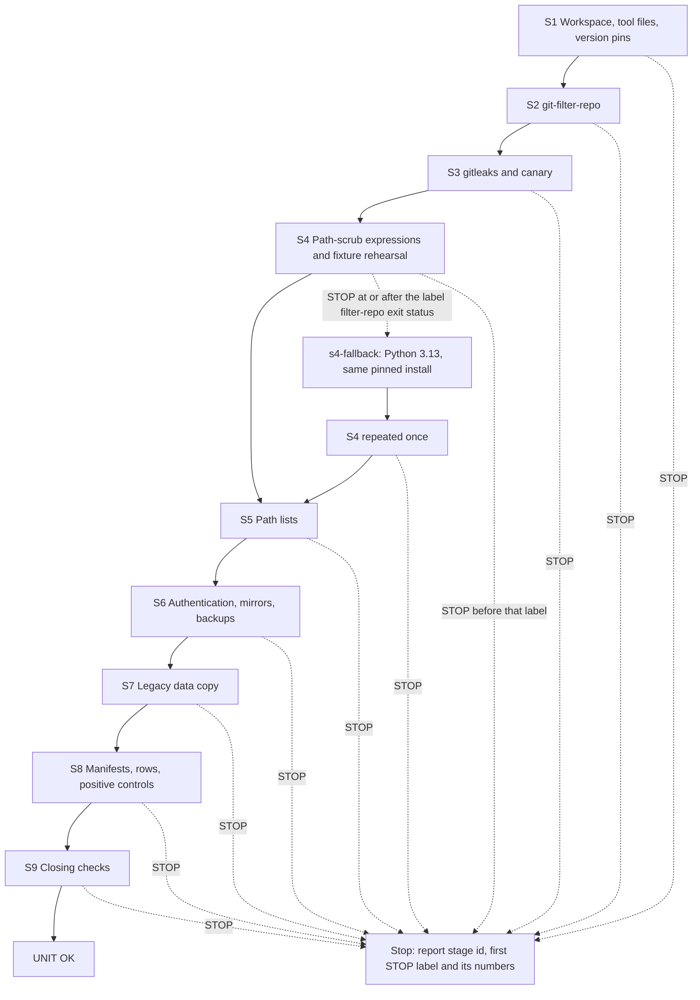

> **Superseded by [`../plan.md`](../plan.md).** The script blocks of Appendix A are identical in both;
> the later text is narrower about what each check asserts and what the landing carries.

# Phase 0 · 1 — Preparation: implementation plan

- **Covers:** [SpartanLaboratories/KotlinBottools#21](https://github.com/SpartanLaboratories/KotlinBottools/issues/21),
  *"Phase 0 · 1 — Preparation: pinned tools, workspace, backup mirrors, legacy data copy and manifests"*,
  a sub-issue of [#2](https://github.com/SpartanLaboratories/KotlinBottools/issues/2) (parent chain
  #21 → #2 → #1).
- **Architecture:** [`../architecture.md`](../architecture.md), unit `preparation` (§15, order 1),
  with §5 (workspace and records layout), §6.1 (toolchain), §6.2 (backups and manifests) and §6.3
  (legacy data copy). Its consequences are in [`../consequences.md`](../consequences.md); the
  tested procedures this plan draws on are the findings files under [`../research/`](../research/).
- **Branch:** `chore/issue-21-preparation`. This plan and the unit's own `consequences.md` (beside
  it in this folder) are committed on that branch in the same landing as the work they describe.
- **What this plans:** the machine-local preparation of Phase 0 — pinned and verified tools, the
  workspace and data folders, the six untouched backup mirrors, the legacy data copy and the
  manifests, expectation rows and positive controls of the five static repositories — as a literal
  procedure of nine stages that an implementer carries out without making a decision.
- **Status:** planning only.
- **Target version:** none (nothing is versioned; no product code, test source or build file
  changes).

This unit is operational. It installs tools, creates two folders, takes backup mirrors, copies
legacy data and proves each step, all on this machine. It writes nothing to GitHub except its own
documents, which land through the repository's version-control service.

---

## Requirements

**Goals**

1. **Folders.** The workspace `%USERPROFILE%\BotWS` (`WS`) and the data folder
   `%USERPROFILE%\BotLegacyData` (`DATA`, which outlives the phase) exist, each with its access
   checked: under the user profile, outside OneDrive, outside the project-checkouts folder, inside
   no repository, and with no `Everyone`, `Users` or `Authenticated Users` entry.
2. **Pinned tools.**
   - git is `2.55.0.windows.5`; the unit stops if it differs.
   - Python is 3.14.x (3.14.7 today); a different minor stops the unit.
   - gh is major version 2 (2.100.0 today). pip (26.2.1 today) and gh are recorded.
   - git-filter-repo 2.47.0 comes from PyPI into the Python user scheme, hash-pinned, and is verified
     by two independent values: the `git filter-repo --version` blob-id prefix `a40bce548d2c` and the
     installed module's sha256, each equal to the upstream tag's script.
   - gitleaks v8.30.1 comes from the release zip and is verified by four equal sha256 values: the
     file's own hash, the release checksums file, the release asset's digest and the winget-pkgs
     manifest.
   - The scan wrapper `secret_scan.py` and the canary pass before any real scan counts.
   - Every helper script is saved and checked against its recorded size and sha256.
3. **The path-scrub expression file** is `DATA/run/scrub/replace-text.txt`. It holds `regex:` lines
   only (no `glob:` line), each case-insensitive:
   - the project-checkouts folder in every slash form, with doubled backslashes, and in Git Bash's
     form, and its dash-mangled form, each becoming `%PROJECTS%`;
   - any user-profile folder (the system drive's `Users` folder plus an account name, in every slash
     form, in Git Bash's form, and with doubled backslashes), becoming `%USERPROFILE%`.

   It names no account. It names the project-checkouts folder, so it is never committed, and neither
   this plan nor any committed text spells that folder out. A helper script writes it from the
   checkout's parent folder at run time. The plan pins only its line count, byte count and sha256:
   3 lines, 291 bytes, `60594a2f2bf43822050cf5b164ac7f1f1eb1f41db3eb0302e57db50d0025740f`.
4. **The filter-repo fixture rehearsal** covers every form of both paths in text files and in a
   commit message, a binary file that must stay untouched, and the UTF-16 negative control of the
   list.
5. **The six root-anchored path lists** are exactly the lists of the parent purge research
   (`docs/plans/1-bottools-consolidation/research/bot-repository-history-purge.md` §6.2), written
   with `printf` and proved byte-wise.
6. **Authentication** is non-interactive: `gh auth git-credential` is the only credential helper, and
   a `git ls-remote` against each of the six repositories proves it before anything is cloned.
7. **Backups.** For each of the six repositories there is one `git clone --mirror`, an untouched
   backup copy of it, and the `ls-remote` listing recorded at clone time.
8. **The legacy data copy.** `BotData.xml` and `guildData/` are copied into
   `%USERPROFILE%\BotLegacyData` from three sources — KotlinBottools `main`; GKB2 at the parent of the
   commit that deletes `guildData/` (found by rule and named by its subject, "No DB updates"); and
   TrumpBot `main` — blob by blob through `git cat-file blob`, verified by
   `git hash-object --no-filters`, and then `COPY-VERIFIED` is written.
9. **Manifests and expectation rows** exist for GKB2, GKB, BotTools, TrumpBot and Support, each equal
   to the research table (findings `purge-blast-radius.md` §3.A.1), with positive-control scans:
   - GKB2, GKB and TrumpBot must flag the guarded files (the probe table of S8);
   - BotTools and Support must show the six rule ids this configuration owns as absent.
10. **Findings are recorded, not stopped on.** A gitleaks default-rule finding in a kept file is
    recorded by rule id and count and becomes a follow-up. A token-rule probe at zero is recorded as a
    coverage gap and the unit continues (architecture §6.2).
11. **Output discipline.** No output anywhere (console, logs, documents) names a secret, a guild, a
    member, a Discord id, or a pre-rewrite commit or blob id. No GitHub Support ticket is part of this
    phase.

**Acceptance criteria (done when)**

- The tool versions are recorded and verified.
- The canary and the fixture rehearsal, including the scrub's cases, give their expected counts.
- The six lists are proved.
- The six backups exist and are untouched.
- `COPY-VERIFIED` is written after the three data copies verify by blob id.
- The five static repositories' expectation rows equal the research table, and their positive
  controls come out as expected.
- No output has named a secret, a guild, a member, a Discord id or a pre-rewrite id.

---

## Current state

Facts checked on 2026-11-08.

**This machine**

- git 2.55.0.windows.5, with `core.autocrlf=true` set system-wide. `git config --list` has no
  multi-line value (22 entries).
- Python 3.14.7 (install manager 26.4; `py install 3.13` would give 3.13.17), pip 26.2.1, gh 2.100.0
  signed in with scopes that include `repo`.
- GNU tar 1.35. `unzip`, `base64`, `awk`, `sha256sum`, `cygpath`, `od`, `xargs`, `find`, `icacls`,
  `cmp`, `timeout`, `curl`, `py` and `powershell` are present. `jq` is not.
- `git filter-repo` and `gitleaks` are not installed. The user-scheme scripts folder is on Git
  Bash's `PATH`.
- `%USERPROFILE%` is on the system drive, is not under OneDrive, and has no `Everyone`, `Users` or
  `Authenticated Users` access entry. Both `BotWS` and `BotLegacyData` are absent. 2.6 TB is free.
- KotlinBottools' checkout sits in the project-checkouts folder with the TrumpBot clone beside it,
  on branch `chore/issue-21-preparation`. This unit only reads that checkout. The research documents'
  working-tree copies are CRLF while their blobs on `main` are LF, which is why the procedure reads
  the blobs.

**The repositories**

- All six answer a non-interactive `git ls-remote` through the `gh` credential helper.
- Refs (each equal to the design's table):

  | Repository | Refs |
  |---|---|
  | GKB2 | `refs/heads/master`, `refs/pull/6/head` |
  | GKB | `refs/heads/master` |
  | BotTools | `refs/heads/main`, `refs/heads/Working-Branch`, `refs/pull/2/head`, `refs/pull/3/head` |
  | TrumpBot | `refs/heads/main`, `refs/heads/feature/pokercommand` |
  | Support | `refs/heads/main` |

- KotlinBottools now has `refs/heads/main` and `refs/pull/20/head`: the planning landing of #2 has
  happened. Its `main` holds 29 files under `guildData/` plus `BotData.xml`, the data copy's expected
  30 records.

**Upstream pins, re-read on 2026-11-08 and unchanged**

- The PyPI wheel `git_filter_repo-2.47.0-py3-none-any.whl`: sha256
  `2cd04929b9024e83e65db571cbe36aec65ead0cb5f9ec5abe42158654af5ad83`, not yanked.
- The v2.47.0 tag's script: size 210911, git blob id `a40bce548d2c0bd0b8d5e233e8930d462e35e495`,
  sha256 `67447413e273fc76809289111748870b6f6072f08b17efe94863a92d810b7d94`. v2.47.0 is still the
  newest release.
- gitleaks v8.30.1: the Windows zip is 8438883 bytes; its asset digest, the release checksums file
  and the winget-pkgs manifest all give sha256
  `d29144deff3a68aa93ced33dddf84b7fdc26070add4aa0f4513094c8332afc4e`. The release has no signature
  or attestation. The checksums file is 999 bytes.

**The tools the phase saves**

- The research documents hold in full every tool the phase saves. `gitleaks.toml`, `secret_scan.py`
  and the workflow file record their sizes and sha256 values there; all other listings do not. This
  plan therefore records the size and sha256 of every tool it saves, in the table of Appendix A's
  `save-tools.sh`.
- The listing of `copy-data.sh` writes two of its destination checks with the placeholders
  `%USERPROFILE%` and `%PROJECTS%` (a documentation-scrub artefact), which would make those two
  checks inert. The procedure saves the listing byte-exactly, then replaces those two lines with real
  folder checks read from the environment, and re-checks the file against its own recorded size and
  sha256. No machine path is written.

**The path-scrub expressions**

- The three `regex:` lines that `scrub_expressions.py` writes, applied in memory to every text blob
  and message of this clone's refs at 2026-11-08, match (commit, file) pairs 483 / 25 / 191 and leave
  zero occurrences of any path form or of the account name.
- Their engine is the same Python `re` over bytes that filter-repo uses. filter-repo applies
  `--replace-text` to every blob with no NUL in its first 8 KB and `--replace-message` to commit
  messages (its v2.47.0 source).

**The evidence behind the expected values**

- The stage scripts of Appendix A have run end to end on this machine against throwaway stand-in
  repositories (made-up content).
- The fixture rehearsal ran with the v2.47.0 script under Python 3.14.7 and git 2.55.0.windows.5; its
  results are recorded in §7.4 S4, and those fixture counts are the expected values.

---

## Assumptions

| Assumption | If false |
|---|---|
| Nothing else pushes to the six repositories or changes their refs while this unit runs. | That repository's S6 call stops at the ref-name check; the unit stops and S6 is repeated for it (§7.5). |
| The real data and histories match what the research read. | The S8 expectation-row comparison and the S7 counts stop the unit for that repository or source. |
| The pip-installed launcher behaves as the fixture's script run did on this machine. | The S4 rehearsal itself shows it. A failure triggers the Python 3.13 fallback (`s4-fallback`). |
| The install manager can install CPython 3.13 and pip works under it. This matters only if the fallback runs: its first step is that install. | The fallback's `py install` or pip step stops, and the unit stops. |
| Each clone, copy and scan fits the Bash tool's limits per stage. S6 and S8 run in the background, one repository per call. | A call that does not finish is read from the as-run log; if it was killed, §7.5 gives the re-run rule. The stage structure does not change. |

---

## Non-goals

- No rewrite of any history and no push.
- No repository creation, and no repository setting changed.
- No change to either local clone: this unit only reads KotlinBottools' checkout, and the TrumpBot
  clone is not touched.
- No GitHub write besides this unit's own documents.
- No scan or manifest of KotlinBottools beyond its data copy. Its real manifest, expectation row and
  positive control belong to the unit that rewrites it.
- No committed helper script. Every tool stays in the workspace; only the three CI files are
  committed, by the later `repository-hygiene` unit.
- No Python 3.13 unless the fallback rule triggers it.
- No change to the parent architecture.
- Follow-ups this work may leave — default-rule findings in kept files, a token-rule coverage gap —
  go to `consequences.md`.

---

## Design

### Shape of the procedure

The procedure is nine stages, run in order, each ending with a `STAGE <id> OK` line or a `STOP`:

| Stage | Name | What it establishes |
|---|---|---|
| S1 | Workspace, tool files and version pins | the two folders and their access; every tool file saved and checked by size and sha256; git, Python and gh pins recorded |
| S2 | git-filter-repo | the hash-pinned install, verified by two independent values |
| S3 | gitleaks and canary | four equal sha256 values; the wrapper; the canary's exact counts |
| S4 | Path-scrub expressions and fixture rehearsal | the expression file; the fixture rehearsal with the scrub's cases and the UTF-16 negative control |
| S5 | Path lists | the six lists, written with `printf` and proved byte-wise |
| S6 | Authentication, mirrors and backups | non-interactive `ls-remote`; six mirrors; six untouched backups with checksum lists |
| S7 | Legacy data copy | the three copies, verified by blob id; `COPY-VERIFIED` |
| S8 | Manifests, expectation rows and positive controls | the five static repositories' manifests, rows and scans |
| S9 | Closing checks | backups unchanged; every record present; the as-run log free of sensitive content |



A stop is fixed first; then the unit is re-run from S1 with the state rules of §7.5.

### Workspace and data-folder layout

The layout is architecture §5, with these additions: `DATA/run/canary/` for the canary's count files,
and, in `DATA/rewrite/<repo>/`, the files this unit writes (listed below).

```
BotLegacyData/                          (DATA; outlives the phase)
  KotlinBottools-main/                  BotData.xml, guildData/...   the copied files, same relative paths
  GKB2-last-with-data/                  BotData.xml, guildData/...
  TrumpBot-main/                        BotData.xml, guildData/...
  records/                              <label>.ls-tree.z, <label>.sha256   the copy's verification records
  manifests/                            <repo>.blobs, .counts, .kept; GKB2 and BotTools also
                                        <repo>.pinned.blobs and .pinned.counts
  rewrite/<repo>/                       ls-remote-at-clone.txt, backup.SHA256SUMS, expect-row.txt,
                                        gitleaks-before.txt, gitleaks-control.txt, gitleaks-kept.txt,
                                        token-rule-gap.txt (only when a token probe is at zero)
  run/                                  tool-versions.txt, as-run.log
    lists/                              the six lists and their SHA256SUMS
    scrub/                              replace-text.txt; fixture-before.txt, fixture-after.txt
    canary/                             canary-all.txt, canary-branches.txt, check-all.txt, check-branches.txt
  COPY-VERIFIED                         empty marker, written only after the three copies verified

BotWS/                                  (WS; deleted by the last unit)
  tools/                                env.sh, save-tools.sh, run-stage.sh, plib.sh, the stage scripts,
                                        the helpers, the 23 tools from the research documents,
                                        kbt-path.txt, filter-repo-requirements.txt, gitleaks-8.30.1/
                                        and its download folder
  lists/                                <repo>-purge.txt
  backup/<repo>.git                     the untouched pre-rewrite mirrors (BK)
  mirror/<repo>.git                     the mirrors the rewrite later runs in
  fresh/                                created empty; later units use it
  canary/   rehearsal/   analysis/   gitleaks/   tmp/
```

Everything under `DATA/rewrite/`, `DATA/manifests/`, `DATA/records/` and `DATA/run/scrub/` holds
pre-rewrite ids, purged blob ids, paths and names, or the machine-local path the scrub names. Nothing
under `DATA` is ever committed, printed or quoted; the as-built records carry counts only.

### How the scripts reach the machine

- **The scripts live in this plan and in the workspace, never in a repository.** The architecture
  commits only the three CI files, and only in the later `repository-hygiene` unit. Keeping the
  helpers out of every repository also keeps machine-specific logic and the rehearsal's fixtures out
  of the history that is being cleaned.
- **Bootstrap.** The first block of S1 (§7.4) creates the first folder paths, records this checkout's
  main working-tree path in `kbt-path.txt`, and saves `env.sh` and `save-tools.sh` from Appendix A's
  fenced blocks. Each such block's fence carries `file=<name>` in its info string, and the block
  between that fence and the next is saved byte for byte with carriage returns stripped. Both files
  are checked against their recorded size and sha256 before anything runs.
- **`save-tools.sh`** then saves every other tool and checks each by size and sha256:
  - the 23 tools of the research documents, taken from each document's blob on `main`
    (`git show main:<path>`) so the checkout's CRLF working copies play no part;
  - the re-check of `copy-data.sh` after its two placeholder lines are given real folder checks;
  - the 18 tools of Appendix A: `run-stage.sh`, `plib.sh`, `s1-pins.sh` to `s9-close.sh` with
    `s4-fallback.sh`, `scrub_expressions.py`, `scrub_count.py`, `rehearsal_fixture.py`,
    `expect_row.py`, `kept_findings.py` and `expected_rows.txt`.
- **The runner.** `run-stage.sh <stage> [argument]` sources `env.sh`, runs the stage script, writes a
  start line, the script's output and `== <stage> exit=<n>` to the console and appends them to
  `DATA/run/as-run.log`, and returns the script's status.

### What the three scrub expressions are, in words

The expression file is built at run time by `scrub_expressions.py` from the checkout's parent folder
(the project-checkouts folder), so the drive letter and folder names never appear in this plan. The
fixture builds its forms the same way.

1. The project-checkouts folder: a case-insensitive match of its path in each slash form, with
   doubled backslashes, and in Git Bash's form, replaced by `%PROJECTS%`.
2. The same folder's dash-mangled form (how a tool that turns separators into dashes renders it),
   replaced by `%PROJECTS%`.
3. A user-profile folder: the system drive's `Users` folder plus any account segment, in each slash
   form, in Git Bash's form and with doubled backslashes, replaced by `%USERPROFILE%`. The account
   segment is generic, so the file names no account.

### Error handling and logging for the scripts

- **Failure path.** Every check goes through `expect LABEL WANT GOT` (saved from the research
  documents' `lib.sh`): it prints `ok    <label>` on equality, and otherwise prints
  `STOP  <label>: expected ..., got ...` and ends the script with status 1. Expected failures — a
  differing version, hash, count, ref listing or access entry — are stops. There is no programmer-error
  path to distinguish: a script that cannot run for any reason ends non-zero, and the runner reports
  that status.
- **Recorded, not stopped.** Three things are recorded and the unit continues: the attestation status
  lines of S3 (including an `attested` line, should upstream ever sign), a token-rule probe at zero
  (`RECORD` line and `token-rule-gap.txt`), and default-rule findings in kept files
  (`gitleaks-kept.txt`).
- **Where a failure is unwrapped.** The implementer reads the last lines of each stage's output (and,
  for background stages, a `grep` of `as-run.log`) and acts on a `STOP`, a non-zero exit or a missing
  `OK` line, as §7.3 states.
- **Logging events**, all into `DATA/run/as-run.log` at one level (the line itself carries the status):
  stage start (`== <time> <stage>`), every `ok` line, every `STOP`, every `RECORD`, the stage's
  closing `STAGE <id> OK` and `== <stage> exit=<n>`. Only counts, rule ids, fixed markers and exit
  statuses are ever printed.

### The output rule

No script prints the contents of `key.txt`, `keys.txt`, `key.pem`, `BotData.xml`, `WebParseKeys.xml`,
anything under `guildData/` or `logs/`, a member or guild name, an id, or a token value. The guild
and member names sit in `guildData/` paths: no script lists those paths, and S9 scans the as-run log
for them. §7.3 repeats the rule as an instruction to the implementer.

### Stops and the state each leaves

§7.4 gives, per stage, the check and the stop condition; §7.5 gives, per stage, what exists after a
stop and how to re-run. In brief: S1 to S5 leave only local tool files, an install, fixtures and the
expression file; S6 leaves the mirrors and backups of the repositories already finished; S7 may leave
a partial copy, which is deleted before the re-run and never counts as `COPY-VERIFIED`; S8 and S9
leave only rewritable records.

---

## 7. Procedure

### 7.1 Repository changes

The landing adds only this unit's documents, all in this folder: this `plan.md`, `consequences.md`,
the as-built record `final-implementation.md` written once the procedure has run, and the issue board
files kept beside them. No other file in the repository changes. The checkout is only read: the
procedure runs `git worktree list`, `git rev-parse` and `git show main:<path>` against it, and writes
nothing into it.

### 7.2 What the procedure creates on this machine

Outside every repository, under the user profile:

- **One install.** git-filter-repo 2.47.0, hash-pinned, in the Python user scheme (the Python 3.14
  user scripts folder; the Python 3.13 one only if the fallback runs).
- **`%USERPROFILE%\BotWS`** (`WS`), laid out as in the Design section and architecture §5.2, holding
  under `WS/tools`:
  - `env.sh` and `save-tools.sh` (saved by the bootstrap), `run-stage.sh`, `plib.sh`;
  - the stage scripts `s1-pins.sh` to `s9-close.sh` and `s4-fallback.sh`;
  - the helpers `scrub_expressions.py`, `scrub_count.py`, `rehearsal_fixture.py`, `expect_row.py`,
    `kept_findings.py` and `expected_rows.txt` (all in Appendix A);
  - the 23 tools saved from the research documents: `gitleaks.toml`, `secret_scan.py`,
    `blob_manifest.py`, `lib.sh`, `datacopy.sh`, `copy-data.sh`, `manifests.sh`,
    `realign-1-preflight.sh`, `realign-2-fetch.sh`, `realign-3-move.sh`, `realign-3b-verify.sh`,
    `realign-4-purge.sh`, `predict_removed.py`, `untracked_collisions.py`, `lockprobe.py`,
    `trumpbot-1-prepare.sh`, `trumpbot-2-replace.sh`, `expect_check.py`, `privacy_gate.py`,
    `oldid_refs.py`, `probe.sh`, `porcelain_tally.awk` and `count-entries.awk`;
  - `kbt-path.txt` (this checkout's main working-tree path) and `filter-repo-requirements.txt` (the
    hash-pinned requirement line, 103 bytes);
  - the gitleaks folder `gitleaks-8.30.1/` and its download folder.

  `WS` also holds `lists/`, `backup/`, `mirror/`, `fresh/`, `canary/`, `rehearsal/`, `analysis/`,
  `gitleaks/` and `tmp/`.
- **`%USERPROFILE%\BotLegacyData`** (`DATA`), laid out as in the Design section and architecture §5.1.

### 7.3 Conventions for every stage

- **Shell.** Git Bash, through the shell tool. Each tool call starts a new shell, so every command below
  stands alone. Paths are in mixed form (a drive letter, then forward slashes); the folders are always
  derived from `%USERPROFILE%`, and the only machine-specific values are read from the environment and from
  `kbt-path.txt`.
- **Scripts, not typed commands.** Everything the stages run lives in the saved scripts of Appendix A; the
  implementer types only the short commands below. None of them contains a doubled backslash, so nothing
  can be mangled in transit, and no literal path is typed.
- **Reading the output.** Every script prints only counts, rule ids, fixed markers and exit statuses. A
  stage succeeds when its last lines are `STAGE <id> OK` and the stage line `== <name> exit=0` (the final
  S9 ends with `UNIT OK`, then `== s9-close exit=0`). The runner `run-stage.sh` appends every line to
  `DATA/run/as-run.log`.
- **On a stop.** A line that starts `STOP`, a non-zero exit, or a missing `OK` line means: stop, take no
  further step, and report the stage id, the label of the first `STOP` line and the numbers on that line
  and nothing else. The state each stop leaves is in §7.4 and the re-run rule is in §7.5.
- **Timeouts.** S1 to S5, S7 and S9 run in the foreground with the tool's timeout at 600000 ms. S6 and S8
  run with the tool's `run_in_background` option, one repository per call, and are read afterwards (the
  `STAGE`/`STOP` lines through a `grep` of `as-run.log`).
- **What is never printed.** The contents of `key.txt`, `keys.txt`, `key.pem`, `BotData.xml`,
  `WebParseKeys.xml`, anything under `guildData/` or `logs/`, any member or guild name, any id, any token
  value. No `cat`, `head`, `less` or `sed -n p` of anything under `DATA/manifests`, `DATA/records`,
  `DATA/rewrite/*/ls-remote-at-clone.txt`, `WS/gitleaks`, `WS/analysis` or a data folder. Only the count
  files named below (`gitleaks-before.txt`, `gitleaks-control.txt`, `gitleaks-kept.txt`, `expect-row.txt`,
  `*.counts`, `tool-versions.txt`, `as-run.log`) are read, and they hold counts only.

### 7.4 The stages

**Conventions used in this section.** `RUN` is the one-line command the implementer types.
`$(cygpath -m "$USERPROFILE")` is the literal text of the command, not a value to replace.

#### S1 — Workspace, tool files and version pins

Bootstrap: one call, typed exactly as written. It creates the two folders' first paths, records this
checkout's main working-tree path in `kbt-path.txt`, saves `env.sh` and `save-tools.sh` from this plan and
then runs `save-tools.sh`, which saves the tool files (44 in the folder when it has finished). It must run
from inside the working tree that holds this plan. It contains no doubled backslash.

```bash
cd "$(git rev-parse --show-toplevel)" || exit 1
P="$PWD/docs/plans/1-bottools-consolidation/2-phase-0-history-rewrite/21-preparation/plan.md"
test -f "$P" || { echo "STOP  plan file not found"; exit 1; }
H="$(cygpath -m "$USERPROFILE")"; mkdir -p "$H/BotWS/tools" "$H/BotLegacyData/run"
git worktree list --porcelain | sed -n '1s/^worktree //p' > "$H/BotWS/tools/kbt-path.txt"
block() { awk -v n="$1" 'substr($0,1,3)=="```"{ if (p) exit; s=" file=" n; if (length($0)>=length(s) && substr($0,length($0)-length(s)+1)==s) {p=1; next} } p' "$P" | tr -d '\r' > "$H/BotWS/tools/$1"; }
block env.sh; block save-tools.sh
[ "$(wc -c < "$H/BotWS/tools/env.sh" | tr -d ' ')" = 1834 ] && [ "$(sha256sum "$H/BotWS/tools/env.sh" | cut -d' ' -f1)" = fbd101cc37f893e4f90d9e37b1db35ae7a29510df5e69918c4075a57d6e8020a ] && echo "ok    env.sh" || { echo "STOP  env.sh differs"; exit 1; }
[ "$(wc -c < "$H/BotWS/tools/save-tools.sh" | tr -d ' ')" = 6477 ] && [ "$(sha256sum "$H/BotWS/tools/save-tools.sh" | cut -d' ' -f1)" = 92788a6cfb43d46e93098c071e8218a7e816c3d17e9947e2e7d868a0b9728cac ] && echo "ok    save-tools.sh" || { echo "STOP  save-tools.sh differs"; exit 1; }
bash "$H/BotWS/tools/save-tools.sh" "$P" 2>&1 | tee -a "$H/BotLegacyData/run/as-run.log"; [ "${PIPESTATUS[0]}" = 0 ] || { echo "STOP  save-tools.sh failed"; exit 1; }
```

**Expected output:** `ok    env.sh`, `ok    save-tools.sh`, then 42 `ok    <file> (<bytes> bytes)` lines (the 23
tools saved from the research documents, the re-check of `copy-data.sh` after its two lines are given the
real folders, and the 18 tools of Appendix A), `tools saved: 44 files`, and `STAGE SAVE-TOOLS OK`. The output
of `save-tools.sh` is also appended to `DATA/run/as-run.log`.

`save-tools.sh` reads each research listing from the blob on `main` (`git show main:...`), so the checkout's
CRLF working copies play no part, and it checks every file against the size and sha256 recorded in it.

**Stop conditions:** any `STOP` line, or a missing final line. A size or hash that differs is never
accepted: the plan or `main` has moved, and the unit stops.

Then the pins and the folders:

```bash
bash "$(cygpath -m "$USERPROFILE")/BotWS/tools/run-stage.sh" s1-pins
```

**Check:** `ok` lines for git `2.55.0.windows.5` (exact), Python minor 3.14, gh major 2; the helper
programs; the checkout being the `KotlinBottools` folder with the `TrumpBot` clone beside it; for each of
`WS` and `DATA`: under the user profile, outside OneDrive, outside the project-checkouts folder, inside no
repository, and no `Everyone`, `Users` or `Authenticated Users` entry in its access list; `DATA/run/tool-versions.txt`
written; last line `STAGE S1 OK`.

**Stop:** a different git version, Python minor or gh major; a broad access entry; a folder in the wrong
place. Nothing has been written to GitHub or to a clone.

#### S2 — git-filter-repo: hash-pinned install, two independent values

```bash
bash "$(cygpath -m "$USERPROFILE")/BotWS/tools/run-stage.sh" s2-filter-repo
```

**Check:** the requirements file's size and sha256; pip's status and `Successfully installed
git-filter-repo-2.47.0` (or `Requirement already satisfied` on a re-run); `git-filter-repo` on `PATH` from
the user-scheme scripts folder; `git filter-repo --version` printing `a40bce548d2c`; the installed module's
sha256 `67447413e273fc76809289111748870b6f6072f08b17efe94863a92d810b7d94`; both values equal to the upstream
tag's script (GitHub contents API, raw download); pip name and version; versions appended to
`tool-versions.txt`; `STAGE S2 OK`.

**Stop:** pip's hash error, a different version prefix or module hash. The install is hash-pinned, so a
stop leaves nothing to clean: the block can be repeated.

#### S3 — gitleaks: four sha256 values, wrapper and canary

```bash
bash "$(cygpath -m "$USERPROFILE")/BotWS/tools/run-stage.sh" s3-gitleaks
```

**Check:** the zip and checksums sizes (8438883 and 999 bytes); four equal values for the zip's sha256
`d29144deff3a68aa93ced33dddf84b7fdc26070add4aa0f4513094c8332afc4e`: the file's own hash, the release
checksums file, the release asset's digest, and the winget-pkgs manifest; `gitleaks.exe`'s sha256 and
version `8.30.1`; `attestation: none` for both the zip and the release (an `attested` line is also
recorded, not a stop); the canary's two scans with these exact lines:

```
commits_scanned=6 expected_commits=6
gitleaks_exit=2 error_lines=0 findings=14
rule bare-token-file findings=1 files=1
rule discord-bot-token findings=5 files=4
rule legacy-bot-data-file findings=3 files=3
rule legacy-key-file findings=2 files=2
rule legacy-state-directory findings=2 files=2
rule private-key findings=1 files=1
RESULT: FINDINGS
```
for all refs, and the same set with `commits_scanned=5 expected_commits=5`, `findings=13`,
`discord-bot-token findings=4 files=3` for branches and tags; both canary checks print `CANARY OK` and status
0; `STAGE S3 OK`.

**Stop:** any differing size, hash or canary line. No real scan counts until this stage has passed.

#### S4 — The path-scrub expression file and the filter-repo fixture rehearsal

```bash
bash "$(cygpath -m "$USERPROFILE")/BotWS/tools/run-stage.sh" s4-rehearsal
```

The stage writes `DATA/run/scrub/replace-text.txt` from the checkout's parent folder (the project-checkouts
folder) and then rehearses filter-repo on a throwaway fixture with the same flags the real KotlinBottools
rewrite will use (`--sensitive-data-removal --invert-paths --paths-from-file` with `--replace-text` and
`--replace-message`).

**Check:**
1. The expression file: 3 lines, 291 bytes, sha256
   `60594a2f2bf43822050cf5b164ac7f1f1eb1f41db3eb0302e57db50d0025740f`; every line a `regex:` line with
   `==>`; no `glob:` line; pure ASCII; no carriage return; and no occurrence of this machine's account name.
2. The fixture's pre-run checks (bare, one remote `origin`, `remote.origin.mirror=true`, no `filter-repo/`,
   no stash, one pack, no case-colliding refs, a parseable config; `N_BEFORE=5`, `R_BEFORE=1`) and per-entry
   counts before: `2 key.txt`, `1 framed photo.png`, `1 res/`, `1 .project`, `1 lib/bin/`.
3. The scrub counts before the run (over every ref, as (commit, file) pairs and commit-message lines):

   ```
   expr=1 pairs=4 matches=16 message_lines=7
   expr=2 pairs=2 matches=4 message_lines=2
   expr=3 pairs=2 matches=16 message_lines=8
   commits=5
   ```
4. filter-repo itself: exit status 0; no `fatal`/`error`/`Traceback`/warning line; `You rewrote 5 (of 5)
   commits.`; `commit-map` 5 data rows, all 5 changed, 2 pruned (the commit whose only change is to a purged
   path and the commit whose only change the scrub makes identical to its parent); one `first-changed-commits`
   line; `changed-refs` naming only `refs/heads/main`; `suboptimal-issues` reading "No filtering problems
   encountered."; `origin` retained; 3 commits after; every entry counting 0 after; the nested `lib/.project`
   surviving; the ref count unchanged; `fsck` clean.
5. The scrub after the run: all three expressions at `pairs=0 matches=0 message_lines=0`, `commits=3`; the
   binary fixture file's blob id unchanged; `rehearsal_fixture.py verify`, byte for byte: every kept text file
   (every form replaced and every control line unchanged, including a path on another drive, a folder with
   a longer name, `C:/Users/` with no account, and a path on a non-system drive), the binary file, and the
   fourth commit's message; `verify: failures=0`.
6. The UTF-16 negative control: a list saved by Windows PowerShell as UTF-16 is rejected by the byte proofs
   (non-ASCII bytes present), and run through filter-repo in a fresh fixture mirror it exits 0 with `You
   rewrote 0 (of 5) commits.`, which the entry check rejects because a listed entry still matches.
7. `STAGE S4 OK`; the before and after counts are copied to `DATA/run/scrub/`.

**The fallback.** If the output has a `STOP` line at or after the label `filter-repo exit status` (the
invocation or a post-run or scrub check, which is what a Python 3.14 problem would show), run the same-pinned
install under Python 3.13 and repeat S4 once:

```bash
bash "$(cygpath -m "$USERPROFILE")/BotWS/tools/run-stage.sh" s4-fallback
bash "$(cygpath -m "$USERPROFILE")/BotWS/tools/run-stage.sh" s4-rehearsal
```

`s4-fallback` installs CPython 3.13 with the install manager (`py install -y 3.13`), installs the same
hash-pinned requirements file with `py -V:3.13 -m pip install --user ...`, checks the installed module's
sha256 and the version prefix `a40bce548d2c` again, and records the 3.13 scripts folder so that `env.sh` puts
it first on `PATH` for every later `git filter-repo`; the other Python scripts keep using 3.14. A `STOP` in the
repeated rehearsal, or a `STOP` before the label `filter-repo exit status` in the first run, stops the unit.

**Stop state:** fixtures and the expression file only; nothing else exists yet that a later step depends on.

#### S5 — The six path lists

```bash
bash "$(cygpath -m "$USERPROFILE")/BotWS/tools/run-stage.sh" s5-lists
```

Writes `WS/lists/<repo>-purge.txt` with `printf '%s\n'` (the entries of the parent purge research §6.2,
unchanged) and copies them to `DATA/run/lists/` with a `SHA256SUMS`. **Check:** for each list the character
proofs (no CR, pure ASCII, no NUL, ends in a newline, only the allowed characters, no dangerous form, no
blank line, the entry count) and the recorded byte count and sha256:

| List | Entries | Bytes | sha256 |
|---|---:|---:|---|
| KotlinBottools | 11 | 115 | `4926094b17b052716ec45c33269eb3ce18f9d4d2eaa0c5c6fb75081c78c2b0fd` |
| GKB2 | 10 | 122 | `ded94b467b48e4b3e1a8fc513425a4bb8dd40888ab6ac4ad8a836974ede8c74a` |
| GKB | 11 | 139 | `3616f0848cb27c8edcb3c993f4eaac24516a6c47dbd643e24562989f99ff5c63` |
| BotTools | 9 | 107 | `f2d66a9b713904730b9d2416c190af1e3bf8912bea00f0ca2f2ef5754683ea7e` |
| TrumpBot | 23 | 241 | `1af096cabae0881ae33145a80e160f9126111beb5a0cf448c8aa7319080b4ff6` |
| Support | 6 | 50 | `37a8f46e88be9679ea4504055120bdfedb7870c58e7b93c85f3fbeba6a51ca13` |

`STAGE S5 OK`. **Stop:** any proof line. A list that fails is never used.

#### S6 — Authentication, mirrors and untouched backups

First the proof, before anything is cloned:

```bash
bash "$(cygpath -m "$USERPROFILE")/BotWS/tools/run-stage.sh" s6-backups auth
```

**Check:** for each of the six repositories a non-interactive `git ls-remote` that uses `gh auth
git-credential` as the only credential helper (no prompt can open) exits 0 and lists refs; for the five
static repositories the ref names equal the design's table exactly:

| Repository | Refs |
|---|---|
| GKB2 | `refs/heads/master`, `refs/pull/6/head` |
| GKB | `refs/heads/master` |
| BotTools | `refs/heads/main`, `refs/heads/Working-Branch`, `refs/pull/2/head`, `refs/pull/3/head` |
| TrumpBot | `refs/heads/main`, `refs/heads/feature/pokercommand` |
| Support | `refs/heads/main` |

KotlinBottools' refs are not pinned; landings move them. `STAGE S6-auth OK`.

Then one call per repository, in this order, each with `run_in_background`:

```bash
bash "$(cygpath -m "$USERPROFILE")/BotWS/tools/run-stage.sh" s6-backups KotlinBottools
bash "$(cygpath -m "$USERPROFILE")/BotWS/tools/run-stage.sh" s6-backups GKB2
bash "$(cygpath -m "$USERPROFILE")/BotWS/tools/run-stage.sh" s6-backups GKB
bash "$(cygpath -m "$USERPROFILE")/BotWS/tools/run-stage.sh" s6-backups BotTools
bash "$(cygpath -m "$USERPROFILE")/BotWS/tools/run-stage.sh" s6-backups TrumpBot
bash "$(cygpath -m "$USERPROFILE")/BotWS/tools/run-stage.sh" s6-backups Support
```

Each call records the `ls-remote` listing at clone time in `DATA/rewrite/<repo>/ls-remote-at-clone.txt`, makes
one `git clone --mirror` into `WS/mirror/<repo>.git`, copies it at once with `cp -a` to `WS/backup/<repo>.git`
(before any other git command runs in the mirror), and proves on the backup: bare, mirror flag set, refs equal
to the listing, identical file set to the mirror, and a `backup.SHA256SUMS` of every file in the backup
written beside the listing. **Each repository must end** `STAGE S6-<repo> OK` with an `ok    <repo>: refs=<n>
backup_files=<m>` line.

**Stop:** a failed credential or clone, or a ref listing that differs: that repository stops and the unit
stops; earlier repositories are unaffected. A mirror or backup that already exists stops the call (see §7.5).

#### S7 — The legacy data copy

```bash
bash "$(cygpath -m "$USERPROFILE")/BotWS/tools/run-stage.sh" s7-data
```

Copies `BotData.xml` and `guildData/` from the three backup mirrors, blob by blob through `git cat-file blob`
into the data folder, and verifies each file by `git hash-object --no-filters`. **Check:**

- GKB2's revision is found by rule (`git rev-list -1 master -- guildData`) and confirmed: its subject is `No
  DB updates`, it has one parent, no `guildData` file itself and 29 at its parent.
- The copy's three destination checks: outside OneDrive, outside the project-checkouts folder, no broad
  access entry.
- For each source a line `<label>: guildData=<n> (want <n>) BotData.xml=1 (want 1) unexpected_entries=0
  write_failures=0` and `<label>: records=<n> files_on_disk=<n> hash_mismatches=0`:

| Label | guildData | BotData.xml | records |
|---|---:|---:|---:|
| `KotlinBottools-main` (from `refs/heads/main`) | 29 | 1 | 30 |
| `GKB2-last-with-data` (from the parent of the deleting commit) | 29 | 1 | 30 |
| `TrumpBot-main` (from `refs/heads/main`) | 30 | 1 | 31 |

- `copy complete`, then `COPY-VERIFIED` (empty) present, then the re-check of each copy against its checksum
  list (`<label>: sha256 -c rc=0`), and `STAGE S7 OK`.

Nothing is printed but counts. **Stop:** a count, a hash mismatch, or a destination check. `COPY-VERIFIED` is
written only after all three copies have verified. No later unit may delete or rewrite anything until it
exists.

#### S8 — Manifests, expectation rows and positive controls

One call per repository, in this order, with `run_in_background`:

```bash
bash "$(cygpath -m "$USERPROFILE")/BotWS/tools/run-stage.sh" s8-row GKB2
bash "$(cygpath -m "$USERPROFILE")/BotWS/tools/run-stage.sh" s8-row GKB
bash "$(cygpath -m "$USERPROFILE")/BotWS/tools/run-stage.sh" s8-row BotTools
bash "$(cygpath -m "$USERPROFILE")/BotWS/tools/run-stage.sh" s8-row TrumpBot
bash "$(cygpath -m "$USERPROFILE")/BotWS/tools/run-stage.sh" s8-row Support
```

For each repository the stage writes the manifest of purged blob ids (`DATA/manifests/<repo>.blobs`,
`.counts`, `.kept`, built by `blob_manifest.py` over every distinct tree of every ref in the backup), derives
the expectation row from the backup with `expect_row.py`, and compares it with this table (the research
table's values, `expected_rows.txt`), field by field:

| Repository | T | P | Commits after | Paths kept | Blobs kept | Blobs total | Manifest | Shared | Largest kept (bytes) | Largest non-jar | Wrapper jar |
|---|---:|---:|---:|---:|---:|---:|---:|---:|---:|---:|---|
| GKB2 | 32 | 2 | 30 | 82 | 211 | 292 | 81 | 0 | 60,756 | 27,602 | yes |
| GKB | 11 | 2 | 9 | 60 | 113 | 171 | 58 | 0 | 60,756 | 27,586 | yes |
| BotTools | 16 | 1 | 15 | 82 | 145 | 184 | 39 | 2 | 27,168 | 27,168 | no |
| TrumpBot | 11 | 2 | 9 | 56 | 106 | 305 | 199 | 0 | 25,952 | 25,952 | no |
| Support | 2 | 1 | 1 | 29 | 29 | 7,288 | 7,259 | 0 | 14,302 | 14,302 | no |

(`T` is the commits on every ref and on branches and tags, equal for these five; `P` is the pruned-commit
count of the research table; the largest surviving blob must also be within the bound of 100000 bytes.)
GKB2 and BotTools also get the `refs/pull/`-pinned variant (`<repo>.pinned.blobs`, `.pinned.counts`), which
predicts a fresh mirror of the server: GKB2 `blobs_kept=281`, `manifest=11`; BotTools `blobs_kept=184`,
`manifest=0`.

Then the positive-control scan of the untouched backup, through `secret_scan.py` with `--refs all`, the JSON
report kept in `WS/gitleaks`, the counts in `DATA/rewrite/<repo>/gitleaks-before.txt`:

- GKB2, GKB and TrumpBot: scan status 1, `RESULT: FINDINGS`, and in `gitleaks-control.txt` every path rule's
  `report_files` equal to its `git_files`, every named probe above zero, and every directory probe equal
  and above zero, ending `CONTROL OK`. The named probes of the positive control are:
  - GKB2: `bare-token-file:key.txt`, `legacy-key-file:keys.txt`, `discord-bot-token:key.txt`,
    `discord-bot-token:keys.txt`, `legacy-bot-data-file:BotData.xml`, `legacy-bot-data-file:WebParseKeys.xml`,
    and the directory probes `legacy-bot-data-file:guildData/`, `legacy-state-directory:logs/`,
    `legacy-state-directory:services/`.
  - GKB: as GKB2, without `legacy-key-file:keys.txt` and `discord-bot-token:keys.txt`.
  - TrumpBot: `bare-token-file:key.txt`, `discord-bot-token:key.txt`, `legacy-key-file:key.pem`,
    `private-key:key.pem`, `legacy-bot-data-file:BotData.xml`, `legacy-bot-data-file:WebParseKeys.xml`,
    `legacy-state-directory:log.txt`, and `legacy-bot-data-file:guildData/`, `legacy-state-directory:services/`.
- The `discord-bot-token` probes are the first real test of the token rule. A token probe at zero while its
  path probe fires is not a stop: it is written to `DATA/rewrite/<repo>/token-rule-gap.txt`, printed as a
  `RECORD` line with the probe count, and becomes the follow-up of the design (consequences §6 "The token
  rule").
- BotTools and Support hold no token and no data path: their pass condition is the absence of the six ids
  this configuration owns (`bare-token-file`, `discord-bot-token`, `legacy-bot-data-file`, `legacy-key-file`,
  `legacy-state-directory`, `private-key`) from `gitleaks-before.txt`.
- Any rule with a finding in a file the purge list keeps is written, by rule id and count, to
  `DATA/rewrite/<repo>/gitleaks-kept.txt` (`kept_findings.py`, counts only). Each such line becomes a
  follow-up in this unit's consequences; it never stops the unit, since a kept file lies outside every purged
  path and the rule set is not edited mid-run.
- `STAGE S8-<repo> OK`.

**Stop:** a row field that differs from the table, a control that fails, a scan's `GATE FAILED`, or a missing
verdict. A repository whose control fails is never declared clean; that repository stops and the unit stops.

#### S9 — Closing checks

```bash
bash "$(cygpath -m "$USERPROFILE")/BotWS/tools/run-stage.sh" s9-close
```

**Check:** every backup unchanged (`sha256sum -c` against its `backup.SHA256SUMS`, and exactly the listed files
present); every recorded file of the unit present; and over `DATA/run/as-run.log`: no 40-digit hexadecimal
token, no 17-to-20-digit number, no path under `guildData/`, no occurrence of this machine's account name, and
no user-profile path. Ends `UNIT OK`. The implementer then reports, per stage, the counts the as-built record
needs (the record states results and counts, never a path or an id).

**Stop:** a changed backup or a found token in the log. A stop here means something unexpected touched the
backups or printed content, and the unit is not done.

### 7.5 Re-running

A stop is fixed first; then the unit is re-run from S1 (the design's rule), with these state rules:

| Stage | What exists after a stop | To re-run it |
|---|---|---|
| S1 | the two folders and the tool files | re-run; it re-saves and re-checks everything |
| S2 | an installed package, if it got that far | re-run; pip is a no-op at the same version, the checks decide |
| S3 | the gitleaks folder, its download, the canary | re-run; the stage deletes and rebuilds them |
| S4 | the rehearsal folder and the expression file | re-run; the stage deletes and rebuilds the rehearsal; the expression file is rewritten and re-checked |
| S5 | the lists | re-run; they are rewritten and re-proved |
| S6 | the mirror and backup of the repositories already done, each with its recorded listing and checksum list | a repository that already has `WS/mirror/<repo>.git` or `WS/backup/<repo>.git` stops the call on purpose. If that repository's call failed, delete only `WS/mirror/<repo>.git`, `WS/backup/<repo>.git`, `DATA/rewrite/<repo>/ls-remote-at-clone.txt` and `DATA/rewrite/<repo>/backup.SHA256SUMS`, then re-run that repository's call. Repositories that ended `STAGE S6-<repo> OK` stay as they are and are not re-run |
| S7 | possibly a partial copy | delete only the partial `DATA/<label>` folder and that label's files in `DATA/records/` (never `COPY-VERIFIED` once it exists), then re-run; the stage stops if any label folder exists |
| S8 | per-repository manifests, rows and scans | re-run the repository's call; its outputs are rewritten |
| S9 | nothing | re-run |

`COPY-VERIFIED`, once written, is permanent for this unit: a copy is never redone over it. S6's backups are
never rebuilt once `COPY-VERIFIED` exists and S7 relied on them, unless the data copy is deleted first; that
would be a re-run from S1 decided outside this procedure.

---

## Documentation impact

- **Documents this unit lands:** this plan and `consequences.md`. Nothing else.
- **README and CHANGELOG:** no entry applies. The change adds planning documents only: no command,
  endpoint, module, dependency, build or run step, protocol or architecture of the repository
  changes.
- **The four documentation rings:** none changes. There is no code (rings 1 and 2), no protocol or
  external contract (ring 3) and no change to the system topology (ring 4); the parent architecture
  is not edited.
- **Appendix A** documents the scripts in the plan itself; each script opens with a comment stating
  its purpose, usage and what it prints.

---

## Test plan

This unit has no product code and no test source. Its verification is the procedure itself: every
stage ends with checks that print `ok` or stop, and every outcome is recorded in
`DATA/run/as-run.log`. Nothing from these runs is committed. The five-level hierarchy maps as
follows.

| Level | Package segment | What proves it here |
|---|---|---|
| 1 — Local gating | `testing.gating` | The save-time size and sha256 check of every saved tool (S1, `save-tools.sh`); the S1 version pins (git exact, Python minor, gh major); the wrapper's `--help` (S3). |
| 2 — Component | `testing.component` | The helpers against known fixtures: the gitleaks canary (S3) with its exact expected lines; the fixture rehearsal (S4) with its exact before and after counts; `rehearsal_fixture.py verify` (byte-for-byte checks of kept files, the binary file and the commit message); the byte-wise list proofs (S5). |
| 3 — Integration | `testing.integration` | The non-interactive `ls-remote` proof against the six repositories, and the real mirror clones and untouched backups (S6). |
| 4a — Deterministic | `testing.deterministic` | The pinned sizes and sha256 values of the expression file and the six lists; the scrub-count numbers (before and after, on the fixture); the UTF-16 negative control's counts. |
| 4b — End-to-end | `testing.e2e` | The data copy verified by blob id (S7) and the manifests, expectation rows and positive controls against the real backup mirrors (S8). |
| 4c — Non-functional | `testing.nonfunctional` | The ACL and location checks of the folders (S1, S7); the no-sensitive-output scan of the as-run log (S9); that no secret or id is printed (S9). |
| 5 — UAT | `testing.uat` | None is needed. The as-built counts are the record a person reviews. |

**Where the expected values are.** The canary's exact lines, the fixture's before and after counts,
the list sizes and hashes, and the row table are in §7.4 S3, S4, S5 and S8; `expected_rows.txt` holds
the row table.

**What a quality gate should confirm after the fact.** The unit's verification is the procedure, so
the gate reads the record rather than re-running it:

- `DATA/run/as-run.log` has `STAGE SAVE-TOOLS OK`, `STAGE S1 OK`, `STAGE S2 OK`, `STAGE S3 OK`,
  `STAGE S4 OK` (once or, after the fallback, twice with the later one OK), `STAGE S5 OK`,
  `STAGE S6-auth OK`, one `STAGE S6-<repo> OK` for each of the six repositories, `STAGE S7 OK` and one
  `STAGE S8-<repo> OK` for each of the five;
- each stage's `== <name> exit=0` line;
- `UNIT OK` (S9) followed by `== s9-close exit=0`;
- `DATA/COPY-VERIFIED` exists and is empty;
- the as-built record states results and counts only.

**What cannot be automated.** The upstream facts the pins rest on (the tag, the wheel, the release
and the winget manifest) are re-read by S2 and S3 at run time but cannot be asserted beforehand; the
comparison to the research table is mechanical but relies on the real histories being unchanged
(Assumptions).

---

## Risks and edge cases

- **A tool or asset hash that differs** — the wheel, the module, the gitleaks zip or executable, a
  research listing or Appendix A block. This is a stop and is never accepted. A changed upstream asset
  is investigated, not adopted.
- **`core.autocrlf=true`.** Anything read from a checkout would be converted. The procedure reads
  blobs (`git show main:<path>`, `git cat-file blob`) and never a working-tree copy; the data copy
  avoids `git archive` for the same reason.
- **A stale or differing ref listing at clone time.** S6 compares the ref names of the five static
  repositories with the design's table before cloning and stops that repository's call on a
  difference.
- **A killed run mid-clone.** The call leaves a partial mirror or backup; S6 refuses to overwrite one.
  §7.5 gives the exact files to delete before that repository's call is repeated.
- **gitleaks exits 0 with "no leaks found" when its git log fails.** The wrapper `secret_scan.py`
  requires the scanned-commit count to equal an independent count, zero error lines and a parseable
  report; the canary proves the gate is not blind before any real scan counts.
- **Default-rule findings in kept files and a token-rule gap.** Recorded by rule id and count, not
  stops. They become follow-ups in `consequences.md`; the rule set is not edited mid-run.
- **Privacy in paths.** The guild and member names sit in `guildData/` paths. No script prints those
  paths, the readable count files hold counts only, and S9 scans the as-run log for any such path, any
  40-digit hexadecimal token, any 17-to-20-digit number, the account name and any user-profile path.
- **An IDE holding the checkout open.** This unit only reads the checkout, so nothing is locked and
  nothing can conflict.
- **Disk space.** About 1 GB for mirrors, backups and the copy against 2.6 TB free.
- **The expression file's sensitivity.** It names the project-checkouts folder. It stays in
  `DATA/run/scrub/`, is never committed, and is never printed; only its line count, byte count and
  sha256 appear in documents.
- **The bootstrap reads this plan file.** The fenced blocks of Appendix A are saved from the working
  tree that holds this plan; the sizes and hashes recorded for them are those of the landed text, so
  any edit to a block after the sizes are recorded must re-record them in `save-tools.sh`'s table.
- **Concurrency.** S6 and S8 run in the background, one repository per call, strictly one after
  another; nothing in this unit runs two calls at once against the same folder.
- **Cross-repo impact.** None: the five static repositories and KotlinBottools are only read.

---

## Version control

- **Branch:** `chore/issue-21-preparation`.
- **Landing:** a single pull request on the pre-rewrite KotlinBottools repository, because units 1
  and 2 land there. No version moves. The commit message type is the one the repository's rules give a
  documents-only change, with no version bump. It closes issue 21 only, and neither #2 nor #1.
- **Content:** this unit's documents in this folder (this `plan.md`, `consequences.md`,
  `final-implementation.md` and the issue board files), in the same landing as the work they
  describe; nothing else.
- **Who commits:** committing and pushing go through the repository's version-control service, not
  the implementer. The implementer runs the procedure, which changes nothing in the repository.
- No commit or pull-request id is recorded in this plan; the issue's resolution comment links the
  pull request.

---

## Interfaces with sibling units

This unit has no dependencies: it starts once #2's planning documents have landed, and they have. It
expects nothing from any sibling. What it provides, by slug:

- **To every later unit** (`transfer-rehearsal`, `kotlinbottools-rewrite-and-swap`,
  `repository-hygiene`, `kotlinbottools-publish`, `gkb2-gkb-rewrite`,
  `bottools-trumpbot-support-rewrite`, `residual-report-and-cleanup`):
  - **The installed tools:** git-filter-repo 2.47.0 (hash-pinned, user scheme, on `PATH`) and gitleaks
    8.30.1 at `WS/tools/gitleaks-8.30.1/gitleaks.exe`.
  - **The saved tools and their fixed names** under `WS/tools`: the 23 research-document tools, the
    helpers and stage scripts of Appendix A, `filter-repo-requirements.txt` and `kbt-path.txt`.
  - **`env.sh` as the contract.** Sibling units source it from the same path
    (`%USERPROFILE%\BotWS\tools\env.sh`, in mixed form). It exports `WS`, `DATA`, `TOOLS`, `OUT`,
    `BKROOT`, `GR`, `GL`, `CFG`, `SS`, `SCRUB`, `KBT`, `PROJECTS`, `REPOS_ALL` and `REPOS_STATIC`; it
    defines the function `gitnet` (every git network read, with `gh auth git-credential` as the only
    credential helper) and the function `repo_env <repo>`, which sets `REPO`, `BK`, `MIRROR`, `RM`,
    `LIST`, `MANIFEST`, `URL` and `CLONE`.
  - **The six lists:** `WS/lists/<repo>-purge.txt`, with copies and a `SHA256SUMS` in
    `DATA/run/lists/`.
  - **`COPY-VERIFIED`,** the precondition of every later step that deletes or rewrites anything. The
    copy is re-verified against its checksum lists immediately before the workspace is deleted.
  - **The runner and the log:** `run-stage.sh` and `DATA/run/as-run.log`.
- **To `kotlinbottools-rewrite-and-swap`:**
  - The path-scrub expression file `DATA/run/scrub/replace-text.txt` and its pinned size and hash
    (3 lines, 291 bytes, sha256 `60594a2f2bf43822050cf5b164ac7f1f1eb1f41db3eb0302e57db50d0025740f`),
    consumed by the rewrite of KotlinBottools, and the fixture's expected before and after scrub
    counts in `DATA/run/scrub/`.
  - The rule that the KotlinBottools mirror and backup taken here serve the data copy only: this
    unit's copies are replaced by a fresh mirror and backup taken at that unit's start.
- **To `gkb2-gkb-rewrite` and `bottools-trumpbot-support-rewrite`:**
  - The unit-1 backups of the five static repositories are the positive-control backups and the
    source of the "no objects changed" argument.
  - The manifests and expectation rows under `DATA/manifests/` and `DATA/rewrite/<repo>/` (including
    `ls-remote-at-clone.txt`, `backup.SHA256SUMS`, `expect-row.txt` and the three gitleaks count
    files), against which each rewrite is judged.
- **To `transfer-rehearsal`, `repository-hygiene`, `kotlinbottools-publish` and
  `residual-report-and-cleanup`:** the proven non-interactive authentication, `secret_scan.py` and
  `gitleaks.toml` at the fixed names with their recorded hashes (the byte-identical sources of two of
  the three committed CI files), and the follow-up records (default-rule findings, any token-rule gap)
  that `residual-report-and-cleanup` confirms.

---

## Sequencing and follow-ups

- **Order:** S1 Workspace, tool files and version pins → S2 git-filter-repo → S3 gitleaks and canary →
  S4 Path-scrub expressions and fixture rehearsal → S5 Path lists → S6 Authentication, mirrors and
  backups → S7 Legacy data copy → S8 Manifests, expectation rows and positive controls → S9 Closing
  checks. The unit is run from S1 after any stop (§7.5).
- **Python 3.13 fallback trigger:** a `STOP` at or after the label `filter-repo exit status` in the
  first S4 run (the invocation, or a post-run or scrub check, which is what a Python 3.14 problem would
  show) triggers `s4-fallback` and one repeat of S4. A `STOP` before that label, or a `STOP` in the
  repeat, stops the unit.
- **What a stop leaves:** §7.5 states, per stage, what exists and how to re-run it.
- **Definition of done:** §7.4 defines "done" for each stage (its last lines and its check).
- **Follow-ups this work may leave,** recorded in `consequences.md`: default-rule findings in kept
  files (by rule id and count) and a token-rule coverage gap.

---

## Considerations

None.


---

## Appendix A — The stage scripts and helpers

### `env.sh`

```bash file=env.sh
# env.sh -- sourced by every stage script of this unit and by the later units of the phase.
# Every path is in mixed form (a drive letter, then forward slashes), which native programs take unchanged.
# The two machine-specific values come from the environment and from kbt-path.txt, never from this text.
export P_HOME="$(cygpath -m "$USERPROFILE")"
export WS="$P_HOME/BotWS"
export DATA="$P_HOME/BotLegacyData"
export TOOLS="$WS/tools"
export OUT="$DATA/rewrite"
export BKROOT="$WS/backup"
export GR="$WS/gitleaks"
export GLV=8.30.1
export GL="$TOOLS/gitleaks-$GLV/gitleaks.exe"
export CFG="$TOOLS/gitleaks.toml"
export SS="$TOOLS/secret_scan.py"
export SCRUB="$DATA/run/scrub/replace-text.txt"
export GIT_ASK_YESNO=false
export GIT_TERMINAL_PROMPT=0
export GCM_INTERACTIVE=never
export KBT="$(cat "$TOOLS/kbt-path.txt")"
export PROJECTS="$(dirname "$KBT")"
export P_HOME_L="$(printf '%s' "$P_HOME" | tr 'A-Z' 'a-z')"
export PROJECTS_L="$(printf '%s' "$PROJECTS" | tr 'A-Z' 'a-z')"
export REPOS_ALL="KotlinBottools GKB2 GKB BotTools TrumpBot Support"
export REPOS_STATIC="GKB2 GKB BotTools TrumpBot Support"
# The fallback interpreter's script folder, present only after the fallback stage has run.
if [ -f "$TOOLS/python313-scripts.txt" ]; then PATH="$(cat "$TOOLS/python313-scripts.txt"):$PATH"; export PATH; fi

# Every git network read of the phase: gh is the only credential helper, so no sign-in window can open.
gitnet() { git -c credential.helper= -c 'credential.helper=!gh auth git-credential' "$@"; }

# repo_env NAME: the per-repository variables the saved tools expect.
repo_env() {
  export REPO="$1" BK="$BKROOT/$1.git" MIRROR="$WS/mirror/$1.git" RM="$OUT/$1"
  export LIST="$WS/lists/$1-purge.txt" MANIFEST="$DATA/manifests/$1.blobs" URL="https://github.com/SpartanLaboratories/$1.git"
  export CLONE="$PROJECTS/$1"
}
```

### `save-tools.sh`

```bash file=save-tools.sh
#!/usr/bin/env bash
# save-tools.sh -- save every tool file of the phase under $TOOLS and check each against its recorded size and sha256.
# usage: bash save-tools.sh PLAN_FILE    (the bootstrap block has already saved env.sh and this script)
. "$(cygpath -m "$USERPROFILE")/BotWS/tools/env.sh"
PLAN="$1"
BASE=docs/plans/1-bottools-consolidation/2-phase-0-history-rewrite/research
mkdir -p "$TOOLS"

fail() { echo "STOP  $1"; exit 1; }

check() {   # NAME SIZE SHA
  local n s
  n="$(wc -c < "$TOOLS/$1" | tr -d ' ')"; [ "$n" = "$2" ] || fail "$1: size $n, expected $2"
  s="$(sha256sum "$TOOLS/$1" | cut -d' ' -f1)"; [ "$s" = "$3" ] || fail "$1: sha256 differs from the recorded value"
  echo "ok    $1 ($2 bytes)"
}

# a fenced block of the plan, named by its info string (file=NAME), byte for byte, CR stripped
block() {
  awk -v n="$1" 'substr($0,1,3)=="```"{ if (p) exit; s=" file=" n; if (length($0)>=length(s) && substr($0,length($0)-length(s)+1)==s) {p=1; next} } p' "$PLAN" | tr -d '\r' > "$TOOLS/$1"
}

# --- the tools the research documents hold in full: the lines of the fenced listing in each document's blob on main
while IFS='|' read -r name doc from to size sha; do
  [ -n "$name" ] || continue
  git -C "$KBT" show "main:$BASE/$doc.md" | sed -n "${from},${to}p" > "$TOOLS/$name"
  check "$name" "$size" "$sha"
done <<'ROWS'
gitleaks.toml|gitleaks-local-and-ci|421|471|2373|4e68f75c709bd2937253ee9efee3f8fd28f891aa3eb7b00de7b830a28f5396eb
secret_scan.py|gitleaks-local-and-ci|486|777|12073|b661e2dc1b0a3ca1893109bca0bd975efb761c4a2f2e3c7059af292eb8dcdd98
blob_manifest.py|clone-realignment-and-data-extraction|480|567|4069|de73383d51c1b68bff75c0feb7870de34a2210bb782e3caa35ef79d106451999
lib.sh|clone-realignment-and-data-extraction|646|687|2479|74aed5f264bba29bf4c7cfd5e34585b18ac7a3226bef4d44405623e3886d5b69
datacopy.sh|clone-realignment-and-data-extraction|392|426|2558|8d097895e084474a2c8e4113a59d0b1e59a6a138b9f0774a9a6ddc39cda6d8fe
copy-data.sh|clone-realignment-and-data-extraction|432|458|1811|21b48b24385ee3386fbd4fa2a1ad573a88af6abb11ff3b8982902a6ec10cf251
manifests.sh|clone-realignment-and-data-extraction|573|589|1518|2b2bc0bd8ade46f0960ee7d93d0e567cd75da7cb5119cca0c7c09cde79e0672d
realign-1-preflight.sh|clone-realignment-and-data-extraction|693|715|2316|214522f5969424af07ac022c94725552252de1411c172f1c246e38c416f0f24f
realign-2-fetch.sh|clone-realignment-and-data-extraction|721|743|1959|89c3349b8b23b0959013d7127eac4738efc8bf47d7bf1ef33a73d9b0126fee7d
realign-3-move.sh|clone-realignment-and-data-extraction|749|766|1174|ad33fa04c1229b451cf6aedfb7d741f887f71c908acb17e8fc6da0bb1de65f08
realign-3b-verify.sh|clone-realignment-and-data-extraction|772|780|982|6e8534787a73c4d40dc6b30ecc9460add21ec93d3f7e93f12413951d7fdcb285
realign-4-purge.sh|clone-realignment-and-data-extraction|786|800|1296|234f1364e74fc26e6d7b244a7cd29f783995c5444baf1ad568d5dac5c305cc99
predict_removed.py|clone-realignment-and-data-extraction|806|822|736|0de9db2df26d050c61965d3e674c8b54e945f066caf6a00de1ca39bd6b16e0fd
untracked_collisions.py|clone-realignment-and-data-extraction|828|857|1169|48a179e96e4b0ee3ec0b400c152363b4c2011807122eda810707ebd08322ceb9
lockprobe.py|clone-realignment-and-data-extraction|863|897|1232|be03a16bb76675c37d3e9de1c909a88ccee4b54fe0dcb6c09d67cc562a699f0e
trumpbot-1-prepare.sh|clone-realignment-and-data-extraction|961|982|2051|0d3175bd9da9ad6434db9076f0c05341711c71b8de73d38ec6e1475a73cb1843
trumpbot-2-replace.sh|clone-realignment-and-data-extraction|988|1010|2108|917aae181de1f8d2476943f5545fa8c6a94156e924b266e8762f01acfec96235
expect_check.py|purge-blast-radius|488|547|4141|942bbc660ad2d1873e2ed8978c1029e24c2fcd202876629d23f661313d2efe34
privacy_gate.py|purge-blast-radius|604|790|10850|8cf81c9f1d3b48250512cba9b30dc9740e983de8a3c98c6a92ca38a455901d19
oldid_refs.py|purge-blast-radius|796|846|2718|8f986727521e1e81c87779664d64802d171ac850ff47a22390fff49738360ec0
probe.sh|github-residual-exposure-and-visibility|363|394|2121|cccd5c5a43b13b5fe3a6c75f8e791dcbaecc1537492aad0720048568e93aad40
porcelain_tally.awk|github-residual-exposure-and-visibility|400|414|638|07dfb695ea8628a4e1893ea6ec37fac39040073e827ca9eab599766c235d5bb3
count-entries.awk|git-filter-repo-on-windows|468|473|324|fc18a18e171b3b1f8f8ae8d16277f2d17d8f95b0106e6cc39565c3ab6aca88b4
ROWS

# --- copy-data.sh names the two folders its destination must lie outside; the listing writes them as placeholders
sed -i -e 's#in %USERPROFILE%/onedrive/\*)#in "$P_HOME_L"/onedrive/*)#' -e 's#in %PROJECTS%/\*)#in "$PROJECTS_L"/*)#' "$TOOLS/copy-data.sh"
check copy-data.sh 1812 43f0a1d9fc196d42afa56e57bbe29a4df24634a37236c8a2ab6ac9189c8c9c9d

# --- the tools this plan adds: fenced blocks of the plan, named by file=, saved byte for byte
while read -r name size sha; do
  [ -n "$name" ] || continue
  block "$name"
  check "$name" "$size" "$sha"
done <<'ROWS'
run-stage.sh 470 be30b3466e077c0b03f9b2628263d4a1ea365eddabcd3f0a1d4b60fecf02d034
plib.sh 1831 d4cea3af6e6f9b04a9f22352a451518646514bfc86ab55d79cb7c547eae508fa
s1-pins.sh 2860 fa842b9fc9b64f20d32bdaee8592f81872b64439b0b7695504bc5b09a7555a03
s2-filter-repo.sh 2689 fdca4a1efadf4450320b590af6e87e2c4de2bee250c25de821d8330132232074
s3-gitleaks.sh 4646 464f1dccaec2f689f27c2fcac7f4448c578c5e22c69080c87c8d850c6311ae58
s4-rehearsal.sh 8886 67265570418dd58e1f995353b57abbc46fbed8a65d04e4a889a951566933837a
s4-fallback.sh 1753 60f1bba5aa43bb27c6740c9c3e8aec80cddbb0a165c3386f7f9e84bd0739a8a9
s5-lists.sh 2468 8c8e195587cb1f8b89467b32ef6617f342aadf8ba892232151b9dfe69a37a7d1
s6-backups.sh 3815 2c6607e31449f8d85e7cc9624d93f519ab51ddf3ff30c24f9c6463cd2b65994b
s7-data.sh 1423 dcb870a2a3fc41b0eba9816e8bd71bf46b0b82273dcbf17428a5ef0e96516a38
s8-row.sh 6532 191e20a549896d7af5a0d3bad11ce13fc5c60528903b61588191e2f326c0af67
s9-close.sh 2270 49cb13c2c6eb70f0a8d4c07f71448a9da1c2c8d3d2d38ff50da3a52b04bcedbf
scrub_expressions.py 1782 775bf1a67dad0f135082848c208c0f10b5c2b10501912a7d1d1bb6aed81ad4c9
scrub_count.py 2808 730a2fbe7d63f0cdd586f73627d3e0cb535a4a3be4d09f1cd2a21210dfeecbdf
rehearsal_fixture.py 8598 d7a6610aa388f2cfd340e2e96cb8bedb4d720357dfe0f3f60b2763e63dcef70d
expect_row.py 2508 4f23fcf5bcbe890a004f10ab0743f52fb66f5fa7c055c970a9307ae0173a7ee6
kept_findings.py 1459 4574983eafe758175f5e24538a5de8050b4c6f95da062d0d134598cb41189b73
expected_rows.txt 256 1bf5d564e7fa6133abe51d30cdb8444c46c1752b358d069af7f4c7598ae7c048
ROWS

echo "tools saved: $(ls "$TOOLS" | wc -l | tr -d ' ') files"
echo "STAGE SAVE-TOOLS OK"
```

### `run-stage.sh`

```bash file=run-stage.sh
#!/usr/bin/env bash
# run-stage.sh -- run one stage script of this unit, keep its output in the as-run log, return its status.
# usage: bash "$TOOLS/run-stage.sh" <stage-script-name-without-.sh> [argument]
. "$(cygpath -m "$USERPROFILE")/BotWS/tools/env.sh"
name="$1"; shift
{
  echo "== $(date -u +%Y-%m-%dT%H:%M:%SZ) $name $*"
  bash "$TOOLS/$name.sh" "$@"
  rc=$?
  echo "== $name exit=$rc"
  exit "$rc"
} 2>&1 | tee -a "$DATA/run/as-run.log"
exit "${PIPESTATUS[0]}"
```

### `plib.sh`

```bash file=plib.sh
# plib.sh -- functions shared by this unit's stage scripts; sourced after lib.sh and env.sh.

# field FILE KEY: the first number written as KEY=<n> in FILE.
field() { sed -n "s/.*$2=\([0-9][0-9]*\).*/\1/p" "$1" | head -n 1; }

# list_chars FILE LINES: the byte-wise proofs of a path list that need no recorded size or hash.
list_chars() {
  local f="$1" lines="$2"
  expect "no carriage return"     0 "$(tr -cd '\r' < "$f" | wc -c | tr -d ' ')"
  expect "pure ASCII"             0 "$(LC_ALL=C tr -d '\000-\177' < "$f" | wc -c | tr -d ' ')"
  expect "no NUL"                 0 "$(tr -cd '\0' < "$f" | wc -c | tr -d ' ')"
  expect "ends with a newline"    a "$(tail -c 1 "$f" | od -An -c | tr -d ' ' | sed 's/^\\n$/a/')"
  expect "only allowed characters" 0 "$(LC_ALL=C grep -c -v -E '^[A-Za-z0-9._ /-]+$' "$f")"
  expect "no dangerous form"      0 "$(LC_ALL=C grep -c -E '(^ | $|^/|//|(^|/)\.\.?(/|$)|(^| )(literal|glob|regex):|^#| /|/ )' "$f")"
  expect "no blank line"          0 "$(LC_ALL=C grep -c -E '^$' "$f")"
  expect "line count"             "$lines" "$(wc -l < "$f" | tr -d ' ')"
}

# list_full FILE LINES SIZE SHA: list_chars plus the recorded byte count and sha256.
list_full() {
  list_chars "$1" "$2"
  expect "byte count" "$3" "$(wc -c < "$1" | tr -d ' ')"
  expect "sha256"     "$4" "$(sha256sum "$1" | cut -d' ' -f1)"
}

# acl_broad DIR: how many access entries of DIR name a broad group; 0 is the required answer.
acl_broad() { icacls "$(cygpath -w "$1")" | grep -c -i -E 'Everyone|BUILTIN\\Users|Authenticated Users'; }

# recheck FILE EXPECTED-SHA EXPECTED-SIZE LABEL: stop unless FILE has exactly this size and sha256.
pinned() {
  local f="$1" size="$2" sha="$3" label="$4"
  expect "$label: size"   "$size" "$(wc -c < "$f" | tr -d ' ')"
  expect "$label: sha256" "$sha"  "$(sha256sum "$f" | cut -d' ' -f1)"
}
```

### `s1-pins.sh`

```bash file=s1-pins.sh
#!/usr/bin/env bash
. "$(cygpath -m "$USERPROFILE")/BotWS/tools/env.sh"
# s1-pins.sh -- check the tool versions the phase is verified against, record them, and create the two folders.
. "$TOOLS/lib.sh"; . "$TOOLS/plib.sh"

# --- the versions the procedures were verified against
GITV="$(git --version | tr -d '\r')"
expect "git is the pinned version" "git version 2.55.0.windows.5" "$GITV"
PYV="$(python --version 2>&1 | tr -d '\r')"
case "$PYV" in "Python 3.14."*) echo "ok    python minor 3.14 ($PYV)" ;; *) echo "STOP  python minor differs: $PYV"; exit 1 ;; esac
PIPV="$(python -m pip --version | tr -d '\r' | awk '{print $2}')"
echo "recorded pip $PIPV"
GHV="$(gh --version | head -n 1 | tr -d '\r' | awk '{print $3}')"
expect "gh major version" "2" "${GHV%%.*}"
echo "recorded gh $GHV"
TARV="$(tar --version | head -n 1 | tr -d '\r')"
for t in sha256sum cygpath od xargs find unzip base64 awk timeout cp sed powershell.exe; do
  command -v "$t" > /dev/null || { echo "STOP  $t is not on PATH"; exit 1; }
done
echo "ok    helper programs present"

# --- this checkout, read only
expect "checkout folder is the KotlinBottools folder" KotlinBottools "$(basename "$KBT")"
expect "the sibling TrumpBot clone is beside it"       1 "$(yn "$PROJECTS/TrumpBot/.git")"
expect "git config has no multi-line value"            0 "$(git config --list | grep -c -v '=')"

# --- the two folders: under the profile, outside OneDrive, outside the project-checkouts folder, no broad access
mkdir -p "$DATA/records" "$DATA/manifests" "$OUT" "$DATA/run/lists" "$DATA/run/scrub" "$DATA/run/canary" \
         "$WS/lists" "$WS/backup" "$WS/mirror" "$WS/fresh" "$WS/canary" "$WS/rehearsal" "$WS/analysis" "$GR" "$WS/tmp"
for d in "$WS" "$DATA"; do
  L="$(printf '%s' "$d" | tr 'A-Z' 'a-z')/"
  case "$L" in "$P_HOME_L"/*) echo "ok    under the user profile" ;; *) echo "STOP  not under the user profile"; exit 1 ;; esac
  case "$L" in "$P_HOME_L"/onedrive*) echo "STOP  under OneDrive"; exit 1 ;; *) echo "ok    outside OneDrive" ;; esac
  case "$L" in "$PROJECTS_L"/*) echo "STOP  under the project-checkouts folder"; exit 1 ;; *) echo "ok    outside the project-checkouts folder" ;; esac
  expect "no repository contains the folder" "" "$(git -C "$d" rev-parse --is-inside-work-tree 2>/dev/null | tr -d '\r')"
  expect "no broad access entry" 0 "$(acl_broad "$d")"
  N=$(icacls "$(cygpath -w "$d")" | grep -c -i -E "$USERNAME|SYSTEM|Administrators")
  [ "$N" -ge 1 ] && echo "ok    access list is readable" || { echo "STOP  access list unreadable"; exit 1; }
done

# --- the record
{
  echo "git: $GITV"
  echo "python: $PYV"
  echo "pip: $PIPV"
  echo "gh: $GHV"
  echo "tar: $TARV"
  echo "recorded: $(date -u +%Y-%m-%dT%H:%M:%SZ)"
} > "$DATA/run/tool-versions.txt"
expect "tool-versions.txt lines" 6 "$(wc -l < "$DATA/run/tool-versions.txt" | tr -d ' ')"
echo "STAGE S1 OK"
```

### `s2-filter-repo.sh`

```bash file=s2-filter-repo.sh
#!/usr/bin/env bash
. "$(cygpath -m "$USERPROFILE")/BotWS/tools/env.sh"
# s2-filter-repo.sh -- install git-filter-repo 2.47.0 hash-pinned into the user scheme and verify it by two values.
. "$TOOLS/lib.sh"; . "$TOOLS/plib.sh"
WHEEL_SHA=2cd04929b9024e83e65db571cbe36aec65ead0cb5f9ec5abe42158654af5ad83
MODULE_SHA=67447413e273fc76809289111748870b6f6072f08b17efe94863a92d810b7d94
BLOB_ID=a40bce548d2c0bd0b8d5e233e8930d462e35e495
REQ="$TOOLS/filter-repo-requirements.txt"

printf '%s\n' "git-filter-repo==2.47.0 --hash=sha256:$WHEEL_SHA" > "$REQ"
pinned "$REQ" 103 58e46d85f1d6b25ea7c5491402fbd3535a9833464e2c4ab409011e3abfdfa658 "requirements file"
python -m pip install --user --require-hashes --only-binary=:all: --no-deps --no-cache-dir --disable-pip-version-check -r "$REQ" > "$WS/tmp/pip-install.log" 2>&1
expect "pip status" 0 "$?"
expect "pip reports the install" 1 "$(grep -c -E '^(Successfully installed git-filter-repo-2\.47\.0|Requirement already satisfied: git-filter-repo==2\.47\.0)' "$WS/tmp/pip-install.log")"

hash -r
LOC="$(command -v git-filter-repo)"; rc=$?
expect "git-filter-repo is on PATH" 0 "$rc"
case "$(printf '%s' "$LOC" | tr 'A-Z' 'a-z')" in
  */python314/scripts/git-filter-repo|*/python314/scripts/git-filter-repo.exe|*/python313/scripts/git-filter-repo|*/python313/scripts/git-filter-repo.exe) echo "ok    launcher is in the user-scheme scripts folder" ;;
  *) echo "STOP  launcher is elsewhere"; exit 1 ;;
esac

VER="$(git filter-repo --version | tr -d '\r')"; rc=$?
expect "git filter-repo --version status" 0 "$rc"
expect "version prints the script's blob-id prefix" "${BLOB_ID:0:12}" "$VER"
expect "pip name and version" "Name: git-filter-repo Version: 2.47.0" "$(python -m pip show git-filter-repo | tr -d '\r' | grep -E '^(Name|Version):' | tr '\n' ' ' | sed 's/ $//')"
FR_LOC="$(python -m pip show git-filter-repo | sed -n 's/^Location: //p' | tr -d '\r')"
expect "installed module sha256" "$MODULE_SHA" "$(sha256sum "$(cygpath -u "$FR_LOC")/git_filter_repo.py" | cut -d' ' -f1)"

# The two constants re-read from upstream, once, on channels independent of the wheel.
mkdir -p "$WS/tmp"
expect "upstream blob id, GitHub API" "$BLOB_ID" "$(gh api 'repos/newren/git-filter-repo/contents/git-filter-repo?ref=v2.47.0' --jq .sha | tr -d '\r')"
expect "upstream script sha256, raw download" "$MODULE_SHA" "$(curl -sSL https://raw.githubusercontent.com/newren/git-filter-repo/v2.47.0/git-filter-repo | sha256sum | cut -d' ' -f1)"

{
  echo "git-filter-repo version prefix: $VER"
  echo "git-filter-repo module sha256: $MODULE_SHA"
  echo "git-filter-repo interpreter: $(python --version 2>&1 | tr -d '\r')"
} >> "$DATA/run/tool-versions.txt"
echo "STAGE S2 OK"
```

### `s3-gitleaks.sh`

```bash file=s3-gitleaks.sh
#!/usr/bin/env bash
. "$(cygpath -m "$USERPROFILE")/BotWS/tools/env.sh"
# s3-gitleaks.sh -- install gitleaks from the release zip, verify it by four equal sha256 values, run the canary.
. "$TOOLS/lib.sh"; . "$TOOLS/plib.sh"
ZIP_SHA=d29144deff3a68aa93ced33dddf84b7fdc26070add4aa0f4513094c8332afc4e
EXE_SHA=17157e2ee8b76fc8b1d8bee607a250e34b8a8023c8bc81822d4b5ee4d78fcb7c
ZIP="gitleaks_${GLV}_windows_x64.zip"; SUMS="gitleaks_${GLV}_checksums.txt"; DL="$TOOLS/gitleaks-dl"
mkdir -p "$GR" "$DATA/run/canary"

# --- download into an empty directory
rm -rf "${DL:?}" "${TOOLS:?}/gitleaks-$GLV"; mkdir -p "$DL"; cd "$DL" || exit 1
gh release download "v$GLV" --repo gitleaks/gitleaks --pattern "$ZIP" --pattern "$SUMS"
expect "release download status" 0 "$?"
expect "checksums file size" 999 "$(wc -c < "$SUMS" | tr -d ' ')"
expect "zip size" 8438883 "$(wc -c < "$ZIP" | tr -d ' ')"

# --- four independent values for the zip's sha256
expect "value 1, the zip's own sha256" "$ZIP_SHA" "$(sha256sum "$ZIP" | cut -d' ' -f1)"
sha256sum --ignore-missing -c "$SUMS" > "$WS/tmp/gl-sums.txt" 2>&1; expect "value 2, the release checksums file (status)" 0 "$?"
expect "value 2, the release checksums file (line)" "$ZIP: OK" "$(cat "$WS/tmp/gl-sums.txt" | tr -d '\r')"
ASSET="$(gh release view "v$GLV" --repo gitleaks/gitleaks --json assets --jq ".assets[]|select(.name==\"$ZIP\")|.digest" | tr -d '\r')"
expect "value 3, the release asset digest" "sha256:$ZIP_SHA" "$ASSET"
WG="$(gh api "repos/microsoft/winget-pkgs/contents/manifests/g/Gitleaks/Gitleaks/$GLV/Gitleaks.Gitleaks.installer.yaml" --jq .content | base64 -d | awk '/windows_x64\.zip/{getline; print tolower($2)}' | tr -d '\r')"
expect "value 4, the winget-pkgs manifest" "$ZIP_SHA" "$WG"

# --- no signature or attestation exists; a change here is recorded, not a stop
gh attestation verify "$ZIP" --repo gitleaks/gitleaks > "$GR/attest-zip.txt" 2>&1; rc=$?
if [ "$rc" -eq 0 ]; then echo "attestation: zip attested"; elif grep -q 'HTTP 404' "$GR/attest-zip.txt"; then echo "attestation: none for the zip"; else echo "STOP  attestation check failed"; exit 1; fi
gh release verify "v$GLV" --repo gitleaks/gitleaks > "$GR/attest-release.txt" 2>&1; rc=$?
if [ "$rc" -eq 0 ]; then echo "attestation: release attested"; elif grep -q 'no attestations for tag' "$GR/attest-release.txt"; then echo "attestation: none for the release"; else echo "STOP  release verify failed"; exit 1; fi

# --- unpack and check the executable
cd "$TOOLS" || exit 1
mkdir "gitleaks-$GLV" && unzip -q "gitleaks-dl/$ZIP" -d "gitleaks-$GLV"; expect "unzip status" 0 "$?"
expect "archive contents" "LICENSE README.md gitleaks.exe " "$(ls "gitleaks-$GLV" | tr '\n' ' ')"
expect "gitleaks.exe sha256" "$EXE_SHA" "$(sha256sum "gitleaks-$GLV/gitleaks.exe" | cut -d' ' -f1)"
expect "gitleaks version" "$GLV" "$("$GL" version | tr -d '\r')"
python -I "$SS" --help > /dev/null; expect "scan wrapper runs" 0 "$?"
cd "$WS" || exit 1
expect "no .gitleaksignore in the workspace" 0 "$(yn "$WS/.gitleaksignore")"
expect "no gitleaks configuration in the environment" "" "${GITLEAKS_CONFIG:-}${GITLEAKS_CONFIG_TOML:-}"

# --- the canary: both scan variants must give their exact per-rule file counts
rm -rf "${WS:?}/canary"; mkdir -p "$WS/canary"; cd "$WS/canary" || exit 1
python -I "$SS" canary-make "$WS/canary/src"; expect "canary-make status" 0 "$?"
git clone --quiet --mirror --no-local src canary.git; expect "canary clone status" 0 "$?"
expect "canary refs" "refs/heads/main refs/heads/side refs/pull/1/head " "$(git -C canary.git for-each-ref --format='%(refname)' | tr -d '\r' | tr '\n' ' ')"
for v in all branches; do
  python -I "$SS" scan --gitleaks "$GL" --repo "$WS/canary/canary.git" --config "$CFG" --refs "$v" \
      --report "$GR/canary-$v.json" --log "$GR/canary-$v.log" > "$DATA/run/canary/canary-$v.txt"
  expect "canary[$v] scan status (1: findings present)" 1 "$?"
  cat "$DATA/run/canary/canary-$v.txt"
  python -I "$SS" canary-check --report "$GR/canary-$v.json" --refs "$v" > "$DATA/run/canary/check-$v.txt"
  rc=$?; cat "$DATA/run/canary/check-$v.txt"
  expect "canary[$v] check status" 0 "$rc"
  expect "canary[$v] verdict line" "CANARY OK" "$(tail -n 1 "$DATA/run/canary/check-$v.txt" | tr -d '\r')"
done
expect "commit count, every ref"        "commits_scanned=6 expected_commits=6" "$(head -n 1 "$DATA/run/canary/canary-all.txt" | tr -d '\r')"
expect "commit count, branches and tags" "commits_scanned=5 expected_commits=5" "$(head -n 1 "$DATA/run/canary/canary-branches.txt" | tr -d '\r')"
echo "gitleaks: $("$GL" version | tr -d '\r') zip sha256 $ZIP_SHA" >> "$DATA/run/tool-versions.txt"
echo "STAGE S3 OK"
```

### `s4-rehearsal.sh`

```bash file=s4-rehearsal.sh
#!/usr/bin/env bash
. "$(cygpath -m "$USERPROFILE")/BotWS/tools/env.sh"
# s4-rehearsal.sh -- write the path-scrub expression file and rehearse filter-repo on a throwaway fixture.
. "$TOOLS/lib.sh"; . "$TOOLS/plib.sh"
RH="$WS/rehearsal"; M="$RH/work.git"; M2="$RH/work-utf16.git"; EXP="$RH/expected"; LOG="$RH/filter-repo.log"

# --- the expression file (regex: lines only; machine-specific, kept in the data folder, never committed)
mkdir -p "$DATA/run/scrub"
python -I "$TOOLS/scrub_expressions.py" "$PROJECTS" "$SCRUB"
expect "expression file written" 0 "$?"
pinned "$SCRUB" 291 60594a2f2bf43822050cf5b164ac7f1f1eb1f41db3eb0302e57db50d0025740f "expression file"
expect "three lines"                 3 "$(wc -l < "$SCRUB" | tr -d ' ')"
expect "every line is a regex: line" 3 "$(grep -c '^regex:' "$SCRUB")"
expect "no glob: line"               0 "$(grep -c '^glob:' "$SCRUB")"
expect "every line has a replacement" 3 "$(grep -c '==>' "$SCRUB")"
expect "pure ASCII"                  0 "$(LC_ALL=C tr -d '\000-\177' < "$SCRUB" | wc -c | tr -d ' ')"
expect "no carriage return"          0 "$(tr -cd '\r' < "$SCRUB" | wc -c | tr -d ' ')"
expect "it names no account"         0 "$(grep -c -i -w -F "$USERNAME" "$SCRUB")"

# --- the fixture, its bare origin and its mirror
rm -rf "${RH:?}"; mkdir -p "$RH"
python -I "$TOOLS/rehearsal_fixture.py" build "$RH/fixture" "$EXP" "$PROJECTS"
expect "fixture built" 0 "$?"
git init -q --bare "$RH/origin.git"; git -C "$RH/fixture" push -q "$RH/origin.git" main; expect "fixture push" 0 "$?"
git clone -q --mirror --no-local "$RH/origin.git" "$M"; expect "mirror clone" 0 "$?"
expect "fixture commits" 5 "$(git --git-dir "$M" rev-list --all --count | tr -d '\r')"

# --- the purge list and its proofs
PL="$RH/purge.txt"
printf '%s\n' 'key.txt' 'framed photo.png' 'res/' '.project' 'lib/bin/' > "$PL"
list_chars "$PL" 5

# --- pre-run checks in the mirror (the pipeline's first gate, on the fixture)
expect "bare mirror"            true "$(git --git-dir "$M" rev-parse --is-bare-repository | tr -d '\r')"
expect "one remote"             origin "$(git --git-dir "$M" remote | tr -d '\r')"
expect "mirror remote flag"     true "$(git --git-dir "$M" config --get remote.origin.mirror | tr -d '\r')"
expect "no filter-repo folder"  0 "$(yn "$M/filter-repo")"
expect "no stash"               "" "$(git --git-dir "$M" for-each-ref refs/stash | tr -d '\r')"
expect "at most one pack"       1 "$(git --git-dir "$M" count-objects -v | tr -d '\r' | awk '$1=="packs:"{print ($2<=1)?1:0}')"
expect "no case-colliding ref"  0 "$(git --git-dir "$M" for-each-ref --format='%(refname)' | tr 'A-Z' 'a-z' | sort | uniq -d | wc -l | tr -d ' ')"
expect "config parses"          0 "$(git --git-dir "$M" config --list | grep -c -v '=')"
N_BEFORE=$(git --git-dir "$M" rev-list --all --count | tr -d '\r')
R_BEFORE=$(git --git-dir "$M" for-each-ref | wc -l | tr -d ' ')
expect "N_BEFORE" 5 "$N_BEFORE"
expect "R_BEFORE" 1 "$R_BEFORE"
entry_counts() { while IFS= read -r e; do printf '%s %s\n' "$(git --git-dir "$M" rev-list --all --full-history --count -- ":(top,literal)$e" | tr -d '\r')" "$e"; done < "$PL"; }
entry_counts > "$RH/entries-before.txt"; cat "$RH/entries-before.txt"
expect "per-entry counts before" "2 key.txt|1 framed photo.png|1 res/|1 .project|1 lib/bin/|" "$(tr '\n' '|' < "$RH/entries-before.txt")"
expect "nested lib/.project before" 1 "$(git --git-dir "$M" rev-list --all --full-history --count -- ':(top,literal)lib/.project' | tr -d '\r')"
python -I "$TOOLS/scrub_count.py" "$M" "$SCRUB" > "$RH/scrub-before.txt"; expect "scrub count status (before)" 0 "$?"
cat "$RH/scrub-before.txt"
expect "scrub before, expression 1" "expr=1 pairs=4 matches=16 message_lines=7" "$(sed -n 1p "$RH/scrub-before.txt" | tr -d '\r')"
expect "scrub before, expression 2" "expr=2 pairs=2 matches=4 message_lines=2" "$(sed -n 2p "$RH/scrub-before.txt" | tr -d '\r')"
expect "scrub before, expression 3" "expr=3 pairs=2 matches=16 message_lines=8" "$(sed -n 3p "$RH/scrub-before.txt" | tr -d '\r')"

# --- the invocation, as unit 3 runs it for KotlinBottools: purge and scrub in one rewrite
BLOB_BEFORE="$(git --git-dir "$M" rev-parse main:scrub-binary.dat | tr -d '\r')"
cd "$M" || exit 1
git filter-repo --sensitive-data-removal --invert-paths --paths-from-file "$(cygpath -m "$PL")" \
    --replace-text "$SCRUB" --replace-message "$SCRUB" </dev/null >"$LOG" 2>&1
RC=$?
cd "$WS" || exit 1
expect "filter-repo exit status" 0 "$RC"

# --- post-run checks
expect "no error or warning line"     0 "$(LC_ALL=C grep -c -E '^(fatal|error|Error|ERROR|Traceback|Aborting|warning|WARNING|Warning)' "$LOG")"
expect "completed line"               1 "$(grep -c 'Completely finished after' "$LOG")"
expect "next-steps block"             1 "$(grep -c 'NEXT STEPS FOR YOUR SENSITIVE DATA REMOVAL:' "$LOG")"
expect "push line"                    1 "$(grep -c 'git push --force --mirror origin' "$LOG")"
expect "LFS note"                     1 "$(grep -c 'NOTE: LFS object orphaning not checked (LFS not in use)' "$LOG")"
expect "rewrite counts C and T"       "5 5" "$(sed -n 's/.*You rewrote \([0-9][0-9]*\) (of \([0-9][0-9]*\)) commits.*/\1 \2/p' "$LOG" | tr -d '\r')"
expect "metadata files" "already_ran changed-refs commit-map first-changed-commits ref-map sensitive_data_removal suboptimal-issues " "$(ls "$M/filter-repo" | grep -v '^analysis$' | tr '\n' ' ')"
expect "commit-map data rows = T"     5 "$(( $(wc -l < "$M/filter-repo/commit-map") - 1 ))"
expect "commit-map changed rows = C"  5 "$(awk 'NR>1 && $1!=$2' "$M/filter-repo/commit-map" | wc -l | tr -d ' ')"
P=$(grep -c ' 0\{40\}$' "$M/filter-repo/commit-map")
expect "pruned commits P (fixture 3 and fixture 5)" 2 "$P"
expect "first-changed-commits lines"  1 "$(grep -c . "$M/filter-repo/first-changed-commits")"
expect "changed-refs"                 "refs/heads/main " "$(tr -d '\r' < "$M/filter-repo/changed-refs" | tr '\n' ' ')"
expect "suboptimal-issues first line" "No filtering problems encountered." "$(head -n 1 "$M/filter-repo/suboptimal-issues" | tr -d '\r')"
expect "origin retained"              1 "$(git --git-dir "$M" remote | tr -d '\r' | grep -c '^origin$')"
expect "commits after = T - P"        3 "$(git --git-dir "$M" rev-list --all --count | tr -d '\r')"
entry_counts > "$RH/entries-after.txt"
expect "every entry counts 0 after"   5 "$(grep -c '^0 ' "$RH/entries-after.txt")"
expect "nested lib/.project kept"     1 "$(git --git-dir "$M" rev-list --all --full-history --count -- ':(top,literal)lib/.project' | tr -d '\r')"
expect "refs unchanged in number"     "$R_BEFORE" "$(git --git-dir "$M" for-each-ref | wc -l | tr -d ' ')"
git --git-dir "$M" fsck --full >/dev/null 2>&1; expect "fsck status" 0 "$?"

# --- the scrub's own checks: every form gone, nothing else changed, the binary untouched
python -I "$TOOLS/scrub_count.py" "$M" "$SCRUB" > "$RH/scrub-after.txt"; expect "scrub count status (after)" 0 "$?"
cat "$RH/scrub-after.txt"
expect "scrub after, expression 1" "expr=1 pairs=0 matches=0 message_lines=0" "$(sed -n 1p "$RH/scrub-after.txt" | tr -d '\r')"
expect "scrub after, expression 2" "expr=2 pairs=0 matches=0 message_lines=0" "$(sed -n 2p "$RH/scrub-after.txt" | tr -d '\r')"
expect "scrub after, expression 3" "expr=3 pairs=0 matches=0 message_lines=0" "$(sed -n 3p "$RH/scrub-after.txt" | tr -d '\r')"
expect "binary blob id unchanged" "$BLOB_BEFORE" "$(git --git-dir "$M" rev-parse main:scrub-binary.dat | tr -d '\r')"
python -I "$TOOLS/rehearsal_fixture.py" verify "$M" "$EXP"; expect "kept files and message byte for byte" 0 "$?"

# --- the negative control: a list saved as UTF-16 parses to nothing, exits 0, and the checks reject it
powershell.exe -NoProfile -Command "Get-Content '$(cygpath -w "$PL")' | Out-File '$(cygpath -w "$RH/purge-utf16.txt")'"
expect "UTF-16 list written" 0 "$?"
UTF="$RH/purge-utf16.txt"
expect "the byte proofs reject the UTF-16 list" 1 "$([ "$(LC_ALL=C tr -d '\000-\177' < "$UTF" | wc -c | tr -d ' ')" -gt 0 ] && echo 1 || echo 0)"
git clone -q --mirror --no-local "$RH/origin.git" "$M2"; expect "second mirror clone" 0 "$?"
cd "$M2" || exit 1
git filter-repo --sensitive-data-removal --invert-paths --paths-from-file "$(cygpath -m "$UTF")" </dev/null >"$RH/filter-repo-utf16.log" 2>&1
RC2=$?
cd "$WS" || exit 1
expect "UTF-16 run exit status (a silent no-op exits 0)" 0 "$RC2"
expect "UTF-16 run rewrites nothing" "0 5" "$(sed -n 's/.*You rewrote \([0-9][0-9]*\) (of \([0-9][0-9]*\)) commits.*/\1 \2/p' "$RH/filter-repo-utf16.log" | tr -d '\r')"
expect "the entry check would reject the run: an entry still matches" 1 "$(g=$(git --git-dir "$M2" rev-list --all --full-history --count -- ':(top,literal)key.txt' | tr -d '\r'); [ "$g" -ge 1 ] && echo 1 || echo 0)"

# --- the counts for the record
cp -f "$RH/scrub-before.txt" "$DATA/run/scrub/fixture-before.txt"
cp -f "$RH/scrub-after.txt" "$DATA/run/scrub/fixture-after.txt"
echo "STAGE S4 OK"
```

### `s4-fallback.sh`

```bash file=s4-fallback.sh
#!/usr/bin/env bash
. "$(cygpath -m "$USERPROFILE")/BotWS/tools/env.sh"
# s4-fallback.sh -- install the same hash-pinned git-filter-repo under Python 3.13, run only if the rehearsal failed.
. "$TOOLS/lib.sh"; . "$TOOLS/plib.sh"
REQ="$TOOLS/filter-repo-requirements.txt"
MODULE_SHA=67447413e273fc76809289111748870b6f6072f08b17efe94863a92d810b7d94
BLOB_PREFIX=a40bce548d2c

py install -y 3.13
expect "py install status" 0 "$?"
PY313V="$(py -V:3.13 --version 2>&1 | tr -d '\r')"
case "$PY313V" in "Python 3.13."*) echo "ok    fallback interpreter ($PY313V)" ;; *) echo "STOP  fallback interpreter is not 3.13"; exit 1 ;; esac
py -V:3.13 -m pip install --user --require-hashes --only-binary=:all: --no-deps --no-cache-dir --disable-pip-version-check -r "$REQ" > "$WS/tmp/pip-install-313.log" 2>&1
expect "pip status under 3.13" 0 "$?"
SCRIPTS_DIR="$(py -V:3.13 -c 'import site,os;print(os.path.join(site.USER_BASE,"Python313","Scripts"))' | tr -d '\r')"
[ -x "$(cygpath -u "$SCRIPTS_DIR")/git-filter-repo.exe" ] && echo "ok    launcher present" || { echo "STOP  launcher missing"; exit 1; }
FR_LOC="$(py -V:3.13 -m pip show git-filter-repo | sed -n 's/^Location: //p' | tr -d '\r')"
expect "installed module sha256" "$MODULE_SHA" "$(sha256sum "$(cygpath -u "$FR_LOC")/git_filter_repo.py" | cut -d' ' -f1)"
cygpath -u "$SCRIPTS_DIR" > "$TOOLS/python313-scripts.txt"
. "$TOOLS/env.sh"
hash -r
expect "git filter-repo resolves to the 3.13 launcher" 1 "$(command -v git-filter-repo | tr 'A-Z' 'a-z' | grep -c 'python313/scripts/git-filter-repo')"
expect "version prefix under 3.13" "$BLOB_PREFIX" "$(git filter-repo --version | tr -d '\r')"
{
  echo "git-filter-repo fallback interpreter: $PY313V"
} >> "$DATA/run/tool-versions.txt"
echo "STAGE S4-fallback OK"
```

### `s5-lists.sh`

```bash file=s5-lists.sh
#!/usr/bin/env bash
. "$(cygpath -m "$USERPROFILE")/BotWS/tools/env.sh"
# s5-lists.sh -- write the six root-anchored path lists with printf and prove each byte-wise.
. "$TOOLS/lib.sh"; . "$TOOLS/plib.sh"
mkdir -p "$WS/lists" "$DATA/run/lists"

printf '%s\n' 'key.txt' 'BotData.xml' 'WebParseKeys.xml' 'guildData/' 'src/test/guildData/' 'services/' 'res/' '.gradle/' '.idea/' 'build/' '.project' > "$WS/lists/KotlinBottools-purge.txt"
printf '%s\n' 'key.txt' 'keys.txt' 'BotData.xml' 'WebParseKeys.xml' 'guildData/' 'logs/' 'res/' 'services/' '.idea/' 'src/jvmTest/resources/screenshot.png' > "$WS/lists/GKB2-purge.txt"
printf '%s\n' 'key.txt' 'BotData.xml' 'WebParseKeys.xml' 'guildData/' 'logs/' 'res/' 'services/' '.idea/' 'screenshot.png' 'cutout.png' 'src/jvmTest/resources/screenshot.png' > "$WS/lists/GKB-purge.txt"
printf '%s\n' '.gradle/' '.classpath' '.project' '.settings/' 'lib/.classpath' 'lib/.project' 'lib/.settings/' 'lib/bin/' 'youtube-dl.exe' > "$WS/lists/BotTools-purge.txt"
printf '%s\n' 'key.txt' 'key.pem' 'BotData.xml' 'WebParseKeys.xml' 'botdata.css' 'guildData/' 'services/' 'res/' 'log.txt' 'list.dat' 'list.idx' 'dl.bat' 'javadoc.xml' 'youtube-dl' 'youtube-dl.exe' 'ffmpeg.exe' 'ffprobe.exe' 'framed.png' 'framed photo.png' 'bin/' '.classpath' '.project' '.settings/' > "$WS/lists/TrumpBot-purge.txt"
printf '%s\n' '.classpath' '.project' '.settings/' 'doc/' 'natives/' 'lib/' > "$WS/lists/Support-purge.txt"

while read -r name entries size sha; do
  [ -n "$name" ] || continue
  list_full "$WS/lists/$name-purge.txt" "$entries" "$size" "$sha"
  echo "ok    $name: $entries entries, proved"
  cp -f "$WS/lists/$name-purge.txt" "$DATA/run/lists/$name-purge.txt"
done <<'ROWS'
KotlinBottools 11 115 4926094b17b052716ec45c33269eb3ce18f9d4d2eaa0c5c6fb75081c78c2b0fd
GKB2 10 122 ded94b467b48e4b3e1a8fc513425a4bb8dd40888ab6ac4ad8a836974ede8c74a
GKB 11 139 3616f0848cb27c8edcb3c993f4eaac24516a6c47dbd643e24562989f99ff5c63
BotTools 9 107 f2d66a9b713904730b9d2416c190af1e3bf8912bea00f0ca2f2ef5754683ea7e
TrumpBot 23 241 1af096cabae0881ae33145a80e160f9126111beb5a0cf448c8aa7319080b4ff6
Support 6 50 37a8f46e88be9679ea4504055120bdfedb7870c58e7b93c85f3fbeba6a51ca13
ROWS

( cd "$DATA/run/lists" && sha256sum *-purge.txt > SHA256SUMS )
expect "SHA256SUMS lines" 6 "$(wc -l < "$DATA/run/lists/SHA256SUMS" | tr -d ' ')"
( cd "$DATA/run/lists" && sha256sum -c --quiet SHA256SUMS > /dev/null 2>&1 ); expect "list checksums verify" 0 "$?"
echo "STAGE S5 OK"
```

### `s6-backups.sh`

```bash file=s6-backups.sh
#!/usr/bin/env bash
. "$(cygpath -m "$USERPROFILE")/BotWS/tools/env.sh"
# s6-backups.sh -- prove non-interactive authentication against all six repositories, then take one repository's
# mirror and its untouched backup.
# usage: s6-backups.sh auth            prove authentication; nothing is cloned
#        s6-backups.sh <repository>    mirror and backup of one repository
# Prints counts and ref names only, never a commit id.
. "$TOOLS/lib.sh"; . "$TOOLS/plib.sh"
mkdir -p "$WS/mirror" "$WS/backup" "$WS/tmp" "$OUT"

expected_refs() {
  case "$1" in
    KotlinBottools) echo "" ;;
    GKB2) echo "HEAD refs/heads/master refs/pull/6/head " ;;
    GKB) echo "HEAD refs/heads/master " ;;
    BotTools) echo "HEAD refs/heads/Working-Branch refs/heads/main refs/pull/2/head refs/pull/3/head " ;;
    TrumpBot) echo "HEAD refs/heads/feature/pokercommand refs/heads/main " ;;
    Support) echo "HEAD refs/heads/main " ;;
  esac
}

if [ "$1" = auth ]; then
  for r in $REPOS_ALL; do
    repo_env "$r"
    timeout 120 git -c credential.helper= -c 'credential.helper=!gh auth git-credential' ls-remote "$URL" </dev/null > "$WS/tmp/auth-$r.txt" 2> "$WS/tmp/auth-$r.err"
    rc=$?
    expect "$r: non-interactive ls-remote status" 0 "$rc"
    n=$(wc -l < "$WS/tmp/auth-$r.txt" | tr -d ' ')
    [ "$n" -ge 1 ] && echo "ok    $r: $n refs listed" || { echo "STOP  $r: no refs"; exit 1; }
    want="$(expected_refs "$r")"
    if [ -n "$want" ]; then
      expect "$r: ref names equal the design's table" "$want" "$(cut -f2 "$WS/tmp/auth-$r.txt" | tr -d '\r' | sort | tr '\n' ' ')"
    fi
  done
  echo "STAGE S6-auth OK"
  exit 0
fi

repo_env "$1"
case " $REPOS_ALL " in *" $REPO "*) ;; *) echo "STOP  unknown repository"; exit 1 ;; esac
mkdir -p "$RM"
if [ -e "$BK" ] || [ -e "$MIRROR" ]; then echo "STOP  $REPO: mirror or backup already exists; see the plan's re-run rule"; exit 1; fi

# the listing recorded at clone time, then the clone, then at once the untouched copy
timeout 120 git -c credential.helper= -c 'credential.helper=!gh auth git-credential' ls-remote "$URL" </dev/null > "$RM/ls-remote-at-clone.txt" 2> "$WS/tmp/ls-$REPO.err"
expect "$REPO: ls-remote status" 0 "$?"
want="$(expected_refs "$REPO")"
if [ -n "$want" ]; then
  expect "$REPO: ref names equal the design's table" "$want" "$(cut -f2 "$RM/ls-remote-at-clone.txt" | tr -d '\r' | sort | tr '\n' ' ')"
fi
timeout 1800 git -c credential.helper= -c 'credential.helper=!gh auth git-credential' clone --quiet --mirror "$URL" "$MIRROR" </dev/null > "$WS/tmp/clone-$REPO.out" 2> "$WS/tmp/clone-$REPO.err"
expect "$REPO: mirror clone status" 0 "$?"
cp -a "$MIRROR" "$BK"
expect "$REPO: backup copy status" 0 "$?"

# proofs on the copy (reads only)
expect "$REPO: backup is bare"          true "$(git --git-dir "$BK" rev-parse --is-bare-repository | tr -d '\r')"
expect "$REPO: mirror remote flag"      true "$(git --git-dir "$BK" config --get remote.origin.mirror | tr -d '\r')"
awk '$2!="HEAD"{print $1 " " $2}' "$RM/ls-remote-at-clone.txt" | tr -d '\r' | sort > "$WS/tmp/ls-$REPO.sorted"
git --git-dir "$BK" for-each-ref --format='%(objectname) %(refname)' | tr -d '\r' | sort > "$WS/tmp/fer-$REPO.sorted"
cmp -s "$WS/tmp/ls-$REPO.sorted" "$WS/tmp/fer-$REPO.sorted"; expect "$REPO: backup refs equal the ls-remote listing" 0 "$?"
expect "$REPO: mirror and backup hold the same files" 0 "$(diff -rq "$MIRROR" "$BK" | wc -l | tr -d ' ')"
( cd "$BK" && find . -type f -print0 | sort -z | xargs -0 sha256sum ) > "$RM/backup.SHA256SUMS"
expect "$REPO: backup checksum list written" 0 "$?"
FILES=$(find "$BK" -type f | wc -l | tr -d ' ')
expect "$REPO: checksum list covers every file" "$FILES" "$(wc -l < "$RM/backup.SHA256SUMS" | tr -d ' ')"
echo "ok    $REPO: refs=$(wc -l < "$WS/tmp/fer-$REPO.sorted" | tr -d ' ') backup_files=$FILES"
echo "STAGE S6-$REPO OK"
```

### `s7-data.sh`

```bash file=s7-data.sh
#!/usr/bin/env bash
. "$(cygpath -m "$USERPROFILE")/BotWS/tools/env.sh"
# s7-data.sh -- copy BotData.xml and guildData/ blob by blob from the three untouched mirrors, verify by blob id,
# and write COPY-VERIFIED. Prints counts only, never a path under guildData/.
. "$TOOLS/lib.sh"; . "$TOOLS/plib.sh"
if [ -e "$DATA/COPY-VERIFIED" ]; then echo "STOP  COPY-VERIFIED already exists; see the plan's re-run rule"; exit 1; fi
for label in KotlinBottools-main GKB2-last-with-data TrumpBot-main; do
  [ ! -e "$DATA/$label" ] || { echo "STOP  $label already exists; see the plan's re-run rule"; exit 1; }
done

# the GKB2 revision, found by rule and named by its subject: checked before the copy runs
G2="$BKROOT/GKB2.git"
D=$(git --git-dir "$G2" rev-list -1 master -- guildData | tr -d '\r')
expect "GKB2: the deleting commit's subject" "No DB updates" "$(git --git-dir "$G2" log -1 --format=%s "$D" | tr -d '\r')"

bash "$TOOLS/copy-data.sh"
expect "copy-data.sh status" 0 "$?"
expect "COPY-VERIFIED exists" 1 "$(yn "$DATA/COPY-VERIFIED")"
expect "COPY-VERIFIED is empty" 0 "$(wc -c < "$DATA/COPY-VERIFIED" | tr -d ' ')"
. "$TOOLS/datacopy.sh"
for label in KotlinBottools-main GKB2-last-with-data TrumpBot-main; do
  rc="$(recheck_data "$label")"
  expect "$label: re-check against its checksum list" "$label: sha256 -c rc=0" "$rc"
done
expect "data folder still has no broad access" 0 "$(acl_broad "$DATA")"
echo "STAGE S7 OK"
```

### `s8-row.sh`

```bash file=s8-row.sh
#!/usr/bin/env bash
. "$(cygpath -m "$USERPROFILE")/BotWS/tools/env.sh"
# s8-row.sh -- for one of the five static repositories: the manifest, the expectation row and the positive control.
# usage: s8-row.sh <repository>
# Prints counts, rule ids and fixed markers only.
. "$TOOLS/lib.sh"; . "$TOOLS/plib.sh"
repo_env "$1"
case " $REPOS_STATIC " in *" $REPO "*) ;; *) echo "STOP  not one of the five static repositories"; exit 1 ;; esac
mkdir -p "$RM" "$DATA/manifests" "$GR"
BKDIR="$BK"

# --- the manifest of purged blob ids (never printed; counts only)
REPOS="$REPO" bash "$TOOLS/manifests.sh"
expect "$REPO: manifests.sh status" 0 "$?"
C="$DATA/manifests/$REPO.counts"
expect "$REPO: entries that match no blob" 0 "$(grep -c '^entry_blobs=0 ' "$C")"

# --- the row from the research table
ROW="$(grep "^$REPO " "$TOOLS/expected_rows.txt")"
read -r _name T P AFTER PATHS KEPT TOTAL MANI SHARED LARGE NONJAR JAR PIN_KEPT PIN_MANI <<< "$ROW"
python -I "$TOOLS/expect_row.py" "$BKDIR" "$LIST" > "$RM/expect-row.txt"
expect "$REPO: expect_row status" 0 "$?"
cat "$RM/expect-row.txt"
R="$RM/expect-row.txt"
expect "$REPO: T commits (every ref)"     "$T"     "$(field "$R" commits_all)"
expect "$REPO: commits on branches and tags" "$T"  "$(field "$R" commits_branches)"
expect "$REPO: commits after = T - P"     "$AFTER" "$(( $(field "$R" commits_all) - P ))"
expect "$REPO: distinct surviving paths"  "$PATHS" "$(field "$R" paths_kept)"
expect "$REPO: blobs kept"                "$KEPT"  "$(field "$R" blobs_kept)"
expect "$REPO: blobs total"               "$TOTAL" "$(field "$R" blobs_total)"
expect "$REPO: purged blobs (manifest)"   "$MANI"  "$(field "$R" manifest)"
expect "$REPO: blobs shared"              "$SHARED" "$(field "$R" shared)"
expect "$REPO: largest surviving blob"    "$LARGE" "$(field "$R" largest_kept)"
expect "$REPO: largest surviving non-jar" "$NONJAR" "$(field "$R" largest_kept_nonjar)"
expect "$REPO: wrapper jar"               "$JAR"   "$(sed -n 's/.*wrapper_jar=\([a-z]*\).*/\1/p' "$R")"
expect "$REPO: manifest lines equal the row" "$MANI" "$(wc -l < "$MANIFEST" | tr -d ' ')"
expect "$REPO: manifest cross-check, builder counts" "$MANI" "$(field "$C" manifest)"
expect "$REPO: blobs_kept cross-check, builder counts" "$KEPT" "$(field "$C" blobs_kept)"
[ "$LARGE" -le 100000 ] && echo "ok    $REPO: largest surviving blob is within the bound" || { echo "STOP  $REPO: bound exceeded"; exit 1; }

# --- GKB2 and BotTools: the variant that predicts a fresh mirror still serving refs/pull/*
if [ "$PIN_KEPT" != "-" ]; then
  python -I "$TOOLS/blob_manifest.py" "$BKDIR" "$LIST" "$DATA/manifests/$REPO.pinned.blobs" refs/pull/ > "$DATA/manifests/$REPO.pinned.counts"
  expect "$REPO: pinned builder status" 0 "$?"
  expect "$REPO: pinned kept"     "$PIN_KEPT" "$(field "$DATA/manifests/$REPO.pinned.counts" blobs_kept)"
  expect "$REPO: pinned manifest" "$PIN_MANI" "$(field "$DATA/manifests/$REPO.pinned.counts" manifest)"
fi

# --- the positive control, on the untouched backup: the first real test of the token rule
BEFORE="$RM/gitleaks-before.txt"; CTRL="$RM/gitleaks-control.txt"
timeout 1800 python -I "$SS" scan --gitleaks "$GL" --repo "$BKDIR" --config "$CFG" --refs all \
    --report "$GR/$REPO-before.json" --log "$GR/$REPO-before.log" > "$BEFORE"
SCAN=$?
cat "$BEFORE"
echo "scan status=$SCAN"
expect "$REPO: the scan's own gate" 0 "$(grep -c '^GATE FAILED' "$BEFORE")"
expect "$REPO: a verdict line exists" 1 "$(grep -c -E '^RESULT: (CLEAN|FINDINGS)$' "$BEFORE")"
case "$REPO" in
  GKB2)  PROBES="--probe-name bare-token-file:key.txt --probe-name legacy-key-file:keys.txt --probe-name discord-bot-token:key.txt --probe-name discord-bot-token:keys.txt --probe-name legacy-bot-data-file:BotData.xml --probe-name legacy-bot-data-file:WebParseKeys.xml --probe-prefix legacy-bot-data-file:guildData/ --probe-prefix legacy-state-directory:logs/ --probe-prefix legacy-state-directory:services/" ;;
  GKB)   PROBES="--probe-name bare-token-file:key.txt --probe-name discord-bot-token:key.txt --probe-name legacy-bot-data-file:BotData.xml --probe-name legacy-bot-data-file:WebParseKeys.xml --probe-prefix legacy-bot-data-file:guildData/ --probe-prefix legacy-state-directory:logs/ --probe-prefix legacy-state-directory:services/" ;;
  TrumpBot) PROBES="--probe-name bare-token-file:key.txt --probe-name discord-bot-token:key.txt --probe-name legacy-key-file:key.pem --probe-name private-key:key.pem --probe-name legacy-bot-data-file:BotData.xml --probe-name legacy-bot-data-file:WebParseKeys.xml --probe-name legacy-state-directory:log.txt --probe-prefix legacy-bot-data-file:guildData/ --probe-prefix legacy-state-directory:services/" ;;
  BotTools|Support) PROBES="" ;;
esac
if [ -n "$PROBES" ]; then
  expect "$REPO: scan status (1: findings, the pass condition)" 1 "$SCAN"
  expect "$REPO: verdict FINDINGS" 1 "$(grep -c '^RESULT: FINDINGS$' "$BEFORE")"
  python -I "$SS" control --repo "$BKDIR" --config "$CFG" --refs all --report "$GR/$REPO-before.json" $PROBES > "$CTRL"
  expect "$REPO: control status" 0 "$?"
  cat "$CTRL"
  # every path rule: report files equal git's files; every named probe above zero, except the token rule's
  # (a token probe at zero is the recorded coverage gap, not a failure); every prefix probe equal and above zero
  awk '
    /^rule /      { split($3,a,"="); split($4,b,"="); if (a[2]!=b[2] || $0 ~ /IMPOSSIBLE/) bad++ }
    /^probe .* findings=/ { split($NF,a,"="); if (a[2]<1 && $2!="discord-bot-token") bad++ }
    /^probe .* prefix=/   { split($(NF-1),a,"="); split($NF,b,"="); if (a[2]!=b[2] || b[2]<1) bad++ }
    END { print (bad ? "CONTROL FAILED (" bad ")" : "CONTROL OK") }' "$CTRL" >> "$CTRL"
  expect "$REPO: control verdict" "CONTROL OK" "$(tail -n 1 "$CTRL" | tr -d '\r')"
  TG=$(grep -c -E '^probe discord-bot-token file=.* findings=0$' "$CTRL")
  if [ "$TG" -gt 0 ]; then
    echo "$REPO: token probes at zero: $TG" | tee "$RM/token-rule-gap.txt"
    echo "RECORD  token-rule coverage gap in $REPO ($TG probe(s)); the unit continues"
  fi
else
  expect "$REPO: the six owned rule ids are absent" 0 "$(grep -c -E '^rule (bare-token-file|discord-bot-token|legacy-bot-data-file|legacy-key-file|legacy-state-directory|private-key) ' "$BEFORE")"
fi

# --- findings of any rule in files the purge list keeps: recorded by rule id and count, a follow-up, never a stop
python -I "$TOOLS/kept_findings.py" "$GR/$REPO-before.json" "$LIST" > "$RM/gitleaks-kept.txt"
expect "$REPO: kept-findings status" 0 "$?"
cat "$RM/gitleaks-kept.txt"
echo "STAGE S8-$REPO OK"
```

### `s9-close.sh`

```bash file=s9-close.sh
#!/usr/bin/env bash
. "$(cygpath -m "$USERPROFILE")/BotWS/tools/env.sh"
# s9-close.sh -- prove the six backups are untouched, confirm every result exists, and check that this unit's output
# named nothing sensitive. Prints counts and fixed markers only.
. "$TOOLS/lib.sh"; . "$TOOLS/plib.sh"

# --- backups unchanged since their checksum lists were written
for r in $REPOS_ALL; do
  repo_env "$r"
  ( cd "$BK" && sha256sum -c --quiet "$RM/backup.SHA256SUMS" > /dev/null 2>&1 )
  expect "$r: backup unchanged" 0 "$?"
  expect "$r: backup holds exactly the listed files" "$(wc -l < "$RM/backup.SHA256SUMS" | tr -d ' ')" "$(find "$BK" -type f | wc -l | tr -d ' ')"
  expect "$r: ls-remote recorded" 1 "$(yn "$RM/ls-remote-at-clone.txt")"
done

# --- the unit's results exist
expect "COPY-VERIFIED" 1 "$(yn "$DATA/COPY-VERIFIED")"
expect "expression file" 1 "$(yn "$SCRUB")"
expect "tool versions recorded" 1 "$(yn "$DATA/run/tool-versions.txt")"
expect "lists recorded" 1 "$(yn "$DATA/run/lists/SHA256SUMS")"
for r in $REPOS_STATIC; do
  for f in "$DATA/manifests/$r.blobs" "$DATA/manifests/$r.counts" "$DATA/manifests/$r.kept" "$OUT/$r/expect-row.txt" "$OUT/$r/gitleaks-before.txt" "$OUT/$r/gitleaks-kept.txt"; do
    expect "present: $(basename "$f") of $r" 1 "$(yn "$f")"
  done
done
expect "GKB2 pinned manifest"     1 "$(yn "$DATA/manifests/GKB2.pinned.blobs")"
expect "BotTools pinned manifest" 1 "$(yn "$DATA/manifests/BotTools.pinned.blobs")"

# --- nothing this unit printed names a secret, a guild, a member, a Discord id or a commit id
L="$DATA/run/as-run.log"
expect "as-run log exists" 1 "$(yn "$L")"
HEX=$(LC_ALL=C grep -c -E '(^|[^0-9a-f])[0-9a-f]{40}([^0-9a-f]|$)' "$L")
LONGNUM=$(LC_ALL=C grep -c -E '(^|[^0-9])[0-9]{17,20}([^0-9]|$)' "$L")
GUILD=$(LC_ALL=C grep -c -E 'guildData/[^ ]' "$L")
expect "as-run log: no full commit or blob id"        0 "$HEX"
expect "as-run log: no id-shaped number"              0 "$LONGNUM"
expect "as-run log: no path under guildData/"         0 "$GUILD"
expect "as-run log: no local account name"            0 "$(grep -c -i -w -F "$USERNAME" "$L")"
expect "as-run log: no personal-folder path"          0 "$(grep -c -i -E '[a-z]:/users/|/c/users/' "$L")"
echo "as-run log lines: $(wc -l < "$L" | tr -d ' ')"
echo "UNIT OK"
```

### `scrub_expressions.py`

```python file=scrub_expressions.py
"""scrub_expressions.py -- write the path-scrub expression file for git filter-repo.

usage: python -I scrub_expressions.py PROJECTS_DIR OUT_FILE

PROJECTS_DIR  the folder that holds the project checkouts, in mixed form (a drive letter, then forward slashes)
OUT_FILE      receives three regex: lines, LF line endings, pure ASCII, one trailing newline

The file holds regex: expressions only (a glob: line would hit the Python 3.14 defect of filter-repo 2.47.0).
Each expression is case-insensitive. The folder's drive and names come from the argument, so this script names
no folder itself; the account segment of the user-profile expression is generic, so no account is named.
Prints the file's line count, byte count and sha256 only.
"""
import hashlib
import re
import sys


def main():
    projects, out = sys.argv[1:3]
    m = re.fullmatch(r"([A-Za-z]):((?:/[^/\\:*?\"<>|]+)+)", projects)
    if not m:
        sys.exit("STOP: PROJECTS_DIR is not a mixed-form folder path")
    drive = m.group(1).lower()
    names = [n.lower() for n in m.group(2).split("/") if n]
    sep = r"[\\/]+"
    left = r"(?i)(?<![a-z0-9_])"
    folder = sep.join(re.escape(n) for n in names)
    mangled = "-".join(re.escape(n) for n in names)
    seg = "\\\\/\\s\"'`<>|:*?,;()\\[\\]{}"
    lines = [
        "regex:%s(?:%s:|/%s)%s%s(?![a-z0-9_-])==>%%PROJECTS%%" % (left, drive, drive, sep, folder),
        "regex:%s%s--%s(?![a-z0-9_])==>%%PROJECTS%%" % (left, drive, mangled),
        "regex:%s(?:c:|/c)%susers%s[^%s]*[^%s.]==>%%USERPROFILE%%" % (left, sep, sep, seg, seg),
    ]
    data = ("\n".join(lines) + "\n").encode("ascii")
    with open(out, "wb") as f:
        f.write(data)
    print("lines=%d bytes=%d sha256=%s" % (len(lines), len(data), hashlib.sha256(data).hexdigest()))


main()
```

### `scrub_count.py`

```python file=scrub_count.py
"""scrub_count.py -- count what each expression of a filter-repo expression file matches, over every ref.

usage: python -I scrub_count.py GIT_DIR EXPRESSION_FILE

For each regex: line of EXPRESSION_FILE: the (commit, file) pairs whose text blob it matches, the matches, and
the commit-message lines it matches.  A blob is text when it has no NUL in its first 8 KB, as filter-repo
decides.  Prints counts and the expression's position only; never a path, a blob, a message or an id.
"""
import re
import subprocess
import sys

GIT = ["git", "-c", "core.quotepath=off"]


def git(gd, *a):
    r = subprocess.run(GIT + ["--git-dir", gd] + list(a), capture_output=True)
    if r.returncode:
        sys.exit("STOP: git %s failed (status %d)" % (a[0], r.returncode))
    return r.stdout


def load(path):
    out = []
    for line in open(path, "rb").read().split(b"\n"):
        line = line.rstrip(b"\r")
        if not line:
            continue
        if not line.startswith(b"regex:") or b"==>" not in line:
            sys.exit("STOP: only regex: expressions with ==> are supported")
        out.append(re.compile(line[6:].rsplit(b"==>", 1)[0]))
    return out


def main():
    gd, path = sys.argv[1:3]
    exprs = load(path)
    pairs = [0] * len(exprs)
    matches = [0] * len(exprs)
    msg = [0] * len(exprs)
    blobs = {}
    cat = subprocess.Popen(GIT + ["--git-dir", gd, "cat-file", "--batch"], stdin=subprocess.PIPE, stdout=subprocess.PIPE)

    def blob(oid):
        if oid not in blobs:
            cat.stdin.write(oid + b"\n")
            cat.stdin.flush()
            size = int(cat.stdout.readline().split()[2])
            data = cat.stdout.read(size)
            cat.stdout.read(1)
            blobs[oid] = data
        return blobs[oid]

    commits = git(gd, "rev-list", "--all").split()
    for c in commits:
        for rec in git(gd, "ls-tree", "-r", "-z", c.decode()).split(b"\0"):
            if not rec:
                continue
            meta, _path = rec.split(b"\t", 1)
            _mode, typ, oid = meta.split(b" ")
            if typ != b"blob":
                continue
            data = blob(oid)
            if b"\0" in data[:8192]:
                continue
            for i, x in enumerate(exprs):
                n = len(x.findall(data))
                if n:
                    pairs[i] += 1
                    matches[i] += n
        message = git(gd, "log", "-1", "--format=%B", c.decode())
        for line in message.split(b"\n"):
            for i, x in enumerate(exprs):
                if x.search(line):
                    msg[i] += 1
    cat.stdin.close()
    cat.wait()
    for i in range(len(exprs)):
        print("expr=%d pairs=%d matches=%d message_lines=%d" % (i + 1, pairs[i], matches[i], msg[i]))
    print("commits=%d" % len(commits))


main()
```

### `rehearsal_fixture.py`

```python file=rehearsal_fixture.py
"""rehearsal_fixture.py -- the throwaway repository of the filter-repo rehearsal, and the check of its rewrite.

usage: python -I rehearsal_fixture.py build  FIXTURE_DIR EXPECTED_DIR PROJECTS_DIR
       python -I rehearsal_fixture.py verify GIT_DIR     EXPECTED_DIR

build   creates FIXTURE_DIR as a repository on branch main with five commits (see the plan's fixture table) and
        writes into EXPECTED_DIR the bytes each kept file and the fourth commit's message must have after the
        rewrite, computed here without the regular expressions.  PROJECTS_DIR is the project-checkouts folder
        in mixed form; the fixture's path forms are built from it, so this text names no folder.
verify  compares a rewritten bare mirror with EXPECTED_DIR: every kept file byte for byte, the binary file's
        blob id, and the fourth commit's message.  Prints fixed labels and counts only.
"""
import os
import subprocess
import sys

BS = chr(92)
SUB = "KotlinBottools"
ACC = "fixtureaccount"


def forms(projects):
    drive, rest = projects.split(":", 1)
    names = [n for n in rest.split("/") if n]
    fwd = drive + ":/" + "/".join(names)
    bs1 = drive + ":" + BS + BS.join(names)
    bs2 = drive + ":" + BS * 2 + (BS * 2).join(names)
    bash = "/" + drive.lower() + "/" + "/".join(names)
    mang = drive + "--" + "-".join(names)
    return drive, names, fwd, bs1, bs2, bash, mang


def project_pairs(projects):
    d, n, fwd, bs1, bs2, bash, mang = forms(projects)
    return [
        (bs1 + BS + SUB, "%PROJECTS%" + BS + SUB),
        (fwd + "/" + SUB, "%PROJECTS%/" + SUB),
        (bs2 + BS * 2 + SUB, "%PROJECTS%" + BS * 2 + SUB),
        (bash + "/" + SUB, "%PROJECTS%/" + SUB),
        (bs1.lower() + BS + SUB.lower(), "%PROJECTS%" + BS + SUB.lower()),
        (fwd.upper() + "/X", "%PROJECTS%/X"),
        ("`" + fwd + "`", "`%PROJECTS%`"),
        (mang + "-" + SUB, "%PROJECTS%-" + SUB),
        (mang.lower(), "%PROJECTS%"),
    ]


def profile_pairs():
    return [
        ("C:" + BS + "Users" + BS + ACC + BS + "AppData", "%USERPROFILE%" + BS + "AppData"),
        ("C:/Users/" + ACC + "/.claude", "%USERPROFILE%/.claude"),
        ("C:" + BS * 2 + "Users" + BS * 2 + ACC + BS * 2 + "x", "%USERPROFILE%" + BS * 2 + "x"),
        ("/c/Users/" + ACC + "/x", "%USERPROFILE%/x"),
        ("c:" + BS + "users" + BS + "first.last" + BS + "x", "%USERPROFILE%" + BS + "x"),
        ('"C:' + BS + "Users" + BS + ACC + '"', '"%USERPROFILE%"'),
        ("C:/Users/" + ACC + ".", "%USERPROFILE%."),
        ("`C:/Users/" + ACC + "`", "`%USERPROFILE%`"),
    ]


def control_lines(projects):
    d, n, fwd, bs1, bs2, bash, mang = forms(projects)
    other = "E" if d.upper() != "E" else "F"
    return [
        other + ":/" + "/".join(n) + "/other-drive",
        fwd + "X/not-the-folder",
        fwd + "-old/not-the-folder",
        "C:/Users/",
        "C:/Users",
        other + ":/Users/" + ACC + "/not-the-system-drive",
        "/" + other.lower() + "/Users/" + ACC + "/not-the-system-drive",
        "C:/Program Files/Git/bin",
        "%PROJECTS%/already/neutral",
        "%USERPROFILE%" + BS + "already" + BS + "neutral",
        "https://example.invalid/" + bash.lstrip("/") + "/inside-a-url",
        "a plain line with no path in it",
    ]


def run(cwd, *args):
    env = dict(os.environ, GIT_AUTHOR_NAME="rehearsal", GIT_AUTHOR_EMAIL="rehearsal@example.invalid",
               GIT_COMMITTER_NAME="rehearsal", GIT_COMMITTER_EMAIL="rehearsal@example.invalid")
    r = subprocess.run(["git", "-c", "core.autocrlf=false", "-c", "commit.gpgsign=false"] + list(args),
                       cwd=cwd, capture_output=True, env=env)
    if r.returncode:
        sys.exit("STOP: git %s failed (status %d)" % (args[0], r.returncode))
    return r.stdout


def write(root, rel, data):
    p = os.path.join(root, rel)
    os.makedirs(os.path.dirname(p), exist_ok=True)
    with open(p, "wb") as f:
        f.write(data)


def lines(items):
    return ("\n".join(items) + "\n").encode("utf-8")


def build(fixture, expected, projects):
    os.makedirs(fixture)
    os.makedirs(expected)
    run(fixture, "init", "-q", "-b", "main")
    run(fixture, "config", "core.autocrlf", "false")
    # commits 1 to 3: the list-parsing fixture
    for f in ("key.txt", "framed photo.png", "res/a b.png", ".project", "lib/.project", "lib/bin/x.class",
              "keep.txt", "src/main/kotlin/bottools/services/S.kt"):
        write(fixture, f, b"1\n")
    run(fixture, "add", "-A")
    run(fixture, "commit", "-q", "-m", "fixture 1")
    write(fixture, "keep.txt", b"1\n2\n")
    run(fixture, "commit", "-qam", "fixture 2")
    write(fixture, "key.txt", b"1\n2\n")
    run(fixture, "commit", "-qam", "fixture 3")
    # commit 4: every form of both paths, in text files, in a binary file and in the commit message
    pp, up, ctl = project_pairs(projects), profile_pairs(), control_lines(projects)
    in_lines = [a for a, _ in pp] + [a for a, _ in up]
    out_lines = [b for _, b in pp] + [b for _, b in up]
    write(fixture, "scrub-forms.txt", lines(in_lines))
    write(fixture, "scrub-controls.txt", lines(ctl))
    flip_in = "before " + forms(projects)[2] + " after"
    write(fixture, "scrub-flip.txt", lines([flip_in]))
    binary = b"\0" + lines(in_lines) + b"\0tail\n"
    write(fixture, "scrub-binary.dat", binary)
    msg = "fixture 4\n\n" + "\n".join(in_lines) + "\nplain message line\n"
    run(fixture, "add", "-A")
    run(fixture, "commit", "-q", "-m", msg)
    # commit 5: changes only the path form of a line, so the scrub makes it an empty commit
    flip_other = "before " + forms(projects)[3].lower() + " after"
    write(fixture, "scrub-flip.txt", lines([flip_other]))
    run(fixture, "commit", "-qam", "fixture 5")
    # the expected state after the rewrite
    flip_out = "before %PROJECTS% after"
    write(expected, "keep.txt", b"1\n2\n")
    write(expected, "src/main/kotlin/bottools/services/S.kt", b"1\n")
    write(expected, "lib/.project", b"1\n")
    write(expected, "scrub-forms.txt", lines(out_lines))
    write(expected, "scrub-controls.txt", lines(ctl))
    write(expected, "scrub-flip.txt", lines([flip_out]))
    write(expected, "scrub-binary.dat", binary)
    write(expected, "message-4.txt", ("fixture 4\n\n" + "\n".join(out_lines) + "\nplain message line\n").encode("utf-8"))
    print("fixture built: commits=5 project_forms=%d profile_forms=%d controls=%d" % (len(pp), len(up), len(ctl)))


def verify(gd, expected):
    bad = 0
    for rel in ("keep.txt", "src/main/kotlin/bottools/services/S.kt", "lib/.project", "scrub-forms.txt",
                "scrub-controls.txt", "scrub-flip.txt", "scrub-binary.dat"):
        with open(os.path.join(expected, rel), "rb") as f:
            want = f.read()
        r = subprocess.run(["git", "--git-dir", gd, "cat-file", "blob", "main:" + rel], capture_output=True)
        same = r.returncode == 0 and r.stdout == want
        print("%s  %s" % ("ok   " if same else "STOP ", rel))
        bad += 0 if same else 1
    # no trace of the purged paths at the branch tip
    tree = subprocess.run(["git", "--git-dir", gd, "ls-tree", "-r", "--name-only", "main"],
                          capture_output=True).stdout.split(b"\n")
    gone = sum(1 for p in tree if p in (b"key.txt", b".project", b"framed photo.png") or p.startswith(b"res/") or p.startswith(b"lib/bin/"))
    print("%s  purged paths absent at the tip (%d)" % ("ok   " if gone == 0 else "STOP ", gone))
    bad += 1 if gone else 0
    # the fourth commit's message: the commit whose subject is exactly "fixture 4"
    revs = subprocess.run(["git", "--git-dir", gd, "log", "--all", "--format=%H%x00%s"], capture_output=True).stdout.split(b"\n")
    ids = [x.split(b"\0")[0] for x in revs if x.endswith(b"\0fixture 4")]
    if len(ids) != 1:
        print("STOP  fixture 4 commit count %d" % len(ids))
        bad += 1
    else:
        raw = subprocess.run(["git", "--git-dir", gd, "cat-file", "commit", ids[0].decode()], capture_output=True).stdout
        message = raw.split(b"\n\n", 1)[1]
        with open(os.path.join(expected, "message-4.txt"), "rb") as f:
            want = f.read()
        same = message == want
        print("%s  fixture 4 commit message" % ("ok   " if same else "STOP "))
        bad += 0 if same else 1
    print("verify: failures=%d" % bad)
    sys.exit(1 if bad else 0)


def main():
    cmd = sys.argv[1]
    if cmd == "build":
        build(sys.argv[2], sys.argv[3], sys.argv[4])
    elif cmd == "verify":
        verify(sys.argv[2], sys.argv[3])
    else:
        sys.exit("STOP: unknown command")


main()
```

### `expect_row.py`

```python file=expect_row.py
"""expect_row.py -- derive a repository's expectation row from its untouched backup mirror.

usage: python -I expect_row.py GIT_DIR PURGE_LIST

Applies filter-repo's matching rule (the same rule as blob_manifest.py) over every distinct commit tree of every
ref, and prints one line of counts:
  commits_all commits_branches paths_kept blobs_kept blobs_total manifest shared largest_kept
  largest_kept_nonjar wrapper_jar
paths_kept and blobs_kept are the distinct paths and blob ids under a kept path, in any tree.  Prints counts only.
"""
import subprocess
import sys


def git(gd, *args):
    r = subprocess.run(["git", "--git-dir", gd, *args], capture_output=True)
    if r.returncode != 0:
        sys.exit("STOP: git %s failed (status %d)" % (args[0], r.returncode))
    return r.stdout


def matches(path, entry):
    n = len(entry)
    return path.startswith(entry) and (entry[n - 1:n] == b"/" or len(path) == n or path[n:n + 1] == b"/")


def main():
    gd, lst = sys.argv[1:3]
    entries = [e for e in open(lst, "rb").read().split(b"\n") if e]
    commits_all = int(git(gd, "rev-list", "--all", "--count"))
    commits_branches = int(git(gd, "rev-list", "--branches", "--tags", "--count"))
    trees = sorted(set(git(gd, "rev-list", "--all", "--no-commit-header", "--format=%T").split()))
    paths, kept, purged = set(), set(), set()
    largest, largest_nonjar = 0, 0
    for t in trees:
        for rec in git(gd, "ls-tree", "-r", "-z", "-l", t.decode()).split(b"\0"):
            if not rec:
                continue
            meta, path = rec.split(b"\t", 1)
            _mode, typ, oid, size = meta.split()
            if typ != b"blob":
                sys.exit("STOP: a tree entry is not a blob")
            if any(matches(path, e) for e in entries):
                purged.add(oid)
                continue
            kept.add(oid)
            paths.add(path)
            size = int(size)
            largest = max(largest, size)
            if path != b"gradle/wrapper/gradle-wrapper.jar":
                largest_nonjar = max(largest_nonjar, size)
    jar = b"gradle/wrapper/gradle-wrapper.jar" in paths
    print("commits_all=%d commits_branches=%d paths_kept=%d blobs_kept=%d blobs_total=%d manifest=%d shared=%d "
          "largest_kept=%d largest_kept_nonjar=%d wrapper_jar=%s"
          % (commits_all, commits_branches, len(paths), len(kept), len(kept | purged), len(purged - kept),
             len(kept & purged), largest, largest_nonjar, "yes" if jar else "no"))


main()
```

### `kept_findings.py`

```python file=kept_findings.py
"""kept_findings.py -- count, per rule id, the gitleaks findings that lie in files the purge list keeps.

usage: python -I kept_findings.py REPORT_JSON PURGE_LIST

REPORT_JSON  the JSON report of a gitleaks scan of an untouched backup mirror (never printed)
PURGE_LIST   the literal, root-anchored path list; a finding's file is matched exactly as filter-repo matches paths

Prints one line per rule with at least one finding in a kept file:
    rule=<id> kept_findings=<n> kept_files=<m>
then "total_kept=<n>".  It never prints a path, a match, a secret or a commit id.
"""
import collections
import json
import sys


def matches(path, entry):
    n = len(entry)
    return path.startswith(entry) and (entry[n - 1:n] == b"/" or len(path) == n or path[n:n + 1] == b"/")


def main():
    report, lst = sys.argv[1:3]
    with open(report, encoding="utf-8") as f:
        data = json.load(f)
    entries = [e for e in open(lst, "rb").read().split(b"\n") if e]
    counts = collections.Counter()
    files = collections.defaultdict(set)
    for finding in data:
        path = finding["File"].encode("utf-8", "replace")
        if any(matches(path, e) for e in entries):
            continue
        counts[finding["RuleID"]] += 1
        files[finding["RuleID"]].add(path)
    for rule in sorted(counts):
        print("rule=%s kept_findings=%d kept_files=%d" % (rule, counts[rule], len(files[rule])))
    print("total_kept=%d" % sum(counts.values()))


main()
```

### `expected_rows.txt`

```text file=expected_rows.txt
GKB2 32 2 30 82 211 292 81 0 60756 27602 yes 281 11
GKB 11 2 9 60 113 171 58 0 60756 27586 yes - -
BotTools 16 1 15 82 145 184 39 2 27168 27168 no 184 0
TrumpBot 11 2 9 56 106 305 199 0 25952 25952 no - -
Support 2 1 1 29 29 7288 7259 0 14302 14302 no - -
```

