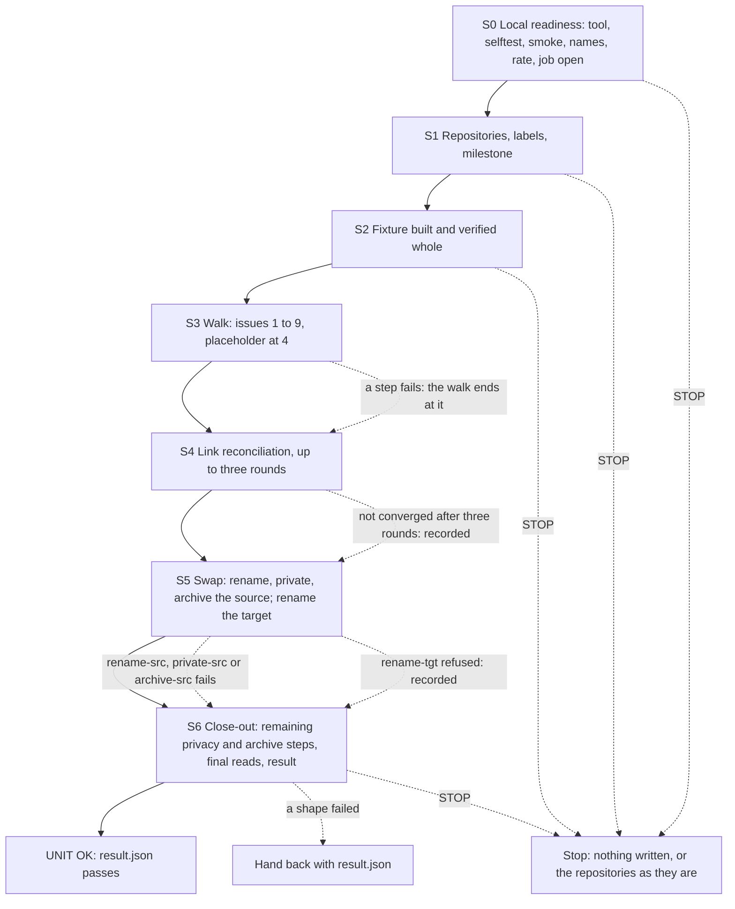
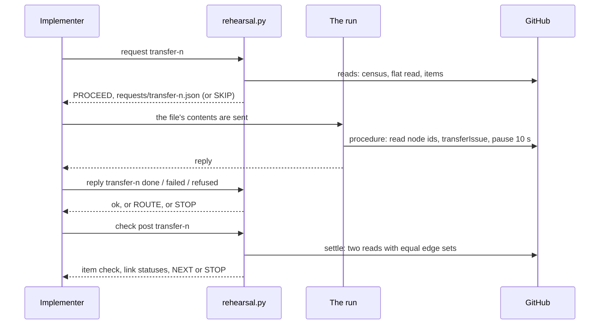

> **Superseded by [`../plan.md`](../plan.md).** This is the version of the plan the walk began with. The current plan compares a moved item's text after mapping back the references GitHub rewrites during a transfer; this copy's item check compares the bytes as they are.

# Phase 0 · 2 — Transfer rehearsal: implementation plan

- **Covers:** [SpartanLaboratories/KotlinBottools#22](https://github.com/SpartanLaboratories/KotlinBottools/issues/22),
  *"Phase 0 · 2 — Transfer rehearsal on two throwaway repositories"*, a sub-issue of
  [#2](https://github.com/SpartanLaboratories/KotlinBottools/issues/2) (parent chain #22 → #2 → #1).
- **Architecture:** [`../architecture.md`](../../architecture.md), unit `transfer-rehearsal` (§15, order 2), with
  §7.2 (the rehearsal, as amended by its dated note of 2026-11-08), §7.4 (the real walk it rehearses), §7.5
  (the renames, as amended), §7.6 (the hand-back states), §5.1 (`DATA/run/rehearsal/`) and §11 (requests).
  Its consequences are in [`../consequences.md`](../../consequences.md); the evidence is the three findings files
  under [`research/`](../research/README.md), whose Summary is this plan's design input.
- **Branch:** `chore/issue-22-transfer-rehearsal`. This plan and the unit's own `consequences.md` (beside it
  in this folder) are committed on that branch in the same landing as the work they describe.
- **What this plans:** the rehearsal of the KotlinBottools repository swap on two throwaway repositories of the
  `SpartanLaboratories` organisation — a fixture of ten numbers (nine issues and one merged pull request), the
  walk that moves it, the re-creation of every link, the rename swap, and both repositories left private and
  archived — as a literal procedure of seven stages that an implementer and the run carry out without making
  a decision, with the results recorded in `DATA/run/rehearsal/`.
- **Status:** planning only.
- **Target version:** none (nothing is versioned; no product code, test source or build file changes).

This unit writes to GitHub, and only through requests. The implementer types the local commands: the
tool's reads, its checks, and the commands that save a reply. The run sends each request and waits for its
reply. The plan itself never performs a GitHub write and never suggests one outside a request. Apart from the
repository's normal landing of its documents (§7.1), the unit writes nothing else to GitHub, and it touches
no KotlinBottools issue, number, label, milestone or setting.

---

## Requirements

**Goals**

1. **Two throwaway repositories** of the `SpartanLaboratories` organisation:
   - `phase0-rehearsal-a`, the source, **public**, with an initial commit (`auto_init`);
   - `phase0-rehearsal-b`, the target, **private** and truly empty (no README, no commit).

   The source is public because the real walk's source is: `SpartanLaboratories/KotlinBottools` has been public
   since 2026-11-08 and stays so until the swap, and the rehearsal proves the real direction, public into
   private. Both repositories end private and archived.
2. **Labels and milestone in both repositories before the fixture and the walk:** `type: tracking` (`ededed`,
   "Multi-issue initiative"), `type: feature` (`0e8a16`, "New capability or API change") and the milestone
   `1.0.0` (a description, no due date). The nine default labels exist from creation.
3. **The fixture,** built strictly serially so that numbers come out exactly as below (issues and pull requests
   share one counter; an issue cannot be created closed):

   | # | Kind | Shape | Parent | Labels | Milestone | Comments | State |
   |---|---|---|---|---|---|---|---|
   | 1 | issue | tracking root | — | `type: tracking` | — | 2 | open |
   | 2 | issue | middle node | 1 | `type: tracking` | — | 1 | open |
   | 3 | issue | feature with milestone | 1 | `type: feature` | `1.0.0` | 0 | open |
   | 4 | pull request | merged, numbered between issues | — | — | — | — | merged |
   | 5 | issue | closed child of the middle node | 2 | — | — | 0 | closed, reason completed |
   | 6 | issue | neither label nor milestone | 1 | — | — | 0 | open |
   | 7 | issue | closed child of the root | 1 | — | — | 1 | closed, reason completed |
   | 8 | issue | open child of the middle node, has its own child | 2 | — | — | 0 | open |
   | 9 | issue | deepest child | 8 | — | — | 0 | open |
   | 10 | issue | stays in the source | — | — | — | 0 | open |

   - **Sub-issue links** (parent → child), seven: 1→2, 1→3, 1→6, 1→7, 2→5, 2→8, 8→9. The hierarchy is three
     levels deep on one branch (1 → 2 → 8 → 9) and one level deep on the others.
   - **"Blocked by" links** (blocked ⟵ blocker), four: 3⟵6 (the blocker has a higher number), 8⟵5 (the blocker
     has a lower number and is closed), 3⟵10 (the stay-behind issue blocks a moved issue) and 10⟵6 (the
     stay-behind issue is blocked by a moved issue). After the walk the two links that touch #10 are
     cross-repository, and until the swap they span a public and a private repository.
   - **Text** is made up and generated deterministically by the tool. Every body has non-ASCII text (Polish,
     Japanese and a euro sign) and `#N` references to other fixture numbers; one body, #6's, is about 9 KB
     (the real maximum is 8,777 bytes). No text contains an `@` mention or anything real.
   - **The pull request** is one branch with one commit (a small text file), merged with a merge commit after
     polling `mergeable`.
4. **The walk,** in numeric order for the numbers 1 to 9 (10 stays): each issue is transferred with the GraphQL
   mutation, the target pinned by repository node id, and the pull request's number 4 is reproduced by a closed
   placeholder issue created at that number, whose body points to the pull request in
   `phase0-rehearsal-a-legacy` (the source's name after the swap).
   - **Before each step** the target's highest number is `n−1` (REST census, which counts issues and pull
     requests).
   - **After each step** the landed number is `n`, and the item is checked on its number: title, body bytes
     (sha256), state and state reason, labels by name, milestone title and due date, comment count, and each
     comment's body hash, author and order (`createdAt` is recorded, not compared).
5. **Links** are read back after each step, in the flat read, after settling (two successive reads with equal
   edge sets, at least 6 seconds apart, bounded), and the step records what each link did: kept, dropped,
   repointed, stale, or still unsettled. Keys are `(repository, number)`, never node ids. The checks assume no
   depth anywhere: the hierarchy is the set of edges `(kind, repo#n, repo#n)`, compared as sets, with
   `parent`/`subIssues` and `blockedBy`/`blocking` cross-checked for consistency.
6. **Link reconciliation after the walk:** read the settled edge set; compute the links to add (the fixture's
   edges, each end mapped to where its issue is now: moved issues in B, the rest in A) and the stale links to
   remove; apply them; read back, settled; the final edge set must equal the expected one, cross-repository
   links included. Cross-repository links are created from the blocked side (a "blocked by" write is on the
   blocked issue, whichever repository it is in); `addSubIssue` is written on the parent. "Duplicate
   sub-issues" and "has already been taken" count as present; "may only have one parent" counts as stale.
7. **Fallback routes,** recorded as results and not as failures:
   - a closed issue whose transfer is refused is reopened, transferred, and closed again with the source's
     reason on the target; a closed issue that arrives open is closed on the target;
   - a transfer refused for a link-related reason: the issue's links are removed and recorded, the issue is
     transferred, and reconciliation re-creates the links;
   - a throttle error (`secondary rate`, `abuse detection`, `submitted too quickly`, or, on `transferIssue`,
     the opaque "Something went wrong while executing your query") is retried per the pacing rule, reading
     back first, because a write that errored may have landed;
   - any other refusal stops the step.
8. **The rename swap:** the source is renamed `phase0-rehearsal-a-legacy`, made private and archived; the target
   is renamed `phase0-rehearsal-a` and then archived. Each step is read back by repository id
   (`GET repositories/{id}` and `GET repos/{owner}/{name}`), never by name alone.
   - After the source's privacy change an unauthenticated request to it by name, by id and on the web answers 404.
   - A transferred issue's old URL is followed at the points the rename findings name, and the resolved
     answer's `number` and `repository_url` must be the issue's new home. Both the original-name URL and the
     `-legacy`-name URL of a transferred issue are followed after the swap, for one open and one closed issue.
9. **Failure behaviour:**
   - A walk step that fails stops the walk at that step. The link reconciliation on what moved and the rename
     swap still run, then both repositories are archived, and every shape's result is recorded.
   - A failure before the walk starts (repository, label, milestone or fixture stage) stops the unit and
     leaves the repositories as they are. Its re-run continues idempotently, because every write is checked
     first: a write that is already done is skipped, never repeated, and above all no duplicate issue is ever
     created.
10. **Results** are recorded in `DATA/run/rehearsal/`: per step, what was done, what was read, the route taken,
    and each refusal's full response body. They hold fixture text and ids only, nothing from a real repository.

**Acceptance criteria (done when)**

- Every item of the source is on its own number in the target, the placeholder included.
- Every fixture link is present at the end, kept or re-created.
- The renames resolve by id.
- Both repositories are private and archived.
- The per-step results are recorded in `DATA/run/rehearsal/`.

Otherwise the unit hands back with those results (§7.6 of the architecture), and
`kotlinbottools-rewrite-and-swap` does not start.

---

## Current state

Facts checked on 2026-11-09.

**This machine**

- The baseline is the branch `chore/issue-22-transfer-rehearsal`, whose latest commit is *"docs(plans): add the
  transfer rehearsal's verification and summary"*; unit 1 (`preparation`) has landed.
- git 2.55.0.windows.5, Python 3.14.7 and `gh` 2.100.0, signed in; Git Bash provides `sleep`, `seq`, `base64`,
  `sha256sum`, `awk` and `curl`.
- `%USERPROFILE%\BotWS\tools` holds unit 1's contract: `env.sh` (exports `WS`, `DATA`, `TOOLS`, `KBT` and the
  rest; defines the function `gitnet`), `lib.sh` (`expect LABEL WANT GOT`), `plib.sh` and `run-stage.sh`.
  `bash "$TOOLS/run-stage.sh" <name> [args]` runs `$TOOLS/<name>.sh` and appends its output to
  `DATA/run/as-run.log`.
- `DATA/run/` holds `as-run.log`, `canary/`, `lists/`, `scrub/` and `tool-versions.txt`. `DATA/run/rehearsal/`
  does not exist yet and is this unit's.
- The GitHub rate limits had headroom (4,654 core and 4,860 GraphQL points remaining at the check).

**GitHub**

- `phase0-rehearsal-a`, `phase0-rehearsal-b` and `phase0-rehearsal-a-legacy` answer 404: the three names are unused.
- The organisation is on the Free plan with `members_can_change_repo_visibility` true; the signed-in account is
  an organisation owner with administrator permission on KotlinBottools
  ([research README](../research/README.md#verification-results)).
- `SpartanLaboratories/KotlinBottools` is public (since 2026-11-08), so the real walk moves issues out of a
  public repository into a private one, the direction this unit rehearses.

**Verified outside-world facts the design rests on** (each linked to its findings file; 55 load-bearing claims
were re-opened at their sources and hold, [research README](../research/README.md#verification-results)):

- *Transfers.* The documented rules are write access to both repositories, one owner, no private-into-public,
  comments and assignees kept, labels (by name) and milestones (by name and due date) kept when the target has
  them, and the old URL redirects. Nothing is documented about the new number, closed issues, or sub-issue and
  "blocked by" links. Three reports show a transfer taking the next number of the target's sequence, 25
  transfers into an empty private target landing on #1 to #25 included; reports agree that a moved child keeps
  its parent as a cross-repository link and that the link settles asynchronously; one report disagrees. Nothing
  covers a parent that moves while its children stay, "blocked by" links, or links across a public/private
  boundary. ([`issue-transfer-behaviour.md`](../research/issue-transfer-behaviour.md) §3.1–§3.5, §6)
- *Limits.* 100 sub-issues per parent, eight nesting levels, 50 links per dependency type; the hierarchy here is
  far inside them. ([`issue-transfer-behaviour.md`](../research/issue-transfer-behaviour.md) §3.6)
- *Rename, visibility, archive.* Renaming redirects the old name; `PATCH repos/{owner}/{repo}` takes `name`,
  `visibility` and `archived` (typed with `-F`); a visibility change on an archived repository is refused with a
  403, so archiving comes last; a name-based read cannot tell a redirect from a direct hit, so every read-back
  compares the repository id; an unauthenticated 404 by name, by id and on the web proves a repository is no
  longer public; a transferred issue's old URL answers 301 on REST, which `gh api` follows silently and
  `gh api --verbose` shows without exposing the token.
  ([`rename-visibility-archive-sequence.md`](../research/rename-visibility-archive-sequence.md) §3.1–§3.6, §6)
- *API forms.* REST through `gh api` for repositories, labels, milestones, issues, comments, closing and
  reopening, the branch, the commit, the pull request and its merge; GraphQL `transferIssue`, `addSubIssue`,
  `addBlockedBy`, `removeSubIssue` and `removeBlockedBy` with node ids read fresh; one flat GraphQL page read per
  25 issues (1 point, about 2 s); a REST census because GraphQL `issues` omits pull requests; a GraphQL error
  makes `gh api` exit 1 with the whole body on stdout; no leading slash on a `gh api` path; `-f` for strings and
  `-F` only for booleans, integers and `@file`; Python run as `python -X utf8 -I` with `encoding="utf-8"`.
  ([`fixture-and-read-api-forms.md`](../research/fixture-and-read-api-forms.md) §3.1–§3.5, §6)
- *Payloads read today by introspection:* `RemoveSubIssuePayload` carries `issue` and `subIssue`,
  `RemoveBlockedByPayload` carries `issue` and `blockingIssue`, and both remove inputs take `issueId` plus
  `subIssueId` or `blockingIssueId`, as the add inputs do.

**The tool, exercised before this plan was written.** The tool of Appendix A passes its `selftest` (71 checks),
and its `smoke` read of `SpartanLaboratories/KotlinBottools` returned counts (28 issues by node id and by name,
30 numbers of which 2 are pull requests, 91 edges, none inconsistent inside the repository, 12 labels, 1
milestone). Its census, its read by node id, its hop parser and its unauthenticated probes ran, read-only, against
real repositories. Its whole flow, from the names check to the result, ran on an in-memory stand-in of GitHub in
six variants: links dropped by every transfer; links kept; a closed issue arriving open; a throttled transfer
together with a refused rename onto the freed name; a link-related refusal; and a step that fails and ends the
walk there.

---

## Assumptions

| Assumption | If false |
|---|---|
| The requests run under a job named `phase-0-transfer-rehearsal`, whose scope lists the repositories `SpartanLaboratories/phase0-rehearsal-a`, `SpartanLaboratories/phase0-rehearsal-b` and `SpartanLaboratories/phase0-rehearsal-a-legacy` and whose actions are the fourteen of the table in Design. No write is sent until that job is open; each request carries `permissionReason: phase-0-transfer-rehearsal`. | S0's last check stops the unit with nothing created. A first request refused because the job is not open stops the unit the same way. |
| Requests named `create-repo`, `comment`, `link-issues`, `transfer-issue`, `placeholder-issue`, `rename-repo`, `repo-visibility` and `archive-repo` exist and carry out the procedure they receive. | The S0 comparison names the missing action; the unit stops before the first write that needs it. |
| Requests named `create-issue`, `create-label`, `create-milestone`, `close-issue`, `reopen-issue` and `fixture-pull-request` exist and carry out the procedure they receive: `create-issue` creates issues in order and compares each new number with the expected one, stopping at the first difference; `create-label` and `create-milestone` create what the procedure lists; `close-issue` and `reopen-issue` change an issue's state; `fixture-pull-request` creates a branch, a commit and a pull request and merges it. The fields of these six are this plan's proposal (Design, "The requests"). | The unit stops before the first write of a missing action; S0 compares the list. If the real field names differ, the table of requests and the builder functions that fill those fields change, and nothing else does. |
| The procedure of a request is carried out with the organisation administrator's GitHub permissions in Git Bash, with `gh` signed in, and `sleep`, `seq`, `test` and `base64 -w0` available. | A command that cannot run fails the request; its reply is `failed` and the step stops at its check. |
| A public issue can be transferred into an empty, commit-less private repository of the same organisation, and it lands on the target's next number. One report shows 25 such transfers on 2026-11-08. | The first transfer is refused or lands elsewhere; the walk ends at step 1 with the refusal body recorded, and the unit hands back. |
| A link's changes after a transfer settle within eight reads, about two minutes. The reports give 6-second retries and "usually within two iterations", with no bound. | The settle is bounded: an unsettled link is recorded as `unsettled`, and reconciliation reads again at S4 and at S6. |
| A read-back reflects a rename, a visibility change or an archive within five reads, 3 seconds apart. | `ids` stops at the label that did not read back; it is safe to run it again later. |
| Nothing else creates or changes anything in the rehearsal repositories, and nobody creates a repository with one of the three names, while the unit runs. | The guards of S0 and the number guards of S2 and S3 stop the step that meets the difference. |
| About 35 paced requests stay under GitHub's content-creation limits (about 80 a minute and 500 an hour; transfers about 100 an hour). | The throttle route applies: read back, wait, retry up to four attempts. |
| The pull request becomes mergeable within the 30 seconds the request polls. | The merge is not sent; the request reports the poll count, the step's check finds the pull request unmerged, and a second request completes it (its procedure skips what exists). |

---

## Non-goals

- No change to KotlinBottools or to any of the other five repositories: not an issue, a number, a label, a
  milestone, a setting or a ref. The only KotlinBottools read is `smoke`, which prints counts.
- No real text, no real data and no real identity in the fixture or in the results.
- No deletion of the rehearsal repositories. Deleting them needs the `delete_repo` scope, which the phase neither
  has nor needs; they are a follow-up (Sequencing and follow-ups).
- No rewrite of the `#N` references in transferred bodies; the bytes are compared as they are.
- No test of a rename or a visibility change on an archived repository: the order never needs one.
- No rehearsal of placeholders adjacent to each other or at the top number, and no commits in the target: the
  fixture has one merged pull request and an empty target (Test plan, "Limits of these checks").
- No `git ls-remote` of the rehearsal repositories: on an empty target it proves nothing, and on a renamed name
  it proves content and not identity.
- No committed helper script. The tool stays in the workspace; nothing is added to any repository's source.
- No GitHub Support ticket. A refusal to rename onto the freed name would be recorded and handed back; the
  ticket is not part of the phase.
- No README or CHANGELOG entry (Documentation impact).

---

## Design

### Shape of the procedure

Seven stages, run in order, each ending with a `STAGE <id> OK` line, a `STAGE <id> RECORDED <what>` line (a
recorded failure: the unit goes on along the failure arrows) or a `STOP`:

| Stage | Name | What it establishes |
|---|---|---|
| S0 | Local readiness | the tool saved and checked; `selftest` and `smoke`; the three names unused; rate-limit headroom; `DATA/run/rehearsal/` created; the job open and the actions defined |
| S1 | Repositories, labels, milestone | A public with an initial commit, B private and empty, the two labels and the milestone in both, each read back |
| S2 | The fixture | ten numbers, their comments, links and closes, verified whole against the spec; the baseline recorded |
| S3 | The walk | issues 1 to 9 transferred in order, the placeholder at 4, each step checked on its number, its links classified |
| S4 | Link reconciliation | up to three rounds of add and remove, the settled edge set equal to the expected one |
| S5 | The rename swap | source renamed, made private, archived; target renamed; ids and old URLs read at each point |
| S6 | Close-out | whatever of the privacy and archive steps is left, the target archived, both read back private and archived, the final edge set, `result` |



### The requests

Every write is one request to the request protocol. A request is a JSON document that the tool generates into
`DATA/run/rehearsal/requests/<key>.json` immediately before it is sent. The run sends the file's contents and
waits for the reply; on `done` the check of §7.4 runs.

**Fields of every request**

| Field | Value |
|---|---|
| `permissionReason` | `phase-0-transfer-rehearsal`, the job's name |
| `github` | `SpartanLaboratories/KotlinBottools`, the repository the job is recorded under |
| `action` | the action's name (table below) |
| `target` | the repository the write applies to, as `owner/name`, by the name it holds at that moment |
| `issue` | for `transfer-issue` and `comment`, the issue's number in the fixture repository; otherwise 22 |
| `procedure` | the literal `gh api` commands, in order, run in one shell (a command that sets a variable is on the same line as the command that uses it); it uses `gh api` for everything and pauses at least 3 s between writes and 10 s after a transfer |
| `inputs` | `key` (the request's key), and `files` (file name → exact text) where a command reads `@file` |
| `checks` | the facts the reply must show; where a command reads `@file`, the first check tells the run to write each entry of `inputs.files` byte for byte (UTF-8, no BOM, LF, no trailing newline) into the working folder |
| `v`, `id`, `attempt`, `from`, `repo` | supplied by the run: `id` is `<sender>/22/<key>`, `attempt` is the number of stored replies for the key plus one |

Fields of one action only: `source` (`transfer-issue`: the source repository); `number`, `title`, `body`
(`placeholder-issue`; `number` also names the issue to change in `close-issue`, `reopen-issue` and the first
number `create-issue` makes); `body` (`comment`: the comment's text; the procedure is the exact command that posts
it, once); `relationships` (`link-issues`: `[{op, kind, from, to}]`, `op` `add` or `remove`, `kind` `sub-issue` or
`blocked-by`, `from` the parent or the blocked issue and `to` the child or the blocker, each as
`owner/repo#n`); `newName` (`rename-repo`); `visibility` (`repo-visibility`). The fields of the six actions the
protocol does not define yet (`create-issue`, `create-label`, `create-milestone`, `close-issue`, `reopen-issue`,
`fixture-pull-request`) are this plan's proposal: if the real field names differ, only this table and the
builders change.

**The requests, in order**

| Key | Action | Target | Fields beyond the common ones | Pre-write check inside `request` | Verified by `check post` |
|---|---|---|---|---|---|
| `repo-a` | `create-repo` | `…/phase0-rehearsal-a` | — | the name is free (or this unit's own) | id and node id recorded; public; `main` exists |
| `repo-b` | `create-repo` | `…/phase0-rehearsal-b` | — | likewise | id and node id recorded; private; no branch |
| `labels-a`, `labels-b` | `create-label` | A, then B | — | only the missing of the two labels are sent | both present with exact colour and description; the nine defaults present |
| `milestone-a`, `milestone-b` | `create-milestone` | A, then B | — | skipped when present | `1.0.0`, description, no due date; its number recorded |
| `issues-1` | `create-issue` | A | `number` 1; bodies in `inputs.files` | highest number 0 (resumes at the first missing number) | #1 to #3 equal the spec (title, body, labels, milestone) |
| `pr-4` | `fixture-pull-request` | A | — | highest number 3 (resumes a half-made branch or pull request) | #4 is a pull request, merged |
| `issues-5` | `create-issue` | A | `number` 5 | highest number 4 | #5 to #10 equal the spec |
| `comment-1-1`, `comment-1-2`, `comment-2-1`, `comment-7-1` | `comment` | A | `issue` n, `body` the comment's text | the issue holds exactly the comments before this one | the comment count and body hashes equal the spec |
| `links-fixture` | `link-issues` | A | `relationships`: the missing of the 11 links | the edges present | all 11 edges present, settled, none extra |
| `close-5`, `close-7` | `close-issue` | A | `number` n | the issue is open | closed, reason completed |
| `transfer-n` for n = 1, 2, 3, 5, 6, 7, 8, 9 | `transfer-issue` | B | `issue` n, `source` A | A holds n, B's highest number is n−1, n is not in B | n is gone from A, B has it on number n; the item check; the link classification |
| `placeholder-4` | `placeholder-issue` | B | `number` 4, `title`, `body` | B's highest number is 3 | B#4 exists, closed, with the placeholder title |
| route: `reopen-n`, `unlink-n`, `close-b-n`, `reopen-b-n` | `reopen-issue`, `link-issues`, `close-issue`, `reopen-issue` | A, A, B, B | `number`; `relationships` (the issue's edges, `remove`) | the issue's current state or edges | the new state; no edge touches the issue |
| `links-rK-a`, `links-rK-b` (K = 1 to 3) | `link-issues` | A, B | `relationships`: removes first, then adds | written by `links rK` from a settled read | `check post links-rK`: the settled edge set equals the expected one, or the next round |
| `rename-src` | `rename-repo` | the source by its current name | `newName` `phase0-rehearsal-a-legacy` | the source's id reads at its old name | the id reads `…-legacy` |
| `private-src` | `repo-visibility` | the source | `visibility` `private` | the source is public | the id reads private |
| `archive-src` | `archive-repo` | the source | — | the source is private | the id reads archived |
| `rename-tgt` | `rename-repo` | the target by its current name | `newName` `phase0-rehearsal-a` | the source holds the legacy name | the id reads `phase0-rehearsal-a` |
| `archive-tgt` | `archive-repo` | the target | — | the target is not archived | the id reads archived |

Each request's `procedure` is the literal commands of the REST and GraphQL forms of the findings
([`fixture-and-read-api-forms.md`](../research/fixture-and-read-api-forms.md) §3.1): `POST orgs/{org}/repos` with
`-F private` and `-F auto_init`; labels with `-f`; issues with `-f title`, `-F body=@file`, `-f 'labels[]=…'` and
`-F milestone=<number>`; `PATCH …/issues/{n}` with `-f state` and `-f state_reason`; the branch, the contents
`PUT`, the pull request, the mergeability poll and the merge; `transferIssue`, `addSubIssue`, `addBlockedBy`,
`removeSubIssue` and `removeBlockedBy` through `gh api graphql` with node ids read in the same command line;
`PATCH repos/{owner}/{repo}` with `-f name`, `-f visibility` and `-F archived=true`. It never uses
`gh issue transfer`, `gh issue edit` or `gh issue view --json`. Every swap request first reads the repository's id
by name and stops if it is not the recorded one, so a write addressed to a name never lands on a repository that
has since taken the name.

**What a reply is.** The request protocol answers `done`, or `rejected` with a reason. The implementer stores each
reply under one of three names. `done`: the protocol's `done`, the procedure having reported success. `failed`: a
reply, `done` or `rejected`, whose text shows the procedure ran and a command failed, with GitHub's error body in
it. `refused`: a `rejected` whose reason shows the request was not carried out (the job is not open, an action is
not defined, a permission was refused); a `refused` request wrote nothing.

**Retry and routes.** The tool, not the request, decides what follows a `failed` reply. A throttle error is
retried after reading back (the next `request` runs its pre-check, which reports `SKIP` if the write landed):
after the `retry-after` seconds the reply states, else 60, 120 and 240 seconds, at most four attempts. A
refusal of a transfer that mentions sub-issues, parents or "blocked by" runs the link route; a refusal of a
transfer of an issue that is closed in the source runs the reopen route; each route is tried once per issue. Any
other refusal ends the step. Every refusal's whole body is kept in `steps.jsonl` and in `replies/`.

### The tool

One Python 3 file, `rehearsal.py`, standard library only, run as `python -X utf8 -I` by `rehearsal-step.sh`
(Appendix A). Subcommands (a key carries its number: `transfer-5`, `comment-1-2`):

| Subcommand | What it does |
|---|---|
| `selftest` | the pure logic (fixture spec, edge mapping and comparison, classification, diffing, refusal routes, request building and linting) and the read and check paths against an in-memory stand-in of GitHub; no network |
| `smoke` | a read-only proof that the read works against `SpartanLaboratories/KotlinBottools`, by node id and by name, plus the census, labels and milestones; prints counts only |
| `spec` | writes the expected fixture to `DATA/run/rehearsal/fixture.json` |
| `request KEY` | runs the key's pre-write check and, on `PROCEED`, writes `requests/KEY.json`; on `SKIP` writes nothing |
| `reply KEY done\|failed\|refused` | stores the reply text from stdin in `replies/`, logs it, and for `failed` prints the `ROUTE` or stops |
| `read LABEL`, `settle LABEL` | the flat read of both repositories into `snapshots/LABEL.json`; `settle` repeats it until two reads 6 s apart have equal edge sets (at most eight reads) |
| `check pre KEY`, `check post KEY` | one verification; `ok`/`STOP` lines, `PROCEED`/`SKIP`, `NEXT` lines; one record in `steps.jsonl`; exit 0 or 1 |
| `check names`, `check rate`, `check protocol JOB ACTIONS`, `check stage ID` | the S0 checks and each stage's closing verdict |
| `links rK` | from a settled read computes the links to add and remove and writes `links-rK-a` and `links-rK-b` |
| `ids LABEL`, `urls LABEL` | the identity reads and the old-URL follows of the rename swap, recording the hops |
| `result` | the per-shape outcome into `result.json` and `result.txt`; exit 0 only if everything passed |

**Reading.** The tool reads both repositories by their recorded node ids (so a rename never changes what is
read) with the flat GraphQL page of the findings ([`fixture-and-read-api-forms.md`](../research/fixture-and-read-api-forms.md)
§3.2.1): 25 issues a page, each issue stating its own `parent`, `subIssues`, `blockedBy` and `blocking` with the
other end's repository and number. A nested connection that reports a next page is a failure. The census of
numbers is REST (`GET repositories/{id}/issues?state=all`, which includes pull requests), so it never depends on
a name either.

**Edges.** The hierarchy and the dependencies are one set of triples `(kind, ref, ref)`, `kind` `sub` (parent,
child) or `blk` (blocked, blocker), `ref` `A#n` or `B#n` (the repository by its role, never by node id). The
four connections are cross-checked: the edges only one side reports (a `parent` with no matching `subIssues`
entry, a `blockedBy` with no matching `blocking`) are the *inconsistent* set, which must be empty when settled.
Nothing assumes a depth or a traversal order. The expected set maps each fixture end to where its issue is now.

**Statuses.** After each transfer, each expected edge is classified against the settled edge set:

| Status | Meaning |
|---|---|
| `kept` | the expected edge is present |
| `repointed` | the expected edge is absent but the same pair of fixture issues is linked, same kind, with a different repository on an end |
| `dropped` | the expected edge is absent and nothing links that pair |
| `unsettled` | the edge differs between the last two reads of a settle that hit its bound |
| `stale` | an edge present that no expected edge matches (counted and listed per step) |

Each step also records how many expected edges the first read after the transfer lacked, so the lag of the
first read is a measured result.

**Closed issues.** A closed issue (#5, #7) arrives in one of three ways, and the step records which:

| Arrival | Recorded as | What follows |
|---|---|---|
| closed, reason completed | `closed/COMPLETED` | nothing: the item check passes |
| closed, another or no reason | `closed/<reason>` | `NEXT reopen-b-n`, then `close-b-n`, then the check again |
| open | `open` | `NEXT close-b-n`, then the check again |
| transfer refused | the refusal body | `ROUTE reopen`: `reopen-n`, `transfer-n`, then as above |

**One step of the walk**



### The rename swap

Order: rename the source, make it private, archive it, rename the target onto the old name, archive the target
(research [`rename-visibility-archive-sequence.md`](../research/rename-visibility-archive-sequence.md) §6). An
archive comes after every other change to a repository, because an archived repository refuses them; the
target's rename comes after the source's rename frees the name. After each write, `check post` reads the
repository by id and records its name; then `ids LABEL` reads:

| Label | Source reads as | Target reads as |
|---|---|---|
| `pre` | `phase0-rehearsal-a`, public | `phase0-rehearsal-b`, private |
| `after-rename-src` | `phase0-rehearsal-a-legacy`, public | unchanged |
| `after-private-src` | private | unchanged |
| `after-archive-src` | private, archived | unchanged |
| `after-rename-tgt` | unchanged | `phase0-rehearsal-a`, private |
| `final` | the names the renames left, private, archived | likewise, private, archived |

`ids` checks, with up to five reads 3 s apart: the id's `full_name`, `private` and `archived` flags; the held
names answering the same id by name (so `phase0-rehearsal-a` answers the target's id at `after-rename-tgt`,
which is the swap's central unknown); an unauthenticated request to each held name, to `repositories/{id}` and
to the web page, answering 404 for a private repository and 200 for a public one; and, recorded and not
compared, what each released old name answers and the time of the label (the window between the two renames).
`urls LABEL` follows the old URL of the first transferred open issue and the first transferred closed issue by
the original name and, once the source is renamed, by the `-legacy` name: `gh api --verbose` filtered to the
`< HTTP` and `< Location` lines shows the hops, and the resolved answer's `number` and `repository_url` must be
the issue's new home (its repository id equals the target's). A URL that does not resolve there is recorded as a
result and does not stop the swap.

### Workspace and data layout

The layout is architecture §5.1 and §5.2, with these additions. `DATA` is `%USERPROFILE%\BotLegacyData`; `WS` is
`%USERPROFILE%\BotWS`.

```
BotLegacyData/run/rehearsal/                (DATA/run/rehearsal; created by the bootstrap)
  fixture.json                              the expected fixture: text, edges, body hashes
  state.json                                repository ids and node ids, current names, milestone numbers,
                                            landed numbers, attempts, routes tried
  baseline.json                             the source's items as read when S2 ends: the walk's reference
  requests/<key>.json                       the requests, generated just before they are sent
  replies/<key>-<attempt>.txt               every reply, whole
  snapshots/<label>.json                    each read: edges, inconsistencies, issues, census, flags
  steps.jsonl                               one JSON record per check, request, reply, step and stage
  result.json, result.txt                   the per-shape outcome
BotWS/tools/rehearsal-step.sh               the runner's script (beside unit 1's stage scripts)
BotWS/tools/rehearsal/rehearsal.py          the tool
```

Everything under `DATA/run/rehearsal/` holds fixture text and ids of the two throwaway repositories. It is
read freely, and it is not committed.

### How the scripts reach the machine

- **The scripts live in this plan and in the workspace, never in a repository.** Appendix A holds `rehearsal.py`
  and `rehearsal-step.sh` in fenced blocks whose info string carries `file=<name>`. The S0 bootstrap saves each
  block byte for byte with carriage returns stripped, and checks each against its recorded size and sha256
  before anything runs.
- **The runner** is unit 1's `run-stage.sh`: `bash "$TOOLS/run-stage.sh" rehearsal-step <subcommand> [args]`
  runs `$TOOLS/rehearsal-step.sh`, which sources `env.sh` and runs the tool; the runner writes a start line, the
  output and `== rehearsal-step exit=<n>` to the console and appends them to `DATA/run/as-run.log`. Standard
  input passes through, which is how `reply` receives the reply text.

### Error handling and logging

- **Failure path.** The tool has one failure type for expected failures (a GitHub error, a mismatch, a missing
  earlier step): it prints `STOP  <why>` and exits 1. A bug in the tool is an ordinary exception with a
  traceback and exit 1. There is no retry inside the tool: retry is an instruction the tool prints (`ROUTE retry`),
  and the implementer carries it out.
- **Recorded, not stopped.** Printed as `RECORD` or `NEXT`, exit 0: a refusal that a route follows; a closed
  issue's arrival; links that did not converge after three rounds; a released name's answer; a URL that did not
  resolve to the new home; no transferred issue of a kind to follow.
- **Where a failure is unwrapped.** The implementer reads the last lines of every command's output and acts on
  a `STOP`, a non-zero exit, a `NEXT` or a `ROUTE` line, or a missing `ok`/`STAGE` line, as §7.3 states.
- **Logging events,** each a line on the console and in `as-run.log`, and a JSON record in `steps.jsonl`:
  names, rate and protocol checks; each request built or skipped; each reply stored (with its whole body when
  not `done`); each pre and post check; each transfer (landed number, item check, link counts, settle reads,
  first-read lag, routes, attempts); each closed issue's arrival; each link round (adds, removes, converged);
  each identity and URL read; each stage verdict; each stop. One level: the line itself carries the status.

### The output rule

The tool prints counts, ids, fixture text, fixed markers and exit statuses. The only read of a real repository
is `smoke`, and it prints counts. Nothing in `DATA/run/rehearsal/` comes from a real repository. A reply's text,
kept whole, is GitHub's answer about the throwaway repositories. `rehearsal.py` never prints a token: the
`--verbose` output of `gh api` is filtered to its `< HTTP` and `< Location` lines.

### Stops and the state each leaves

| Where | The stop | State left | Next |
|---|---|---|---|
| S0 | a pin, a hash, `selftest`, `smoke`, a name taken, rate headroom, the job not open or an action missing | nothing on GitHub | fix the cause, re-run S0 |
| S0–S1 | the first request refused because the job is not open | nothing created | open the job, re-run S0 |
| S1 | a `repo-*` conflict, a refused request, a label or milestone differing | the repositories created so far, empty of issues | fix, re-run S0–S1 (idempotent) |
| S2 | a fixture mismatch, a number guard, a refused request | the fixture part-built; no duplicate | fix, re-run S0–S2 (idempotent); a number that came out wrong cannot be repaired, and the pair is abandoned: take S6's three STEPs (`private-src`, `archive-src`, `archive-tgt`), then hand back |
| S3 | a step's `request` pre-check, reply or `check post` stops | items 1 to k−1 on their numbers in B (the placeholder included); item k in A, or in B on another number; the rest untouched in A | `check stage S3` prints `RECORDED walk-stopped-at=k`; go to S4 |
| S4 | links not converged after three rounds | every number reproduced as far as the walk went; the missing and stale edges listed | `check stage S4` prints `RECORDED`; go to S5 |
| S5 | `rename-src`, `private-src` or `archive-src` stops | names unchanged or half-swapped; nothing deleted | go to S6 |
| S5 | `rename-tgt` refused | the source renamed, private and archived; the target under its old name | the refusal body is the result; `check stage S5` prints `RECORDED`; go to S6 |
| S6 | a request stops or a read-back differs | the repositories as far as the steps went | hand back with `result.json` |

### What the unit creates on GitHub

Two repositories (private and archived at the end), their labels and milestone, ten numbers in A (nine issues
and one merged pull request with its branch), 4 comments, 11 links; in B nine items (eight transferred issues
and a closed placeholder at 4), reconciliation links, the swap's renames, a privacy change and two archives.

---

## 7. Procedure

### 7.1 Repository changes

The landing changes documents and generated boards only, through the repository's normal landing.

- **In this folder:** this `plan.md`, `consequences.md`, the as-built record `final-implementation.md`, the
  research folder (`research/`, already committed on this branch), and the issue board files (`plan.json`,
  `plan.js`, `dashboard.html`) beside them.
- **Outside this folder:** one line in the parent's `consequences.md` linking to this unit's `consequences.md`;
  the dated notes the parent's `architecture.md` and `consequences.md` carry for 2026-11-08 (the repository
  public since that date, the rehearsal's public source, the privacy step of the swap, and the walk and link
  checks that read the hierarchy flat, issue by issue; they are already written and ride with this landing); and
  the generated boards the landing regenerates (the repository work board `docs/plans/board.js`, `board.json`
  and `index.html`; the parent folder's and unit 1's issue boards; the state boards under `docs/dashboards/`).

No source, test or build file changes. The procedure itself writes nothing into the checkout: its only
repository read is this plan file, by the bootstrap.

### 7.2 What the procedure creates on this machine

Under the user profile, outside every repository:

- `%USERPROFILE%\BotWS\tools\rehearsal-step.sh` and `%USERPROFILE%\BotWS\tools\rehearsal\rehearsal.py`;
- `%USERPROFILE%\BotLegacyData\run\rehearsal\` (the layout of Design), growing to a few hundred kilobytes.

### 7.3 Conventions for every stage

- **Shell.** Git Bash, through the shell tool. Each call starts a new shell, so every call begins with this
  definition (`rs` for "run a rehearsal step"; it writes the output to the console and to `as-run.log`):

  ```bash
  rs() { bash "$(cygpath -m "$USERPROFILE")/BotWS/tools/run-stage.sh" rehearsal-step "$@"; }
  ```

  Paths are derived from `%USERPROFILE%`; no machine path is typed.
- **Reading the output.** A command succeeded when its exit status is 0 and its last line is an `ok` line, a
  `PROCEED`, a `SKIP`, or the `STAGE` line the stage names. A line that starts `STOP` is a stop.
- **A `STEP <key>`** is the unit of every write:
  1. `rs request <key>`. It prints `PROCEED  REQUEST <key> -> requests/<key>.json (<state>)`, or `SKIP  <key>:
     already done`, or a `STOP`. On `SKIP`, go to 4.
  2. The run sends the contents of `$DATA/run/rehearsal/requests/<key>.json` as a request and waits for the
     reply.
  3. The implementer stores the reply: `rs reply <key> done`, `failed` or `refused`, with the reply text pasted
     into a heredoc that ends at the line `REPLY_END`:

     ```bash
     rs reply <key> done <<'REPLY_END'
     (the reply text)
     REPLY_END
     ```

     `refused` stops the step. `failed` prints `RECORD refusal: …` and one of `ROUTE retry: wait N s, then run
     request <key> again`, `ROUTE unlink: …`, `ROUTE reopen: …`, or a `STOP` when no route is left.
  4. `rs check post <key>`. It prints `ok` lines, or `NEXT …`, or a `STOP`.
- **`NEXT` and `ROUTE` lines** are instructions: `NEXT  request <key> again` repeats the STEP (at most three
  checks per key); `NEXT  <other-key>` means take the STEP of that key, then run the original check again;
  `NEXT  links rK` means run `rs links rK`; `ROUTE retry` means `sleep N` (in a call of its own) and repeat from
  1; `ROUTE unlink` and `ROUTE reopen` name the STEPs to take before the transfer's.
- **On a stop.** A `STOP` line, a non-zero exit, or a missing expected line means: take no further step of that
  stage except the one the stops table names, and report the stage id, the key, the first `STOP` line and the
  numbers on it. The state each stop leaves is in Design, "Stops and the state each leaves", and the re-run rule
  is in §7.5.
- **Timeouts.** Every call runs in the foreground with the shell tool's timeout at 600000 ms. A `check post` of
  a transfer takes 15 to 60 seconds, a `ROUTE retry` wait is its own call.
- **What is never done.** No command of this plan writes to GitHub: only a request does. No `gh issue transfer`,
  `gh issue edit` or `gh issue view --json` is typed. No request is sent without the `PROCEED` line that
  generated its file in the same step, and no file is reused for a second send after a failure: `request` is run
  again, which reads back first.

### 7.4 The stages

#### S0 — Local readiness

Bootstrap: one call, typed exactly as written. It saves the two files of Appendix A from this plan and checks
each by size and sha256. It must run from inside the working tree that holds this plan.

```bash
cd "$(git rev-parse --show-toplevel)" || exit 1
P="$PWD/docs/plans/1-bottools-consolidation/2-phase-0-history-rewrite/22-transfer-rehearsal/plan.md"
test -f "$P" || { echo "STOP  plan file not found"; exit 1; }
H="$(cygpath -m "$USERPROFILE")"; T="$H/BotWS/tools"
{ test -f "$T/env.sh" && test -f "$T/run-stage.sh"; } || { echo "STOP  the preparation unit's tools are not in place"; exit 1; }
mkdir -p "$T/rehearsal" "$H/BotLegacyData/run/rehearsal"
block() { awk -v n="$1" 'substr($0,1,3)=="```"{ if (p) exit; s=" file=" n; if (length($0)>=length(s) && substr($0,length($0)-length(s)+1)==s) {p=1; next} } p' "$P" | tr -d '\r' > "$2"; }
check() { [ "$(wc -c < "$1" | tr -d ' ')" = "$2" ] && [ "$(sha256sum "$1" | cut -d' ' -f1)" = "$3" ] && echo "ok    $(basename "$1") ($2 bytes)" || { echo "STOP  $(basename "$1") differs"; exit 1; }; }
block rehearsal-step.sh "$T/rehearsal-step.sh"; check "$T/rehearsal-step.sh" 318 4428bc8bfadbb59b18b6b33d0b2bde300b02a9378b52d9a084b74a9aa7ca61f8
block rehearsal.py "$T/rehearsal/rehearsal.py"; check "$T/rehearsal/rehearsal.py" 65495 30be35c812e5785b6da2d715c4d40a2e10cf499654445c722c711d6bdfb75dd7
```

**Expected output:** `ok    rehearsal-step.sh (318 bytes)` and `ok    rehearsal.py (65495 bytes)`. A size or hash that
differs is never accepted: the plan has moved, and the unit stops.

Then, each its own call, each beginning with the `rs` definition:

```bash
rs selftest
rs smoke
rs check names
rs check rate
rs spec
```

- **`selftest`:** `ok    selftest: 71 checks passed`.
- **`smoke`:** two `ok    smoke: …` lines with counts of `SpartanLaboratories/KotlinBottools` (printed, not
  compared; on 2026-11-09 they read 28 issues by node id and by name, 30 numbers of which 2 are pull requests,
  91 edges, 0 inconsistent inside the repository, 12 labels, 1 milestone) and the record `smoke` in `steps.jsonl`.
- **`check names`:** `ok    the three rehearsal names are unused` (on a re-run, `the names are held by this unit's
  own repositories`).
- **`check rate`:** `ok    rate-limit headroom: core …, graphql …` (at least 1500 each).
- **`spec`:** `ok    fixture.json: 9 issues, 1 pull request, 7 sub-issue and 4 blocked-by links, largest body 9072 bytes`.
  The bodies' sizes are 134, 128, 144, 149, 9072, 142, 150, 130 and 137 bytes for numbers 1, 2, 3, 5, 6, 7, 8, 9
  and 10; the item checks of S3 print them.

**The job.** The run confirms, by whatever the request protocol offers for it, that the job
`phase-0-transfer-rehearsal` is open and that every action of the table of requests is defined (`create-repo`,
`create-label`, `create-milestone`, `create-issue`, `fixture-pull-request`, `comment`, `link-issues`,
`close-issue`, `reopen-issue`, `transfer-issue`, `placeholder-issue`, `rename-repo`, `repo-visibility`,
`archive-repo`). The implementer records the answer, and closes the stage:

```bash
rs check protocol open defined
rs check stage S0
```

`ok    the job phase-0-transfer-rehearsal is open and every action is defined`, then `STAGE S0 OK`. Any other answer
(`not-open`, `missing`) is a stop with nothing created. No `STEP` of S1 is taken before `STAGE S0 OK`.

**Stop:** any `STOP`, or a missing final line. Nothing has been written to GitHub.

#### S1 — Repositories, labels and milestone

STEPs, in this order: `repo-a`, `repo-b`, `labels-a`, `labels-b`, `milestone-a`, `milestone-b`. Then:

```bash
rs check stage S1
```

**Check:** after `repo-a` and `repo-b` the post checks print `ok    repo-a: done {…}` and `ok    repo-b: done {…}`, with
the public repository's `main` present and the private one's branch list empty; after the labels and milestones
`done`; then `STAGE S1 OK`.

**Stop:** a `conflict` (a name taken before S0 looked, a repository of the wrong visibility, a differing label or
milestone), a refused request, a `failed` reply. The repositories created so far stay.

#### S2 — The fixture

STEPs, in this order: `issues-1`, `pr-4`, `issues-5`, `comment-1-1`, `comment-1-2`, `comment-2-1`, `comment-7-1`,
`links-fixture`, `close-5`, `close-7`. The numbers must come out exactly as the fixture table says, so nothing
else is created in A and nothing in B. Then:

```bash
rs check stage S2
```

**Check:** the stage reads both repositories settled and compares them whole to the spec: the numbers in A are
1 to 10 with a pull request at 4; every issue's title, body (compared after normalising line ends), labels,
milestone, comments, state and reason; the edge set equals the 11 fixture edges, consistent, settled. It then
records `baseline.json`, the walk's reference. `ok    S2: numbers 1 to 10 (9 issues, 1 merged pull request) equal the
spec; 11 edges, settled; baseline recorded`, then `STAGE S2 OK`.

**Stop:** a differing item or edge set. A `NEXT  request <key> again` after a `check post` means the request did
not finish; repeat the STEP (the builder sends only what is missing). If a number comes out other than the
expected one, the guard of the request stops at the first difference and the pair is abandoned, the numbers
being beyond repair: take S6's three STEPs (`private-src`, `archive-src`, `archive-tgt`), which leave both
repositories private and archived, and hand back.

#### S3 — The walk

STEPs, in this order: `transfer-1`, `transfer-2`, `transfer-3`, `placeholder-4`, `transfer-5`, `transfer-6`,
`transfer-7`, `transfer-8`, `transfer-9`. For every transfer, `request` first checks that A holds the number, that
B's highest number is n−1, and that n is not already in B; `PROCEED` is the only go-ahead. After each STEP the
check prints, for a transfer:

```
ok    transfer-n: B#n equals the source item (title, <bytes> body bytes, state, labels, milestone, <k> comments)
ok    transfer-n: links, <r> reads, settled=True: {'kept': …, 'repointed': …, 'dropped': …, 'unsettled': …}, stale=0, inconsistent=0
ok    transfer-n: done {"landed": n}
```

The second line is the measurement (what each link did at that step); only its structure is expected. For
`transfer-5` and `transfer-7` (the closed issues) a `RECORD closed issue … arrived …` and a `NEXT` line are a
recorded result: take the named STEP and run the check again. Any `ROUTE` line is followed as printed.

After the last step, or at the first stop:

```bash
rs check stage S3
```

`STAGE S3 OK` when numbers 1 to 9 landed on their own numbers, the placeholder included; otherwise `STAGE S3
RECORDED walk-stopped-at=<n>`, which is not a stop of the unit: take no further walk STEP and go to S4.

**Stop (of the walk):** a refusal with no route, a `refused` reply, an item that differs, a number that lands
elsewhere (the check records the landed number and STOPs), a `conflict` in the pre-check. A wrong number cannot be
repaired; the walk ends at it.

#### S4 — Link reconciliation

```bash
rs links r1
```

prints one `PROCEED  REQUEST links-r1-a …` and/or `PROCEED  REQUEST links-r1-b …` line (the writes on A's issues,
then on B's; removes first, then adds), or `SKIP  links r1: nothing to add or remove`. For each printed key, in
that order: the run sends the file; the implementer stores the reply (`rs reply <key> done` or `failed`; a failed
link request prints `ROUTE read back` and is not a stop). Then:

```bash
rs check post links-r1
```

`ok    links round 1: the settled edge set equals the expected one (11 edges)`, or `NEXT  links r2`. Repeat with `r2`
and `r3`; after round 3 a still-different set prints `RECORD links not converged after 3 rounds: …` and the stage
continues. Then:

```bash
rs check stage S4
```

`STAGE S4 OK` when the final settled edge set equals the expected one, cross-repository links included, and is
consistent; otherwise `STAGE S4 RECORDED links missing=… stale=…`. Either way, go to S5.

#### S5 — The rename swap

First the reads before any rename:

```bash
rs ids pre
rs urls pre
```

`ok    ids pre: …` for each repository (by id and by name, public and private as the label says, unauthenticated
200 for the public source and 404 for the private target), the `RECORD old names answer` line, and one `ok    url
pre: …` line for each followed URL.

Then, in this order, each STEP followed by its two reads:

| STEP | then |
|---|---|
| `rename-src` | `rs ids after-rename-src`, `rs urls after-rename-src` |
| `private-src` | `rs ids after-private-src`, `rs urls after-private-src` |
| `archive-src` | `rs ids after-archive-src`, `rs urls after-archive-src` |
| `rename-tgt` | `rs ids after-rename-tgt`, `rs urls after-rename-tgt` |

The privacy read must show the unauthenticated 404s of the source by name, by id and on the web. Then:

```bash
rs check stage S5
```

`STAGE S5 OK` when the four labels read back; otherwise `STAGE S5 RECORDED swap-incomplete`. A `reply
rename-tgt failed` that ends in a `STOP` is the swap's central unknown answered "no": the whole body is the
result; go to S6. A stop at `rename-src`, `private-src` or `archive-src` also goes to S6.

#### S6 — Close-out

STEPs, in this order: `private-src`, `archive-src`, `archive-tgt`. After S5 the first two print `SKIP` (their
checks still run); after a stop in S5 they finish what is left. Then:

```bash
rs ids final
rs urls final
rs check stage S6
rs result
```

`ids final` reads both repositories by id (private and archived), and the unauthenticated 404s. `STAGE S6 OK`
needs the final edge set at the final names equal to the expected one, consistent and settled, and both
repositories read private and archived. `rs result` prints one `ok`/`FAIL` line per shape (numbers, placeholder,
closed issues, links, cross-repository links, rename, private and archived, old URLs), `refusals recorded: <k>`,
and `UNIT OK` with exit 0 only if every shape passed; otherwise a `STOP` and the unit hands back with
`result.json` and `result.txt`.

The implementer then reports, per stage, the counts and shapes the as-built record needs: the record states
results, ids and counts, never a path.

### 7.5 Re-running

A stop is fixed first; then the unit is continued as the table says. Every `request` runs its pre-check, so a
write that is already done prints `SKIP` and is never repeated; no duplicate issue can be created.

| Stage | What exists after a stop | To continue |
|---|---|---|
| S0 | nothing on GitHub; the tool and an empty folder | re-run S0; `check names` accepts this unit's own repositories after its first success |
| S1 | the repositories created so far | re-run S0, then S1; a repository that exists is adopted and read back, a label or milestone that exists is skipped |
| S2 | the fixture part-built | re-run S0, S1, S2; `issues-*` send only the missing numbers, `pr-4` resumes a half-made branch or pull request, comments are counted, only missing links are sent, a closed issue is not closed again |
| S3 | items 1 to k−1 in B, the rest in A | resume at the first number not in B: take the STEP of each remaining number in order (`SKIP` for any already done). Never re-run S2 once S3 has begun: its numbers have moved |
| S4 | whatever the rounds wrote | `rs links r1` again: the settled read decides what is still to add or remove (the rounds are numbered from r1 each time; three rounds per run) |
| S5 | a part-made swap | take the STEP of each swap key in order: `request` reads the id at each name, prints `SKIP` for a step that took, and `PROCEED` for the first that did not; run `ids` for the labels from there on |
| S6 | a part-made close-out | take the STEPs again (`SKIP` for done ones), then `ids final`, `check stage S6`, `result` |

`steps.jsonl` is append-only; `result` takes the last record of each kind for each number or label.

---

## Documentation impact

- **What lands:** §7.1 gives the account: this unit's documents and the research folder, the one line in the
  parent's `consequences.md`, the dated notes of the parent's `architecture.md` and `consequences.md`, and the
  regenerated boards.
- **README and CHANGELOG:** no entry applies. The change adds planning documents and regenerated boards only: no
  command, endpoint, module, dependency, build or run step, protocol or architecture of the repository
  changes. The two throwaway repositories are recorded in the parent's `consequences.md` as a follow-up.
- **The four documentation rings:** none changes. There is no code (rings 1 and 2), no protocol or external
  contract of the repository (ring 3) and no change to the system topology (ring 4); the requests table of
  Design is this unit's account of the request protocol's use, and the parent design keeps its own §11.
- **Appendix A** documents the tool in the plan itself: the file opens with its purpose, usage, exit statuses and
  the output rule, and each function with a stated contract carries a docstring.
- **The as-built record** (`final-implementation.md`) states what was built and the measured results: the
  per-shape outcome, the closed-issue route, what each link kind did at each step, the cross-repository links,
  the rename order and whether a rename onto a freed name succeeded, and the redirect behaviour; its
  deviations from this plan, if any, with their reasoning.

---

## Test plan

This unit has no product code and no test source. Its verification is the tool's own tests and the procedure's
checks: every stage ends with checks that print `ok` or stop, and every outcome is recorded in
`DATA/run/as-run.log` and `DATA/run/rehearsal/steps.jsonl`. Nothing from these runs is committed. The
five-level hierarchy maps as follows.

| Level | Package segment | What proves it here |
|---|---|---|
| 1 — Local gating | `testing.gating` | The bootstrap's size and sha256 check of both saved files (S0); `rs selftest` before any other command (S0); `rs check rate` (S0) |
| 2 — Component | `testing.component` | `selftest`'s 71 checks, with every external call replaced by an in-memory stand-in: the fixture generator (one 9 KB body, non-ASCII, no `@`, `#N` references only to other fixture numbers, deterministic); the edge mapping and the five statuses; the refusal routes (throttle, `retry-after`, fourth attempt, link, closed, no route left); the request builders, 20 forms that cover every key family and action (fixed fields; none of `gh issue`, a leading slash, `-F title`, `-F name`, `-f archived`; the transfer by GraphQL with the repository id and a 10 s pause; eleven fixture links each followed by a 3 s pause; the three bodies of `issues-1`); the flat read, the settle (waits out a stale first read), the item compare (clean, and a changed body found) and the reconciliation arithmetic on the stand-in |
| 3 — Integration | `testing.integration` | `rs smoke`, which reads `SpartanLaboratories/KotlinBottools` by node id and by name through the real `gh`; and every post-check of S1 to S6, which reads GitHub after each request: the repositories by id and by name, the labels, milestones and census by REST, the flat read by GraphQL, the unauthenticated probes, the hops of `gh api --verbose` |
| 4a — Deterministic | `testing.deterministic` | The fixture's text and sizes (134, 128, 144, 149, 9072, 142, 150, 130 and 137 bytes), the 11 expected edges, the mapping of the expected set for any set of moved issues, the classification of edges, the diff of the link lists |
| 4b — End-to-end | `testing.e2e` | S2 to S6 on the two real repositories: every item on its number, the placeholder, the closed issues, the links kept or re-created, the swap and the final edge set; `rs result` |
| 4c — Non-functional | `testing.nonfunctional` | Pacing and rate: every procedure pauses 3 s after a write and 10 s after a transfer, the headroom check, the four-attempt throttle rule; the 9 KB non-ASCII body and its normalised and raw hashes; the bounded settle |
| 5 — UAT | `testing.uat` | None is needed. `result.txt` and `result.json` are what a person reads to decide whether the swap may start |

**What cannot be automated.** Everything that writes to GitHub is a request and cannot be tested here: the
procedures of the 20 forms `selftest` builds are checked for form (their commands are linted) and run for the first
time in the unit. The facts the design rests on (that a transfer lands on the next number, what a closed issue arrives as,
what each link does, whether a link may span a public and a private repository, whether a rename onto a freed
name succeeds, what a released name and an old URL answer) are exactly what the unit measures; none can be
asserted beforehand.

**What a quality gate should confirm after the fact.** The gate reads the record rather than re-running it:

- `DATA/run/as-run.log` has `STAGE S0 OK`, `STAGE S1 OK`, `STAGE S2 OK`, and `STAGE S3`, `S4`, `S5`, `S6`
  lines each `OK` or `RECORDED <what>`; each command's `== rehearsal-step exit=<n>`;
- `UNIT OK` and `result.json` with `"pass": true`, or the hand-back it describes;
- `DATA/run/rehearsal/` holds `fixture.json`, `baseline.json`, `state.json`, the requests and replies, the
  snapshots, `steps.jsonl`, `result.json` and `result.txt`;
- the as-built record states results, ids and counts only.

**Limits of these checks.** Each check reaches exactly this far:

- **The target is commit-less,** unlike the real target, which receives a pushed history before the walk.
- **The fixture has one merged pull request,** while the real walk has placeholders adjacent to each other and
  at the top number.
- **Link settle time is unbounded in the reports.** The settle loop is bounded at eight reads; a link still
  moving at the bound is recorded as `unsettled`, and the final reads of S4 and S6 are the proof of the end
  state.
- **A transfer's refusal texts are not documented.** The tool classifies a refusal by patterns (throttle, link,
  closed); a refusal that matches none stops the step with its whole body kept. The patterns are a rehearsal of
  the real walk's, not a complete list.
- **A rename onto a freed name is documented only for creating a repository,** so the swap's central step is
  measured here and not assumed.
- **The stand-in** reproduces the shapes the tool reads and none of GitHub's timing or its undocumented
  behaviour; it proves the tool's logic and nothing about GitHub.
- **Ordinary text and bodies** are compared as bytes between the source and the target; against the spec the
  body is compared after normalising line ends, since GitHub's storage of line ends is not documented.

---

## Risks and edge cases

- **A transfer into a commit-less private repository may be refused.** The first step then stops the walk with
  the refusal recorded; the unit hands back. Nothing numbered exists in B.
- **A number that lands wrongly cannot be repaired.** The walk ends there; the rest of the unit runs on what
  exists, and the hand-back carries the landed number.
- **Every transfer may drop its links, or keep them, or repoint them.** The walk is built for each: reconciliation
  adds what is missing and removes what is stale, and a stale parent that blocks an `addSubIssue` ("may only
  have one parent") is removed in the next round.
- **A write that errored may have landed.** Every `request` reads back first; a retried transfer is never blind.
- **The first read after a transfer lags.** Link statuses are read only after two equal reads; the lag of the
  first read is recorded.
- **Windows quoting.** Titles and labels go as `-f` arguments (non-ASCII text round-trips), bodies as `-F
  body=@file` from `inputs.files`; no all-digit string is ever sent with `-F`; no `gh api` path has a leading
  slash; Python runs as `python -X utf8 -I` with explicit encodings.
- **A name-based read can be a redirect.** Every identity read compares the repository id; no write is addressed to
  a name before its id is confirmed.
- **The rename onto the freed name may be refused.** The whole refusal is the result; the only documented remedy
  is a request to GitHub Support, which the phase does not include, and the real swap does not start.
- **The throwaway source is public until S5.** It holds made-up text only.
- **Archived repositories refuse writes.** Every issue and link write finishes before the repository it touches is
  archived; a fix after the archive would need an unarchive, itself a request.
- **Rate.** About 35 requests and a few hundred reads (about 5 GraphQL points a settle) stay far below the
  limits; the headroom is checked at S0.
- **Concurrency.** Nothing runs in parallel: one request at a time, one command at a time.
- **Cross-repo impact.** None on KotlinBottools, MagicBot or WebTools: the rehearsal's links are among the two
  throwaway repositories.

---

## Version control

- **Branch:** `chore/issue-22-transfer-rehearsal`.
- **Landing:** a single pull request on the current KotlinBottools repository, because units 1 and 2 land there.
  No version moves. The commit type is the one the repository's rules give a documents-only change (`docs:`,
  as the earlier landings on this repository). The pull request closes issue 22 only, and neither #2 nor #1.
- **Commit sequence,** each a coherent unit:
  1. this plan and the unit's `consequences.md`, with the issue board files (the plan rides with the first stage
     of the work it describes);
  2. the dated notes and the one line in the parent's `consequences.md` and `architecture.md`;
  3. after the run, the as-built record and the reconciled `consequences.md`;
  4. the regenerated boards.
- **Who commits:** the procedure commits and pushes nothing. The repository's normal landing carries the
  documents and the boards.
- No commit or pull-request id is recorded in this plan; the issue's resolution comment links the pull request.

---

## Interfaces with sibling units

- **Expects from `preparation` (unit 1):**
  - `%USERPROFILE%\BotWS\tools` holding `env.sh` (exports `WS`, `DATA`, `TOOLS`, `KBT` and the rest; defines
    `gitnet`), `lib.sh` (`expect LABEL WANT GOT`), `plib.sh` and `run-stage.sh`;
  - `bash "$TOOLS/run-stage.sh" <name> [args]` running `$TOOLS/<name>.sh` and appending its output to
    `DATA/run/as-run.log`;
  - `DATA/run/` as unit 1 left it. This unit creates `DATA/run/rehearsal/`;
  - `gh` signed in with the `repo` scope. This unit does not use `lib.sh`, `plib.sh` or `gitnet`: it does no git
    network read.
- **Provides to `kotlinbottools-rewrite-and-swap` (#23):**
  - **The measured results** in `DATA/run/rehearsal/result.json` and `result.txt`, and the as-built record:
    the numbers each transfer landed on; whether the placeholder at 4 kept the sequence; the closed-issue route
    (how a closed issue arrives, and whether the reopen route was needed); what each link kind did at each step
    (kept, dropped, repointed, stale, unsettled, and the first read's lag); whether a link spans a public and a
    private repository, in both directions, and what reconciliation needed; the rename order, whether a rename
    onto a freed name succeeds, and the time between the two renames; whether the private source's and the
    renamed repositories' ids and old names read as designed; the redirect behaviour of a transferred issue's
    old URL at each point, by the original name and the `-legacy` name, open and closed; every refusal's whole
    body.
  - **The reusable tools** in `$TOOLS/rehearsal/`: the flat read (`read_repo`, `read_world`), the edge-set
    comparison (`expected`, `classify`, the add and remove lists of `links`), the settle rule (`settle`), the
    refusal routes and the pacing (`refusal_route` and the procedures' pauses), the identity and URL reads
    (`ids`, `urls`), and the request builders as worked examples of the procedures.
  - **The actions that unit also needs,** to be defined when it runs: `create-label`, `create-milestone`,
    `transfer-issue`, `placeholder-issue`, `link-issues`, `rename-repo`, `repo-visibility`, `archive-repo`, and
    `close-issue` and `reopen-issue` if the closed-issue route is used.
  - The placeholder here is closed with reason `not_planned`; that unit uses the same unless it has a reason not to.
- **Provides to `residual-report-and-cleanup`:** the two rehearsal repositories as a follow-up: after the swap
  they are `phase0-rehearsal-a-legacy` (the source) and `phase0-rehearsal-a` (the target), both private and
  archived, with their ids in `DATA/run/rehearsal/state.json`; deleting them needs the `delete_repo` scope.
- **Provides to every later unit that sends requests** the pattern of this unit's requests table: the common
  fields, `STEP`, the pre-write check and the read-back.

---

## Sequencing and follow-ups

- **Order:** S0 → S1 → S2 → S3 → S4 → S5 → S6. The unit is continued from the first step that did not take after
  any stop (§7.5). It starts once unit 1 has landed, which it has; `kotlinbottools-rewrite-and-swap` starts only
  when `result.json` passes.
- **Follow-ups this work leaves,** recorded in `consequences.md`:
  - the two rehearsal repositories (private and archived) for the organisation administrator to delete when they
    are not wanted;
  - the real walk's inherited results (Interfaces), including any `unsettled` link status and any refusal
    text, to be read before that unit's plan is written;
  - a request for GitHub Support if the rename onto the freed name is refused (not part of the phase);
  - the definition of the six actions this plan proposes, if they were not defined when the unit ran.

---

## Considerations

None.

---

## Appendix A — The tool and its runner

The bootstrap of S0 saves the two blocks below, named by `file=` in their fence's info string, byte for byte
with carriage returns stripped, and checks each against its recorded size and sha256. Any edit to a block after
the sizes are recorded must re-record them in the bootstrap.

### `rehearsal-step.sh`

```bash file=rehearsal-step.sh
#!/usr/bin/env bash
# rehearsal-step.sh -- run one subcommand of the transfer rehearsal's tool; `reply` reads the reply text on stdin.
# usage: bash "$TOOLS/run-stage.sh" rehearsal-step <subcommand> [args]
. "$(cygpath -m "$USERPROFILE")/BotWS/tools/env.sh"
exec python -X utf8 -I "$TOOLS/rehearsal/rehearsal.py" "$@"
```

### `rehearsal.py`

```python file=rehearsal.py
#!/usr/bin/env python3
"""rehearsal.py -- the transfer rehearsal's one tool: fixture spec, flat reads, edge sets, requests, checks, results.

usage (through run-stage.sh, which logs): bash "$TOOLS/run-stage.sh" rehearsal-step <subcommand> [args]
  selftest | smoke | spec | request KEY | reply KEY STATUS | read LABEL | settle LABEL | links ROUND
  check pre|post KEY | check names|rate|stage ID | check protocol JOB ACTIONS | ids LABEL | urls LABEL | result
KEY names a request and carries its number (transfer-5, comment-1-2, links-fixture, rename-src, ...).
Exit 0 = fine, 1 = a STOP line was printed. Prints counts, ids and fixture text only, never text of a real repository.
Errors: an expected failure (a GitHub error, a mismatch) raises Stop, which main() prints as `STOP  <why>`; a bug raises a
normal exception. Nothing here writes to GitHub: every write is a request, built by `request` and `links`, sent by the run.
"""
import hashlib, json, os, re, subprocess, sys, tempfile, time, urllib.error, urllib.request
from datetime import datetime, timezone

ORG, JOB = "SpartanLaboratories", "phase-0-transfer-rehearsal"
HOME = ORG + "/KotlinBottools"                       # the repository the requests' permission lookup names
NAME = {"A": "phase0-rehearsal-a", "B": "phase0-rehearsal-b"}
LEGACY = "phase0-rehearsal-a-legacy"
RD = os.path.join(os.environ.get("DATA", "."), "run", "rehearsal")
SLEEP = time.sleep
LABELS = [("type: tracking", "ededed", "Multi-issue initiative"), ("type: feature", "0e8a16", "New capability or API change")]
MS = ("1.0.0", "Rehearsal milestone, no due date")
DEFAULTS = {"bug", "documentation", "duplicate", "enhancement", "good first issue", "help wanted", "invalid", "question", "wontfix"}
SHAPES = {1: "tracking root", 2: "middle node", 3: "feature with milestone", 4: "merged pull request", 5: "closed child of the middle node",
          6: "neither label nor milestone", 7: "closed child of the root", 8: "open child with its own child", 9: "deepest child",
          10: "stays in the source"}
LAB, COMMENTS, CLOSED, PR, BIG = {1: "type: tracking", 2: "type: tracking", 3: "type: feature"}, {1: 2, 2: 1, 7: 1}, (5, 7), 4, 6
SUBS = [(1, 2), (1, 3), (1, 6), (1, 7), (2, 5), (2, 8), (8, 9)]       # (parent, child)
BLKS = [(3, 6), (8, 5), (3, 10), (10, 6)]                              # (blocked, blocker)
KIND = {"sub": "sub-issue", "blk": "blocked-by"}                       # the request protocol's words for the two edge kinds
WALK = [1, 2, 3, 4, 5, 6, 7, 8, 9]
PL, JA, EU = "Za\u017c\u00f3\u0142\u0107 g\u0119\u015bl\u0105 ja\u017a\u0144", "\u65e5\u672c\u8a9e\u306e\u30c6\u30b9\u30c8", "12,50 \u20ac"
THROTTLE = re.compile(r"secondary rate|abuse detection|submitted too quickly|retry-after", re.I)
LINKISH = re.compile(r"sub.?issue|parent|blocked|blocking|dependenc|relationship", re.I)


class Stop(Exception):
    """An expected failure: printed as a STOP line, exit status 1."""


def now(): return datetime.now(timezone.utc).strftime("%Y-%m-%dT%H:%M:%SZ")
def sha(s): return hashlib.sha256(s.encode("utf-8")).hexdigest()
def nb(s): return s.replace("\r\n", "\n").rstrip()
def ok(msg): print("ok    " + msg)
def rpath(*p):
    f = os.path.join(RD, *p); os.makedirs(os.path.dirname(f), exist_ok=True); return f
def wjson(p, obj):
    with open(rpath(p), "w", encoding="utf-8") as f: json.dump(obj, f, ensure_ascii=False, indent=1)
def rjson(p, default=None):
    try:
        with open(os.path.join(RD, p), encoding="utf-8") as f: return json.load(f)
    except FileNotFoundError: return default
def log(**rec):
    with open(rpath("steps.jsonl"), "a", encoding="utf-8") as f: f.write(json.dumps({"ts": now(), **rec}, ensure_ascii=False) + "\n")
def records(what):
    try:
        with open(os.path.join(RD, "steps.jsonl"), encoding="utf-8") as f: return [r for r in map(json.loads, filter(str.strip, f)) if r["what"] == what]
    except FileNotFoundError: return []
def load():
    st = {"repos": {}, "moved": {}, "attempts": {}, "routes": {}, "ms": {}, "names_free": False, **(rjson("state.json") or {})}
    st["moved"] = {int(k): v for k, v in st["moved"].items()}
    return st
def save(st): wjson("state.json", {k: v for k, v in st.items() if not k.startswith("_")})
def write_request(key, d):
    with open(rpath("requests", key + ".json"), "w", encoding="utf-8") as f: json.dump(d, f, ensure_ascii=False, indent=1)


# region fixture spec: pure and deterministic
def title(n): return f"Rehearsal {n:02d} - {SHAPES[n]} - {JA}"
def comment(n, k): return f"Comment {k} on fixture issue {n}: {PL} / {JA} / {EU}. See #{(n + k) % 10 + 1}."
def body(n):
    refs = sorted({(n * 3) % 10 + 1, (n * 7) % 10 + 1, (n + 4) % 10 + 1} - {n})
    text = f"Fixture issue {n}, {SHAPES[n]}.\nPolish: {PL}. Japanese: {JA}. Price: {EU}.\nSee " + ", ".join(f"#{m}" for m in refs) + "."
    k, others = 0, [m for m in range(1, 11) if m != n]
    while n == BIG and len(text.encode("utf-8")) < 9000:           # the one body of about 9 KB
        k += 1; text += f"\nLine {k}: {PL} | {JA} | {EU} | see #{others[k % 9]}"
    return text
def spec():
    issues = {n: {"title": title(n), "body": body(n), "labels": [LAB[n]] if n in LAB else [], "milestone": MS[0] if n == 3 else None,
                  "closed": n in CLOSED, "comments": [comment(n, k) for k in range(1, COMMENTS.get(n, 0) + 1)]} for n in range(1, 11) if n != PR}
    return {"issues": issues, "pr": {"number": PR, "branch": "rehearsal-pr", "file": "rehearsal/fixture.txt"}, "subs": SUBS, "blocks": BLKS,
            "placeholder": {"number": PR, "title": f"Placeholder for pull request {PR}",
                            "body": f"This number belonged to a pull request. It is at https://github.com/{ORG}/{LEGACY}/pull/{PR}"}}
# endregion


# region edges: hierarchy and dependencies as sets of (kind, ref, ref); kind sub = (parent, child), blk = (blocked, blocker)
def parse(ref): role, n = ref.rsplit("#", 1); return role, int(n)
def where(moved, n): return f"B#{moved[n]}" if n in moved else f"A#{n}"
def expected(moved):
    """The fixture's edges with each end where its issue is now (`moved`: fixture number -> number it landed on in B)."""
    return ({("sub", where(moved, p), where(moved, c)) for p, c in SUBS} | {("blk", where(moved, b), where(moved, k)) for b, k in BLKS})
def classify(exp, act, moved, unsettled=frozenset()):
    """Per expected edge: kept | repointed (right pair of issues, wrong repository) | dropped | unsettled; and the stale (extra) edges."""
    inv = {m: x for x, m in moved.items()}
    def fx(r):
        if r[:2] == "A#": return parse(r)[1]
        return inv.get(parse(r)[1], -parse(r)[1]) if r[:2] == "B#" else r
    pairs = {(e[0], fx(e[1]), fx(e[2])) for e in act}
    status = {e: "unsettled" if e in unsettled else "kept" if e in act else "repointed" if (e[0], fx(e[1]), fx(e[2])) in pairs else "dropped" for e in exp}
    return status, sorted(set(act) - set(exp))
def rels(op, edges, st):
    full = lambda r: f"{ORG}/{st['repos'][r[0]]['name']}#{r[2:]}" if r[:2] in ("A#", "B#") else r
    return [{"op": op, "kind": KIND[k], "from": full(f), "to": full(t)} for k, f, t in sorted(edges)]
# endregion


# region reads: gh api only; a GraphQL error makes gh exit 1 with the whole body on stdout
def run_gh(args):
    p = subprocess.run(["gh"] + list(args), capture_output=True, encoding="utf-8")
    return p.returncode, p.stdout, p.stderr
GH = run_gh
def fail(what, rc, out, err): return Stop(f"{what}: exit {rc}: {out.strip()[:1500]} {err.strip()[:300]}")
def api(path, *flags):
    rc, out, err = GH(["api", path, *flags])
    if rc: raise fail("gh api " + path, rc, out, err)
    return json.loads(out) if out.strip() else None
def exists(path):
    rc, out, err = GH(["api", path])
    if rc and "404" not in out + err: raise fail("gh api " + path, rc, out, err)
    return rc == 0
def gql(query, **v):
    rc, out, err = GH(["api", "graphql", "-f", "query=" + query] + [x for k, val in v.items() if val is not None for x in ("-f", f"{k}={val}")])
    data = json.loads(out) if out.lstrip().startswith("{") else {}
    if rc or data.get("errors"): raise Stop("graphql: " + json.dumps({"exit": rc, "errors": data.get("errors"), "stderr": err.strip()[:300]}))
    return data["data"]
def conn(name, inner): return f"{name}(first: 100) {{ totalCount pageInfo {{ hasNextPage endCursor }} nodes {{ {inner} }} }}"
LINK = "id number repository { nameWithOwner }"
FIELDS = ("id nameWithOwner isPrivate isArchived issues(first: 25, after: $cursor, orderBy: {field: CREATED_AT, direction: ASC}) { totalCount "
          "pageInfo { hasNextPage endCursor } nodes { id number title body state stateReason createdAt closedAt " + conn("labels", "name")
          + " milestone { number title description dueOn } " + conn("comments", "id databaseId body createdAt author { login }")
          + f" parent {{ {LINK} }} " + " ".join(conn(c, LINK) for c in ("subIssues", "blockedBy", "blocking")) + " } }")
Q_NAME = "query($owner: String!, $name: String!, $cursor: String) { repository(owner: $owner, name: $name) { " + FIELDS + " } }"
Q_ID = "query($id: ID!, $cursor: String) { node(id: $id) { ... on Repository { " + FIELDS + " } } }"
def read_repo(node_id=None, name=None):
    """Every issue of one repository, flat, 25 per page; a nested connection that has a next page is a failure."""
    nodes, cursor = [], None
    while True:
        d = gql(Q_ID, id=node_id, cursor=cursor)["node"] if node_id else gql(Q_NAME, owner=ORG, name=name, cursor=cursor)["repository"]
        if d is None: raise Stop("repository not readable")
        for nd in d["issues"]["nodes"]:
            for c in ("labels", "comments", "subIssues", "blockedBy", "blocking"):
                if nd[c]["pageInfo"]["hasNextPage"]: raise Stop(f"{d['nameWithOwner']}#{nd['number']}: {c} needs a continuation page")
        nodes += d["issues"]["nodes"]
        if not d["issues"]["pageInfo"]["hasNextPage"]:
            return {k: d[k] for k in ("id", "nameWithOwner", "isPrivate", "isArchived")}, nodes
        cursor = d["issues"]["pageInfo"]["endCursor"]
def census(rid):
    """(number, is_pull_request, state, state_reason) of every issue and pull request, by REST: GraphQL `issues` omits pull requests."""
    rc, out, err = GH(["api", f"repositories/{rid}/issues?state=all&per_page=100&sort=created&direction=asc", "--paginate", "--jq",
                       ".[]|[.number,(.pull_request!=null),.state,.state_reason]|@tsv"])
    if rc: raise fail(f"census {rid}", rc, out, err)
    return [(int(r[0]), r[1] == "true", r[2], r[3]) for r in (l.split("\t") for l in out.splitlines() if l.strip())]
def shape(nd, rolemap):
    rf = lambda x: f"{rolemap.get(x['repository']['nameWithOwner'], x['repository']['nameWithOwner'])}#{x['number']}"
    b, cs = nd["body"] or "", nd["comments"]["nodes"]
    return {"n": nd["number"], "node": nd["id"], "title": nd["title"], "bytes": len(b.encode("utf-8")), "sha": sha(b), "nsha": sha(nb(b)),
            "state": nd["state"], "reason": nd["stateReason"], "created": nd["createdAt"], "closed": nd["closedAt"],
            "labels": sorted(x["name"] for x in nd["labels"]["nodes"]), "ms": nd["milestone"] and [nd["milestone"]["title"], nd["milestone"]["dueOn"]],
            "comments": [[sha(c["body"]), (c["author"] or {}).get("login"), c["createdAt"]] for c in cs], "cnsha": [sha(nb(c["body"])) for c in cs],
            "parent": nd["parent"] and rf(nd["parent"]), **{k: sorted(rf(x) for x in nd[k]["nodes"]) for k in ("subIssues", "blockedBy", "blocking")}}
def read_world(st):
    """Both repositories, read by recorded node id: census, issues, and the edge set with its inconsistencies."""
    w, rolemap, reads = {"repos": {}, "census": {}, "issues": {}}, {}, {}
    for role, r in st["repos"].items():
        info, reads[role] = read_repo(node_id=r["node_id"])
        rolemap[info["nameWithOwner"]] = role
        w["repos"][role] = {"name": info["nameWithOwner"], "private": info["isPrivate"], "archived": info["isArchived"]}
        w["census"][role] = census(r["id"])
    par, sub, blk, bkg = set(), set(), set(), set()
    for role, nodes in reads.items():
        for nd in nodes:
            it = shape(nd, rolemap); me = f"{role}#{it['n']}"; w["issues"][me] = it
            if it["parent"]: par.add(("sub", it["parent"], me))
            sub |= {("sub", me, c) for c in it["subIssues"]}
            blk |= {("blk", me, k) for k in it["blockedBy"]}
            bkg |= {("blk", b, me) for b in it["blocking"]}
    w["edges"], w["incons"] = par | sub | blk | bkg, (par ^ sub) | (blk ^ bkg)    # an edge only one side reports is inconsistent
    return w
def world(st): return st.get("_w") or read_world(st)
def settle(st, label, tries=8, gap=6):
    """Read until two successive reads, `gap` seconds apart, give equal edge sets (bounded by `tries`); write the snapshot."""
    t0, prev, first = time.time(), None, None
    for reads in range(1, tries + 1):
        w = read_world(st); first = first or w
        key = (frozenset(w["edges"]), frozenset(w["incons"]))
        if prev and prev[0] == key: break
        prev = (key, w)
        if reads < tries: SLEEP(gap)
    settled = bool(prev and prev[0] == key)
    unsettled = set() if settled else set(prev[1]["edges"]) ^ set(w["edges"])
    wjson(f"snapshots/{label}.json", {"label": label, "t": now(), "settled": settled, "reads": reads, "seconds": round(time.time() - t0),
          "first_edges": sorted(first["edges"]), "edges": sorted(w["edges"]), "incons": sorted(w["incons"]), "unsettled": sorted(unsettled),
          "repos": w["repos"], "census": w["census"], "issues": w["issues"]})
    return {"world": w, "settled": settled, "reads": reads, "unsettled": unsettled, "first": first["edges"]}
# endregion


# region comparisons and the refusal routes
def diff_item(base, got):
    out = [f"{k}: {base[k]!r} != {got[k]!r}" for k in ("title", "bytes", "sha", "state", "reason", "labels", "ms") if base[k] != got[k]]
    if len(base["comments"]) != len(got["comments"]): out.append(f"comments: count {len(base['comments'])} != {len(got['comments'])}")
    out += [f"comment {i + 1}: body or author differs" for i, (x, y) in enumerate(zip(base["comments"], got["comments"])) if x[:2] != y[:2]]
    if [c[2] for c in got["comments"]] != sorted(c[2] for c in got["comments"]): out.append("comments: createdAt not ascending")
    return out
def spec_diffs(sp, it, final=True):
    """Where an issue read differs from its fixture spec (body compared after normalising line ends; final=False skips state, comments)."""
    if it is None: return ["not readable"]
    pairs = [("title", sp["title"], it["title"]), ("body", sha(nb(sp["body"])), it["nsha"]), ("labels", sorted(sp["labels"]), it["labels"]),
             ("milestone", sp["milestone"], it["ms"] and it["ms"][0])]
    if final: pairs += [("comments", [sha(nb(c)) for c in sp["comments"]], it["cnsha"]), ("state", "CLOSED" if sp["closed"] else "OPEN", it["state"]),
                        ("reason", "COMPLETED" if sp["closed"] else None, it["reason"])]
    return [k for k, want, got in pairs if want != got]
def parse_hops(text):
    """The `< HTTP` and `< Location` lines of `gh api --verbose` output; the token is redacted there and nothing else is kept."""
    return [m.group(1).strip() for m in (re.match(r"^< (HTTP\S*\s+\d{3}.*|[Ll]ocation:.*)$", l.rstrip("\r")) for l in text.splitlines()) if m]
def refusal_route(key, text, st, closed_in_source):
    """-> ('retry', wait_seconds) | ('unlink', None) | ('reopen', None) | ('stop', None): what to do after a GitHub refusal."""
    k, transfer = st["attempts"].get(key, 1), key.startswith("transfer-")
    if THROTTLE.search(text) or (transfer and "Something went wrong while executing your query" in text):
        m = re.search(r"retry-after\D{0,3}(\d+)", text, re.I)
        return ("stop", None) if k >= 4 else ("retry", int(m.group(1)) if m else 60 * 2 ** (k - 1))
    tried = st["routes"].get(key[9:], [])
    if transfer and LINKISH.search(text) and "unlink" not in tried: return "unlink", None
    if transfer and closed_in_source and "reopen" not in tried: return "reopen", None
    return "stop", None
# endregion


# region keys: how to tell whether a request is done (todo | partial | done | conflict, plus detail) and how to build it
def poll(fn, tries=5, gap=3):
    for i in range(1, tries + 1):
        v = fn()
        if v or i == tries: return v, i
        SLEEP(gap)
def rfull(st, role): return f"{ORG}/{st['repos'][role]['name']}"
def baseline(): return rjson("baseline.json") or {}

def h_repo(st, r):
    role, rec = r.upper(), st["repos"].get(r.upper())
    if rec is None:
        if not exists(f"repos/{ORG}/{NAME[role]}"): return "todo", {}
        if not st["names_free"]: return "conflict", {"why": "the name was already taken when S0 looked"}
    d = api(f"repositories/{rec['id']}") if rec else api(f"repos/{ORG}/{NAME[role]}")
    if d["private"] != (role == "B") or d["archived"]: return "conflict", {"private": d["private"], "archived": d["archived"]}
    good, tries = poll(lambda: exists(f"repositories/{d['id']}/git/ref/heads/main")) if role == "A" else (api(f"repositories/{d['id']}/branches") == [], 1)
    if not good: return "conflict", {"why": "A has no initial commit" if role == "A" else "B holds a branch"}
    st["repos"][role] = {"id": d["id"], "node_id": d["node_id"], "name": d["name"]}; save(st)
    return "done", {"id": d["id"], "visibility": d["visibility"], "tries": tries}
def h_labels(st, r):
    have = {x["name"]: x for x in api(f"repositories/{st['repos'][r.upper()]['id']}/labels?per_page=100")}
    odd = [n for n, c, d in LABELS if n in have and (have[n]["color"], have[n]["description"]) != (c, d)]
    miss = [x for x in LABELS if x[0] not in have]
    state = "conflict" if odd or not DEFAULTS <= set(have) else "done" if not miss else "partial" if len(miss) < len(LABELS) else "todo"
    return state, {"missing": miss, "odd": odd}
def h_milestone(st, r):
    got = [m for m in api(f"repositories/{st['repos'][r.upper()]['id']}/milestones?state=all") if m["title"] == MS[0]]
    if not got: return "todo", {}
    if got[0]["description"] != MS[1] or got[0]["due_on"] is not None: return "conflict", {"milestone": got[0]}
    st["ms"][r.upper()] = got[0]["number"]; save(st)
    return "done", {"number": got[0]["number"]}
def h_issues(st, first, last):
    w = world(st); cen = {c[0]: c for c in w["census"]["A"]}; hi = max(cen, default=0); sp = spec()["issues"]
    want = [n for n in range(first, last + 1) if n != PR]; have = [n for n in want if n in cen]
    bad = [n for n in have if cen[n][1] or spec_diffs(sp[n], w["issues"].get(f"A#{n}"), final=False)]
    if bad: return "conflict", {"mismatch": bad}
    if not have: return ("todo", {"next": first}) if hi == first - 1 else ("conflict", {"highest": hi, "want": first - 1})
    if have != want[:len(have)] or (have != want and hi != have[-1]): return "conflict", {"highest": hi, "have": have}
    return ("done", {}) if have == want else ("partial", {"next": want[len(have)]})
def h_pr(st):
    rid = st["repos"]["A"]["id"]; cen = {c[0]: c for c in census(rid)}; hi = max(cen, default=0)
    if PR not in cen: return ("todo", {}) if hi == PR - 1 else ("conflict", {"highest": hi, "want": PR - 1})
    if not cen[PR][1]: return "conflict", {"why": f"#{PR} is an issue"}
    return ("done" if api(f"repositories/{rid}/pulls/{PR}")["merged"] else "partial"), {}
def h_comment(st, n, k):
    it = world(st)["issues"].get(f"A#{n}"); want = [sha(nb(c)) for c in spec()["issues"][n]["comments"]]
    if it is None or it["cnsha"] != want[:len(it["cnsha"])]: return "conflict", {"why": "the comments differ from the spec"}
    c = len(it["cnsha"]); return ("done" if c >= k else "todo" if c == k - 1 else "conflict"), {"have": c}
def h_links_fixture(st):
    w = world(st); exp = expected({}); extra = w["edges"] - exp
    if extra or w["incons"]: return "conflict", {"extra": sorted(extra), "incons": sorted(w["incons"])}
    return ("done" if exp <= w["edges"] else "partial" if w["edges"] else "todo"), {"missing": sorted(exp - w["edges"])}
def h_state(st, role, n, want):
    num = st["moved"].get(n, n) if role == "B" else n; it = world(st)["issues"].get(f"{role}#{num}")
    if it is None: return "conflict", {"why": f"{role}#{num} is not readable"}
    if want == "open": return ("done" if it["state"] == "OPEN" else "todo"), {"num": num}
    reason = ((baseline().get(str(n)) or {}).get("reason") or "COMPLETED") if role == "B" else "COMPLETED"
    if it["state"] == "OPEN": return "todo", {"num": num, "reason": reason}
    return ("done" if it["reason"] == reason else "conflict"), {"num": num, "reason": reason, "got": it["reason"]}
def h_transfer(st, n):
    w = world(st); in_a = n in {c[0] for c in w["census"]["A"]}; hb = max((c[0] for c in w["census"]["B"]), default=0)
    m = next((parse(r)[1] for r, it in w["issues"].items() if r[0] == "B" and it["title"] == title(n)), None)
    if in_a and m is not None: return "conflict", {"why": f"fixture {n} exists in both repositories"}
    if in_a: return ("todo", {"highest": hb}) if hb == n - 1 else ("conflict", {"highest": hb, "want": n - 1})
    return ("done", {"landed": m}) if m is not None else ("conflict", {"why": f"fixture {n} is in neither repository"})
def h_placeholder(st):
    w = world(st); hb = max((c[0] for c in w["census"]["B"]), default=0); it = w["issues"].get(f"B#{PR}")
    if hb == PR - 1: return "todo", {}
    if hb == PR and it and it["title"] == spec()["placeholder"]["title"]: return ("done" if it["state"] == "CLOSED" else "partial"), {}
    return "conflict", {"highest": hb}
def h_unlink(st, n):
    touching = sorted(e for e in world(st)["edges"] if f"A#{n}" in e[1:]); return ("todo" if touching else "done"), {"edges": touching}
def h_repo_op(st, op):
    role = "A" if op.endswith("src") else "B"; rec = st["repos"][role]; d = api(f"repositories/{rec['id']}")
    rec["name"] = cur = d["full_name"].split("/")[1]; save(st); info = {"id": rec["id"], "name": cur}
    if op.startswith("rename"):
        old, new = (NAME["A"], LEGACY) if role == "A" else (NAME["B"], NAME["A"])
        held = op == "rename-tgt" and st["repos"]["A"]["name"] != LEGACY           # the name is free only after the source is renamed
        return ("conflict" if held else "done" if cur == new else "todo" if cur == old else "conflict"), info
    if op == "private-src": return ("done" if d["private"] else "todo"), info
    return ("done" if d["archived"] else "todo" if d["private"] else "conflict"), info

def req(key, action, target, procedure, checks, issue=22, files=None, **extra):
    d = {"permissionReason": JOB, "github": HOME, "action": action, "target": target, "issue": issue}
    d.update({k: v for k, v in extra.items() if v is not None})
    if files: checks = ["first write each entry of inputs.files byte for byte (UTF-8, no BOM, LF, no trailing newline) into the working folder"] + checks
    return {**d, "procedure": procedure, "inputs": {"key": key, **({"files": files} if files else {})}, "checks": checks}
HIGHEST = lambda repo: f"$(gh api 'repos/{repo}/issues?state=all&per_page=1&sort=created&direction=desc' --jq '.[0].number // 0')"
def q_id(repo, n):
    return ("$(gh api graphql -f query='query($o:String!,$n:String!,$num:Int!){repository(owner:$o,name:$n){issue(number:$num){id}}}' "
            f"-f o={ORG} -f n={repo} -F num={n} --jq .data.repository.issue.id)")
MUT = {("sub-issue", "add"): ("addSubIssue", "issueId:$p,subIssueId:$c"), ("sub-issue", "remove"): ("removeSubIssue", "issueId:$p,subIssueId:$c"),
       ("blocked-by", "add"): ("addBlockedBy", "issueId:$p,blockingIssueId:$c"), ("blocked-by", "remove"): ("removeBlockedBy", "issueId:$p,blockingIssueId:$c")}
def link_cmd(i, rel):
    (fr, fn), (to, tn) = (x.rsplit("#", 1) for x in (rel["from"], rel["to"])); m, inp = MUT[(rel["kind"], rel["op"])]
    q = "mutation($p:ID!,$c:ID!){@M@(input:{@I@}){issue{number}}}".replace("@M@", m).replace("@I@", inp)
    return (f"echo 'REL {i} {rel['op']} {rel['kind']} {rel['from']} {rel['to']}'; P={q_id(fr.split('/')[1], fn)}; C={q_id(to.split('/')[1], tn)}; "
            f"gh api graphql -f query='{q}' -f p=\"$P\" -f c=\"$C\"; echo \"exit=$?\"; sleep 3")
def b_links(key, st, rl, target):
    return req(key, "link-issues", target, [link_cmd(i + 1, r) for i, r in enumerate(rl)],
               ["each relationship's reply: exit=0 with no errors, or exit=1 with the whole body printed",
                "a body saying 'duplicate sub-issues' or 'has already been taken' means the link is present; 'may only have one parent' means a stale parent",
                "keep going after a failed relationship and report every outcome"], relationships=rl)
def b_repo(st, d, r):
    role = r.upper(); pub = role == "A"
    return req(f"repo-{r}", "create-repo", f"{ORG}/{NAME[role]}",
               [f"gh api orgs/{ORG}/repos -f name={NAME[role]} -F private={'false' if pub else 'true'} -F auto_init={'true' if pub else 'false'} "
                "-F has_issues=true --jq '[.id,.node_id,.full_name,.visibility,.private,.default_branch,.has_issues,.archived]|@tsv'", "sleep 3"],
               [f"the reply names {ORG}/{NAME[role]} with visibility {'public' if pub else 'private'}", "the reply carries id and node_id"])
def b_labels(st, d, r):
    repo = rfull(st, r.upper())
    return req(f"labels-{r}", "create-label", repo, [c for n, col, desc in d["missing"] for c in (
        f"gh api repos/{repo}/labels -f name='{n}' -f color={col} -f description='{desc}' --jq '[.id,.name,.color,.description]|@tsv'", "sleep 3")],
        ["each reply shows the name, colour and description of its command"])
def b_milestone(st, d, r):
    repo = rfull(st, r.upper())
    return req(f"milestone-{r}", "create-milestone", repo, [f"gh api repos/{repo}/milestones -f title={MS[0]} -f description='{MS[1]}' "
               "--jq '[.number,.title,.description,.due_on,.state]|@tsv'", "sleep 3"], ["the reply shows title 1.0.0, due_on null, state open"])
def b_issues(st, d, first, last):
    repo, sp, files, proc = rfull(st, "A"), spec()["issues"], {}, []
    for n in [x for x in range(d["next"], last + 1) if x != PR]:
        s = sp[n]; files[f"body-{n}.md"] = s["body"]
        flags = "".join(f" -f 'labels[]={l}'" for l in s["labels"]) + (f" -F milestone={st['ms']['A']}" if s["milestone"] else "")
        proc += [f"test \"{HIGHEST(repo)}\" = {n - 1}   # stop if not: number {n} must come next",
                 f"gh api repos/{repo}/issues -f title='{s['title']}' -F body=@body-{n}.md{flags} "
                 "--jq '[.number,.id,.node_id,.state,([.labels[].name]|join(\",\")),.milestone.title]|@tsv'", "sleep 3"]
    return req(f"issues-{first}", "create-issue", repo, proc, ["the first column of each reply equals the number in the guard before it; stop at the first difference"], files=files, number=d["next"])
def b_pr(st, d):
    r, sp = rfull(st, "A"), spec()["pr"]; b, f = sp["branch"], sp["file"]
    return req("pr-4", "fixture-pull-request", r, [
        f"SHA=$(gh api repos/{r}/git/ref/heads/main --jq .object.sha); gh api repos/{r}/git/refs -f ref=refs/heads/{b} -f sha=\"$SHA\" --jq '[.ref,.object.sha]|@tsv'   # skip when gh api repos/{r}/git/ref/heads/{b} answers 200", "sleep 3",
        f"gh api --method PUT repos/{r}/contents/{f} -f message='Add rehearsal fixture file' -f content=\"$(printf 'rehearsal fixture\\n' | base64 -w0)\" -f branch={b} "
        f"--jq '[.commit.sha,.content.path]|@tsv'   # skip when gh api 'repos/{r}/contents/{f}?ref={b}' answers 200", "sleep 3",
        f"test \"{HIGHEST(r)}\" = {PR - 1}   # when the highest number is already {PR}, skip the next command and use that pull request",
        f"gh api repos/{r}/pulls -f title='Rehearsal pull request' -f head={b} -f base=main -f body='Merged pull request that holds a number between issues' "
        f"--jq '[.number,.state,.mergeable,.mergeable_state]|@tsv'   # the number must be {PR}",
        f"for i in $(seq 1 15); do M=$(gh api repos/{r}/pulls/{PR} --jq .mergeable); [ \"$M\" = true ] && break; sleep 2; done; echo \"mergeable=$M after $i polls\"",
        f"gh api --method PUT repos/{r}/pulls/{PR}/merge -f merge_method=merge --jq '[.merged,.sha,.message]|@tsv'",
        f"gh api repos/{r}/pulls/{PR} --jq '[.merged,.state,.merge_commit_sha]|@tsv'", "sleep 3"],
        [f"the pull request number is {PR}", "mergeable became true before the merge; the reply states the poll count", "merged is true"])
def b_comment(st, d, n, k):
    r, text = rfull(st, "A"), spec()["issues"][n]["comments"][k - 1]
    return req(f"comment-{n}-{k}", "comment", r, [f"gh api repos/{r}/issues/{n}/comments -F body=@comment.md --jq '[.id,.node_id,.created_at,.user.login]|@tsv'", "sleep 3"],
               ["exactly one comment is posted, with exactly this text, by the procedure's command", "the reply carries the comment id and created_at"],
               issue=n, files={"comment.md": text}, body=text)
def b_state(st, d, role, n, want):
    r, num = rfull(st, role), d["num"]; closing = want == "closed"
    key = ("close-" if closing else "reopen-") + ("b-" if role == "B" else "") + str(n)
    flags = f"-f state=closed -f state_reason={d['reason'].lower()}" if closing else "-f state=open"
    return req(key, "close-issue" if closing else "reopen-issue", r, [
        f"test \"$(gh api repos/{r}/issues/{num} --jq .state)\" = {'open' if closing else 'closed'}   # state_reason is ignored unless the state changes",
        f"gh api --method PATCH repos/{r}/issues/{num} {flags} --jq '[.number,.state,.state_reason,.closed_at]|@tsv'", "sleep 3"],
        [f"the reply shows number {num}, state {'closed' if closing else 'open'}" + (f", state_reason {d['reason'].lower()}" if closing else "")], number=num)
def b_transfer(st, d, n):
    a, b = st["repos"]["A"], st["repos"]["B"]
    m = "mutation($i:ID!,$r:ID!){transferIssue(input:{issueId:$i,repositoryId:$r}){issue{id number url state stateReason closedAt repository{id nameWithOwner}}}}"
    return req(f"transfer-{n}", "transfer-issue", rfull(st, "B"), [f"ISSUE_ID={q_id(a['name'], n)}; gh api graphql -f query='{m}' -f i=\"$ISSUE_ID\" -f r={b['node_id']}; echo \"exit=$?\"", "sleep 10"],
               [f"exit=0, the reply's number is {n} and its repository id is {b['node_id']}", "on exit=1 print the whole body and do not retry"],
               issue=n, source=rfull(st, "A"))
def b_placeholder(st, d):
    r, sp = rfull(st, "B"), spec()["placeholder"]
    return req("placeholder-4", "placeholder-issue", r, [
        f"test \"{HIGHEST(r)}\" = {PR - 1}   # when issue {PR} already exists with this title, skip the create and only close it",
        f"gh api repos/{r}/issues -f title='{sp['title']}' -F body=@placeholder.md --jq '[.number,.state]|@tsv'   # the number must be {PR}", "sleep 3",
        f"gh api --method PATCH repos/{r}/issues/{PR} -f state=closed -f state_reason=not_planned --jq '[.number,.state,.state_reason]|@tsv'", "sleep 3"],
        [f"the created number is {PR}", "the issue ends closed with state_reason not_planned"], files={"placeholder.md": sp["body"]}, number=PR, title=sp["title"], body=sp["body"])
def b_repo_op(st, d, op):
    r, rid = f"{ORG}/{d['name']}", d["id"]; new = {"rename-src": LEGACY, "rename-tgt": NAME["A"]}.get(op)
    flag = {"private-src": "-f visibility=private", "archive-src": "-F archived=true", "archive-tgt": "-F archived=true"}.get(op, f"-f name={new}")
    action = {"rename": "rename-repo", "private": "repo-visibility", "archive": "archive-repo"}[op.split("-")[0]]
    return req(op, action, r, [f"test \"$(gh api repos/{r} --jq .id)\" = {rid}   # stop if not: write by name only after its id is confirmed",
               f"gh api --method PATCH repos/{r} {flag} --jq '[.id,.full_name,.private,.visibility,.archived]|@tsv'", "sleep 3"],
               [f"the reply's id is {rid}"] + ([f"full_name is {ORG}/{new}"] if new else []), newName=new, visibility="private" if op == "private-src" else None)

I = lambda f: lambda st, *g: f(st, *map(int, g))                    # handlers that take numbers: the key's groups arrive as text
KEYS = [(r"repo-([ab])", h_repo, b_repo), (r"labels-([ab])", h_labels, b_labels), (r"milestone-([ab])", h_milestone, b_milestone),
        (r"issues-(1|5)", lambda st, f: h_issues(st, int(f), 3 if f == "1" else 10), lambda st, d, f: b_issues(st, d, f, 3 if f == "1" else 10)),
        (r"pr-4", h_pr, b_pr), (r"comment-(\d+)-(\d+)", I(h_comment), lambda st, d, n, k: b_comment(st, d, int(n), int(k))),
        (r"links-fixture", h_links_fixture, lambda st, d: b_links("links-fixture", st, rels("add", {tuple(e) for e in d["missing"]}, st), rfull(st, "A"))),
        (r"close-(\d+)", lambda st, n: h_state(st, "A", int(n), "closed"), lambda st, d, n: b_state(st, d, "A", int(n), "closed")),
        (r"reopen-(\d+)", lambda st, n: h_state(st, "A", int(n), "open"), lambda st, d, n: b_state(st, d, "A", int(n), "open")),
        (r"close-b-(\d+)", lambda st, n: h_state(st, "B", int(n), "closed"), lambda st, d, n: b_state(st, d, "B", int(n), "closed")),
        (r"reopen-b-(\d+)", lambda st, n: h_state(st, "B", int(n), "open"), lambda st, d, n: b_state(st, d, "B", int(n), "open")),
        (r"transfer-(\d+)", I(h_transfer), b_transfer), (r"placeholder-4", h_placeholder, b_placeholder),
        (r"unlink-(\d+)", I(h_unlink), lambda st, d, n: b_links(f"unlink-{n}", st, rels("remove", {tuple(e) for e in d["edges"]}, st), rfull(st, "A"))),
        (r"(rename-src|private-src|archive-src|rename-tgt|archive-tgt)", h_repo_op, b_repo_op)]
def judge(key, st):
    """-> (state, detail, builder, groups); a conflict, or a step whose earlier steps are missing, is a Stop."""
    for pat, h, b in KEYS:
        m = re.fullmatch(pat, key)
        if m:
            try: state, d = h(st, *m.groups())
            except KeyError as e: raise Stop(f"{key}: an earlier step has not been recorded ({e}); run it first")
            if state == "conflict": raise Stop(f"{key}: the repositories are not as this step expects: {json.dumps(d, ensure_ascii=False)[:600]}")
            return state, d, b, m.groups()
    raise Stop(f"unknown request key {key}")
# endregion


# region subcommands
def cmd_request(a):
    st = load(); state, d, b, g = judge(a[0], st)
    if state == "done": print(f"SKIP  {a[0]}: already done"); log(what="request", key=a[0], result="skip"); return 0
    write_request(a[0], b(st, d, *g)); print(f"PROCEED  REQUEST {a[0]} -> requests/{a[0]}.json ({state})"); log(what="request", key=a[0], result="proceed", state=state)
    return 0
def cmd_reply(a):
    key, status, text, st = a[0], a[1], sys.stdin.read(), load()
    if status not in ("done", "failed", "refused"): raise Stop(f"reply status {status!r}: want done, failed or refused")
    st["attempts"][key] = k = st["attempts"].get(key, 0) + 1
    with open(rpath("replies", f"{key}-{k}.txt"), "w", encoding="utf-8") as f: f.write(text)
    size = len(text.encode("utf-8")); log(what="reply", key=key, attempt=k, status=status, bytes=size, **({"body": text} if status != "done" else {}))
    save(st)
    if status == "refused": raise Stop(f"{key}: the request was refused; it wrote nothing")
    if status == "done": ok(f"reply {key} #{k} stored ({size} bytes)"); return 0
    if key.startswith(("links-", "unlink-")):                  # a link request that failed in part: the CHECK reads what landed
        route, wait = refusal_route(key, text, st, False)
        print("RECORD refusal: " + text.strip().replace(chr(10), " ")[:300]); print(f"ROUTE read back: {f'wait {wait} s, then ' if route == 'retry' else ''}run the CHECK; it names what is still missing"); return 0
    n = key.split("-")[-1]; closed = key.startswith("transfer-") and (baseline().get(n) or {}).get("state") == "CLOSED"
    route, wait = refusal_route(key, text, st, closed)
    if route in ("unlink", "reopen"): st["routes"].setdefault(n, []).append(route); save(st)
    print("RECORD refusal: " + text.strip().replace("\n", " ")[:300])
    if route == "retry": print(f"ROUTE retry: wait {wait} s, then run `request {key}` again (its pre-check reads back first)"); return 0
    if route == "unlink": print(f"ROUTE unlink: REQUEST unlink-{n}, then transfer-{n}"); return 0
    if route == "reopen": print(f"ROUTE reopen: REQUEST reopen-{n}, then transfer-{n}; the CHECK after it says what follows"); return 0
    raise Stop(f"{key}: refused by GitHub, no route left (attempt {k}); the whole body is in steps.jsonl")
def after_transfer(st, n, s):
    base, landed = baseline()[str(n)], st["moved"][n]; it = s["world"]["issues"][f"B#{landed}"]; diffs = diff_item(base, it)
    if base["state"] == "CLOSED":
        arrival = "open" if it["state"] == "OPEN" else f"closed/{it['reason']}"; log(what="closed-arrival", n=n, arrival=arrival, source=base["reason"])
        if diffs and {d.split(":")[0] for d in diffs} <= {"state", "reason"}:
            print(f"RECORD closed issue {n} arrived {arrival} (source: closed/{base['reason']})")
            print(f"NEXT  {'close-b' if arrival == 'open' else 'reopen-b'}-{n}   (then run this CHECK again)"); return False
    if diffs: log(what="transfer", n=n, ok=False, landed=landed, diffs=diffs); raise Stop(f"transfer-{n}: B#{landed} differs from the source: " + "; ".join(diffs))
    ok(f"transfer-{n}: B#{landed} equals the source item (title, {base['bytes']} body bytes, state, labels, milestone, {len(base['comments'])} comments)")
    exp = expected(st["moved"]); cls, stale = classify(exp, s["world"]["edges"], st["moved"], s["unsettled"])
    count = {v: sum(x == v for x in cls.values()) for v in ("kept", "repointed", "dropped", "unsettled")}
    ok(f"transfer-{n}: links, {s['reads']} reads, settled={s['settled']}: {count}, stale={len(stale)}, inconsistent={len(s['world']['incons'])}")
    log(what="transfer", n=n, ok=True, landed=landed, links=count, stale=stale, settled=s["settled"], reads=s["reads"], first_missing=len(exp - set(s["first"])),
        edges={f"{k} {f} {t}": v for (k, f, t), v in sorted(cls.items())}, routes=st["routes"].get(str(n), []), attempts=st["attempts"].get(f"transfer-{n}", 0))
    return True
def check_step(st, when, key):
    if key.startswith("links-r"): return links_post(st, int(key[7:]))
    if when == "pre":
        state, d, b, g = judge(key, st); print(("SKIP  " if state == "done" else "PROCEED  ") + f"{key} ({state})"); log(what="pre", key=key, state=state); return 0
    s = settle(st, "after-" + key) if key.startswith("transfer-") or key == "links-fixture" else None
    st["_w"] = s and s["world"]
    state, d, b, g = judge(key, st)
    if state != "done":                                                      # the request did not finish: send it again, three tries at most
        k = st["attempts"][f"post:{key}"] = st["attempts"].get(f"post:{key}", 0) + 1; save(st)
        if k >= 3: raise Stop(f"{key}: still {state} after {k} checks: {json.dumps(d, ensure_ascii=False)[:600]}")
        print(f"NEXT  request {key} again (found {state}, check {k} of 3)"); return 0
    if key.startswith("transfer-"):
        n = int(g[0]); st["moved"][n] = d["landed"]; save(st)
        if d["landed"] != n: log(what="transfer", n=n, ok=False, landed=d["landed"]); raise Stop(f"{key}: landed on {d['landed']}, want {n}")
        if not after_transfer(st, n, s): return 0
    ok(f"{key}: done {json.dumps(d, ensure_ascii=False)[:300]}"); log(what="post", key=key, ok=True, detail=d); return 0
def links_post(st, rnd):
    s = settle(st, f"links-r{rnd}-after"); exp, act = expected(st["moved"]), s["world"]["edges"]
    conv = exp == act and not s["world"]["incons"] and s["settled"]
    log(what="links-round", round=rnd, adds=len(exp - act), removes=len(act - exp), converged=conv, settled=s["settled"])
    if conv: ok(f"links round {rnd}: the settled edge set equals the expected one ({len(exp)} edges)")
    elif rnd >= 3: print(f"RECORD links not converged after 3 rounds: {len(exp - act)} missing, {len(act - exp)} stale")
    else: print(f"NEXT  links r{rnd + 1}   ({len(exp - act)} to add, {len(act - exp)} to remove)")
    return 0
def cmd_links(a):
    st, rnd = load(), int(a[0][1:])
    if rnd > 3: raise Stop("links: three rounds were run; the rest is recorded")
    s = settle(st, f"links-{a[0]}-before"); exp, act = expected(st["moved"]), s["world"]["edges"]
    rl, sent = rels("remove", act - exp, st) + rels("add", exp - act, st), 0
    for role in "AB":
        mine = [r for r in rl if r["from"].split("#")[0] == rfull(st, role)]
        if mine:
            sent += 1; key = f"links-{a[0]}-{role.lower()}"; write_request(key, b_links(key, st, mine, rfull(st, role)))
            print(f"PROCEED  REQUEST {key} -> requests/{key}.json ({sum(r['op'] == 'remove' for r in mine)} removes, {sum(r['op'] == 'add' for r in mine)} adds)")
    if not sent: print(f"SKIP  links {a[0]}: nothing to add or remove")
    log(what="links-plan", round=rnd, adds=len(exp - act), removes=len(act - exp), settled=s["settled"]); return 0
def cmd_check(a):
    st, what = load(), a[0]
    if what in ("pre", "post"): return check_step(st, what, a[1])
    if what == "names":
        free = [not exists(f"repos/{ORG}/{n}") for n in (NAME["A"], NAME["B"], LEGACY)]
        if all(free): st["names_free"] = True; save(st); ok("the three rehearsal names are unused")
        elif not st["names_free"]: raise Stop(f"a rehearsal name is already taken: {free}")
        elif not free[2]: raise Stop("the legacy name is taken")
        else: ok("the names are held by this unit's own repositories")
        log(what="names", ok=True); return 0
    if what == "rate":
        r = api("rate_limit")["resources"]; core, gl = r["core"]["remaining"], r["graphql"]["remaining"]
        if min(core, gl) < 1500: raise Stop(f"rate-limit headroom: core {core}, graphql {gl}, want at least 1500 each")
        ok(f"rate-limit headroom: core {core}, graphql {gl}"); log(what="rate", core=core, graphql=gl); return 0
    if what == "protocol":
        if a[1:3] != ["open", "defined"]: raise Stop(f"job state {a[1]!r}, actions {a[2]!r}: want `open defined`")
        ok(f"the job {JOB} is open and every action is defined"); log(what="protocol", ok=True); return 0
    if what == "stage": return stage(st, a[1])
    raise Stop("usage: check pre|post KEY | names | rate | protocol JOB ACTIONS | stage ID")
def final_edges(st, label, stage_id):
    s = settle(st, label); exp, act = expected(st["moved"]), s["world"]["edges"]; good = exp == act and s["settled"] and not s["world"]["incons"]
    flags = {r: (m["private"], m["archived"]) for r, m in s["world"]["repos"].items()}
    log(what="final-edges", stage=stage_id, ok=good, missing=sorted(exp - act), extra=sorted(act - exp), repos=flags)
    return good, len(exp - act), len(act - exp), s["settled"], flags
def stage(st, sid):
    verdict = "OK"
    if sid == "S0":
        have = {r["what"] for w in ("names", "rate", "protocol", "smoke") for r in records(w)}
        if have != {"names", "rate", "protocol", "smoke"}: raise Stop(f"S0 is missing {sorted({'names', 'rate', 'protocol', 'smoke'} - have)}")
    elif sid == "S1":
        for key in ("repo-a", "repo-b", "labels-a", "labels-b", "milestone-a", "milestone-b"):
            if judge(key, st)[0] != "done": raise Stop(f"S1: {key} is not done")
    elif sid == "S2":
        s = settle(st, "fixture"); w, sp = s["world"], spec()["issues"]; cen = {c[0]: c for c in w["census"]["A"]}
        if sorted(cen) != list(range(1, 11)) or not cen[PR][1]: raise Stop(f"S2: the numbers in A are {sorted(cen)}, want 1 to 10 with a pull request at {PR}")
        bad = {n: spec_diffs(sp[n], w["issues"].get(f"A#{n}")) for n in sp if spec_diffs(sp[n], w["issues"].get(f"A#{n}"))}
        if bad: raise Stop(f"S2: items differ from the spec: {bad}")
        if w["edges"] != expected({}) or w["incons"] or not s["settled"]:
            raise Stop(f"S2: edges differ: {len(expected({}) - w['edges'])} missing, {len(w['edges'] - expected({}))} extra, settled={s['settled']}")
        wjson("baseline.json", {str(n): w["issues"][f"A#{n}"] for n in sp})
        ok(f"S2: numbers 1 to 10 (9 issues, 1 merged pull request) equal the spec; {len(w['edges'])} edges, settled; baseline recorded")
    elif sid == "S3":
        done = {r["n"]: r for r in records("transfer") if r.get("ok")}; ph = any(r["key"] == "placeholder-4" for r in records("post"))
        stopped = next((n for n in WALK if (n == PR and not ph) or (n != PR and done.get(n, {}).get("landed") != n)), None)
        verdict = "OK" if stopped is None else f"RECORDED walk-stopped-at={stopped}"
    elif sid == "S4":
        good, miss, extra, settled, _ = final_edges(st, "s4-final", "S4")
        verdict = "OK" if good else f"RECORDED links missing={miss} stale={extra} settled={settled}"
    elif sid == "S5":
        got = {r["label"]: r for r in records("ids")}
        verdict = "OK" if all(got.get(l, {}).get("ok") for l in ("after-rename-src", "after-private-src", "after-archive-src", "after-rename-tgt")) else "RECORDED swap-incomplete"
    elif sid == "S6":
        good, miss, extra, settled, flags = final_edges(st, "final-edges", "S6")
        verdict = "OK" if good and len(flags) == 2 and all(f == (True, True) for f in flags.values()) else f"RECORDED edges missing={miss} stale={extra} flags={flags}"
    else: raise Stop("stage S0 to S6")
    log(what="stage", id=sid, verdict=verdict); print(f"STAGE {sid} {verdict}"); return 0
def unauth(url):
    try: return urllib.request.urlopen(urllib.request.Request(url, headers={"User-Agent": "rehearsal-check"}), timeout=20).status
    except urllib.error.HTTPError as e: return e.code
IDS = {"pre": (NAME["A"], NAME["B"], False, False, True, False), "after-rename-src": (LEGACY, NAME["B"], False, False, True, False),
       "after-private-src": (LEGACY, NAME["B"], True, False, True, False), "after-archive-src": (LEGACY, NAME["B"], True, True, True, False),
       "after-rename-tgt": (LEGACY, NAME["A"], True, True, True, False), "final": (LEGACY, NAME["A"], True, True, True, True)}
def cmd_ids(a):
    st, (sn, tn, sp_, sa, tp, ta) = load(), IDS[a[0]]; res = {"label": a[0], "t": now()}
    if a[0] == "final": sn, tn = st["repos"]["A"]["name"], st["repos"]["B"]["name"]       # the names the renames left, however far they got
    probe = lambda name, rid: [unauth(u) for u in (f"https://api.github.com/repos/{ORG}/{name}", f"https://api.github.com/repositories/{rid}", f"https://github.com/{ORG}/{name}")]
    for role, who, name, priv, arch in (("A", "src", sn, sp_, sa), ("B", "tgt", tn, tp, ta)):
        rid = st["repos"][role]["id"]; flags = lambda: (lambda d: (d["full_name"], d["private"], d["archived"]))(api(f"repositories/{rid}"))
        got, tries = poll(lambda: flags() == (f"{ORG}/{name}", priv, arch))
        if not got: raise Stop(f"ids {a[0]}: repository {rid} reads {flags()}, want {(f'{ORG}/{name}', priv, arch)}")
        byname = api(f"repos/{ORG}/{name}")["id"]
        if byname != rid: raise Stop(f"ids {a[0]}: the name {name} answers id {byname}, want {rid}")
        want = [404 if priv else 200] * 3; seen, _ = poll(lambda: (lambda p: p if p == want else None)(probe(name, rid)), tries=5)
        if seen != want: raise Stop(f"ids {a[0]}: unauthenticated {who} (name, id, web) answered {probe(name, rid)}, want {want}")
        res[role] = {"id": rid, "name": name, "private": priv, "archived": arch, "reads": tries, "unauth": want[0]}
        ok(f"ids {a[0]}: id {rid} is {ORG}/{name} by id and by name, private={priv}, archived={arch}; unauthenticated name, id and web all {want[0]}")
    res["old_names"] = {}
    for old in {NAME["A"], NAME["B"], LEGACY} - {sn, tn}:
        rc, out, err = GH(["api", f"repos/{ORG}/{old}", "--jq", ".id"]); res["old_names"][old] = out.strip() if rc == 0 else "404" if "404" in out + err else f"exit {rc}"
    print(f"RECORD old names answer: {res['old_names']}"); res["ok"] = True; log(what="ids", **res); return 0
def cmd_urls(a):
    st, label = load(), a[0]; T, base = st["repos"]["B"]["id"], baseline(); res = {"label": label, "t": now(), "follows": [], "ok": True}
    pick = {k: next((n for n in sorted(st["moved"]) if (base[str(n)]["state"] == "CLOSED") == (k == "closed")), None) for k in ("open", "closed")}
    for kind, n in pick.items():
        if n is None: print(f"RECORD no transferred {kind} issue to follow"); continue
        for name in [NAME["A"]] + ([LEGACY] if label != "pre" else []):
            path = f"repos/{ORG}/{name}/issues/{n}"; rc, out, err = GH(["api", "--verbose", path]); rec = {"kind": kind, "name": name, "n": n, "hops": parse_hops(out + err)}
            try:
                d = api(path); landed = api(d["repository_url"].replace("https://api.github.com/", ""))["id"]
                rec.update(number=d["number"], repository=d["repository_url"].rsplit("/", 1)[1], ok=d["number"] == st["moved"][n] and landed == T)
            except Stop as e: rec.update(ok=False, error=str(e)[:400])
            res["follows"].append(rec); res["ok"] &= rec["ok"]
            print(f"{'ok   ' if rec['ok'] else 'RECORD'} url {label}: {kind} issue {n} by name {name}: hops {rec['hops']}, answer {rec.get('number')} in {rec.get('repository')}, new home={rec['ok']}")
    log(what="urls", **res); return 0
def cmd_result(a):
    r = {k: records(k) for k in ("transfer", "closed-arrival", "ids", "urls", "links-round", "final-edges", "reply", "post")}
    moved = {x["n"]: x for x in r["transfer"] if x.get("ok")}; lab = {x["label"]: x for x in r["ids"]}; swap = ("after-rename-src", "after-private-src", "after-archive-src", "after-rename-tgt", "final")
    kinds, cross = {}, {}
    for x in moved.values():
        for e, v in x["edges"].items():
            kinds.setdefault(e.split()[0], {}).setdefault(v, 0); kinds[e.split()[0]][v] += 1
            if "A#" in e and "B#" in e: cross[v] = cross.get(v, 0) + 1
    links_ok = bool(r["final-edges"]) and r["final-edges"][-1]["ok"]               # the last read decides: "present at the end"
    arrivals = {}
    for x in r["closed-arrival"]: arrivals.setdefault(x["n"], x["arrival"])
    final, ulab = lab.get("final", {}), {x["label"]: x for x in r["urls"]}          # re-runs append: the last record of a label counts
    sh = {"numbers": {"pass": all(moved.get(n, {}).get("landed") == n for n in WALK if n != PR), "landed": {n: x["landed"] for n, x in sorted(moved.items())}},
          "placeholder": {"pass": any(x["key"] == "placeholder-4" for x in r["post"])},
          "closed-issues": {"pass": all(n in moved for n in CLOSED), "first arrival": arrivals, "routes": {n: moved[n]["routes"] for n in CLOSED if n in moved}},
          "links": {"pass": links_ok, "statuses per step, by kind": kinds, "rounds [round, adds, removes, converged]": [(x["round"], x["adds"], x["removes"], x["converged"]) for x in r["links-round"]]},
          "cross-repository links": {"pass": links_ok, "statuses when an end moved": cross},
          "rename": {"pass": all(lab.get(l, {}).get("ok") for l in swap), "rename onto the freed name": "succeeded" if "after-rename-tgt" in lab else "not reached or refused",
                     "old names answer": {l: lab[l]["old_names"] for l in lab}, "window": [lab[l]["t"] for l in ("after-rename-src", "after-rename-tgt") if l in lab]},
          "private and archived": {"pass": bool(final) and all(final[x]["private"] and final[x]["archived"] for x in "AB")},
          "old URLs": {"pass": all(ulab.get(l, {}).get("ok") for l in ("pre",) + swap),
                       "by label": {x["label"]: [(f["kind"], f["name"], f["hops"], f["ok"]) for f in x["follows"]] for x in r["urls"]}}}
    out = {"pass": all(v["pass"] for v in sh.values()), "shapes": sh, "refusals": [x for x in r["reply"] if x["status"] != "done"], "t": now()}
    wjson("result.json", out)
    with open(rpath("result.txt"), "w", encoding="utf-8") as f: f.write("\n".join(f"{'PASS' if v['pass'] else 'FAIL'}  {k}" for k, v in sh.items()) + f"\nrefusals recorded: {len(out['refusals'])}\n")
    for k, v in sh.items(): print(("ok    " if v["pass"] else "FAIL  ") + k)
    print(f"refusals recorded: {len(out['refusals'])}")
    if not out["pass"]: raise Stop("result: a shape failed; the unit hands back with result.json")
    print("UNIT OK"); return 0
def cmd_read(a, do_settle=False):
    st = load(); s = settle(st, a[0]) if do_settle else None; w = s["world"] if s else read_world(st)
    if not s: wjson(f"snapshots/{a[0]}.json", {"label": a[0], "t": now(), "edges": sorted(w["edges"]), "incons": sorted(w["incons"]), "repos": w["repos"], "census": w["census"], "issues": w["issues"]})
    ok(f"{a[0]}: {len(w['issues'])} issues, {len(w['edges'])} edges, {len(w['incons'])} inconsistent" + (f", settled={s['settled']} after {s['reads']} reads" if s else "")); return 0
def cmd_spec(a):
    sp = spec(); wjson("fixture.json", {**sp, "edges": sorted(expected({})), "sha": {n: sha(i["body"]) for n, i in sp["issues"].items()}})
    ok(f"fixture.json: {len(sp['issues'])} issues, 1 pull request, {len(SUBS)} sub-issue and {len(BLKS)} blocked-by links, largest body {max(len(i['body'].encode('utf-8')) for i in sp['issues'].values())} bytes"); return 0
def cmd_smoke(a):
    info, nodes = read_repo(name="KotlinBottools"); rid = api(f"repos/{ORG}/KotlinBottools")["id"]
    w = read_world({"repos": {"K": {"id": rid, "node_id": info["id"], "name": "KotlinBottools"}}})
    inside = lambda es: [e for e in es if e[1][:2] == "K#" and e[2][:2] == "K#"]       # edges to other repositories are one-sided in this read
    ok(f"smoke: {len(w['issues'])} issues read by node id and {len(nodes)} by name; {len(w['census']['K'])} numbers, {sum(c[1] for c in w['census']['K'])} of them pull requests")
    ok(f"smoke: {len(w['edges'])} edges, {len(inside(w['incons']))} inconsistent inside the repository; {len(api(f'repositories/{rid}/labels?per_page=100'))} labels, "
       f"{len(api(f'repositories/{rid}/milestones?state=all'))} milestones; no nested page needed")
    if len(nodes) != len(w["issues"]) or inside(w["incons"]): raise Stop("smoke: the reads disagree")
    log(what="smoke", ok=True, issues=len(w["issues"]), edges=len(w["edges"])); return 0
# endregion


# region selftest: pure logic, and the read and check paths against an in-memory stand-in for GitHub (no network)
class Fake:
    """Two repositories in memory, with the few `gh api` forms the tool reads."""
    def __init__(self):
        self.repos = {1: {"name": NAME["A"], "private": False}, 2: {"name": NAME["B"], "private": True}}
        self.issues, self.lag = {}, 0
        for n, s in spec()["issues"].items():
            self.issues[(1, n)] = {"title": s["title"], "body": s["body"], "state": "CLOSED" if s["closed"] else "OPEN", "reason": "COMPLETED" if s["closed"] else None,
                                   "labels": s["labels"], "ms": [s["milestone"], None] if s["milestone"] else None, "comments": list(s["comments"])}
        self.edges = {("sub", (1, p), (1, c)) for p, c in SUBS} | {("blk", (1, b), (1, k)) for b, k in BLKS}
    def ref(self, k): return {"id": f"I_{k[0]}_{k[1]}", "number": k[1], "repository": {"nameWithOwner": f"{ORG}/{self.repos[k[0]]['name']}"}}
    def transfer(self, n, drop=False):
        it = self.issues.pop((1, n)); new = 1 + max([k[1] for k in self.issues if k[0] == 2] + [0]); self.issues[(2, new)] = it
        self.edges = {(t, (2, new) if f == (1, n) else f, (2, new) if g == (1, n) else g) for t, f, g in self.edges if not (drop and (1, n) in (f, g))}
    def node(self, k, edges):
        it, page = self.issues[k], lambda xs: {"totalCount": len(xs), "pageInfo": {"hasNextPage": False, "endCursor": None}, "nodes": xs}
        return {"id": f"I_{k[0]}_{k[1]}", "number": k[1], "title": it["title"], "body": it["body"], "state": it["state"], "stateReason": it["reason"],
                "createdAt": f"2026-11-09T00:00:{k[1]:02d}Z", "closedAt": None, "labels": page([{"name": l} for l in it["labels"]]),
                "milestone": it["ms"] and {"number": 1, "title": it["ms"][0], "description": "", "dueOn": None},
                "comments": page([{"id": "c", "databaseId": 1, "body": c, "createdAt": f"2026-11-09T00:01:{i:02d}Z", "author": {"login": "tester"}} for i, c in enumerate(it["comments"])]),
                "parent": next((self.ref(f) for t, f, g in edges if t == "sub" and g == k), None),
                "subIssues": page([self.ref(g) for t, f, g in edges if t == "sub" and f == k]),
                "blockedBy": page([self.ref(g) for t, f, g in edges if t == "blk" and f == k]), "blocking": page([self.ref(f) for t, f, g in edges if t == "blk" and g == k])}
    def __call__(self, args):
        a = list(args)
        if a[1] == "graphql":
            rid = int(next(x for x in a if x.startswith("id=R_"))[5:]); stale, self.lag = self.lag > 0, max(self.lag - 1, 0)
            edges = sorted(self.edges)[:-1] if stale else sorted(self.edges)
            nodes = [self.node(k, edges) for k in sorted(self.issues) if k[0] == rid]
            repo = {"id": f"R_{rid}", "nameWithOwner": f"{ORG}/{self.repos[rid]['name']}", "isPrivate": self.repos[rid]["private"], "isArchived": False,
                    "issues": {"totalCount": len(nodes), "pageInfo": {"hasNextPage": False, "endCursor": None}, "nodes": nodes}}
            return 0, json.dumps({"data": {"node": repo}}), ""
        rid = int(re.match(r"repositories/(\d+)/issues", a[1]).group(1))
        rows = [(k[1], "false", v["state"].lower(), (v["reason"] or "").lower()) for k, v in self.issues.items() if k[0] == rid] + ([(PR, "true", "closed", "")] if rid == 1 else [])
        return 0, "".join("\t".join(map(str, r)) + "\n" for r in sorted(rows)), ""

def selftest(a):
    global GH, RD, SLEEP
    count, keep = [0], (GH, RD, SLEEP)
    def t(label, want, got):
        if want != got: raise Stop(f"selftest {label}: expected {want!r}, got {got!r}")
        count[0] += 1
    SLEEP = lambda s: None
    with tempfile.TemporaryDirectory() as tmp:
        RD = tmp; sp = spec()
        t("spec shape: issues, sub-issue links, blocked-by links, comments", (9, 7, 4, 4), (len(sp["issues"]), len(SUBS), len(BLKS), sum(COMMENTS.values())))
        t("one body of about 9 KB", True, 9000 <= len(sp["issues"][BIG]["body"].encode("utf-8")) < 12000)
        t("texts: non-ASCII, no mention, references to other fixture numbers only", True, all(not i["body"].isascii() and "@" not in i["body"] and "#" in i["body"]
          and all(1 <= int(m) <= 10 and int(m) != n for m in re.findall(r"#(\d+)", i["body"])) for n, i in sp["issues"].items()))
        t("deterministic", spec(), spec())
        e0 = expected({}); t("11 edges, all in A", (11, True), (len(e0), all(f[0] == "A" and g[0] == "A" for _, f, g in e0)))
        e1 = expected({1: 1}); t("a moved end maps to B", True, ("sub", "B#1", "A#2") in e1)
        act = (e1 - {("sub", "B#1", "A#2"), ("sub", "B#1", "A#3")}) | {("sub", "A#1", "A#3"), ("sub", "A#7", "A#6")}
        cls, stale = classify(e1, act, {1: 1}, frozenset({("blk", "A#3", "A#6")}))
        t("classify: dropped, repointed, unsettled, kept", ("dropped", "repointed", "unsettled", "kept"),
          (cls[("sub", "B#1", "A#2")], cls[("sub", "B#1", "A#3")], cls[("blk", "A#3", "A#6")], cls[("sub", "A#2", "A#5")]))
        t("stale edges", [("sub", "A#1", "A#3"), ("sub", "A#7", "A#6")], stale)
        st = {"repos": {"A": {"name": NAME["A"]}, "B": {"name": NAME["B"]}}}
        t("rels", [{"op": "add", "kind": "sub-issue", "from": f"{ORG}/{NAME['B']}#1", "to": f"{ORG}/{NAME['A']}#2"}], rels("add", [("sub", "B#1", "A#2")], st))
        t("hops", ["HTTP/2.0 301 Moved Permanently", "Location: https://x/y", "HTTP/2.0 200 OK"],
          parse_hops("> GET /x\n< HTTP/2.0 301 Moved Permanently\n< Location: https://x/y\n< Content-Type: z\n< HTTP/2.0 200 OK\n"))
        r0 = {"attempts": {"transfer-5": 1}, "routes": {}}
        t("opaque transfer error is a throttle", ("retry", 60), refusal_route("transfer-5", "Something went wrong while executing your query. Please include 1", r0, True))
        t("retry-after wins", ("retry", 17), refusal_route("transfer-5", "submitted too quickly; retry-after: 17", r0, False))
        t("fourth throttle stops", ("stop", None), refusal_route("transfer-5", "secondary rate limit", {"attempts": {"transfer-5": 4}, "routes": {}}, False))
        t("link refusal", ("unlink", None), refusal_route("transfer-1", "the issue has sub-issues", r0, False))
        t("closed issue refused", ("reopen", None), refusal_route("transfer-5", "cannot do that", r0, True))
        t("no route left", ("stop", None), refusal_route("transfer-5", "cannot do that", {"attempts": {}, "routes": {"5": ["reopen"]}}, True))
        fk = GH = Fake(); stt = {"repos": {"A": {"id": 1, "node_id": "R_1", "name": NAME["A"]}, "B": {"id": 2, "node_id": "R_2", "name": NAME["B"]}},
                                 "moved": {}, "attempts": {}, "routes": {}, "ms": {"A": 1, "B": 1}, "names_free": True}
        w = read_world(stt); t("read: 9 issues, edges equal the fixture's, consistent", (9, e0, set()), (len(w["issues"]), w["edges"], w["incons"]))
        fk.lag = 2; s = settle(stt, "lag", gap=0); t("settle waits out a stale first read", (True, 3), (s["settled"], s["reads"]))
        t("fixture equals the spec", [], [n for n in sp["issues"] if spec_diffs(sp["issues"][n], w["issues"][f"A#{n}"])])
        t("census numbers", list(range(1, 11)), [c[0] for c in w["census"]["A"]])
        t("issues-1 and issues-5 done", ("done", "done"), (h_issues(stt, 1, 3)[0], h_issues(stt, 5, 10)[0]))
        t("transfer 1 todo, transfer 3 conflict", ("todo", "conflict"), (h_transfer(stt, 1)[0], h_transfer(stt, 3)[0]))
        wjson("baseline.json", {str(n): w["issues"][f"A#{n}"] for n in sp["issues"]}); base = baseline()
        fk.transfer(1, drop=True); w = read_world(stt); stt["moved"][1] = 1
        t("transfer 1 landed on 1", ("done", 1), (lambda r: (r[0], r[1]["landed"]))(h_transfer(stt, 1)))
        t("a transfer that drops the 4 links of #1, seen", 4, sum(v == "dropped" for v in classify(expected(stt["moved"]), w["edges"], stt["moved"])[0].values()))
        t("item compare clean, then a changed body found", ([], True), (diff_item(base["1"], w["issues"]["B#1"]),
          (lambda: (fk.issues[(2, 1)].update(body=fk.issues[(2, 1)]["body"] + "x"), any(d.startswith("bytes") for d in diff_item(base["1"], read_world(stt)["issues"]["B#1"])))[1])()))
        fk.issues[(2, 1)]["body"] = fk.issues[(2, 1)]["body"][:-1]
        act = w["edges"]; exp = expected(stt["moved"]); t("reconciliation: add what is missing, remove nothing", (4, 0), (len(exp - act), len(act - exp)))
        for kind, f, g in exp - act: fk.edges.add((kind, (1 if f[0] == "A" else 2, int(f[2:])), (1 if g[0] == "A" else 2, int(g[2:]))))
        t("reconciled edge set equals the expected one", exp, read_world(stt)["edges"])
        fixed = {"repo-a": {}, "repo-b": {}, "labels-a": {"missing": LABELS}, "milestone-b": {}, "issues-1": {"next": 1}, "issues-5": {"next": 5}, "pr-4": {},
                 "comment-1-2": {}, "links-fixture": {"missing": sorted(e0)}, "close-5": {"num": 5, "reason": "COMPLETED"}, "transfer-3": {}, "placeholder-4": {},
                 "close-b-5": {"num": 5, "reason": "COMPLETED"}, "reopen-b-5": {"num": 5}, "unlink-3": {"edges": [("blk", "A#3", "A#6")]},
                 "rename-src": {"id": 1, "name": NAME["A"]}, "private-src": {"id": 1, "name": LEGACY}, "archive-src": {"id": 1, "name": LEGACY},
                 "rename-tgt": {"id": 2, "name": NAME["B"]}, "archive-tgt": {"id": 2, "name": NAME["A"]}}
        built = {}
        for key, d in fixed.items():
            m = next(re.fullmatch(p, key) for p, h, b in KEYS if re.fullmatch(p, key)); b = next(b for p, h, b in KEYS if re.fullmatch(p, key))
            r = built[key] = b(stt, d, *m.groups()); json.dumps(r, ensure_ascii=False); cmds = " ".join(r["procedure"])
            t(f"{key}: fixed fields", (JOB, HOME), (r["permissionReason"], r["github"]))
            t(f"{key}: no forbidden form", [], [x for x in ("gh issue", "gh api /", " -F title", " -F name=", "-f archived", "--paginate") if x in cmds])
        t("transfer: GraphQL mutation by repository id, then a 10 s pause", (True, True, "sleep 10"),
          ("transferIssue" in built["transfer-3"]["procedure"][0], "r=R_2" in built["transfer-3"]["procedure"][0], built["transfer-3"]["procedure"][-1]))
        t("fixture links: 11 relationships, each followed by a 3 s pause", (11, 11), (len(built["links-fixture"]["relationships"]), sum(c.endswith("sleep 3") for c in built["links-fixture"]["procedure"])))
        t("issues request carries its three bodies", ["body-1.md", "body-2.md", "body-3.md"], sorted(built["issues-1"]["inputs"]["files"]))
        t("the 20 request forms above all built", 20, len(built))
    GH, RD, SLEEP = keep
    ok(f"selftest: {count[0]} checks passed"); return 0
# endregion


def main(argv):
    cmds = {"selftest": selftest, "smoke": cmd_smoke, "spec": cmd_spec, "request": cmd_request, "reply": cmd_reply, "read": cmd_read, "settle": lambda a: cmd_read(a, True),
            "check": cmd_check, "links": cmd_links, "ids": cmd_ids, "urls": cmd_urls, "result": cmd_result}
    if len(argv) < 2 or argv[1] not in cmds: print(__doc__); return 1
    try: return cmds[argv[1]](argv[2:])
    except Stop as e:
        print(f"STOP  {e}")
        if argv[1] != "selftest": log(what="stop", cmd=argv[1:], why=str(e)[:2000])
        return 1


if __name__ == "__main__":
    sys.exit(main(sys.argv))
```
