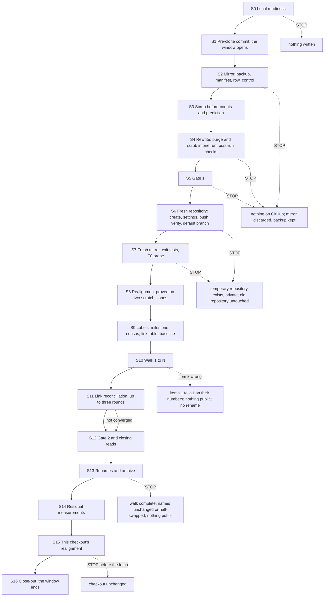
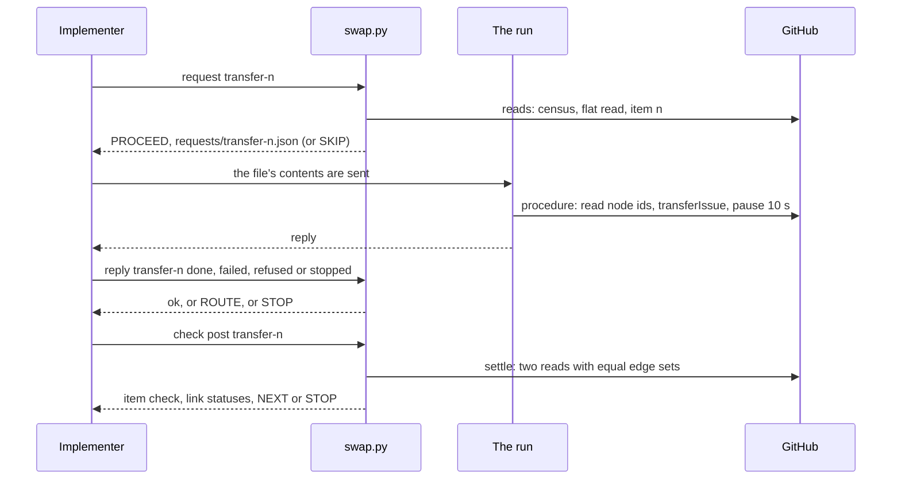

> **Superseded by [`../plan.md`](../plan.md).** This is the version of the plan whose local readiness stage (S0) ran first. The current plan builds every id-shaped fixture value at run time, gives the privacy gate's corpus neutral labels and masks every label it prints, splits the realignment's move so that its hard reset is one command in the form the version-control service runs, and states the scrub-check self-test count consistently.
>
> This copy differs from that version in one line: the 17-digit fixture id in the self-test of `allow_tool.py` (Appendix A) is written here as it is built at run time, so that no id-shaped literal enters the published record. The size and sha256 this copy records for `allow_tool.py` therefore no longer match its own block.

# Phase 0 · 3 — KotlinBottools rewrite and swap: implementation plan

- **Covers:** [SpartanLaboratories/KotlinBottools#23](https://github.com/SpartanLaboratories/KotlinBottools/issues/23),
  *"Phase 0 · 3 — KotlinBottools: rewrite with path scrub, fresh repository, number-preserving swap and clone
  realignment"*, a sub-issue of [#2](https://github.com/SpartanLaboratories/KotlinBottools/issues/2) (parent chain
  #23 → #2 → #1).
- **Architecture:** [`../architecture.md`](../architecture.md), unit `kotlinbottools-rewrite-and-swap` (§15, order 3),
  with §6.4 (the rewrite pipeline), §6.5 (Gate 1 and Gate 2), §6.6 (residual measurement), §7.1 and §7.3 to §7.6 (the
  fresh repository, the number walk, the renames, the stop states, as amended by their dated notes of 2026-11-09), §8,
  §9.1 to §9.4 (this checkout's realignment), §11 (requests and the topic branch) and §12.4 (the report row). Its
  consequences are in [`../consequences.md`](../consequences.md) and [`consequences.md`](consequences.md); the evidence
  is [`research/README.md`](research/README.md), whose Summary is this plan's design input for the fresh repository's
  settings, and the earlier units' research, which it cites.
- **Branch:** `chore/issue-23-history-rewrite`. This plan, this unit's `consequences.md` and its issue board files are
  committed on that branch in one commit made before the mirror clone (§7.4, S1) and carry through the rewrite to the
  fresh repository with the rest of the history; the unit's landing is the first pull request on the fresh repository.
- **What this plans:** the rewrite of KotlinBottools' history with the path scrub in the same filter-repo run; the fresh
  private repository, its settings and the mirror push; the reproduction of every issue and pull-request number of the
  pre-rewrite repository in it, with every relationship; the renames that make it `KotlinBottools` and leave the
  pre-rewrite repository private and archived as `KotlinBottools-legacy`; and the realignment of this checkout onto the
  rewritten history. It is a literal procedure of seventeen stages, with its tools, that an implementer and the run
  carry out without making a decision.
- **Status:** planning only.
- **Target version:** none. Nothing is versioned; no product code, test source or build file changes. The landing changes
  documents and generated boards only.

This unit writes to GitHub and to this checkout, and only through requests. The implementer types the local commands:
the tools' reads and checks, the local stage scripts, and the commands that store a reply. The run sends each request
and waits for its reply. The plan never performs a GitHub write itself and never suggests one outside a request.

---

## Requirements

**Goals**

1. **The history is purged and scrubbed.** One filter-repo run removes the purge list's paths and replaces the
   machine-local path forms in every file and commit message, so that every branch on a fresh mirror is clean, every
   manifest blob is missing, and the scrub's count of machine-local paths is zero over every file of every commit and every
   commit message of every ref.
2. **The fresh repository** is created private and empty under a temporary name, `KotlinBottools-next`, with the old
   repository's settings, except that its wiki is off and the default workflow permissions of GitHub Actions are
   `read` with Actions not allowed to approve pull requests. The rewritten history reaches it by one mirror push without
   `--force`, and no pre-rewrite id resolves in it.
3. **Every number is reproduced.** Every number of the pre-rewrite repository (1 to N, N being 31 when read on
   2026-11-10 and read again at the walk) exists in the fresh repository on the same number: each issue transferred with
   its comments, labels, milestone and state, each pull request reproduced by a closed placeholder issue. The
   milestone `1.0.0` and the three custom labels exist before the walk.
4. **Every relationship is present at the end**, kept or re-created: the 26 sub-issue links, the 44 "blocked by" links
   inside the repository, the 19 with MagicBot issues and the 2 with WebTools #55 (91 edges), consistent on both sides.
5. **The swap.** The pre-rewrite repository (id 562658298) is renamed `KotlinBottools-legacy`, made private and archived,
   with its refs unchanged and no issue left in it. The fresh repository is renamed `KotlinBottools`; its id at that name
   is the recorded fresh id and its heads equal `ref-map`'s new column.
6. **This checkout is realigned** in place onto the rewritten history, with the push-safety proof passed before any push
   leaves it, and the object-deletion proofs passed or the deferred step recorded with its exact commands.
7. **Nothing public is exposed further.** From the mirror clone to the end of the walk nothing lands on KotlinBottools and
   nobody else creates an issue or pull request there. The pre-rewrite repository's public window ends when it is made
   private, and is recorded.

**Rules this unit keeps**

- **The moved texts keep what the transfers write.** When the walk ends, the moved issue texts name
  `SpartanLaboratories/KotlinBottools-next#N` for every cited issue that moved; nothing in this unit edits or restores
  them. The name `KotlinBottools-next` therefore stays reserved permanently: no repository is ever created under it or
  renamed onto it. The walk's item check maps every reference that names the source or the target, in any form
  (`owner/name#N`, `name#N`, issue and pull-request URLs, under `KotlinBottools`, `KotlinBottools-next` or
  `KotlinBottools-legacy`), back to bare `#N` before it compares a text with the one read before the first transfer.
- **The frozen window.** From the moment the pre-clone commit is pushed (S1) until the realignment of this checkout has
  ended and its push-safety proof has passed (S15): no commit is made on this checkout's branches and no tracked file in
  this checkout changes, this plan included. The run's board events inside the window are applied to the git-ignored live
  view only; the tracked boards are brought up to date after the realignment. A correction to a tool needed inside the
  window is saved in the workspace with its new size and sha256 recorded under `DATA`, and enters this plan and the
  as-built record only after the realignment. Before the window everything pending is committed on the topic branch and
  pushed: this plan, this unit's `consequences.md`, its issue board files and the board files already modified here.
  Commits pushed before the mirror clone travel through the rewrite and are mapped by `commit-map`, which is all the
  realignment's map step needs; "no commits of its own yet" (architecture §9.2) is met as "no commit after the mirror clone".
- **This plan matches none of the scrub's expressions.** Because this plan, this unit's `consequences.md`, its research and the board files are committed before the
  mirror clone, the rewrite would change any line of them that one of the three expressions matches, and the published plan would no longer match its own recorded
  hashes. No line of them does: the tools' fixtures build every machine-local path form at run time from fragments. S0 (`k0-ready.sh`) and the pre-check of the S1 commit
  count the real expression file's three expressions over every file this unit's folder holds and every file the commit carries; a match is a stop before the commit.
- **The allow-list is proposed by the run and confirmed by the owner, one key at a time, without a word being printed.** It is built at S0, before the
  window opens, over everything Gate 1 will read before the rewrite. A rejected key leaves its hits blocking: S0 then stops with nothing written anywhere and
  the unit hands back, because a real name in what becomes public needs a decision about the texts and the history. S5 starts from the confirmed list and stops
  if the gate meets a key no one decided.
- **The 26 accepted ids.** The resolution comments on #2, #21 and #22 hold 26 pre-rewrite merge-commit ids inside
  permalinks. They move with the issues and stay. This unit records their count, the three comments they sit in and their
  list (in `DATA` only, never committed or printed), and hands the list to the publication unit, whose id-reference check
  accounts for exactly these 26.
- **Outside this unit.** The 56 links that still name the deleted planning branch (3 in #1's body, 2 in each of #2 to #19,
  16 in MagicBot #1 to #8, 1 in WebTools #55), #1's body naming that branch, and #2's plan-folder line still reading
  `0-<slug>` move as they are. They are open follow-ups for one later pass of issue-text edits on the fresh repository
  before it becomes public. This unit sends no `edit-issue-body` and no comment edit.
- **Placeholders.** The numbers of pull requests #20, #30 and #31 are reproduced by issues closed with reason
  `not_planned`, titled `Placeholder for pull request N: <the pull request's title>`, whose body says in one or two
  sentences that the number belonged to a pull request with that title, merged on its UTC merge date, and that it is at
  `https://github.com/SpartanLaboratories/KotlinBottools-legacy/pull/N`. The pull request's own body is never copied. The
  census at the walk reads the three again.
- **Order of systems** (architecture §7.1): the fresh repository created and proven under the temporary name; the walk;
  the links; Gate 2; the renames and the archive; the realignment.

**Preconditions only the owner can arrange** (S0 checks what it can and stops otherwise):

- **A job for this unit** granted at the version-control service's console, named `phase-0-kotlinbottools-swap`, used as
  `permissionReason` on every request. It defines the actions `push-mirror`, `create-repo`, `repo-settings`,
  `create-label`, `create-milestone`, `transfer-issue`, `placeholder-issue`, `link-issues`, `close-issue`, `reopen-issue`,
  `rename-repo`, `repo-visibility`, `archive-repo` and `realign-checkout`, with the scope: `SpartanLaboratories/KotlinBottools`
  (the pre-rewrite repository, and the fresh one after its rename), `SpartanLaboratories/KotlinBottools-legacy`,
  `SpartanLaboratories/KotlinBottools-next`, `SpartanLaboratories/MagicBot` and `SpartanLaboratories/WebTools` (for
  `link-issues` only), this checkout, and the second scratch clone's path for `realign-checkout`.
- **The service's launcher settings deny `git reset --hard`** and the `git push --force` forms. The realignment contains a
  hard reset, so the job's grant decides lifting that rule for it. The mirror push needs no `--force` (every ref is new;
  `--mirror` alone) and uses none.
- **The owner's answers to the allow-list proposal** (S0, before the window opens). The privacy gate's only suppression is a reviewed
  allow-list. The run proposes its entries from the gate's masked first-run output, and the owner confirms or rejects each key before S5;
  that confirmation is the one owner input to the allow-list. See Design, "The allow-list".
- **From the mirror clone until the walk ends,** nothing lands on KotlinBottools and nobody else creates an issue or a pull
  request there.

**Acceptance criteria** (the issue's "Done when", with the stage checks that prove each):

| Criterion | Proved by |
|---|---|
| KotlinBottools' history is purged and scrubbed: every branch and tag clean on a fresh mirror, every manifest blob missing, a zero count of machine-local paths over every file and commit message of every ref | S4 (`STAGE S4 OK`, with the fidelity and zero-count checks), S5 (Gate 1), S7 (`STAGE S7 OK`) |
| Every number of the pre-rewrite repository is reproduced in the fresh repository with every recorded relationship | S10 (`STAGE S10 OK`), S11 (`STAGE S11 OK`), S12, S16 (`RESULT OK`) |
| `KotlinBottools-legacy` is private and archived, its refs unchanged and no issue left in it | S13, S16 |
| `KotlinBottools` resolves to the fresh repository by id | S13, S16 |
| The main working copy passes the push-safety proof, and its object deletion is proven or recorded as deferred | S15 (`STAGE KR5 OK`; `STAGE KR4 OK` or `STAGE KR4 RECORDED`) |
| The fresh repository's settings read back as designed: wiki off (REST and GraphQL), default workflow permissions `read`, no approval by Actions, default branch `main` | S6 (the read-back tables) |

---

## Current state

**GitHub, as read on 2026-11-09 and 2026-11-10** (counts only; the run reads every one of them again at its stage):

- `SpartanLaboratories/KotlinBottools`, id 562658298, public since 2026-11-08, secret scanning off, wiki stored on,
  forking on (it is public), default Actions workflow permissions `write`. It holds the numbers 1 to 31: issues 1 to 19
  and 21 to 29 (28 issues, 26 open; #21 and #22 closed as completed; #29 open, folded into #3) and pull requests #20, #30
  and #31, all merged with merge commits, whose `refs/pull/N/head` all lie inside `main`. The highest number is 31 today;
  the run reads N itself.
- Its refs on the server: `main`, `chore/issue-23-history-rewrite` (three research commits ahead of `main`; more land
  before the mirror clone), and `refs/pull/20/head`, `refs/pull/30/head`, `refs/pull/31/head`. No tag. The old planning
  branch no longer exists.
- Relationships: 26 sub-issue links (18 under #1, 8 under #2), 44 "blocked by" links inside the repository, 19 with
  MagicBot issues and 2 with WebTools #55: 91 edges. #29 has none.
- Labels: the nine defaults and `type: bug` (`d73a4a`, "A defect in released behaviour"), `type: feature` (`0e8a16`,
  "New capability or API change"), `type: tracking` (`ededed`, "Multi-issue initiative"). One milestone, `1.0.0`, open,
  no due date, 14 open issues on it.
- Eight comments (#1: 2, #2: 2, #3: 1, #21: 1, #22: 1, #29: 1). The texts hold about 119 bare `#N` references (86 in 27
  bodies, 33 in the comments), 11 URL references in the comments of #2, #21 and #22, no bare reference to a
  pull-request number, and references to MagicBot, WebTools and `.github` issues in #1, #3, #9, #15 and #16. No
  machine-local path occurs in any issue text.
- `KotlinBottools-next` and `KotlinBottools-legacy` are unused names. The organisation is on GitHub Free (a private
  repository reports `has_wiki` false in REST whatever is stored; forking of private repositories is disallowed by the
  organisation). The token's scopes are `gist, project, read:org, repo, workflow`; the signed-in account is an
  organisation owner, without `admin:org` and `delete_repo`.
- The fresh repository's settings are specified, with their read-backs, by
  [`research/fresh-repository-settings.md`](research/fresh-repository-settings.md) (requests A, B1 and B2) and
  summarised in [`research/README.md`](research/README.md#summary). Its claim 12 failed verification and is not cited;
  claim 13 is an opinion: the procedure reads which branch GitHub made the default and sets `main` regardless, after the
  push, because the documented precondition for changing the default branch is more than one branch, and the empty
  repository has none.

**Verified outside-world facts this unit rests on** (each with its source; verified on 2026-11-09 and 2026-11-10 against the tool versions above):

- **The rewrite.** git-filter-repo 2.47.0's invocation, the byte rules of its `--paths-from-file` list, the `regex:` semantics of `--replace-text` and
  `--replace-message` (binary blobs untouched), its outputs and the post-run checks:
  [`../research/git-filter-repo-on-windows.md`](../research/git-filter-repo-on-windows.md) §3.4 to §3.6 and §6.1 to §6.7.
- **The mirror push** from a filter-repo mirror (its flags, porcelain lines, GitHub's hidden pull-request refs, the dry run and the per-ref
  verification) and the proof that no pre-rewrite id resolves in the fresh repository:
  [`../research/github-residual-exposure-and-visibility.md`](../research/github-residual-exposure-and-visibility.md) §3.1 to §3.6, §6.2, §6.3 and §6.5.
- **The scans** of the backup and of the fresh mirror: [`../research/gitleaks-local-and-ci.md`](../research/gitleaks-local-and-ci.md) §3.2 to §3.5, §6.4, §6.7, §6.8.
- **The realignment** of a checkout in place under an open IDE, its push-safety proof and its deferred step:
  [`../research/clone-realignment-and-data-extraction.md`](../research/clone-realignment-and-data-extraction.md) §3.1 to §3.6, §3.10, §6.3, §6.8.
- **The privacy gate and the id-reference check:** [`../research/purge-blast-radius.md`](../research/purge-blast-radius.md) §3.B, §6.3, §6.4.
- **What a transfer does** to numbers, closed issues, links and the references in the moved text, and the content-creation limits:
  [`../22-transfer-rehearsal/research/issue-transfer-behaviour.md`](../22-transfer-rehearsal/research/issue-transfer-behaviour.md) §3 and §6, as corrected
  by [`../22-transfer-rehearsal/research/README.md`](../22-transfer-rehearsal/research/README.md#did-not-hold-in-the-build) and measured in the rehearsal's
  [as-built record §3](../22-transfer-rehearsal/final-implementation.md#3-measurements).
- **The rename, privacy and archive order** and identity read by repository id:
  [`../22-transfer-rehearsal/research/rename-visibility-archive-sequence.md`](../22-transfer-rehearsal/research/rename-visibility-archive-sequence.md) §3 and §6.
- **The REST and GraphQL forms** for issues, comments, placeholders, transfers, links, the census and the flat read:
  [`../22-transfer-rehearsal/research/fixture-and-read-api-forms.md`](../22-transfer-rehearsal/research/fixture-and-read-api-forms.md) §3 and §6.
- **The fresh repository's creation, settings and read-backs:** [`research/fresh-repository-settings.md`](research/fresh-repository-settings.md).

**This machine.** git 2.55.0.windows.5, Python 3.14.7, gh 2.100.0, git-filter-repo 2.47.0 (version prefix
`a40bce548d2c`, module sha256 `67447413e273fc76809289111748870b6f6072f08b17efe94863a92d810b7d94`) and gitleaks 8.30.1,
as the preparation unit recorded them in `DATA/run/tool-versions.txt`. `DATA/COPY-VERIFIED` exists; the expression file
`DATA/run/scrub/replace-text.txt` is 3 lines, 291 bytes, sha256
`60594a2f2bf43822050cf5b164ac7f1f1eb1f41db3eb0302e57db50d0025740f` (never printed); the six lists are in `WS/lists/`,
KotlinBottools' being 11 lines, 115 bytes, sha256 `4926094b17b052716ec45c33269eb3ce18f9d4d2eaa0c5c6fb75081c78c2b0fd`.
The preparation unit's KotlinBottools mirror and backup still exist (`WS/mirror/`, `WS/backup/`, with
`DATA/rewrite/KotlinBottools/ls-remote-at-clone.txt` and `backup.SHA256SUMS`); they served the data copy only, and this
unit replaces them with its own taken at S2 (`s6-backups.sh` stops when a mirror or a backup exists, so S2 moves unit 1's
copies aside first). The five static repositories' backups and checksum lists are the corpus of Gate 1.

**KotlinBottools' expectation is by rule.** The preparation unit's tool folder holds no manifest, expectation row or
positive control for KotlinBottools (`s8-row.sh` serves the five static repositories only; `expected_rows.txt` has no
KotlinBottools row). The expectation is therefore: commits after = T − P, where T is counted over every ref of the mirror
at its clone (83 commits on `main` plus the topic branch's commits on 2026-11-10; the pull-request heads lie inside
`main`) and P = 2 (the commits the purge prunes) + E (the commits the scrub would make empty, counted before the run).
At `main`'s tip 153 files are tracked, 41 of them removed by the purge and 2 whose content the scrub changes
(`build.gradle.kts` and `src/main/kotlin/bottools/dataprocessing/GuildDataParser.kt`). The planning documents name no
machine-local path any more, but older commits do, so the scrub changes history-wide and E may be above 0. The scrub
changes blob content, so the purge-only `blobs_kept` of `expect_row.py` is not the post-run blob count: the procedure
predicts the post-run blob set exactly (every kept text blob with the expressions applied; binary blobs, those with a
NUL in the first 8 KB, unchanged), checks it, and gives `expect_check.py` the scrub-adjusted counts.

**The rehearsal's tool and its gaps.** The transfer rehearsal ran with `rehearsal.py` (sha256
`9bc7fd63c773c19b5f149f332eb382c9b6e985a10a9a01929b6f22d6e73596a6`, the text of the rehearsal unit's Appendix A, byte-identical
on this machine to the one that ran). It measured: a transfer lands on the same number when the target's highest number
is one below; a closed issue arrives closed with its reason; the links all stay kept across a transfer, also across
repositories; references in the moved text are rewritten to full names; the renames and archive order, and identity by
repository id ([as-built record §3](../22-transfer-rehearsal/final-implementation.md#3-measurements)). Its known gaps
([consequences §5](../22-transfer-rehearsal/consequences.md)) are closed in this unit's own tool, `swap.py`
(Design, "The walk tool").

**The saved realignment scripts** (`realign-1-preflight.sh` to `realign-4-purge.sh`) depart from architecture §9.2 in four
ways, which this unit's own copies (`kr1-preflight.sh` to `kr5-proof.sh`, Appendix A) correct: (1) the running-`git.exe`
check and the open-handle check are recorded, not stops; (2) the fetch and the `ls-remote` before it use `gh auth git-credential` as the only credential
helper (architecture §6.1), so that no Git Credential Manager window can open in a run that cannot answer one, where the saved script used the checkout's own helper; (3) the fresh
repository's id is read, and compared with the recorded id and with 562658298, before anything is fetched; (4) the
tracked files whose content the scrub changes are predicted before the move and verified after it. Like the saved
scripts, the preflight stops on any tracked change, and the request service's own guard checks the same immediately
before the move.

**This checkout.** On `chore/issue-23-history-rewrite`, equal to its remote and ahead of `main` by the research commits;
one worktree; no stash; `origin` the only remote; Git Credential Manager configured system-wide; `core.autocrlf true`.
Nine tracked board files are modified and uncommitted (board events write them here). This unit's folder is untracked
except `research/`. Ignored or untracked local folders: `.idea/`, `.gradle/`, `build/`, `docs/plans/.live/` and
`graphify-out/` (the last two excluded by `.git/info/exclude`; `graphify-out/` is a graph of the code and documents with no
purged file among its sources and no token-shaped string). IntelliJ IDEA was not running when checked; the procedure works
with the project open or closed and records which. The generated board `plan.json` of this unit carries a pre-rewrite
commit id in its generated `baseline.sha` field; generated board fields are outside the output rule (architecture §1.1
item 9, dated note). This plan cites commits by subject, never by id.

**Self-tests, run before this plan was written** (from a sandbox standing in for the user profile, on fixtures the tests
build themselves; no real history, no real repository):

- `swap.py selftest`: `ok    selftest: 537 checks passed`, and a mutation harness showed that its checks fail when the logic they
  guard is broken.
- `allow_tool.py selftest`: `ok    allow_tool selftest: 29 checks passed`, on made-up legacy data and a fixture corpus with planted hits, through the real gate.
- `scrub_check.py selftest`: `ok    scrub_check selftest: 15 checks passed`.
- `kselftest.sh`: `ok    kselftest: 106 checks passed`, covering `kept_findings.py` on a finding in a kept file, the
  rewrite scripts (S3, S4) end to end on a fixture with the scrub, Gate 1's script, the push preparation and verification, the
  exit tests with the F0 probe, the scratch clone and the realignment scripts on fixture clones, and their stops.
  `k14-residual.sh` and `k16-close.sh` against the same stand-ins, each with a passing run and with runs that record or stop.

---

## Assumptions

| # | Assumption | If false |
|---|---|---|
| A1 | Everything pending is committed on the topic branch before the mirror clone (S1), and nothing is committed after it until the realignment has ended. | A commit made in the window is not mapped by `commit-map`: `kr1-preflight.sh` stops on a branch tip not in the map, and the realignment is redone from a fresh mirror. |
| A2 | `push-mirror` and `repo-settings` work as the research describes on their first use. Their target is the temporary repository, which a re-run can use again or replace under another temporary name. | A refusal or a read-back difference stops S6 with the temporary repository holding what it holds; the stop table says what to do. A re-run under another temporary name needs the tools' temporary name changed, leaves `KotlinBottools-next` in place and reserved, and is a hand-back, not a step of this plan. |
| A3 | The realignment is proven before it touches this checkout: a local dry run of the scripts on a scratch clone, then one `realign-checkout` request against a second scratch clone, then the request on this checkout, after this checkout's untracked and ignored files were copied to `DATA`. | A failure on a scratch clone stops S8 before the walk; nothing public has changed, and the scripts are corrected before the walk (a correction before the window opens enters the plan; after it, see the frozen window). |
| A4 | Placeholders for pull requests are issues closed with reason `not_planned`; GitHub accepts creating an issue and closing it on the number the target's highest number plus one gives. | A refusal stops the walk at that number (stop state of S10); the rehearsal created and closed one on the same pattern. |
| A5 | The rehearsal tool's known gaps are closed in `swap.py`, with the fuller self-test, before any write. | S0 stops on a failing self-test; no write is made. |
| A6 | A transfer's dropped links are repaired by `link-issues`, in at most three rounds, including links whose other end is a MagicBot or WebTools issue, through requests whose `target` is that repository. | The links not repaired are recorded by number and kind (S11 `RECORDED`) and handed back; every number is still reproduced. |
| A7 | A transfer rewrites references in the moved text to the repository's full name, in both directions, as the rehearsal measured; it either rewrites texts in MagicBot, WebTools and `.github` that cite a KotlinBottools issue or it does not. | The item check maps every form back, so a different rewriting form is a difference only if it is not a reference; the outcome of the cross-repository texts is recorded (S9, S12) and goes to the consequences either way. |
| A8 | The three closed issues' transfer route measured in the rehearsal (a closed issue arrives closed with its reason) holds on #21 and #22; the tool still carries the reopen and close routes. | The step prints `NEXT` for the route and takes it; each route is recorded. |
| A9 | The renames behave as in the rehearsal: a rename onto the name the source has just released is accepted (in the rehearsal it came about six minutes after the release, with the privacy step and the archive between; no waiting period is implied), and the redirect from `KotlinBottools-next` holds while no repository takes that name. | The rename stops (S13 stop state: names half-swapped, nothing public); the re-run continues from the first rename that did not take. |
| A10 | The service's grant lifts its rule against `git reset --hard` for the realignment's job. | The `realign-checkout` request is refused (`refused`); nothing moved; the owner decides, and the realignment is the last stage so that nothing before it depends on it. |
| A11 | `gh auth git-credential` serves the fetch of the private fresh repository from a checkout and from a scratch clone. | S8's dry run stops at `kr2-fetch.sh` before anything moves; nothing public has changed. |
| A12 | The names the gate meets are ordinary words, a repository name, the template guild folder, and the Steam64 base, as the research found. | The owner rejects the key (a name that looks like a person or a server), and S0 stops before the window opens with nothing written; the unit hands back. |
| A13 | The default-rule findings of gitleaks in kept files are none; a custom-rule finding cannot occur after the purge. | A default-rule finding is recorded by rule id and count at S7 and stops the publication unit's visibility change, not this unit; a custom-rule finding stops S7 (a purged kind of file survived). |
| A14 | No landing, issue or pull request is created on KotlinBottools between the mirror clone and the end of the walk. | S6's preparation stops on a head that is not `ref-map`'s old column; S9's census and S12's highest-number check stop on a number that is not in the census; the unit restarts from a fresh mirror. |

---

## Non-goals

- Restoring the moved issue texts' references to a bare form or to the final name, and any issue-text edit (the open
  follow-ups above). No `edit-issue-body` request and no comment edit is sent.
- The hygiene files, the visibility change of the fresh repository, secret scanning, Gate 3 and the id-reference check:
  later units.
- The rewrite of the other five repositories, and TrumpBot's clone.
- Deleting the pre-rewrite repository, the fresh repository's old temporary name's redirect, or the throwaway repositories of
  the rehearsal (the token has no `delete_repo` scope).
- Editing MagicBot's or WebTools' documents or issue texts: only their relationships with KotlinBottools issues are written.
- Any change to a source, test or build file.

---

## Design

### Shape of the procedure

Seventeen stages, run in order, each ending with a `STAGE <id> OK` line, a `STAGE <id> RECORDED <what>` line (a recorded
shortfall: the unit goes on along the arrows of the stop table) or a `STOP`. The table is the board's list of the unit's
stages.

| id | name | brief | kind | steps |
|---|---|---|---|---|
| S0 | Local readiness | The tools are saved and verified, the pins, data copy and backups are as recorded, every self-test passes, the names are free, the job is open and the privacy gate's allow-list is confirmed | check | bootstrap: Save and hash the tools; local-ready: Pins, data copy, expression file, backups; selftests: Walk tool, scrub tools, allow-list tool, shell scripts; source: The source's identity; names: The two names are unused; rate: Rate-limit headroom; job: The job is open with its actions defined; allow-proposal: Propose the allow-list entries from the gate's masked output; allow-confirm: The owner confirms or rejects each key; allow-write: Write the list and its record; allow-verify: Verify it against the corpus |
| S1 | The pre-clone commit | Everything pending is committed on the topic branch and pushed, and the window opens | work | precommit: Commit and push the pending documents and boards |
| S2 | Mirror, backup, manifest, expectation, control | KotlinBottools' own mirror and untouched backup, its manifest, its expectation row by rule, and its positive control | work | mirror: Move unit 1's copies aside and take the mirror and backup; manifest: Manifest and expectation row; control: Positive control and kept findings |
| S3 | The scrub's before-counts | The scrub matches in both path kinds, the commits it would empty are counted, and the post-run blob set is predicted | check | scrub-before: Before-counts, E and the prediction |
| S4 | The rewrite | One filter-repo run purges and scrubs, and every post-run check, including the fidelity check, passes | work | rewrite: The invocation and the post-run checks |
| S5 | Gate 1 | The confirmed allow-list is checked, and the rewritten mirror, the five static backups' messages and identities and the old repository's texts hold no name, guild or id, and the accepted ids are listed | check | dump-old: Dump the old repository's texts; gate-1: Gate 1 and the accepted ids |
| S6 | The fresh repository | A private empty repository is created and set, the mirror is pushed without force and verified on two channels, and the default branch is set | work | fresh-create: Create it; fresh-settings: Apply and read back the settings; push-prep: Push preparation; fresh-push: The mirror push; push-verify: Per-ref verification; fresh-default: Default branch and its read-back |
| S7 | Fresh mirror and exit tests | A fresh mirror passes the exit tests, and no pre-rewrite id resolves in the fresh repository | check | exit-tests: Fresh mirror, manifest, scrub count, gitleaks and the F0 probe |
| S8 | Realignment proven on scratch clones | The realignment scripts and the realignment request are proven on two scratch clones before they touch this checkout | check | dry-run: Scripts on the first scratch clone; scratch-clone: Second scratch clone; realign-scratch: The realignment request on it |
| S9 | Before the walk | The milestone and labels exist, and the census, link table, baseline, accepted ids and cross-repository references are recorded | work | labels-fresh: The three labels; ms-fresh: The milestone; census: Numbers 1 to N; baseline: Texts, links and states before the first transfer; accepted: The accepted ids; xrefs-before: Cross-repository references |
| S10 | The walk | Every number 1 to N is on its number in the fresh repository, issues transferred and pull requests reproduced by closed placeholders | work | walk: transfer-N or placeholder-N for each number in order |
| S11 | Link reconciliation | Every recorded relationship is present on both sides, kept or re-created | work | links-r1: Round one; links-r2: Round two; links-r3: Round three |
| S12 | Gate 2 and the closing reads | The moved texts pass the gate, the numbers and texts are re-read, and the cross-repository references are counted again | check | gate-2: Dump and gate the fresh repository's texts; reads: Numbers, items and references |
| S13 | The renames and the archive | The old repository is renamed, private and archived; the fresh one is named KotlinBottools with its recorded id and heads | work | rename-old: Rename the old repository; private-old: Make it private; archive-old: Archive it; rename-fresh: Rename the fresh repository; swap-reads: Identity, URLs, heads and settings snapshot |
| S14 | Residual measurements | The old ids' answers in the fresh and legacy repositories, the activity feed and the public window are recorded | check | residuals: The probes and the report row |
| S15 | This checkout's realignment | This checkout is on the rewritten history and passes the push-safety proof, its object deletion proven or deferred | work | copy-local: Copy the untracked and ignored files; realign-main: The realignment request; proofs: Push-safety and object-deletion proofs |
| S16 | Close-out | Every number, placeholder, link, rename and proof is recomputed from final reads, and the window ends | check | result: The final gate; close-local: Legacy refs, checksums |



**The ordering reasons.** Nothing is written to GitHub before S6, so every stage before it can be re-run from its start.
Realignment is proven on scratch clones (S8) before the walk, because the walk cannot be undone and the realignment
scripts are the part of the unit nothing has exercised; the realignment of this checkout itself is last (S15), because it
needs the final names. Gate 2 (S12) precedes the renames, because it is the last stage before the repository changes name.

### The job

A **job** is a named, scoped grant recorded at the version-control service's console under
`SpartanLaboratories/KotlinBottools`: its scope lists the repositories its requests may touch and the actions they may use;
each request names it in `permissionReason`. This unit's job is `phase-0-kotlinbottools-swap`; its actions and scope are
the owner's precondition above. An **action** is a named kind of write the request protocol carries out; it is defined when
the protocol has it. A request with a `target` other than `github` names, in `target`, a repository the job's scope lists. S1's `commit` is an ordinary version-control
request and names no job; every other request of this unit does.

### The requests

A request is a JSON document that `swap.py` generates into `DATA/run/swap/requests/<key>.json` immediately before it is
sent. The run sends the file's contents as one request and waits for the reply; on `done` the check of §7.4 runs.

**Fields of every request**

| Field | Value |
|---|---|
| `permissionReason` | `phase-0-kotlinbottools-swap`, the job's name; every request but `precommit`, an ordinary version-control request that names no job |
| `github` | `SpartanLaboratories/KotlinBottools`, the repository the job is recorded under |
| `action` | the action's name (table below) |
| `target` | the repository the write applies to, as `owner/name`, by the name it holds at that moment |
| `issue` | for `transfer-issue`, the issue's number in the source; otherwise 23, this unit's issue number |
| `procedure` | the literal commands, in order, run in one shell (a command that sets a variable is on the same line as the command that uses it); `gh api` for every GitHub write; at least 3 s between writes and 10 s after a transfer; every network `git` command with `gh auth git-credential` as its only credential helper |
| `inputs` | `key` (the request's key), `files` (file name → exact text) where a command reads `@file`, and the action's own inputs (`mirror`, `expectedTally`, `scripts`, `checkout`) |
| `checks` | the facts the reply must show; where a command reads `@file`, the first check tells the run to write each entry of `inputs.files` byte for byte (UTF-8, no BOM, LF, no trailing newline) into the working folder |
| `v`, `id`, `attempt`, `from`, `repo` | supplied by the run: the request protocol's envelope, added when the file is sent, except `repo` for `realign-checkout`: that request carries the path of the clone it acts on (the scratch clone for `realign-scratch`, this checkout for `realign-main`, equal to `worktree`) and the run sends it unchanged; `id` is `<sender>/23/<key>`, `attempt` the number of stored replies for the key plus one |

Fields of one action only: `branch`, `worktree`, `paths`, `notes` (`commit`); `mirror`, `expectedTally` (`push-mirror`);
`settings` (`repo-settings`); `source` (`transfer-issue`: the source repository); `number`, `title`, `body`
(`placeholder-issue`; `number` also names the issue to change in `close-issue` and `reopen-issue`); `relationships`
(`link-issues`: `[{op, kind, from, to}]`, `op` `add` or `remove`, `kind` `sub-issue` or `blocked-by`, `from` the parent or the
blocked issue and `to` the child or the blocker, each as `owner/repo#n`); `newName` (`rename-repo`); `visibility`
(`repo-visibility`); `worktree` and `repo` (`realign-checkout`: the clone's path, the same in both).

**The requests, in order**

| Key | Action | Target | Fields beyond the common ones | Pre-write check inside `request` | Verified by `check post` |
|---|---|---|---|---|---|
| `precommit` | `commit` | `…/KotlinBottools` | `branch` the topic branch, `worktree` this checkout, `paths` the exact list the script derives | every modified tracked file is a generated board file under `docs/plans/`, every untracked file lies in this unit's folder; anything else is a stop; the path scrub's three expressions, counted over those files and over every file this unit's folder holds, match none (counts only; a match is a stop before the commit) | tracked files clean; no untracked file in this unit's folder; the local topic branch equals its remote |
| `fresh-create` | `create-repo` | `…/KotlinBottools-next` | — | the name is free (or is this unit's own, adopted by id) | id and node id recorded; private; empty (no branch, size 0); not archived; anonymous 404 |
| `fresh-settings` | `repo-settings` | the fresh repository | `settings`: wiki off, workflow permissions `read`, no approval by Actions | the settings read by id against the table of the findings | the read-back table, REST and GraphQL, saved as snapshot B1; after the push the same read compares the values that do not depend on the push |
| `fresh-push` | `push-mirror` | the fresh repository | `mirror`, `expectedTally` (`new` = the number of heads; forced, deleted, rejected 0; `Done` 1) | the server's branches against `ref-map`'s new column: nothing, part, all, or a head that is not a rewritten one (a stop) | the same read: every branch equals the new column |
| `fresh-default` | `repo-settings` | the fresh repository | `settings`: default branch `main` | the default GitHub made is read and recorded before the write | table B2, REST and GraphQL; only the emptiness and default-branch fields differ from B1 |
| `labels-fresh` | `create-label` | the fresh repository | — | only the labels of the old repository's three that are missing are sent | all three present with exact colour and description; the nine defaults present |
| `ms-fresh` | `create-milestone` | the fresh repository | the milestone's description in `inputs.files` | skipped when present | `1.0.0`, description, no due date, open |
| `transfer-N` for each issue number N | `transfer-issue` | the fresh repository | `issue` N, `source` `…/KotlinBottools` | the source holds N, the fresh repository's highest number is N−1, N is not in it | N is gone from the source; the fresh repository has it on N; the item check; the links classified |
| `placeholder-N` for each pull-request number | `placeholder-issue` | the fresh repository | `number`, `title`, `body` (the text of Requirements) | the fresh repository's highest number is N−1 (an existing placeholder with this text is skipped, wherever N is); the close is on the same command line as a test that the issue's title is the placeholder's, so a create that landed elsewhere can never close another issue | exists on N, closed, `not_planned`, title and body as specified, not a pull request |
| routes: `reopen-N`, `unlink-N`, `close-t-N`, `reopen-t-N` | `reopen-issue`, `link-issues`, `close-issue`, `reopen-issue` | the source, the source, the fresh repository, the fresh repository | `number`; `relationships` (the issue's edges, `remove`) | the issue's current state or edges | the new state; no edge touches the issue |
| `links-rK-s`, `-t`, `-m`, `-w` for K = 1 to 3 | `link-issues` | the source, the fresh repository, MagicBot, WebTools | `relationships`: removes first, then adds | written by `links rK` from a settled read | `check post links-rK-…`: the settled edge set equals the expected one, or `NEXT links rK+1` |
| `rename-old` | `rename-repo` | the source, by its current name | `newName` `KotlinBottools-legacy` | the id at the name is 562658298 | id 562658298 at the new name |
| `private-old` | `repo-visibility` | the old repository (`KotlinBottools-legacy`) | `visibility` `private` | the id at the name is 562658298 | read back private; unauthenticated 404 by name, by id and on the web |
| `archive-old` | `archive-repo` | the old repository | — | the id at the name is 562658298 | read back archived |
| `rename-fresh` | `rename-repo` | the fresh repository, by its temporary name | `newName` `KotlinBottools` | the id at the name is the recorded fresh id | the id at `KotlinBottools` is the fresh id, not 562658298 |
| `realign-scratch`, `realign-main` | `realign-checkout` | the fresh repository (by the name it holds) | `repo` and `worktree`, both the clone's path; `inputs.scripts` | done when the push-safety proof already holds for the clone | the proof (`kr5-proof.sh quiet`) holds, and the run reads the proofs of §7.4, S15 |

Each request's `procedure` is the literal commands: `POST orgs/{org}/repos` with `-F private=true -F auto_init=false`,
`PATCH repos/{owner}/{repo}` with every settings field and never `name`, the two `PUT`s of the Actions permissions,
`git push --porcelain --mirror fresh` (a dry run first, the same flags), `transferIssue`, `addSubIssue`, `addBlockedBy`,
`removeSubIssue`, `removeBlockedBy` through `gh api graphql` with node ids read in the same command line, and
`PATCH repos/{owner}/{repo}` with `-f name`, `-f visibility` or `-F archived=true`. It never uses `gh issue transfer`,
`gh issue edit` or `gh issue view --json`. Every request that names a repository first reads its id by name and stops when
it is not the recorded one, so a write addressed to a name never lands on a repository that has since taken the name.

**What a reply is.** The implementer stores each reply under one of four names. `done`: the protocol's `done`, the
procedure having reported success. `failed`: a reply, `done` or `rejected`, whose text shows the procedure ran and a command
failed, with GitHub's error body in it. `refused`: a `rejected` whose reason shows the request was not carried out (the job
is not open, an action is not defined, a permission was refused); a `refused` request wrote nothing. `stopped`: the
protocol's `stopped`, a write whose own check failed and after which no further step ran: the tool prints
`ROUTE read-first`, and the implementer runs `check pre <key>` and acts on its answer (`PROCEED`: send the request again;
`SKIP`: the write is done) before any other step.

**Retry and routes.** The tool, not the request, decides what follows a `failed` reply. A throttle error is retried after
reading back (the next `request` runs its pre-check, which reports `SKIP` if the write landed): after the `retry-after`
seconds the reply states, else 60, 120 and 240 seconds, at most four attempts. A refusal of a transfer that mentions
sub-issues, parents or "blocked by" runs the unlink route; a refusal of a transfer of an issue that is closed in the source
runs the reopen route; each route is tried once per issue. Any other refusal ends the step. Every refusal's whole body is kept
in `steps.jsonl` and in `replies/`. A link request that fails in part is not retried inside the step: the check reads what
landed and the next round writes what is missing.

**One step of the walk**



### The tools

All tools are saved from Appendix A by the S0 bootstrap, each checked by size and sha256, and run through
`run-stage.sh`, which appends their output to `DATA/run/as-run.log`.

**`swap.py`** (with its runner `swap-step.sh`), Python 3 standard library only, run as `python -X utf8 -I`, derived from
the rehearsal tool's reusable parts: the flat read by repository node id (25 issues a page, each stating its own `parent`,
`subIssues`, `blockedBy` and `blocking` with the other end's repository and number; a nested connection that reports a next
page is a stop); the REST census by repository id (so a rename never changes what is read); edge sets with the
four-connection cross-check; settle; classify; the refusal routes and pacing; the identity, URL and reference reads; and the
request builders with their pre-checks. It is parameterised by the real census and link table, which it reads into
`DATA/run/swap/` before the first transfer, not by a fixture.

| Subcommand | What it does |
|---|---|
| `selftest` | the pure logic and the whole flow against an in-memory stand-in for GitHub: no network, no file but a temporary folder |
| `smoke` | a read-only proof that the reads work against the real source (counts only) |
| `check source`, `check names`, `check rate`, `check protocol JOB open defined` | the S0 checks: the source is id 562658298, public, not archived; the two names are unused; rate-limit headroom (at least 1500 each of core and GraphQL); the job state the run reports |
| `request KEY` | runs the key's pre-write check and, on `PROCEED`, writes `requests/KEY.json`; on `SKIP` writes nothing; on a conflict stops |
| `reply KEY done\|failed\|refused\|stopped` | stores the reply text from standard input in `replies/`, logs it, and prints the `ROUTE`, or stops |
| `check pre KEY`, `check post KEY` | one verification; `ok`, `NEXT` and `STOP` lines; one record in `steps.jsonl` |
| `check stage ID` | the closing verdict of S1, S6, S9, S10, S11, S12 and S13 (`STAGE <id> OK` or `STAGE <id> RECORDED …`) |
| `census`, `baseline`, `accepted` | S9: the numbers and kinds; every issue's text hashes, state and reason, labels, milestone, comments, and the link table with the other end's repository, taken before the first transfer; the accepted ids |
| `links rK` | from a settled read computes the removes and adds and writes `links-rK-s`, `-t`, `-m` and `-w` (only the groups that have work) |
| `read LABEL`, `settle LABEL` | the flat read; `settle` repeats it until two reads 6 s apart have equal edge sets, at most eight reads, and reports `settled=False` at the bound |
| `ids LABEL`, `urls LABEL` | the identity reads (by id, by name, unauthenticated by name, id and web) and the old-URL follows of a rename step |
| `snapshot LABEL [OTHER [counts]]` | the fresh repository's settings by id into `snapshots/settings-LABEL.json`; with OTHER, the diff, which may hold only the name and URL fields (and the open-issue counts with `counts`) |
| `xrefs LABEL`, `refs LABEL` | the reference forms in the texts of MagicBot, WebTools and `.github` that cite a KotlinBottools issue (counted, with a hash of the texts, never printed), and what the names in the moved texts resolve to |
| `dump LABEL ROLE` | the issues, pull requests, comments and reviews of one repository, whole, into `DATA/run/gate/` (counts printed) |
| `result` | the final gate: every shape recomputed from reads taken now |

**The closed gaps.** Every known gap of the rehearsal's consequences §5 is closed in `swap.py`:

| Gap | How it is closed |
|---|---|
| `settle()` always reported settled | it returns `settled=False` and the difference of the last two reads when the bound is reached; the classification then reports `unsettled`, and the final link check and `result` require `settled` |
| The result gate used constants and step-time records | `result` recomputes every shape from reads taken at its own run (census, flat read, labels, milestone, identity); `ids` and `transfer` results follow one rule, the last record of a key, failures included, so an older success never stands over a later failure; the placeholder shape verifies each placeholder at the end (number, title, body, closed, reason, not a pull request); no shape passes vacuously (an empty list, an empty census or an empty baseline fails) |
| A resumed placeholder request did not skip | `placeholder-N` is `done` when the placeholder is already there with its text and state, for any N (adjacent placeholders and one at the top included); a placeholder with other text is a conflict, never overwritten |
| Unauthenticated reads: a 5xx, a timeout or a `URLError` was a traceback or a wrong answer | `unauth()` retries a bounded number of times and then records `unreachable:<why>`, which is never taken as an answer; the identity read stops with "run it again later" |
| A thin self-test | `selftest` covers the result gate; the post-check failure paths (an item difference, the closed-issue branch, a wrong number, the three tries); `judge` and every handler; command-level `STOP` handling; the link rounds and their post-check; inconsistent edges; settle at its bound; every negative of `diff_item`; the nested-connection stop; the stand-in is wholly in memory, every check label states a behaviour, and a mutation harness showed that checks fail when the logic they guard is broken |

The tool prints counts, numbers, repository ids and fixed markers only; never an issue's text (the texts are kept under
`DATA`). It never prints a token. It writes nothing to GitHub: every write is a request built by `request` and `links`.

**`scrub_check.py`** reproduces, from git-filter-repo 2.47.0's own semantics, what one run with `--invert-paths
--paths-from-file LIST --replace-text EXPR --replace-message EXPR` does: a path is removed when it equals a list entry or
lies below one; a blob is text when its first 8 KB hold no NUL, and only a text blob is rewritten (each `regex:`
expression, in file order, by `re.sub` over the bytes, with the replacement after the last `==>`); a commit message is
rewritten the same way and then its hexadecimal words are translated to the new commit ids; a commit whose changes all
become identical to its parent's is pruned. `predict` (before the run) counts the commits the purge prunes, the commits the
scrub alone would empty (E), the surviving paths, the predicted post-run blob set (written to `predicted-blobs.txt`) and the
number of surviving blobs the scrub changes; `verify` (after the run) checks every surviving commit tree by tree against
the prediction (trees, identities, messages, the blob set) and prints `RESULT: PASS`; `index-effects` (inside a work tree)
predicts which tracked files the rewrite removes and which it changes in content. It prints counts only.

**The stage scripts** (Appendix A; each ends with its `STAGE` line and stops with a `STOP` line through `expect`, which
prints and ends the script):

| Script | Stage | What it does |
|---|---|---|
| `k0-ready.sh` | S0 | every reused tool at its recorded size and sha256; the version pins against the preparation unit's record; `COPY-VERIFIED`; the expression file and the purge list; the five static backups against their checksum lists; this unit's folders |
| `kselftest.sh` | S0 | the shell scripts on fixtures in a sandbox that stands in for the user profile |
| `k2-mirror.sh` | S2 | unit 1's copies aside; `s6-backups.sh`; the manifest; the expectation row by rule; the positive control with KotlinBottools' named probes; kept findings |
| `k3-scrub-before.sh` | S3 | the scrub's before-counts, E, the prediction; writes `expect.env` |
| `k4-rewrite.sh` | S4 | the one invocation and every post-run check |
| `k5-gate1.sh` | S5 | Gate 1; the accepted ids |
| `k6-fresh.sh` | S6, S13 | `prep` (push preparation, the `fresh` remote) and `verify` (per-ref verification on two channels) |
| `k7-exit.sh` | S7 | the fresh mirror, exit tests and the F0 probe |
| `k8-scratch.sh` | S8 | a scratch clone of the backup set up like this checkout |
| `kr1-preflight.sh` … `kr5-proof.sh` | S8, S15 | the realignment: preflight, fetch, move, verification, purge, push-safety proof (`quiet` mode answers by exit status) |
| `k14-residual.sh` | S14 | the residual probes and the report row |
| `k16-close.sh` | S16 | the legacy repository's refs, the checksum lists |
| `allow_tool.py`, `allow-step.sh` | S0, S5, S12 | the allow-list: `propose`, `decide`, `write`, `verify`, `check`, `selftest` (Design, "The allow-list") |
| `kcorpus.sh` | S0, S5, S12 | the corpus arguments of one run of the gate, so that the proposal, the gate and the verification read the same corpus |
| `klib.sh` | all | shared functions |

**Rewrite pipeline (S2 to S4), as the scripts carry it.** Pre-run checks in the mirror (bare, one remote `origin` with
`remote.origin.mirror=true`, no `filter-repo/` folder, no stash, at most one pack, no case-colliding refs, a parseable
`git config --list`, `N_BEFORE` = T, every list entry counting at least one commit); the invocation exactly
`git filter-repo --sensitive-data-removal --invert-paths --paths-from-file <list> --replace-text <expr> --replace-message <expr>`
with standard input from `/dev/null` and output to a log, no `--force`, `--partial`, `--refs`, `--no-fetch` or `--mailmap`, one
invocation per mirror; then: exit status 0 and no `fatal`, `error`, `Traceback` or warning line; `You rewrote T (of T)`; in
`commit-map` rows = T, changed rows = T, pruned rows = P; one `first-changed-commits` line; `origin` retained; commits
after = T − P; every list entry counts 0; the number of refs unchanged; `fsck` clean; `expect_check.py` PASS with the
scrub-adjusted counts; every manifest blob missing and the backup the control; the scrub's zero count (all three
expressions) over every file of every commit and every commit message on every ref; the fidelity check (`scrub_check.py
verify`); and the number of surviving blobs the scrub changed equal to the prediction. The outputs are copied to
`DATA/rewrite/KotlinBottools/` with a `SHA256SUMS`.

### The allow-list

The privacy gate (`privacy_gate.py`, the preparation unit's tool at its recorded hash, unchanged) fails on any member name, guild folder or standalone id of the
legacy data it meets. Its only suppression is an allow-list of words the reviewer has judged not to be personal data (ordinary words, a repository name, the
template guild folder, public constants such as the Steam64 base). The gate never prints a name, and an entry that is a real name hides a leak, so the list is
built by proposal and confirmation, never by the run's own judgement, and no word is printed or written anywhere but the list itself.

- **Where it sits.** At S0, before the window opens. The first run covers, before the rewrite, everything Gate 1 will read (`kcorpus.sh s0`): this checkout's
  history with the purge list applied (`privacy_gate.py --repo <checkout>::<purge list>`, the mode its usage line documents for "before the rewrite"); the files
  the pre-clone commit will carry (`--file` on this unit's folder and on each modified board file); the five static backups' commit messages and identities
  (`git log` dumps under `WS/tmp`, read with `--file`); and the old repository's texts (`swap-step dump old S`). The scrub only replaces paths, so S5's corpus can
  only hit fewer names than this one.
- **The proposal** (`allow_tool.py propose s0`). The gate's own output, with no allow-list, lists every blocking name as `NAME#i` or `GUILD#i`: the index into
  its member or guild list sorted case-insensitively, stable because the legacy data does not change, with its length, hits and distinct files and up to two masked
  lines per corpus (every hit masked as `<NAME#j>`, `<GUILD#j>` or `<ID>`). The tool prints one row per key: the key (`NAME#i`, `GUILD#i`, or `ID#k`, k numbering the
  distinct standalone id values in first-seen order across all proposals), its kind, length, hits, files and masked lines; for an id also whether it is the Steam64 base
  (76561197960265728, a public constant) and whether it is in the legacy data, as yes or no. It loads the gate's functions from its source without the final `main()`
  call, so the lists and the masking are the gate's own, and it stops if the gate's own output and the rows disagree on the blocking names. A key already confirmed is
  not proposed again. The implementer fills a proposed category per key from the masked context: repository name, ordinary word, template guild folder, public
  constant, or "not proposed (it looks like a person or a server)".
- **The confirmation.** The run puts the proposal to the owner, each key with its masked lines and proposed category, and waits. The owner confirms or rejects each
  key. The implementer records every answer with `allow_tool.py decide KEY confirmed|rejected CATEGORY`, which writes only the key, the decision, the category and the
  time to `DATA/run/gate/allow-decisions.txt`. A key confirmed as "not proposed" is refused.
- **The list.** `allow_tool.py write` resolves every confirmed key to its word inside the tool (rebuilding the sorted lists from the legacy data as the gate does) and
  writes `DATA/run/gate/allow.txt` (lower-case, one entry per line) and `allow.record` (the confirmed keys, the entry count, the sha256 of `allow.txt`, a hash of the
  sorted lists, so that a change to the legacy data, which would move the indexes, is caught); it prints counts only. A rejected key leaves its hits blocking: `write`
  refuses, S0 stops before the window opens, nothing having been written anywhere, and the unit hands back.
- **The verification** (`allow_tool.py verify s0`) re-runs the gate with `--allow` over the same corpus and expects `GATE: 0 blocking hit(s)`; it also checks the
  resolution by the gate's output alone: every confirmed key's line is gone, every other key's line is still there, and the allowed name hits equal the confirmed keys'
  hits (and the standalone id counts fall by the confirmed ids' hits).
- **S5 and S12.** S5's first command is `allow_tool.py check`, which stops unless `allow.txt` exists and its sha256 equals the record, the legacy lists are the recorded
  ones, every key of the latest proposal has a decision, and the record holds exactly the confirmed keys. If Gate 1 still meets a key that was never decided, S5 runs the
  same proposal on its own corpus (`kcorpus.sh s5`) and stops: that is a stop until the owner has answered, with nothing written to GitHub. The same file serves Gate 2 at
  S12 and Gate 3 of the publication unit; a new key there takes the same path.

### The path-scrub guard

The scrub applies to every file of the history, and this plan is committed before the mirror clone. `scrub_check.py files EXPR PATH...` counts the three expressions over files (counts only, exit 1 on a match); `k0-ready.sh` runs it over every file of this
unit's folder and every modified tracked file the pre-clone commit will carry, and the pre-check of `precommit` counts the same over the paths it puts in the request and over the whole folder, so a match stops before the commit. The realignment's
prediction therefore expects exactly the files the scrub changes in the tracked tree, `build.gradle.kts` and `GuildDataParser.kt` at today's tip.

### The frozen window

The window opens when `precommit` is `done` (S1) and closes when S15's push-safety proof has passed. Inside it:

- no commit is made on this checkout's branches and no tracked file here changes, this plan, this unit's other documents and
  the tracked boards included; the generated boards are not regenerated here;
- the run's board events are applied to the git-ignored live view only (`docs/plans/.live/`);
- a tool correction is saved to `WS/tools` with its size and sha256 recorded in `DATA/run/swap/tool-corrections.txt`, and enters
  this plan and the as-built record after S15;
- the realignment's preflight stops on any tracked change, and so does the request service's own guard immediately before
  the move; the untracked and ignored files are compared across the move.

### Workspace and data layout

The layout is architecture §5.1 and §5.2, with these additions. `DATA` is `%USERPROFILE%\BotLegacyData`; `WS` is
`%USERPROFILE%\BotWS`.

```
BotLegacyData/rewrite/KotlinBottools/        (DATA/rewrite/KotlinBottools)
  prior/                                     unit 1's ls-remote-at-clone.txt and backup.SHA256SUMS
  ls-remote-at-clone.txt, backup.SHA256SUMS  this unit's, taken at S2
  expect-row.txt, expect.env, predict.txt, predicted-blobs.txt, verify.txt, expect-check.txt, entries-*.txt
  filter-repo.log, commit-map, ref-map, changed-refs, first-changed-commits, suboptimal-issues, next-steps.txt, purge-list.txt
  gitleaks-before.txt, gitleaks-control.txt, gitleaks-kept.txt, gitleaks-fresh-*.txt, default-rule-findings.txt (if any)
  push-dry.txt, push.txt (and .err), push-expect.env, server-pull-refs.txt, fresh-heads-after-push.txt
  expect-check-fresh.txt, f0-fresh.txt, report-row.txt, probe-*.codes (under the repository-named folders)
  SHA256SUMS, SHA256SUMS-fresh, SHA256SUMS-final
BotLegacyData/run/scrub/                     before-KotlinBottools.txt, after-KotlinBottools.txt, after-fresh-KotlinBottools.txt
BotLegacyData/run/gate/                      old-*.json, fresh-*.json, corpus-*.args, proposals.log, proposal-*.txt and .args, allow-decisions.txt, allow-ids.map, allow.txt, allow.record,
                                             gate1.txt, gate2.txt, accepted-s5.txt
BotLegacyData/run/swap/                      the walk's records:
  state.json                                 repository ids and node ids, current names, moved numbers, attempts, routes, flags
  census.json, baseline.json, linktable.json, meta.json, texts-before.json (whole texts, never printed), accepted-ids.txt
  requests/<key>.json, replies/<key>-<attempt>.txt, snapshots/<label>.json, steps.jsonl, result.json, result.txt
BotLegacyData/run/realign/<tag>/             preflight-records.txt, count-objects.txt, DEFERRED (if any); main/ holds this checkout's
BotLegacyData/run/realign-files/             the copy of this checkout's untracked and ignored files
BotWS/tools/swap/swap.py, swap-step.sh, the k*.sh scripts, scrub_check.py
BotWS/prior/                                 unit 1's KotlinBottools mirror and backup, moved aside
BotWS/scratch/dry, BotWS/scratch/scratch     the two scratch clones
BotWS/fresh/KotlinBottools.git               the fresh mirror
```

Everything under `DATA/rewrite/`, `DATA/run/gate/`, `DATA/run/scrub/`, `DATA/run/swap/` and `DATA/run/realign*` holds pre-rewrite
commit ids, paths and names, or whole issue texts, and the machine-local path the scrub replaces: nothing in it is
committed, printed or quoted. The as-built record carries counts only.

### How the scripts reach the machine

- **The scripts live in this plan and in the workspace, never in a repository.** Appendix A holds each tool in a fenced
  block whose info string carries `file=<name>`. The S0 bootstrap saves each block byte for byte with carriage returns
  stripped and checks it against its recorded size and sha256 before anything runs. It must run from inside the working tree
  that holds this plan.
- **The runner** is the preparation unit's `run-stage.sh`: `bash "$TOOLS/run-stage.sh" <name> [args]` runs
  `$TOOLS/<name>.sh`, writes a start line, the output and `== <name> exit=<n>` to the console and appends them to
  `DATA/run/as-run.log`. Standard input passes through, which is how `reply` receives the reply text. `swap-step.sh` runs
  `swap.py` with the environment the preparation unit's `env.sh` exports.

### Error handling and logging

- **Failure path.** `swap.py` has one failure type for expected failures (a GitHub error, a mismatch, a missing earlier step):
  it prints `STOP  <why>` and exits 1; a bug in the tool is an ordinary exception with a traceback and exit 1. Nothing is
  retried inside the tool: a retry is an instruction the tool prints (`ROUTE retry`). The shell scripts end through `expect`
  (`STOP  <label>: expected '<x>', got '<y>'`, exit 1); `note` prints `RECORD` and never stops.
- **Recorded, not stopped:** a refusal that a route follows; a closed issue's arrival; links not converged after three
  rounds; a released name's answer; the reference reads; a default-rule finding in a kept file; the residual probes' answers;
  the running-`git.exe` and open-handle checks of the realignment; a deferred object deletion.
- **Where a failure is unwrapped.** The implementer reads the last lines of every command's output and acts on a `STOP`, a
  non-zero exit, a `NEXT` or a `ROUTE` line, or a missing `ok`/`STAGE` line, as §7.3 states.
- **Logging events,** each a line on the console and in `as-run.log`, and for `swap.py` a JSON record in `steps.jsonl`:
  names, rate and protocol checks; each request built or skipped; each reply stored (whole body when not `done`); each pre
  and post check; each transfer (landed number, item check, link counts, settle reads, first-read lag, routes, attempts); each
  closed issue's arrival; each placeholder; each link round (adds, removes, converged); each identity, URL, snapshot and
  reference read; each stage verdict; each stop. Level: the line carries its status (`ok`, `RECORD`, `NEXT`, `ROUTE`,
  `STOP`, `STAGE`).

### The output rule

The tools print counts, numbers, ids of repositories, fixed markers and exit statuses. Never printed or quoted: an issue's or
comment's text, a pre-rewrite commit id, a blob id, a path, a name, a rule's match, a token. The expression file is never
printed. `swap.py` filters the `--verbose` output of `gh api` to its `< HTTP` and `< Location` lines. Rule ids and counts of
gitleaks findings are printed; paths and values are not.

### Stops and the state each leaves

| Where | The stop | State left | Next |
|---|---|---|---|
| S0 | a hash, a pin, a self-test, a name taken, rate headroom, the job not open or an action missing | nothing written anywhere | fix the cause, re-run S0 |
| S0 | an allow-list key the owner rejected or has not answered | nothing written anywhere; the window is not open | a rejected key hands the unit back (a real name in what becomes public needs a decision about the texts and the history); an unanswered key waits for the owner |
| S1 | `precommit` finds a change that is not a board file or a file of this unit's folder, or the post check differs | the topic branch as it was, or committed but not pushed (the post check says which) | the implementer reads the state; no window yet: fix, re-run S1 |
| S2 | any `expect` of `k2-mirror.sh` | nothing on GitHub; unit 1's copies aside; a mirror and backup of this unit possibly taken | fix; the stage is re-runnable from `DATA/run/swap/mirror-taken` (see §7.5) |
| S3–S4 | a before-count at zero, a prediction that differs, any post-run check | nothing on GitHub; the mirror is discarded, the backup stays | fix the cause, remove the mirror, re-run from S2's mirror step |
| S5 | the allow-list is not confirmed (`allow-step check`), a new key the gate meets that no one decided, an id outside #2, #21 and #22 | nothing on GitHub | for a new key the run has already printed the proposal for this corpus: the owner answers each key, then write, verify and S5 again; a hit is never allow-listed by the run |
| S6 | `fresh-create` conflict or refusal; `fresh-settings` differing; `k6-fresh.sh prep` differing; `fresh-push` failure; verification differing | the temporary repository exists, private, empty or holding the rewritten history; the old repository untouched | `fresh-create` is never repeated blind (the name is read first); a push that left part of the refs is never repeated blind: read the state, then a re-run of the mirror push to the same repository is idempotent (every ref is new, then up to date), or another temporary name is used |
| S7 | a check of the exit tests, a custom-rule finding, a served old id | as S6 | read the cause; a served old id is a stop that hands back |
| S8 | a script or a request on a scratch clone | nothing public changed | fix, re-run S8 |
| S9 | a census gap, a link table inconsistent, labels or milestone differing | labels and milestone possibly created; no number in the fresh repository | fix, re-run S9 (idempotent) |
| S10 | an item *k* lands on the wrong number or loses anything; a refusal with no route | items 1 to *k*−1 on their numbers; item *k* in the source or on another number; the rest in the source; nothing public; no rename | `check stage S10` prints `RECORDED walk-stopped-at=k`; the options belong to the organisation's administrator: continue with renumbered citations, or move the issues back, which cannot restore their numbers; no later stage runs |
| S11 | links not converged after three rounds | every number reproduced; the missing and stale edges listed | `check stage S11` prints `RECORDED`; continue to S12 |
| S12 | the gate finds a hit, a number is missing, a text differs | every number reproduced; nothing public | no rename until fixed; a hit is an issue edit on request, a follow-up |
| S13 | a rename, the privacy change or the archive stops | the walk complete; names unchanged or half-swapped; nothing deleted | a re-run continues from the first step that did not take (`request` reads the id at each name and prints `SKIP` for a step that took) |
| S14 | a probe set meets an unexpected status | the renames done | run it again later; the answers are recorded, not stops |
| S15 | a stop before the fetch | this checkout unchanged | fix, re-run the request once |
| S15 | a stop after the fetch | this checkout partly moved | the block is re-run once after the cause is gone; a lock that persists past a re-run means a real process holds it, and the realignment stops for the owner |
| S15 | a failed object-deletion proof | this checkout realigned, old objects unreachable | recorded and deferred (architecture §9.4); not a stop; **no push leaves this checkout until the push-safety proof passes** |
| S16 | the result gate fails | whatever the stage found | the unit hands back with `result.json` |

### What the unit creates on GitHub

One repository (created `KotlinBottools-next`, renamed `KotlinBottools`, private, with the old repository's settings less the
wiki and the Actions write permission), its mirror-pushed history (two branches, no tag, no pull-request ref), the three
custom labels and one milestone, 28 transferred issues with their comments, three closed placeholder issues, link
repairs in the fresh repository and, for the cross-repository links, in MagicBot and WebTools; the old repository's rename, its
change to private and its archive. It sends no comment, no issue-body edit and no deletion.

---

## 7. Procedure

### 7.1 Repository changes

The landing changes documents and generated boards only, through the repository's normal landing, after the realignment.

- **In this folder:** this `plan.md`, `consequences.md`, the as-built record `final-implementation.md`, the research folder
  (`research/`, already committed on the topic branch), and the issue board files (`plan.json`, `plan.js`,
  `dashboard.html`) beside them.
- **Outside this folder**, all written after the realignment, never inside the window: one link line for this unit in the
  parent's `consequences.md` §4; a dated note under the parent `consequences.md` §5's first known-gaps bullet (the
  protocol now defines every request the units need; which ones the rehearsal and this unit exercised; which remain
  unexercised: `repo-security`, `edit-issue-body`, `replace-clone`, and any this run did not reach); dated notes on the parent
  `architecture.md`: §1.1 item 9 and the "Public material" line (the 26 accepted ids in three moved resolution comments), §6.4 stage 6 (the push to the empty fresh repository uses `--mirror` without `--force`, every ref being new),
  §7.4 (the moved texts keep the names the transfers write; `KotlinBottools-next` stays reserved), §9.2 and §11 (the topic
  branch carries the commits made before the mirror clone), and any other section the build departs from; the regenerated
  boards.
- **README and CHANGELOG:** no entry. Documents and boards only land, no module is published, and the history rewrite is not
  a landing; no command, endpoint, module, dependency, build or run step of the project changes.

No source, test or build file changes. The procedure writes into this checkout only the commit of S1 (before the window),
the realignment of S15 and, after it, the landing; every other write is to GitHub, the workspace or the data folder.

### 7.2 What the procedure creates on this machine

Under the user profile, outside every repository: the tools of Appendix A under `WS/tools/`; this unit's mirror, backup and
fresh mirror under `WS/mirror/`, `WS/backup/` and `WS/fresh/`; unit 1's KotlinBottools copies under `WS/prior/`; the two
scratch clones under `WS/scratch/`; and the records of the data-folder layout (Design), growing to a few megabytes. The allow-list's files (`allow.txt`, `allow.record`, `allow-decisions.txt`, `allow-ids.map`, the proposals and corpus arguments) are under `DATA/run/gate/`;
the commit-message dumps of the static backups are scratch files under `WS/tmp`, deleted after the allow-list's verification and after Gate 1.
Nothing is created in any repository.

### 7.3 Conventions for every stage

- **Shell.** Git Bash. Each call starts a fresh shell, so every call begins with this prelude (`sw` runs the walk tool, `ak` the allow-list tool,
  `ks` a stage script, `fid` prints the fresh repository's id once it is recorded); paths come from `%USERPROFILE%`, and no
  machine path is typed:

  ```bash
  . "$(cygpath -m "$USERPROFILE")/BotWS/tools/env.sh"
  sw() { REALIGN_SCRATCH="$WS/scratch/scratch" bash "$TOOLS/run-stage.sh" swap-step "$@"; }
  ks() { bash "$TOOLS/run-stage.sh" "$@"; }
  ak() { bash "$TOOLS/run-stage.sh" allow-step "$@"; }
  fid() { python -I -c 'import json,sys;print(json.load(open(sys.argv[1]))["repos"]["T"]["id"])' "$DATA/run/swap/state.json"; }
  ```
- **Reading the output.** A command succeeded when its exit status is 0 and its last line is an `ok` line, a `PROCEED`, a
  `SKIP`, or the `STAGE` line the stage names. A line that starts `STOP` is a stop. `RECORD` lines are results, never stops.
- **A `STEP <key>`** is the unit of every write:
  1. `sw request <key>`. It prints `PROCEED  REQUEST <key> -> requests/<key>.json (<state>)`, or `SKIP  <key>: already done`,
     or a `STOP`. On `SKIP`, go to 4.
  2. The run sends the contents of `$DATA/run/swap/requests/<key>.json` as a request and waits for the reply.
  3. The implementer stores the reply: `sw reply <key> done`, `failed`, `refused` or `stopped`, with the reply text pasted
     into a heredoc that ends at the line `REPLY_END`:

     ```bash
     sw reply <key> done <<'REPLY_END'
     (the reply text)
     REPLY_END
     ```

     `refused` stops the step. `failed` prints `RECORD refusal: …` and one of `ROUTE retry: wait N s, then run request <key>
     again`, `ROUTE unlink: …`, `ROUTE reopen: …`, or a `STOP` when no route is left. `stopped` prints `ROUTE read-first`.
  4. `sw check post <key>`. It prints `ok` lines, or `NEXT …`, or a `STOP`.
- **`NEXT` and `ROUTE` lines** are instructions: `NEXT  request <key> again` repeats the STEP (at most three checks per key);
  `NEXT  <other-key>` means take the STEP of that key, then run the original check again; `NEXT  links rK` means run
  `sw links rK`; `ROUTE retry` means `sleep N` (in a call of its own) and repeat from 1; `ROUTE unlink` and `ROUTE reopen`
  name the STEPs to take before the transfer's; `ROUTE read-first` means run `sw check pre <key>` and act on its answer.
- **The link keys** (`links-rK-s`, `-t`, `-m`, `-w`) are written by `sw links rK`, not by `request`: their STEP starts at 2.
- **On a stop.** A `STOP` line, a non-zero exit, or a missing expected line means: take no further step of that stage except
  the one the stop table names, and report the stage id, the key, the first `STOP` line and the numbers on it. The state each
  stop leaves is in Design, "Stops and the state each leaves", and the re-run rule is §7.5.
- **Timeouts.** Every call runs in the foreground with a 10-minute timeout, except the calls that name their own: S2, S4 and
  S7 run in the background and are read with their log (`as-run.log`) when they end. A `check post` of a transfer takes 15 to
  60 seconds; a `ROUTE retry` wait is its own call.
- **What is never done.** No command of this plan writes to GitHub: only a request does. No `gh issue transfer`,
  `gh issue edit` or `gh issue view --json` is typed. No request is sent without the `PROCEED` line that generated its file in
  the same step, and no file is reused for a second send after a failure: `request` is run again, which reads back first. No
  `--force` is used anywhere. Nothing is committed on this checkout between S1 and the end of S15.

### 7.4 The stages

#### S0 — Local readiness

Bootstrap: one call, typed exactly as written. It saves the files of Appendix A from this plan and checks each by size and
sha256. It must run from inside the working tree that holds this plan.

```bash
cd "$(git rev-parse --show-toplevel)" || exit 1
P="$PWD/docs/plans/1-bottools-consolidation/2-phase-0-history-rewrite/23-kotlinbottools-rewrite-and-swap/plan.md"
test -f "$P" || { echo "STOP  plan file not found"; exit 1; }
H="$(cygpath -m "$USERPROFILE")"; T="$H/BotWS/tools"
{ test -f "$T/env.sh" && test -f "$T/run-stage.sh"; } || { echo "STOP  the preparation unit's tools are not in place"; exit 1; }
mkdir -p "$T/swap" "$H/BotLegacyData/run/swap"
block() { awk -v n="$1" 'substr($0,1,3)=="```"{ if (p) exit; s=" file=" n; if (length($0)>=length(s) && substr($0,length($0)-length(s)+1)==s) {p=1; next} } p' "$P" | tr -d '\r' > "$2"; }
check() { [ "$(wc -c < "$1" | tr -d ' ')" = "$2" ] && [ "$(sha256sum "$1" | cut -d' ' -f1)" = "$3" ] && echo "ok    $(basename "$1") ($2 bytes)" || { echo "STOP  $(basename "$1") differs"; exit 1; }; }
while read -r name dest size sha; do block "$name" "$T/$dest"; check "$T/$dest" "$size" "$sha"; done <<'ROWS'
swap-step.sh swap-step.sh 381 6abb3fdf829c5fbeff05a8bf8ba071d1d19e58e8929982b7cc0fb888b287fd10
swap.py swap/swap.py 164990 99ff8293a8033d35e5ded5f252b482f243b82b0b9400d4eb6eaaccbf2c5e61ba
scrub_check.py scrub_check.py 23670 2789a65c3de12fbf4e4b031ba13a8682a991a072a4c564ac6506cccc2fe1375b
allow-step.sh allow-step.sh 282 7cc2ef03bced01dd6f11c0603fd858a48c01a974c47388a228cd3af41a7113cf
allow_tool.py allow_tool.py 26680 404c9a630362e8796675c1469f6e4cfde97b0c7eb9fe0489f0ceac11cf266914
kcorpus.sh kcorpus.sh 2753 51e4eb613e14cbd5b02b8a6fbcba8058ce196e99ac505c83247981718c3470ac
klib.sh klib.sh 3025 ba2946f38541602daf9be05d9efc94cdf0bc3403957493afc1b2f2973eb86ce2
k0-ready.sh k0-ready.sh 6845 19b93eae6ddf64db2d772bbc40b26cfa1d6e0467e89f06e80beef8af81de1b72
kselftest.sh kselftest.sh 31699 601e2afc3412c021810bc8afff8674321d8923ef5fbb5b91e3b408d87c5426dd
k2-mirror.sh k2-mirror.sh 5629 e37b5116534ea62923a754e66a471a2a1340ead10ba6901a617d542be9980071
k3-scrub-before.sh k3-scrub-before.sh 3438 010456f38fda2e2e2f034bb5a22794ba2a0bae16b39df2b2bba0cb9cb6ed3855
k4-rewrite.sh k4-rewrite.sh 7152 6c9a4904539ddd820ff73e914903b386d24f2e0f2a8a76fded3a0696bd130656
k5-gate1.sh k5-gate1.sh 3127 9cd8bc7fd171d2f04a3072603bd6cdc29bf33e4643ab29bec191d9818a82483c
k6-fresh.sh k6-fresh.sh 6448 c7ea58727cdab96396f530762e0247477ae8111d8eeaa3f1189b2084c8b1c876
k7-exit.sh k7-exit.sh 6664 c875580296fae76d9791ae9903d5fbc2d27ccbeddce6f6fbc62562fd8d004a0f
k8-scratch.sh k8-scratch.sh 2281 2e99dfd66c6b20485c9383f2d1645d840bc0883f069702873089c85b9d0e98f5
k12-gate2.sh k12-gate2.sh 2234 5b2518a1f5aeeb8377933cb1ade66ceebde4246ea50e313d68ea14fb7635380a
k14-residual.sh k14-residual.sh 5332 d5c7bb2f953e88220f006d163770c3e4d6425489ea1c73c2b08926749f1be0de
k16-close.sh k16-close.sh 2210 324b653d04ba662a8de263066962abf5a039363488f59d9a09402f00fb1f769a
kr1-preflight.sh kr1-preflight.sh 4088 beefb25eb16058a9dc4471d2704a2d24ff5de0707218abffd8a979459972fdb2
kr2-fetch.sh kr2-fetch.sh 2733 58b5da34fed644cbe8f64144194329ab538f90b42c387c580dcead130efd4a07
kr3-move.sh kr3-move.sh 1713 2b9087e8a37ec847da821ea299851c26f1b7f105d2de6c00b32ac5f6599187db
kr3b-verify.sh kr3b-verify.sh 2399 64f77b7864454d9bac311c0ff8e00ee04fbb5967d555794b98b0f36409932da1
kr4-purge.sh kr4-purge.sh 2203 665bb42765f3c315095b57e67f648585a72eb9eafa181b97c8ffccc8062f9367
kr5-proof.sh kr5-proof.sh 2740 7e872471778b8ce1153dcd8893ff49d02cb06bf2df8e6568ae8b7c5e7f303e9f
ROWS
```

**Expected output:** one `ok    <file> (<n> bytes)` line for each of the 25 files of Appendix A. A size or hash that differs
is never accepted: the plan has moved, and the unit stops.

Then, each its own call, each beginning with the prelude:

```bash
ks k0-ready
sw selftest
python -X utf8 -I "$TOOLS/scrub_check.py" selftest
ak selftest
ks kselftest
sw smoke
sw check source
sw check names
sw check rate
```

- **`k0-ready`:** `ok    24 reused tools are the recorded ones`, the pins, the data copy, the expression file (3 lines, 291 bytes,
  the recorded sha256), the purge list (11 lines, 115 bytes), the five static backups against their checksum lists, the path scrub's three expressions counted over every file of this unit's folder and of the pre-clone commit (`expr=1 files_with_match=0 matches=0` and so on; a match is a stop), then
  `RECORD IntelliJ IDEA running: <0|1>; git.exe processes: <n>` and `STAGE S0-local OK`. The IDE state is recorded for
  S15 and changes nothing here.
- **`sw selftest`:** `ok    selftest: 537 checks passed`.
- **`scrub_check.py selftest`:** `ok    scrub_check selftest: 15 checks passed` (about 20 seconds).
- **`ak selftest`:** `ok    allow_tool selftest: 29 checks passed`.
- **`ks kselftest`:** `ok    kselftest: 106 checks passed`, then `STAGE S0-kselftest OK`. It runs the shell scripts on fixtures
  in a sandbox it builds under `WS/tmp/kselftest` (and deletes), with a stand-in for `gh` and local repositories for GitHub,
  and takes about ten minutes. It reads no real history.
- **`sw smoke`:** two `ok    smoke: …` lines with counts of `SpartanLaboratories/KotlinBottools` (printed, not compared; on
  2026-11-10: 28 issues read by node id and by name, 31 numbers of which 3 are pull requests, 91 edges (26 sub-issue, 65
  blocked-by) with ends in MagicBot and WebTools, no inconsistent edge inside the repository and none one-sided, 12 labels,
  1 milestone).
- **`check source`:** `ok    the source is SpartanLaboratories/KotlinBottools, id 562658298, public since before this unit`.
- **`check names`:** `ok    the names KotlinBottools-next and KotlinBottools-legacy are unused` (on a re-run, `the names are held by
  this unit's own repositories`).
- **`check rate`:** `ok    rate-limit headroom: core …, graphql …` (at least 1500 each).

**The job.** The run confirms, by whatever the request protocol offers for it, that the job `phase-0-kotlinbottools-swap` is
open and that every action of the table of requests is defined (`push-mirror`, `create-repo`, `repo-settings`,
`create-label`, `create-milestone`, `transfer-issue`, `placeholder-issue`, `link-issues`, `close-issue`, `reopen-issue`,
`rename-repo`, `repo-visibility`, `archive-repo`, `realign-checkout`), and that the lifting of the rule against `git reset
--hard` is granted for it. The implementer records the answer:

```bash
sw check protocol phase-0-kotlinbottools-swap open defined
```

`ok    the job phase-0-kotlinbottools-swap is open and every action is defined`. Any other answer (`not-open`, `missing`) is a stop with
nothing written.

**The allow-list** (steps `allow-proposal`, `allow-confirm`, `allow-write`, `allow-verify`), still before the window opens. The first call reads GitHub (the old
repository's texts, a read) and builds the corpus of everything Gate 1 will read before the rewrite; the second proposes the entries:

```bash
sw dump old S
ks kcorpus s0
ak propose s0
```

- **`dump old S`:** `ok    dump old: issues 31, comments 8, pulls 3, pull-comments …, reviews …` (counts as read).
- **`kcorpus s0`:** `ok    corpus s0: 1 repositories, <n> files or folders, 5 dumps`, `STAGE corpus-s0 OK`.
- **`propose s0`:** one row per blocking key, for example `NAME#12 member-name len=8 hits=34 files=5` with its masked lines (`<corpus> | <where> | <line with <NAME#j>, <GUILD#j>, <ID> markers>`),
  an id row with `steam64-base=… in-legacy-data=…`, and `ok    proposal s0: <n> keys (<a> member names, <b> guild folders, <c> ids), … already confirmed and not proposed again; …`.
  Nothing it prints names a member, a guild folder or an id value. At the research baseline the keys are the three ordinary words and the Steam64 base.

**`allow-confirm`.** The implementer fills a proposed category for each key from its masked context (repository name, ordinary word, template guild folder, public
constant, or "not proposed (it looks like a person or a server)") and puts the table (key, masked lines, proposed category) to the owner, who confirms or rejects each
key. Then, for each key, with the owner's answer:

```bash
ak decide NAME#12 confirmed ordinary-word
ak decide GUILD#2 confirmed template-guild-folder
ak decide ID#0 confirmed public-constant
```

`ok    decision recorded: <key> <decision> <category>`; the tool refuses an unknown key or category and a key confirmed as `not-proposed`. **A rejected key** (`ak decide <key> rejected
not-proposed`) leaves its hits blocking: `ak write` stops, S0 stops before the window opens with nothing written anywhere, and the unit hands back. An unanswered key waits.

```bash
ak write
ak verify s0
ak check
rm -f "$WS/tmp"/gate-msgs-*.txt
```

- **`write`:** `ok    allow.txt written: <n> entries from <n> confirmed keys (<a> member names, <b> guild folders, <c> ids); sha256 recorded in allow.record`.
- **`verify s0`:** `ok    verify s0: GATE: 0 blocking hit(s); <n> confirmed keys gone, 0 other keys unchanged, allowed name hits <h>, allowed standalone id hits <i>`: the gate passes with the
  list, and the resolution is checked by the gate's output alone.
- **`check`:** `ok    allow-list confirmed: … keys decided in the latest proposal, <n> confirmed keys, <n> entries, allow.txt is the recorded one`. S0 is complete with that line. No STEP
  is taken before it.

**Stop:** any `STOP`, or a missing final line. Nothing has been written to GitHub or to any repository; a rejected or unanswered allow-list key stops S0 before the window opens.

#### S1 — The pre-clone commit

One STEP: `precommit`. Before it, the working tree holds the pending documents of this unit and the generated board files
already modified; `request` determines the exact path list at that moment (every file `git status --porcelain
--untracked-files=no` lists must be a generated board file under `docs/plans/`; every untracked file must lie in this unit's
folder; anything else is a stop that names the number of such files) and puts it in `paths`. It then counts the path scrub's three expressions over those files and over every file of this unit's folder; a match is a stop before the commit.

```bash
sw request precommit
# the run sends requests/precommit.json, then:
sw reply precommit done <<'REPLY_END'
(the reply text)
REPLY_END
sw check post precommit
sw check stage S1
date -u +%Y-%m-%dT%H:%M:%SZ > "$DATA/run/swap/window-opened"
```

**Expected output:** `PROCEED  REQUEST precommit -> requests/precommit.json (todo)`; `ok    reply precommit #1 stored (… bytes)`;
`ok    precommit: done {"head": "…"}`; `STAGE S1 OK`. The request's checks: exactly those paths are committed on the topic branch and
pushed; afterwards the tracked files are clean, no untracked file is left in this unit's folder, and the local topic branch
equals its remote.

**From `STAGE S1 OK` the window is open** (Design, "The frozen window"): no commit, no change to a tracked file here, no board
event written to a tracked file. If the run has anything else pending on this checkout it is committed before this step, not
after.

#### S2 — Mirror, backup, manifest, expectation and control

```bash
ks k2-mirror
```

Run it in the background; it reads GitHub (`git clone --mirror` and one `ls-remote`), scans with gitleaks and ends in minutes.

**What it does, in order:** moves unit 1's mirror and backup of KotlinBottools to `WS/prior/` and its two records to
`DATA/rewrite/KotlinBottools/prior/` (stopping if anything is in the way); `s6-backups.sh KotlinBottools` (the listing taken at
the clone, the mirror, the untouched backup, the checksum list; it stops if a mirror or backup exists, which is why the move comes
first) and writes `DATA/run/swap/mirror-taken` with the time; `manifests.sh` (the manifest of every purged blob and its
counts; every list entry matches at least one blob); the expectation row by rule (`expect_row.py`), cross-checked against the
manifest builder's counts and against `rev-list`; the gitleaks scan of the untouched backup over every ref (verdict
`FINDINGS`, the pass condition); the positive control with KotlinBottools' named probes, derived from its purge list (`key.txt`
as a bare-token file and as a Discord token file, `BotData.xml`, `WebParseKeys.xml`, the `guildData/` and `src/test/guildData/`
prefixes and `services/`) and the rules of `gitleaks.toml` (`CONTROL OK`); the token-rule coverage gap, if the Discord-token
probes read zero (recorded, not a stop); and the findings of any rule in files the purge list keeps (`kept_findings.py`),
printed by rule id and count.

**Expected output:** `ok    the row: commits <T>, paths <n>, blobs kept <n>, manifest <n>, largest kept <n> bytes`, the scan's per-rule counts, `ok
control verdict`, then `STAGE S2 OK`. T is read from the mirror (on 2026-11-10: 83 commits on `main`, the topic branch's
commits, and this unit's S1 commit). A `RECORD token-rule coverage gap` or kept findings are recorded in the as-built record,
never a stop here.

The time written to `DATA/run/swap/mirror-taken` is the mirror clone's. **From it until the walk ends nothing may land on
KotlinBottools.**

#### S3 — The scrub's before-counts

```bash
ks k3-scrub-before
```

It counts, with `scrub_count.py`, for each of the three expressions the (commit, file) pairs, the matches and the commit-message
lines across every ref of the untouched backup: the project-checkouts form and the user-profile form each above zero (the
dash-mangled form's count is recorded and may be zero); runs `scrub_check.py predict` (the commits the purge prunes, which must be
2; E, the commits the scrub alone would make empty; the surviving paths; the predicted post-run blob set and the number of
surviving blobs the scrub changes; the one binary blob, the wrapper jar); and writes `DATA/rewrite/KotlinBottools/expect.env`:
T, P (= 2 + E), E, AFTER (= T − P), PATHS, BLOBS_BEFORE, BLOBS_AFTER, BLOBS_CHANGED, NEW_IDS, LARGE_AFTER, JAR, MANI.

**Expected output:** `expect` lines, `T=… P=… E=… AFTER=… …`, then `STAGE S3 OK`. The implementer notes T, P, E and AFTER; they
are the expectation the rewrite is judged against.

#### S4 — The rewrite

```bash
ks k4-rewrite
```

One invocation, exactly the one of Design, then every post-run check listed there, with the expectation of `expect.env`. It runs
in the background (a minute or two). If any check fails, the mirror is discarded (`rm -rf "$WS/mirror/KotlinBottools.git"`),
the cause is fixed, and S2's mirror step is re-run (§7.5): a second filter-repo run in the same mirror stops by design.

**Expected output:** `ok    filter-repo exit status`, `ok    rewrite counts C and T`, `ok    pruned commits P …`, `ok    commits after = T - P`, the
`expect_check.py` PASS lines, `ok    every manifest blob is missing from the mirror`, three `ok    the scrub's zero count, expression i`
lines, `ok    fidelity: …`, `ok    the number of surviving blobs the scrub changed equals the prediction`, `ok    outputs under the data folder:
15 files in SHA256SUMS`, then `STAGE S4 OK`.

#### S5 — Gate 1

Precondition: the allow-list confirmed at S0. The script's first command is `allow-step check` (it stops unless `allow.txt` is the recorded one, every key of the latest proposal
has a decision and the record holds exactly the confirmed keys). Then:

```bash
sw dump old S
ks k5-gate1
```

`sw dump old S` writes the old repository's issues, pull requests, comments, pull-request comments and reviews, whole, into
`DATA/run/gate/old-*.json`: `ok    dump old: issues 31, comments 8, pulls 3, pull-comments …, reviews …` (counts as read). `k5-gate1.sh`
builds the corpus (`kcorpus.sh s5`: the five static backups' commit messages and identities dumped with `git log` into scratch files under `WS/tmp`, because the gate's `--repo` reads every blob, so they are
scanned with `--file`, and the files are deleted once the gate has passed), runs `privacy_gate.py --legacy "$DATA" --allow` over the rewritten mirror
(`--repo`: every text blob of every ref, every message and identity), the five message files and the five dumps, and expects
`GATE: 0 blocking hit(s)` with exit status 0. If the gate still meets a key no one decided, the script prints `RECORD Gate 1 meets a name or id that no one decided`, runs `allow_tool.py propose s5`
and stops: the owner answers each key, then `ak decide`, `ak write`, `ak verify s5` and S5 again. It then extracts the 40-hexadecimal ids of the moved comments (not of issue bodies
and titles, which must hold none; not of the pull requests' own texts, which are not carried over) into
`DATA/run/swap/accepted-ids-s5.txt` and prints `RECORD accepted pre-rewrite ids in the moved comments: <occurrences> occurrences, 26
distinct, in 3 comments of issues [2, 21, 22]; in issue bodies and titles: 0`. An id in a comment of any other issue, or any id in
a body or title, is a stop.

**Expected output:** the gate's counts (masked, no name), `ok    the gate's verdict line`, the `RECORD accepted …` line, `STAGE S5 OK`.
The list stays in `DATA`: its count (26) and the three comments go to the as-built record and to the publication unit.

#### S6 — The fresh repository

STEPs, in this order, with their commands between them:

1. `fresh-create`. The post check prints `ok    fresh-create: done {"id": …, "visibility": "private"}` (the repository is private, empty,
   not a fork, not archived; an unauthenticated request to it answers 404). The id is recorded in `state.json`.
2. `fresh-settings`. The post check reads the table of settings by repository id, REST and GraphQL, and prints `ok    fresh-settings:
   done {"values": "read back, REST and GraphQL", "phase": "B1"}` with snapshot B1 saved. The wiki reads `false` in REST and
   `hasWikiEnabled=false` in GraphQL (REST masks the stored value on a private repository of a Free organisation, which is why
   both are read); workflow permissions `read`; Actions not allowed to approve pull requests; forking reads off (the organisation
   disallows it while the repository is private) and is not written; `security_and_analysis` reads `null`.
3. `ks`: push preparation, with the fresh id:

   ```bash
   FRESH_ID="$(fid)" ks k6-fresh prep
   ```

   `STAGE S6-prep OK`. It deletes the local `refs/pull/*` of the mirror (GitHub never advertises them to a push, so every remaining
   `!` would be a real failure), expects only heads locally, equal to `ref-map`'s new column, states the expected tally (`new` =
   the number of heads; nothing forced, deleted or rejected), expects the pre-rewrite repository's heads (read with `git ls-remote`,
   `gh auth git-credential` as the only helper) to equal `ref-map`'s old column (nothing landed since the clone), records its
   pull-request refs against the clone's listing, adds the `fresh` remote (origin stays the old repository) and runs `fsck`.
4. `fresh-push`. The request's procedure checks the remote, runs the push as a dry run and then for real (`--porcelain --mirror`,
   no `--force`), tallies each with `porcelain_tally.awk`, and requires the dry run's tally to be `new=<heads> forced=0 deleted=0
   rejected=0 done=1 pull_lines=0 other_refs=0 bad=0`, the push's flags to equal the dry run's, exit status 0 and `Done` present.
   On any difference after the push: stop, report both tallies, never repeat blindly. Then `sw check post fresh-push`.
5. Per-ref verification on two channels:

   ```bash
   FRESH_ID="$(fid)" ks k6-fresh verify
   ```

   `STAGE S6-verify OK`: `git ls-remote --refs` of the fresh repository and the REST `branches` listing both equal `ref-map`'s new
   column; no ref points at a pre-rewrite commit; no pull-request ref exists in the fresh repository; the pre-rewrite repository's
   heads and pull-request refs are as before the push.
6. `fresh-settings` again (`sw check pre fresh-settings` prints `SKIP`; `sw check post fresh-settings` re-reads the table after the push and
   saves the snapshot `after-push`: the values that do not depend on the push are unchanged).
7. `fresh-default`. Before the write the tool records which branch GitHub made the default (`default-seen` in `steps.jsonl`); the
   request sets `main`; the post check reads table B2 and diffs it with B1: only the emptiness and default-branch fields may differ.

```bash
sw check stage S6
```

`STAGE S6 OK`. **Stop:** per the stop table; the temporary repository is never created twice (the name is read before any retry).

#### S7 — Fresh mirror and exit tests

```bash
FRESH_ID="$(fid)" ks k7-exit
```

Run it in the background. It takes a fresh mirror of the fresh repository (`WS/fresh/KotlinBottools.git`), expects its refs to be `ref-map`'s new column, heads only, and its commit count to be
T − P; runs `fsck`; `expect_check.py` with the scrub-adjusted counts; the manifest compared with the objects reachable from
branches and tags (0) and from every ref (0); the scrub's zero count again over every ref of the fresh mirror; the gitleaks scans
of branches and tags and of every ref, which must be `RESULT: CLEAN` and equal (no pull-request ref exists); a default-rule
finding in a kept file is recorded by rule id and count (it stops the publication unit's visibility change, not this unit) and a
custom-rule finding stops. Then the F0 probe: status-only authenticated requests for every pre-rewrite tip, every first-changed
commit and an evenly spaced sample of at most 60 manifest blobs, against the fresh repository, with a positive control (a
rewritten tip: 200) and a negative control (an id that does not exist: 404 or 422); no id may be served.

**Expected output:** `ok    gitleaks: RESULT: CLEAN on branches and on every ref`, `ok    probe control-positive: every id is served`,
`ok    probe old-tips: no id is served` (and for `first-changed`, `manifest-sample`, `control-negative`), `tips=… first_changed=…
blob_sample=… served=0`, `STAGE S7 OK`.

#### S8 — The realignment proven on two scratch clones

The scratch clones are clones of the untouched backup, set up like this checkout (`main` and the topic branch, the topic branch
checked out, `origin` at the fresh repository, untracked and ignored files present).

```bash
ks k8-scratch dry
for s in kr1-preflight kr2-fetch kr3-move kr3b-verify kr4-purge kr5-proof; do
  REALIGN_CLONE="$WS/scratch/dry" REALIGN_TAG=dry FRESH_ID="$(fid)" FRESH_NAME=KotlinBottools-next ks "$s" || break
done
```

`STAGE S8-scratch-dry OK`, then in order `STAGE KR1 OK` … `STAGE KR3B OK` (exactly the predicted tracked files left and changed
content, the untracked and ignored files unchanged), `STAGE KR4 OK` (or `STAGE KR4 RECORDED deferred=<n>`, recorded) and `STAGE KR5 OK`.
The dry run exercises `gh auth git-credential` against the fresh repository (A11). Then the request on the second
clone:

```bash
ks k8-scratch scratch
sw request realign-scratch
# the run sends requests/realign-scratch.json, then:
sw reply realign-scratch done <<'REPLY_END'
(the reply text)
REPLY_END
sw check post realign-scratch
```

`STAGE S8-scratch-scratch OK`; `ok    realign-scratch: done {"clone": …, "fresh_name": "KotlinBottools-next"}` (the check runs the push-safety
proof on the clone). The request carries the six scripts and the guard of the service: the scratch clone's tracked files are
unchanged immediately before the move. **Stop:** any `STOP`, with nothing public changed.

#### S9 — Before the walk

STEPs: `labels-fresh`, `ms-fresh`; each `request`, send, `reply`, `check post`. Then:

```bash
sw check rate
sw census
sw baseline
sw accepted
cmp -s "$DATA/run/swap/accepted-ids-s5.txt" "$DATA/run/swap/accepted-ids.txt" && echo "ok    the accepted ids equal S5's"
sw xrefs before
sw check stage S9
```

- **`labels-fresh` post:** the three custom labels with exact colour and description, and the nine defaults present.
- **`ms-fresh` post:** `1.0.0`, the description, no due date, open.
- **`census`:** `ok    census: N=31; 28 issues (26 open), 3 pull requests` (as read now; N, the kinds and the three pull requests'
  titles and merge dates are read again, and a pull request that is not merged is a stop). The numbers are 1 to N without a gap.
- **`baseline`:** each issue's title, body, comments, state and reason, labels, milestone and hashes, the link table with the other
  end's repository, `meta.json` (labels and milestone), and `texts-before.json` (the whole texts, kept under `DATA`, never printed):
  `ok    baseline: 28 issues, 8 comments, 91 edges (26 sub-issue, 65 blocked-by; 21 with MagicBot/WebTools), 3 labels, 1 milestone with … open and …
  closed issues`. It stops on any other edge count, on an edge with a repository no job scope names, on an edge the other
  repository does not report the same way, and on a label or milestone that is not the design's.
- **`accepted`:** `RECORD accepted ids: … occurrences, 26 distinct, in 3 comments of issues [2, 21, 22]`.
- **`xrefs before`:** `RECORD xrefs before: {…}`: for MagicBot, WebTools and `.github`, the number of texts, the number of references
  to KotlinBottools issues by the name form used, and a hash of those texts. Counts only; measured again after the walk to show
  whether the transfers rewrote them.
- **`check stage S9`:** `ok    S9: N=31, 28 issues in the baseline, 91 edges in the table, the fresh repository holds no number`, `STAGE S9 OK`.

#### S10 — The walk

Numbers 1 … N in order, one STEP each. The key of each number is `transfer-<n>` for an issue and `placeholder-<n>` for a pull
request; print the list from the census:

```bash
python -I -c 'import json,os;c=json.load(open(os.environ["DATA"]+"/run/swap/census.json"));print(" ".join(("placeholder-" if i["kind"]=="pr" else "transfer-")+str(i["n"]) for i in c["items"]))'
```

On 2026-11-10 the placeholders are 20, 30 and 31. For each key, in the list's order, `sw request <key>`, send, `sw reply <key> …`,
`sw check post <key>`. Pre-check (inside `request`): the source holds n (a pull request: the source's census holds it as a pull
request), the fresh repository's highest number is n − 1, and n is not already there; a `SKIP` means the step is done. Post
check of a transfer: the item landed on n (a wrong number stops the walk at it); it equals the item read before the walk
(title, body, state, labels, milestone, comment count, every comment), every reference that names the source or the target in any
form mapped back to bare `#N` before the comparison and any other difference a stop; the links settled and classified (`kept`,
`repointed`, `dropped`, `unsettled`, `stale`); the references measured. Post check of a placeholder: number, title, body, closed,
`not_planned`, not a pull request. A closed issue's arrival is recorded (`closed/COMPLETED` needs nothing; otherwise `NEXT close-t-<n>` or
`NEXT reopen-t-<n>` and the check again; a refusal of its transfer runs the reopen route).

**Expected output per transfer:** `ok    transfer-<n>: T#<n> equals the item read before the walk (…)`, `ok    transfer-<n>: links, 2 reads, settled=True:
{…}, stale=0, inconsistent=0`, `ok    transfer-<n>: references: …`, `ok    transfer-<n>: done {…}`. Per placeholder: `ok    placeholder-<n>: done {…}`.
The pacing is the request's (10 s after a transfer) and the check's (about 15 to 60 s); the walk takes about an hour.

When every number is done:

```bash
sw check stage S10
```

`STAGE S10 OK` (the fresh repository holds 1 … N and the source holds the pull requests only), or `STAGE S10 RECORDED walk-stopped-at=<k>`, the
stop state of the table; no later stage runs after a `RECORDED walk-stopped-at`.

#### S11 — Link reconciliation

```bash
sw links r1
```

From a settled read it computes, against the link table with every moved end in the fresh repository, the relationships to remove
(stale) and to add (missing), removes first, and writes one request per repository that has work: `links-r1-s` (the source),
`links-r1-t` (the fresh repository), `links-r1-m` (MagicBot) and `links-r1-w` (WebTools); a cross-repository link is written on the
blocked side, so a MagicBot or WebTools issue's `blockedBy` gains the fresh repository's issue and those requests' `target` is
MagicBot or WebTools. For each file written: send, `sw reply <key> …`; then `sw check post links-r1-t` (any key of the round): `ok    links
round 1: the settled edge set equals the expected one (91 edges), consistent on both sides`, or `NEXT  links r2   (<n> to add, <m> to
remove)`. At most three rounds. Then:

```bash
sw check stage S11
```

`STAGE S11 OK`, or `STAGE S11 RECORDED links missing=<n> stale=<m> settled=<bool>` (recorded; go on to S12). A body saying a link is already
present counts as present; "may only have one parent" names a stale parent that the next round removes.

#### S12 — Gate 2 and the closing reads

```bash
sw dump fresh T
ks k12-gate2
sw check stage S12
sw xrefs after
sw refs after-walk
```

- **`dump fresh T`:** `ok    dump fresh: issues 31, comments 8, pulls 0, …` (the issues list includes the placeholders).
- **`k12-gate2`:** `GATE: 0 blocking hit(s)`, exit 0; and `RECORD the scrub's expressions over the fresh repository's issue, placeholder,
  pull-request and comment texts: … texts, … matches (expected 0; a match is a follow-up)`; `STAGE S12-gate OK`.
- **`check stage S12`:** `ok    S12: numbers 1 to 31 in the fresh repository, the source holds 3 pull requests only, every moved item equals its text before
  the walk`; it stops if the fresh repository's numbers are not 1 … N, the source holds an issue or its highest number changed (the
  highest number is still N), or an item differs.
- **`xrefs after`:** `RECORD xrefs after: {…}; texts changed since before: {…}`: whether the transfers rewrote the texts of MagicBot,
  WebTools and `.github` that cite KotlinBottools issues. **`refs after-walk`:** `RECORD refs after-walk: the names in the texts resolve
  {…}`. Both go to the as-built record and the consequences, whichever the answer.

#### S13 — The renames and the archive

STEPs in this order, each followed by the identity read named after it (a rename and a visibility change take a moment to read
back; the read polls):

```bash
sw request rename-old        # send, reply, check post, then:
sw ids after-rename-old
sw request private-old       # send, reply, check post, then:
sw ids after-private-old
date -u +%Y-%m-%dT%H:%M:%SZ > "$DATA/run/swap/legacy-private-at"
sw request archive-old       # send, reply, check post, then:
sw ids after-archive-old
sw request rename-fresh      # send, reply, check post, then:
sw ids after-rename-fresh
sw urls after-rename-fresh
sw snapshot after-rename B2 counts
FRESH_ID="$(fid)" FRESH_NAME=KotlinBottools FRESH_URL=https://github.com/SpartanLaboratories/KotlinBottools.git \
  OLD_URL=https://github.com/SpartanLaboratories/KotlinBottools-legacy.git ks k6-fresh verify
sw check stage S13
```

- **`ids <label>`:** `ok    ids <label>: id <id> is SpartanLaboratories/<name> by id and by name, private=<…>, archived=<…>; unauthenticated name, id and web all <200|404>`
  for each repository, and `RECORD old names answer: {…}`. After `private-old`: the old repository reads private and answers 404
  unauthenticated by name, by id and on the web; the time written to `legacy-private-at` ends its public window.
- **`urls after-rename-fresh`:** `ok    url …` lines: the old URL of one transferred open and one transferred closed issue, by each name that
  still resolves, lands on the issue's new home (recorded hops).
- **`snapshot after-rename B2 counts`:** `ok    snapshot after-rename: the settings read back as designed and equal B2 apart from the name and URL fields`.
- **`k6-fresh verify` with the final names:** `git ls-remote https://github.com/SpartanLaboratories/KotlinBottools.git` heads equal `ref-map`'s new
  column; the legacy repository's heads and pull-request refs are the recorded ones; the id at `KotlinBottools` is the recorded fresh
  id and not 562658298.
- **`check stage S13`:** `STAGE S13 OK` (every identity record `ok`), or `STAGE S13 RECORDED swap-incomplete`.

**Stop:** per the table; a re-run continues at the first step whose `request` prints `PROCEED`.

#### S14 — Residual measurements

```bash
FRESH_ID="$(fid)" ks k14-residual
```

Status-only probes, authenticated, of every pre-rewrite tip, every first-changed commit and a sample of at most 60 manifest
blobs, and a protocol-v2 `want` of each old tip: against the fresh repository every id is expected not found (404 or 422) and
every `want` NOT-SERVED; against `KotlinBottools-legacy`, authenticated, every id served (200, SERVED); anonymously against the legacy
repository, 404. The fresh repository's activity feed: no `before` or `after` id in the old-id set (`before_in_old=0`). The public window:
from 2026-11-08 to the time in `legacy-private-at`. An unexpected answer is `RECORD`ed; a status other than 200, 404 and 422 stops
the probe set, to be run again later. The result is `report-row.txt`, the row for the residual report; the as-built record states
what the probes prove (the old ids are not served by the fresh repository) and what they cannot (that GitHub has dropped the
objects, that cached views are gone, that no third-party copy exists, that secret scanning examined them, that nobody copied
the repository while it was public).

**Expected output:** `fresh, authenticated: …` notes as `ok`, the `fresh activity feed: … distinct ids, before_in_old=0`, the tallies, the public window, `STAGE S14 OK`.

#### S15 — This checkout's realignment

Preconditions (architecture §9.2): `COPY-VERIFIED` exists; the swap is complete and `origin` resolves to the fresh repository by id;
`DATA/rewrite/KotlinBottools/` is present; the tracked files are unchanged; this checkout is the clone's only worktree and its local
branches are `main` and the topic branch, which has no commit after the mirror clone. The IDE may be open or closed; the preflight
records which.

First, copy this checkout's untracked and ignored files to `DATA` (a safety copy of what git does not hold):

```bash
D="$DATA/run/realign-files"; mkdir -p "$D"
( cd "$KBT" && git ls-files -o -z > "$D/list.z" && tar --null -T "$D/list.z" -cf "$D/untracked-and-ignored.tar" ) ; echo "tar status=$?"
echo "ok    $(tr -cd '\0' < "$D/list.z" | wc -c | tr -d ' ') files listed, $(tar -tf "$D/untracked-and-ignored.tar" | wc -l | tr -d ' ') in the archive"
```

The two counts must be equal. **No board event and no agent start while the request runs:** the untracked-and-ignored set is compared across
the move, and the live view of the boards is part of it. Then the STEP `realign-main`:

```bash
sw request realign-main
# the run sends requests/realign-main.json, then:
sw reply realign-main done <<'REPLY_END'
(the reply text)
REPLY_END
sw check post realign-main
```

The request runs the six scripts in order through the runner, with `REALIGN_CLONE` this checkout, `REALIGN_TAG=main`, `FRESH_ID` the fresh id and
`FRESH_NAME=KotlinBottools`; **immediately before the move** the service checks that the tracked files are unchanged and replies
`stopped` otherwise. The scripts:

1. `kr1-preflight.sh`: refs exist only under `refs/heads` and `refs/remotes`; one remote with the recorded URL; no alternates, `.keep`
   pack, gc or pack configuration, submodule, extra worktree, operation in progress or `index.lock`; every local branch mapped through
   `commit-map` (a pruned tip walks first parents; a tip not in the map stops); the predicted counts of tracked files the reset removes
   (41 at the research baseline) and whose content the scrub changes (exactly `build.gradle.kts` and `GuildDataParser.kt` at today's tip); the running-`git.exe`, IDE and open-handle checks **recorded**.
2. `kr2-fetch.sh`: the fresh repository's id is read and must be the recorded one and not 562658298; its heads (read with
   `gh auth git-credential` as the only helper) must equal `ref-map`'s new column **before** `git fetch --prune`, because pruning against an empty or
   half-filled remote deletes every remote-tracking ref and exits 0; then `fetch --prune --no-tags`, `remote set-head --auto`, the
   remote-tracking refs equal to `ref-map`, and each local branch's target: its same-name counterpart if the mapped tip is at or
   behind it, else the mapped tip on the rewritten history, else stop.
3. `kr3-move.sh` and `kr3b-verify.sh`: the untracked-collision count must be 0; `git reset --hard` of the checked-out branch (its stderr
   counted, never printed), `update-ref` for the other; exactly the predicted tracked files left the working tree and none remains on
   disk, exactly the predicted files changed content, the untracked and ignored set is unchanged, every branch is at its target.
4. `kr4-purge.sh`: `ORIG_HEAD` and `FETCH_HEAD` deleted; `git reflog expire --expire=now --all`; `git gc --prune=now`; `count-objects` must
   show one pack, no garbage and no loose objects; `fsck` passes; every first-changed commit, every changed or pruned commit and every
   manifest blob missing, with the backup as the control; no old id as text anywhere in `.git` outside `objects/`. A failed proof here is
   **recorded and deferred**, never a stop.
5. `kr5-proof.sh`: the push-safety proof.

A transient `index.lock` held by an IDE git command makes a step fail with "unable to create index.lock" or a rename error: the block is
re-run once after the error; `index.lock` is never deleted by hand; a lock that persists means a real process holds it, and the
realignment stops for the owner. The `check post` runs the push-safety proof quietly; then the implementer reads the proofs:

```bash
REALIGN_CLONE="$KBT" REALIGN_TAG=main FRESH_ID="$(fid)" FRESH_NAME=KotlinBottools ks kr5-proof
cat "$DATA/run/realign/main/count-objects.txt" | head -n 12
test -e "$DATA/run/realign/main/DEFERRED" && echo "RECORD the object deletion is deferred" || echo "ok    the object deletion is proven"
git -C "$KBT" status --porcelain --untracked-files=no | wc -l
git -C "$KBT" for-each-ref --format='%(refname)' refs/heads
```

**The push-safety proof** (it must pass before any push leaves this checkout, whatever `kr4` recorded): `git rev-list --all` with `HEAD` contains no
changed or pruned pre-rewrite commit and no first-changed commit; no reflog entry names one; there is no stash; no `ORIG_HEAD`,
`FETCH_HEAD` or other text in `.git` outside `objects/` names one; the remote-tracking refs are the rewritten tips; every local branch tip
is a rewritten commit; `origin` is the fresh repository by id. A push sends only objects reachable from the refs it updates, and every
commit those refs reach has a rewritten tree, so no push can carry old history whether or not the old objects have been deleted.

**Expected output:** `STAGE KR1 OK`, `STAGE KR2 OK`, `STAGE KR3 OK`, `STAGE KR3B OK`, `STAGE KR4 OK` (or `STAGE KR4 RECORDED deferred=<n>`), `STAGE KR5 OK`; the
tracked-file change count `0`; the branches `refs/heads/chore/issue-23-history-rewrite` and `refs/heads/main`.

**The deferred step**, if `DEFERRED` exists (IntelliJ or another process held a pack): the as-built record states it with the `count-objects`
lines, and the owner is given these commands, to be run once IntelliJ is closed, from this checkout:

1. `git reflog expire --expire=now --all`
2. `git -c gc.auto=0 gc --prune=now`
3. `git count-objects -v`, which must show one pack and `garbage: 0`
4. the `cat-file --batch-check` tally over the first-changed, changed and manifest id files in `DATA/rewrite/KotlinBottools/` and
   `DATA/manifests/`, which must report all missing (`ktally` in `klib.sh` is the function).

Until it is done this checkout holds unreachable old objects that no push can carry. **The window ends here:** the push-safety proof has
passed, the tracked boards may be brought up to date, and the Document step may begin after S16.

#### S16 — Close-out

```bash
sw result
FRESH_ID="$(fid)" ks k16-close
```

- **`result`:** recomputes, from final reads taken now, every shape: the numbers (the fresh repository holds 1 … N and the source's pull requests
  only), the placeholders (each: number, title, body, closed, `not_planned`, not a pull request), the issues (each equals its text before the walk with
  references mapped back), the closed issues (state and reason), the labels and milestone, the links (91 edges, settled, consistent), the
  cross-repository links, the identity (the fresh id at `KotlinBottools`, not 562658298; the legacy repository private and archived) and the old URLs;
  prints `ok    <shape>` for each, `refusals recorded: <n>`, and `RESULT OK`. A shape that fails prints `FAIL  <shape>` and the unit hands back with
  `result.json`.
- **`k16-close`:** the legacy repository's refs equal the listing taken at the mirror clone, no issue is left in it, it is private and archived,
  `KotlinBottools` resolves to the fresh id, and the checksum lists of the records are written; `STAGE S16-local OK`.

The unit's result is these final reads and nothing recorded earlier. Then the Document step: the as-built record, the reconciled consequences,
the dated notes and the link line (§7.1), the regenerated boards, and the landing.

### 7.5 Re-running

A stop is fixed first; then the unit is continued as the table says. Every `request` runs its pre-check, so a write that is already done prints `SKIP`
and is never repeated; no duplicate issue, label or repository can be created.

| Stage | What exists after a stop | To continue |
|---|---|---|
| S0 | nothing | re-run S0 |
| S1 | the topic branch with or without the commit | `sw request precommit` reads the state: `PROCEED` (still pending), `SKIP` (done) |
| S2 | unit 1's copies aside; possibly this unit's mirror and backup (`mirror-taken` present) | with `mirror-taken` present the script skips the clone and redoes the manifest, row and control; if the mirror must be taken again (nothing has been pushed), remove `mirror-taken`, `WS/mirror/KotlinBottools.git` and `WS/backup/KotlinBottools.git`, and re-run |
| S3 | `expect.env`, the before-counts | re-run |
| S4 | a rewritten or part-rewritten mirror | discard the mirror, restore it from the backup (`cp -a "$WS/backup/KotlinBottools.git" "$WS/mirror/KotlinBottools.git"`), re-run S3 and S4 |
| S5 | dumps and the gate output | re-run |
| S6 | the temporary repository, as far as the steps went | take the STEP of each key again in order (`SKIP` for done ones); `k6-fresh prep` is idempotent; never repeat `fresh-push` after a partial result without reading the server: `request fresh-push` prints `partial` and the state |
| S7 | a fresh mirror | re-run (it is always taken anew) |
| S8 | the scratch clones | re-run (each clone is always made anew) |
| S9 | labels, milestone, records | re-run; `census` and `baseline` stop once a number is in the fresh repository (the walk has begun) |
| S10 | items 1 to k−1 in the fresh repository | resume at the first number not in it: take the STEP of each remaining key in order (`SKIP` for any already done). Never re-run S9 once S10 has begun |
| S11 | whatever the rounds wrote | `sw links r1` again: the settled read decides what is still to add or remove (three rounds per run) |
| S12 | dumps and records | re-run |
| S13 | a part-made swap | take the STEP of each swap key in order: `request` reads the id at each name and prints `SKIP` for a step that took, `PROCEED` for the first that did not |
| S14 | probe records | re-run |
| S15 | a part-moved or realigned checkout | before the fetch: re-run the request. After it: the block is re-run once after the cause is gone (the scripts keep their "before" sets from the first run) |
| S16 | records | re-run |

`steps.jsonl` is append-only; `result` takes the last record of each kind for each number or label.

**Re-entering after a correction to a tool.** When a stage stops at a check that a tool got wrong rather than at something GitHub did, the tool is
corrected in the workspace (inside the window: recorded under `DATA`, see Design, "The frozen window"), and the stage continues on the same state:
the bootstrap's block for that file is replaced by the corrected file, `sw selftest` (or the script's own self-test) must pass, and the check that
stopped is run again. A `STOP` inside the item check does not use one of a key's three `NEXT  request` tries, which count only a request that did not
finish; the failed check's `transfer` record has `ok: false`, which `check stage S10` and `result` ignore, the later `ok: true` record being the one they use.

---

## Documentation impact

The four documentation rings, for a change that adds no code to any repository:

| Ring | What moves |
|---|---|
| 1. In-editor navigation | nothing in a repository; the tools' scripts carry header comments and `region` markers (Appendix A) |
| 2. Component and API contracts | the tools' docstrings and usage lines in Appendix A (`swap.py`, `scrub_check.py`, the stage scripts); no public API of any library changes |
| 3. Boundary and protocol | the table of requests (Design) is the contract with the request protocol for this unit: every action it exercises, with its fields, pre-write check and read-back; the parent `consequences.md` §5 note records which requests units 2 and 3 have exercised |
| 4. Architectural topology | dated notes on the parent `architecture.md` (§1.1 item 9 and the "Public material" line, §7.4, §9.2 and §11), the reconciled `consequences.md`, and the regenerated boards |

**In this folder:** `plan.md`; `consequences.md` (written with the plan, reconciled once the unit has run); `research/`
(committed); the issue board files; after the realignment, the as-built record `final-implementation.md`.

**Outside this folder, all written in the Document step after the realignment, never inside the window** (the dated note on architecture §6.4 stage 6 is among them: the push to the empty fresh repository uses `--mirror` without `--force`, every ref being new): one link line for this unit in the
parent `consequences.md` §4; a dated note under the parent `consequences.md` §5's first known-gaps bullet ("The requests that units 2 to 8 need do
not exist yet…"), in the style of that file's 2026-11-09 notes, recording that the protocol now defines every request the units need, which ones
units 2 and 3 have exercised, and which remain unexercised (`repo-security`, `edit-issue-body`, `replace-clone`, and any this run did not reach);
dated notes on the parent `architecture.md` §1.1 item 9 and the "Public material" line (the boards' exception extends to the 26 pre-rewrite ids
in three moved resolution comments), §7.4 (the moved texts keep the names the transfers write; `KotlinBottools-next` stays reserved), §9.2 and
§11 (the topic branch carries the commits made before the mirror clone), and any other section the build departs from; the regenerated boards
(the repository work board, the parent folder's and the earlier units' issue boards, this unit's, the state boards under `docs/dashboards/`).

**README and CHANGELOG:** no entry. The landing changes documents and generated boards only; the history rewrite is not a landing that changes
what lands on `main`, no module is published, and no command, endpoint, module, dependency, build or run step of the project changes. A comment-
or document-only change adds no CHANGELOG entry.

---

## Test plan

No product code changes; the tools' self-tests and the stages' checks are the tests. The five levels map as in the rehearsal unit's plan.

| Level | Package segment (the tools have no packages; the segment names the folder a level would have) | What proves it here | Limits |
|---|---|---|---|
| 1. Gating | `testing.gating` | before any write, at S0: every tool's size and sha256 (the bootstrap and `k0-ready.sh`), the version pins, `bash -n` of every script (inside `kselftest.sh`'s run of them), `sw selftest`, `scrub_check.py selftest`, `ks kselftest` | proves the tools are the tested ones; says nothing about GitHub |
| 2. Component | `testing.component` | `swap.py`'s self-test (537 checks) against an in-memory stand-in for GitHub: the result gate, the post-check failure paths, `judge` and every handler, command-level stops, link rounds, settle at its bound, inconsistent edges, `diff_item` negatives, the nested-connection stop; `scrub_check.py`'s self-test (17 checks) with the real filter-repo on a fixture; `allow_tool.py`'s self-test (29 checks) on made-up legacy data through the real gate (propose, decide, write, the gate passing, a rejected key blocking, `check` stopping on an unanswered key, a wrong resolution and a changed legacy list caught); `kselftest.sh` (106 checks): `kept_findings.py`, the S3 and S4 scripts end to end on a fixture with the scrub, Gate 1 and Gate 2 with planted names and ids, push preparation and verification, the exit tests and the F0 probe, the residual and close-out scripts (a passing run of each, and runs that record or stop), all with stand-ins for `gh` and `curl`, the path-scrub guard of S0, the scratch clone, the realignment scripts on fixture clones and every stop they have | the stand-ins are not GitHub: a behaviour GitHub differs on is found by the integration level; each check label states a behaviour, and the walk tool's checks were shown to fail when the logic they guard is broken (a mutation run) |
| 3. Integration | `testing.integration` | each stage's reads and read-backs against the real services: `smoke`, the census, the baseline, the fresh repository's settings tables (REST and GraphQL by id), the push's tally, the per-ref verification on two channels, the F0 and residual probes, the identity reads at each name, the item check on every number, the link rounds; S8's dry run and its request on a scratch clone, which exercise the realignment scripts and the request service before this checkout | each write is verified by reading it back; nothing is assumed from a reply's status |
| 4a. Deterministic | `testing.deterministic` | the pure functions: edge mapping and classification, `diff_item`, the reference mapping (every form back to bare `#N`), the placeholder text, the refusal routes; `scrub_check.py predict` against filter-repo's semantics; the counts `expect` compares | none beyond the fixtures' coverage |
| 4b. End to end | `testing.e2e` | the run S0 to S16 ending in `RESULT OK`, recomputed from final reads; the scratch clone's complete realignment before the checkout's | a single run, no repeat |
| 4c. Non-functional | `testing.nonfunctional` | rate-limit headroom before the walk and at its start; pacing (10 s after a transfer); the output rule (counts only, no name, path, id or token; checked by the self-tests of the gates and by reading the logs for the planted values); the workspace and data folders' ACL (checked by the preparation unit) | the walk's duration (about an hour) is an estimate; GitHub's secondary rate limits are handled by the retry route |
| 5. UAT | `testing.uat` | the owner's confirmation or rejection of each proposed allow-list key (S0); the owner's grant of the job; after S15 the owner opens this checkout's project in the IDE and confirms the rewritten history is what its log shows | cannot be automated |

**What cannot be tested automatically:** how GitHub treats a transfer of the real 28 issues and the three closed pull-request numbers (proved only by the
walk's own checks, with a hand-back at the first difference); whether the wiki is stored off on a private repository of a Free organisation (read on
GraphQL); the request service's real behaviour under `realign-checkout` against this checkout (proved first on a scratch clone); and that IntelliJ's Local
History keeps copies of the removed files outside git (stated in the as-built record, outside this unit's reach).

---

## Risks and edge cases

- **A number lands elsewhere or an item loses something** (the central risk). The walk checks every number before the next; a difference stops it, and the stop
  table gives the state; the rehearsal measured the transfer's behaviour on the same shapes, and this walk adds what the rehearsal's fixture did not cover:
  a target that already holds a pushed history, placeholders next to each other (#30 and #31) and at the top number, 31 numbers instead of ten, links with
  issues in a third repository, and references written as URLs in the moved texts. Each is checked on its number, not assumed.
- **A landing or new issue reaches KotlinBottools after the mirror clone.** A commit would be missing from the rewritten history and an item numbered after
  the census from the fresh repository. `k6-fresh.sh prep` stops on a head that is not `ref-map`'s old column; `census`/`baseline` stop on a gap or a
  mismatch; `check stage S12` stops if the source's highest number is not what the census holds before the renames.
- **A request is carried out other than the plan specifies.** Every request carries the expected result and the unit reads GitHub before the next step; a
  `stopped` reply makes the implementer read the state before anything else.
- **The rename window.** Between the two renames `KotlinBottools` resolves by redirect to the legacy repository. Every check that a repository is the fresh one
  compares ids; the checkout's `origin` is not touched before S15, and S15 starts only after both renames.
- **The scrub changes content.** `build.gradle.kts` and `GuildDataParser.kt` change content in every commit that holds them, and in this checkout's working tree
  after S15: a local Maven repository line that named this machine's folder reads as its placeholder. A local build that relied on it needs a local override
  (follow-up for the hygiene unit and Phase 1).
- **IntelliJ holds a pack or the index at the wrong moment.** The procedure is the architecture's §9.3: the realignment's running-`git.exe` and open-handle
  checks are recorded, an `index.lock` is never deleted by hand, and a blocked deletion is recorded and deferred; push safety never depends on it. Local
  History may keep copies of removed files outside git.
- **Rate limits.** The walk reads both repositories flat after each step. Headroom is checked at S0 and S9 (at least 1500 each); a GraphQL budget under 300
  mid-walk is a pause until the reset, not a stop.
- **Wire and compatibility.** A mirror push without `--force` to an empty repository cannot overwrite anything. The fresh repository never receives a
  `refs/pull/*`; the legacy repository keeps its own. Public links to KotlinBottools issues from MagicBot (49 citations), WebTools (6) and `.github` (5) answer
  "not found" to anyone without access from the swap until the publication unit, because the fresh repository stays private.
- **The moved texts' references.** After the walk they name `KotlinBottools-next#N` permanently. They resolve only through the redirect the rename leaves, which
  holds while no repository takes that name: the name stays reserved.
- **The 26 pre-rewrite ids in three comments** resolve to nothing in the fresh repository; their permalinks open only for someone with access to the legacy
  repository. Accepted and recorded.
- **Public window.** The pre-rewrite repository has been public since 2026-11-08 and stays public until S13; its old objects were anonymously readable
  throughout. No measurement can exclude a copy taken in that window; the report row states it.
- **Cross-repository impact.** MagicBot and WebTools receive `link-issues` requests (relationships only, 21 edges at most) and nothing else; the transfers may
  rewrite references in their texts (measured, not edited).
- **A default-rule gitleaks finding in a kept file** is recorded and stops the publication unit's visibility change; a custom-rule finding stops S7.
- **A tool correction inside the window.** It is saved in the workspace and recorded under `DATA`; the plan's Appendix keeps the version the run started with
  until the Document step.

---

## Version control

- **Branch:** `chore/issue-23-history-rewrite` (it exists, with the research commits).
- **Commit sequence:**
  1. **Before the mirror clone (S1):** one commit on the topic branch through the `commit` request, with the exact paths the script derives: this plan,
     this unit's `consequences.md`, its issue board files, and the board files already modified in this checkout (generated boards, all of them
     pending and not part of any other change). It is pushed to the pre-rewrite repository, and the mirror push carries it through the rewrite to the fresh
     repository. The plan is committed in this same commit, so `git log --follow` binds the plan to the work it describes.
  2. **Nothing from the mirror clone** until the realignment and its push-safety proof have passed.
  3. **After the realignment,** on the realigned topic branch, which now tracks the fresh repository: the Document step's commits (the as-built record, the
     reconciled `consequences.md`, the parent documents' dated notes and link line, the regenerated boards) and the landing: a single pull request on the
     fresh repository, its first (expected number 32), closing #23 only, of type `docs:`, with no version.
- **Unrelated pre-existing working-tree changes:** none beyond the generated board files of this and the earlier units, which S1's commit carries on purpose
  (the window forbids leaving them uncommitted). Anything else modified at S1 is a stop and a separate commit.
  the as-built record before the landing exists.

---

## Interfaces with sibling units

**Expects from `preparation` (#21, as built):**

- `env.sh`'s exports and functions: `P_HOME`, `WS`, `DATA`, `TOOLS`, `OUT`, `BKROOT`, `GR`, `GLV`, `GL`, `CFG`, `SS`, `SCRUB`, `KBT`, `PROJECTS`, `P_HOME_L`,
  `PROJECTS_L`, `REPOS_ALL`, `REPOS_STATIC`; `gitnet`; `repo_env` setting `REPO`, `BK`, `MIRROR`, `RM`, `LIST`, `MANIFEST`, `URL`, `CLONE`;
- `lib.sh` (`expect`, `yn`, `plan_from_commit_map`, `tally`, `prove_removed`), `plib.sh` (`field`, `list_chars`, `list_full`, `acl_broad`, `pinned`),
  `run-stage.sh`, and the saved tools at their recorded sizes and hashes (the table `k0-ready.sh` checks);
- the six lists, `COPY-VERIFIED`, the expression file (3 lines, 291 bytes, its sha256) and the fixture's expected scrub counts, the five static backups and
  their checksum lists, which this unit leaves untouched.

**Expects from `transfer-rehearsal` (#22, as built):** the measured behaviour (as-built §3), the tool `rehearsal.py` at its sha256 (the base of `swap.py`),
the request pattern (the STEP convention, the key table, the reply kinds). This unit closes the tool's known gaps in `swap.py`.

**Provides to `repository-hygiene` (#24):** the rewritten `main` on the fresh repository under `KotlinBottools`; this checkout realigned; the topic-branch
pattern (a topic branch carried through the rewrite by the pre-clone commit and realigned onto the fresh repository). Nothing lands on KotlinBottools until
this unit has.

**Provides to `kotlinbottools-publish` (#25):** the fresh repository's id; the B2 settings snapshot (`DATA/run/swap/snapshots/settings-B2.json`, with the
post-rename snapshot); the list (in `DATA/run/swap/accepted-ids.txt`) and count (26) of the accepted pre-rewrite ids in the moved comments of #2, #21 and #22,
which its id-reference check accounts for exactly; Gate 2's result (`DATA/run/gate/gate2.txt`); the allow-list (`DATA/run/gate/allow.txt`, with `allow.record` and `allow-decisions.txt`), which its Gate 3 reads, a new key there taking the same path (`allow-step propose`, the owner's answers, `write`, `verify`, `check`); the scrub's zero counts (the mirror, the fresh mirror and the
texts); any default-rule finding in a kept file (`DATA/rewrite/KotlinBottools/default-rule-findings.txt`, its stop condition); the moved texts naming
`KotlinBottools-next` (its Gate 3 reads them); `allow_forking` and the wiki, to re-read after the flip; and the open issue-text edits (the 56 branch links, #1's
body, #2's folder line), to be made before the flip.

**Provides to `gkb2-gkb-rewrite` (#26) and `bottools-trumpbot-support-rewrite` (#27):** the pipeline as exercised on KotlinBottools (the stage scripts of
Appendix A as worked examples, with `klib.sh`), the five static backups untouched (`k0-ready.sh` proves it), `push-mirror` proven (its request, tally and
verification).

**Provides to `residual-report-and-cleanup` (#28):** KotlinBottools' report row (`report-row.txt`) and the public window; the deferred step, if any; the
reserved name `KotlinBottools-next`; the rehearsal repositories (unchanged follow-up); `DATA/run/swap/` and `DATA/rewrite/KotlinBottools/` with their
checksum lists.

---

## Sequencing and follow-ups

**Order.** S0 to S16 as the table; nothing is written to GitHub before S6; the window is S1 to the end of S15; the Document step and the landing follow S16.

**Follow-ups, deliberately left:**

- One pass of issue-text edits on the fresh repository before it becomes public (the 56 links that name the deleted planning branch, #1's body, #2's folder
  line). It needs `edit-issue-body` (and a comment edit if a comment holds one), which this unit does not send.
- Restoring the moved texts' references to a bare form or the final name: at most a possible follow-up, not planned.
- The rehearsal's two repositories, private and archived, for the organisation's administrator to delete (`delete_repo` is out of scope).
- The deferred object-deletion step, if the proofs recorded it, to be run once IntelliJ is closed.
- A local build override, if a local build depended on the scrubbed Maven repository line.
- The scrub's expressions counted over the issue texts: a match is an issue edit on request.

---

## Considerations

None.

---

## Appendix A — The tools and their runner

Every file below is saved by the S0 bootstrap, byte for byte with carriage returns stripped, to the path in the second column under `WS/tools/`, and checked against its
size and sha256. Self-tests run before these values were recorded: `swap.py selftest` printed `ok    selftest: 537 checks passed`; `scrub_check.py selftest` printed
`ok    scrub_check selftest: 17 checks passed`; `kselftest.sh` printed `ok    kselftest: 106 checks passed`.

| File | Saved to | Bytes | sha256 | Role |
|---|---|---|---|---|
| `swap-step.sh` | `swap-step.sh` | 381 | `6abb3fdf829c5fbeff05a8bf8ba071d1d19e58e8929982b7cc0fb888b287fd10` | the runner of the walk tool |
| `swap.py` | `swap/swap.py` | 164990 | `99ff8293a8033d35e5ded5f252b482f243b82b0b9400d4eb6eaaccbf2c5e61ba` | the walk tool: census, link table, baseline, requests, checks, results |
| `scrub_check.py` | `scrub_check.py` | 23670 | `2789a65c3de12fbf4e4b031ba13a8682a991a072a4c564ac6506cccc2fe1375b` | the scrub's prediction, fidelity and index-effects tool |
| `allow-step.sh` | `allow-step.sh` | 282 | `7cc2ef03bced01dd6f11c0603fd858a48c01a974c47388a228cd3af41a7113cf` | the runner of the allow-list tool |
| `allow_tool.py` | `allow_tool.py` | 26680 | `404c9a630362e8796675c1469f6e4cfde97b0c7eb9fe0489f0ceac11cf266914` | the allow-list tool: propose, decide, write, verify, check |
| `kcorpus.sh` | `kcorpus.sh` | 2753 | `51e4eb613e14cbd5b02b8a6fbcba8058ce196e99ac505c83247981718c3470ac` | S0, S5, S12: the corpus arguments of one run of the privacy gate |
| `klib.sh` | `klib.sh` | 3025 | `ba2946f38541602daf9be05d9efc94cdf0bc3403957493afc1b2f2973eb86ce2` | functions shared by this unit's scripts |
| `k0-ready.sh` | `k0-ready.sh` | 6845 | `19b93eae6ddf64db2d772bbc40b26cfa1d6e0467e89f06e80beef8af81de1b72` | S0: the local readiness checks |
| `kselftest.sh` | `kselftest.sh` | 31699 | `601e2afc3412c021810bc8afff8674321d8923ef5fbb5b91e3b408d87c5426dd` | S0: the shell scripts' self-test on fixtures, in a sandbox |
| `k2-mirror.sh` | `k2-mirror.sh` | 5629 | `e37b5116534ea62923a754e66a471a2a1340ead10ba6901a617d542be9980071` | S2: mirror, backup, manifest, expectation row, positive control |
| `k3-scrub-before.sh` | `k3-scrub-before.sh` | 3438 | `010456f38fda2e2e2f034bb5a22794ba2a0bae16b39df2b2bba0cb9cb6ed3855` | S3: the scrub's before-counts and the prediction |
| `k4-rewrite.sh` | `k4-rewrite.sh` | 7152 | `6c9a4904539ddd820ff73e914903b386d24f2e0f2a8a76fded3a0696bd130656` | S4: the rewrite and its post-run checks |
| `k5-gate1.sh` | `k5-gate1.sh` | 3127 | `9cd8bc7fd171d2f04a3072603bd6cdc29bf33e4643ab29bec191d9818a82483c` | S5: Gate 1 and the accepted ids |
| `k6-fresh.sh` | `k6-fresh.sh` | 6448 | `c7ea58727cdab96396f530762e0247477ae8111d8eeaa3f1189b2084c8b1c876` | S6, S13: push preparation and per-ref verification |
| `k7-exit.sh` | `k7-exit.sh` | 6664 | `c875580296fae76d9791ae9903d5fbc2d27ccbeddce6f6fbc62562fd8d004a0f` | S7: fresh mirror, exit tests, the F0 probe |
| `k8-scratch.sh` | `k8-scratch.sh` | 2281 | `2e99dfd66c6b20485c9383f2d1645d840bc0883f069702873089c85b9d0e98f5` | S8: a scratch clone set up like this checkout |
| `k12-gate2.sh` | `k12-gate2.sh` | 2234 | `5b2518a1f5aeeb8377933cb1ade66ceebde4246ea50e313d68ea14fb7635380a` | S12: Gate 2 and the scrub's count over the texts |
| `k14-residual.sh` | `k14-residual.sh` | 5332 | `d5c7bb2f953e88220f006d163770c3e4d6425489ea1c73c2b08926749f1be0de` | S14: the residual probes and the report row |
| `k16-close.sh` | `k16-close.sh` | 2210 | `324b653d04ba662a8de263066962abf5a039363488f59d9a09402f00fb1f769a` | S16: the local half of the close-out |
| `kr1-preflight.sh` | `kr1-preflight.sh` | 4088 | `beefb25eb16058a9dc4471d2704a2d24ff5de0707218abffd8a979459972fdb2` | S8, S15: realignment preflight |
| `kr2-fetch.sh` | `kr2-fetch.sh` | 2733 | `58b5da34fed644cbe8f64144194329ab538f90b42c387c580dcead130efd4a07` | S8, S15: realignment fetch |
| `kr3-move.sh` | `kr3-move.sh` | 1713 | `2b9087e8a37ec847da821ea299851c26f1b7f105d2de6c00b32ac5f6599187db` | S8, S15: realignment move |
| `kr3b-verify.sh` | `kr3b-verify.sh` | 2399 | `64f77b7864454d9bac311c0ff8e00ee04fbb5967d555794b98b0f36409932da1` | S8, S15: what the move did, against the prediction |
| `kr4-purge.sh` | `kr4-purge.sh` | 2203 | `665bb42765f3c315095b57e67f648585a72eb9eafa181b97c8ffccc8062f9367` | S8, S15: object deletion and its proofs |
| `kr5-proof.sh` | `kr5-proof.sh` | 2740 | `7e872471778b8ce1153dcd8893ff49d02cb06bf2df8e6568ae8b7c5e7f303e9f` | S8, S15: the push-safety proof |

### `swap-step.sh`

```bash file=swap-step.sh
#!/usr/bin/env bash
# swap-step.sh -- run one subcommand of the KotlinBottools walk tool; `reply` reads the reply text on stdin.
# usage: bash "$TOOLS/run-stage.sh" swap-step <subcommand> [args]      (env: REALIGN_SCRATCH, the second scratch clone's path, for `realign-scratch`)
. "$(cygpath -m "$USERPROFILE")/BotWS/tools/env.sh"
exec python -X utf8 -I "$TOOLS/swap/swap.py" "$@"
```

### `swap.py`

```python file=swap.py
#!/usr/bin/env python3
"""swap.py -- the KotlinBottools number walk's one tool: census, link table, baseline, requests, checks, results.

usage (through run-stage.sh, which logs): bash "$TOOLS/run-stage.sh" swap-step <subcommand> [args]
  selftest | smoke | request KEY | reply KEY STATUS | check pre|post KEY | check names|rate|protocol JOB ACTIONS|meta|stage ID
  census | baseline | xrefs LABEL | read LABEL | settle LABEL | links ROUND | ids LABEL | urls LABEL | dump LABEL ROLE | result
KEY names a request and carries its number (transfer-5, placeholder-20, links-r1-t, rename-old, ...).
Exit 0 = fine, 1 = a STOP line was printed (an expected failure); a bug is an ordinary traceback.
Prints counts, numbers, repository ids and fixed markers only. The texts of the issues are read into DATA and never printed.
Nothing here writes to GitHub: every write is a request, built by `request` and `links`, sent by the run.

Failure design: an expected failure (a GitHub error, a mismatch, an earlier step missing) raises Stop; main() prints it as
`STOP  <why>` and exits 1. Pure functions return values; reads return values or raise Stop; nothing is retried inside the
tool: a retry is an instruction the tool prints (`ROUTE retry`), carried out by the run.
"""
import contextlib, hashlib, io, json, os, re, subprocess, sys, tempfile, time, urllib.error, urllib.request
from datetime import datetime, timezone

ORG = "SpartanLaboratories"
HOME = ORG + "/KotlinBottools"                     # the repository the requests' permission lookup names
SRC, LEGACY, TMP, FINAL = "KotlinBottools", "KotlinBottools-legacy", "KotlinBottools-next", "KotlinBottools"
OURS = (LEGACY, TMP, FINAL)                        # every name a KotlinBottools repository holds in this unit
SRC_ID = 562658298                                 # the pre-rewrite repository's id: the key of every identity check
EXT = ("MagicBot", "WebTools")                     # repositories whose "blocked by" links to KotlinBottools issues are written
LABELS = [("type: bug", "d73a4a", "A defect in released behaviour"), ("type: feature", "0e8a16", "New capability or API change"),
          ("type: tracking", "ededed", "Multi-issue initiative")]
MS_TITLE = "1.0.0"
DEFAULTS = {"bug", "documentation", "duplicate", "enhancement", "good first issue", "help wanted", "invalid", "question", "wontfix"}
EDGES_EXPECTED = 91                                # 26 sub-issue links, 44 inside, 19 with MagicBot, 2 with WebTools: the table must have this many
RD = os.path.join(os.environ.get("DATA", "."), "run", "swap")
SLEEP = time.sleep
THROTTLE = re.compile(r"secondary rate|abuse detection|submitted too quickly|retry-after", re.I)
LINKISH = re.compile(r"sub.?issue|parent|blocked|blocking|dependenc|relationship", re.I)
NAMES_RX = "|".join(map(re.escape, sorted((SRC, LEGACY, TMP, FINAL), key=len, reverse=True)))
# every reference naming the source or the target in any form: owner/name#N, name#N (not inside a URL), issue and pull URLs
OUR_REF = re.compile(r"(?<![\w/.-])(?:" + re.escape(ORG) + r"/)?(?:" + NAMES_RX + r")#(\d+)\b"
                     + "|https://github\\.com/" + re.escape(ORG) + "/(?:" + NAMES_RX + r")/(?:issues|pull)/(\d+)\b")
ANY_REF = re.compile(r"(?<![\w/.#-])([\w.-]+/[\w.-]+)?#(\d+)\b")


class Stop(Exception):
    """An expected failure: printed as a STOP line, exit status 1."""


class DiskFS:
    """Where the tool keeps its records: the disk. The self-test swaps in MemFS, so it touches no file at all."""
    def read(self, path):
        with open(path, encoding="utf-8") as f: return f.read()
    def write(self, path, text):
        os.makedirs(os.path.dirname(path), exist_ok=True)
        with open(path, "w", encoding="utf-8") as f: f.write(text)
    def append(self, path, text):
        os.makedirs(os.path.dirname(path), exist_ok=True)
        with open(path, "a", encoding="utf-8") as f: f.write(text)
    def readloose(self, path):
        with open(path, encoding="utf-8", errors="replace") as f: return f.read()
    def listing(self, root): return [os.path.join(dp, f).replace(chr(92), "/") for dp, _, fs in os.walk(root) for f in fs]
class MemFS:
    """An in-memory file store (paths compared with forward slashes), for the self-test."""
    def __init__(self): self.files = {}
    @staticmethod
    def key(path): return path.replace(chr(92), "/")
    def read(self, path):
        if self.key(path) not in self.files: raise FileNotFoundError(path)
        return self.files[self.key(path)]
    def write(self, path, text): self.files[self.key(path)] = text
    def append(self, path, text): self.files[self.key(path)] = self.files.get(self.key(path), "") + text
    def readloose(self, path): return self.read(path)
    def listing(self, root): return [k for k in self.files if k.startswith(self.key(root) + "/")]
FS = DiskFS()
def now(): return datetime.now(timezone.utc).strftime("%Y-%m-%dT%H:%M:%SZ")
def sha(s): return hashlib.sha256(s.encode("utf-8")).hexdigest()
def ok(msg): print("ok    " + msg)
def rpath(*p): return os.path.join(RD, *p)
def wjson(p, obj): FS.write(rpath(p), json.dumps(obj, ensure_ascii=False, indent=1))
def rjson(p, default=None):
    try: return json.loads(FS.read(rpath(p)))
    except FileNotFoundError: return default
def log(**rec): FS.append(rpath("steps.jsonl"), json.dumps({"ts": now(), **rec}, ensure_ascii=False) + "\n")
def records(what):
    """Every record of one kind, in file order: a result is computed from the LAST record of a key, failures included."""
    try: return [r for r in map(json.loads, filter(str.strip, FS.read(rpath("steps.jsonl")).splitlines())) if r["what"] == what]
    except FileNotFoundError: return []
def last(what, **kv):
    """The last record of a kind whose fields equal kv, or None."""
    return next((r for r in reversed(records(what)) if all(r.get(k) == v for k, v in kv.items())), None)
def load():
    st = {"repos": {}, "moved": {}, "attempts": {}, "routes": {}, "names_free": False, "job": None, **(rjson("state.json") or {})}
    st["moved"] = {int(k): v for k, v in st["moved"].items()}
    return st
def save(st): wjson("state.json", {k: v for k, v in st.items() if not k.startswith("_")})
def write_request(key, d): FS.write(rpath("requests", key + ".json"), json.dumps(d, ensure_ascii=False, indent=1))
def census_file(): return rjson("census.json") or {}
def table(): return rjson("linktable.json") or {}
def baseline(): return rjson("baseline.json") or {}


# region edges: hierarchy and dependencies as sets of (kind, ref, ref); kind sub = (parent, child), blk = (blocked, blocker)
# ref: K#n = KotlinBottools number n wherever it is now (the table's form); S#n / T#n = in the source / target (the read's form);
#      Name#n = an issue of another repository of the organisation (MagicBot#12)
def parse(ref): role, n = ref.rsplit("#", 1); return role, int(n)
def where(moved, ref):
    """Map a table ref to where its issue is now: K#n -> T#n if n moved, else S#n; other refs unchanged."""
    role, n = parse(ref)
    return (f"T#{n}" if n in moved else f"S#{n}") if role == "K" else ref
def expected(tbl_edges, moved): return {(k, where(moved, a), where(moved, b)) for k, a, b in tbl_edges}
def to_k(ref): return f"K#{parse(ref)[1]}" if ref[:2] in ("S#", "T#") else ref
def classify(exp, act, moved, unsettled=frozenset()):
    """Per expected edge: kept | repointed (right pair of issues, wrong repository) | dropped | unsettled; and the stale (extra) edges."""
    pairs = {(e[0], to_k(e[1]), to_k(e[2])) for e in act}
    status = {e: "unsettled" if e in unsettled else "kept" if e in act else "repointed" if (e[0], to_k(e[1]), to_k(e[2])) in pairs else "dropped" for e in exp}
    return status, sorted(set(act) - set(exp))
def repo_of(ref, st):
    """The repository full name an edge end lives in, given the roles' current names."""
    role, _ = parse(ref)
    return f"{ORG}/{st['repos'][role]['name']}" if role in ("S", "T") else f"{ORG}/{role}"
def rels(op, kindedges, st):
    full = lambda r: f"{repo_of(r, st)}#{parse(r)[1]}"
    return [{"op": op, "kind": {"sub": "sub-issue", "blk": "blocked-by"}[k], "from": full(f), "to": full(t)} for k, f, t in sorted(kindedges)]
# endregion


# region reads: gh api only; a GraphQL error makes gh exit 1 with the whole body on stdout
def run_gh(args):
    p = subprocess.run(["gh"] + list(args), capture_output=True, encoding="utf-8")
    return p.returncode, p.stdout, p.stderr
GH = run_gh
def fail(what, rc, out, err): return Stop(f"{what}: exit {rc}: {out.strip()[:1500]} {err.strip()[:300]}")
def api(path, *flags):
    rc, out, err = GH(["api", path, *flags])
    if rc: raise fail("gh api " + path, rc, out, err)
    return json.loads(out) if out.strip() else None
def exists(path):
    rc, out, err = GH(["api", path])
    if rc and "404" not in out + err: raise fail("gh api " + path, rc, out, err)
    return rc == 0
def gql(query, **v):
    rc, out, err = GH(["api", "graphql", "-f", "query=" + query] + [x for k, val in v.items() if val is not None for x in (("-F" if isinstance(val, int) and not isinstance(val, bool) else "-f"), f"{k}={val}")])
    data = json.loads(out) if out.lstrip().startswith("{") else {}
    if rc or data.get("errors"): raise Stop("graphql: " + json.dumps({"exit": rc, "errors": data.get("errors"), "stderr": err.strip()[:300]}))
    return data["data"]
def conn(name, inner): return f"{name}(first: 100) {{ totalCount pageInfo {{ hasNextPage endCursor }} nodes {{ {inner} }} }}"
LINK = "id number repository { nameWithOwner }"
FIELDS = ("id nameWithOwner isPrivate isArchived issues(first: 25, after: $cursor, orderBy: {field: CREATED_AT, direction: ASC}) { totalCount "
          "pageInfo { hasNextPage endCursor } nodes { id number title body state stateReason createdAt closedAt " + conn("labels", "name")
          + " milestone { number title description dueOn } " + conn("comments", "id databaseId body createdAt author { login }")
          + f" parent {{ {LINK} }} " + " ".join(conn(c, LINK) for c in ("subIssues", "blockedBy", "blocking")) + " } }")
Q_ID = "query($id: ID!, $cursor: String) { node(id: $id) { ... on Repository { " + FIELDS + " } } }"
Q_NAME = "query($owner: String!, $name: String!, $cursor: String) { repository(owner: $owner, name: $name) { " + FIELDS + " } }"
def read_repo(node_id=None, name=None):
    """Every issue of one repository, flat, 25 per page; a nested connection that has a next page is a failure."""
    nodes, cursor = [], None
    while True:
        d = gql(Q_ID, id=node_id, cursor=cursor)["node"] if node_id else gql(Q_NAME, owner=ORG, name=name, cursor=cursor)["repository"]
        if d is None: raise Stop("repository not readable")
        for nd in d["issues"]["nodes"]:
            for c in ("labels", "comments", "subIssues", "blockedBy", "blocking"):
                if nd[c]["pageInfo"]["hasNextPage"]: raise Stop(f"{d['nameWithOwner']}#{nd['number']}: {c} needs a continuation page")
        nodes += d["issues"]["nodes"]
        if not d["issues"]["pageInfo"]["hasNextPage"]:
            return {k: d[k] for k in ("id", "nameWithOwner", "isPrivate", "isArchived")}, nodes
        cursor = d["issues"]["pageInfo"]["endCursor"]
def census(rid):
    """[(number, is_pull_request, state, state_reason)] of every issue and pull request, by REST: GraphQL `issues` omits pull requests."""
    rc, out, err = GH(["api", f"repositories/{rid}/issues?state=all&per_page=100&sort=created&direction=asc", "--paginate", "--jq",
                       ".[]|[.number,(.pull_request!=null),.state,.state_reason]|@tsv"])
    if rc: raise fail(f"census {rid}", rc, out, err)
    return [(int(r[0]), r[1] == "true", r[2], r[3]) for r in (l.split("\t") for l in out.splitlines() if l.strip())]
def unqualify(t):
    """Every reference naming the source or the target, under any name either holds, back to bare `#N`: what GitHub writes during a transfer."""
    return OUR_REF.sub(lambda m: "#" + (m.group(1) or m.group(2)), t)
def refs_in(t): return [[m.group(1), int(m.group(2))] for m in ANY_REF.finditer(t)]
def nb(s): return s.replace("\r\n", "\n").rstrip()
def shape(nd, rolemap):
    """The comparable summary of one issue read: hashes of its text and of its text with references mapped back, state, labels, links."""
    def rf(x):
        n = x["repository"]["nameWithOwner"]
        return f"{rolemap[n]}#{x['number']}" if n in rolemap else f"{n.split('/')[-1] if n.startswith(ORG + '/') else n}#{x['number']}"
    b, cs = nd["body"] or "", nd["comments"]["nodes"]
    return {"n": nd["number"], "node": nd["id"], "title": nd["title"], "bytes": len(b.encode("utf-8")), "sha": sha(b),
            "mbytes": len(unqualify(b).encode("utf-8")), "msha": sha(unqualify(b)), "mcomments": [sha(unqualify(c["body"])) for c in cs],
            "refs": refs_in(b) + [r for c in cs for r in refs_in(c["body"])],
            "state": nd["state"], "reason": nd["stateReason"], "created": nd["createdAt"], "closed": nd["closedAt"],
            "labels": sorted(x["name"] for x in nd["labels"]["nodes"]), "ms": nd["milestone"] and [nd["milestone"]["title"], nd["milestone"]["dueOn"]],
            "comments": [[sha(c["body"]), (c["author"] or {}).get("login"), c["createdAt"]] for c in cs],
            "parent": nd["parent"] and rf(nd["parent"]), **{k: sorted(rf(x) for x in nd[k]["nodes"]) for k in ("subIssues", "blockedBy", "blocking")}}
def read_world(st, roles=("S", "T")):
    """The repositories of `roles`, read by recorded node id: census, issues, and the edge set with its inconsistencies.
    An edge with an end outside S and T is reported by one side only in this read, so only edges inside S and T can be inconsistent."""
    w, rolemap, reads = {"repos": {}, "census": {}, "issues": {}}, {}, {}
    for role in roles:
        if role not in st["repos"]: continue
        r = st["repos"][role]; info, reads[role] = read_repo(node_id=r["node_id"])
        rolemap[info["nameWithOwner"]] = role
        w["repos"][role] = {"id": r["id"], "name": info["nameWithOwner"], "private": info["isPrivate"], "archived": info["isArchived"]}
        w["census"][role] = census(r["id"])
    par, sub, blk, bkg = set(), set(), set(), set()
    for role, nodes in reads.items():
        for nd in nodes:
            it = shape(nd, rolemap); me = f"{role}#{it['n']}"; w["issues"][me] = it
            if it["parent"]: par.add(("sub", it["parent"], me))
            sub |= {("sub", me, c) for c in it["subIssues"]}
            blk |= {("blk", me, k) for k in it["blockedBy"]}
            bkg |= {("blk", b, me) for b in it["blocking"]}
    inside = lambda es: {e for e in es if e[1][:2] in ("S#", "T#") and e[2][:2] in ("S#", "T#")}
    w["edges"] = par | sub | blk | bkg
    w["incons"] = inside(par ^ sub) | inside(blk ^ bkg)
    return w
def world(st): return st.get("_w") or read_world(st)
def settle(st, label, tries=8, gap=6):
    """Read until two successive reads, `gap` seconds apart, give equal edge sets (bounded by `tries`, at least 2); write the snapshot.
    At the bound `settled` is False and `unsettled` is the difference of the LAST TWO reads."""
    t0, seq = time.time(), []
    for i in range(max(tries, 2)):
        w = read_world(st); seq.append(w)
        key = lambda x: (frozenset(x["edges"]), frozenset(x["incons"]))
        if len(seq) >= 2 and key(seq[-1]) == key(seq[-2]): break
        if i + 1 < max(tries, 2): SLEEP(gap)
    w, settled = seq[-1], len(seq) >= 2 and key(seq[-1]) == key(seq[-2])
    unsettled = set() if settled else set(seq[-2]["edges"]) ^ set(w["edges"])
    wjson(f"snapshots/{label}.json", {"label": label, "t": now(), "settled": settled, "reads": len(seq), "seconds": round(time.time() - t0),
          "first_edges": sorted(seq[0]["edges"]), "edges": sorted(w["edges"]), "incons": sorted(w["incons"]), "unsettled": sorted(unsettled),
          "repos": w["repos"], "census": w["census"], "issues": {k: {a: b for a, b in v.items() if a != "node"} for k, v in w["issues"].items()}})
    return {"world": w, "settled": settled, "reads": len(seq), "unsettled": unsettled, "first": seq[0]["edges"]}
Q_EXT = ("query($o: String!, $n: String!, $num: Int!) { repository(owner: $o, name: $n) { issue(number: $num) { number "
         + " ".join(conn(c, LINK) for c in ("blockedBy", "blocking")) + " } } }")
def ext_view(refs, st):
    """For other repositories' issues named in `refs` (Name#n): the edges those issues report themselves, as (blk, blocked, blocker) with
    the same ref forms as read_world, so they can be compared with what the KotlinBottools side reports. Reads each issue once."""
    rolemap = {f"{ORG}/{st['repos'][r]['name']}": r for r in ("S", "T") if r in st["repos"]}
    rf = lambda x: (f"{rolemap[x['repository']['nameWithOwner']]}#{x['number']}" if x["repository"]["nameWithOwner"] in rolemap
                    else f"{x['repository']['nameWithOwner'].split('/')[-1]}#{x['number']}")
    out = set()
    for ref in sorted(set(refs)):
        name, n = parse(ref)
        d = gql(Q_EXT, o=ORG, n=name, num=n)["repository"]["issue"]
        if d is None: raise Stop(f"{ref}: not readable")
        for c in ("blockedBy", "blocking"):
            if d[c]["pageInfo"]["hasNextPage"]: raise Stop(f"{ref}: {c} needs a continuation page")
        out |= {("blk", ref, rf(x)) for x in d["blockedBy"]["nodes"]} | {("blk", rf(x), ref) for x in d["blocking"]["nodes"]}
    return out
def ext_inconsistent(edges, st):
    """Edges between a KotlinBottools issue and an issue of another repository, compared with what the other repository's issue reports itself:
    -> sorted list of the edges only one side reports (empty when both agree)."""
    cross = lambda e: e[0] == "blk" and any(parse(r)[0] in EXT for r in e[1:]) and any(r[:2] in ("S#", "T#") for r in e[1:])
    mine = {e for e in edges if cross(e)}
    refs = {r for e in mine for r in e[1:] if parse(r)[0] in EXT}
    theirs = {e for e in ext_view(refs, st) if cross(e)} if refs else set()
    return sorted(mine ^ theirs)
# endregion


# region comparisons and the refusal routes
def diff_item(base, got):
    """Where a moved item differs from its text read before the walk. Body and comments are compared after the references naming the source
    or the target are mapped back to bare #N (C1), byte for byte otherwise. -> list of 'field: why' strings, empty when equal."""
    out = [f"{k}: {base[k]!r} != {got[k]!r}" for k in ("title", "state", "reason", "labels", "ms") if base[k] != got[k]]
    if (base["bytes"], base["sha"]) != (got["mbytes"], got["msha"]):
        out.append(f"body: before {base['bytes']} bytes, now {got['bytes']} bytes, {got['mbytes']} after mapping references back, hash differs")
    if len(base["comments"]) != len(got["comments"]): out.append(f"comments: count {len(base['comments'])} != {len(got['comments'])}")
    out += [f"comment {i + 1}: body or author differs" for i, (x, y) in enumerate(zip(base["comments"], got["comments"])) if [x[0], x[1]] != [got["mcomments"][i], y[1]]]
    if [c[2] for c in got["comments"]] != sorted(c[2] for c in got["comments"]): out.append("comments: createdAt not ascending")
    return out
def base_for_compare(b):
    """A baseline shape as diff_item's `base`: its own text hashes are the mapped ones (the baseline holds the text before any transfer, which names no repository)."""
    return {**b, "sha": b["msha"], "bytes": b["mbytes"], "comments": [[h, a, c] for h, (_, a, c) in zip(b["mcomments"], b["comments"])]}
def parse_hops(text):
    """The `< HTTP` and `< Location` lines of `gh api --verbose` output; the token is redacted there and nothing else is kept."""
    return [m.group(1).strip() for m in (re.match(r"^< (HTTP\S*\s+\d{3}.*|[Ll]ocation:.*)$", l.rstrip("\r")) for l in text.splitlines()) if m]
def refusal_route(key, text, st, closed_in_source):
    """-> ('retry', wait_seconds) | ('unlink', None) | ('reopen', None) | ('stop', None): what to do after a GitHub refusal."""
    k, transfer = st["attempts"].get(key, 1), key.startswith("transfer-")
    if THROTTLE.search(text) or (transfer and "Something went wrong while executing your query" in text):
        m = re.search(r"retry-after\D{0,3}(\d+)", text, re.I)
        return ("stop", None) if k >= 4 else ("retry", int(m.group(1)) if m else 60 * 2 ** (k - 1))
    tried = st["routes"].get(key[9:], [])
    if transfer and LINKISH.search(text) and "unlink" not in tried: return "unlink", None
    if transfer and closed_in_source and "reopen" not in tried: return "reopen", None
    return "stop", None
def ref_forms(rs, moved, n=None):
    """Counts of reference forms in a text (source name, target name, legacy name, bare, other), each split by whether the number has moved."""
    out = {}
    for q, m in rs:
        form = "bare" if q is None else {f"{ORG}/{SRC}": "src-name", f"{ORG}/{TMP}": "tmp-name", f"{ORG}/{LEGACY}": "legacy-name"}.get(q, "other")
        d = out.setdefault(form, {}); w = "moved" if m in moved and m != n else "in-source"; d[w] = d.get(w, 0) + 1
    return out
def placeholder_text(n, prs):
    """The title and body of the placeholder at pull request n: the pull request's title and UTC merge date, its address, never its body."""
    p = prs[str(n)]
    return (f"Placeholder for pull request {n}: {p['title']}",
            f"This number belonged to a pull request titled \"{p['title']}\", merged on {p['merged_at'][:10]} (UTC). It is at https://github.com/{ORG}/{LEGACY}/pull/{n}")
# endregion


# region request builders: every write is one request; procedure = literal commands run in one shell, a variable set on the line that uses it
def hp(): return os.environ.get("P_HOME", ".")
def ws(): return os.environ.get("WS", ".")
def data(): return os.environ.get("DATA", ".")
def req(st, key, action, target, procedure, checks, issue=23, files=None, **extra):
    d = {"permissionReason": st["job"], "github": HOME, "action": action, "target": target, "issue": issue}
    ie = extra.pop("inputs_extra", {})
    d.update({k: v for k, v in extra.items() if v is not None})
    if files: checks = ["first write each entry of inputs.files byte for byte (UTF-8, no BOM, LF, no trailing newline) into the working folder"] + checks
    return {**d, "procedure": procedure, "inputs": {"key": key, **({"files": files} if files else {}), **ie}, "checks": checks}
HIGHEST = lambda repo: f"$(gh api 'repos/{repo}/issues?state=all&per_page=1&sort=created&direction=desc' --jq '.[0].number // 0')"
GITNET = "git -c credential.helper= -c 'credential.helper=!gh auth git-credential'"
def q_id(repo, n):
    return ("$(gh api graphql -f query='query($o:String!,$n:String!,$num:Int!){repository(owner:$o,name:$n){issue(number:$num){id}}}' "
            f"-f o={ORG} -f n={repo} -F num={n} --jq .data.repository.issue.id)")
MUT = {("sub-issue", "add"): ("addSubIssue", "issueId:$p,subIssueId:$c"), ("sub-issue", "remove"): ("removeSubIssue", "issueId:$p,subIssueId:$c"),
       ("blocked-by", "add"): ("addBlockedBy", "issueId:$p,blockingIssueId:$c"), ("blocked-by", "remove"): ("removeBlockedBy", "issueId:$p,blockingIssueId:$c")}
def link_cmd(i, rel):
    (fr, fn), (to, tn) = (x.rsplit("#", 1) for x in (rel["from"], rel["to"])); m, inp = MUT[(rel["kind"], rel["op"])]
    q = "mutation($p:ID!,$c:ID!){@M@(input:{@I@}){issue{number}}}".replace("@M@", m).replace("@I@", inp)
    return (f"echo 'REL {i} {rel['op']} {rel['kind']} {rel['from']} {rel['to']}'; P={q_id(fr.split('/')[1], fn)}; C={q_id(to.split('/')[1], tn)}; "
            f"gh api graphql -f query='{q}' -f p=\"$P\" -f c=\"$C\"; echo \"exit=$?\"; sleep 3")
def rfull(st, role): return f"{ORG}/{st['repos'][role]['name']}"
def b_links(st, key, rl, target):
    return req(st, key, "link-issues", target, [link_cmd(i + 1, r) for i, r in enumerate(rl)],
               ["each relationship's reply: exit=0 with no errors, or exit=1 with the whole body printed",
                "a body saying 'duplicate sub-issues' or 'has already been taken' means the link is present; 'may only have one parent' means a stale parent",
                "keep going after a failed relationship and report every outcome"], relationships=rl)
def b_precommit(st, d):
    """An ordinary version-control request, not a temporarily-requestable action: it names no job."""
    r = req(st, "precommit", "commit", HOME, [], ["exactly these paths are committed on the topic branch and pushed, nothing else",
               "afterwards the tracked files are clean and the local topic branch equals its remote"], branch=d["branch"], worktree=d["worktree"], paths=d["paths"],
               notes="docs(plans): the rewrite and swap unit's plan, consequences and boards; the window opens when this commit is pushed")
    r.pop("permissionReason", None); return r
def b_fresh_create(st, d):
    return req(st, "fresh-create", "create-repo", f"{ORG}/{TMP}", [
        f"gh api repos/{ORG}/{TMP} --silent; echo \"exit=$?\"   # expected exit=1 (Not Found): the name is free; any other answer: stop",
        f"CREATED=$(gh api orgs/{ORG}/repos -f name={TMP} -F private=true -F auto_init=false --jq '[.id,.node_id,.full_name,.visibility,.private,.default_branch,.size,.archived]|@tsv'); echo \"$CREATED\"",
        f"RID=$(gh api repos/{ORG}/{TMP} --jq .id); gh api repositories/$RID --jq '[.id,.full_name,.visibility,.private,.archived,.fork,.default_branch,.size]|@tsv'; gh api repositories/$RID/branches --jq length",
        f"RID=$(gh api repos/{ORG}/{TMP} --jq .id); curl -s -o /dev/null -w '%{{http_code}}\\n' https://api.github.com/repositories/$RID   # anonymous: 404", "sleep 3"],
        [f"the creation reply names {ORG}/{TMP}, private true, size 0, with an id and a node id", "the read by id shows private, not archived, no fork, no branch",
         "the anonymous request answers 404", "do not repeat the creation on any failure: read repos/{org}/{name} first"])
SETTINGS_PATCH = ("-F has_issues=true -F has_projects=true -F has_wiki=false -F allow_merge_commit=true -F allow_squash_merge=true -F allow_rebase_merge=true "
                  "-F allow_auto_merge=false -F delete_branch_on_merge=false -F allow_update_branch=false -F web_commit_signoff_required=false "
                  "-f merge_commit_title=MERGE_MESSAGE -f merge_commit_message=PR_TITLE -f squash_merge_commit_title=COMMIT_OR_PR_TITLE -f squash_merge_commit_message=COMMIT_MESSAGES")
def b_fresh_settings(st, d):
    r, rid = f"{ORG}/{TMP}", st["repos"]["T"]["id"]
    return req(st, "fresh-settings", "repo-settings", r, [
        f"test \"$(gh api repos/{r} --jq .id)\" = {rid} && echo SAME   # stop if not: write by name only after its id is confirmed",
        f"gh api --method PATCH repos/{r} {SETTINGS_PATCH} --jq '[.id,.visibility,.has_wiki,.allow_merge_commit]|@tsv'   # no name, no private, no description, no homepage, no allow_forking",
        f"gh api --method PUT repos/{r}/actions/permissions -F enabled=true -f allowed_actions=all; echo \"exit=$?\"   # 204, no output",
        f"gh api --method PUT repos/{r}/actions/permissions/workflow -f default_workflow_permissions=read -F can_approve_pull_request_reviews=false; echo \"exit=$?\"   # 204; a 409 is a stop", "sleep 3"],
        ["the id read before the writes equals the recorded id", "both PUTs exit 0 with no output; the PATCH reply shows has_wiki false",
         "the read-back is the run's: it compares the table of values, REST and GraphQL, by id"], settings={"wiki": False, "workflowPermissions": "read", "canApprovePullRequestReviews": False})
def b_fresh_push(st, d):
    m, o = f"{ws()}/mirror/KotlinBottools.git", f"{data()}/rewrite/KotlinBottools"; tools = f"{ws()}/tools"
    exp = {"new": d["heads"], "forced": 0, "fastforward": 0, "deleted": 0, "uptodate": 0, "rejected": 0, "done": 1, "pull_lines": 0, "other_refs": 0, "bad": 0}
    push = f"{GITNET} push --porcelain --mirror fresh"
    tally = lambda f: f"LC_ALL=C awk -f \"{tools}/porcelain_tally.awk\" \"{o}/{f}\""
    return req(st, "fresh-push", "push-mirror", f"{ORG}/{TMP}", [
        f"cd \"{m}\" && test \"$(git rev-parse --is-bare-repository)\" = true && test \"$(git remote get-url fresh)\" = \"https://github.com/{ORG}/{TMP}.git\" && echo REMOTE-OK",
        f"cd \"{m}\" && test \"$(git for-each-ref --format='%(refname)' | grep -c -v -E '^refs/(heads|tags)/')\" = 0 && echo ONLY-HEADS-AND-TAGS",
        f"cd \"{m}\" && {push.replace('push ', 'push --dry-run ')} > \"{o}/push-dry.txt\" 2> \"{o}/push-dry.err\"; echo \"dry rc=$?\"; {tally('push-dry.txt')}",
        f"cd \"{m}\" && {push} > \"{o}/push.txt\" 2> \"{o}/push.err\"; echo \"push rc=$?\"; {tally('push.txt')}",
        f"diff <(awk -F'\\t' 'NR>1 && $0!=\"Done\"{{print $1 $2}}' \"{o}/push-dry.txt\" | sort) <(awk -F'\\t' 'NR>1 && $0!=\"Done\"{{print $1 $2}}' \"{o}/push.txt\" | sort) >/dev/null; echo \"same refs and flags rc=$?\"",
        "sleep 3"],
        ["the dry run's tally equals the expected one: " + json.dumps(exp), "the push's flags equal the dry run's, exit status 0, no rejected line, `Done` present",
         "no --force anywhere: every ref is new", "on any difference after the push: stop, report both tallies, never repeat the push"],
        mirror=m, inputs_extra={"mirror": m, "expectedTally": exp}, expectedTally=exp)
def b_fresh_default(st, d):
    r, rid = f"{ORG}/{TMP}", st["repos"]["T"]["id"]
    return req(st, "fresh-default", "repo-settings", r, [
        f"test \"$(gh api repos/{r} --jq .id)\" = {rid} && echo SAME",
        f"gh api --method PATCH repos/{r} -f default_branch=main --jq '[.id,.default_branch]|@tsv'   # {rid}, main; a no-op if it already is", "sleep 3"],
        ["the reply's id equals the recorded id and default_branch is main"], settings={"defaultBranch": "main"})
def b_labels(st, d):
    repo = rfull(st, "T")
    return req(st, "labels-fresh", "create-label", repo, [c for n, col, desc in d["missing"] for c in (
        f"gh api repos/{repo}/labels -f name='{n}' -f color={col} -f description='{desc}' --jq '[.id,.name,.color,.description]|@tsv'", "sleep 3")],
        ["each reply shows the name, colour and description of its command"])
def b_milestone(st, d):
    repo, ms = rfull(st, "T"), d["ms"]
    return req(st, "ms-fresh", "create-milestone", repo, [f"gh api repos/{repo}/milestones -f title={ms['title']} -F description=@milestone.md "
               "--jq '[.number,.title,.description,.due_on,.state]|@tsv'", "sleep 3"], ["the reply shows title 1.0.0, due_on null, state open"], files={"milestone.md": ms["description"]})
def b_state(st, d, role, n, want):
    r, num = rfull(st, role), d["num"]; closing = want == "closed"
    key = ("close-" if closing else "reopen-") + ("t-" if role == "T" else "") + str(n)
    flags = f"-f state=closed -f state_reason={d['reason'].lower()}" if closing else "-f state=open"
    return req(st, key, "close-issue" if closing else "reopen-issue", r, [
        f"test \"$(gh api repos/{r}/issues/{num} --jq .state)\" = {'open' if closing else 'closed'}   # state_reason is ignored unless the state changes",
        f"gh api --method PATCH repos/{r}/issues/{num} {flags} --jq '[.number,.state,.state_reason,.closed_at]|@tsv'", "sleep 3"],
        [f"the reply shows number {num}, state {'closed' if closing else 'open'}" + (f", state_reason {d['reason'].lower()}" if closing else "")], number=num)
def b_transfer(st, d, n):
    s, t = st["repos"]["S"], st["repos"]["T"]
    m = "mutation($i:ID!,$r:ID!){transferIssue(input:{issueId:$i,repositoryId:$r}){issue{id number url state stateReason closedAt repository{id nameWithOwner}}}}"
    return req(st, f"transfer-{n}", "transfer-issue", rfull(st, "T"), [f"ISSUE_ID={q_id(s['name'], n)}; gh api graphql -f query='{m}' -f i=\"$ISSUE_ID\" -f r={t['node_id']}; echo \"exit=$?\"", "sleep 10"],
               [f"exit=0, the reply's number is {n} and its repository id is {t['node_id']}", "on exit=1 print the whole body and do not retry"], issue=n, source=rfull(st, "S"))
def b_placeholder(st, d, n):
    r, (title, body) = rfull(st, "T"), d["text"]
    return req(st, f"placeholder-{n}", "placeholder-issue", r, [
        f"test \"{HIGHEST(r)}\" = {n - 1}",
        f"gh api repos/{r}/issues -F title=@title.txt -F body=@body.md --jq '[.number,.state]|@tsv'   # the number must be {n}", "sleep 3",
        f"test \"$(gh api repos/{r}/issues/{n} --jq .title)\" = \"$(cat title.txt)\" && gh api --method PATCH repos/{r}/issues/{n} -f state=closed -f state_reason=not_planned --jq '[.number,.state,.state_reason]|@tsv'", "sleep 3"],
        [f"the created number is {n}", "the issue on that number is closed only if its title is the placeholder's", "the issue ends closed with state_reason not_planned"], files={"title.txt": title, "body.md": body}, number=n, title=title, body=body)
def b_repo_op(st, d, op):
    rid, r = d["id"], f"{ORG}/{d['name']}"; new = {"rename-old": LEGACY, "rename-fresh": FINAL}.get(op)
    flag = {"private-old": "-f visibility=private", "archive-old": "-F archived=true"}.get(op, f"-f name={new}")
    action = {"rename": "rename-repo", "private": "repo-visibility", "archive": "archive-repo"}[op.split("-")[0]]
    return req(st, op, action, r, [f"test \"$(gh api repos/{r} --jq .id)\" = {rid}   # stop if not: write by name only after its id is confirmed",
               f"gh api --method PATCH repos/{r} {flag} --jq '[.id,.full_name,.private,.visibility,.archived]|@tsv'", "sleep 3"],
               [f"the reply's id is {rid}"] + ([f"full_name is {ORG}/{new}"] if new else []), newName=new, visibility="private" if op == "private-old" else None)
REALIGN_SCRIPTS = ["kr1-preflight", "kr2-fetch", "kr3-move", "kr3b-verify", "kr4-purge", "kr5-proof"]
def b_realign(st, d, tag):
    clone = d["clone"]; tools = f"{ws()}/tools"
    env = f"REALIGN_CLONE=\"{clone}\" REALIGN_TAG={tag} FRESH_ID={st['repos']['T']['id']} FRESH_NAME={d['fresh_name']}"
    return req(st, f"realign-{tag}", "realign-checkout", f"{ORG}/{d['fresh_name']}", [f"env {env} bash \"{tools}/run-stage.sh\" {s}" for s in REALIGN_SCRIPTS],
               ["every script ends with its STAGE line and exit=0; a STOP line or a non-zero exit ends the request", "the request service's own guard that the tracked files are unchanged stands in front of kr3-move"],
               worktree=clone, repo=clone, inputs_extra={"scripts": REALIGN_SCRIPTS, "checkout": clone})      # `repo`: the checkout this request acts on, sent unchanged
# endregion


# region keys: how to tell whether a request is done (todo | partial | done | conflict, plus detail) and how to build it
UNIT_DIR = "docs/plans/1-bottools-consolidation/2-phase-0-history-rewrite/23-kotlinbottools-rewrite-and-swap"
BOARD_FILES = {"dashboard.html", "plan.js", "plan.json", "board.js", "board.json", "index.html"}
TOPIC = "chore/issue-23-history-rewrite"
def run_git(args, cwd=None):
    p = subprocess.run(["git"] + list(args), capture_output=True, encoding="utf-8", cwd=cwd)
    return p.returncode, p.stdout, p.stderr
GIT = run_git
def run_sh(cmd, env=None):
    return subprocess.run(["bash", "-c", cmd], capture_output=True, encoding="utf-8", env={**os.environ, **(env or {})}).returncode
SH = run_sh
def poll(fn, tries=5, gap=3):
    for i in range(1, tries + 1):
        v = fn()
        if v or i == tries: return v, i
        SLEEP(gap)
def nums(cen): return {c[0] for c in cen}
def hi(cen): return max(nums(cen), default=0)
def item(n):
    it = next((x for x in census_file().get("items", []) if x["n"] == n), None)
    if it is None: raise Stop(f"number {n} is not in census.json: run `census` first")
    return it

def scrub_exprs():
    """The path-scrub expressions, read the way filter-repo reads the file (one `regex:<pattern>==><replacement>` per line); never printed. Raises Stop when the file is unusable."""
    p = os.path.join(data(), "run", "scrub", "replace-text.txt")
    try: text = FS.read(p)
    except OSError as e: raise Stop(f"the expression file is not readable ({type(e).__name__})")
    out = []
    for line in text.splitlines():
        if not line.strip(): continue
        if not line.startswith("regex:") or "==>" not in line: raise Stop("the expression file holds a line that is not a regex: expression")
        out.append(re.compile(line[6:].rsplit("==>", 1)[0]))
    if not out: raise Stop("the expression file holds no expression")
    return out
def scrub_hits(files):
    """-> (matches per expression, number of files): the expressions counted over the given files. Counts only; a file that cannot be read is a Stop."""
    ex = scrub_exprs(); hits = [0] * len(ex)
    for f in sorted(files):
        try: text = FS.readloose(f)
        except OSError as e: raise Stop(f"scrub guard: a file is not readable ({type(e).__name__})")
        for i, rx in enumerate(ex): hits[i] += len(rx.findall(text))
    return hits, len(files)
def h_precommit(st):
    rc, top, _ = GIT(["rev-parse", "--show-toplevel"]); top = top.strip()
    rc2, br, _ = GIT(["symbolic-ref", "--short", "HEAD"])
    if rc or rc2 or br.strip() != TOPIC: return "conflict", {"why": "not on the topic branch"}
    rc, out, _ = GIT(["status", "--porcelain", "--untracked-files=all"])
    if rc: return "conflict", {"why": "git status failed"}
    paths, bad = [], []
    for line in out.splitlines():
        code, path = line[:2], line[3:].strip('"')
        if code == "??" and path.startswith(UNIT_DIR + "/"): paths.append(path)
        elif code == " M" and path.startswith("docs/plans/") and path.rsplit("/", 1)[-1] in BOARD_FILES: paths.append(path)
        else: bad.append(code)
    if bad: return "conflict", {"why": "a change that is neither a generated board file nor a new file of this unit's folder", "codes": sorted(set(bad)), "count": len(bad)}
    if paths:      # the rewrite would change a file the scrub's expressions match: the plan and every file of the commit must hold none
        hits, n = scrub_hits({f"{top}/{p}" for p in paths} | set(FS.listing(f"{top}/{UNIT_DIR}")))
        if any(hits): return "conflict", {"why": "the path scrub's expressions match a file of this commit or of this unit's folder: the rewrite would change it", "matches": hits, "files": n}
        return "todo", {"paths": sorted(paths), "branch": TOPIC, "worktree": top, "scrub_matches": hits, "files": n}
    rc, local, _ = GIT(["rev-parse", "HEAD"]); rc2, remote, _ = GIT(["ls-remote", "origin", f"refs/heads/{TOPIC}"])
    if rc or rc2 or remote.split("\t")[0].strip() != local.strip(): return "conflict", {"why": "nothing to commit and the local topic branch differs from its remote"}
    return "done", {"head": local.strip()[:7]}

def h_fresh_create(st):
    rec = st["repos"].get("T")
    if rec: d = api(f"repositories/{rec['id']}")
    elif exists(f"repos/{ORG}/{TMP}"):
        if not st["names_free"]: return "conflict", {"why": "the name was already taken when S0 looked"}
        d = api(f"repos/{ORG}/{TMP}")
    else: return "todo", {}
    if d["private"] is not True or d["archived"] or d["fork"] or d["id"] == SRC_ID: return "conflict", {"private": d["private"], "archived": d["archived"], "fork": d["fork"], "id": d["id"]}
    st["repos"]["T"] = {"id": d["id"], "node_id": d["node_id"], "name": d["name"]}; save(st)
    return "done", {"id": d["id"], "visibility": d["visibility"]}

def settings_snapshot(st):
    """Everything the settings request must have set, read by repository id: REST repository (without the volatile fields), Actions, workflow
    permissions, the GraphQL values REST masks, and access. A dict of plain JSON."""
    rid, nid = st["repos"]["T"]["id"], st["repos"]["T"]["node_id"]
    repo = api(f"repositories/{rid}")
    for k in ("pushed_at", "updated_at", "size"): repo.pop(k, None)
    g = gql("query($id:ID!){node(id:$id){... on Repository{databaseId hasWikiEnabled hasDiscussionsEnabled hasIssuesEnabled hasProjectsEnabled forkingAllowed isEmpty defaultBranchRef{name}}}}", id=nid)["node"]
    collab = [f"{c['login']}:{c['role_name']}" for c in api(f"repositories/{rid}/collaborators")]
    return {"repo": repo, "actions": api(f"repositories/{rid}/actions/permissions"), "workflow": api(f"repositories/{rid}/actions/permissions/workflow"),
            "graphql": g, "collaborators": collab, "direct": len(api(f"repositories/{rid}/collaborators?affiliation=direct")), "teams": len(api(f"repositories/{rid}/teams")),
            "invitations": len(api(f"repositories/{rid}/invitations")), "topics": api(f"repositories/{rid}/topics")["names"]}
def settings_diffs(snap, phase):
    """The read-back table of the fresh repository's settings. phase: common (nothing about the default branch), B1 (empty, no branch), B2 (pushed, main default)."""
    r, g, a, w = snap["repo"], snap["graphql"], snap["actions"], snap["workflow"]
    want = [("private", r["private"], True), ("visibility", r.get("visibility"), "private"), ("archived", r["archived"], False), ("has_issues", r["has_issues"], True),
            ("has_projects", r["has_projects"], True), ("has_wiki (REST)", r["has_wiki"], False), ("has_discussions", r.get("has_discussions"), False),
            ("allow_merge_commit", r["allow_merge_commit"], True), ("allow_squash_merge", r["allow_squash_merge"], True), ("allow_rebase_merge", r["allow_rebase_merge"], True),
            ("allow_auto_merge", r["allow_auto_merge"], False), ("delete_branch_on_merge", r["delete_branch_on_merge"], False),
            ("allow_update_branch", r["allow_update_branch"], False), ("web_commit_signoff_required", r["web_commit_signoff_required"], False),
            ("merge_commit_title", r["merge_commit_title"], "MERGE_MESSAGE"), ("merge_commit_message", r["merge_commit_message"], "PR_TITLE"),
            ("squash_merge_commit_title", r["squash_merge_commit_title"], "COMMIT_OR_PR_TITLE"), ("squash_merge_commit_message", r["squash_merge_commit_message"], "COMMIT_MESSAGES"),
            ("use_squash_pr_title_as_default", r["use_squash_pr_title_as_default"], False), ("description", r["description"], None), ("homepage", r["homepage"], None),
            ("topics", snap["topics"], []), ("allow_forking", r["allow_forking"], False), ("security_and_analysis", r.get("security_and_analysis"), None),
            ("hasWikiEnabled (GraphQL)", g["hasWikiEnabled"], False), ("hasDiscussionsEnabled", g["hasDiscussionsEnabled"], False), ("hasIssuesEnabled", g["hasIssuesEnabled"], True),
            ("hasProjectsEnabled", g["hasProjectsEnabled"], True), ("forkingAllowed", g["forkingAllowed"], False),
            ("actions enabled", a["enabled"], True), ("allowed_actions", a["allowed_actions"], "all"), ("sha_pinning_required", a["sha_pinning_required"], False),
            ("default_workflow_permissions", w["default_workflow_permissions"], "read"), ("can_approve_pull_request_reviews", w["can_approve_pull_request_reviews"], False),
            ("collaborators", [c.split(":")[1] for c in snap["collaborators"]], ["admin"]), ("direct collaborators", snap["direct"], 0), ("teams", snap["teams"], 0),
            ("invitations", snap["invitations"], 0)]
    if phase == "B1": want += [("default_branch", r["default_branch"], "main"), ("isEmpty", g["isEmpty"], True), ("defaultBranchRef", g["defaultBranchRef"], None)]
    if phase == "B2": want += [("default_branch", r["default_branch"], "main"), ("isEmpty", g["isEmpty"], False), ("defaultBranchRef", g["defaultBranchRef"], {"name": "main"})]
    return [f"{k}: want {w_!r}, got {got!r}" for k, got, w_ in want if got != w_]
def snapshot_diff(a, b, allow_counts=False):
    """Fields that differ between two settings snapshots of one repository, apart from the name and the URL fields a rename changes
    (and, with allow_counts, the open-issue counts a walk changes). -> sorted list of 'section.field'."""
    out = []
    for sec in ("repo", "actions", "workflow", "graphql"):
        for k in sorted(set(a[sec]) | set(b[sec])):
            if a[sec].get(k) == b[sec].get(k): continue
            if sec == "repo" and (k in ("name", "full_name", "url") or k.endswith("_url") or (allow_counts and k in ("open_issues", "open_issues_count"))): continue
            out.append(f"{sec}.{k}")
    out += [f"{k}" for k in ("collaborators", "direct", "teams", "invitations", "topics") if a[k] != b[k]]
    return out
def h_fresh_settings(st):
    if "T" not in st["repos"]: raise KeyError("T")
    diffs = settings_diffs(settings_snapshot(st), "common")
    return ("done" if not diffs else "todo"), {"diffs": diffs}
def expected_heads():
    """[(sha, refs/heads/name)] of ref-map's new column for the heads: the rewritten tips the fresh repository must hold after the push."""
    p = os.path.join(data(), "rewrite", "KotlinBottools", "ref-map")
    rows = [l.split() for l in FS.read(p).splitlines()[1:] if l.strip()]
    return sorted((r[1], r[2]) for r in rows if r[2].startswith("refs/heads/") and not set(r[1]) <= {"0"})
def h_fresh_push(st):
    rid = st["repos"]["T"]["id"]; want = {r: s for s, r in expected_heads()}
    have = {"refs/heads/" + b["name"]: b["commit"]["sha"] for b in api(f"repositories/{rid}/branches?per_page=100")}
    if have == want: return "done", {"heads": len(want)}
    if any(r not in want or want[r] != s for r, s in have.items()): return "conflict", {"why": "the fresh repository holds a head that is not the rewritten one", "have": len(have)}
    return ("partial" if have else "todo"), {"heads": len(want)}
def h_fresh_default(st):
    rid = st["repos"]["T"]["id"]
    if not api(f"repositories/{rid}/branches?per_page=100"): return "conflict", {"why": "the fresh repository has no branch: push first"}
    seen = api(f"repositories/{rid}")["default_branch"]
    if st.get("b2_done") or (st["attempts"].get("fresh-default", 0) >= 1 and seen == "main"): return "done", {"seen": seen}
    log(what="default-seen", default_branch=seen); return "todo", {"seen": seen}          # what GitHub made the default: recorded before the write
def h_labels(st):
    have = {x["name"]: x for x in api(f"repositories/{st['repos']['T']['id']}/labels?per_page=100")}
    want = (rjson("meta.json") or {}).get("labels") or [list(x) for x in LABELS]
    odd = [n for n, c, d in want if n in have and (have[n]["color"], have[n]["description"]) != (c, d)]
    miss = [x for x in want if x[0] not in have]
    state = "conflict" if odd or not DEFAULTS <= set(have) else "done" if not miss else "partial" if len(miss) < len(want) else "todo"
    return state, {"missing": miss, "odd": odd}
def h_milestone(st):
    ms = (rjson("meta.json") or {}).get("milestone") or {"title": MS_TITLE, "description": ""}
    got = [m for m in api(f"repositories/{st['repos']['T']['id']}/milestones?state=all") if m["title"] == ms["title"]]
    if not got: return "todo", {"ms": ms}
    if (got[0]["description"] or "") != ms["description"] or got[0]["due_on"] is not None or got[0]["state"] != "open": return "conflict", {"milestone": got[0]}
    st["ms_number"] = got[0]["number"]; save(st)
    return "done", {"number": got[0]["number"], "ms": ms}
def h_state(st, role, n, want):
    num = n; it = (world(st)["issues"].get(f"{role}#{num}"))
    if it is None: return "conflict", {"why": f"{role}#{num} is not readable"}
    if want == "open": return ("done" if it["state"] == "OPEN" else "todo"), {"num": num}
    reason = ((baseline().get(str(n)) or {}).get("reason") or "COMPLETED") if role == "T" else "COMPLETED"
    if it["state"] == "OPEN": return "todo", {"num": num, "reason": reason}
    return ("done" if it["reason"] == reason else "conflict"), {"num": num, "reason": reason, "got": it["reason"]}
def h_transfer(st, n):
    it = item(n)
    if it["kind"] != "issue": return "conflict", {"why": f"{n} is a pull request"}
    cs, ct = census(st["repos"]["S"]["id"]), census(st["repos"]["T"]["id"]); hb = hi(ct)
    in_s, in_t = n in nums(cs), n in nums(ct)
    if in_s and in_t: return "conflict", {"why": f"{n} exists in both repositories"}
    if in_s: return ("todo", {"highest": hb}) if hb == n - 1 else ("conflict", {"highest": hb, "want": n - 1})
    if in_t:
        t = api(f"repositories/{st['repos']['T']['id']}/issues/{n}")
        return (("done", {"landed": n}) if "pull_request" not in t and t["title"] == baseline()[str(n)]["title"] else ("conflict", {"why": f"T#{n} is not the moved issue"}))
    if hb == 0 or hb == n - 1: return "conflict", {"why": f"{n} is in neither repository", "highest": hb}
    t = api(f"repositories/{st['repos']['T']['id']}/issues/{hb}")                 # it landed elsewhere: report where
    if t["title"] != baseline()[str(n)]["title"]: return "conflict", {"why": f"{n} is in neither repository and T#{hb} is not it"}
    return "done", {"landed": hb}
def h_placeholder(st, n):
    it = item(n)
    if it["kind"] != "pr": return "conflict", {"why": f"{n} is an issue"}
    cs, ct = census(st["repos"]["S"]["id"]), census(st["repos"]["T"]["id"]); hb = hi(ct); title, body = placeholder_text(n, {str(n): it})
    if n not in {c[0] for c in cs if c[1]}: return "conflict", {"why": f"{n} is not a pull request of the source"}
    if n in nums(ct):
        t = api(f"repositories/{st['repos']['T']['id']}/issues/{n}")
        if "pull_request" in t or t["title"] != title: return "conflict", {"why": f"T#{n} is not this placeholder"}
        good = t["state"] == "closed" and t["state_reason"] == "not_planned" and t["body"].replace("\r\n", "\n") == body
        return ("done" if good else "partial"), {"text": (title, body)}
    return ("todo", {"text": (title, body)}) if hb == n - 1 else ("conflict", {"highest": hb, "want": n - 1})
def h_unlink(st, n):
    touching = sorted(e for e in world(st)["edges"] if f"S#{n}" in e[1:]); return ("todo" if touching else "done"), {"edges": touching}
def h_repo_op(st, op):
    s, t = st["repos"]["S"], st["repos"].get("T"); d = api(f"repositories/{s['id']}"); s["name"] = cur = d["full_name"].split("/")[1]; save(st); info = {"id": s["id"], "name": cur}
    if op == "rename-fresh":
        td = api(f"repositories/{t['id']}"); t["name"] = tcur = td["full_name"].split("/")[1]; save(st); info = {"id": t["id"], "name": tcur}
        if tcur == FINAL: return "done", info
        return ("todo" if tcur == TMP and cur == LEGACY and d["private"] and d["archived"] else "conflict"), info
    if op == "rename-old":
        cs, ct = census(s["id"]), census(t["id"]); N = census_file().get("N")
        if cur == LEGACY: return "done", info
        guard = hi(cs) == N and hi(ct) == N and not [c for c in cs if not c[1]]    # nothing numbered since the census; the source holds pull requests only
        return ("todo" if cur == SRC and guard else "conflict"), {**info, "highest_source": hi(cs), "highest_target": hi(ct), "issues_left": len([c for c in cs if not c[1]])}
    if op == "private-old": return (("done" if d["private"] else "todo" if cur == LEGACY else "conflict"), info)
    return ("done" if d["archived"] else "todo" if d["private"] and cur == LEGACY else "conflict"), info          # archive-old
def h_realign(st, tag):
    """done when the checkout's own push-safety proof passes; the proof script is the one the request ends with."""
    rc = SH(f"bash \"{ws()}/tools/kr5-proof.sh\" quiet", env={"REALIGN_CLONE": CLONES[tag], "FRESH_NAME": (FINAL if tag == "main" else TMP), "REALIGN_TAG": tag, "FRESH_ID": str(st["repos"]["T"]["id"])})
    return ("done" if rc == 0 else "todo"), {"clone": CLONES[tag], "fresh_name": FINAL if tag == "main" else TMP}
CLONES = {"scratch": os.environ.get("REALIGN_SCRATCH", ""), "main": os.environ.get("KBT", "")}      # the two clones a realign request may name: the second scratch clone, and this checkout

def I(f): return lambda st, *g: f(st, *map(int, g))
KEYS = [(r"precommit", lambda st: h_precommit(st), b_precommit), (r"fresh-create", h_fresh_create, b_fresh_create), (r"fresh-settings", h_fresh_settings, b_fresh_settings),
        (r"fresh-push", h_fresh_push, lambda st, d: b_fresh_push(st, d)), (r"fresh-default", h_fresh_default, b_fresh_default),
        (r"labels-fresh", h_labels, b_labels), (r"ms-fresh", h_milestone, b_milestone),
        (r"transfer-(\d+)", I(h_transfer), lambda st, d, n: b_transfer(st, d, int(n))), (r"placeholder-(\d+)", I(h_placeholder), lambda st, d, n: b_placeholder(st, d, int(n))),
        (r"reopen-(\d+)", lambda st, n: h_state(st, "S", int(n), "open"), lambda st, d, n: b_state(st, d, "S", int(n), "open")),
        (r"close-t-(\d+)", lambda st, n: h_state(st, "T", int(n), "closed"), lambda st, d, n: b_state(st, d, "T", int(n), "closed")),
        (r"reopen-t-(\d+)", lambda st, n: h_state(st, "T", int(n), "open"), lambda st, d, n: b_state(st, d, "T", int(n), "open")),
        (r"unlink-(\d+)", I(h_unlink), lambda st, d, n: b_links(st, f"unlink-{n}", rels("remove", {tuple(e) for e in d["edges"]}, st), rfull(st, "S"))),
        (r"(rename-old|private-old|archive-old|rename-fresh)", h_repo_op, b_repo_op),
        (r"realign-(scratch|main)", h_realign, lambda st, d, tag: b_realign(st, d, tag))]
def judge(key, st):
    """-> (state, detail, builder, groups); a conflict, or a step whose earlier steps are missing, is a Stop."""
    for pat, h, b in KEYS:
        m = re.fullmatch(pat, key)
        if m:
            try: state, d = h(st, *m.groups())
            except KeyError as e: raise Stop(f"{key}: an earlier step has not been recorded ({e}); run it first")
            if state == "conflict": raise Stop(f"{key}: the repositories are not as this step expects: {json.dumps(d, ensure_ascii=False)[:600]}")
            return state, d, b, m.groups()
    raise Stop(f"unknown request key {key}")
# endregion


# region subcommands
def cmd_request(a):
    st = load()
    if not st["job"]: raise Stop("no job recorded: run `check protocol JOB open defined` first (S0)")
    state, d, b, g = judge(a[0], st)
    if state == "done": print(f"SKIP  {a[0]}: already done"); log(what="request", key=a[0], result="skip"); return 0
    write_request(a[0], b(st, d, *g)); print(f"PROCEED  REQUEST {a[0]} -> requests/{a[0]}.json ({state})"); log(what="request", key=a[0], result="proceed", state=state)
    return 0
def cmd_reply(a):
    key, status, text, st = a[0], a[1], sys.stdin.read(), load()
    if status not in ("done", "failed", "refused", "stopped"): raise Stop(f"reply status {status!r}: want done, failed, refused or stopped")
    st["attempts"][key] = k = st["attempts"].get(key, 0) + 1
    FS.write(rpath("replies", f"{key}-{k}.txt"), text)
    size = len(text.encode("utf-8")); log(what="reply", key=key, attempt=k, status=status, bytes=size, **({"body": text} if status != "done" else {}))
    save(st)
    if status == "refused": raise Stop(f"{key}: the request was refused; it wrote nothing")
    if status == "done": ok(f"reply {key} #{k} stored ({size} bytes)"); return 0
    if status == "stopped":                                     # the write's own check failed: read the state before anything else
        print("RECORD stopped: " + text.strip().replace("\n", " ")[:300])
        if k >= 4: raise Stop(f"{key}: stopped {k} times; the whole body is in steps.jsonl")
        print(f"ROUTE read-first: run `check pre {key}` and act on its answer (PROCEED: send the request again; SKIP: the write is done); take no other step before"); return 0
    if key.startswith(("links-", "unlink-")):                  # a link request that failed in part: the CHECK reads what landed
        route, wait = refusal_route(key, text, st, False)
        print("RECORD refusal: " + text.strip().replace(chr(10), " ")[:300]); print(f"ROUTE read back: {f'wait {wait} s, then ' if route == 'retry' else ''}run the CHECK; it names what is still missing"); return 0
    n = key.split("-")[-1]; closed = key.startswith("transfer-") and (baseline().get(n) or {}).get("state") == "CLOSED"
    route, wait = refusal_route(key, text, st, closed)
    if route in ("unlink", "reopen"): st["routes"].setdefault(n, []).append(route); save(st)
    print("RECORD refusal: " + text.strip().replace("\n", " ")[:300])
    if route == "retry": print(f"ROUTE retry: wait {wait} s, then run `request {key}` again (its pre-check reads back first)"); return 0
    if route == "unlink": print(f"ROUTE unlink: REQUEST unlink-{n}, then transfer-{n}"); return 0
    if route == "reopen": print(f"ROUTE reopen: REQUEST reopen-{n}, then transfer-{n}; the CHECK after it says what follows"); return 0
    raise Stop(f"{key}: refused by GitHub, no route left (attempt {k}); the whole body is in steps.jsonl")
def after_transfer(st, n, s):
    """The item check, the link classification and the reference measurement of one landed transfer. -> True when the step passed;
    False after a `NEXT` line (a closed issue that must be closed or reopened on the target first)."""
    base, landed = baseline()[str(n)], st["moved"][n]; it = s["world"]["issues"][f"T#{landed}"]; diffs = diff_item(base_for_compare(base), it)
    if base["state"] == "CLOSED":
        arrival = "open" if it["state"] == "OPEN" else f"closed/{it['reason']}"; log(what="closed-arrival", n=n, arrival=arrival, source=base["reason"])
        if diffs and {d.split(":")[0] for d in diffs} <= {"state", "reason"}:
            print(f"RECORD closed issue {n} arrived {arrival} (source: closed/{base['reason']})")
            print(f"NEXT  {'close-t' if arrival == 'open' else 'reopen-t'}-{n}   (then run this CHECK again)"); return False
    if diffs: log(what="transfer", n=n, ok=False, landed=landed, diffs=diffs); raise Stop(f"transfer-{n}: T#{landed} differs from its text before the walk: " + "; ".join(diffs))
    ok(f"transfer-{n}: T#{landed} equals the item read before the walk (title, {base['bytes']} body bytes, state, labels, milestone, {len(base['comments'])} comments)")
    exp = expected(table().get("edges", []), set(st["moved"])); cls, stale = classify(exp, s["world"]["edges"], set(st["moved"]), s["unsettled"])
    count = {v: sum(x == v for x in cls.values()) for v in ("kept", "repointed", "dropped", "unsettled")}
    ok(f"transfer-{n}: links, {s['reads']} reads, settled={s['settled']}: {count}, stale={len(stale)}, inconsistent={len(s['world']['incons'])}")
    own, rewritten = ref_forms(it["refs"], set(st["moved"]), n), {}                     # the measured rule: what this transfer did to references
    for key, x in s["world"]["issues"].items():
        b0 = baseline().get(key[2:]) if key[0] == "S" else None
        if b0 and x["sha"] != b0["sha"]: rewritten[int(key[2:])] = ref_forms(x["refs"], set(st["moved"]))
    ok(f"transfer-{n}: references: moved text {own}; source issues rewritten so far {len(rewritten)}")
    log(what="transfer", n=n, ok=True, landed=landed, links=count, stale=stale, settled=s["settled"], reads=s["reads"], first_missing=len(set(exp) - set(s["first"])), refs=own,
        source_rewritten=len(rewritten), routes=st["routes"].get(str(n), []), attempts=st["attempts"].get(f"transfer-{n}", 0))
    return True
def check_step(st, when, key):
    if key.startswith("links-r"): return links_post(st, key)
    if when == "pre":
        state, d, b, g = judge(key, st); print(("SKIP  " if state == "done" else "PROCEED  ") + f"{key} ({state})"); log(what="pre", key=key, state=state); return 0
    s = settle(st, "after-" + key) if key.startswith("transfer-") else None
    st["_w"] = s and s["world"]
    state, d, b, g = judge(key, st)
    if state != "done":                                                      # the request did not finish: send it again, three tries at most
        k = st["attempts"][f"post:{key}"] = st["attempts"].get(f"post:{key}", 0) + 1; save(st)
        if k >= 3: raise Stop(f"{key}: still {state} after {k} checks: {json.dumps(d, ensure_ascii=False)[:600]}")
        print(f"NEXT  request {key} again (found {state}, check {k} of 3)"); return 0
    if key.startswith("transfer-"):
        n = int(g[0]); st["moved"][n] = d["landed"]; save(st)
        if d["landed"] != n: log(what="transfer", n=n, ok=False, landed=d["landed"]); raise Stop(f"{key}: landed on {d['landed']}, want {n}; the walk ends here")
        if not after_transfer(st, n, s): return 0
    elif key == "fresh-create":
        rid = st["repos"]["T"]["id"]
        if not st.get("pushed") and (api(f"repositories/{rid}/branches") != [] or api(f"repositories/{rid}")["size"] != 0): raise Stop("fresh-create: the repository is not empty")
        code = unauth(f"https://api.github.com/repositories/{rid}")
        if code != 404: raise Stop(f"fresh-create: an unauthenticated request answered {code}, want 404 (private)")
    elif key == "fresh-settings":
        snap = settings_snapshot(st); phase = "common" if st.get("pushed") else "B1"; diffs = settings_diffs(snap, phase)
        wjson("snapshots/settings-B1.json" if phase == "B1" else "snapshots/settings-after-push.json", snap)
        if diffs: raise Stop("fresh-settings: " + "; ".join(diffs))
        st["b1_done"] = True; save(st); d = {"values": "read back, REST and GraphQL", "phase": phase}
    elif key == "fresh-push": st["pushed"] = True; save(st)
    elif key == "fresh-default":
        snap = settings_snapshot(st); diffs = settings_diffs(snap, "B2"); wjson("snapshots/settings-B2.json", snap)
        if diffs: raise Stop("fresh-default: " + "; ".join(diffs))
        b1 = rjson("snapshots/settings-B1.json")
        moved = snapshot_diff(b1, snap) if b1 else []
        if set(moved) - {"graphql.isEmpty", "graphql.defaultBranchRef", "repo.default_branch"}: raise Stop(f"fresh-default: the settings changed besides the default branch: {moved}")
        st["b2_done"] = True; save(st); d = {"changed since B1": moved}
    elif key.startswith("placeholder-"):
        n = int(g[0]); t = api(f"repositories/{st['repos']['T']['id']}/issues/{n}"); title, body = d["text"]
        good = (t["number"], t["title"], t["body"].replace("\r\n", "\n"), t["state"], t["state_reason"], "pull_request" in t) == (n, title, body, "closed", "not_planned", False)
        log(what="placeholder", n=n, ok=good)
        if not good: raise Stop(f"{key}: the placeholder at {n} differs from its text, state or reason")
    ok(f"{key}: done {json.dumps(d, ensure_ascii=False)[:300]}"); log(what="post", key=key, ok=True, detail=d); return 0
def links_post(st, key):
    rnd = int(re.match(r"links-r(\d)", key).group(1)); s = settle(st, f"links-r{rnd}-after")
    exp, act = expected(table().get("edges", []), set(st["moved"])), s["world"]["edges"]
    xin = ext_inconsistent(act, st); conv = exp == act and not s["world"]["incons"] and not xin and s["settled"]
    log(what="links-round", round=rnd, adds=len(exp - act), removes=len(act - exp), converged=conv, settled=s["settled"], ext_inconsistent=len(xin))
    if conv: ok(f"links round {rnd}: the settled edge set equals the expected one ({len(exp)} edges), consistent on both sides")
    elif rnd >= 3: print(f"RECORD links not converged after 3 rounds: {len(exp - act)} missing, {len(act - exp)} stale, {len(xin)} one-sided")
    else: print(f"NEXT  links r{rnd + 1}   ({len(exp - act)} to add, {len(act - exp)} to remove)")
    return 0
GROUP = {"S": "s", "T": "t", "MagicBot": "m", "WebTools": "w"}
def cmd_links(a):
    st, rnd = load(), int(a[0][1:])
    if rnd > 3: raise Stop("links: three rounds were run; the rest is recorded")
    s = settle(st, f"links-{a[0]}-before"); exp, act = expected(table().get("edges", []), set(st["moved"])), s["world"]["edges"]
    rl, groups = rels("remove", act - exp, st) + rels("add", exp - act, st), {}
    for r in rl:
        owner_repo = r["from"].split("#")[0].split("/")[1]
        role = next((x for x in ("S", "T") if st["repos"][x]["name"] == owner_repo), owner_repo)
        if role not in GROUP: raise Stop(f"links: a relationship is written in {owner_repo}, which no job scope names")
        groups.setdefault(GROUP[role], []).append(r)
    for g in "stmw":
        if g in groups:
            key = f"links-{a[0]}-{g}"; target = groups[g][0]["from"].split("#")[0]
            write_request(key, b_links(st, key, groups[g], target))
            print(f"PROCEED  REQUEST {key} -> requests/{key}.json ({sum(r['op'] == 'remove' for r in groups[g])} removes, {sum(r['op'] == 'add' for r in groups[g])} adds)")
    if not groups: print(f"SKIP  links {a[0]}: nothing to add or remove")
    log(what="links-plan", round=rnd, adds=len(exp - act), removes=len(act - exp), settled=s["settled"]); return 0
def cmd_check(a):
    st, what = load(), a[0]
    if what in ("pre", "post"): return check_step(st, what, a[1])
    if what == "source":
        d = api(f"repos/{ORG}/{SRC}")
        if d["id"] != SRC_ID or d["private"] or d["archived"]: raise Stop(f"source: id {d['id']}, private {d['private']}, archived {d['archived']}: want {SRC_ID}, public, not archived")
        st["repos"]["S"] = {"id": d["id"], "node_id": d["node_id"], "name": d["name"]}; save(st); ok(f"the source is {ORG}/{SRC}, id {d['id']}, public since before this unit"); return 0
    if what == "names":
        free = [not exists(f"repos/{ORG}/{n}") for n in (TMP, LEGACY)]
        if all(free): st["names_free"] = True; save(st); ok(f"the names {TMP} and {LEGACY} are unused")
        elif not st["names_free"]: raise Stop(f"a reserved name is already taken: {free}")
        elif not free[1] and st["repos"].get("S", {}).get("name") != LEGACY: raise Stop("the legacy name is taken by a repository that is not the source")
        else: ok("the names are held by this unit's own repositories")
        log(what="names", ok=True); return 0
    if what == "rate":
        r = api("rate_limit")["resources"]; core, gl = r["core"]["remaining"], r["graphql"]["remaining"]
        if min(core, gl) < 1500: raise Stop(f"rate-limit headroom: core {core}, graphql {gl}, want at least 1500 each")
        ok(f"rate-limit headroom: core {core}, graphql {gl}"); log(what="rate", core=core, graphql=gl); return 0
    if what == "protocol":
        if a[2:4] != ["open", "defined"] or not a[1]: raise Stop(f"job state {a[2:4]!r}: want `JOB open defined`")
        st["job"] = a[1]; save(st); ok(f"the job {a[1]} is open and every action is defined"); log(what="protocol", ok=True, job=a[1]); return 0
    if what == "stage": return stage(st, a[1])
    raise Stop("usage: check pre|post KEY | source | names | rate | protocol JOB open defined | stage ID")
def final_edges(st, label, stage_id):
    s = settle(st, label); exp, act = expected(table().get("edges", []), set(st["moved"])), s["world"]["edges"]; xin = ext_inconsistent(act, st)
    good = bool(exp) and exp == act and s["settled"] and not s["world"]["incons"] and not xin and len(exp) == EDGES_EXPECTED
    flags = {r: (m["private"], m["archived"]) for r, m in s["world"]["repos"].items()}
    log(what="final-edges", stage=stage_id, ok=good, missing=sorted(exp - act), extra=sorted(act - exp), one_sided=len(xin), expected=len(exp), repos=flags)
    return good, len(exp - act), len(act - exp), s["settled"], flags
def walk_verdict(st):
    """From the censuses of this moment: ('OK', None) when the target holds 1..N and the source holds pull requests only, else ('RECORDED', first number missing)."""
    c = census_file(); N = c.get("N", 0); cs, ct = census(st["repos"]["S"]["id"]), census(st["repos"]["T"]["id"])
    prs = {x["n"] for x in c.get("items", []) if x["kind"] == "pr"}
    if N and nums(ct) == set(range(1, N + 1)) and nums(cs) == prs and all(x[1] for x in cs): return "OK", None
    return "RECORDED", next((n for n in range(1, N + 1) if n not in nums(ct)), N + 1)
def stage(st, sid):
    verdict = "OK"
    if sid == "S1":
        if judge("precommit", st)[0] != "done": raise Stop("S1: the pre-clone commit is not done")
    elif sid == "S6":
        for key in ("fresh-create", "fresh-settings", "fresh-push", "fresh-default"):
            if judge(key, st)[0] != "done": raise Stop(f"S6: {key} is not done")
        if not (st.get("pushed") and st.get("b1_done") and st.get("b2_done") and rjson("snapshots/settings-B2.json")): raise Stop("S6: a read-back snapshot is missing")
    elif sid == "S9":
        for key in ("labels-fresh", "ms-fresh"):
            if judge(key, st)[0] != "done": raise Stop(f"S9: {key} is not done")
        if not (census_file().get("N") and baseline() and table().get("edges") and rjson("meta.json")): raise Stop("S9: census, baseline, link table or meta is missing")
        if census(st["repos"]["T"]["id"]): raise Stop("S9: the fresh repository already holds a number")
        ok(f"S9: N={census_file()['N']}, {len(baseline())} issues in the baseline, {len(table()['edges'])} edges in the table, the fresh repository holds no number")
    elif sid == "S10":
        v, k = walk_verdict(st); verdict = "OK" if v == "OK" else f"RECORDED walk-stopped-at={k}"
    elif sid == "S11":
        good, miss, extra, settled, _ = final_edges(st, "s11-final", "S11")
        verdict = "OK" if good else f"RECORDED links missing={miss} stale={extra} settled={settled}"
    elif sid == "S12":
        c = census_file(); N = c["N"]; cs, ct = census(st["repos"]["S"]["id"]), census(st["repos"]["T"]["id"])
        s = settle(st, "s12-final"); bad = items_diffs(s["world"], c)
        if hi(ct) != N or nums(ct) != set(range(1, N + 1)): raise Stop(f"S12: the fresh repository's numbers are not 1 to {N}")
        if hi(cs) != max((x["n"] for x in c["items"] if x["kind"] == "pr"), default=0) or [x for x in cs if not x[1]]:
            raise Stop("S12: the source holds an issue, or its highest number changed")
        if bad: raise Stop(f"S12: items differ from the text before the walk: {bad}")
        ok(f"S12: numbers 1 to {N} in the fresh repository, the source holds {len(cs)} pull requests only, every moved item equals its text before the walk")
    elif sid == "S13":
        got = {r["label"]: r for r in records("ids")}
        verdict = "OK" if all(got.get(l, {}).get("ok") for l in ("after-rename-old", "after-private-old", "after-archive-old", "after-rename-fresh")) else "RECORDED swap-incomplete"
    else: raise Stop("stage S1, S6, S9, S10, S11, S12 or S13")
    log(what="stage", id=sid, verdict=verdict); print(f"STAGE {sid} {verdict}"); return 0
def items_diffs(w, c):
    """Every issue of the target against the text read before the walk (mapped references): -> list of 'n: field' strings; an empty target is a difference."""
    base, out = baseline(), []
    issues = [x["n"] for x in c["items"] if x["kind"] == "issue"]
    if not issues: return ["no issue in the census"]
    for n in issues:
        it = w["issues"].get(f"T#{n}")
        if it is None: out.append(f"{n}: not in the target"); continue
        out += [f"{n}: {d.split(':')[0]}" for d in diff_item(base_for_compare(base[str(n)]), it)]
    return out
def unauth(url, tries=3, gap=5):
    """An unauthenticated GET status. A 5xx, a timeout or a connection error is retried (bounded) and then returned as 'unreachable:<why>', never as an answer."""
    why = None
    for i in range(tries):
        try: return urllib.request.urlopen(urllib.request.Request(url, headers={"User-Agent": "swap-check"}), timeout=20).status
        except urllib.error.HTTPError as e:
            if e.code < 500: return e.code
            why = str(e.code)
        except (urllib.error.URLError, TimeoutError, OSError) as e: why = type(e).__name__
        if i + 1 < tries: SLEEP(gap)
    return f"unreachable:{why}"
REAL_UNAUTH = unauth
# label -> (source name, target name, source private, source archived, target private, target archived)
IDS = {"pre-swap": (SRC, TMP, False, False, True, False), "after-rename-old": (LEGACY, TMP, False, False, True, False), "after-private-old": (LEGACY, TMP, True, False, True, False),
       "after-archive-old": (LEGACY, TMP, True, True, True, False), "after-rename-fresh": (LEGACY, FINAL, True, True, True, False), "final": (LEGACY, FINAL, True, True, True, False)}
def read_identity(st, label):
    """The two repositories read by id, by held name and unauthenticated; raises Stop on any difference. -> the record."""
    sn, tn, sp, sa, tp, ta = IDS[label]; res = {"label": label, "t": now()}
    for role, who, name, priv, arch in (("S", "src", sn, sp, sa), ("T", "fresh", tn, tp, ta)):
        rid = st["repos"][role]["id"]; flags = lambda: (lambda d: (d["full_name"], d["private"], d["archived"]))(api(f"repositories/{rid}"))
        got, tries = poll(lambda: flags() == (f"{ORG}/{name}", priv, arch))
        if not got: raise Stop(f"ids {label}: repository {rid} reads {flags()}, want {(f'{ORG}/{name}', priv, arch)}")
        byname = api(f"repos/{ORG}/{name}")["id"]
        if byname != rid: raise Stop(f"ids {label}: the name {name} answers id {byname}, want {rid}")
        if role == "T" and (rid == SRC_ID or byname == SRC_ID): raise Stop(f"ids {label}: the fresh repository reads as the pre-rewrite id")
        probe = lambda: [unauth(u) for u in (f"https://api.github.com/repos/{ORG}/{name}", f"https://api.github.com/repositories/{rid}", f"https://github.com/{ORG}/{name}")]
        want = [404 if priv else 200] * 3; seen, _ = poll(lambda: (lambda p: p if p == want else None)(probe()), tries=5)
        if seen != want:
            last = probe()
            if any(isinstance(x, str) for x in last): raise Stop(f"ids {label}: an unauthenticated read of {who} was unreachable ({last}): not an answer; run it again later")
            raise Stop(f"ids {label}: unauthenticated {who} (name, id, web) answered {last}, want {want}")
        res[role] = {"id": rid, "name": name, "private": priv, "archived": arch, "reads": tries, "unauth": want[0]}
        ok(f"ids {label}: id {rid} is {ORG}/{name} by id and by name, private={priv}, archived={arch}; unauthenticated name, id and web all {want[0]}")
    res["old_names"] = {}
    for old in {SRC, LEGACY, TMP, FINAL} - {sn, tn}:
        rc, out, err = GH(["api", f"repos/{ORG}/{old}", "--jq", ".id"]); res["old_names"][old] = out.strip() if rc == 0 else "404" if "404" in out + err else f"exit {rc}"
    return res
def cmd_ids(a):
    """Read both repositories' identity at one label. A failing read is recorded too (ok false), so an older success never stands in for a later failure."""
    st = load()
    try: res = read_identity(st, a[0])
    except Stop as e: log(what="ids", label=a[0], ok=False, why=str(e)[:600]); raise
    print(f"RECORD old names answer: {res['old_names']}"); res["ok"] = True; log(what="ids", **res); return 0
def follow_urls(st, label):
    """The old URL of one transferred open and one transferred closed issue, by each name that still resolves: the answer must be the issue's new home."""
    T, base = st["repos"]["T"]["id"], baseline(); res = {"label": label, "t": now(), "follows": [], "ok": True}
    pick = {k: next((n for n in sorted(st["moved"]) if (base[str(n)]["state"] == "CLOSED") == (k == "closed")), None) for k in ("open", "closed")}
    names = [SRC] + ([LEGACY] if label != "pre-swap" else []) + ([TMP] if label in ("after-rename-fresh", "final") else [])
    for kind, n in pick.items():
        if n is None: print(f"RECORD no transferred {kind} issue to follow"); continue
        for name in names:
            path = f"repos/{ORG}/{name}/issues/{n}"; rc, out, err = GH(["api", "--verbose", path]); rec = {"kind": kind, "name": name, "n": n, "hops": parse_hops(out + err)}
            try:
                d = api(path); landed = api(d["repository_url"].replace("https://api.github.com/", ""))["id"]
                rec.update(number=d["number"], repository=d["repository_url"].rsplit("/", 1)[1], ok=d["number"] == n and landed == T)
            except Stop as e: rec.update(ok=False, error=str(e)[:400])
            res["follows"].append(rec); res["ok"] &= rec["ok"]
            print(f"{'ok   ' if rec['ok'] else 'RECORD'} url {label}: {kind} issue {n} by name {name}: hops {rec['hops']}, answer {rec.get('number')} in {rec.get('repository')}, new home={rec['ok']}")
    return res
def cmd_urls(a):
    st = load(); res = follow_urls(st, a[0]); log(what="urls", **res); return 0
def rest_all(path):
    """Every item of a paginated REST list, flattened (gh --paginate --slurp gives a list of pages)."""
    rc, out, err = GH(["api", path, "--paginate", "--slurp"])
    if rc: raise fail("gh api " + path, rc, out, err)
    pages = json.loads(out) if out.strip() else []
    return [x for p in pages for x in (p if isinstance(p, list) else [p])]
XREF = re.compile(r"(?<![\w/.-])(?:" + re.escape(ORG) + r"/)?(" + NAMES_RX + r")#(\d+)\b|github\.com/" + re.escape(ORG) + r"/(" + NAMES_RX + r")/(?:issues|pull)/(\d+)\b")
def cmd_xrefs(a):
    """How many references to KotlinBottools issues the texts of other repositories hold, by the name they use; and a hash of those texts, to see
    whether a transfer rewrote them. Counts only."""
    label, repos, tallies = a[0], ["MagicBot", "WebTools", ".github"], {}
    for r in repos:
        texts = [(f"i{x['number']}", x.get("title") or "", x.get("body") or "") for x in rest_all(f"repos/{ORG}/{r}/issues?state=all&per_page=100")]
        texts += [(f"c{x['id']}", "", x.get("body") or "") for x in rest_all(f"repos/{ORG}/{r}/issues/comments?per_page=100")]
        forms = {}
        for _, t, b in texts:
            for m in XREF.finditer(t + "\n" + b):
                k = ("url:" if m.group(3) else "name:") + (m.group(1) or m.group(3)); forms[k] = forms.get(k, 0) + 1
        tallies[r] = {"texts": len(texts), "references": sum(forms.values()), "forms": dict(sorted(forms.items())),
                      "sha": sha("\n".join(f"{i}\t{t}\t{b}" for i, t, b in sorted(texts)))[:16]}
    prev = last("xrefs", label="before"); changed = {r: prev["tallies"][r]["sha"] != v["sha"] for r, v in tallies.items()} if prev and label != "before" else {}
    print(f"RECORD xrefs {label}: {json.dumps(tallies, sort_keys=True)}" + (f"; texts changed since before: {changed}" if changed else "")); log(what="xrefs", label=label, tallies=tallies, changed=changed); return 0
def cmd_dump(a):
    """The issues, pull requests and comments of one repository, whole, into DATA/run/gate for the privacy gate: counts printed, files never."""
    st, label, role = load(), a[0], a[1]; rid = st["repos"][role]["id"]; g = os.path.join(data(), "run", "gate")
    out = {"issues": rest_all(f"repositories/{rid}/issues?state=all&per_page=100"), "comments": rest_all(f"repositories/{rid}/issues/comments?per_page=100"),
           "pulls": rest_all(f"repositories/{rid}/pulls?state=all&per_page=100"), "pull-comments": rest_all(f"repositories/{rid}/pulls/comments?per_page=100")}
    out["reviews"] = [x for p in out["pulls"] for x in rest_all(f"repositories/{rid}/pulls/{p['number']}/reviews?per_page=100")]
    for k, v in out.items():
        FS.write(os.path.join(g, f"{label}-{k}.json"), json.dumps(v, ensure_ascii=False))
    ok(f"dump {label}: " + ", ".join(f"{k} {len(v)}" for k, v in out.items())); log(what="dump", label=label, counts={k: len(v) for k, v in out.items()}); return 0
def cmd_census(a):
    st = load()
    if "S" not in st["repos"]: raise Stop("run `check source` first")
    if st["moved"]: raise Stop("census: the walk has begun; the census is taken before the first transfer")
    rid = st["repos"]["S"]["id"]; cen = census(rid); N = hi(cen)
    if nums(cen) != set(range(1, N + 1)) or len(cen) != N: raise Stop(f"census: the numbers are not 1 to {N} without a gap")
    items = []
    for n, pr, state, reason in sorted(cen):
        if not pr: items.append({"n": n, "kind": "issue", "state": state, "reason": reason}); continue
        p = api(f"repositories/{rid}/pulls/{n}")
        if not p.get("merged"): raise Stop(f"census: pull request {n} is not merged; the placeholder text is not specified for it")
        items.append({"n": n, "kind": "pr", "state": state, "title": p["title"], "merged_at": p["merged_at"]})
    wjson("census.json", {"N": N, "t": now(), "items": items})
    ok(f"census: N={N}; {sum(i['kind'] == 'issue' for i in items)} issues ({sum(i['kind'] == 'issue' and i['state'] == 'open' for i in items)} open), "
       f"{sum(i['kind'] == 'pr' for i in items)} pull requests"); log(what="census", N=N); return 0
def cmd_baseline(a):
    """Before the first transfer: each issue's text hashes and state, the link table with the other end's repository, the labels and the milestone;
    the whole text goes to DATA/run/swap/texts-before.json (never printed)."""
    st = load()
    if st["moved"] or census(st["repos"]["T"]["id"]): raise Stop("baseline: a number is already in the fresh repository; the baseline is taken before the first transfer")
    c = census_file(); info, nodes = read_repo(node_id=st["repos"]["S"]["node_id"]); w = read_world({"repos": {"S": st["repos"]["S"]}}, roles=("S",))
    issues = {str(n["number"]): n for n in nodes}
    if sorted(map(int, issues)) != [x["n"] for x in c["items"] if x["kind"] == "issue"]: raise Stop("baseline: the issues read differ from the census")
    base = {k: w["issues"][f"S#{k}"] for k in issues}
    edges = sorted([k, to_k(f), to_k(t)] for k, f, t in w["edges"])
    other = sorted({parse(r)[0] for e in edges for r in e[1:]} - {"K"})
    if len(edges) != EDGES_EXPECTED: raise Stop(f"baseline: {len(edges)} edges, the design records {EDGES_EXPECTED}")
    if set(other) - set(EXT): raise Stop(f"baseline: links reach {sorted(set(other) - set(EXT))}, which no job scope names")
    if w["incons"]: raise Stop(f"baseline: {len(w['incons'])} inconsistent edges inside the repository")
    xin = ext_inconsistent(w["edges"], st)
    if xin: raise Stop(f"baseline: {len(xin)} edges the other repository does not report the same way")
    labels = [[x["name"], x["color"], x["description"] or ""] for x in api(f"repositories/{st['repos']['S']['id']}/labels?per_page=100") if x["name"] not in DEFAULTS]
    mss = api(f"repositories/{st['repos']['S']['id']}/milestones?state=all")
    if sorted(map(tuple, labels)) != sorted(LABELS) or len(mss) != 1 or mss[0]["title"] != MS_TITLE or mss[0]["due_on"] is not None or mss[0]["state"] != "open":
        raise Stop(f"baseline: the labels or the milestone are not the three and the one the design records ({len(labels)} labels, {len(mss)} milestones)")
    wjson("meta.json", {"labels": labels, "milestone": {"title": mss[0]["title"], "description": mss[0]["description"] or "", "open_issues": mss[0]["open_issues"], "closed_issues": mss[0]["closed_issues"]}})
    wjson("baseline.json", base); wjson("linktable.json", {"t": now(), "edges": edges})
    wjson("texts-before.json", {k: {"title": n["title"], "body": n["body"] or "", "comments": [{"id": x["databaseId"], "author": (x["author"] or {}).get("login"), "body": x["body"]} for x in n["comments"]["nodes"]]} for k, n in issues.items()})
    ok(f"baseline: {len(base)} issues, {sum(len(b['comments']) for b in base.values())} comments, {len(edges)} edges ({sum(e[0] == 'sub' for e in edges)} sub-issue, "
       f"{sum(e[0] == 'blk' for e in edges)} blocked-by; {sum(any(parse(r)[0] != 'K' for r in e[1:]) for e in edges)} with {'/'.join(other)}), {len(labels)} labels, 1 milestone "
       f"with {mss[0]['open_issues']} open and {mss[0]['closed_issues']} closed issues")
    log(what="baseline", issues=len(base), edges=len(edges)); return 0
HEX40 = re.compile(r"(?<![0-9A-Za-z])[0-9a-f]{40}(?![0-9A-Za-z])")
def cmd_accepted(a):
    """The pre-rewrite commit ids that sit inside the texts of the moved issues: where they are, how many, and the list (into DATA only)."""
    t = rjson("texts-before.json") or {}; found, places = [], {}
    for n, x in t.items():
        for i, c in enumerate(x["comments"]):
            ids = HEX40.findall(c["body"])
            if ids: found += ids; places[(n, i)] = len(ids)
        if HEX40.search(x["body"]) or HEX40.search(x["title"]): raise Stop(f"accepted ids: a commit id sits in the body or title of #{n}")
    outside = sorted({int(n) for n, _ in places} - {2, 21, 22})
    if outside: raise Stop(f"accepted ids: commit ids sit in the comments of {outside}, not only of #2, #21 and #22")
    FS.write(rpath("accepted-ids.txt"), "\n".join(sorted(set(found))) + ("\n" if found else ""))
    print(f"RECORD accepted ids: {len(found)} occurrences, {len(set(found))} distinct, in {len(places)} comments of issues {sorted({int(n) for n, _ in places})}" + ("" if len(set(found)) == 26 and len(places) == 3 else "; the design records 26 ids in 3 comments"))
    log(what="accepted-ids", occurrences=len(found), distinct=len(set(found)), comments=len(places)); return 0
def cmd_refs(a):
    """What the references in the moved texts reach now: every distinct owner/name#N, resolved by the API (a rename's redirect followed), compared by issue id with the item
    that number names now. Recorded, never a stop."""
    st, label = load(), a[0]; T = st["repos"]["T"]["id"]; ids = {x["number"]: x["id"] for x in rest_all(f"repositories/{T}/issues?state=all&per_page=100")}; pairs = set()
    for x in rest_all(f"repositories/{T}/issues?state=all&per_page=100") + rest_all(f"repositories/{T}/issues/comments?per_page=100"):
        pairs |= {(q, m) for q, m in refs_in(x.get("body") or "") if q and q.split("/")[-1] in (SRC, TMP, LEGACY)}
    res = {}
    for q, m in sorted(pairs):
        rc, out, err = GH(["api", f"repos/{q}/issues/{m}"])
        if rc and "404" not in out + err: raise fail(f"refs {q}#{m}", rc, out, err)
        outcome = "not found" if rc else "same" if json.loads(out)["id"] == ids.get(m) else "other"
        d = res.setdefault(q.split("/")[-1], {}); d[outcome] = d.get(outcome, 0) + 1
    print(f"RECORD refs {label}: the names in the texts resolve {res}"); log(what="refs", label=label, resolves=res); return 0
def cmd_result(a):
    """The final gate: every shape is recomputed from reads taken now, never from a record or a constant; an empty list is a failure."""
    st = load(); c = census_file(); N = c.get("N", 0); base, tbl = baseline(), table().get("edges", []); sh = {}
    cs, ct = census(st["repos"]["S"]["id"]), census(st["repos"]["T"]["id"]); prs = sorted(x["n"] for x in c.get("items", []) if x["kind"] == "pr")
    s = settle(st, "result-final"); w = s["world"]
    sh["numbers"] = {"pass": bool(N) and nums(ct) == set(range(1, N + 1)) and nums(cs) == set(prs) and all(x[1] for x in cs) and bool(prs), "target": [min(nums(ct), default=0), hi(ct)], "source": sorted(nums(cs))}
    ph = {}
    for n in prs:
        t = api(f"repositories/{st['repos']['T']['id']}/issues/{n}") if n in nums(ct) else None
        title, body = placeholder_text(n, {str(n): next(x for x in c["items"] if x["n"] == n)})
        ph[n] = bool(t) and (t["number"], t["title"], t["body"].replace("\r\n", "\n"), t["state"], t["state_reason"], "pull_request" in t) == (n, title, body, "closed", "not_planned", False)
    sh["placeholders"] = {"pass": bool(ph) and all(ph.values()), "each": ph}
    bad = items_diffs(w, c)
    sh["issues"] = {"pass": not bad and bool(base), "differences": bad, "count": len([x for x in c.get("items", []) if x["kind"] == "issue"])}
    closed = {n: (b["state"], b["reason"]) for n, b in base.items() if b["state"] == "CLOSED"}
    sh["closed-issues"] = {"pass": bool(closed) and all((w["issues"].get(f"T#{n}") or {}).get("state") == "CLOSED" and w["issues"][f"T#{n}"]["reason"] == r for n, (_, r) in closed.items()),
                           "arrivals": {str(r["n"]): r["arrival"] for r in records("closed-arrival")}}
    tl = {x["name"]: (x["color"], x["description"] or "") for x in api(f"repositories/{st['repos']['T']['id']}/labels?per_page=100")}
    ms = [m for m in api(f"repositories/{st['repos']['T']['id']}/milestones?state=all") if m["title"] == MS_TITLE]
    msn = sum(1 for b in base.values() if b["ms"])
    sh["labels-milestone"] = {"pass": all(tl.get(n) == (col, d) for n, col, d in LABELS) and len(ms) == 1 and ms[0]["due_on"] is None and ms[0]["state"] == "open"
                              and sum(1 for k, i in w["issues"].items() if i["ms"] and k[0] == "T") == msn and msn > 0, "issues on the milestone": msn}
    exp, act = expected(tbl, set(st["moved"])), w["edges"]; xin = ext_inconsistent(act, st)
    sh["links"] = {"pass": bool(exp) and exp == act and not w["incons"] and not xin and s["settled"] and len(exp) == EDGES_EXPECTED, "expected": len(exp), "missing": len(exp - act), "stale": len(act - exp), "one_sided": len(xin), "settled": s["settled"]}
    ce = {e for e in exp if any(parse(r)[0] in EXT for r in e[1:])}
    sh["cross-repository links"] = {"pass": bool(ce) and ce <= act and not xin, "expected": len(ce), "present": len(ce & act)}
    try: ident = read_identity(st, "final"); idok = True
    except Stop as e: ident, idok = {"why": str(e)[:400]}, False
    byname = api(f"repos/{ORG}/{FINAL}")["id"] if idok else None
    sh["identity"] = {"pass": idok and byname == st["repos"]["T"]["id"] and byname != SRC_ID and st["repos"]["S"]["id"] == SRC_ID, "fresh id": st["repos"]["T"]["id"], "name resolves to": byname}
    uf = follow_urls(st, "final"); sh["old-urls"] = {"pass": bool(uf["follows"]) and uf["ok"], "follows": len(uf["follows"])}
    out = {"pass": all(v["pass"] for v in sh.values()), "shapes": sh, "refusals": [x for x in records("reply") if x["status"] != "done"], "t": now()}
    wjson("result.json", out)
    FS.write(rpath("result.txt"), "\n".join(f"{'PASS' if v['pass'] else 'FAIL'}  {k}" for k, v in sh.items()) + f"\nrefusals recorded: {len(out['refusals'])}\n")
    for k, v in sh.items(): print(("ok    " if v["pass"] else "FAIL  ") + k)
    print(f"refusals recorded: {len(out['refusals'])}")
    if not out["pass"]: raise Stop("result: a shape failed; the unit hands back with result.json")
    print("RESULT OK"); return 0
def cmd_smoke(a):
    """A read-only proof that the reads work against the real source: counts only, by node id and by name; nothing is recorded but one line."""
    info, nodes = read_repo(name=SRC); rid = api(f"repos/{ORG}/{SRC}")["id"]
    st = {"repos": {"S": {"id": rid, "node_id": info["id"], "name": SRC}}}; w = read_world(st, roles=("S",)); xin = ext_inconsistent(w["edges"], st)
    other = sorted({parse(r)[0] for e in w["edges"] for r in e[1:] if r[:2] != "S#"})
    ok(f"smoke: {len(w['issues'])} issues read by node id and {len(nodes)} by name; {len(w['census']['S'])} numbers, {sum(c[1] for c in w['census']['S'])} of them pull requests")
    ok(f"smoke: {len(w['edges'])} edges ({sum(e[0] == 'sub' for e in w['edges'])} sub-issue, {sum(e[0] == 'blk' for e in w['edges'])} blocked-by) with ends in {other}; "
       f"{len(w['incons'])} inconsistent inside the repository, {len(xin)} one-sided with the other repositories; "
       f"{len(api(f'repositories/{rid}/labels?per_page=100'))} labels, {len(api(f'repositories/{rid}/milestones?state=all'))} milestones")
    if len(nodes) != len(w["issues"]) or w["incons"] or xin: raise Stop("smoke: the reads disagree")
    log(what="smoke", ok=True, issues=len(w["issues"]), edges=len(w["edges"])); return 0
def cmd_snapshot(a):
    """Read every setting of the fresh repository by id into snapshots/settings-LABEL.json; with a second label, compare with that snapshot:
    only the name and the URL fields a rename changes may differ (and, with `counts`, the open-issue counts a walk changes)."""
    st, label = load(), a[0]; snap = settings_snapshot(st); wjson(f"snapshots/settings-{label}.json", snap)
    diffs = settings_diffs(snap, "B2")
    if diffs: raise Stop("snapshot " + label + ": " + "; ".join(diffs))
    if len(a) > 1:
        before = rjson(f"snapshots/settings-{a[1]}.json")
        if before is None: raise Stop(f"snapshot: no snapshot {a[1]}")
        moved = snapshot_diff(before, snap, allow_counts=a[2:3] == ["counts"])
        if moved: raise Stop(f"snapshot {label}: differs from {a[1]} in {moved}")
    ok(f"snapshot {label}: the settings read back as designed" + (f" and equal {a[1]} apart from the name and URL fields" if len(a) > 1 else "")); log(what="snapshot", label=label); return 0
def cmd_read(a, do_settle=False):
    st = load(); s = settle(st, a[0]) if do_settle else None; w = s["world"] if s else read_world(st)
    if not s: wjson(f"snapshots/{a[0]}.json", {"label": a[0], "t": now(), "edges": sorted(w["edges"]), "incons": sorted(w["incons"]), "repos": w["repos"], "census": w["census"]})
    ok(f"{a[0]}: {len(w['issues'])} issues, {len(w['edges'])} edges, {len(w['incons'])} inconsistent" + (f", settled={s['settled']} after {s['reads']} reads" if s else "")); return 0
# endregion


# region selftest: the pure logic, and the whole flow against an in-memory stand-in for GitHub (no network, no file system but a temporary folder)
SELF_EDGES = 7
class Fake:
    """GitHub in memory: a source (id SRC_ID) and, once created, a target; issues, pull requests, comments, labels, a milestone, links to
    MagicBot and WebTools issues, settings, names with their redirects; and the `gh api` forms the tool reads. `mode` switches behaviours:
    drop (every transfer drops the moved issue's links), reopen (a closed issue arrives open), throttle (the first transfer is refused
    that many times), lag (reads that lack the last edge)."""
    HEX = "0123456789abcdef0123456789abcdef01234567"
    def __init__(self, **mode):
        self.mode, self.lag, self.calls, self.thr = mode, mode.get("lag", 0), [], mode.get("throttle", 0)
        self.repos = {SRC_ID: self.new_repo(SRC_ID, SRC, False)}
        self.repos[SRC_ID]["labels"] = {n: (c, d) for n, c, d in LABELS} | {n: ("ffffff", "") for n in DEFAULTS}
        self.repos[SRC_ID]["ms"] = {"title": MS_TITLE, "description": "the first release", "due_on": None, "state": "open", "number": 1}
        self.names, self.redirect, self.next_id = {SRC: SRC_ID}, {}, 7000
        self.ext = {("MagicBot", 12): "ext 12", ("MagicBot", 13): "ext 13", ("WebTools", 55): "ext 55"}
        s = self.repos[SRC_ID]
        for n in (1, 2, 3, 5, 6, 8):
            s["issues"][n] = {"title": f"Issue {n} title", "body": f"Issue {n}: see #{(n % 8) + 1} and #{(n + 2) % 8 + 1}, and #4.",
                              "state": "closed" if n == 5 else "open", "reason": "completed" if n == 5 else None, "labels": ["type: feature"] if n in (3, 6) else (["type: tracking"] if n == 1 else []),
                              "ms": n in (3, 6), "comments": [f"Comment on {n}: see #{(n + 3) % 8 + 1}."] * (2 if n == 1 else 0), "pr": False}
        s["issues"][2]["comments"] = [f"Merged as https://github.com/{ORG}/{SRC}/commit/{self.HEX} done", "plain"]
        for n in (4, 7, 9): s["issues"][n] = {"title": f"pull request {n}", "body": "pull request body that is never copied", "state": "closed", "reason": None, "labels": [], "ms": False,
                                              "comments": [], "pr": True, "merged_at": f"2026-11-0{n % 9 + 1}T01:02:03Z"}
        R = lambda n: ("R", SRC_ID, n); X = lambda nm, n: ("X", nm, n)
        self.edges = {("sub", R(1), R(2)), ("sub", R(1), R(3)), ("sub", R(2), R(5)), ("blk", R(3), R(6)), ("blk", R(6), X("MagicBot", 12)), ("blk", X("MagicBot", 13), R(2)), ("blk", X("WebTools", 55), R(8))}
        self.ext_texts = {"MagicBot": [(12, "needs #3 of KotlinBottools", f"{ORG}/{SRC}#6")], "WebTools": [(55, "x", "no reference")], ".github": [(1, "t", f"see {SRC}#1")]}
    def new_repo(self, rid, name, private):
        return {"name": name, "private": private, "archived": False, "node": f"R_{rid}", "issues": {}, "labels": {n: ("ffffff", "") for n in DEFAULTS}, "ms": None, "branches": {}, "default_branch": "main",
                "settings": self.good_settings()}
    @staticmethod
    def good_settings():
        return {"has_issues": True, "has_projects": True, "has_wiki": False, "has_discussions": False, "allow_merge_commit": True, "allow_squash_merge": True, "allow_rebase_merge": True,
                "allow_auto_merge": False, "delete_branch_on_merge": False, "allow_update_branch": False, "web_commit_signoff_required": False, "merge_commit_title": "MERGE_MESSAGE",
                "merge_commit_message": "PR_TITLE", "squash_merge_commit_title": "COMMIT_OR_PR_TITLE", "squash_merge_commit_message": "COMMIT_MESSAGES", "use_squash_pr_title_as_default": False,
                "description": None, "homepage": None, "allow_forking": False, "security_and_analysis": None, "actions": ("all", True), "workflow": ("read", False)}
    @property
    def T(self): return self.repos.get(next((i for i in self.repos if i != SRC_ID), None))
    def rid_of(self, name): return self.names.get(name) or self.redirect.get(name)
    def full(self, rid): return f"{ORG}/{self.repos[rid]['name']}"
    def create_repo(self, name):
        rid = self.next_id; self.next_id += 1; self.repos[rid] = self.new_repo(rid, name, True); self.names[name] = rid
        self.repos[rid]["settings"]["workflow"] = ("write", False); return rid
    # --- the writes (what a request's procedure does)
    def transfer(self, n):
        if self.thr > 0: self.thr -= 1; return "Something went wrong while executing your query"
        s, t = self.repos[SRC_ID], self.T; it = s["issues"].pop(n); new = 1 + max(t["issues"], default=0) + self.mode.get("skip", 0); self.moved_n = getattr(self, "moved_n", set()) | {n}
        if self.mode.get("reopen") and it["state"] == "closed": it = {**it, "state": "open", "reason": None}
        src, tmp = f"{ORG}/{SRC}", f"{ORG}/{TMP}"; bare = r"(?<![\w/.-])#(\d+)\b"
        moved = set(t["issues"])
        fix = lambda txt: re.sub(bare, lambda m: f"{tmp}#{m.group(1)}" if int(m.group(1)) in moved else f"{src}#{m.group(1)}", txt)
        it = {**it, "body": fix(it["body"]), "comments": [fix(c) for c in it["comments"]]}
        for o in s["issues"].values():                                      # source issues citing the moved one
            if re.search(bare.replace(r"(\d+)", str(n)), o["body"] + " ".join(o["comments"])):
                rw = lambda txt: re.sub(bare, lambda m: f"{tmp}#{new}" if int(m.group(1)) == n else f"{src}#{m.group(1)}", txt)
                o["body"], o["comments"] = rw(o["body"]), [rw(c) for c in o["comments"]]
        for o in t["issues"].values():                                      # moved issues citing it by the source's name
            o["body"], o["comments"] = [x.replace(f"{src}#{n}", f"{tmp}#{n}") for x in (o["body"],)][0], [c.replace(f"{src}#{n}", f"{tmp}#{n}") for c in o["comments"]]
        t["issues"][new] = it; ren = lambda e: ("R", t_id, new) if e == ("R", SRC_ID, n) else e; t_id = next(i for i in self.repos if i != SRC_ID)
        self.edges = {(k, ren(a), ren(b)) for k, a, b in self.edges if not (self.mode.get("drop") and ("R", SRC_ID, n) in (a, b))}
        return None
    def placeholder(self, n, title, body):
        t = self.T
        if n in t["issues"]: t["issues"][n].update(title=title, body=body)
        else: t["issues"][n] = {"title": title, "body": body, "state": "open", "reason": None, "labels": [], "ms": False, "comments": [], "pr": False}
    def state(self, rid, n, st_, reason=None): self.repos[rid]["issues"][n].update(state=st_, reason=reason)
    def link(self, rel):
        if self.mode.get("nolink"): return
        ref = lambda s: (lambda r, n: ("X", r, int(n)) if r in EXT else ("R", self.rid_of(r), int(n)))(*s.split("/")[1].split("#"))
        kind = {"sub-issue": "sub", "blocked-by": "blk"}[rel["kind"]]; e = (kind, ref(rel["from"]), ref(rel["to"]))
        if rel["op"] == "add": self.edges.add(e)
        else: self.edges.discard(e)
    # --- the reads
    def rest_repo(self, rid):
        r = self.repos[rid]
        return {"id": rid, "node_id": r["node"], "name": r["name"], "full_name": self.full(rid), "private": r["private"], "visibility": "private" if r["private"] else "public",
                "archived": r["archived"], "fork": False, "default_branch": r["default_branch"], "size": 0 if not r["branches"] else 9, "pushed_at": "x", "updated_at": "y",
                "html_url": f"https://github.com/{self.full(rid)}", **{k: v for k, v in r["settings"].items() if k not in ("actions", "workflow")}, "open_issues": 3, "open_issues_count": 3}
    def issue_rest(self, rid, n):
        i = self.repos[rid]["issues"][n]
        return {"number": n, "id": rid * 1000 + n, "title": i["title"], "body": i["body"], "state": i["state"], "state_reason": i["reason"], **({"pull_request": {}} if i["pr"] else {})}
    def ref(self, e):
        if e[0] == "X": return {"id": f"X_{e[1]}_{e[2]}", "number": e[2], "repository": {"nameWithOwner": f"{ORG}/{e[1]}"}}
        return {"id": f"I_{e[1]}_{e[2]}", "number": e[2], "repository": {"nameWithOwner": self.full(e[1])}}
    def node(self, rid, n, edges):
        i, page = self.repos[rid]["issues"][n], lambda xs: {"totalCount": len(xs), "pageInfo": {"hasNextPage": False, "endCursor": None}, "nodes": xs}
        me = ("R", rid, n); r = self.ref
        return {"id": f"I_{rid}_{n}", "number": n, "title": i["title"], "body": i["body"], "state": i["state"].upper(), "stateReason": i["reason"].upper() if i["reason"] else None,
                "createdAt": f"2026-11-09T00:00:{n:02d}Z", "closedAt": None, "labels": page([{"name": l} for l in i["labels"]]),
                "milestone": {"number": 1, "title": MS_TITLE, "description": "", "dueOn": None} if i["ms"] else None,
                "comments": page([{"id": "c", "databaseId": k, "body": c, "createdAt": f"2026-11-09T00:01:{k:02d}Z", "author": {"login": "tester"}} for k, c in enumerate(i["comments"])]),
                "parent": None if self.mode.get("incons") == n else next((r(a) for k, a, b in edges if k == "sub" and b == me), None), "subIssues": page([r(b) for k, a, b in edges if k == "sub" and a == me]),
                "blockedBy": page([r(b) for k, a, b in edges if k == "blk" and a == me]), "blocking": page([r(a) for k, a, b in edges if k == "blk" and b == me])}
    def graphql(self, a):
        q = next(x for x in a if x.startswith("query=")); kv = dict(x.split("=", 1) for x in a if "=" in x and not x.startswith("query="))
        if "hasWikiEnabled" in q:
            rid = int(kv["id"][2:]); r = self.repos[rid]; s = r["settings"]
            return {"node": {"databaseId": rid, "hasWikiEnabled": s["has_wiki"], "hasDiscussionsEnabled": s["has_discussions"], "hasIssuesEnabled": s["has_issues"], "hasProjectsEnabled": s["has_projects"],
                             "forkingAllowed": s["allow_forking"], "isEmpty": not r["branches"], "defaultBranchRef": {"name": r["default_branch"]} if r["branches"] else None}}
        if "issue(number: $num)" in q:
            name, n = kv["n"], int(kv["num"])
            if (name, n) not in self.ext: return {"repository": {"issue": None}}
            e = ("X", name, n); r = self.ref; page = lambda xs: {"totalCount": len(xs), "pageInfo": {"hasNextPage": False, "endCursor": None}, "nodes": xs}
            skip = self.mode.get("onesided") == (name, n)
            return {"repository": {"issue": {"number": n, "blockedBy": page([] if skip else [r(b) for k, a, b in self.edges if k == "blk" and a == e]),
                                              "blocking": page([] if skip else [r(a) for k, a, b in self.edges if k == "blk" and b == e])}}}
        rid = int(kv["id"][2:]); stale, self.lag = self.lag > 0, max(self.lag - 1, 0)
        edges = sorted(self.edges, key=repr)[:-1] if stale else sorted(self.edges, key=repr)
        nodes = [self.node(rid, n, edges) for n in sorted(self.repos[rid]["issues"]) if not self.repos[rid]["issues"][n]["pr"]]
        repo = {"id": f"R_{rid}", "nameWithOwner": self.full(rid), "isPrivate": self.repos[rid]["private"], "isArchived": self.repos[rid]["archived"],
                "issues": {"totalCount": len(nodes), "pageInfo": {"hasNextPage": False, "endCursor": None}, "nodes": nodes}}
        return {"node": repo}
    def __call__(self, args):
        a = list(args); self.calls.append(a)
        if a[1] == "graphql":
            try: return 0, json.dumps({"data": self.graphql(a)}), ""
            except KeyError as e: return 1, json.dumps({"errors": [str(e)]}), ""
        path, flags = a[1].split("?")[0], a[2:]; jq = flags[flags.index("--jq") + 1] if "--jq" in flags else None
        slurp, notfound = "--slurp" in flags, (1, "", "gh: Not Found (HTTP 404)")
        def out(obj):
            if jq == ".id": return 0, f"{obj['id']}\n", ""
            return 0, json.dumps([obj] if slurp and not isinstance(obj, list) else ([obj] if slurp else obj)), ""
        if path == "rate_limit": return 0, json.dumps({"resources": {"core": {"remaining": self.mode.get("rate", 4000)}, "graphql": {"remaining": 4000}}}), ""
        m = re.fullmatch(r"repos/%s/([^/]+)(?:/(.*))?" % ORG, path)
        if m:
            name, rest = m.groups(); rid = self.rid_of(name)
            if rid is None and name in [x for x, _ in self.ext_texts.items()] or name in self.ext_texts:
                if rest and rest.startswith("issues/comments"): return out([{"id": 1, "body": "plain comment"}])
                return out([{"number": n, "title": t, "body": b} for n, t, b in self.ext_texts[name]])
            if rid is None: return notfound
            if rest is None: return out(self.rest_repo(rid))
            m2 = re.fullmatch(r"issues/(\d+)", rest)
            if m2:
                n = int(m2.group(1))
                if n not in self.repos[rid]["issues"] and rid == SRC_ID and n in getattr(self, "moved_n", ()): rid = next(i for i in self.repos if i != SRC_ID)     # a transferred issue's old URL redirects
                if n not in self.repos[rid]["issues"]: return notfound
                d = self.issue_rest(rid, n); d["repository_url"] = f"https://api.github.com/repos/{self.full(rid)}"; return out(d)
            return notfound
        m = re.fullmatch(r"repositories/(\d+)(?:/(.*))?", path)
        if m:
            rid, rest = int(m.group(1)), m.group(2)
            if rid not in self.repos: return notfound
            r = self.repos[rid]
            if rest is None: return out(self.rest_repo(rid))
            if rest == "issues" or (rest == "issues" and "state" in a[1]):
                rows = [(n, i["pr"], i["state"], i["reason"] or "") for n, i in sorted(r["issues"].items())]
                if jq: return 0, "".join(f"{n}\t{str(pr).lower()}\t{s}\t{rs}\n" for n, pr, s, rs in rows), ""
                return out([{**self.issue_rest(rid, n), "id": rid * 1000 + n} for n in sorted(r["issues"])])
            m2 = re.fullmatch(r"issues/(\d+)", rest)
            if m2:
                n = int(m2.group(1)); return out(self.issue_rest(rid, n)) if n in r["issues"] else notfound
            if rest == "issues/comments": return out([{"id": 1, "body": c} for i in r["issues"].values() for c in i["comments"]])
            if rest == "branches": return out([{"name": b, "commit": {"sha": s}} for b, s in sorted(r["branches"].items())])
            if rest == "labels": return out([{"name": n, "color": c, "description": d} for n, (c, d) in r["labels"].items()])
            if rest == "milestones": return out([{**r["ms"], "open_issues": 3, "closed_issues": 1}] if r["ms"] else [])
            m2 = re.fullmatch(r"pulls/(\d+)", rest)
            if m2:
                i = r["issues"][int(m2.group(1))]; return out({"title": i["title"], "merged": not self.mode.get("unmerged"), "merged_at": i["merged_at"]})
            if rest == "pulls": return out([{"number": n, "title": i["title"], "body": ""} for n, i in sorted(r["issues"].items()) if i["pr"]])
            if rest in ("pulls/comments",) or rest.endswith("/reviews"): return out([])
            if rest == "collaborators": return out([] if "affiliation=direct" in a[1] else [{"login": "admin", "role_name": "admin"}])
            if rest in ("teams", "invitations"): return out([])
            if rest == "topics": return out({"names": []})
            if rest == "actions/permissions": return out({"enabled": True, "allowed_actions": r["settings"]["actions"][0], "sha_pinning_required": False})
            if rest == "actions/permissions/workflow": return out({"default_workflow_permissions": r["settings"]["workflow"][0], "can_approve_pull_request_reviews": r["settings"]["workflow"][1]})
        return notfound
FAKE_STATE_KEYS = ("repos",)
# endregion


# region selftest driver: the run's side, and the checks of the pure logic
class Run:
    """The run's side in the self-test: send a request file to the stand-in, store the reply, run the post check; each call returns the printed lines."""
    def __init__(self, fk): self.fk = fk
    def cmd(self, fn, *a, stdin=""):
        buf, old = io.StringIO(), sys.stdin
        sys.stdin = io.StringIO(stdin)
        try:
            with contextlib.redirect_stdout(buf):
                try: rc = fn(list(a))
                except Stop as e: print(f"STOP  {e}"); rc = 1
        finally: sys.stdin = old
        return rc, buf.getvalue().splitlines()
    def req(self, key): return rjson(f"requests/{key}.json")
    def apply(self, key, r):
        fk, act, T = self.fk, r["action"], self.fk.T
        if act == "create-repo": fk.create_repo(TMP)
        elif act == "repo-settings":
            if r.get("settings", {}).get("defaultBranch"): T["default_branch"] = "main"
            else: T["settings"]["workflow"] = ("read", False)
        elif act == "push-mirror": T["branches"] = {ref[len("refs/heads/"):]: sha for sha, ref in expected_heads()}
        elif act == "create-label": T["labels"].update({n: (c, d) for n, c, d in LABELS})
        elif act == "create-milestone": T["ms"] = {"title": MS_TITLE, "description": r["inputs"]["files"]["milestone.md"], "due_on": None, "state": "open", "number": 1}
        elif act == "transfer-issue":
            err = fk.transfer(r["issue"])
            if err: return "failed", err
            if fk.mode.get("tamper") == r["issue"]: T["issues"][max(T["issues"])]["body"] += " tampered"
        elif act == "placeholder-issue":
            fk.placeholder(r["number"], r["title"], r["body"]); fk.state(next(i for i in fk.repos if i != SRC_ID), r["number"], "closed", "not_planned")
        elif act == "close-issue": fk.state(fk.rid_of(r["target"].split("/")[1]), r["number"], "closed", "completed")
        elif act == "reopen-issue": fk.state(fk.rid_of(r["target"].split("/")[1]), r["number"], "open")
        elif act == "link-issues":
            for rel in r["relationships"]: fk.link(rel)
        elif act == "rename-repo":
            rid = fk.rid_of(r["target"].split("/")[1]); old = fk.repos[rid]["name"]; fk.repos[rid]["name"] = r["newName"]; fk.names.pop(old, None); fk.redirect[old] = rid; fk.names[r["newName"]] = rid; fk.redirect.pop(r["newName"], None)
        elif act == "repo-visibility": fk.repos[fk.rid_of(r["target"].split("/")[1])]["private"] = r["visibility"] == "private"
        elif act == "archive-repo": fk.repos[fk.rid_of(r["target"].split("/")[1])]["archived"] = True
        return "done", "ok"
    def step(self, key):
        """request, send, reply, check post. -> (lines of the request, lines of reply and post); the reply status follows the stand-in."""
        rc, ql = self.cmd(cmd_request, key)
        if not any(l.startswith("PROCEED") for l in ql): return ql, []
        status, text = self.apply(key, self.req(key))
        rc, rl = self.cmd(cmd_reply, key, status, stdin=text)
        if status != "done": return ql, rl
        rc, pl = self.cmd(cmd_check, "post", key)
        return ql, rl + pl
    def links(self, rnd):
        rc, ll = self.cmd(cmd_links, f"r{rnd}"); keys = [l.split()[2] for l in ll if l.startswith("PROCEED")]
        for k in keys: self.apply(k, self.req(k)); self.cmd(cmd_reply, k, "done", stdin="ok")
        rc, pl = self.cmd(cmd_check, "post", f"links-r{rnd}")
        return ll, pl, keys

def selftest(a):
    """The whole tool against an in-memory stand-in of GitHub, git and the shell, with every record kept in memory: -> `ok    selftest: N checks passed`."""
    global GH, GIT, SH, RD, SLEEP, EDGES_EXPECTED, unauth, FS
    count, keep = [0], (GH, GIT, SH, RD, SLEEP, EDGES_EXPECTED, unauth, FS, os.environ.get("DATA"), os.environ.get("WS"))
    def t(label, want, got):
        if want != got: raise Stop(f"selftest {label}: expected {want!r}, got {got!r}")
        count[0] += 1
    def stops(label, why, lines): t(label, True, any(l.startswith("STOP") and why in l for l in lines))
    SLEEP = lambda s: None; EDGES_EXPECTED = SELF_EDGES; os.environ["DATA"] = "/mem"; os.environ["WS"] = "/mem/ws"
    try:
        FS = MemFS(); RD = "/mem/run/pure"
        pure(t)
        for name, kw in (("main", {}), ("drop", {"drop": True}), ("reopen", {"reopen": True}), ("throttle", {"throttle": 2})): walk(t, stops, Fake(**kw), name)
        failures(t, stops); handlers(t, stops); reads(t, stops)
    finally:
        GH, GIT, SH, RD, SLEEP, EDGES_EXPECTED, unauth, FS = keep[:8]
        for k, v in (("DATA", keep[8]), ("WS", keep[9])):
            if v is None: os.environ.pop(k, None)
            else: os.environ[k] = v
    ok(f"selftest: {count[0]} checks passed"); return 0

def pure(t):
    src, tmp_, leg = f"{ORG}/{SRC}", f"{ORG}/{TMP}", f"{ORG}/{LEGACY}"
    t("unqualify maps every form naming the source or the target, under any of the three names, and nothing else",
      "See #4 and #5 and #6 and #7 and #8 and #9 and other/repo#10 and MagicBot#11 and https://github.com/x/y/issues/3",
      unqualify(f"See {src}#4 and {tmp_}#5 and {leg}#6 and {TMP}#7 and https://github.com/{ORG}/{FINAL}/issues/8 and https://github.com/{ORG}/{LEGACY}/pull/9 and other/repo#10 and MagicBot#11 and https://github.com/x/y/issues/3"))
    t("unqualify leaves a name that merely contains the source's name, and another repository of the organisation", f"My{SRC}#4 {ORG}/MagicBot#3", unqualify(f"My{SRC}#4 {ORG}/MagicBot#3"))
    t("unqualify: the longer name wins (next is not read as the source's name followed by a dash)", "#12", unqualify(f"{TMP}#12"))
    t("refs_in: bare and qualified", [[None, 1], [f"{ORG}/MagicBot", 2]], refs_in(f"#1 and {ORG}/MagicBot#2"))
    t("ref_forms by name and by whether the number moved", {"src-name": {"in-source": 1}, "tmp-name": {"moved": 1}, "legacy-name": {"moved": 1}, "bare": {"in-source": 1}, "other": {"in-source": 1}},
      ref_forms(refs_in(f"{src}#4, {tmp_}#1, {leg}#2, #7, other/repo#9"), {1, 2}))
    base = {"title": "T", "state": "OPEN", "reason": None, "labels": ["a"], "ms": ["1.0.0", None], "bytes": 10, "sha": sha("0123456789"), "mbytes": 10, "msha": sha("0123456789"),
            "mcomments": [sha("c1")], "comments": [[sha("c1"), "who", "2026-01-01T00:00:00Z"]]}
    b = base_for_compare(base)
    t("diff_item: an unchanged item has no difference", [], diff_item(b, base))
    for field, change, want in (("title", {"title": "U"}, "title"), ("state", {"state": "CLOSED"}, "state"), ("reason", {"reason": "COMPLETED"}, "reason"), ("labels", {"labels": ["b"]}, "labels"),
                                ("milestone", {"ms": None}, "ms"), ("body", {"msha": sha("x")}, "body"), ("comment count", {"comments": [], "mcomments": []}, "comments"),
                                ("comment body", {"mcomments": [sha("c2")]}, "comment 1"), ("comment author", {"comments": [[sha("c1"), "other", "2026-01-01T00:00:00Z"]]}, "comment 1")):
        t(f"diff_item finds a difference in the {field}", True, any(d.startswith(want) for d in diff_item(b, {**base, **change})))
    two = {**b, "comments": b["comments"] * 2, "mcomments": b["mcomments"] * 2}
    t("diff_item finds comments out of order", True, any(d.startswith("comments: createdAt") for d in diff_item(two, {**base, "comments": [[sha("c1"), "who", "2026-01-02T00:00:00Z"], [sha("c1"), "who", "2026-01-01T00:00:00Z"]], "mcomments": [sha("c1")] * 2})))
    exp = expected([["sub", "K#1", "K#2"], ["blk", "K#2", "MagicBot#12"], ["blk", "WebTools#5", "K#1"]], {1})
    t("expected: moved ends map to the target, the rest to the source, other repositories unchanged", {("sub", "T#1", "S#2"), ("blk", "S#2", "MagicBot#12"), ("blk", "WebTools#5", "T#1")}, exp)
    act = (exp - {("sub", "T#1", "S#2"), ("blk", "S#2", "MagicBot#12")}) | {("sub", "S#1", "S#2"), ("sub", "S#9", "S#8")}
    cls, stale = classify(exp, act, {1}, frozenset({("blk", "WebTools#5", "T#1")}))
    t("classify: repointed, dropped, unsettled", ("repointed", "dropped", "unsettled"), (cls[("sub", "T#1", "S#2")], cls[("blk", "S#2", "MagicBot#12")], cls[("blk", "WebTools#5", "T#1")]))
    t("classify: kept, and the stale edges listed", ("kept", [("sub", "S#1", "S#2"), ("sub", "S#9", "S#8")]), (classify(exp, exp, {1})[0][("sub", "T#1", "S#2")], stale))
    st = {"repos": {"S": {"name": LEGACY}, "T": {"name": FINAL}}}
    t("rels: an add with the other repository's name", [{"op": "add", "kind": "blocked-by", "from": f"{ORG}/MagicBot#13", "to": f"{ORG}/{FINAL}#2"}], rels("add", [("blk", "MagicBot#13", "T#2")], st))
    t("rels: a remove of a sub-issue link names the legacy source", [{"op": "remove", "kind": "sub-issue", "from": f"{ORG}/{LEGACY}#1", "to": f"{ORG}/{FINAL}#2"}], rels("remove", [("sub", "S#1", "T#2")], st))
    t("hops", ["HTTP/2.0 301 Moved Permanently", "Location: https://x/y", "HTTP/2.0 200 OK"], parse_hops("> GET /x\n< HTTP/2.0 301 Moved Permanently\n< Location: https://x/y\n< Content-Type: z\n< HTTP/2.0 200 OK\n"))
    r0 = {"attempts": {"transfer-5": 1}, "routes": {}}
    t("an opaque transfer error is a throttle", ("retry", 60), refusal_route("transfer-5", "Something went wrong while executing your query. Please include 1", r0, True))
    t("retry-after wins", ("retry", 17), refusal_route("transfer-5", "submitted too quickly; retry-after: 17", r0, False))
    t("the second throttle waits 120 seconds", ("retry", 120), refusal_route("transfer-5", "secondary rate limit", {"attempts": {"transfer-5": 2}, "routes": {}}, False))
    t("the fourth throttle stops", ("stop", None), refusal_route("transfer-5", "secondary rate limit", {"attempts": {"transfer-5": 4}, "routes": {}}, False))
    t("a link refusal routes to unlink", ("unlink", None), refusal_route("transfer-1", "the issue has sub-issues", r0, False))
    t("a refusal of a closed issue routes to reopen", ("reopen", None), refusal_route("transfer-5", "cannot do that", r0, True))
    t("no route is left once reopen was tried", ("stop", None), refusal_route("transfer-5", "cannot do that", {"attempts": {}, "routes": {"5": ["reopen"]}}, True))
    prs = {"20": {"title": "docs: a title, with a colon", "merged_at": "2026-11-08T01:42:58Z"}}
    t("placeholder text: title and merge date, address in the legacy repository, never the body", (
        "Placeholder for pull request 20: docs: a title, with a colon",
        f"This number belonged to a pull request titled \"docs: a title, with a colon\", merged on 2026-11-08 (UTC). It is at https://github.com/{ORG}/{LEGACY}/pull/20"), placeholder_text(20, prs))
    t("the 40-hex pattern finds an id and not a 41-hex run", (1, 0), (len(HEX40.findall("x " + Fake.HEX + " y")), len(HEX40.findall("a" + Fake.HEX))))
    t("XREF finds the name forms and the URL form", {SRC, TMP}, {m.group(1) or m.group(3) for m in XREF.finditer(f"{SRC}#1 {ORG}/{TMP}#2 https://github.com/{ORG}/{SRC}/issues/3")})
    snapA = {"repo": {"name": "a", "full_name": "o/a", "html_url": "u", "url": "u", "git_url": "g", "x": 1, "open_issues": 1}, "actions": {}, "workflow": {}, "graphql": {"isEmpty": True},
             "collaborators": ["a:admin"], "direct": 0, "teams": 0, "invitations": 0, "topics": []}
    snapB = {**snapA, "repo": {**snapA["repo"], "name": "b", "full_name": "o/b", "html_url": "v", "url": "v", "git_url": "h", "open_issues": 2}}
    t("snapshot_diff: a rename changes only name and URL fields; the open-issue count only when allowed", ([], ["repo.open_issues"]), (snapshot_diff(snapA, snapB, True), snapshot_diff(snapA, snapB)))
    t("snapshot_diff: any other field is reported", ["repo.x"], snapshot_diff(snapA, {**snapB, "repo": {**snapB["repo"], "open_issues": 1, "x": 2}}))
    t("snapshot_diff: access and topics are compared", ["collaborators", "topics"], snapshot_diff(snapA, {**snapA, "collaborators": [], "topics": ["t"]}))
    e1, e2 = {("sub", "S#1", "S#2")}, {("sub", "S#1", "S#3")}
    t("settle reports unsettled at its bound, with the difference of the last two reads", (False, 4, e1 | e2), settle_bound(e1, e2, 4))
    t("settle with a bound of 1 still reads twice", (True, 2), settle_bound(e1, e1, 1)[:2])
    log(what="k", label="x", ok=True); log(what="k", label="x", ok=False)
    t("last(): the later record wins, a failure over an earlier success; no record is None", (False, None), (last("k", label="x")["ok"], last("k", label="y")))

def settle_bound(a, b, tries):
    """A stand-in whose edge set alternates on every read: settle must say unsettled at its bound, and say which edges differ."""
    global read_world, FS
    keep, keepfs, n = read_world, FS, [0]
    def alternating(st, roles=("S", "T")):
        n[0] += 1; return {"edges": a if n[0] % 2 else b, "incons": set(), "repos": {}, "census": {}, "issues": {}}
    read_world, FS = alternating, MemFS()
    try: s = settle({"repos": {}}, "bound", tries=tries, gap=0)
    finally: read_world, FS = keep, keepfs
    return s["settled"], s["reads"], s["unsettled"]


def anon(fk, url):
    """The unauthenticated answer of the stand-in: 404 for a private repository (or a name nobody holds), 200 for a public one."""
    m = re.search(r"repositories/(\d+)", url); rid = int(m.group(1)) if m else fk.rid_of(url.rstrip("/").split("/")[-1])
    return 404 if rid is None or fk.repos[rid]["private"] else 200
def fresh_state(fk, name):
    """A new in-memory records folder, the stand-in as `gh`, and the ref-map the push check reads. -> the run's side."""
    global GH, RD, FS, unauth
    GH, FS, RD = fk, MemFS(), f"/mem/run/{name}"; unauth = lambda url, **k: anon(fk, url)
    FS.write("/mem/rewrite/KotlinBottools/ref-map", "old new ref\n" + "".join(f"{'a' * 40} {c * 40} refs/heads/{n}\n" for c, n in (("b", "main"), ("c", "topic"))) + f"{'d' * 40} {'0' * 40} refs/pull/20/head\n")
    return Run(fk)
def prelude(name, **mode):
    """The state at the start of the walk: the fresh repository made, pushed and set up, the census and the baseline taken."""
    fk = Fake(**mode); R = fresh_state(fk, name)
    for c in (("source",), ("protocol", "j", "open", "defined"), ("names",)): R.cmd(cmd_check, *c)
    for k in ("fresh-create", "fresh-settings", "fresh-push", "fresh-default", "labels-fresh"): R.step(k)
    R.cmd(cmd_census); R.cmd(cmd_baseline); R.step("ms-fresh")
    return fk, R
WALK_KEYS = ["transfer-1", "transfer-2", "transfer-3", "placeholder-4", "transfer-5", "transfer-6", "placeholder-7", "transfer-8", "placeholder-9"]
def plain(): return {"title": "x", "body": "", "state": "open", "reason": None, "labels": [], "ms": False, "comments": [], "pr": False}

def walk(t, stops, fk, mode):
    """The whole flow on the stand-in, from the source check to the final result: every request is built, sent, answered and checked."""
    R = fresh_state(fk, mode); P = lambda s: f"{mode}: {s}"
    def go(*a, **k): return R.cmd(*a, **k)
    rc, l = go(cmd_check, "source"); t(P("the source is recorded: id, public"), (0, True), (rc, any("public" in x for x in l)))
    rc, l = go(cmd_request, "fresh-create"); stops(P("a request before the job is recorded stops"), "no job recorded", l)
    rc, l = go(cmd_check, "protocol", "phase-0-test", "open", "defined"); t(P("the job is recorded"), (0, "phase-0-test"), (rc, load()["job"]))
    rc, l = go(cmd_check, "rate"); t(P("rate headroom passes"), 0, rc)
    rc, l = go(cmd_check, "names"); t(P("the reserved names are unused"), (0, True), (rc, load()["names_free"]))
    # --- S6: the fresh repository
    ql, pl = R.step("fresh-create"); t(P("fresh-create proceeds, then its post check passes"), (True, True), (any(x.startswith("PROCEED") for x in ql), any("fresh-create: done" in x for x in pl)))
    rq = R.req("fresh-create"); proc = " ".join(rq["procedure"])
    t(P("every request carries the job, the home repository, an action, a target, a procedure and checks"), (True,) * 5,
      (rq["permissionReason"] == "phase-0-test", rq["github"] == HOME, rq["action"] == "create-repo", rq["target"] == f"{ORG}/{TMP}", bool(rq["procedure"] and rq["checks"])))
    t(P("the creation is private and empty"), (True, True, False), ("private=true" in proc, "auto_init=false" in proc, "private=false" in proc))
    ql, pl = R.step("fresh-create"); t(P("fresh-create again is skipped and creates nothing twice"), (True, 2), (any(x.startswith("SKIP") for x in ql), len(fk.repos)))
    tid = load()["repos"]["T"]["id"]; T = fk.T
    t(P("the fresh repository is recorded by id and node id, and is not the source"), (True, True), (tid != SRC_ID, load()["repos"]["T"]["node_id"] == f"R_{tid}"))
    ql, pl = R.step("fresh-settings"); proc = " ".join(R.req("fresh-settings")["procedure"])
    t(P("fresh-settings writes with a PATCH and both PUTs, and sends no name, visibility or forking"), (True, True, True, True), (
        "--method PATCH" in proc and "actions/permissions/workflow" in proc and "default_workflow_permissions=read" in proc, "-f name=" not in proc, "-f visibility" not in proc, "allow_forking=" not in proc))
    t(P("fresh-settings is read back and snapshot B1 is written"), (True, True), (any("fresh-settings: done" in x for x in pl), rjson("snapshots/settings-B1.json") is not None))
    ql, pl = R.step("fresh-push"); rq = R.req("fresh-push"); proc = rq["procedure"]
    t(P("fresh-push: no --force, one dry run before the push, the gh credential helper only"), (False, 1, True), (
        "--force" in " ".join(proc), sum("--dry-run" in p for p in proc), all("credential.helper=!gh auth git-credential" in p for p in proc[2:4])))
    t(P("fresh-push expects 2 new refs and nothing else, and names the mirror"), (2, 0, True), (rq["expectedTally"]["new"], rq["expectedTally"]["rejected"] + rq["expectedTally"]["forced"] + rq["expectedTally"]["deleted"], rq["mirror"].endswith("mirror/KotlinBottools.git")))
    t(P("fresh-push: the heads read back equal the rewritten tips"), (True, True), (any("fresh-push: done" in x for x in pl), load().get("pushed")))
    ql, pl = R.step("fresh-default")
    t(P("fresh-default: what GitHub made the default is recorded before the write, B2 is read back"), (True, "main", True), (any("fresh-default: done" in x for x in pl), last("default-seen")["default_branch"], load().get("b2_done")))
    ql, pl = R.step("labels-fresh"); t(P("labels-fresh creates the three labels with the source's colours"), (True, True), (any("labels-fresh: done" in x for x in pl), all(T["labels"][n] == (c, d) for n, c, d in LABELS)))
    rc, l = go(cmd_check, "stage", "S6"); t(P("stage S6 is OK"), "STAGE S6 OK", l[-1])
    # --- S9
    rc, l = go(cmd_census); t(P("census: N=9, six issues (five open), three pull requests"), True, any("N=9; 6 issues (5 open), 3 pull requests" in x for x in l))
    rc, l = go(cmd_baseline); t(P("baseline: edges by kind and the external repositories"), True, any(f"{SELF_EDGES} edges (3 sub-issue, 4 blocked-by; 3 with MagicBot/WebTools)" in x for x in l))
    t(P("the baseline holds each issue and the table names every end K# or by its repository"), (6, True), (len(baseline()), all(parse(r)[0] in ("K", "MagicBot", "WebTools") for e in table()["edges"] for r in e[1:])))
    rc, l = go(cmd_accepted); t(P("the pre-rewrite ids in the texts: one id in one comment of #2"), True, any("1 occurrences, 1 distinct, in 1 comments of issues [2]" in x for x in l))
    ql, pl = R.step("ms-fresh"); t(P("ms-fresh creates the milestone with the source's description and no due date"), ("the first release", None), (T["ms"]["description"], T["ms"]["due_on"]))
    rc, l = go(cmd_check, "stage", "S9"); t(P("stage S9 is OK: the baseline, the table and the empty target are all there"), (True, "STAGE S9 OK"), (l[-2].startswith("ok    S9: N=9, 6 issues in the baseline, 7 edges"), l[-1]))
    rc, l = go(cmd_xrefs, "before"); t(P("xrefs before: the other repositories' references by the form they use"), True, any("RECORD xrefs before" in x and "name:KotlinBottools" in x for x in l))
    # --- S10: the walk
    for key in WALK_KEYS:
        ql, pl = R.step(key); t(P(f"{key} proceeds"), True, any(x.startswith("PROCEED") for x in ql))
        if key == "transfer-1" and mode == "throttle":
            t(P("the first refusal says wait 60 s and moved nothing"), (True, True), (any("ROUTE retry: wait 60 s" in x for x in pl), 1 in fk.repos[SRC_ID]["issues"]))
            ql, pl = R.step(key); t(P("the second refusal says wait 120 s"), True, any("ROUTE retry: wait 120 s" in x for x in pl))
            ql, pl = R.step(key); t(P("the third attempt lands"), True, any("transfer-1: done" in x for x in pl))
            continue
        if key == "transfer-5" and mode == "reopen":
            t(P("a closed issue that arrives open is recorded and the route named"), (True, True), (any("RECORD closed issue 5 arrived open" in x for x in pl), any(x.startswith("NEXT  close-t-5") for x in pl)))
            ql2, pl2 = R.step("close-t-5"); t(P("close-t-5 closes it with the source's reason"), True, any("close-t-5: done" in x for x in pl2))
            rc, pl = go(cmd_check, "post", "transfer-5")
        t(P(f"{key} is done and checked on its own number"), True, any(f"{key}: done" in x for x in pl))
        if key.startswith("transfer-"): t(P(f"{key}: the item equals its text before the walk"), True, any("equals the item read before the walk" in x for x in pl))
    ql, pl = R.step("placeholder-9"); t(P("a resumed placeholder at the top number is skipped"), True, any(x.startswith("SKIP") for x in ql))
    ql, pl = R.step("placeholder-4"); t(P("a resumed placeholder between other numbers is skipped"), True, any(x.startswith("SKIP") for x in ql))
    ph = R.req("placeholder-7")
    t(P("a placeholder request: title and body from the pull request's title and merge date, never its body"), (True, False, True), (
        ph["title"].startswith("Placeholder for pull request 7: pull request 7"), "never copied" in json.dumps(ph), "(UTC)" in ph["body"] and "/pull/7" in ph["body"]))
    t(P("a placeholder ends closed with reason not_planned, as its own check read it"), ("closed", "not_planned"), (T["issues"][4]["state"], T["issues"][4]["reason"]))
    rc, l = go(cmd_check, "stage", "S10"); t(P("stage S10 is OK: numbers 1 to 9 in the fresh repository"), "STAGE S10 OK", l[-1])
    t(P("the closed issue is closed with its reason in the target"), ("closed", "completed"), (T["issues"][5]["state"], T["issues"][5]["reason"]))
    # --- S11
    if mode == "drop":
        ll, pl, keys = R.links(1)
        order = lambda k: [r["op"] for r in R.req(k)["relationships"]]
        t(P("round 1 writes in the target, on MagicBot and on WebTools, removes before adds"), (True, True), (set(keys) >= {"links-r1-t", "links-r1-m", "links-r1-w"}, all(order(k) == sorted(order(k), key=lambda o: o != "remove") for k in keys)))
        t(P("a MagicBot issue's blocked-by is written on MagicBot"), f"{ORG}/MagicBot", R.req("links-r1-m")["target"])
        t(P("the round converges and both sides agree"), True, any("links round 1: the settled edge set equals the expected one" in x for x in pl))
    else:
        ll, pl, keys = R.links(1); t(P("kept links: round 1 has nothing to add or remove"), (True, []), (any(x.startswith("SKIP  links r1") for x in ll), keys))
        t(P("kept links: round 1's check passes"), True, any("links round 1: the settled edge set equals" in x for x in pl))
    rc, l = go(cmd_check, "stage", "S11"); t(P("stage S11 is OK: the edge set equals the table and is consistent on both sides"), "STAGE S11 OK", l[-1])
    rc, l = go(cmd_xrefs, "after"); t(P("xrefs after: the other repositories' texts compared with before"), True, any("RECORD xrefs after" in x and "texts changed since before" in x for x in l))
    rc, l = go(cmd_snapshot, "B3", "B2", "counts"); t(P("snapshot B3 before the renames equals B2 apart from the open-issue counts"), (0, True), (rc, any("equal B2 apart from the name and URL fields" in x for x in l)))
    rc, l = go(cmd_check, "stage", "S12"); t(P("stage S12 is OK: items equal their text before the walk, the source holds pull requests only"), (True, "STAGE S12 OK"), (l[-2].startswith("ok    S12: numbers 1 to 9"), l[-1]))
    # --- S13
    rc, l = go(cmd_ids, "pre-swap"); t(P("ids before the swap: the source public, the fresh repository private"), 0, rc)
    for key, label in (("rename-old", "after-rename-old"), ("private-old", "after-private-old"), ("archive-old", "after-archive-old"), ("rename-fresh", "after-rename-fresh")):
        ql, pl = R.step(key); t(P(f"{key} is sent and checked"), True, any(f"{key}: done" in x for x in pl))
        rc, l = go(cmd_ids, label); t(P(f"ids {label} reads as designed"), 0, rc)
    t(P("the name KotlinBottools answers the fresh repository's id and the legacy name the old one"), (tid, SRC_ID), (fk.rid_of(FINAL), fk.rid_of(LEGACY)))
    ql, pl = R.step("rename-fresh"); t(P("rename-fresh again is skipped"), True, any(x.startswith("SKIP") for x in ql))
    rc, l = go(cmd_check, "stage", "S13"); t(P("stage S13 is OK"), "STAGE S13 OK", l[-1])
    rc, l = go(cmd_snapshot, "B4", "B3"); t(P("snapshot B4 after the rename equals B3 apart from the name and URL fields, found by id"), (0, True), (rc, any("equal B3 apart from" in x for x in l)))
    T["settings"]["has_wiki"] = True; rc, l = go(cmd_snapshot, "B5", "B4"); stops(P("a setting that changed since the rename is a stop"), "snapshot B5", l); T["settings"]["has_wiki"] = False
    fk.repos[tid]["settings"]["allow_forking"] = True; rc, l = go(cmd_snapshot, "B6"); stops(P("a snapshot of settings that are not as designed stops"), "allow_forking", l); fk.repos[tid]["settings"]["allow_forking"] = False
    rc, l = go(cmd_refs, "final"); t(P("refs: what the references in the moved texts reach is recorded"), True, any("RECORD refs final" in x and "'same'" in x for x in l))
    rc, l = go(cmd_result); t(P("result: every shape, recomputed from reads taken now, passes"), (0, "RESULT OK"), (rc, l[-1]))
    res = rjson("result.json"); t(P("result.json holds nine shapes, all passing"), (9, True), (len(res["shapes"]), all(v["pass"] for v in res["shapes"].values())))
    # --- the same gate on a world that has since changed
    fk.T["issues"][4]["state"] = "open"; rc, l = go(cmd_result); t(P("result fails when a placeholder is open again: it reads, it does not remember"), (1, True), (rc, any(x.startswith("FAIL  placeholders") for x in l)))
    fk.T["issues"][4]["state"] = "closed"; fk.T["issues"][2]["body"] += " edit"; rc, l = go(cmd_result); t(P("result fails when a moved issue's text changed after its step"), True, any(x.startswith("FAIL  issues") for x in l))
    fk.T["issues"][2]["body"] = fk.T["issues"][2]["body"][:-5]
    e = next(x for x in fk.edges if x[0] == "sub"); fk.edges.discard(e); rc, l = go(cmd_result); t(P("result fails when a link is missing at the end"), True, any(x.startswith("FAIL  links") for x in l)); fk.edges.add(e)
    fk.T["issues"][5]["reason"] = None; rc, l = go(cmd_result); t(P("result fails when a closed issue lost its reason"), True, any(x.startswith("FAIL  closed-issues") for x in l)); fk.T["issues"][5]["reason"] = "completed"
    rc, l = go(cmd_result); t(P("result passes again once the world is as it was"), 0, rc)
    for rid, who in ((SRC_ID, "source"), (tid, "fresh")):
        fk.repos[rid]["private"] = not fk.repos[rid]["private"]; rc, l = go(cmd_result)
        t(P(f"result fails when the {who} repository's visibility is not as designed"), True, any(x.startswith("FAIL  identity") for x in l)); fk.repos[rid]["private"] = not fk.repos[rid]["private"]
    ci = rjson("census.json"); wjson("census.json", {**ci, "items": [x for x in ci["items"] if x["kind"] == "issue"]})
    rc, l = go(cmd_result); t(P("result never passes vacuously: a census with no pull request fails the placeholders and the numbers"), True, any(x.startswith("FAIL  placeholders") for x in l) and any(x.startswith("FAIL  numbers") for x in l))
    wjson("census.json", {**ci, "items": [x for x in ci["items"] if x["kind"] == "pr"]})
    rc, l = go(cmd_result); t(P("nor with no issue: the issues shape fails"), True, any(x.startswith("FAIL  issues") for x in l))
    t(P("items_diffs on a census with no issue is a difference"), ["no issue in the census"], items_diffs({"issues": {}}, {"items": []}))
    wjson("census.json", ci)

def failures(t, stops):
    global GIT, SH
    # --- a wrong number, a tampered text, a conflict, a refusal, a stopped reply
    fk, R = prelude("skip", skip=1)
    ql, pl = R.step("transfer-1"); stops("a transfer that lands on another number stops the walk", "landed on 2, want 1", pl)
    t("and the wrong landing is recorded as a failed transfer", (False, 2), (last("transfer", n=1)["ok"], last("transfer", n=1)["landed"]))
    rc, l = R.cmd(cmd_check, "stage", "S10"); t("stage S10 then reports where the walk stopped", True, l[-1].startswith("STAGE S10 RECORDED walk-stopped-at=1"))
    fk, R = prelude("tamper", tamper=1)
    ql, pl = R.step("transfer-1"); stops("a transfer whose text differs stops, naming the field", "differs from its text before the walk", pl)
    t("a stop in the item check records ok=false and uses none of the three tries", (False, None), (last("transfer", n=1)["ok"], load()["attempts"].get("post:transfer-1")))
    fk, R = prelude("conflict")
    rc, l = R.cmd(cmd_request, "transfer-3"); stops("a transfer out of order is refused before it is sent", "not as this step expects", l)
    rc, l = R.cmd(cmd_request, "transfer-99"); stops("a number outside the census is refused", "not in census.json", l)
    rc, l = R.cmd(cmd_request, "nonsense"); stops("an unknown key is refused", "unknown request key", l)
    rc, l = R.cmd(cmd_request, "placeholder-1"); stops("a placeholder for an issue number is refused", "is an issue", l)
    rc, l = R.cmd(cmd_request, "transfer-4"); stops("a transfer of a pull request number is refused", "is a pull request", l)
    rc, l = R.cmd(cmd_request, "transfer-1")
    rc, l = R.cmd(cmd_reply, "transfer-1", "refused", stdin="the job is not open"); stops("a refused request stops, having written nothing", "refused", l)
    rc, l = R.cmd(cmd_reply, "transfer-1", "failed", stdin="the issue has sub-issues"); t("a link-related refusal routes to unlink", True, any(x.startswith("ROUTE unlink") for x in l))
    rc, l = R.cmd(cmd_reply, "transfer-1", "failed", stdin="cannot do that"); stops("a refusal with no route left stops", "no route left", l)
    rc, l = R.cmd(cmd_reply, "transfer-2", "stopped", stdin="step 3 check failed"); t("a stopped reply routes to a read first and stops nothing", (0, True), (rc, any(x.startswith("ROUTE read-first") for x in l)))
    for _ in range(2): R.cmd(cmd_reply, "transfer-2", "stopped", stdin="again")
    rc, l = R.cmd(cmd_reply, "transfer-2", "stopped", stdin="again"); stops("a request that stops a fourth time ends the step", "stopped 4 times", l)
    rc, l = R.cmd(cmd_reply, "transfer-1", "maybe", stdin="x"); stops("an unknown reply kind is refused", "want done, failed, refused or stopped", l)
    rc, l = R.cmd(cmd_reply, "links-r1-t", "failed", stdin="duplicate sub-issues"); t("a failed link request is read back, not stopped", (0, True), (rc, any(x.startswith("ROUTE read back") for x in l)))
    rc, l = R.cmd(cmd_check, "post", "transfer-1"); t("a post check on an unfinished request asks for it again", True, any(x.startswith("NEXT  request transfer-1 again (found todo, check 1 of 3)") for x in l))
    R.cmd(cmd_check, "post", "transfer-1"); rc, l = R.cmd(cmd_check, "post", "transfer-1"); stops("the third unfinished check stops", "still todo after 3 checks", l)
    rc, l = R.cmd(cmd_request, "unlink-1")
    t("unlink: the issue's links are removed, and nothing is added", (True, True), (any(x.startswith("PROCEED") for x in l), all(r["op"] == "remove" for r in R.req("unlink-1")["relationships"]) and len(R.req("unlink-1")["relationships"]) == 2))
    # --- transfers whose links never come back: three rounds, the third records the failure
    fk, R = prelude("nolink", drop=True, nolink=True)
    for k in WALK_KEYS: R.step(k)
    outs = [R.links(r)[1] for r in (1, 2, 3)]
    t("links that never come back: rounds 1 and 2 name the next round, round 3 records the failure and does not stop", (True, True, True), (
        any(x.startswith("NEXT  links r2") for x in outs[0]), any(x.startswith("NEXT  links r3") for x in outs[1]), any(x.startswith("RECORD links not converged after 3 rounds") for x in outs[2])))
    rc, l = R.cmd(cmd_links, "r4"); stops("a fourth round is refused", "three rounds were run", l)
    rc, l = R.cmd(cmd_check, "stage", "S11"); t("stage S11 then reports the missing links as recorded, not as OK", True, l[-1].startswith("STAGE S11 RECORDED links missing="))
    # --- a link the other repository does not report keeps the round from converging; a table of another size keeps the stage from passing
    fk, R = prelude("ext", drop=True)
    for k in WALK_KEYS: R.step(k)
    fk.mode["onesided"] = ("MagicBot", 12); out1 = R.links(1)[1]
    t("a blocked-by edge the other repository does not report is not a converged round", (True, False), (any(x.startswith("NEXT  links r2") for x in out1), any("equals the expected one" in x for x in out1)))
    del fk.mode["onesided"]; R.links(2)
    global EDGES_EXPECTED
    keepe, EDGES_EXPECTED = EDGES_EXPECTED, SELF_EDGES + 1; rc, l = R.cmd(cmd_check, "stage", "S11"); EDGES_EXPECTED = keepe
    t("stage S11 does not pass when the table has another size than the design records", True, l[-1].startswith("STAGE S11 RECORDED"))
    # --- the pre-clone commit, with a stand-in for git
    st = load(); out = {"rev-parse --show-toplevel": (0, "/work\n", ""), "symbolic-ref --short HEAD": (0, TOPIC + "\n", ""), "status --porcelain --untracked-files=all": (0, "", ""), "rev-parse HEAD": (0, "abc\n", ""),
                        f"ls-remote origin refs/heads/{TOPIC}": (0, "abc\trefs/heads/x\n", "")}
    GIT = lambda args, cwd=None: out[" ".join(args)]
    t("precommit: nothing to commit and the topic branch equal to its remote is done", "done", h_precommit(st)[0])
    FS.write("/mem/run/scrub/replace-text.txt", "regex:(?i)madeupfolder==>%P%")
    for p in ("docs/plans/board.json", "docs/plans/x/dashboard.html", f"{UNIT_DIR}/plan.md", f"{UNIT_DIR}/consequences.md"): FS.write("/work/" + p, "clean text")
    out["status --porcelain --untracked-files=all"] = (0, f" M docs/plans/board.json\n M docs/plans/x/dashboard.html\n?? {UNIT_DIR}/plan.md\n?? {UNIT_DIR}/consequences.md\n", "")
    s, d = h_precommit(st); t("precommit: board files and this unit's new files are the paths, sorted", ("todo", [f"{UNIT_DIR}/consequences.md", f"{UNIT_DIR}/plan.md", "docs/plans/board.json", "docs/plans/x/dashboard.html"]), (s, d["paths"]))
    rq = b_precommit({"job": "j"}, d); t("precommit request: a commit of exactly those paths on the topic branch", ("commit", TOPIC, 4), (rq["action"], rq["branch"], len(rq["paths"])))
    t("precommit request: an ordinary request that names no job", False, "permissionReason" in rq)
    t("precommit: a clean set of files carries no match of the scrub's expressions", ([0], 4), (s and d["scrub_matches"], d["files"]))
    FS.write(f"/work/{UNIT_DIR}/research/x.md", "see MadeUpFolder here"); s2, d2 = h_precommit(st)
    t("precommit: a file of this unit's folder that the scrub's expressions match is a conflict, with its count and no file named", ("conflict", [1]), (s2, d2["matches"]))
    FS.write(f"/work/{UNIT_DIR}/research/x.md", "clean"); FS.write("/work/docs/plans/board.json", "a MadeUpFolder in a board"); s2, d2 = h_precommit(st)
    t("precommit: a board file the pre-clone commit carries that the expressions match is a conflict", ("conflict", [1]), (s2, d2["matches"]))
    FS.write("/work/docs/plans/board.json", "clean text"); keepx = FS.files.pop("/mem/run/scrub/replace-text.txt")
    try: h_precommit(st); raised = False
    except Stop: raised = True
    t("precommit: an unreadable expression file is a stop, not a pass", True, raised); FS.files["/mem/run/scrub/replace-text.txt"] = keepx
    del FS.files[f"/work/{UNIT_DIR}/research/x.md"]
    out["status --porcelain --untracked-files=all"] = (0, " M src/main/kotlin/A.kt\n", ""); t("precommit: any other change is a conflict", "conflict", h_precommit(st)[0])
    out["status --porcelain --untracked-files=all"] = (0, "?? docs/other.md\n", ""); t("precommit: an untracked file outside this unit's folder is a conflict", "conflict", h_precommit(st)[0])
    out["status --porcelain --untracked-files=all"] = (0, "", ""); out[f"ls-remote origin refs/heads/{TOPIC}"] = (0, "zzz\trefs/heads/x\n", "")
    t("precommit: nothing to commit but a different remote is a conflict", "conflict", h_precommit(st)[0])
    out["symbolic-ref --short HEAD"] = (0, "main\n", ""); t("precommit: another branch is a conflict", "conflict", h_precommit(st)[0])
    # --- the realignment request, with a stand-in for the proof
    st["repos"]["T"]["id"] = 7001; CLONES["scratch"], CLONES["main"] = "/scratch", "/main"
    SH = lambda cmd, env=None: 0 if env.get("REALIGN_CLONE") == "/main" else 1
    t("realign: a passing proof means done, a failing one means proceed", ("done", "todo"), (h_realign(st, "main")[0], h_realign(st, "scratch")[0]))
    rq = b_realign(st, {"clone": "/scratch", "fresh_name": TMP}, "scratch")
    t("realign request: the six scripts in order, with the fresh id and name in the environment", (6, True, True, "/scratch"), (len(rq["procedure"]), "kr1-preflight" in rq["procedure"][0] and "kr5-proof" in rq["procedure"][-1],
      "FRESH_ID=7001" in rq["procedure"][0] and f"FRESH_NAME={TMP}" in rq["procedure"][0], rq["worktree"]))
    t("realign request: `repo` is the clone the request acts on, equal to the worktree, for the scratch clone and for this checkout", ("/scratch", "/main", True),
      (rq["repo"], b_realign(st, {"clone": "/main", "fresh_name": FINAL}, "main")["repo"], rq["repo"] == rq["worktree"]))
    rq = b_placeholder(st, {"text": ("a title", "a body")}, 20)
    t("placeholder request: the close is on the same command line as a test of the issue's title, and no comment tells the service to skip the create", (True, False),
      (any(c.startswith("test ") and "title.txt" in c and "--method PATCH" in c and "state=closed" in c for c in rq["procedure"]), any("skip the create" in c for c in rq["procedure"])))
    t("placeholder request: the create is followed by a pause and then the guarded close", (True, "sleep 3", True), ("-F title=@title.txt" in rq["procedure"][1], rq["procedure"][2], rq["procedure"][3].startswith("test ")))
    # --- the command line
    rc, l = Run(None).cmd(lambda a: main(["swap.py", "check", "stage", "S99"])); t("main: an unknown stage is a STOP line and exit status 1", (1, True), (rc, any(x.startswith("STOP") for x in l)))
    t("main: the stop is recorded in steps.jsonl", True, "stage" in (last("stop") or {"cmd": []})["cmd"])
    rc, l = Run(None).cmd(lambda a: main(["swap.py"])); t("main: no subcommand prints the usage and exits 1", (1, True), (rc, any("usage (through run-stage.sh" in x for x in l)))

def handlers(t, stops):
    """Every handler, in every state it can answer."""
    fk, R = prelude("handlers"); st = load(); T = fk.T; tid = st["repos"]["T"]["id"]
    t("h_fresh_create: done on its own repository", "done", h_fresh_create(st)[0])
    st2 = {**st, "repos": {"S": st["repos"]["S"]}, "names_free": False}
    t("h_fresh_create: a name taken before S0 looked is a conflict", "conflict", h_fresh_create(st2)[0])
    st2["names_free"] = True; t("h_fresh_create: the same repository is adopted when the names were free at S0", "done", h_fresh_create(st2)[0])
    T["private"] = False; t("h_fresh_create: a public repository is a conflict", "conflict", h_fresh_create(st)[0]); T["private"] = True
    T["settings"]["has_wiki"] = True; s, d = h_fresh_settings(st); t("h_fresh_settings: a wiki that reads on is todo and says so", ("todo", True), (s, any("has_wiki" in x for x in d["diffs"]))); T["settings"]["has_wiki"] = False
    T["settings"]["workflow"] = ("write", False); t("h_fresh_settings: write permissions are todo", "todo", h_fresh_settings(st)[0]); T["settings"]["workflow"] = ("read", False)
    t("h_fresh_settings: all values right is done", "done", h_fresh_settings(st)[0])
    heads = dict(T["branches"]); T["branches"]["main"] = "z" * 40; t("h_fresh_push: a head that is not the rewritten tip is a conflict", "conflict", h_fresh_push(st)[0])
    T["branches"] = {"main": heads["main"]}; t("h_fresh_push: a subset of the rewritten heads is partial (the mirror push is idempotent)", "partial", h_fresh_push(st)[0])
    T["branches"] = {}; t("h_fresh_push: no head is todo", "todo", h_fresh_push(st)[0]); T["branches"] = heads
    t("h_fresh_default: after the write it is done", "done", h_fresh_default(st)[0])
    st3 = {**st, "attempts": {}, "b2_done": False}; t("h_fresh_default: before the first write it is todo, even if main is already the default", "todo", h_fresh_default(st3)[0])
    T["branches"] = {}; t("h_fresh_default: an empty repository is a conflict", "conflict", h_fresh_default(st3)[0]); T["branches"] = heads
    T["labels"]["type: bug"] = ("000000", "x"); t("h_labels: a label with another colour is a conflict", "conflict", h_labels(st)[0])
    T["labels"]["type: bug"] = LABELS[0][1:]; del T["labels"]["type: tracking"]; s, d = h_labels(st); t("h_labels: one missing label is partial and names it", ("partial", ["type: tracking"]), (s, [x[0] for x in d["missing"]]))
    for n, _, _ in LABELS: T["labels"].pop(n, None)
    t("h_labels: none of the three is todo", "todo", h_labels(st)[0])
    for n, c, d in LABELS: T["labels"][n] = (c, d)
    t("h_labels: all present is done", "done", h_labels(st)[0])
    T["ms"]["due_on"] = "2027-01-01T00:00:00Z"; t("h_milestone: a due date is a conflict", "conflict", h_milestone(st)[0]); T["ms"]["due_on"] = None
    T["ms"]["description"] = "other"; t("h_milestone: another description is a conflict", "conflict", h_milestone(st)[0]); T["ms"]["description"] = "the first release"
    t("h_milestone: as read from the source is done", "done", h_milestone(st)[0])
    msave = T["ms"]; T["ms"] = None; t("h_milestone: none is todo", "todo", h_milestone(st)[0]); T["ms"] = msave
    # transfers and placeholders
    t("h_transfer: in the source with the target one below is todo", "todo", h_transfer(st, 1)[0])
    src1 = fk.repos[SRC_ID]["issues"][1]; T["issues"][1] = dict(src1); t("h_transfer: in both repositories is a conflict", "conflict", h_transfer(st, 1)[0])
    del fk.repos[SRC_ID]["issues"][1]; t("h_transfer: in the target with the baseline title is done", ("done", {"landed": 1}), h_transfer(st, 1))
    b0 = baseline(); b1 = json.loads(json.dumps(b0)); b1["2"]["title"] = T["issues"][1]["title"]; wjson("baseline.json", b1); s2 = fk.repos[SRC_ID]["issues"].pop(2)
    t("h_transfer: absent from both repositories, while the target's highest issue carries this one's title, is a conflict (nothing landed on a higher number)", "conflict", h_transfer(st, 2)[0])
    fk.repos[SRC_ID]["issues"][2] = s2; wjson("baseline.json", b0)
    T["issues"][1]["title"] = "other"; t("h_transfer: in the target with another title is a conflict", "conflict", h_transfer(st, 1)[0])
    del T["issues"][1]; fk.repos[SRC_ID]["issues"][1] = src1
    T["issues"][9] = plain(); t("h_transfer: the target already one above the expected number is a conflict, not a blind transfer", "conflict", h_transfer(st, 1)[0]); del T["issues"][9]
    src2 = fk.repos[SRC_ID]["issues"].pop(2); t("h_transfer: in neither repository, the target empty, is a conflict", "conflict", h_transfer(st, 2)[0])
    T["issues"][1] = plain(); t("h_transfer: in neither repository, the target at the number below, is a conflict and not a landed transfer", "conflict", h_transfer(st, 2)[0]); del T["issues"][1]
    fk.repos[SRC_ID]["issues"][2] = src2
    t("h_transfer: a pull request number is a conflict", "conflict", h_transfer(st, 4)[0])
    for n in (1, 2, 3): T["issues"][n] = plain()
    t("h_placeholder: the target at the number below is todo", "todo", h_placeholder(st, 4)[0])
    title, body = placeholder_text(4, {"4": item(4)}); T["issues"][4] = {**plain(), "title": title, "body": body}
    t("h_placeholder: the right text but open is partial", "partial", h_placeholder(st, 4)[0]); fk.state(tid, 4, "closed", "not_planned")
    t("h_placeholder: closed with the reason is done", "done", h_placeholder(st, 4)[0])
    for n in (5, 6, 7, 8): T["issues"][n] = plain()
    t9 = placeholder_text(9, {"9": item(9)}); T["issues"][9] = {**plain(), "title": t9[0], "body": t9[1], "state": "closed", "reason": "not_planned"}
    t("h_placeholder: the same at the top number is done", "done", h_placeholder(st, 9)[0])
    T["issues"][4]["title"] = "other"; t("h_placeholder: another title at the number is a conflict", "conflict", h_placeholder(st, 4)[0])
    del T["issues"][9]; t("h_placeholder: a number that is not next is a conflict", "conflict", h_placeholder(st, 7)[0])
    t("h_placeholder: an issue number is a conflict", "conflict", h_placeholder(st, 5)[0])
    # state routes and unlinking
    fk.repos[SRC_ID]["issues"][5]["state"] = "open"; t("h_state: reopen on an open issue is done", "done", h_state(st, "S", 5, "open")[0])
    fk.repos[SRC_ID]["issues"][5]["state"] = "closed"; t("h_state: reopen on a closed issue is todo", "todo", h_state(st, "S", 5, "open")[0])
    t("h_state: an issue nobody has is a conflict", "conflict", h_state(st, "T", 77, "closed")[0])
    t("h_unlink: an issue with links is todo and lists them", ("todo", 2), (lambda r: (r[0], len(r[1]["edges"])))(h_unlink(st, 1)))
    # the repository operations, in their order and with their guards
    C = census_file()
    t("h_repo_op rename-old: the source still holding an issue is a conflict", "conflict", h_repo_op(st, "rename-old")[0])
    for n in [n for n, i in list(fk.repos[SRC_ID]["issues"].items()) if not i["pr"]]: del fk.repos[SRC_ID]["issues"][n]
    for n in range(1, C["N"] + 1): T["issues"].setdefault(n, plain())
    t("h_repo_op rename-old: only pull requests left, the numbers unchanged, is todo", "todo", h_repo_op(st, "rename-old")[0])
    T["issues"][C["N"] + 1] = plain(); t("h_repo_op rename-old: a number created since the census is a conflict", "conflict", h_repo_op(st, "rename-old")[0]); del T["issues"][C["N"] + 1]
    t("h_repo_op private-old: before the rename is a conflict", "conflict", h_repo_op(st, "private-old")[0])
    t("h_repo_op rename-fresh: before the source is renamed, private and archived is a conflict", "conflict", h_repo_op(st, "rename-fresh")[0])
    R.apply("rename-old", {"action": "rename-repo", "target": f"{ORG}/{SRC}", "newName": LEGACY}); t("h_repo_op rename-old: done once renamed", "done", h_repo_op(st, "rename-old")[0])
    t("h_repo_op archive-old: a public source is a conflict", "conflict", h_repo_op(st, "archive-old")[0])
    fk.repos[SRC_ID]["private"] = True; t("h_repo_op private-old: done once private", "done", h_repo_op(st, "private-old")[0])
    t("h_repo_op archive-old: private and renamed is todo", "todo", h_repo_op(st, "archive-old")[0])
    fk.repos[SRC_ID]["archived"] = True; t("h_repo_op archive-old: done once archived", "done", h_repo_op(st, "archive-old")[0])
    t("h_repo_op rename-fresh: after the source is renamed, private and archived is todo", "todo", h_repo_op(st, "rename-fresh")[0])
    R.apply("rename-fresh", {"action": "rename-repo", "target": f"{ORG}/{TMP}", "newName": FINAL}); t("h_repo_op rename-fresh: done once renamed", "done", h_repo_op(st, "rename-fresh")[0])
    # stages that stop
    rc, l = R.cmd(cmd_check, "stage", "S6"); t("stage S6 on a finished set-up is OK", "STAGE S6 OK", l[-1])
    st = load(); st["b2_done"] = False; save(st); rc, l = R.cmd(cmd_check, "stage", "S6"); stops("stage S6 stops when a read-back is missing", "S6", l)
    rc, l = R.cmd(cmd_check, "stage", "S9"); stops("stage S9 stops when the target already holds a number", "already holds a number", l)
    fk2, R2 = prelude("s12"); del fk2.repos[SRC_ID]["issues"][1]; fk2.T["issues"][1] = plain()
    del fk2.T["issues"][1]
    rc, l = R2.cmd(cmd_check, "stage", "S12"); stops("stage S12 stops when the target's numbers are not 1 to N", "the fresh repository's numbers are not 1 to", l)
    fk3, R3 = prelude("s13"); R3.cmd(cmd_ids, "pre-swap")
    rc, l = R3.cmd(cmd_check, "stage", "S13"); t("stage S13 before any rename is RECORDED incomplete", True, l[-1].startswith("STAGE S13 RECORDED"))
    for lab in ("after-rename-old", "after-private-old", "after-archive-old", "after-rename-fresh"): log(what="ids", label=lab, ok=True)
    rc, l = R3.cmd(cmd_check, "stage", "S13"); t("stage S13 is OK when the four labels read back", "STAGE S13 OK", l[-1])
    rc, l = R3.cmd(cmd_ids, "after-rename-old"); stops("ids after-rename-old stops when nothing was renamed", "reads", l)
    t("and the failed read is recorded, so it overrides the older success at that label", False, last("ids", label="after-rename-old")["ok"])
    rc, l = R3.cmd(cmd_check, "stage", "S13"); t("stage S13 then says the swap is incomplete: the last record of a label counts", True, l[-1].startswith("STAGE S13 RECORDED"))

def reads(t, stops):
    """The reads and the commands that read: unauthenticated retries, nested pages, inconsistent edges, one-sided edges, the censuses and the dumps."""
    global GH, unauth, EDGES_EXPECTED
    class Resp:
        status = 200
    calls, seq = [0], []
    def fake_urlopen(req, timeout=0):
        calls[0] += 1; x = seq.pop(0)
        if isinstance(x, BaseException): raise x
        return Resp()
    keep_open, un = urllib.request.urlopen, REAL_UNAUTH
    urllib.request.urlopen = fake_urlopen
    try:
        h = lambda c: urllib.error.HTTPError("u", c, "x", {}, None)
        seq[:] = [h(503), h(502), None]; calls[0] = 0; t("unauth: a 5xx twice, then 200, is retried and gives 200", (200, 3), (un("http://x"), calls[0]))
        seq[:] = [h(503)] * 3; calls[0] = 0; t("unauth: a 5xx every time is 'unreachable', never an answer, after exactly three tries", ("unreachable:503", 3), (un("http://x"), calls[0]))
        seq[:] = [TimeoutError()] * 3; t("unauth: a timeout is 'unreachable', not a traceback", "unreachable:TimeoutError", un("http://x"))
        seq[:] = [urllib.error.URLError("no route")] * 3; t("unauth: a connection error is 'unreachable'", "unreachable:URLError", un("http://x"))
        seq[:] = [h(404)]; calls[0] = 0; t("unauth: a 404 is an answer and is not retried", (404, 1), (un("http://x"), calls[0]))
    finally: urllib.request.urlopen = keep_open
    fk, R = prelude("reads"); st = load()
    unauth = lambda url, **k: "unreachable:503"
    rc, l = R.cmd(cmd_ids, "pre-swap"); stops("an unreachable unauthenticated read is reported as not an answer", "not an answer", l)
    t("and it is not reported as a wrong answer", False, any("want [404" in x for x in l))
    unauth = lambda url, **k: 200
    rc, l = R.cmd(cmd_ids, "pre-swap"); stops("a private repository that answers 200 is a stop", "want [404, 404, 404]", l)
    unauth = lambda url, **k: anon(fk, url)
    # nested pages and edges
    def nested(args):
        rc, out, err = fk(args)
        if args[1] == "graphql" and "hasWikiEnabled" not in " ".join(args) and "issue(number" not in " ".join(args):
            d = json.loads(out); d["data"]["node"]["issues"]["nodes"][0]["comments"]["pageInfo"]["hasNextPage"] = True; out = json.dumps(d)
        return rc, out, err
    GH = nested
    try: read_world(st); got = None
    except Stop as e: got = str(e)
    t("read: a nested connection that has a next page is a stop", True, got is not None and "needs a continuation page" in got)
    GH = fk
    fk.mode["incons"] = 3; w = read_world(st); t("read: an edge that only one side reports is inconsistent", True, bool(w["incons"])); del fk.mode["incons"]
    t("read: a consistent world has none", set(), read_world(st)["incons"])
    t("ext_inconsistent: edges both sides report are consistent", [], ext_inconsistent(read_world(st)["edges"], st))
    fk.mode["onesided"] = ("MagicBot", 12); xin = ext_inconsistent(read_world(st)["edges"], st); t("ext_inconsistent: an edge the other repository does not report is found", True, any("MagicBot#12" in e[2] for e in xin)); del fk.mode["onesided"]
    # commands that read
    rc, l = R.cmd(cmd_check, "rate"); t("rate: enough headroom passes", 0, rc)
    fk.mode["rate"] = 10; rc, l = R.cmd(cmd_check, "rate"); stops("rate: low headroom stops", "rate-limit headroom", l); del fk.mode["rate"]
    rc, l = R.cmd(cmd_check, "protocol", "j", "not-open", "defined"); stops("protocol: a job that is not open stops", "want `JOB open defined`", l)
    fk.repos[SRC_ID]["private"] = True; rc, l = R.cmd(cmd_check, "source"); stops("source: a private source stops", "want 562658298, public", l); fk.repos[SRC_ID]["private"] = False
    rc, l = R.cmd(cmd_check, "names"); t("names: this unit's own repositories are accepted on a re-run", True, any("held by this unit's own repositories" in x for x in l))
    s2 = Fake(); R2 = fresh_state(s2, "names2"); s2.create_repo(TMP); R2.cmd(cmd_check, "source"); rc, l = R2.cmd(cmd_check, "names"); stops("names: the temporary name already taken stops", "reserved name is already taken", l)
    s3 = Fake(); R3 = fresh_state(s3, "cen"); R3.cmd(cmd_check, "source"); s3.repos[SRC_ID]["issues"].pop(3); rc, l = R3.cmd(cmd_census); stops("census: a gap in the numbers stops", "without a gap", l)
    s4 = Fake(unmerged=True); R4 = fresh_state(s4, "cen2"); R4.cmd(cmd_check, "source"); rc, l = R4.cmd(cmd_census); stops("census: a pull request that is not merged stops", "is not merged", l)
    fk8, R8 = prelude("census-late"); R8.step("transfer-1"); rc, l = R8.cmd(cmd_census); stops("census: refused once the walk has begun", "walk has begun", l)
    # the baseline's refusals
    fk5, R5 = prelude("base"); fk5.T["issues"][1] = plain(); rc, l = R5.cmd(cmd_baseline); stops("baseline: refused once the fresh repository holds a number", "already in the fresh repository", l); del fk5.T["issues"][1]
    keepe, EDGES_EXPECTED = EDGES_EXPECTED, 99; rc, l = R5.cmd(cmd_baseline); stops("baseline: an edge count other than the design's is a stop", "the design records 99", l); EDGES_EXPECTED = keepe
    fk5.edges.add(("blk", ("R", SRC_ID, 8), ("X", "Other", 1))); fk5.ext[("Other", 1)] = "x"; keepe, EDGES_EXPECTED = EDGES_EXPECTED, SELF_EDGES + 1
    rc, l = R5.cmd(cmd_baseline); stops("baseline: a link to a repository no job names is a stop", "which no job scope names", l); fk5.edges.discard(("blk", ("R", SRC_ID, 8), ("X", "Other", 1))); EDGES_EXPECTED = keepe
    fk5.mode["incons"] = 2; rc, l = R5.cmd(cmd_baseline); stops("baseline: inconsistent edges inside the repository are a stop", "inconsistent edges", l); del fk5.mode["incons"]
    del fk5.repos[SRC_ID]["labels"]["type: bug"]; rc, l = R5.cmd(cmd_baseline); stops("baseline: labels other than the three are a stop", "the labels or the milestone", l); fk5.repos[SRC_ID]["labels"]["type: bug"] = LABELS[0][1:]
    # accepted ids
    fk6, R6 = prelude("acc"); fk6.repos[SRC_ID]["issues"][3]["comments"] = [f"see {Fake.HEX}"]; R6.cmd(cmd_baseline); rc, l = R6.cmd(cmd_accepted); stops("accepted ids: an id in a comment of another issue is a stop", "not only of #2, #21 and #22", l)
    texts = rjson("texts-before.json"); texts["3"]["comments"] = []; texts["3"]["body"] = f"see {Fake.HEX}"; wjson("texts-before.json", texts); rc, l = R6.cmd(cmd_accepted); stops("accepted ids: an id in a body is a stop", "body or title", l)
    # the other repositories' texts, the dumps, the urls
    fk7, R7 = prelude("x"); R7.cmd(cmd_xrefs, "before"); fk7.ext_texts["MagicBot"].append((14, "also", f"{ORG}/{TMP}#3"))
    rc, l = R7.cmd(cmd_xrefs, "after"); t("xrefs: a changed text in another repository is reported, with the name form it uses", True, any("'MagicBot': True" in x and "name:KotlinBottools-next" in x for x in l))
    rc, l = R7.cmd(cmd_dump, "old", "S"); t("dump: issues, comments, pull requests, review comments and reviews are written, and only counts are printed", (True, True), (
        any(x.startswith("ok    dump old: issues 9, comments") and "pulls 3" in x for x in l), all(f"/mem/run/gate/old-{k}.json" in FS.files for k in ("issues", "comments", "pulls", "pull-comments", "reviews"))))
    rc, l = R7.cmd(cmd_urls, "pre-swap"); t("urls: with no transferred issue yet, nothing is followed and that is recorded, not a stop", (0, True), (rc, any("RECORD no transferred" in x for x in l)))
# endregion


def main(argv):
    cmds = {"selftest": selftest, "request": cmd_request, "reply": cmd_reply, "read": cmd_read, "settle": lambda a: cmd_read(a, True), "check": cmd_check, "links": cmd_links, "ids": cmd_ids,
            "urls": cmd_urls, "refs": cmd_refs, "xrefs": cmd_xrefs, "dump": cmd_dump, "snapshot": cmd_snapshot, "census": cmd_census, "smoke": cmd_smoke, "baseline": cmd_baseline, "accepted": cmd_accepted, "result": cmd_result}
    if len(argv) < 2 or argv[1] not in cmds: print(__doc__); return 1
    try: return cmds[argv[1]](argv[2:])
    except Stop as e:
        print(f"STOP  {e}")
        if argv[1] != "selftest": log(what="stop", cmd=argv[1:], why=str(e)[:2000])
        return 1


if __name__ == "__main__":
    sys.exit(main(sys.argv))
```

### `scrub_check.py`

```python file=scrub_check.py
"""scrub_check.py -- predict and verify what one `git filter-repo --invert-paths --paths-from-file LIST --replace-text EXPR --replace-message EXPR` run does.

usage (python -I):
  scrub_check.py predict BACKUP LIST EXPR OUTDIR      before the run: counts, the commits the scrub alone would empty, the predicted blob set
  scrub_check.py verify  BACKUP MIRROR LIST EXPR COMMIT_MAP PREDICTED_BLOBS     after the run: every surviving commit, tree by tree
  scrub_check.py index-effects LIST EXPR OUTDIR       inside a work tree: which tracked files the rewrite removes and which it changes in content
  scrub_check.py files EXPR PATH...                    counts of each expression over the given files (counts only; exit 1 when any expression matches)
  scrub_check.py selftest                              a fixture, the real filter-repo, and all of the above against it

What it reproduces, from git-filter-repo 2.47.0: a path is removed when it equals a list entry or lies below one (root-anchored literals);
a blob is text when its first 8 KB hold no NUL byte, and only a text blob is rewritten: each `regex:` expression of the file, in file order,
by `re.sub` over the bytes, with the replacement after the last `==>`; a commit message is rewritten the same way and then its 7..40-digit
hexadecimal words are translated to the new commit ids (so messages are compared with those words masked); a commit whose changes all become
identical to its parent's is pruned. Prints counts only: never a path, an id, a blob or a message.
Failure: a mismatch exits 1 with `STOP`/`FAIL` lines of counts; a git failure raises Fail, printed as `STOP`.
"""
import hashlib, os, re, subprocess, sys, tempfile

GIT = ["git", "-c", "core.quotepath=off"]
HASHWORD = re.compile(rb"\b[0-9a-f]{7,40}\b")


class Fail(Exception):
    """An expected failure: printed as STOP, exit status 1."""


def git(gd, *a, inp=None):
    r = subprocess.run(GIT + (["--git-dir", gd] if gd else []) + list(a), capture_output=True, input=inp)
    if r.returncode: raise Fail("git %s failed (status %d)" % (a[0], r.returncode))
    return r.stdout


def load_exprs(path):
    """-> [(compiled regex, replacement bytes)] exactly as filter-repo reads the file: one expression per line, regex: lines only here."""
    out = []
    for line in open(path, "rb").read().split(b"\n"):
        line = line.rstrip(b"\r")
        if not line: continue
        if not line.startswith(b"regex:") or b"==>" not in line: raise Fail("only regex: expressions with ==> are supported")
        pat, rep = line[6:].rsplit(b"==>", 1)
        out.append((re.compile(pat), rep))
    if not out: raise Fail("no expression")
    return out


def load_list(path):
    return [e for e in open(path, "rb").read().split(b"\n") if e and not e.startswith(b"#")]


def purged(path, entries):
    """filter-repo's filename_matches for root-anchored literals."""
    return any(path.startswith(e) and (e[-1:] == b"/" or len(path) == len(e) or path[len(e):len(e) + 1] == b"/") for e in entries)


def apply_exprs(data, exprs):
    for rx, rep in exprs: data = rx.sub(rep, data)
    return data


def blob_id(data): return hashlib.sha1(b"blob %d\0" % len(data) + data).hexdigest().encode()


class Scrubber:
    """Reads blobs of one repository through one `cat-file --batch` and remembers, per blob id, the id the rewrite gives it."""
    def __init__(self, gd, exprs):
        self.gd, self.exprs, self.memo = gd, exprs, {}
        self.cat = subprocess.Popen(GIT + ["--git-dir", gd, "cat-file", "--batch"], stdin=subprocess.PIPE, stdout=subprocess.PIPE)
    def data(self, oid):
        self.cat.stdin.write(oid + b"\n"); self.cat.stdin.flush()
        head = self.cat.stdout.readline().split()
        if len(head) < 3 or head[1] != b"blob": raise Fail("a tree entry is not a readable blob")
        d = self.cat.stdout.read(int(head[2])); self.cat.stdout.read(1); return d
    def new_id(self, oid):
        """-> (id after the rewrite, kind, size after the rewrite) where kind is binary | text-same | text-changed."""
        if oid not in self.memo:
            d = self.data(oid)
            if b"\0" in d[:8192]: self.memo[oid] = (oid, "binary", len(d))
            else:
                n = apply_exprs(d, self.exprs)
                self.memo[oid] = (oid, "text-same", len(d)) if n == d else (blob_id(n), "text-changed", len(n))
        return self.memo[oid]
    def close(self):
        self.cat.stdin.close(); self.cat.wait()


def tree_entries(gd, commit):
    """{path: (mode, blob id)} of one commit; a submodule entry is a failure (the rule does not cover it)."""
    out = {}
    for rec in git(gd, "ls-tree", "-r", "-z", commit).split(b"\0"):
        if not rec: continue
        meta, path = rec.split(b"\t", 1); mode, typ, oid = meta.split(b" ")
        if typ != b"blob": raise Fail("a tree entry is not a blob")
        out[path] = (mode, oid)
    return out


def history(gd):
    """[(commit, [parents])] in parent-before-child order over every ref."""
    rows = git(gd, "rev-list", "--all", "--topo-order", "--reverse", "--parents").split(b"\n")
    return [(r.split()[0], r.split()[1:]) for r in rows if r.strip()]


def views(gd, lst, exprs):
    """For every commit: its kept entries before the scrub and after it. -> ({commit: (kept, scrubbed)}, history, Scrubber)."""
    entries, sc, hist, out = load_list(lst), Scrubber(gd, exprs), None, {}
    hist = history(gd)
    for c, _ in hist:
        kept = {p: v for p, v in tree_entries(gd, c.decode()).items() if not purged(p, entries)}
        out[c] = (kept, {p: (m, sc.new_id(o)[0]) for p, (m, o) in kept.items()})
    return out, hist, sc


def simulate(hist, view):
    """The commits filter-repo prunes, given each commit's view (path -> (mode, blob id)) after the rewrite's changes. A commit is pruned when its view equals
    its (surviving) parent's; a merge first loses the parents that the pruning left redundant (as filter-repo's _maybe_trim_extra_parents), then is pruned
    the same way if it is left with one parent. -> (set of pruned commits, number of merges among them)."""
    parents = dict(hist); orig = {}
    for c, ps in hist: orig[c] = {c}.union(*[orig[p] for p in ps]) if ps else {c}
    eff, anc, pruned, merges = {}, {}, set(), 0
    for c, ps in hist:
        if len(ps) <= 1:
            e = eff[ps[0]] if ps else None
            same = (not view[c]) if e is None else view[c] == view[e]
            if same: pruned.add(c); eff[c] = e; continue
            eff[c] = c; anc[c] = {c} | (anc[e] if e is not None else set()); continue
        live = [p for p in ps if eff[p] is not None]; heads = list(dict.fromkeys(eff[p] for p in live))
        keep = [x for x in heads if not any(y != x and x in anc[y] and not any(o in orig[q] for o in [p for p in ps if eff[p] == x] for q in ps if eff[q] == y) for y in heads)]
        keep = keep or heads[:1]
        if len(keep) >= 2: eff[c] = c; anc[c] = {c}.union(*[anc[x] for x in keep]); continue
        e = keep[0] if keep else None
        if (not view[c]) if e is None else view[c] == view[e]: pruned.add(c); merges += 1; eff[c] = e
        else: eff[c] = c; anc[c] = {c} | (anc[e] if e is not None else set())
    return pruned, merges
def cmd_predict(a):
    gd, lst, expr, outdir = a; os.makedirs(outdir, exist_ok=True)
    exprs = load_exprs(expr); v, hist, sc = views(gd, lst, exprs)
    merges = sum(len(ps) > 1 for _, ps in hist)
    p_purge, m_purge = simulate(hist, {c: k for c, (k, _) in v.items()}); p_all, m_all = simulate(hist, {c: s_ for c, (_, s_) in v.items()})
    before = {o for k, _ in v.values() for _, o in k.values()}
    after = {n for _, s in v.values() for _, n in s.values()}
    changed = {o for o in before if sc.new_id(o)[1] == "text-changed"}
    kinds = {k: sum(1 for o in before if sc.new_id(o)[1] == k) for k in ("binary", "text-same", "text-changed")}
    paths = {p for k, _ in v.values() for p in k}
    largest = max(sc.new_id(o)[2] for o in before)
    sc.close()
    with open(os.path.join(outdir, "predicted-blobs.txt"), "wb") as f: f.write(b"".join(o + b"\n" for o in sorted(after)))
    print("commits=%d merges=%d pruned_by_the_purge=%d (merges %d) scrub_extra=%d (merges %d)" % (len(hist), merges, len(p_purge), m_purge, len(p_all) - len(p_purge), m_all - m_purge))
    print("expected_pruned=%d expected_after=%d" % (len(p_all), len(hist) - len(p_all)))
    print("paths_kept=%d blobs_kept_before=%d blobs_after=%d blobs_text_changed=%d blobs_text_same=%d blobs_binary=%d new_ids_not_in_old=%d largest_after=%d"
          % (len(paths), len(before), len(after), len(changed), kinds["text-same"], kinds["binary"], len(after - before), largest))
    return 0


def cmd_verify(a):
    old, new, lst, expr, cmap, pred = a
    exprs = load_exprs(expr); v, hist, sc = views(old, lst, exprs)
    rows = [l.split() for l in open(cmap, "rb").read().decode().splitlines()[1:] if l.strip()]
    mapping = {r[0].encode(): r[1].encode() for r in rows}
    bad = {"missing in the map": 0, "tree differs": 0, "identity differs": 0, "message differs": 0}
    checked = pruned = binary_kept = 0
    fmt = "%an%x00%ae%x00%ad%x00%cn%x00%ce%x00%cd"
    for c, ps in hist:
        n = mapping.get(c)
        if n is None: bad["missing in the map"] += 1; continue
        if set(n) == {ord("0")}: pruned += 1; continue
        checked += 1
        got = {p: (m, o) for p, (m, o) in tree_entries(new, n.decode()).items()}
        if got != v[c][1]: bad["tree differs"] += 1
        binary_kept += sum(1 for p, (m, o) in v[c][0].items() if sc.new_id(o)[1] == "binary" and got.get(p) == (m, o))
        if git(old, "log", "-1", "--date=raw", "--format=" + fmt, c.decode()) != git(new, "log", "-1", "--date=raw", "--format=" + fmt, n.decode()): bad["identity differs"] += 1
        want = HASHWORD.sub(b"<H>", apply_exprs(git(old, "log", "-1", "--format=%B", c.decode()), exprs))
        if want != HASHWORD.sub(b"<H>", git(new, "log", "-1", "--format=%B", n.decode())): bad["message differs"] += 1
    sc.close()
    reach = [l.split()[0] for l in git(new, "rev-list", "--objects", "--all").splitlines() if l.strip()]
    kinds = git(new, "cat-file", "--batch-check=%(objecttype) %(objectname)", inp=b"".join(o + b"\n" for o in reach)).splitlines()
    actual = {k.split()[1] for k in kinds if k.startswith(b"blob ")}
    wanted = {l.strip() for l in open(pred, "rb").read().split(b"\n") if l.strip()}
    reach = set()
    for line in git(new, "rev-list", "--objects", "--all").decode().splitlines():
        if line.strip(): reach.add(line.split()[0].encode())
    actual = {o for o in actual if o in reach}
    print("commits_checked=%d pruned=%d trees_equal=%d identities_equal=%d messages_equal=%d binary_entries_unchanged=%d"
          % (checked, pruned, checked - bad["tree differs"], checked - bad["identity differs"], checked - bad["message differs"], binary_kept))
    print("blobs_actual=%d blobs_predicted=%d only_actual=%d only_predicted=%d" % (len(actual), len(wanted), len(actual - wanted), len(wanted - actual)))
    fails = sum(bad.values()) + len(actual ^ wanted)
    print("RESULT:", "FAIL (%d)" % fails if fails else "PASS")
    return 1 if fails else 0


def cmd_files(a):
    """The three expressions counted over a list of files: `expr=<i> files_with_match=<n> matches=<m>` per expression, then `files=<n>`. Exit 1 when any matches (a plan or
    a commit that the rewrite would change). Prints counts only: never a path, a line or a match."""
    exprs = load_exprs(a[0]); files = a[1:]; hit_files = [0] * len(exprs); hits = [0] * len(exprs)
    for p in files:
        data = open(p, "rb").read()
        for i, (rx, _) in enumerate(exprs):
            n = len(rx.findall(data))
            if n: hit_files[i] += 1; hits[i] += n
    for i in range(len(exprs)): print("expr=%d files_with_match=%d matches=%d" % (i + 1, hit_files[i], hits[i]))
    print("files=%d" % len(files))
    return 1 if any(hits) else 0


def cmd_index_effects(a):
    """Inside a work tree: of the tracked files, how many the list removes and how many the scrub changes (and which, into OUTDIR, NUL-separated)."""
    lst, expr, outdir = a; os.makedirs(outdir, exist_ok=True)
    exprs, entries = load_exprs(expr), load_list(lst); sc = Scrubber(os.path.join(git(None, "rev-parse", "--absolute-git-dir").decode().strip()), exprs)
    removed = changed = total = 0; paths = []
    for rec in git(None, "ls-files", "-s", "-z").split(b"\0"):
        if not rec: continue
        meta, path = rec.split(b"\t", 1); mode, oid, _stage = meta.split(b" "); total += 1
        if purged(path, entries): removed += 1; continue
        if sc.new_id(oid)[1] == "text-changed": changed += 1; paths.append(path)
    sc.close()
    with open(os.path.join(outdir, "predicted-changed.z"), "wb") as f: f.write(b"\0".join(sorted(paths)) + (b"\0" if paths else b""))
    print("tracked=%d removed=%d content_changed=%d" % (total, removed, changed))
    return 0


# region selftest: a fixture repository, the real filter-repo, and every subcommand against it
def run(cmd, cwd=None, env=None, check=True):
    r = subprocess.run(cmd, cwd=cwd, capture_output=True, env={**os.environ, **(env or {})})
    if check and r.returncode: raise Fail("fixture command failed: %s" % cmd[:3])
    return r


def selftest(a):
    checks, home = [0], os.getcwd()
    def t(label, want, got):
        if want != got: raise Fail("selftest %s: expected %r, got %r" % (label, want, got))
        checks[0] += 1
    with tempfile.TemporaryDirectory() as tmp:
        W, M, B = os.path.join(tmp, "work"), os.path.join(tmp, "mirror.git"), os.path.join(tmp, "backup.git")
        os.makedirs(W)
        env = {"GIT_AUTHOR_NAME": "A", "GIT_AUTHOR_EMAIL": "a@x", "GIT_COMMITTER_NAME": "A", "GIT_COMMITTER_EMAIL": "a@x", "GIT_CONFIG_GLOBAL": os.devnull, "GIT_CONFIG_SYSTEM": os.devnull}
        g = lambda *x, **k: run(["git", *x], cwd=W, env={**env, **k.get("env", {})})
        def commit(msg, when):
            g("add", "-A"); g("commit", "-q", "--allow-empty", "-m", msg, env={"GIT_AUTHOR_DATE": when, "GIT_COMMITTER_DATE": when})
        def w(path, data):
            p = os.path.join(W, path); os.makedirs(os.path.dirname(p), exist_ok=True); open(p, "wb").write(data)
        US = "Us" + "ers"      # the fixtures build their user-profile forms at run time, so that no line of this file matches the path scrub
        pj, un, mg = "Z:\\fixture\\projects\\Alpha", "C:\\" + US + "\\somebody\\AppData", "z--fixture-projects-Alpha"
        g("init", "-q", "-b", "main"); g("config", "core.autocrlf", "false")
        w("src/a.txt", ("line one\npath " + pj + "\nok\n").encode()); w("key.txt", b"secret-token"); w("bin/blob.dat", b"\0\1\2" + pj.encode() + b"\0")
        w("src/crlf.txt", ("x " + un + "\r\ny\r\n").encode()); w("src/same.txt", b"nothing to scrub\n"); w("src/\u00e9.txt", ("caf\u00e9 " + mg + "\n").encode())
        commit("first " + pj, "2026-01-01T00:00:00Z")
        w("key.txt", b"secret-token-2"); commit("only the purged file changes", "2026-01-02T00:00:00Z")                      # emptied by the purge alone
        w("src/a.txt", ("line one\npath C:\\" + US + "\\other\\AppData\nok\n").encode()); w("src/crlf.txt", ("x C:\\" + US + "\\other\\AppData\r\ny\r\n").encode())
        commit("change the account", "2026-01-03T00:00:00Z")
        w("src/a.txt", ("line one\npath C:\\" + US + "\\third\\AppData\nok\n").encode()); w("src/crlf.txt", ("x C:\\" + US + "\\third\\AppData\r\ny\r\n").encode())
        commit("change the account again", "2026-01-04T00:00:00Z")                                                              # emptied by the scrub alone
        os.chmod(os.path.join(W, "src", "same.txt"), 0o755); g("update-index", "--chmod=+x", "src/same.txt"); w("src/new.txt", b"new\n"); commit("add a file, mode change", "2026-01-05T00:00:00Z")
        g("checkout", "-q", "-b", "topic"); w("src/topic.txt", ("t " + pj + "\n").encode()); commit("topic work " + "0123456789abcdef0123456789abcdef01234567", "2026-01-06T00:00:00Z")
        g("checkout", "-q", "main"); w("src/main2.txt", b"m\n"); commit("main work", "2026-01-07T00:00:00Z")
        g("merge", "-q", "--no-ff", "-m", "merge topic", "topic", env={"GIT_AUTHOR_DATE": "2026-01-08T00:00:00Z", "GIT_COMMITTER_DATE": "2026-01-08T00:00:00Z"})
        g("checkout", "-q", "-b", "topic2"); w("key.txt", b"secret-token-3"); commit("topic2 touches only the purged file", "2026-01-09T00:00:00Z")
        g("checkout", "-q", "main"); g("merge", "-q", "--no-ff", "-m", "merge topic2", "topic2", env={"GIT_AUTHOR_DATE": "2026-01-10T00:00:00Z", "GIT_COMMITTER_DATE": "2026-01-10T00:00:00Z"})   # a merge the purge makes degenerate
        lst, expr = os.path.join(tmp, "list.txt"), os.path.join(tmp, "expr.txt")
        open(lst, "wb").write(b"key.txt\n")
        sx = os.path.join(os.path.dirname(os.path.abspath(__file__)), "scrub_expressions.py")
        if not os.path.exists(sx): sx = os.path.join(os.environ.get("TOOLS", "."), "scrub_expressions.py")
        run([sys.executable, "-I", sx, "Z:/fixture/projects", expr])
        run(["git", "clone", "-q", "--mirror", W, M]); run(["git", "clone", "-q", "--mirror", W, B])
        out = os.path.join(tmp, "out"); import io, contextlib
        def call(fn, *args):
            buf = io.StringIO()
            with contextlib.redirect_stdout(buf): rc = fn(list(args))
            return rc, buf.getvalue().splitlines()
        rc, l = call(cmd_predict, B, lst, expr, out)
        t("predict: commits, merges, the purge alone prunes one, the scrub adds one", "commits=10 merges=2 pruned_by_the_purge=3 (merges 1) scrub_extra=1 (merges 0)", l[0])
        t("predict: the commits left", "expected_pruned=4 expected_after=6", l[1])
        t("predict: paths, blobs before and after, changed, same, binary, new ids (counted by hand from the fixture; the largest is the line-one file with the profile folder)",
          "paths_kept=8 blobs_kept_before=12 blobs_after=9 blobs_text_changed=8 blobs_text_same=3 blobs_binary=1 new_ids_not_in_old=5 largest_after=39", l[2])
        run(["git", "filter-repo", "--sensitive-data-removal", "--invert-paths", "--paths-from-file", lst, "--replace-text", expr, "--replace-message", expr], cwd=M, env=env)
        cm = os.path.join(M, "filter-repo", "commit-map")
        rows = [r.split() for r in open(cm).read().splitlines()[1:]]
        t("the run pruned exactly the predicted number of commits, the degenerate merge included", 4, sum(set(r[1]) == {"0"} for r in rows))
        t("and left the predicted number", 6, int(git(M, "rev-list", "--all", "--count")))
        rc, l = call(cmd_verify, B, M, lst, expr, cm, os.path.join(out, "predicted-blobs.txt"))
        t("verify: every surviving commit's tree, identity and message, and the blob set, equal the prediction", (0, "RESULT: PASS"), (rc, l[-1]))
        t("verify: the binary entries are unchanged", True, "binary_entries_unchanged=" in l[0] and not l[0].endswith("binary_entries_unchanged=0"))
        # negatives: a tampered mirror is found
        T2 = os.path.join(tmp, "tampered.git"); run(["git", "clone", "-q", "--mirror", M, T2])
        run(["git", "-C", T2, "config", "user.name", "A"]); run(["git", "-C", T2, "config", "user.email", "a@x"])
        head = git(T2, "rev-parse", "main").decode().strip()
        p = subprocess.run(GIT + ["--git-dir", T2, "hash-object", "-w", "--stdin"], input=b"tampered\n", capture_output=True); bid = p.stdout.decode().strip()
        idx = os.path.join(tmp, "idx"); e2 = {"GIT_INDEX_FILE": idx}
        run(["git", "--git-dir", T2, "read-tree", head], env=e2); run(["git", "--git-dir", T2, "update-index", "--cacheinfo", "100644," + bid + ",src/a.txt"], env=e2)
        tree = run(["git", "--git-dir", T2, "write-tree"], env=e2).stdout.decode().strip()
        newc = run(["git", "--git-dir", T2, "commit-tree", tree, "-p", head, "-m", "x"], env=env).stdout.decode().strip()
        run(["git", "--git-dir", T2, "update-ref", "refs/heads/main", newc])
        rc, l = call(cmd_verify, B, T2, lst, expr, cm, os.path.join(out, "predicted-blobs.txt"))
        t("verify: a tampered mirror (an extra commit with a foreign blob) fails", (1, True), (rc, l[-1].startswith("RESULT: FAIL")))
        # a mirror rewritten without the scrub (the purge alone) and one with a different message expression are found
        P = os.path.join(tmp, "purge-only.git"); run(["git", "clone", "-q", "--mirror", W, P])
        run(["git", "filter-repo", "--sensitive-data-removal", "--invert-paths", "--paths-from-file", lst], cwd=P, env=env)
        rc, l = call(cmd_verify, B, P, lst, expr, os.path.join(P, "filter-repo", "commit-map"), os.path.join(out, "predicted-blobs.txt"))
        t("verify: a rewrite without the scrub fails on trees, messages and the blob set", (1, True, True), (rc, "trees_equal=0" in l[0] or "messages_equal=" in l[0], l[-1].startswith("RESULT: FAIL")))
        t("verify: and it names the differing blob sets by count", True, "only_actual=" in l[1] and not l[1].endswith("only_actual=0 only_predicted=0"))
        # index effects in a clone of the backup's tip
        C = os.path.join(tmp, "checkout"); run(["git", "clone", "-q", B, C], env=env)
        rc, l = (lambda cwd: (os.chdir(cwd), call(cmd_index_effects, lst, expr, os.path.join(tmp, "eff")))[1])(C)
        t("index-effects: one file removed by the list, three changed in content", True, "removed=1 content_changed=" in l[0])
        n_changed = int(l[0].rsplit("=", 1)[1]); t("index-effects: the changed paths are written", n_changed, len([x for x in open(os.path.join(tmp, "eff", "predicted-changed.z"), "rb").read().split(b"\0") if x]))
        os.chdir(home)
        # the expression semantics the prediction relies on
        ex = load_exprs(expr)
        t("expressions apply in file order: the folder, the dash form, the profile folder (the rest of the path stays)", (b"%PROJECTS%\\x", b"%PROJECTS%", b"%USERPROFILE%/x"),
          (apply_exprs(b"Z:\\fixture\\projects\\x", ex), apply_exprs(b"z--fixture-projects", ex), apply_exprs(b"c:/" + US.lower().encode() + b"/who/x", ex)))
        t("a binary blob is never rewritten", "binary", Scrubber(B, ex).new_id(run(["git", "--git-dir", B, "rev-parse", "main:bin/blob.dat"]).stdout.strip())[1])
        FA, FB = os.path.join(tmp, "files-clean.txt"), os.path.join(tmp, "files-hit.txt")
        open(FA, "wb").write(b"nothing to scrub here"); open(FB, "wb").write(b"see Z:/fixture/projects/x for it")
        rc, l = call(cmd_files, expr, FA); t("files: a clean file counts zero for every expression and exits 0", (0, ["expr=1 files_with_match=0 matches=0", "expr=2 files_with_match=0 matches=0", "expr=3 files_with_match=0 matches=0", "files=1"]), (rc, l))
        rc, l = call(cmd_files, expr, FA, FB); t("files: a file the folder expression matches exits 1 and is counted, never shown", (1, "expr=1 files_with_match=1 matches=1", "files=2"), (rc, l[0], l[-1]))
        t("blob_id equals git hash-object", run(["git", "--git-dir", B, "rev-parse", "main:src/same.txt"]).stdout.strip(), blob_id(b"nothing to scrub\n"))
    print("ok    scrub_check selftest: %d checks passed" % checks[0]); return 0
# endregion


def main(argv):
    cmds = {"predict": (cmd_predict, 4), "verify": (cmd_verify, 6), "index-effects": (cmd_index_effects, 3), "files": (cmd_files, -2), "selftest": (selftest, 0)}
    if len(argv) < 2 or argv[1] not in cmds or (len(argv) - 2 != cmds[argv[1]][1] if cmds[argv[1]][1] >= 0 else len(argv) - 2 < -cmds[argv[1]][1]): print(__doc__); return 1
    try: return cmds[argv[1]][0](argv[2:])
    except Fail as e: print("STOP  %s" % e); return 1


if __name__ == "__main__":
    sys.exit(main(sys.argv))
```

### `allow-step.sh`

```bash file=allow-step.sh
#!/usr/bin/env bash
# allow-step.sh -- run one subcommand of the allow-list tool.
# usage: bash "$TOOLS/run-stage.sh" allow-step propose|decide|write|verify|check|selftest [args]
. "$(cygpath -m "$USERPROFILE")/BotWS/tools/env.sh"
exec python -X utf8 -I "$TOOLS/allow_tool.py" "$@"
```

### `allow_tool.py`

```python file=allow_tool.py
#!/usr/bin/env python3
"""allow_tool.py -- the privacy gate's reviewed allow-list, built without a name ever being printed.

usage (python -X utf8 -I; through run-stage.sh as `allow-step`):
  allow_tool.py propose NAME [ARGSFILE]       scan a corpus with no allow-list: one row per blocking key (NAME#i, GUILD#i, ID#k), masked, with counts
  allow_tool.py decide KEY confirmed|rejected CATEGORY      record one answer of the owner (keys, decisions, categories and times only)
  allow_tool.py write                         resolve every confirmed key to its word inside this tool and write allow.txt and allow.record (counts only)
  allow_tool.py verify NAME                   re-run the gate with --allow over the proposal's corpus and check the resolution by its output alone
  allow_tool.py check                         stop unless allow.txt is the recorded one, every key of the latest proposal is decided, and the record holds the confirmed keys
  allow_tool.py selftest                      on made-up legacy data and a fixture corpus only
ARGSFILE holds the gate's corpus options, one argument per line (--repo, --json, --file); the default is DATA/run/gate/corpus-NAME.args.
Keys: NAME#i and GUILD#i are the indexes into the member and guild lists privacy_gate.py prints, sorted case-insensitively (stable, because the legacy data does not
change); ID#k numbers the distinct standalone id values the corpus holds, in first-seen order across all proposals (the map is kept in DATA, never printed).
CATEGORY is one of: repository-name, ordinary-word, template-guild-folder, public-constant, not-proposed. A key confirmed as not-proposed is refused; a rejected key
leaves its hits blocking.
Failure design: an expected failure raises Stop, printed as `STOP  <why>`, exit status 1. Prints keys, counts, categories and fixed markers only: never a name, a guild
folder, a member, an id value or a masked word. The gate itself (privacy_gate.py, the preparation unit's tool, unchanged) is loaded from its source with its final
`main()` call removed, so that its own list loading and masking are the ones used.
"""
import argparse, ast, hashlib, os, re, subprocess, sys, tempfile
from datetime import datetime, timezone

CATEGORIES = ("repository-name", "ordinary-word", "template-guild-folder", "public-constant", "not-proposed")
STEAM64 = "76561197960265728"
KEYRX = re.compile(r"^(NAME|GUILD)#(\d+)$|^ID#(\d+)$")


class Stop(Exception):
    """An expected failure: printed as a STOP line, exit status 1."""


def now(): return datetime.now(timezone.utc).strftime("%Y-%m-%dT%H:%M:%SZ")
def ok(msg): print("ok    " + msg)
def data(): return os.environ.get("DATA") or "."
def tools(): return os.environ.get("TOOLS") or os.path.dirname(os.path.abspath(__file__))
def gdir(): return os.path.join(data(), "run", "gate")
def gp(*p): return os.path.join(gdir(), *p)
def readlines(path):
    try:
        with open(path, encoding="utf-8") as f: return [l.rstrip("\r\n") for l in f]
    except FileNotFoundError: return []
def append(path, line):
    os.makedirs(os.path.dirname(path), exist_ok=True)
    with open(path, "a", encoding="utf-8", newline="\n") as f: f.write(line + chr(10))
def write(path, lines):
    os.makedirs(os.path.dirname(path), exist_ok=True)
    with open(path, "w", encoding="utf-8", newline="\n") as f: f.write("".join(l + chr(10) for l in lines))
def sha_file(path):
    with open(path, "rb") as f: return hashlib.sha256(f.read()).hexdigest()


def load_gate():
    """The gate's own functions, from its source without the final main() call."""
    path = os.path.join(tools(), "privacy_gate.py")
    try: lines = open(path, encoding="utf-8").read().rstrip().split(chr(10))
    except OSError: raise Stop("privacy_gate.py is not in the tools folder")
    if lines[-1].strip() != "main()": raise Stop("privacy_gate.py does not end in main(): it is not the recorded tool")
    ns = {"__name__": "privacy_gate_lib", "__file__": path}
    exec(compile(chr(10).join(lines[:-1]), path, "exec"), ns)
    return ns, path


def corpus_args(argsfile):
    args = [l for l in readlines(argsfile) if l.strip()]
    if not args: raise Stop("the corpus arguments file is missing or empty")
    ap = argparse.ArgumentParser(); ap.add_argument("--repo", action="append", default=[]); ap.add_argument("--json", action="append", default=[]); ap.add_argument("--file", action="append", default=[])
    try: ap.parse_args(args)
    except SystemExit: raise Stop("the corpus arguments file holds an option other than --repo, --json and --file")
    return args


def scan(ns, args):
    """The gate's own scan of the corpus with an empty allow-list, with the standalone id values captured (value -> [hits, files, masked lines])."""
    guilds, members, ids = ns["load_legacy"](data())
    ID = ns["ID"]; Base = ns["Gate"]

    class Cap(Base):
        def __init__(self, *a, **k): super().__init__(*a, **k); self.idvals = {}
        def scan_line(self, corpus, where, line):
            super().scan_line(corpus, where, line)
            for m in ID.finditer(line):
                near = bool(re.match(r"[A-Fa-f]", line[m.end():m.end() + 1])) or bool(re.match(r"[A-Fa-f]", line[max(0, m.start() - 1):m.start()]))
                if near: continue
                rec = self.idvals.setdefault(m.group(0), [0, set(), []]); rec[0] += 1; rec[1].add(corpus + " " + where.rsplit(":", 1)[0])
                shown = self.mask(where)
                if len(rec[2]) < 2 and shown not in [w for _, w, _ in rec[2]]: rec[2].append((corpus, shown, self.mask(line.strip())[:110]))
    g = Cap(guilds, members, ids, set())
    ap = argparse.ArgumentParser(); ap.add_argument("--repo", action="append", default=[]); ap.add_argument("--json", action="append", default=[]); ap.add_argument("--file", action="append", default=[])
    a = ap.parse_args(args)
    for r in a.repo: ns["scan_repo"](g, r)
    for j in a.json:
        import json
        ns["walk_json"](g, os.path.basename(j), json.load(open(j, encoding="utf-8")), "")
    for f in a.file:
        paths = [f] if os.path.isfile(f) else [os.path.join(dp, x) for dp, dn, fn in os.walk(f) for x in fn]
        for p in paths:
            raw = open(p, "rb").read()
            if chr(0).encode() not in raw[:8000]:
                g.scan_text("files:" + os.path.basename(os.path.normpath(f)), os.path.relpath(p, os.path.dirname(os.path.abspath(f))).replace(chr(92), "/"), raw.decode("utf-8", "replace"))
    return g


def run_gate(path, args, allow=None):
    cmd = [sys.executable, "-X", "utf8", "-I", path, "--legacy", data()] + (["--allow", allow] if allow else []) + args
    r = subprocess.run(cmd, capture_output=True); return r.returncode, r.stdout.decode("utf-8", "replace")


def parse_gate(out):
    """-> ({key: hits}, summed counters) read from the gate's own output."""
    keys, tot = {}, {}
    for line in out.splitlines():
        m = re.match(r"^\s+(NAME|GUILD)#(\d+) len=(\d+) hits=(\d+) files=(\d+)$", line)
        if m: keys["%s#%s" % (m.group(1), m.group(2))] = int(m.group(4)); continue
        if "{" in line and line.rstrip().endswith("}") and not line.startswith(" "):
            try: d = ast.literal_eval(line[line.index("{"):])
            except (ValueError, SyntaxError): continue
            for k, v in d.items():
                if isinstance(v, int): tot[k] = tot.get(k, 0) + v
    return keys, tot


def id_map():
    m = {}
    for l in readlines(gp("allow-ids.map")):
        k, v = l.split(" ", 1); m[v] = int(k)
    return m


def register_ids(values):
    m = id_map()
    for v in values:
        if v not in m: m[v] = len(m); append(gp("allow-ids.map"), "%d %s" % (m[v], v))
    return m


def proposals():
    """-> [(time, name, [keys])] from proposals.log, oldest first."""
    out = []
    for l in readlines(gp("proposals.log")):
        w = l.split(" ")
        if len(w) >= 2: out.append((w[0], w[1], [x for x in w[2:] if x]))
    return out


def decisions():
    """-> {key: (decision, category, time)}: the last answer for each key."""
    d = {}
    for l in readlines(gp("allow-decisions.txt")):
        w = l.split(" ")
        if len(w) == 4: d[w[1]] = (w[2], w[3], w[0])
    return d


def cmd_propose(a):
    name = a[0]
    if not re.fullmatch(r"[a-z0-9]+", name or ""): raise Stop("propose NAME: a name of lower-case letters and digits")
    argsfile = a[1] if len(a) > 1 else gp("corpus-%s.args" % name); args = corpus_args(argsfile)
    ns, gate = load_gate(); g = scan(ns, args)
    rows = []
    for (kind, i), (n, files, first) in sorted(g.per_name.items(), key=lambda kv: (-kv[1][0], kv[0])):
        word = (g.members if kind == "m" else g.guilds)[i]
        rows.append({"key": "%s#%d" % ("NAME" if kind == "m" else "GUILD", i), "kind": "member name" if kind == "m" else "guild folder", "len": len(word), "hits": n, "files": len(files),
                     "lines": [(c, w, l) for c, ls in first.items() for w, l in ls], "extra": ""})
    idm = register_ids(list(g.idvals))
    for v, (n, files, lines) in g.idvals.items():
        rows.append({"key": "ID#%d" % idm[v], "kind": "id", "len": len(v), "hits": n, "files": len(files), "lines": lines,
                     "extra": "steam64-base=%s in-legacy-data=%s" % ("yes" if v == STEAM64 else "no", "yes" if v in g.known else "no")})
    rc, out = run_gate(gate, args)                  # the gate's own output must agree with the rows: the same keys, the same hit counts
    keys, _ = parse_gate(out)
    mine = {r["key"]: r["hits"] for r in rows if r["kind"] != "id"}
    if keys != mine: raise Stop("the gate's own output and this proposal disagree on the blocking names (%d against %d keys)" % (len(keys), len(mine)))
    dec = decisions(); done = [r for r in rows if dec.get(r["key"], ("",))[0] == "confirmed"]; rows = [r for r in rows if r not in done]
    text = []
    for r in rows:
        text.append("%s %s len=%d hits=%d files=%d %s" % (r["key"], r["kind"].replace(" ", "-"), r["len"], r["hits"], r["files"], r["extra"]))
        for c, w, l in r["lines"]: text.append("    %s | %s | %s" % (c, w, l))
    write(gp("proposal-%s.txt" % name), text); write(gp("proposal-%s.args" % name), args)
    append(gp("proposals.log"), " ".join([now(), name] + [r["key"] for r in rows]))
    for l in text: print(l)
    nn, ng, ni = (sum(r["kind"] == k for r in rows) for k in ("member name", "guild folder", "id"))
    ok("proposal %s: %d keys (%d member names, %d guild folders, %d ids), %d more already confirmed and not proposed again; the owner confirms or rejects each key above; nothing is allowed by this command" % (name, len(rows), nn, ng, ni, len(done))); return 0


def cmd_decide(a):
    if len(a) != 3: raise Stop("usage: decide KEY confirmed|rejected CATEGORY")
    key, dec, cat = a
    known = {k for _, _, ks in proposals() for k in ks}
    if not KEYRX.match(key) or key not in known: raise Stop("decide: %s is not a key of any proposal" % key if KEYRX.match(key) else "decide: not a key")
    if dec not in ("confirmed", "rejected"): raise Stop("decide: the decision is confirmed or rejected")
    if cat not in CATEGORIES: raise Stop("decide: the category is one of " + ", ".join(CATEGORIES))
    if dec == "confirmed" and cat == "not-proposed": raise Stop("decide: a key that looks like a person or a server cannot be confirmed")
    append(gp("allow-decisions.txt"), "%s %s %s %s" % (now(), key, dec, cat)); ok("decision recorded: %s %s %s" % (key, dec, cat)); return 0


def resolve(ns, keys):
    """Each confirmed key to its word, inside this tool; -> sorted unique lower-case entries."""
    guilds, members, _ = ns["load_legacy"](data()); ms = sorted(members, key=str.lower); gs = sorted(guilds, key=str.lower); idm = {k: v for v, k in id_map().items()}; out = set()
    for k in keys:
        m = KEYRX.match(k)
        try:
            if m.group(1) == "NAME": out.add(ms[int(m.group(2))].lower())
            elif m.group(1) == "GUILD": out.add(gs[int(m.group(2))].lower())
            else: out.add(idm[int(m.group(3))])
        except (IndexError, KeyError): raise Stop("write: %s does not resolve" % k)
    return sorted(out)


def lists_hash(ns):
    """A hash of the sorted member and guild lists: the indexes the keys name hold only while these lists do not change."""
    guilds, members, _ = ns["load_legacy"](data()); h = hashlib.sha256()
    for part in (sorted(members, key=str.lower), ["|"], sorted(guilds, key=str.lower)): h.update(chr(10).join(part).encode("utf-8") + chr(10).encode())
    return h.hexdigest()


def cmd_write(a):
    props = proposals()
    if not props: raise Stop("write: no proposal has been made")
    dec = decisions(); latest = props[-1][2]
    undecided = [k for k in latest if k not in dec]
    if undecided: raise Stop("write: %d keys of the latest proposal have no answer yet" % len(undecided))
    rejected = [k for k in latest if dec[k][0] == "rejected"]
    if rejected: raise Stop("write: %d keys of the latest proposal are rejected and stay blocking; nothing is written: a name in what becomes public needs a decision about the texts and the history" % len(rejected))
    confirmed = sorted(k for k, (d, _, _) in dec.items() if d == "confirmed")
    ns, _ = load_gate(); entries = resolve(ns, confirmed)
    if any(not e or chr(10) in e for e in entries): raise Stop("write: an entry is empty or holds a line break")
    write(gp("allow.txt"), entries)
    write(gp("allow.record"), ["keys=" + ",".join(confirmed), "entries=%d" % len(entries), "sha256=" + sha_file(gp("allow.txt")), "proposal=" + props[-1][1], "lists=" + lists_hash(ns)])
    ok("allow.txt written: %d entries from %d confirmed keys (%d member names, %d guild folders, %d ids); sha256 recorded in allow.record"
       % (len(entries), len(confirmed), sum(k.startswith("NAME") for k in confirmed), sum(k.startswith("GUILD") for k in confirmed), sum(k.startswith("ID") for k in confirmed))); return 0


def cmd_verify(a):
    name = a[0]; args = corpus_args(gp("proposal-%s.args" % name)); ns, gate = load_gate(); rec = dict(l.split("=", 1) for l in readlines(gp("allow.record")) if "=" in l)
    if not os.path.exists(gp("allow.txt")) or rec.get("sha256") != sha_file(gp("allow.txt")): raise Stop("verify: allow.txt is not the recorded one")
    confirmed = [k for k in rec.get("keys", "").split(",") if k]
    rc0, before = run_gate(gate, args); rc1, after = run_gate(gate, args, gp("allow.txt"))
    kb, tb = parse_gate(before); ka, ta = parse_gate(after)
    cn = {k for k in confirmed if not k.startswith("ID")}; ci = [k for k in confirmed if k.startswith("ID")]
    if rc1 != 0 or "GATE: 0 blocking hit(s)" not in after: raise Stop("verify: the gate still reports blocking hits with the allow-list (%d names left)" % len(ka))
    if any(k in ka for k in cn): raise Stop("verify: a confirmed key is still blocking: its resolution is wrong")
    if set(ka) != set(kb) - cn: raise Stop("verify: a key that was not confirmed changed: the resolution allowed more than the confirmed keys")
    want = sum(h for k, h in kb.items() if k in cn)
    if ta.get("allowed-name-hits", 0) != want: raise Stop("verify: the allowed name hits (%d) are not the confirmed keys' hits (%d)" % (ta.get("allowed-name-hits", 0), want))
    g = scan(ns, args); idm = {k: v for v, k in id_map().items()}; idhits = sum(g.idvals[idm[int(k[3:])]][0] for k in ci if idm.get(int(k[3:])) in g.idvals)
    if tb.get("id-standalone", 0) - ta.get("id-standalone", 0) != idhits: raise Stop("verify: the ids allowed are not the confirmed ids' standalone hits")
    ok("verify %s: GATE: 0 blocking hit(s); %d confirmed keys gone, %d other keys unchanged, allowed name hits %d, allowed standalone id hits %d" % (name, len(confirmed), len(kb) - len(cn), want, idhits)); return 0


def cmd_check(a):
    props = proposals()
    if not props: raise Stop("check: no proposal has been made")
    rec = dict(l.split("=", 1) for l in readlines(gp("allow.record")) if "=" in l)
    if not os.path.exists(gp("allow.txt")) or not rec: raise Stop("check: allow.txt or allow.record is missing")
    if rec.get("sha256") != sha_file(gp("allow.txt")): raise Stop("check: allow.txt is not the recorded one")
    if rec.get("lists") != lists_hash(load_gate()[0]): raise Stop("check: the legacy data changed since the list was written: the keys no longer name the same entries")
    dec = decisions(); latest = props[-1][2]; undecided = [k for k in latest if k not in dec]
    if undecided: raise Stop("check: %d keys of the latest proposal (%s) have no answer: the owner confirms or rejects each, then write and verify" % (len(undecided), props[-1][1]))
    if any(dec[k][0] == "rejected" for k in latest): raise Stop("check: a key of the latest proposal is rejected and stays blocking")
    confirmed = sorted(k for k, (d, _, _) in dec.items() if d == "confirmed")
    if sorted(k for k in rec.get("keys", "").split(",") if k) != confirmed: raise Stop("check: the record does not hold exactly the confirmed keys: run write and verify")
    ok("allow-list confirmed: %d keys decided in the latest proposal, %d confirmed keys, %s entries, allow.txt is the recorded one" % (len(latest), len(confirmed), rec.get("entries"))); return 0


# region selftest: made-up legacy data, a fixture corpus with planted hits, and the real gate
def selftest(a):
    count = [0]
    def t(label, want, got):
        if want != got: raise Stop("selftest %s: expected %r, got %r" % (label, want, got))
        count[0] += 1
    keep = (os.environ.get("DATA"), os.environ.get("TOOLS"))
    tmp = tempfile.mkdtemp(prefix="allowtool-"); os.environ["DATA"] = tmp
    if not os.path.exists(os.path.join(tools(), "privacy_gate.py")): raise Stop("selftest: privacy_gate.py is not in the tools folder")
    me = os.path.abspath(__file__); N1, N2, N3, N4 = "Zorbulaxian", "Quindlemoor", "Frobnitzel", "Wibblethorp"; GUILD = "Alphaguildone"; SHORT = "Zed"; ID1 = "98765" + "432109876543"
    def tool(*args):
        r = subprocess.run([sys.executable, "-X", "utf8", "-I", me] + list(args), capture_output=True, env=dict(os.environ)); return r.returncode, r.stdout.decode("utf-8", "replace")
    def rows(out):
        d = {}
        for l in out.splitlines():
            m = re.match(r"^((?:NAME|GUILD|ID)#\d+) (\S+) len=(\d+) hits=(\d+) files=(\d+) ?(.*)$", l)
            if m: d[m.group(1)] = (m.group(2), int(m.group(3)), int(m.group(4)), m.group(6))
        return d
    try:
        gd = os.path.join(tmp, "legacy-copy", "guildData"); os.makedirs(os.path.join(gd, GUILD)); os.makedirs(os.path.join(gd, "Betaguildtwo"))
        members = os.path.join(gd, GUILD, "MemberData1.xml")
        open(members, "w").write("<r>" + "".join("<m><tName>%s</tName></m>" % n for n in (N1, N2, N3, N4, SHORT)) + "</r>")
        open(os.path.join(gd, "Betaguildtwo", "notes.txt"), "w").write("plain " + ID1)
        corpus = os.path.join(tmp, "corpus"); os.makedirs(corpus)
        open(os.path.join(corpus, "a.txt"), "w").write(chr(10).join(["%s said hello" % N1, "again %s here" % N1, "%s met %s" % (N2, GUILD), "id %s here" % ID1,
            "base " + STEAM64 + " base", "hash 3a" + ID1 + "b is not standalone", "short %s is not listed" % SHORT, "clean line"]) + chr(10))
        open(os.path.join(corpus, "b.txt"), "w").write("%s appears once" % N3 + chr(10))
        os.makedirs(os.path.join(tmp, "run", "gate")); write(gp("corpus-t1.args"), ["--file", corpus])
        rc, out = tool("propose", "t1"); r1 = rows(out)
        kinds = sorted(v[0] for v in r1.values())
        t("propose: exit 0 and a summary of three member names, one guild folder and two ids", (0, True), (rc, "proposal t1: 6 keys (3 member names, 1 guild folders, 2 ids), 0 more already confirmed" in out))
        t("propose: the keys are the names above the length, the guild folder and the standalone ids; the short name and the id inside a hash are not", ["guild-folder", "id", "id", "member-name", "member-name", "member-name"], kinds)
        k_z = next(k for k, v in r1.items() if v[0] == "member-name" and v[2] == 2); k_g = next(k for k, v in r1.items() if v[0] == "guild-folder")
        k_base = next(k for k, v in r1.items() if "steam64-base=yes" in v[3]); k_id = next(k for k, v in r1.items() if v[0] == "id" and k != k_base)
        t("propose: the most-hit name comes first, and an id row says whether it is the Steam64 base and whether it is in the legacy data", (True, "steam64-base=no in-legacy-data=yes", "steam64-base=yes in-legacy-data=no"), (out.index(k_z) < out.index(k_g), r1[k_id][3], r1[k_base][3]))
        t("propose: nothing printed names a member, a guild folder or an id value", 0, sum(1 for w in (N1, N2, N3, N4, GUILD, ID1, STEAM64) if w.lower() in out.lower()))
        t("propose: the masked lines carry NAME, GUILD and ID markers instead", True, all(m in out for m in ("<NAME#", "<GUILD#", "<ID>")))
        t("decide: a key that is in no proposal is refused", 1, tool("decide", "NAME#99", "confirmed", "ordinary-word")[0])
        t("decide: an unknown category is refused", 1, tool("decide", k_z, "confirmed", "sounds-fine")[0])
        t("decide: a key confirmed as not-proposed is refused", 1, tool("decide", k_z, "confirmed", "not-proposed")[0])
        t("check: before anything is written it stops", 1, tool("check")[0])
        t("write: with no answer to any key it stops and writes nothing", (1, False), (tool("write")[0], os.path.exists(gp("allow.txt"))))
        others = [k for k in r1 if k not in (k_z, k_g, k_base)]
        for k, c in ((k_z, "ordinary-word"), (k_g, "template-guild-folder"), (k_base, "public-constant")): tool("decide", k, "confirmed", c)
        for k in others: tool("decide", k, "rejected", "not-proposed")
        rc, out = tool("write")
        t("write: a rejected key leaves its hits blocking, nothing is written, and the stop says why", (1, False, True), (rc, os.path.exists(gp("allow.txt")), "rejected" in out))
        for k in others: tool("decide", k, "confirmed", "repository-name")
        rc, out = tool("write")
        t("write: every key answered and confirmed writes the list and its record, counts only", (0, True, 0), (rc, "allow.txt written: 6 entries from 6 confirmed keys (3 member names, 1 guild folders, 2 ids)" in out, sum(1 for w in (N1, N2, N3, GUILD, ID1) if w.lower() in out.lower())))
        words = readlines(gp("allow.txt")); rec = dict(l.split("=", 1) for l in readlines(gp("allow.record")))
        t("write: entries are lower-case, one per line, the ids as digits", (True, True), (all(w == w.lower() for w in words), STEAM64 in words and ID1 in words))
        t("write: the record holds the keys, the count and the sha256 of allow.txt", (6, "6", sha_file(gp("allow.txt"))), (len(rec["keys"].split(",")), rec["entries"], rec["sha256"]))
        rc, out = tool("verify", "t1"); t("verify: the gate passes with the list, every confirmed key's line is gone and the others unchanged", (0, True), (rc, "GATE: 0 blocking hit(s)" in out and "6 confirmed keys gone" in out))
        t("check: every key decided and the list the recorded one passes", 0, tool("check")[0])
        write(gp("corpus-t2.args"), ["--file", corpus])
        rc, out = tool("propose", "t2"); t("propose again over the same corpus: a confirmed key is not proposed twice", True, "proposal t2: 0 keys" in out and "6 more already confirmed" in out)
        t("check: a latest proposal with no keys passes", 0, tool("check")[0])
        # a name that was in the legacy data but not in the first corpus turns up: a new key, and check stops until it is answered
        open(os.path.join(corpus, "c.txt"), "w").write("%s turns up" % N4 + chr(10)); write(gp("corpus-t3.args"), ["--file", corpus])
        rc, out = tool("propose", "t3"); r3 = rows(out); t("propose: a new name is exactly one new key", (0, 1), (rc, len(r3)))
        rc, out = tool("check"); t("check: a key of the latest proposal with no answer stops the unit", (1, True), (rc, "no answer" in out))
        k_n4 = next(iter(r3)); tool("decide", k_n4, "rejected", "not-proposed")
        t("write: that key rejected stops the write", 1, tool("write")[0])
        tool("decide", k_n4, "confirmed", "ordinary-word"); t("write: and confirmed it writes seven entries", (0, True), (lambda r: (r[0], "7 entries" in r[1]))(tool("write")))
        t("verify: over the third corpus the gate passes", 0, tool("verify", "t3")[0]); os.remove(os.path.join(corpus, "c.txt"))
        # a wrong resolution: the record is made consistent, but a confirmed key's word is replaced by another member's, so its line is still there
        good = readlines(gp("allow.txt")); rec = dict(l.split("=", 1) for l in readlines(gp("allow.record")))
        bad = [w if w != N1.lower() else N3.lower() for w in good]; write(gp("allow.txt"), bad)
        write(gp("allow.record"), ["keys=" + rec["keys"], "entries=%d" % len(bad), "sha256=" + sha_file(gp("allow.txt")), "proposal=t3", "lists=" + rec["lists"]])
        rc, out = tool("verify", "t1"); t("verify: a confirmed key resolved to another member's word is caught: its line is still there", (1, True), (rc, "still" in out))
        write(gp("allow.txt"), good); t("check: an allow.txt that is not the recorded one stops", 1, tool("check")[0])
        write(gp("allow.record"), ["keys=" + rec["keys"], "entries=%d" % len(good), "sha256=" + sha_file(gp("allow.txt")), "proposal=t3", "lists=" + rec["lists"]]); t("check: with the record right again it passes", 0, tool("check")[0])
        # the legacy data changes: the indexes the keys name move, and check and verify stop
        open(os.path.join(gd, GUILD, "MemberData2.xml"), "w").write("<r><m><tName>Aaaardvark</tName></m></r>")
        rc, out = tool("check"); t("check: a change to the legacy data after the list was written stops the unit", (1, True), (rc, "legacy data changed" in out))
        t("verify: and the old resolution no longer holds", 1, tool("verify", "t1")[0]); os.remove(os.path.join(gd, GUILD, "MemberData2.xml")); t("check: with the data as it was it passes again", 0, tool("check")[0])
    finally:
        for k, v in zip(("DATA", "TOOLS"), keep):
            if v is None: os.environ.pop(k, None)
            else: os.environ[k] = v
        import shutil; shutil.rmtree(tmp, ignore_errors=True)
    ok("allow_tool selftest: %d checks passed" % count[0]); return 0
# endregion


def main(argv):
    cmds = {"propose": cmd_propose, "decide": cmd_decide, "write": cmd_write, "verify": cmd_verify, "check": cmd_check, "selftest": selftest}
    if len(argv) < 2 or argv[1] not in cmds: print(__doc__); return 1
    try: return cmds[argv[1]](argv[2:])
    except Stop as e: print("STOP  %s" % e); return 1


if __name__ == "__main__":
    sys.exit(main(sys.argv))
```

### `kcorpus.sh`

```bash file=kcorpus.sh
#!/usr/bin/env bash
. "$(cygpath -m "$USERPROFILE")/BotWS/tools/env.sh"
# kcorpus.sh -- write the corpus arguments of one run of the privacy gate into DATA/run/gate/corpus-NAME.args (one argument per line), so that the proposal of the
# allow-list, the gate itself and the verification all read the same corpus. Prints counts and fixed markers only.
# usage: bash "$TOOLS/run-stage.sh" kcorpus s0|s5|s12
#   s0   before the window opens, everything Gate 1 will read, before the rewrite: this checkout's history with the purge list applied; this unit's folder and each modified
#        board file (what the pre-clone commit carries); the commit messages and identities of the five static backups; the old repository's texts (`swap-step dump old S`)
#   s5   Gate 1: the rewritten mirror; the five static backups' messages and identities; the old repository's texts
#   s12  Gate 2: the fresh repository's texts (`swap-step dump fresh T`)
# env (self-test only): KC_TOP (the checkout), KC_UNIT (this unit's folder)
. "$TOOLS/lib.sh"; . "$TOOLS/plib.sh"; . "$TOOLS/klib.sh"
repo_env KotlinBottools
NAME="$1"; G="$DATA/run/gate"; mkdir -p "$G" "$WS/tmp"; A="$G/corpus-$NAME.args"
TOP="${KC_TOP:-$KBT}"; UNIT="${KC_UNIT:-$TOP/docs/plans/1-bottools-consolidation/2-phase-0-history-rewrite/23-kotlinbottools-rewrite-and-swap}"
msgs() {   # the gate's --repo reads every blob, so the static backups are dumped with git log (messages and identities only) and read with --file
  local r
  for r in $REPOS_STATIC; do
    git --git-dir "$BKROOT/$r.git" log --all --format='%an <%ae>%n%cn <%ce>%n%B%n----' > "$WS/tmp/gate-msgs-$r.txt" || { echo "STOP  $r: messages and identities not dumped" >&2; return 1; }
    echo "--file"; echo "$WS/tmp/gate-msgs-$r.txt"
  done
}
dumps() {  # LABEL: the five dumps of one repository's texts
  local k
  for k in issues comments pulls pull-comments reviews; do
    [ -e "$G/$1-$k.json" ] || { echo "STOP  the dump $1-$k.json is not there" >&2; return 1; }
    echo "--json"; echo "$G/$1-$k.json"
  done
}
case "$NAME" in
  s0)  { echo "--repo"; echo "$TOP::$LIST"; echo "--file"; echo "$UNIT"
         git -C "$TOP" status --porcelain --untracked-files=no | sed -n 's/^ M //p' | while read -r p; do echo "--file"; echo "$TOP/$p"; done
         msgs && dumps old; } > "$A" ;;
  s5)  { echo "--repo"; echo "$MIRROR"; msgs && dumps old; } > "$A" ;;
  s12) { dumps fresh; } > "$A" ;;
  *)   echo "STOP  usage: kcorpus s0|s5|s12"; exit 1 ;;
esac
RC=$?
[ "$RC" -eq 0 ] || { rm -f "$A"; echo "STOP  the corpus $NAME could not be built"; exit 1; }
echo "ok    corpus $NAME: $(grep -c -x -e '--repo' "$A") repositories, $(grep -c -x -e '--file' "$A") files or folders, $(grep -c -x -e '--json' "$A") dumps"
echo "STAGE corpus-$NAME OK"
```

### `klib.sh`

```bash file=klib.sh
# klib.sh -- functions shared by this unit's scripts; sourced after env.sh, lib.sh and plib.sh.
# Nothing here prints a path, an id of the history or a name: counts, numbers and fixed markers only.
OWNER=SpartanLaboratories
SRC_ID=562658298

# note LABEL WANT GOT: print ok, or print RECORD (never a stop); count the miss in NOTES.
NOTES=0
note() { if [ "$2" = "$3" ]; then echo "ok    $1"; else echo "RECORD $1: expected '$2', got '$3'"; NOTES=$((NOTES+1)); fi; }

# kfresh_identity ID NAME: stop unless repository ID is OWNER/NAME, is not the pre-rewrite repository, and NAME resolves to ID.
kfresh_identity() {
  local id="$1" name="$2" got by
  got="$(gh api "repositories/$id" --jq .full_name 2>/dev/null | tr -d '\r')"
  expect "repository $id reads as $OWNER/$name" "$OWNER/$name" "$got"
  expect "the fresh id is not the pre-rewrite repository's" 1 "$([ "$id" != "$SRC_ID" ] && echo 1 || echo 0)"
  by="$(gh api "repos/$OWNER/$name" --jq .id 2>/dev/null | tr -d '\r')"
  expect "the name $name resolves to the fresh id" "$id" "$by"
}

# krinit: the variables of the realignment scripts. REALIGN_CLONE (the checkout), REALIGN_TAG (a folder name), FRESH_ID and FRESH_NAME come from the request.
krinit() {
  for v in REALIGN_CLONE REALIGN_TAG FRESH_ID FRESH_NAME; do [ -n "${!v}" ] || { echo "STOP  $v is not set"; exit 1; }; done
  repo_env KotlinBottools
  CLONE="$REALIGN_CLONE"; RT="$WS/tmp/realign-$REALIGN_TAG"; RD_DATA="$DATA/run/realign/$REALIGN_TAG"
  EXPECT_URL="${REALIGN_EXPECT_URL:-https://github.com/$OWNER/$FRESH_NAME.git}"
  mkdir -p "$RT" "$RD_DATA"
}

# kplan_from_commit_map: for every local branch of $CLONE, the rewritten id of its old tip (a pruned tip walks its first parents).
# Writes $RT/plan1.txt lines "<ref> <old tip> <new id | NOTINMAP | NOSURVIVOR>".
kplan_from_commit_map() {
  git for-each-ref --format='%(objectname) %(refname)' refs/heads > "$RT/heads-before.txt"
  awk 'NR>1{print $1" "$2}' "$RM/commit-map" | sort > "$RT/map.txt"
  : > "$RT/plan1.txt"
  while read -r tip ref; do
    c=$tip; new=""
    while [ -n "$c" ]; do
      new=$(awk -v t="$c" '$1==t{print $2}' "$RT/map.txt")
      [ -z "$new" ] && { new=NOTINMAP; break; }
      [ "$new" = "$ZERO" ] || break
      c=$(git rev-parse -q --verify "$c^1^{commit}" 2>/dev/null)
      [ -z "$c" ] && new=NOSURVIVOR
    done
    echo "$ref $tip $new" >> "$RT/plan1.txt"
  done < "$RT/heads-before.txt"
  echo "local branches: $(wc -l < "$RT/plan1.txt" | tr -d ' ')"
  expect "every local branch is in commit-map" 0 "$(grep -c -E ' (NOTINMAP|NOSURVIVOR)$' "$RT/plan1.txt")"
}

# kold_ids: the id files the object-deletion proofs and the push-safety proof read.
kold_ids() {
  awk 'NR>1 && $1!=$2 {print $1}' "$RM/commit-map" | sort -u > "$RT/old-changed.txt"
  awk '{print $1}' "$RM/first-changed-commits" | sort -u > "$RT/old-first.txt"
}

# ktally FILE GITDIR: "<missing> <total>" for the ids in FILE as seen by GITDIR
ktally() { git --git-dir "$2" cat-file --batch-check < "$1" | awk '$2=="missing"{m++} END{print m+0, NR}'; }
```

### `k0-ready.sh`

```bash file=k0-ready.sh
#!/usr/bin/env bash
. "$(cygpath -m "$USERPROFILE")/BotWS/tools/env.sh"
# k0-ready.sh -- S0, the local half: every reused tool at its recorded size and sha256, the version pins, the data copy, the expression file, the purge
# list, the five static backups against their checksum lists, and this unit's folders. Reads only, except for the folders it creates. Nothing on GitHub.
. "$TOOLS/lib.sh"; . "$TOOLS/plib.sh"; . "$TOOLS/klib.sh"
V="$DATA/run/tool-versions.txt"
# --- the reused tools, each at the size and sha256 the earlier units recorded
while read -r name size sha; do
  [ -n "$name" ] || continue
  expect "tool $name: size"   "$size" "$(wc -c < "$TOOLS/$name" | tr -d ' ')"
  expect "tool $name: sha256" "$sha"  "$(sha256sum "$TOOLS/$name" | cut -d' ' -f1)"
done <<'ROWS'
env.sh 1834 fbd101cc37f893e4f90d9e37b1db35ae7a29510df5e69918c4075a57d6e8020a
lib.sh 2479 74aed5f264bba29bf4c7cfd5e34585b18ac7a3226bef4d44405623e3886d5b69
plib.sh 1831 d4cea3af6e6f9b04a9f22352a451518646514bfc86ab55d79cb7c547eae508fa
run-stage.sh 470 be30b3466e077c0b03f9b2628263d4a1ea365eddabcd3f0a1d4b60fecf02d034
s6-backups.sh 3815 2c6607e31449f8d85e7cc9624d93f519ab51ddf3ff30c24f9c6463cd2b65994b
manifests.sh 1518 2b2bc0bd8ade46f0960ee7d93d0e567cd75da7cb5119cca0c7c09cde79e0672d
blob_manifest.py 4069 de73383d51c1b68bff75c0feb7870de34a2210bb782e3caa35ef79d106451999
expect_row.py 2508 4f23fcf5bcbe890a004f10ab0743f52fb66f5fa7c055c970a9307ae0173a7ee6
expect_check.py 4141 942bbc660ad2d1873e2ed8978c1029e24c2fcd202876629d23f661313d2efe34
scrub_count.py 2808 730a2fbe7d63f0cdd586f73627d3e0cb535a4a3be4d09f1cd2a21210dfeecbdf
scrub_expressions.py 1782 775bf1a67dad0f135082848c208c0f10b5c2b10501912a7d1d1bb6aed81ad4c9
secret_scan.py 12073 b661e2dc1b0a3ca1893109bca0bd975efb761c4a2f2e3c7059af292eb8dcdd98
kept_findings.py 1459 4574983eafe758175f5e24538a5de8050b4c6f95da062d0d134598cb41189b73
privacy_gate.py 10850 8cf81c9f1d3b48250512cba9b30dc9740e983de8a3c98c6a92ca38a455901d19
oldid_refs.py 2718 8f986727521e1e81c87779664d64802d171ac850ff47a22390fff49738360ec0
probe.sh 2121 cccd5c5a43b13b5fe3a6c75f8e791dcbaecc1537492aad0720048568e93aad40
porcelain_tally.awk 638 07dfb695ea8628a4e1893ea6ec37fac39040073e827ca9eab599766c235d5bb3
count-entries.awk 324 fc18a18e171b3b1f8f8ae8d16277f2d17d8f95b0106e6cc39565c3ab6aca88b4
predict_removed.py 736 0de9db2df26d050c61965d3e674c8b54e945f066caf6a00de1ca39bd6b16e0fd
untracked_collisions.py 1169 48a179e96e4b0ee3ec0b400c152363b4c2011807122eda810707ebd08322ceb9
lockprobe.py 1232 be03a16bb76675c37d3e9de1c909a88ccee4b54fe0dcb6c09d67cc562a699f0e
gitleaks.toml 2373 4e68f75c709bd2937253ee9efee3f8fd28f891aa3eb7b00de7b830a28f5396eb
rehearsal_fixture.py 8598 d7a6610aa388f2cfd340e2e96cb8bedb4d720357dfe0f3f60b2763e63dcef70d
rehearsal/rehearsal.py 76564 9bc7fd63c773c19b5f149f332eb382c9b6e985a10a9a01929b6f22d6e73596a6
ROWS
echo "ok    24 reused tools are the recorded ones"
# --- the version pins, against the record of the preparation unit
expect "git"                 "$(sed -n 's/^git: //p' "$V" | tr -d '\r')" "$(git --version | tr -d '\r')"
expect "python"              "$(sed -n 's/^python: //p' "$V" | tr -d '\r')" "$(python --version 2>&1 | tr -d '\r')"
expect "gh"                  "$(sed -n 's/^gh: //p' "$V" | tr -d '\r')" "$(gh --version | head -n 1 | tr -d '\r' | awk '{print $3}')"
expect "git-filter-repo"     "$(sed -n 's/^git-filter-repo version prefix: //p' "$V" | tr -d '\r')" "$(git filter-repo --version | tr -d '\r')"
FRM="$(python -c 'import importlib.util as u; print(u.find_spec("git_filter_repo").origin)' | tr -d '\r')"
expect "git-filter-repo module sha256" "$(sed -n 's/^git-filter-repo module sha256: //p' "$V" | tr -d '\r')" "$(sha256sum "$(cygpath -u "$FRM")" | cut -d' ' -f1)"
expect "gitleaks"            "$GLV" "$("$GL" version | tr -d '\r')"
expect "no gitleaks configuration in the environment" "" "${GITLEAKS_CONFIG:-}${GITLEAKS_CONFIG_TOML:-}"
# --- the data copy, the expression file, the purge list
expect "the data copy is verified"   1 "$(yn "$DATA/COPY-VERIFIED")"
expect "the expression file: size"   "${SCRUB_SIZE:-291}" "$(wc -c < "$SCRUB" | tr -d ' ')"
expect "the expression file: sha256" "${SCRUB_SHA:-60594a2f2bf43822050cf5b164ac7f1f1eb1f41db3eb0302e57db50d0025740f}" "$(sha256sum "$SCRUB" | cut -d' ' -f1)"
expect "the expression file: three lines" 3 "$(wc -l < "$SCRUB" | tr -d ' ')"
repo_env KotlinBottools
list_full "$LIST" "${LIST_LINES:-11}" "${LIST_SIZE:-115}" "${LIST_SHA:-4926094b17b052716ec45c33269eb3ce18f9d4d2eaa0c5c6fb75081c78c2b0fd}"
expect "the six lists are in place" 6 "$(ls "$WS"/lists/*-purge.txt | wc -l | tr -d ' ')"
# --- the five static backups are unchanged: they are the corpus of Gate 1
for r in $REPOS_STATIC; do
  repo_env "$r"
  expect "$r: the backup's files equal the recorded checksum list" 0 "$( (cd "$BK" && find . -type f -print0 | sort -z | xargs -0 sha256sum) | cmp -s - "$RM/backup.SHA256SUMS"; echo $?)"
done
# --- KotlinBottools: unit 1's copy is there to be moved aside, or has been moved
repo_env KotlinBottools
if [ -e "$DATA/run/swap/mirror-taken" ]; then echo "ok    this unit's mirror was taken at $(cat "$DATA/run/swap/mirror-taken")"
else
  expect "the preparation unit's mirror and backup of KotlinBottools are there, to be moved aside" 2 "$(ls -d "$BK" "$MIRROR" 2>/dev/null | wc -l | tr -d ' ')"
  expect "its two records are there" 2 "$(ls "$RM/ls-remote-at-clone.txt" "$RM/backup.SHA256SUMS" 2>/dev/null | wc -l | tr -d ' ')"
fi
# --- the plan, this unit's other files and the files the pre-clone commit will carry must hold no match of the path scrub's expressions: the rewrite would change them
# (K0_UNIT_DIR and K0_TOP are for the self-test only)
U="${K0_UNIT_DIR:-$KBT/docs/plans/1-bottools-consolidation/2-phase-0-history-rewrite/23-kotlinbottools-rewrite-and-swap}"; TOP="${K0_TOP:-$KBT}"
expect "this unit's folder is there" 1 "$(yn "$U")"
{ find "$U" -type f; [ -d "$TOP/.git" ] && git -C "$TOP" status --porcelain --untracked-files=no | sed -n 's/^ M //p' | sed "s#^#$TOP/#"; } > "$WS/tmp/k0-guard-files.txt"
mapfile -t GF < "$WS/tmp/k0-guard-files.txt"; expect "there are files to count over" 1 "$([ "${#GF[@]}" -gt 0 ] && echo 1 || echo 0)"
python -I "$TOOLS/scrub_check.py" files "$SCRUB" "${GF[@]}" > "$WS/tmp/k0-guard.txt"; GRC=$?
cat "$WS/tmp/k0-guard.txt"
expect "the path scrub's three expressions match no file of this unit's folder and of the pre-clone commit" 0 "$GRC"
# --- this unit's folders, and the two scratch clones' parent
mkdir -p "$DATA/run/swap" "$DATA/run/gate" "$DATA/run/realign" "$GR" "$WS/tmp" "$WS/prior" "$WS/scratch" "$TOOLS/swap"
expect "no .gitleaksignore in the workspace" 0 "$(yn "$WS/.gitleaksignore")"
echo "RECORD IntelliJ IDEA running: $(tasklist 2>/dev/null | grep -c -i '^idea64.exe'); git.exe processes: $(tasklist 2>/dev/null | grep -c -i '^git.exe')"
echo "STAGE S0-local OK"
```

### `kselftest.sh`

```bash file=kselftest.sh
#!/usr/bin/env bash
. "$(cygpath -m "$USERPROFILE")/BotWS/tools/env.sh"
# kselftest.sh -- S0: this unit's shell scripts on a throwaway fixture, in a sandbox that stands in for the user profile.
# What it proves: kept_findings.py on a finding in a kept file; the rewrite scripts (S3, S4) end to end on the fixture, scrub included; the
# realignment scripts (kr1 to kr5) on a clone of the fixture, with a stand-in for gh and local repositories for GitHub; their stops.
# It writes only under $WS/tmp/kselftest, which it deletes at the end, and prints counts and fixed markers only.
. "$TOOLS/lib.sh"
V_REAL="$DATA/run/tool-versions.txt"
PASS=0; F() { PASS=$((PASS+1)); }
t() { if [ "$2" = "$3" ]; then echo "ok    $1"; F; else echo "STOP  $1: expected '$2', got '$3'"; exit 1; fi; }
SB="$WS/tmp/kselftest"; rm -rf "${SB:?}"; mkdir -p "$SB"
# ---------------------------------------------------------------- kept_findings.py, on the canary with three purge lists
mkdir -p "$SB/canary" && python -I "$SS" canary-make "$SB/canary/src" >/dev/null && git clone -q --mirror --no-local "$SB/canary/src" "$SB/canary/canary.git"; t "the canary is built" 0 "$?"
CAN="$SB/canary/canary.git"
python -I "$SS" scan --gitleaks "$GL" --repo "$CAN" --config "$CFG" --refs all --report "$SB/canary.json" --log "$SB/canary.log" > "$SB/canary.txt"; t "canary scan: findings present" 1 "$?"
printf '%s\n' key.txt keys.txt key.pem BotData.xml WebParseKeys.xml guildData/ logs/ services/ > "$SB/list-a.txt"
python -I "$TOOLS/kept_findings.py" "$SB/canary.json" "$SB/list-a.txt" > "$SB/kept-a.txt"
t "kept_findings: with every owned path purged, only the two token files outside them remain" "rule=discord-bot-token kept_files=2 total_kept=" "$(sed -n 's/^\(rule=[a-z-]*\) kept_findings=[0-9]* \(kept_files=[0-9]*\)$/\1 \2/p;s/^\(total_kept=\).*/\1/p' "$SB/kept-a.txt" | tr '\n' ' ' | sed 's/ $//')"
t "kept_findings: and the total is at least their two" 1 "$([ "$(sed -n 's/^total_kept=//p' "$SB/kept-a.txt")" -ge 2 ] && echo 1 || echo 0)"
printf '%s\n' key.txt keys.txt BotData.xml WebParseKeys.xml guildData logs > "$SB/list-b.txt"
python -I "$TOOLS/kept_findings.py" "$SB/canary.json" "$SB/list-b.txt" > "$SB/kept-b.txt"
t "kept_findings: with the key file and the state directory left unlisted they are found, an entry without a slash covering its directory" \
  "discord-bot-token=2 legacy-key-file=1 legacy-state-directory=1 private-key=1" "$(sed -n 's/^rule=\([a-z-]*\) kept_findings=[0-9]* kept_files=\([0-9]*\)$/\1=\2/p' "$SB/kept-b.txt" | tr '\n' ' ' | sed 's/ $//')"
printf '%s\n' nothing-here > "$SB/list-c.txt"
python -I "$TOOLS/kept_findings.py" "$SB/canary.json" "$SB/list-c.txt" > "$SB/kept-c.txt"
t "kept_findings: with nothing purged every file the scan reports is kept (the canary's own per-rule counts)" \
  "bare-token-file=1 discord-bot-token=4 legacy-bot-data-file=3 legacy-key-file=2 legacy-state-directory=2 private-key=1" "$(sed -n 's/^rule=\([a-z-]*\) kept_findings=[0-9]* kept_files=\([0-9]*\)$/\1=\2/p' "$SB/kept-c.txt" | tr '\n' ' ' | sed 's/ $//')"
printf '%s\n' key.txt keys.txt key.pem BotData.xml WebParseKeys.xml guildData/ logs/ services/ merge-only.txt pr-only.txt > "$SB/list-d.txt"
python -I "$TOOLS/kept_findings.py" "$SB/canary.json" "$SB/list-d.txt" > "$SB/kept-d.txt"
t "kept_findings: with every reported file purged there is nothing, and it says so" "total_kept=0" "$(tr -d '\r' < "$SB/kept-d.txt")"

# ---------------------------------------------------------------- the sandbox: a user profile in miniature
H="$SB/home"; mkdir -p "$H/BotWS/tools" "$H/BotWS/lists" "$H/BotWS/tmp" "$H/BotWS/backup" "$H/BotWS/mirror" "$H/BotLegacyData/run/scrub" "$H/BotLegacyData/rewrite/KotlinBottools" "$H/BotLegacyData/manifests" "$SB/bin"
for f in "$TOOLS"/*.sh "$TOOLS"/*.py "$TOOLS"/*.awk "$TOOLS"/*.toml; do cp -f "$f" "$H/BotWS/tools/"; done
mkdir -p "$H/BotWS/tools/rehearsal"; cp -f "$TOOLS/rehearsal/rehearsal.py" "$H/BotWS/tools/rehearsal/"; cp -r "$TOOLS/gitleaks-8.30.1" "$H/BotWS/tools/"
echo "Z:/fixture/projects/KotlinBottools" > "$H/BotWS/tools/kbt-path.txt"
touch "$H/BotLegacyData/COPY-VERIFIED"
S="$H/BotLegacyData/run/scrub/replace-text.txt"; python -I "$TOOLS/scrub_expressions.py" "Z:/fixture/projects" "$S" > /dev/null; t "the sandbox's expression file is written" 3 "$(wc -l < "$S" | tr -d ' ')"
python -I "$TOOLS/rehearsal_fixture.py" build "$SB/fixture" "$SB/expected" "Z:/fixture/projects" > /dev/null; t "fixture built" 0 "$?"
printf '%s\n' key.txt 'framed photo.png' res/ .project lib/bin/ scrub-binary.dat > "$H/BotWS/lists/KotlinBottools-purge.txt"
G() { git -C "$SB/fixture" -c user.name=A -c user.email=a@x "$@"; }
G checkout -q -b chore/issue-23-history-rewrite; mkdir -p "$SB/fixture/docs"; printf 'notes for C:\\%s\\fixtureaccount\\AppData and nothing else\n' "Us""ers" > "$SB/fixture/docs/plan.md"
G add -A; G commit -q -m "docs: the topic branch's commit"; G checkout -q main
git init -q --bare -b main "$SB/old.git"; G push -q "$SB/old.git" main chore/issue-23-history-rewrite; t "old origin populated" 2 "$(git --git-dir "$SB/old.git" for-each-ref | wc -l | tr -d ' ')"
git clone -q --mirror --no-local "$SB/old.git" "$H/BotWS/backup/KotlinBottools.git"; cp -a "$H/BotWS/backup/KotlinBottools.git" "$H/BotWS/mirror/KotlinBottools.git"
export USERPROFILE="$(cygpath -w "$H")" PATH="$(cygpath -u "$SB")/bin:$PATH"
export ORIGIN_URL="$SB/old.git" SCRUB_SIZE="$(wc -c < "$S" | tr -d ' ')" SCRUB_SHA="$(sha256sum "$S" | cut -d' ' -f1)"
export PURGE_PRUNED=1 BINARY_BLOBS=0 LIST_LINES=6 LIST_SIZE="$(wc -c < "$H/BotWS/lists/KotlinBottools-purge.txt" | tr -d ' ')" LIST_SHA="$(sha256sum "$H/BotWS/lists/KotlinBottools-purge.txt" | cut -d' ' -f1)"
unset TOOLS WS DATA                                  # the scripts source the sandbox's env.sh
. "$(cygpath -m "$USERPROFILE")/BotWS/tools/env.sh"; . "$TOOLS/lib.sh"; . "$TOOLS/plib.sh"
repo_env KotlinBottools
REPOS=KotlinBottools bash "$TOOLS/manifests.sh" > "$SB/manifests.out" 2>&1; t "manifests.sh on the fixture" 0 "$?"
python -I "$TOOLS/expect_row.py" "$BK" "$LIST" > "$RM/expect-row.txt"; t "expect_row on the fixture" 0 "$?"

REAL_GH="$(command -v gh)"; export REAL_GH
cat > "$SB/bin/gh" <<'GH'
#!/usr/bin/env bash
# a stand-in for gh: the fresh repository is id 7777 named $STUB_NAME (KotlinBottools-next); the pre-rewrite repository is 562658298 named KotlinBottools-legacy; every other read fails
[ "$1" = --version ] && { exec "$REAL_GH" --version; }
[ "$1" = auth ] && [ "$2" = token ] && { echo faketoken; exit 0; }
if [ "$1" = api ] && [ "$2" = "repositories/${STUB_ID:-7777}" ]; then echo "SpartanLaboratories/${STUB_NAME:-KotlinBottools-next}"; exit 0; fi
if [ "$1" = api ] && [ "$2" = "repos/SpartanLaboratories/${STUB_NAME:-KotlinBottools-next}" ]; then echo "${STUB_ID:-7777}"; exit 0; fi
if [ "$1" = api ] && [ "$2" = "repositories/${STUB_ID:-7777}/branches?per_page=100" ]; then git --git-dir "$STUB_FRESH" for-each-ref --format='%(objectname) %(refname)' refs/heads; exit 0; fi
if [ "$1" = api ] && [ "$2" = "repos/SpartanLaboratories/KotlinBottools-legacy" ]; then echo 562658298; exit 0; fi
if [ "$1" = api ] && [ "$2" = "repositories/562658298" ]; then echo "${STUB_LEGACY_PRIVATE:-true} ${STUB_LEGACY_ARCHIVED:-true}"; exit 0; fi
if [ "$1" = api ] && [ "$2" = "repositories/562658298/issues?state=all&per_page=100" ]; then echo "${STUB_LEGACY_ISSUES:-0}"; exit 0; fi
if [ "$1" = api ] && [ "$2" = "repos/SpartanLaboratories/KotlinBottools/activity?per_page=100" ]; then cat "${STUB_ACTIVITY:-/dev/null}"; exit 0; fi
exit 1
GH
cat > "$SB/bin/curl" <<'CURL'
#!/usr/bin/env bash
# a stand-in for curl: status-only HEAD probes answer 200 for an id listed in $STUB_SERVED (the fresh repository) or $STUB_SERVED_LEGACY (a URL naming the legacy repository,
# only with credentials: anonymous requests to it answer 404); a protocol-v2 `want` answers packfile for a served id and `not our ref` for the others
auth=0; req=""; post=0
for a in "$@"; do u="$a"; case "$a" in Authorization*|-u) auth=1 ;; @*) req="${a#@}" ;; POST) post=1 ;; esac; done
legacy=0; case "$u" in *KotlinBottools-legacy*) legacy=1 ;; esac
list="$STUB_SERVED"; [ "$legacy" = 1 ] && list="$STUB_SERVED_LEGACY"
if [ "$post" = 1 ]; then
  id="$(tr -c '0-9a-f' ' ' < "$req" | grep -o -E '[0-9a-f]{40}' | head -n 1)"
  if grep -q -x "$id" "$list" 2>/dev/null; then echo packfile; else echo "not our ref"; fi; exit 0
fi
id="${u##*/}"
if [ "$legacy" = 1 ] && [ "$auth" = 0 ]; then printf 404; exit 0; fi
if grep -q -x "$id" "$list" 2>/dev/null; then printf 200; else printf 404; fi
CURL
chmod +x "$SB/bin/gh" "$SB/bin/curl"

# ---------------------------------------------------------------- S0 local half, and Gate 1 (S5), on the fixture
cp -f "$V_REAL" "$DATA/run/tool-versions.txt"
for r in GKB2 GKB BotTools TrumpBot Support; do cp -f "$LIST" "$WS/lists/$r-purge.txt"; done
for r in $REPOS_STATIC; do
  git clone -q --mirror --no-local "$SB/old.git" "$BKROOT/$r.git"; mkdir -p "$OUT/$r"; ( cd "$BKROOT/$r.git" && find . -type f -print0 | sort -z | xargs -0 sha256sum ) > "$OUT/$r/backup.SHA256SUMS"
done
git ls-remote "$SB/old.git" > "$RM/ls-remote-at-clone.txt"; ( cd "$BK" && find . -type f -print0 | sort -z | xargs -0 sha256sum ) > "$RM/backup.SHA256SUMS"
export LIST_LINES=6
mkdir -p "$SB/unit/research"; echo "clean plan text" > "$SB/unit/plan.md"; echo "clean" > "$SB/unit/research/r.md"; export K0_UNIT_DIR="$SB/unit" K0_TOP="$SB/nogit"
out="$(bash "$TOOLS/k0-ready.sh" 2>&1 | tr -d '\r')"; t "k0 ends STAGE S0-local OK: every tool at its recorded hash, the pins, the data copy, the expression file, the backups" "STAGE S0-local OK" "$(echo "$out" | tail -n 1)"
t "k0 checked each reused tool" 1 "$(echo "$out" | grep -c -E '^ok    [0-9]+ reused tools are the recorded ones$')"
t "k0 counted the path scrub's three expressions over the unit's folder and found none" 1 "$(echo "$out" | grep -c '^expr=1 files_with_match=0 matches=0$')"
printf 'see Z:/fixture/projects/x for it\n' > "$SB/unit/research/bad.md"
out="$(bash "$TOOLS/k0-ready.sh" 2>&1 | tr -d '\r')"; t "k0 stops when a file of the unit's folder matches an expression" "STOP  the path scrub's three expressions match no file of this unit's folder and of the pre-clone commit: expected '0', got '1'" "$(echo "$out" | tail -n 1)"
t "k0 printed only counts for it, no file name" 0 "$(echo "$out" | grep -c 'bad.md')"
rm -f "$SB/unit/research/bad.md"
cp "$TOOLS/lib.sh" "$SB/lib.sh.keep"; echo '# changed' >> "$TOOLS/lib.sh"
out="$(bash "$TOOLS/k0-ready.sh" 2>&1 | tr -d '\r')"; t "k0 stops on a tool whose size differs" "STOP  tool lib.sh: size:" "$(echo "$out" | tail -n 1 | cut -c1-24)"; cp "$SB/lib.sh.keep" "$TOOLS/lib.sh"
cp "$BKROOT/GKB2.git/HEAD" "$SB/HEAD.keep"; echo x >> "$BKROOT/GKB2.git/HEAD"
out="$(bash "$TOOLS/k0-ready.sh" 2>&1 | tr -d '\r')"; t "k0 stops when a static backup differs from its checksum list" "STOP  GKB2: the backup's files equal the recorded checksum list: expected '0', got '1'" "$(echo "$out" | tail -n 1)"
cp "$SB/HEAD.keep" "$BKROOT/GKB2.git/HEAD"
# The allow-list (S0) and Gate 1 (S5): a legacy folder with made-up names, five dumps, the corpus of S0, the proposal, the owner's answers, write, verify, check
GD="$DATA/KotlinBottools-main/guildData"; mkdir -p "$GD/Fixtureguildone" "$DATA/run/gate"
printf '<root><m><tName>Zorbulaxian</tName></m><m><tName>Fixtureword</tName></m></root>' > "$GD/Fixtureguildone/MemberData1.xml"
G="$DATA/run/gate"; H1=0123456789abcdef0123456789abcdef01234567; H2=fedcba9876543210fedcba9876543210fedcba98
printf '[{"number":1,"title":"a title","body":"mentions Fixtureword, which is a hit until it is confirmed"},{"number":3,"title":"pr","body":"%s","pull_request":{}}]' "$H1" > "$G/old-issues.json"
printf '[{"issue_url":"x/issues/2","body":"see %s and %s"},{"issue_url":"x/issues/21","body":"see %s"},{"issue_url":"x/issues/22","body":"none"}]' "$H1" "$H2" "$H1" > "$G/old-comments.json"
for k in pulls pull-comments reviews; do echo '[]' > "$G/old-$k.json"; done
ak() { bash "$TOOLS/allow-step.sh" "$@" 2>&1 | tr -d '\r'; }
t "allow_tool selftest on made-up legacy data" 1 "$(python -X utf8 -I "$TOOLS/allow_tool.py" selftest | grep -c -E '^ok    allow_tool selftest: [0-9]+ checks passed$')"
export KC_TOP="$SB/fixture" KC_UNIT="$SB/unit"
out="$(bash "$TOOLS/kcorpus.sh" s0 2>&1 | tr -d '\r')"; t "kcorpus s0 ends STAGE corpus-s0 OK: the checkout's history, the unit's folder, the five backups and the old texts" "STAGE corpus-s0 OK" "$(echo "$out" | tail -n 1)"
t "kcorpus s0: one repository, six files or folders, five dumps" "ok    corpus s0: 1 repositories, 6 files or folders, 5 dumps" "$(echo "$out" | grep '^ok    corpus')"
t "kcorpus s5 and s12 build their own corpora" "STAGE corpus-s5 OK STAGE corpus-s12 OK" "$(bash "$TOOLS/kcorpus.sh" s5 2>&1 | tail -n 1 | tr -d '\r') $(echo '[]' > "$G/fresh-issues.json"; for k in comments pulls pull-comments reviews; do echo '[]' > "$G/fresh-$k.json"; done; bash "$TOOLS/kcorpus.sh" s12 2>&1 | tail -n 1 | tr -d '\r')"
out="$(ak propose s0)"; KEY="$(echo "$out" | grep -o -E '^NAME#[0-9]+' | head -n 1)"
t "propose s0: exactly the one key the corpus hits, with no name printed" "1 0" "$(echo "$out" | grep -c -E '^NAME#[0-9]+ ') $(echo "$out" | grep -c -i -E 'zorbulaxian|fixtureword|fixtureguildone')"
out="$(bash "$TOOLS/k5-gate1.sh" 2>&1 | tr -d '\r')"; t "k5 stops before the gate while the allow-list is not confirmed" 1 "$(echo "$out" | grep -c '^STOP  the allow-list is not confirmed')"
t "decide, write and verify: confirmed as an ordinary word, one entry, the gate passes" "ok    decision recorded: $KEY confirmed ordinary-word|ok    allow.txt written: 1 entries from 1 confirmed keys (1 member names, 0 guild folders, 0 ids); sha256 recorded in allow.record|1" \
  "$(ak decide "$KEY" confirmed ordinary-word)|$(ak write)|$(ak verify s0 | grep -c 'GATE: 0 blocking hit(s)')"
t "check passes" 1 "$(ak check | grep -c '^ok    allow-list confirmed')"
out="$(bash "$TOOLS/k5-gate1.sh" 2>&1 | tr -d '\r')"; t "k5 (Gate 1) ends STAGE S5 OK, the confirmed word passing" "STAGE S5 OK" "$(echo "$out" | tail -n 1)"
t "k5 recorded the accepted ids: occurrences, distinct, comments, issues" "RECORD accepted pre-rewrite ids in the moved comments: 3 occurrences, 2 distinct, in 2 comments of issues [2, 21]; in issue bodies and titles: 0" "$(echo "$out" | grep '^RECORD accepted')"
t "k5 printed no name" 0 "$(echo "$out" | grep -c -i -E 'zorbulaxian|fixtureguildone')"
mv "$G/allow.txt" "$G/allow.keep"
out="$(bash "$TOOLS/k5-gate1.sh" 2>&1 | tr -d '\r')"; t "k5 stops when allow.txt is missing" 1 "$(echo "$out" | grep -c '^STOP  the allow-list is not confirmed')"; mv "$G/allow.keep" "$G/allow.txt"
T0=$(git --git-dir "$BKROOT/TrumpBot.git" rev-parse main^{tree}); C0=$(git --git-dir "$BKROOT/TrumpBot.git" -c user.name=A -c user.email=a@x commit-tree "$T0" -p main -m "Zorbulaxian was here")
git --git-dir "$BKROOT/TrumpBot.git" update-ref refs/heads/planted "$C0"
out="$(bash "$TOOLS/k5-gate1.sh" 2>&1 | tr -d '\r')"; t "k5 on a member name in a static backup's commit message: the proposal for this corpus runs, then the stop" "1 STOP  the gate's verdict line" "$(echo "$out" | grep -c '^ok    proposal s5: 1 keys') $(echo "$out" | grep '^STOP' | cut -c1-29)"
t "k5 printed no name in that run" 0 "$(echo "$out" | grep -c -i -E 'zorbulaxian')"
KEY2="$(echo "$out" | grep -o -E '^NAME#[0-9]+' | head -n 1)"
t "check: a key no one answered stops the unit" 1 "$(ak check | grep -c '^STOP  check: 1 keys of the latest proposal (s5) have no answer')"
out="$(bash "$TOOLS/k5-gate1.sh" 2>&1 | tr -d '\r')"; t "k5 stops at the allow-list until that key is answered" 1 "$(echo "$out" | grep -c '^STOP  the allow-list is not confirmed')"
ak decide "$KEY2" rejected not-proposed > /dev/null; t "write: a rejected key leaves its hits blocking and nothing is written" 1 "$(ak write | grep -c '^STOP  write: 1 keys of the latest proposal are rejected')"
git --git-dir "$BKROOT/TrumpBot.git" update-ref -d refs/heads/planted; bash "$TOOLS/kcorpus.sh" s5 > /dev/null; out="$(ak propose s5)"; t "propose s5 once the plant is gone: no key, and check passes" "1 1" "$(echo "$out" | grep -c 'proposal s5: 0 keys') $(ak check | grep -c '^ok    allow-list confirmed')"
sed -i 's/"body":"none"/"body":"Zorbulaxian replied"/' "$G/old-comments.json"
out="$(bash "$TOOLS/k5-gate1.sh" 2>&1 | tr -d '\r')"; t "k5 on a member name in a moved comment: the proposal for this corpus runs, then the stop" "1 STOP  the gate's verdict line" "$(echo "$out" | grep -c '^ok    proposal s5: 1 keys') $(echo "$out" | grep '^STOP' | cut -c1-29)"
sed -i 's/"body":"Zorbulaxian replied"/"body":"none"/' "$G/old-comments.json"; ak propose s5 > /dev/null
printf '[{"issue_url":"x/issues/5","body":"see %s"}]' "$H1" > "$G/old-comments.json"
out="$(bash "$TOOLS/k5-gate1.sh" 2>&1 | tr -d '\r')"; t "k5 stops on a pre-rewrite id in a comment outside #2, #21 and #22" "STOP  no pre-rewrite id in an issue body or title, and none in a comment outside #2, #21 and #22: expected '0', got '1'" "$(echo "$out" | grep '^STOP')"
rm -f "$WS/tmp"/gate-msgs-*.txt

# Gate 2 (S12) on dumps of the fresh repository
printf '[{"number":1,"title":"a title","body":"clean text"}]' > "$G/fresh-issues.json"; for k in comments pulls pull-comments reviews; do echo '[]' > "$G/fresh-$k.json"; done
out="$(bash "$TOOLS/k12-gate2.sh" 2>&1 | tr -d '\r')"; t "k12 (Gate 2) ends STAGE S12-gate OK" "STAGE S12-gate OK" "$(echo "$out" | tail -n 1)"
t "k12 counted no match of the scrub's expressions in clean texts" 1 "$(echo "$out" | grep -c ': 2 texts, 0 matches ')"
printf '[{"number":1,"title":"a title","body":"see Z:/fixture/projects/x for it"}]' > "$G/fresh-issues.json"
out="$(bash "$TOOLS/k12-gate2.sh" 2>&1 | tr -d '\r')"; t "k12 records a match of the scrub's expressions and does not stop" 1 "$(echo "$out" | grep -c -E ': 2 texts, [1-9][0-9]* matches ')"
printf '[{"number":1,"title":"a title","body":"Zorbulaxian is here"}]' > "$G/fresh-issues.json"
out="$(bash "$TOOLS/k12-gate2.sh" 2>&1 | tr -d '\r')"; t "k12 on a member name in a fresh text: the proposal for this corpus runs, then the stop" "1 STOP  the gate's verdict line" "$(echo "$out" | grep -c '^ok    proposal s12: 1 keys') $(echo "$out" | grep '^STOP' | cut -c1-29)"
unset KC_TOP KC_UNIT

# ---------------------------------------------------------------- S3 and S4 on the fixture: the purge and the scrub in one run, judged by the prediction
bash "$TOOLS/k3-scrub-before.sh" > "$SB/k3.out" 2>&1; t "k3 (the before-counts and the prediction) ends STAGE S3 OK" "STAGE S3 OK" "$(tail -n 1 "$SB/k3.out" | tr -d '\r')"
t "k3 predicted the fixture's pruned commits: one by the purge and one the scrub alone empties" "T=6 P=2 E=1 AFTER=4" "$(sed -n 's/^\(T\|P\|E\|AFTER\)=\(.*\)/\1=\2/p' "$RM/expect.env" | head -4 | tr '\n' ' ' | sed 's/ $//')"
bash "$TOOLS/k4-rewrite.sh" > "$SB/k4.out" 2>&1; t "k4 (the rewrite and every post-run check) ends STAGE S4 OK" "STAGE S4 OK" "$(tail -n 1 "$SB/k4.out" | tr -d '\r')"
t "k4 checked the scrub's zero count, the fidelity and the changed-blob count (three zero counts, the fidelity line, the blob line)" 5 "$(grep -c -E 'the scrub.s zero count, expression|fidelity: every surviving|the number of surviving blobs the scrub changed' "$SB/k4.out")"
t "k4 wrote its outputs with a checksum list" 15 "$(wc -l < "$RM/SHA256SUMS" | tr -d ' ')"
bash "$TOOLS/k4-rewrite.sh" > "$SB/k4b.out" 2>&1; t "a second run of k4 in the same mirror stops (one invocation per mirror)" 1 "$([ "$(tail -n 1 "$SB/k4b.out" | cut -c1-4 | tr -d '\r')" = STOP ] && echo 1 || echo 0)"

# ---------------------------------------------------------------- the realignment on clones of the fixture
git init -q --bare -b main "$SB/fresh.git"; git -C "$MIRROR" push -q --mirror "$SB/fresh.git" 2> /dev/null; t "fresh repository populated" 2 "$(git --git-dir "$SB/fresh.git" for-each-ref | wc -l | tr -d ' ')"
mkco() {   # NAME: a checkout like the real one: main and the topic branch, untracked and ignored files, origin at the fresh repository
  local d="$SB/$1"; git clone -q "$SB/old.git" "$d"; git -C "$d" checkout -q -b chore/issue-23-history-rewrite origin/chore/issue-23-history-rewrite
  printf '.idea/\nbuild/\n' >> "$d/.git/info/exclude"; mkdir -p "$d/.idea" "$d/build"; echo a > "$d/.idea/w.xml"; echo b > "$d/build/o.txt"; echo c > "$d/untracked.txt"
  git -C "$d" remote set-url origin "$SB/fresh.git"
}
export FRESH_ID=7777 FRESH_NAME=KotlinBottools-next REALIGN_EXPECT_URL="$SB/fresh.git"
kr() { REALIGN_CLONE="$SB/$1" REALIGN_TAG="$1" bash "$TOOLS/$2.sh" 2>&1 | tr -d '\r'; }
mkco co1
tracked_before=$(git -C "$SB/co1" ls-files | wc -l | tr -d ' ')
t "kr5 before the realignment: the proof does not hold (quiet, exit 1)" 1 "$(REALIGN_CLONE="$SB/co1" REALIGN_TAG=co1 bash "$TOOLS/kr5-proof.sh" quiet; echo $?)"
out="$(kr co1 kr1-preflight)"; t "kr1 ends STAGE KR1 OK" "STAGE KR1 OK" "$(echo "$out" | tail -n 1)"
t "kr1 predicted the files the list removes and the files the scrub changes" "removed=6 content_changed=3" "$(echo "$out" | sed -n 's/^tracked=[0-9]* \(removed=[0-9]* content_changed=[0-9]*\)$/\1/p')"
t "kr1 recorded the running-git and open-handle checks without stopping" 2 "$(echo "$out" | grep -c -E '^RECORD (git.exe processes|files in .git)')"
out="$(kr co1 kr2-fetch)"; t "kr2 ends STAGE KR2 OK" "STAGE KR2 OK" "$(echo "$out" | tail -n 1)"
t "kr2 read the fresh repository's id before it fetched" 1 "$([ "$(echo "$out" | grep -n 'the name KotlinBottools-next resolves' | cut -d: -f1)" -lt "$(echo "$out" | grep -n 'fetch exit status' | cut -d: -f1)" ] && echo 1 || echo 0)"
out="$(kr co1 kr3-move)"; t "kr3 ends STAGE KR3 OK" "STAGE KR3 OK" "$(echo "$out" | tail -n 1)"
out="$(kr co1 kr3b-verify)"; t "kr3b ends STAGE KR3B OK: exactly the predicted files left, exactly the predicted files changed" "STAGE KR3B OK" "$(echo "$out" | tail -n 1)"
t "the tracked files fell by the predicted number" "$((tracked_before - 6))" "$(git -C "$SB/co1" ls-files | wc -l | tr -d ' ')"
t "the untracked and ignored files are as they were" "untracked.txt .idea/w.xml build/o.txt" "$( (cd "$SB/co1" && for f in untracked.txt .idea/w.xml build/o.txt; do [ -f "$f" ] && echo "$f"; done) | tr '\n' ' ' | sed 's/ $//')"
t "no machine-local path of the scrubbed forms remains in a tracked file (the controls on other drives stay)" 0 "$(git -C "$SB/co1" grep -c -i -E 'c:[\/]+users[\/]+fixtureaccount|z:[\/]+fixture[\/]+projects([\/]|$)' | wc -l | tr -d ' ')"
out="$(kr co1 kr4-purge)"; t "kr4 ends STAGE KR4 OK: one pack, no garbage, every old id missing" "STAGE KR4 OK" "$(echo "$out" | tail -n 1)"
out="$(kr co1 kr5-proof)"; t "kr5 ends STAGE KR5 OK: the push-safety proof holds" "STAGE KR5 OK" "$(echo "$out" | tail -n 1)"
t "kr5 quiet now answers 0" 0 "$(REALIGN_CLONE="$SB/co1" REALIGN_TAG=co1 bash "$TOOLS/kr5-proof.sh" quiet; echo $?)"
t "and prints nothing" 0 "$(REALIGN_CLONE="$SB/co1" REALIGN_TAG=co1 bash "$TOOLS/kr5-proof.sh" quiet | wc -c | tr -d ' ')"
# --- stops
mkco co2; echo dirty >> "$SB/co2/$(git -C "$SB/co2" ls-files | grep -v '^docs/' | grep -v -E '\.(png|dat|jar)$' | head -1)"
out="$(kr co2 kr1-preflight)"; t "kr1 stops on a tracked change" "STOP  tracked files unchanged: expected '0', got '1'" "$(echo "$out" | tail -n 1)"
mkco co3; out="$(STUB_ID=9999 kr co3 kr1-preflight)"; t "kr1 does not read the id (kr2 does)" "STAGE KR1 OK" "$(echo "$out" | tail -n 1)"
out="$(STUB_ID=9999 kr co3 kr2-fetch)"; t "kr2 stops when the fresh id does not read as the fresh name" 1 "$(echo "$out" | tail -n 1 | grep -c '^STOP  repository 7777 reads as')"
out="$(FRESH_ID=562658298 STUB_ID=562658298 kr co3 kr2-fetch)"; t "kr2 stops when the id is the pre-rewrite repository's" 1 "$(echo "$out" | grep -c "^STOP  the fresh id is not the pre-rewrite repository's")"
mkco co4; kr co4 kr1-preflight > /dev/null; git -C "$SB/fixture" -c user.name=A -c user.email=a@x commit -q --allow-empty -m "landed"; git -C "$SB/fixture" push -q -f "$SB/fresh.git" main:refs/heads/main 2>/dev/null
out="$(kr co4 kr2-fetch)"; t "kr2 stops when the server's heads are not the rewritten ones, before any fetch" 1 "$(echo "$out" | grep -c "^STOP  server heads == ref-map's new column")"
t "and fetched nothing" 0 "$(git -C "$SB/co4" for-each-ref refs/remotes/origin | wc -l | tr -d ' ' | sed 's/^[1-9].*/0/;s/^0$/0/')"
git --git-dir "$SB/fresh.git" update-ref -d refs/heads/main 2>/dev/null; git -C "$MIRROR" push -q --mirror "$SB/fresh.git" 2>/dev/null
mkco co5; kr co5 kr1-preflight > /dev/null; kr co5 kr2-fetch > /dev/null; kr co5 kr3-move > /dev/null; kr co5 kr3b-verify > /dev/null
P5="$(ls "$SB/co5/.git/objects/pack" | grep -m1 '\.pack$')"; touch "$SB/co5/.git/objects/pack/${P5%.pack}.keep"     # a kept pack is one a gc must leave behind: a stand-in for a pack another program holds
out="$(kr co5 kr4-purge)"; t "kr4 records a blocked deletion as deferred and does not stop" "STAGE KR4 RECORDED deferred=" "$(echo "$out" | tail -n 1 | sed 's/deferred=[0-9]*/deferred=/')"
out="$(kr co5 kr5-proof)"; t "and the push-safety proof still holds" "STAGE KR5 OK" "$(echo "$out" | tail -n 1)"
t "the deferred step is marked for the record" 1 "$(yn "$DATA/run/realign/co5/DEFERRED")"

# ---------------------------------------------------------------- S6 (prep, verify), S7 (exit tests, F0) and S8 (the scratch clone) on local repositories
git init -q --bare -b main "$SB/fresh2.git"; export STUB_FRESH="$SB/fresh2.git" FRESH_URL="$SB/fresh2.git" STUB_SERVED="$SB/served.txt"
git --git-dir "$MIRROR" update-ref refs/pull/1/head "$(git --git-dir "$MIRROR" rev-parse main)"
out="$(bash "$TOOLS/k6-fresh.sh" prep 2>&1 | tr -d '\r')"; t "k6 prep ends STAGE S6-prep OK" "STAGE S6-prep OK" "$(echo "$out" | tail -n 1)"
t "k6 prep deleted the local pull-request ref" 0 "$(git --git-dir "$MIRROR" for-each-ref refs/pull/ | wc -l | tr -d ' ')"
t "k6 prep added the fresh remote and left origin" "fresh origin" "$(git --git-dir "$MIRROR" remote | sort | tr '\n' ' ' | sed 's/ $//')"
out="$(bash "$TOOLS/k6-fresh.sh" prep 2>&1 | tr -d '\r')"; t "a second prep is idempotent" "STAGE S6-prep OK" "$(echo "$out" | tail -n 1)"
git --git-dir "$SB/old.git" update-ref refs/heads/landed-later "$(git --git-dir "$SB/old.git" rev-parse main)"
out="$(bash "$TOOLS/k6-fresh.sh" prep 2>&1 | tr -d '\r')"; t "k6 prep stops when something landed on the pre-rewrite repository after the clone" 1 "$(echo "$out" | tail -n 1 | grep -c "^STOP  the pre-rewrite repository's heads equal ref-map's old column")"
git --git-dir "$SB/old.git" update-ref -d refs/heads/landed-later
git --git-dir "$MIRROR" push -q --mirror fresh 2>/dev/null; t "the mirror push (a stand-in: the request does it)" 0 "$?"
out="$(bash "$TOOLS/k6-fresh.sh" verify 2>&1 | tr -d '\r')"; t "k6 verify ends STAGE S6-verify OK: both channels equal ref-map" "STAGE S6-verify OK" "$(echo "$out" | tail -n 1)"
git --git-dir "$SB/fresh2.git" update-ref refs/heads/extra "$(git --git-dir "$SB/fresh2.git" rev-parse main)"
out="$(bash "$TOOLS/k6-fresh.sh" verify 2>&1 | tr -d '\r')"; t "k6 verify stops on an extra ref in the fresh repository" 1 "$(echo "$out" | grep -c '^STOP  channel 1')"
git --git-dir "$SB/fresh2.git" update-ref -d refs/heads/extra
git --git-dir "$MIRROR" for-each-ref --format='%(objectname)' > "$SB/served.txt"
out="$(bash "$TOOLS/k7-exit.sh" 2>&1 | tr -d '\r')"; t "k7 ends STAGE S7 OK: the fresh mirror, the exit tests and the F0 probe" "STAGE S7 OK" "$(echo "$out" | tail -n 1)"
t "k7 probed no served old id" "served=0" "$(sed -n 's/.* \(served=[0-9]*\)$/\1/p' "$RM/f0-fresh.txt")"
t "k7 ran the positive control" 1 "$(echo "$out" | grep -c 'probe control-positive: every id is served')"
awk 'NR>1 && $3 ~ /^refs\/heads\// {print $1}' "$RM/ref-map" | head -n 1 >> "$SB/served.txt"
out="$(bash "$TOOLS/k7-exit.sh" 2>&1 | tr -d '\r')"; t "k7 stops when an old tip is served by the fresh repository" "STOP  probe old-tips: no id is served: expected '0', got '1'" "$(echo "$out" | tail -n 1)"
# S14 (residual probes) and S16 (close-out) with the same stand-ins
export STUB_NAME=KotlinBottools STUB_SERVED_LEGACY="$SB/served-legacy.txt" STUB_ACTIVITY="$SB/activity.txt"; : > "$SB/served.txt"; echo "ffffffffffffffffffffffffffffffffffffff01" > "$SB/activity.txt"
{ awk 'NR>1 && $3 ~ /^refs\/heads\// {print $1}' "$RM/ref-map"; awk '{print $1}' "$RM/first-changed-commits"; cat "$MANIFEST"; } > "$SB/served-legacy.txt"
out="$(FRESH_ID=7777 bash "$TOOLS/k14-residual.sh" 2>&1 | tr -d '\r')"; t "k14 ends STAGE S14 OK" "STAGE S14 OK" "$(echo "$out" | tail -n 1)"
t "k14: the fresh repository serves no old id and the legacy repository serves them all, so nothing is recorded as unexpected" 1 "$(echo "$out" | grep -c '^answers other than the expected ones: 0$')"
t "k14 read the activity feed: no id of it is an old id" 1 "$(echo "$out" | grep -c 'before_in_old=0$')"
t "k14 printed no id" 0 "$(echo "$out" | grep -c -E '[0-9a-f]{40}')"
: > "$SB/served-legacy.txt"; awk 'NR>1 && $3 ~ /^refs\/heads\// {print $1}' "$RM/ref-map" | head -n 1 > "$SB/served.txt"; cp "$SB/served.txt" "$SB/activity.txt"
out="$(FRESH_ID=7777 bash "$TOOLS/k14-residual.sh" 2>&1 | tr -d '\r')"; t "k14 records, and does not stop on, a fresh repository that serves an old tip, a legacy repository that serves none, and an old id in the activity feed" "STAGE S14 OK" "$(echo "$out" | tail -n 1)"
t "k14: each unexpected answer is a RECORD line" 1 "$([ "$(echo "$out" | grep -c '^RECORD ')" -ge 4 ] && echo 1 || echo 0)"
t "k14: the activity feed's old id is counted" 1 "$(echo "$out" | grep -c 'before_in_old=1$')"
export LEGACY_URL="$SB/old.git"
out="$(FRESH_ID=7777 bash "$TOOLS/k16-close.sh" 2>&1 | tr -d '\r')"; t "k16 ends STAGE S16-local OK" "STAGE S16-local OK" "$(echo "$out" | tail -n 1)"
t "k16 wrote both checksum lists" 2 "$(ls "$RM/SHA256SUMS-final" "$DATA/run/swap-SHA256SUMS" | wc -l | tr -d ' ')"
out="$(STUB_LEGACY_ARCHIVED=false FRESH_ID=7777 bash "$TOOLS/k16-close.sh" 2>&1 | tr -d '\r')"; t "k16 stops on a legacy repository that is not archived" "STOP  the legacy repository is private and archived: expected 'true true', got 'true false'" "$(echo "$out" | tail -n 1)"
out="$(STUB_LEGACY_ISSUES=2 FRESH_ID=7777 bash "$TOOLS/k16-close.sh" 2>&1 | tr -d '\r')"; t "k16 stops on a legacy repository that still holds an issue" "STOP  no issue is left in the legacy repository: expected '0', got '2'" "$(echo "$out" | tail -n 1)"
git --git-dir "$SB/old.git" update-ref refs/heads/moved "$(git --git-dir "$SB/old.git" rev-parse main)"
out="$(FRESH_ID=7777 bash "$TOOLS/k16-close.sh" 2>&1 | tr -d '\r')"; t "k16 stops on a legacy repository whose refs are not the listing taken at the mirror clone" "STOP  the legacy repository's refs are the listing taken at the mirror clone: expected '0', got '1'" "$(echo "$out" | tail -n 1)"
git --git-dir "$SB/old.git" update-ref -d refs/heads/moved; unset LEGACY_URL STUB_NAME STUB_SERVED_LEGACY STUB_ACTIVITY
bash "$TOOLS/k8-scratch.sh" dry > "$SB/k8.out" 2>&1; t "k8 makes the scratch clone" "STAGE S8-scratch-dry OK" "$(tail -n 1 "$SB/k8.out" | tr -d '\r')"
FRESH_URL="$SB/fresh.git" REALIGN_EXPECT_URL="$SB/fresh.git" bash "$TOOLS/k8-scratch.sh" scratch > "$SB/k8b.out" 2>&1; t "k8 makes the second scratch clone" "STAGE S8-scratch-scratch OK" "$(tail -n 1 "$SB/k8b.out" | tr -d '\r')"
for s in kr1-preflight kr2-fetch kr3-move kr3b-verify kr4-purge kr5-proof; do
  out="$(REALIGN_CLONE="$WS/scratch/scratch" REALIGN_TAG=scratch REALIGN_EXPECT_URL="$SB/fresh.git" bash "$TOOLS/$s.sh" 2>&1 | tr -d '\r')"; t "the realignment script $s on the scratch clone ends with its STAGE line" 1 "$(echo "$out" | tail -n 1 | grep -c '^STAGE KR')"
done
cd "$WS" || exit 1
echo "ok    kselftest: $PASS checks passed"
rm -rf "${SB:?}"
echo "STAGE S0-kselftest OK"
```

### `k2-mirror.sh`

```bash file=k2-mirror.sh
#!/usr/bin/env bash
. "$(cygpath -m "$USERPROFILE")/BotWS/tools/env.sh"
# k2-mirror.sh -- S2: this unit's own mirror clone and untouched backup of KotlinBottools, its manifest, its expectation row (by rule) and its
# positive control. Unit 1's copies of the same repository served the data copy only; they are moved aside, never deleted.
# Prints counts, rule ids and fixed markers only.
. "$TOOLS/lib.sh"; . "$TOOLS/plib.sh"; . "$TOOLS/klib.sh"
repo_env KotlinBottools
mkdir -p "$RM" "$DATA/manifests" "$GR" "$WS/prior" "$WS/tmp" "$DATA/run/swap"
MARK="$DATA/run/swap/mirror-taken"
if [ -e "$MARK" ]; then
  echo "SKIP  the mirror and backup of this unit exist already ($(cat "$MARK"))"
else
  # --- unit 1's copies aside
  if [ -e "$BK" ] || [ -e "$MIRROR" ]; then
    expect "unit 1's records of the earlier copy are present" 2 "$(ls "$RM/ls-remote-at-clone.txt" "$RM/backup.SHA256SUMS" 2>/dev/null | wc -l | tr -d ' ')"
    expect "nothing of an earlier move is in the way" 0 "$(ls -d "$WS/prior/KotlinBottools-mirror-unit1.git" "$WS/prior/KotlinBottools-backup-unit1.git" "$RM/prior" 2>/dev/null | wc -l | tr -d ' ')"
    mkdir -p "$RM/prior"
    mv "$MIRROR" "$WS/prior/KotlinBottools-mirror-unit1.git";  expect "unit 1's mirror moved aside" 0 "$?"
    mv "$BK" "$WS/prior/KotlinBottools-backup-unit1.git";      expect "unit 1's backup moved aside" 0 "$?"
    mv "$RM/ls-remote-at-clone.txt" "$RM/backup.SHA256SUMS" "$RM/prior/"; expect "unit 1's two records moved under prior/" 0 "$?"
  fi
  # --- the nothing-lands rule: the repository holds no number beyond the census yet to be taken, and its heads are what the mirror will record
  bash "$TOOLS/s6-backups.sh" KotlinBottools || { echo "STOP  s6-backups.sh failed"; exit 1; }
  date -u +%Y-%m-%dT%H:%M:%SZ > "$MARK"
  echo "ok    the mirror clone time is recorded; nothing may land on KotlinBottools from here until the walk ends"
fi
# --- the manifest
REPOS=KotlinBottools bash "$TOOLS/manifests.sh"; expect "manifests.sh status" 0 "$?"
C="$DATA/manifests/KotlinBottools.counts"
expect "every entry of the purge list matches at least one blob" 0 "$(grep -c '^entry_blobs=0 ' "$C")"
# --- the expectation row, by rule (this repository has no row in the research table): counts only, derived from the untouched backup
python -I "$TOOLS/expect_row.py" "$BK" "$LIST" > "$RM/expect-row.txt"; expect "expect_row status" 0 "$?"
cat "$RM/expect-row.txt"; R="$RM/expect-row.txt"
expect "commits on every ref = commits on branches and tags (the pull-request heads lie inside main)" "$(field "$R" commits_all)" "$(field "$R" commits_branches)"
expect "commits on every ref = rev-list" "$(git --git-dir "$BK" rev-list --all --count | tr -d '\r')" "$(field "$R" commits_all)"
expect "manifest lines equal the row"                "$(field "$R" manifest)"   "$(wc -l < "$MANIFEST" | tr -d ' ')"
expect "manifest cross-check, builder counts"        "$(field "$R" manifest)"   "$(field "$C" manifest)"
expect "blobs_kept cross-check, builder counts"      "$(field "$R" blobs_kept)" "$(field "$C" blobs_kept)"
expect "blobs total cross-check, builder counts"     "$(field "$R" blobs_total)" "$(field "$C" blobs_total)"
echo "ok    the row: commits $(field "$R" commits_all), paths $(field "$R" paths_kept), blobs kept $(field "$R" blobs_kept), manifest $(field "$R" manifest), largest kept $(field "$R" largest_kept) bytes"
# --- the positive control on the untouched backup, with this repository's probes (its purge list against the configuration's rules)
BEFORE="$RM/gitleaks-before.txt"; CTRL="$RM/gitleaks-control.txt"
timeout 1800 python -I "$SS" scan --gitleaks "$GL" --repo "$BK" --config "$CFG" --refs all --report "$GR/KotlinBottools-before.json" --log "$GR/KotlinBottools-before.log" > "$BEFORE"
SCAN=$?; cat "$BEFORE"; echo "scan status=$SCAN"
expect "the scan's own gate" 0 "$(grep -c '^GATE FAILED' "$BEFORE")"
expect "a verdict line exists" 1 "$(grep -c -E '^RESULT: (CLEAN|FINDINGS)$' "$BEFORE")"
expect "scan status (1: findings, the pass condition)" 1 "$SCAN"
expect "verdict FINDINGS" 1 "$(grep -c '^RESULT: FINDINGS$' "$BEFORE")"
PROBES="--probe-name bare-token-file:key.txt --probe-name discord-bot-token:key.txt --probe-name legacy-bot-data-file:BotData.xml --probe-name legacy-bot-data-file:WebParseKeys.xml --probe-prefix legacy-bot-data-file:guildData/ --probe-prefix legacy-bot-data-file:src/test/guildData/ --probe-prefix legacy-state-directory:services/"
python -I "$SS" control --repo "$BK" --config "$CFG" --refs all --report "$GR/KotlinBottools-before.json" $PROBES > "$CTRL"; expect "control status" 0 "$?"
cat "$CTRL"
awk '
  /^rule /      { split($3,a,"="); split($4,b,"="); if (a[2]!=b[2] || $0 ~ /IMPOSSIBLE/) bad++ }
  /^probe .* findings=/ { split($NF,a,"="); if (a[2]<1 && $2!="discord-bot-token") bad++ }
  /^probe .* prefix=/   { split($(NF-1),a,"="); split($NF,b,"="); if (a[2]!=b[2] || b[2]<1) bad++ }
  END { print (bad ? "CONTROL FAILED (" bad ")" : "CONTROL OK") }' "$CTRL" >> "$CTRL"
expect "control verdict" "CONTROL OK" "$(tail -n 1 "$CTRL" | tr -d '\r')"
TG=$(grep -c -E '^probe discord-bot-token file=.* findings=0$' "$CTRL")
if [ "$TG" -gt 0 ]; then echo "KotlinBottools: token probes at zero: $TG" | tee "$RM/token-rule-gap.txt"; echo "RECORD  token-rule coverage gap in KotlinBottools ($TG probe(s)); the unit continues"; fi
# --- findings of any rule in files the purge list keeps: recorded by rule id and count, a follow-up, never a stop here
python -I "$TOOLS/kept_findings.py" "$GR/KotlinBottools-before.json" "$LIST" > "$RM/gitleaks-kept.txt"; expect "kept-findings status" 0 "$?"
cat "$RM/gitleaks-kept.txt"
echo "STAGE S2 OK"
```

### `k3-scrub-before.sh`

```bash file=k3-scrub-before.sh
#!/usr/bin/env bash
. "$(cygpath -m "$USERPROFILE")/BotWS/tools/env.sh"
# k3-scrub-before.sh -- S3: the scrub's before-counts over every ref of the untouched backup, and the predictions the rewrite is judged against.
# Writes $RM/expect.env (counts only). Prints counts and fixed markers only.
. "$TOOLS/lib.sh"; . "$TOOLS/plib.sh"; . "$TOOLS/klib.sh"
repo_env KotlinBottools
mkdir -p "$DATA/run/scrub" "$RM"
expect "the backup is there"        1 "$(yn "$BK")"
expect "the expression file is the recorded one" 1 "$([ "$(wc -c < "$SCRUB" | tr -d ' ')" = "${SCRUB_SIZE:-291}" ] && [ "$(sha256sum "$SCRUB" | cut -d' ' -f1)" = "${SCRUB_SHA:-60594a2f2bf43822050cf5b164ac7f1f1eb1f41db3eb0302e57db50d0025740f}" ] && echo 1 || echo 0)"
# --- the before-counts, per expression: (commit, file) pairs, matches, commit-message lines
B="$DATA/run/scrub/before-KotlinBottools.txt"
python -I "$TOOLS/scrub_count.py" "$BK" "$SCRUB" > "$B"; expect "scrub_count status" 0 "$?"
cat "$B"
expect "the project-checkouts folder: pairs above zero"  1 "$([ "$(sed -n 's/^expr=1 pairs=\([0-9]*\).*/\1/p' "$B")" -gt 0 ] && echo 1 || echo 0)"
expect "the user-profile folder: pairs above zero"       1 "$([ "$(sed -n 's/^expr=3 pairs=\([0-9]*\).*/\1/p' "$B")" -gt 0 ] && echo 1 || echo 0)"
echo "RECORD the dash-mangled form: $(sed -n 's/^expr=2 \(pairs=[0-9]* matches=[0-9]*\).*/\1/p' "$B")"
expect "the commit count is the backup's" "$(git --git-dir "$BK" rev-list --all --count | tr -d '\r')" "$(sed -n 's/^commits=//p' "$B" | tr -d '\r')"
# --- the prediction: commits the purge and the scrub prune, the predicted blob set, the number of blobs the scrub changes
python -I "$TOOLS/scrub_check.py" predict "$BK" "$LIST" "$SCRUB" "$RM" > "$RM/predict.txt"; expect "predict status" 0 "$?"
cat "$RM/predict.txt"
P1="$(sed -n 1p "$RM/predict.txt")"; P2="$(sed -n 2p "$RM/predict.txt")"; P3="$(sed -n 3p "$RM/predict.txt")"
g() { echo "$1" | sed -n "s/.*[ ^]$2=\([0-9]*\).*/\1/p"; }
T=$(g " $P1" commits); PURGE=$(g " $P1" pruned_by_the_purge); EXTRA=$(g " $P1" scrub_extra); PRUNED=$(g " $P2" expected_pruned); AFTER=$(g " $P2" expected_after)
expect "the purge prunes ${PURGE_PRUNED:-2} commits (the design's P)" "${PURGE_PRUNED:-2}" "$PURGE"
expect "pruned = the purge's ${PURGE_PRUNED:-2} + the commits the scrub alone empties (E=$EXTRA)" "$((${PURGE_PRUNED:-2} + EXTRA))" "$PRUNED"
expect "commits after = T - P" "$((T - PRUNED))" "$AFTER"
R="$RM/expect-row.txt"
expect "the predicted kept paths equal the row's"  "$(field "$R" paths_kept)" "$(g " $P3" paths_kept)"
expect "the predicted blobs before the scrub equal the row's blobs_kept" "$(field "$R" blobs_kept)" "$(g " $P3" blobs_kept_before)"
expect "the binary blobs (the wrapper jar only)" "${BINARY_BLOBS:-1}" "$(g " $P3" blobs_binary)"
expect "the predicted blob list has one line per predicted blob" "$(g " $P3" blobs_after)" "$(wc -l < "$RM/predicted-blobs.txt" | tr -d ' ')"
{ echo "T=$T"; echo "P=$PRUNED"; echo "E=$EXTRA"; echo "AFTER=$AFTER"; echo "PATHS=$(g " $P3" paths_kept)"; echo "BLOBS_BEFORE=$(g " $P3" blobs_kept_before)"
  echo "BLOBS_AFTER=$(g " $P3" blobs_after)"; echo "BLOBS_CHANGED=$(g " $P3" blobs_text_changed)"; echo "NEW_IDS=$(g " $P3" new_ids_not_in_old)"; echo "LARGE_AFTER=$(g " $P3" largest_after)"
  echo "JAR=$(sed -n 's/.*wrapper_jar=\([a-z]*\).*/\1/p' "$R")"; echo "MANI=$(field "$R" manifest)"; } > "$RM/expect.env"
tr '\n' ' ' < "$RM/expect.env"; echo
echo "STAGE S3 OK"
```

### `k4-rewrite.sh`

```bash file=k4-rewrite.sh
#!/usr/bin/env bash
. "$(cygpath -m "$USERPROFILE")/BotWS/tools/env.sh"
# k4-rewrite.sh -- S4: the one filter-repo invocation (the purge and the scrub in one run) and every post-run check of the design.
# Prints counts and fixed markers only. A stop here discards the mirror (the backup stays); the stage is re-run from S2's mirror step.
. "$TOOLS/lib.sh"; . "$TOOLS/plib.sh"; . "$TOOLS/klib.sh"
repo_env KotlinBottools
. "$RM/expect.env"
M="$MIRROR"; LOG="$RM/filter-repo.log"
list_full "$LIST" "${LIST_LINES:-11}" "${LIST_SIZE:-115}" "${LIST_SHA:-4926094b17b052716ec45c33269eb3ce18f9d4d2eaa0c5c6fb75081c78c2b0fd}"
# --- pre-run checks in the mirror (the pipeline's first gate)
expect "bare mirror"            true "$(git --git-dir "$M" rev-parse --is-bare-repository | tr -d '\r')"
expect "one remote"             origin "$(git --git-dir "$M" remote | tr -d '\r')"
expect "origin URL"             "${ORIGIN_URL:-$URL}" "$(git --git-dir "$M" remote get-url origin | tr -d '\r')"
expect "mirror remote flag"     true "$(git --git-dir "$M" config --get remote.origin.mirror | tr -d '\r')"
expect "no filter-repo folder"  0 "$(yn "$M/filter-repo")"
expect "no stash"               "" "$(git --git-dir "$M" for-each-ref refs/stash | tr -d '\r')"
expect "at most one pack"       1 "$(git --git-dir "$M" count-objects -v | tr -d '\r' | awk '$1=="packs:"{print ($2<=1)?1:0}')"
expect "no case-colliding ref"  0 "$(git --git-dir "$M" for-each-ref --format='%(refname)' | tr 'A-Z' 'a-z' | sort | uniq -d | wc -l | tr -d ' ')"
expect "config parses"          0 "$(git --git-dir "$M" config --list | grep -c -v '=')"
N_BEFORE=$(git --git-dir "$M" rev-list --all --count | tr -d '\r'); R_BEFORE=$(git --git-dir "$M" for-each-ref | wc -l | tr -d ' ')
expect "N_BEFORE is T"          "$T" "$N_BEFORE"
echo "ok    N_BEFORE=$N_BEFORE R_BEFORE=$R_BEFORE"
entry_counts() { while IFS= read -r e; do printf '%s %s\n' "$(git --git-dir "$M" rev-list --all --full-history --count -- ":(top,literal)$e" | tr -d '\r')" "$e"; done < "$LIST"; }
entry_counts > "$RM/entries-before.txt"
expect "every list entry counts at least one commit" 0 "$(grep -c '^0 ' "$RM/entries-before.txt")"
# --- the invocation: exactly this, stdin from /dev/null, output to a log
cd "$M" || exit 1
git filter-repo --sensitive-data-removal --invert-paths --paths-from-file "$(cygpath -m "$LIST")" \
    --replace-text "$SCRUB" --replace-message "$SCRUB" </dev/null >"$LOG" 2>&1
RC=$?
cd "$WS" || exit 1
expect "filter-repo exit status" 0 "$RC"
# --- post-run checks
expect "no error or warning line"     0 "$(LC_ALL=C grep -c -E '^(fatal|error|Error|ERROR|Traceback|Aborting|warning|WARNING|Warning)' "$LOG")"
expect "completed line"               1 "$(grep -c 'Completely finished after' "$LOG")"
expect "next-steps block"             1 "$(grep -c 'NEXT STEPS FOR YOUR SENSITIVE DATA REMOVAL:' "$LOG")"
expect "push line"                    1 "$(grep -c 'git push --force --mirror origin' "$LOG")"
expect "rewrite counts C and T"       "$T $T" "$(sed -n 's/.*You rewrote \([0-9][0-9]*\) (of \([0-9][0-9]*\)) commits.*/\1 \2/p' "$LOG" | tr -d '\r')"
expect "metadata files" "already_ran changed-refs commit-map first-changed-commits ref-map sensitive_data_removal suboptimal-issues " "$(ls "$M/filter-repo" | grep -v '^analysis$' | tr '\n' ' ')"
expect "commit-map data rows = T"     "$T" "$(( $(wc -l < "$M/filter-repo/commit-map") - 1 ))"
expect "commit-map changed rows = C"  "$T" "$(awk 'NR>1 && $1!=$2' "$M/filter-repo/commit-map" | wc -l | tr -d ' ')"
expect "pruned commits P (2 by the purge + E by the scrub)" "$P" "$(grep -c ' 0\{40\}$' "$M/filter-repo/commit-map")"
expect "first-changed-commits lines"  1 "$(grep -c . "$M/filter-repo/first-changed-commits")"
expect "changed-refs are the branches" "$(git --git-dir "$M" for-each-ref --format='%(refname)' | sort | tr '\n' ' ')" "$(tr -d '\r' < "$M/filter-repo/changed-refs" | sort | tr '\n' ' ')"
expect "suboptimal-issues first line" "No filtering problems encountered." "$(head -n 1 "$M/filter-repo/suboptimal-issues" | tr -d '\r')"
expect "origin retained"              1 "$(git --git-dir "$M" remote | tr -d '\r' | grep -c '^origin$')"
expect "commits after = T - P"        "$AFTER" "$(git --git-dir "$M" rev-list --all --count | tr -d '\r')"
entry_counts > "$RM/entries-after.txt"
expect "every entry counts 0 after"   "$(wc -l < "$LIST" | tr -d ' ')" "$(grep -c '^0 ' "$RM/entries-after.txt")"
expect "refs unchanged in number"     "$R_BEFORE" "$(git --git-dir "$M" for-each-ref | wc -l | tr -d ' ')"
git --git-dir "$M" fsck --full >/dev/null 2>&1; expect "fsck status" 0 "$?"
python -I "$TOOLS/expect_check.py" "$M" --branch-commits "$AFTER" --paths "$PATHS" --blobs "$BLOBS_AFTER" --max-blob "$LARGE_AFTER" --wrapper-jar "$JAR" > "$RM/expect-check.txt"; RC=$?
cat "$RM/expect-check.txt"; expect "expect_check status (scrub-adjusted counts)" 0 "$RC"
# --- every manifest blob is missing, and the surviving blobs are the predicted ones
R=$(ktally "$MANIFEST" "$M"); expect "every manifest blob is missing from the mirror" "${R#* }" "${R% *}"
R=$(ktally "$MANIFEST" "$BK"); expect "control, untouched backup: none missing" 0 "${R% *}"
# --- the scrub's checks: the zero count, the fidelity of every surviving commit, the changed blobs
python -I "$TOOLS/scrub_count.py" "$M" "$SCRUB" > "$DATA/run/scrub/after-KotlinBottools.txt"; expect "scrub_count status (after)" 0 "$?"
cat "$DATA/run/scrub/after-KotlinBottools.txt"
for i in 1 2 3; do expect "the scrub's zero count, expression $i" "expr=$i pairs=0 matches=0 message_lines=0" "$(sed -n "${i}p" "$DATA/run/scrub/after-KotlinBottools.txt" | tr -d '\r')"; done
python -I "$TOOLS/scrub_check.py" verify "$BK" "$M" "$LIST" "$SCRUB" "$M/filter-repo/commit-map" "$RM/predicted-blobs.txt" > "$RM/verify.txt"; RC=$?
cat "$RM/verify.txt"; expect "fidelity: every surviving commit's tree, identity and message, and the blob set, equal the prediction" 0 "$RC"
blobs_of() { git --git-dir "$1" rev-list --objects --all | awk '{print $1}' | git --git-dir "$1" cat-file --batch-check='%(objecttype) %(objectname)' | awk '$1=="blob"{print $2}' | LC_ALL=C sort -u; }
blobs_of "$M" > "$WS/tmp/blobs-after.txt"; blobs_of "$BK" > "$WS/tmp/blobs-before.txt"
expect "the number of surviving blobs the scrub changed equals the prediction" "$NEW_IDS" "$(LC_ALL=C comm -23 "$WS/tmp/blobs-after.txt" "$WS/tmp/blobs-before.txt" | wc -l | tr -d ' ')"
# --- the outputs, with a checksum list
cp -f "$M"/filter-repo/commit-map "$M"/filter-repo/ref-map "$M"/filter-repo/changed-refs "$M"/filter-repo/first-changed-commits "$M"/filter-repo/suboptimal-issues "$RM/"
sed -n '/NEXT STEPS FOR YOUR SENSITIVE DATA REMOVAL:/,$p' "$LOG" > "$RM/next-steps.txt"; cp -f "$LIST" "$RM/purge-list.txt"
( cd "$RM" && sha256sum filter-repo.log commit-map ref-map changed-refs first-changed-commits suboptimal-issues next-steps.txt purge-list.txt expect.env predict.txt predicted-blobs.txt verify.txt expect-check.txt entries-before.txt entries-after.txt > SHA256SUMS )
expect "checksum list written" 0 "$?"
echo "ok    outputs under the data folder: $(wc -l < "$RM/SHA256SUMS" | tr -d ' ') files in SHA256SUMS"
echo "STAGE S4 OK"
```

### `k5-gate1.sh`

```bash file=k5-gate1.sh
#!/usr/bin/env bash
. "$(cygpath -m "$USERPROFILE")/BotWS/tools/env.sh"
# k5-gate1.sh -- S5: Gate 1. The corpus: the rewritten KotlinBottools mirror (every text blob of every ref, every commit message and identity), the commit
# messages and identities of the five static backups (the gate's --repo reads every blob, so they are dumped with git log and scanned with --file), and the
# pre-rewrite repository's issues, pull requests, comments and reviews as dumped by `swap-step dump old`. Prints counts and fixed markers only.
# It starts from the confirmed allow-list (`allow-step check`); if the gate still meets a key no one decided, it runs the proposal on this corpus and stops.
# Also records the pre-rewrite commit ids that sit in the moved comments (written by `swap-step accepted`): their number goes in the as-built record, never the ids.
. "$TOOLS/lib.sh"; . "$TOOLS/plib.sh"; . "$TOOLS/klib.sh"
repo_env KotlinBottools
G="$DATA/run/gate"; A="$G/allow.txt"; mkdir -p "$G" "$WS/tmp" "$DATA/run/swap"
ak() { python -X utf8 -I "$TOOLS/allow_tool.py" "$@"; }
ak check; [ $? -eq 0 ] || { echo "STOP  the allow-list is not confirmed: S0's proposal, the owner's answers, write and verify come first"; exit 1; }
bash "$TOOLS/kcorpus.sh" s5 || exit 1
mapfile -t CA < "$G/corpus-s5.args"
python -I "$TOOLS/privacy_gate.py" --legacy "$DATA" --allow "$A" "${CA[@]}" > "$G/gate1.txt"; RC=$?
tail -n 25 "$G/gate1.txt" | cut -c1-160
if [ "$(grep '^GATE:' "$G/gate1.txt" | tr -d '\r')" != "GATE: 0 blocking hit(s)" ]; then
  echo "RECORD Gate 1 meets a name or id that no one decided: the proposal for this corpus follows; the owner confirms or rejects each key, then write, verify s5 and S5 again"
  ak propose s5
fi
expect "the gate's verdict line" "GATE: 0 blocking hit(s)" "$(grep '^GATE:' "$G/gate1.txt" | tr -d '\r')"
expect "the gate's exit status" 0 "$RC"
rm -f "$WS/tmp"/gate-msgs-*.txt
python -I - "$G/old-comments.json" "$G/old-issues.json" "$DATA/run/swap/accepted-ids-s5.txt" <<'PY' | tee "$G/accepted-s5.txt"
import json, re, sys
H = re.compile(r"(?<![0-9A-Za-z])[0-9a-f]{40}(?![0-9A-Za-z])")
comments, issues, out = json.load(open(sys.argv[1], encoding="utf-8")), json.load(open(sys.argv[2], encoding="utf-8")), sys.argv[3]
inbody = sum(len(H.findall((i.get("title") or "") + " " + (i.get("body") or ""))) for i in issues if "pull_request" not in i)
by = {}
for c in comments:
    ids = H.findall(c.get("body") or "")
    if ids: by.setdefault(int(c["issue_url"].rsplit("/", 1)[1]), []).append(ids)
allids = sorted({x for v in by.values() for l in v for x in l})
open(out, "w", encoding="utf-8", newline="\n").write("".join(i + "\n" for i in allids))
n = sum(len(v) for v in by.values())
print(f"RECORD accepted pre-rewrite ids in the moved comments: {sum(len(l) for v in by.values() for l in v)} occurrences, {len(allids)} distinct, in {n} comments of issues {sorted(by)}; in issue bodies and titles: {inbody}")
sys.exit(0 if inbody == 0 and set(by) <= {2, 21, 22} else 1)
PY
expect "no pre-rewrite id in an issue body or title, and none in a comment outside #2, #21 and #22" 0 "${PIPESTATUS[0]}"
echo "STAGE S5 OK"
```

### `k6-fresh.sh`

```bash file=k6-fresh.sh
#!/usr/bin/env bash
. "$(cygpath -m "$USERPROFILE")/BotWS/tools/env.sh"
# k6-fresh.sh -- S6 around the mirror push. `prep`: the push preparation of the pipeline (local pull-request refs deleted, the expected tally, the
# pre-rewrite repository's heads equal ref-map's old column, its pull-request refs recorded, the `fresh` remote). `verify`: the per-ref verification on
# two channels after the push. The push itself is a request. Prints counts and fixed markers only.
# usage: bash "$TOOLS/run-stage.sh" k6-fresh prep|verify      env: FRESH_ID (required), FRESH_NAME (default KotlinBottools-next), FRESH_URL;
#   OLD_URL (verify only: where the pre-rewrite repository is now; default the mirror's origin, the legacy repository's URL after the renames); ORIGIN_URL (tests only)
. "$TOOLS/lib.sh"; . "$TOOLS/plib.sh"; . "$TOOLS/klib.sh"
MODE="$1"; repo_env KotlinBottools
M="$MIRROR"; FRESH_NAME="${FRESH_NAME:-KotlinBottools-next}"; FRESH_URL="${FRESH_URL:-https://github.com/$OWNER/$FRESH_NAME.git}"; OURL="${ORIGIN_URL:-$URL}"
[ -n "$FRESH_ID" ] || { echo "STOP  FRESH_ID is not set"; exit 1; }
OLD="${OLD_URL:-origin}"; RT="$WS/tmp/k6"; mkdir -p "$RT"
awk 'NR>1 && $3 ~ /^refs\/heads\// {print $1" "$3}' "$RM/ref-map" | sort > "$RT/old-heads.txt"                                   # the old column: the pre-rewrite tips
awk 'NR>1 && $3 ~ /^refs\/heads\// && $2 !~ /^0+$/ {print $2" "$3}' "$RM/ref-map" | sort > "$RT/new-heads.txt"                       # the new column: the rewritten tips
HEADS=$(wc -l < "$RT/new-heads.txt" | tr -d ' ')
expect "ref-map holds no tag row"             0 "$(awk 'NR>1 && $3 ~ /^refs\/tags\//' "$RM/ref-map" | wc -l | tr -d ' ')"
expect "no head is pruned away"               "$(wc -l < "$RT/old-heads.txt" | tr -d ' ')" "$HEADS"
kfresh_identity "$FRESH_ID" "$FRESH_NAME"
heads_of() { gitnet --git-dir "$M" ls-remote --heads "$1" </dev/null | tr -d '\r' | tr '\t' ' ' | sort; }
case "$MODE" in
prep)
  expect "the mirror's origin is the pre-rewrite repository" "$OURL" "$(git --git-dir "$M" remote get-url origin | tr -d '\r')"
  PULL=$(git --git-dir "$M" for-each-ref --format='%(refname)' refs/pull/ | wc -l | tr -d ' ')
  git --git-dir "$M" for-each-ref --format='delete %(refname)' refs/pull/ | git --git-dir "$M" update-ref --stdin; expect "local pull-request refs deleted ($PULL)" 0 "$?"
  expect "no refs/pull/ is left"                0 "$(git --git-dir "$M" for-each-ref refs/pull/ | wc -l | tr -d ' ')"
  expect "only heads remain locally"            0 "$(git --git-dir "$M" for-each-ref --format='%(refname)' | grep -c -v '^refs/heads/')"
  git --git-dir "$M" for-each-ref --format='%(objectname) %(refname)' | sort > "$RT/local-heads.txt"
  expect "the local heads are ref-map's new column" 0 "$(cmp -s "$RT/local-heads.txt" "$RT/new-heads.txt"; echo $?)"
  echo "ok    expected tally of the push: new=$HEADS forced=0 deleted=0 rejected=0 (every ref is new in the empty repository)"
  heads_of origin > "$RT/server-heads.txt"; expect "ls-remote of the pre-rewrite repository status" 0 "${PIPESTATUS[0]}"
  expect "the pre-rewrite repository's heads equal ref-map's old column (nothing landed since the clone)" 0 "$(cmp -s "$RT/server-heads.txt" "$RT/old-heads.txt"; echo $?)"
  gitnet --git-dir "$M" ls-remote origin 'refs/pull/*' </dev/null | tr -d '\r' | tr '\t' ' ' | sort > "$RM/server-pull-refs.txt"; expect "ls-remote of the pull-request refs status" 0 "${PIPESTATUS[0]}"
  grep ' refs/pull/' "$RM/ls-remote-at-clone.txt" | tr -d '\r' | tr '\t' ' ' | grep -v '/merge$' | sort > "$RT/clone-pull-refs.txt"
  expect "the server's pull-request refs are the ones the clone listed" 0 "$(cmp -s "$RM/server-pull-refs.txt" "$RT/clone-pull-refs.txt"; echo $?)"
  echo "ok    pull-request refs on the pre-rewrite server: $(wc -l < "$RM/server-pull-refs.txt" | tr -d ' ') (recorded)"
  if git --git-dir "$M" remote | grep -q '^fresh$'; then expect "the fresh remote is the temporary repository" "$FRESH_URL" "$(git --git-dir "$M" remote get-url fresh | tr -d '\r')"
  else git --git-dir "$M" remote add fresh "$FRESH_URL"; expect "the fresh remote added" 0 "$?"; fi
  expect "origin is unchanged"                  "$OURL" "$(git --git-dir "$M" remote get-url origin | tr -d '\r')"
  expect "the mirror has two remotes, origin and fresh" "fresh origin" "$(git --git-dir "$M" remote | tr -d '\r' | sort | tr '\n' ' ' | sed 's/ $//')"
  git --git-dir "$M" fsck --full >/dev/null 2>&1; expect "fsck status before the push" 0 "$?"
  echo "HEADS=$HEADS" > "$RM/push-expect.env"; echo "STAGE S6-prep OK" ;;
verify)
  gitnet --git-dir "$M" ls-remote --refs "$FRESH_URL" </dev/null | tr -d '\r' | tr '\t' ' ' | sort > "$RT/fresh-refs.txt"; expect "ls-remote of the fresh repository status" 0 "${PIPESTATUS[0]}"
  expect "channel 1, git ls-remote --refs: every ref is a head and equals ref-map's new column" 0 "$(cmp -s "$RT/fresh-refs.txt" "$RT/new-heads.txt"; echo $?)"
  gh api "repositories/$FRESH_ID/branches?per_page=100" --paginate --jq '.[] | .commit.sha + " refs/heads/" + .name' | tr -d '\r' | sort > "$RT/fresh-branches.txt"; expect "branches listing status" 0 "${PIPESTATUS[0]}"
  expect "channel 2, REST branches: equal ref-map's new column" 0 "$(cmp -s "$RT/fresh-branches.txt" "$RT/new-heads.txt"; echo $?)"
  old_changed() { awk 'NR>1 && $1!=$2 {print $1}' "$RM/commit-map" | sort -u; }
  old_changed > "$RT/old-changed.txt"
  expect "no ref of the fresh repository points at a pre-rewrite commit" 0 "$(cut -d' ' -f1 "$RT/fresh-refs.txt" | sort -u | comm -12 - "$RT/old-changed.txt" | wc -l | tr -d ' ')"
  expect "no pull-request ref in the fresh repository" 0 "$(gitnet --git-dir "$M" ls-remote "$FRESH_URL" 'refs/pull/*' </dev/null | wc -l | tr -d ' ')"
  heads_of "$OLD" > "$RT/server-heads-after.txt"
  expect "the pre-rewrite repository's heads are still ref-map's old column" 0 "$(cmp -s "$RT/server-heads-after.txt" "$RT/old-heads.txt"; echo $?)"
  gitnet --git-dir "$M" ls-remote "$OLD" 'refs/pull/*' </dev/null | tr -d '\r' | tr '\t' ' ' | sort > "$RT/server-pull-after.txt"
  expect "its pull-request refs are as recorded before the push" 0 "$(cmp -s "$RT/server-pull-after.txt" "$RM/server-pull-refs.txt"; echo $?)"
  cp -f "$RT/fresh-refs.txt" "$RM/fresh-heads-after-push.txt"
  echo "ok    the fresh repository holds $(wc -l < "$RT/fresh-refs.txt" | tr -d ' ') heads, all rewritten; nothing else"; echo "STAGE S6-verify OK" ;;
*) echo "STOP  usage: k6-fresh prep|verify"; exit 1 ;;
esac
```

### `k7-exit.sh`

```bash file=k7-exit.sh
#!/usr/bin/env bash
. "$(cygpath -m "$USERPROFILE")/BotWS/tools/env.sh"
# k7-exit.sh -- S7: a fresh mirror of the fresh repository and the exit tests (pipeline stage 8), then the F0 probe: no pre-rewrite id resolves there.
# Prints counts, rule ids and fixed markers only. env: FRESH_ID (required), FRESH_NAME (default KotlinBottools-next), FRESH_URL.
# A default-rule finding in a kept file is recorded by rule id and count (it stops the publication unit, not this one); a custom-rule finding stops.
. "$TOOLS/lib.sh"; . "$TOOLS/plib.sh"; . "$TOOLS/klib.sh"
repo_env KotlinBottools; . "$RM/expect.env"; . "$TOOLS/probe.sh"
FRESH_NAME="${FRESH_NAME:-KotlinBottools-next}"; FRESH_URL="${FRESH_URL:-https://github.com/$OWNER/$FRESH_NAME.git}"
[ -n "$FRESH_ID" ] || { echo "STOP  FRESH_ID is not set"; exit 1; }
FM="$WS/fresh/KotlinBottools.git"; RT="$WS/tmp/k7"; mkdir -p "$WS/fresh" "$RT" "$OUT/$FRESH_NAME" "$GR"
kfresh_identity "$FRESH_ID" "$FRESH_NAME"
[ -e "$FM" ] && { rm -rf "${FM:?}"; echo "RECORD an earlier fresh mirror was removed: a fresh mirror is always taken anew"; }
gitnet clone --quiet --mirror "$FRESH_URL" "$FM" </dev/null > "$RT/clone.out" 2>&1; expect "fresh mirror clone status" 0 "$?"
awk 'NR>1 && $3 ~ /^refs\/heads\// && $2 !~ /^0+$/ {print $2" "$3}' "$RM/ref-map" | sort > "$RT/new-heads.txt"
git --git-dir "$FM" for-each-ref --format='%(objectname) %(refname)' | sort > "$RT/fresh-refs.txt"
expect "the fresh mirror's refs are ref-map's new column, heads only" 0 "$(cmp -s "$RT/fresh-refs.txt" "$RT/new-heads.txt"; echo $?)"
expect "commits on every ref = T - P"        "$AFTER" "$(git --git-dir "$FM" rev-list --all --count | tr -d '\r')"
git --git-dir "$FM" fsck --full >/dev/null 2>&1; expect "fsck status" 0 "$?"
python -I "$TOOLS/expect_check.py" "$FM" --branch-commits "$AFTER" --paths "$PATHS" --blobs "$BLOBS_AFTER" --max-blob "$LARGE_AFTER" --wrapper-jar "$JAR" > "$RM/expect-check-fresh.txt"; RC=$?
cat "$RM/expect-check-fresh.txt"; expect "expect_check on the fresh mirror (scrub-adjusted counts)" 0 "$RC"
# --- the manifest: no purged blob is reachable
git --git-dir "$FM" rev-list --objects --branches --tags | cut -d' ' -f1 | LC_ALL=C sort -u > "$RT/reach-branches.txt"
git --git-dir "$FM" rev-list --objects --all             | cut -d' ' -f1 | LC_ALL=C sort -u > "$RT/reach-all.txt"
LC_ALL=C sort -u "$MANIFEST" > "$RT/manifest.sorted"
expect "manifest blobs reachable from branches and tags" 0 "$(LC_ALL=C comm -12 "$RT/manifest.sorted" "$RT/reach-branches.txt" | wc -l | tr -d ' ')"
expect "manifest blobs reachable from every ref"         0 "$(LC_ALL=C comm -12 "$RT/manifest.sorted" "$RT/reach-all.txt" | wc -l | tr -d ' ')"
# --- the scrub's zero count again, over every ref of the fresh mirror
python -I "$TOOLS/scrub_count.py" "$FM" "$SCRUB" > "$DATA/run/scrub/after-fresh-KotlinBottools.txt"; expect "scrub_count status (fresh mirror)" 0 "$?"
for i in 1 2 3; do expect "the scrub's zero count on the fresh mirror, expression $i" "expr=$i pairs=0 matches=0 message_lines=0" "$(sed -n "${i}p" "$DATA/run/scrub/after-fresh-KotlinBottools.txt" | tr -d '\r')"; done
# --- gitleaks, branches and tags, then every ref
for v in branches all; do
  timeout 1800 python -I "$SS" scan --gitleaks "$GL" --repo "$FM" --config "$CFG" --refs "$v" --report "$GR/KotlinBottools-fresh-$v.json" --log "$GR/KotlinBottools-fresh-$v.log" > "$RM/gitleaks-fresh-$v.txt"; SC=$?
  head -n 3 "$RM/gitleaks-fresh-$v.txt"; echo "scan[$v] status=$SC"
  expect "scan[$v]: the scan's own gate" 0 "$(grep -c '^GATE FAILED' "$RM/gitleaks-fresh-$v.txt")"
  expect "scan[$v]: a verdict line exists" 1 "$(grep -c -E '^RESULT: (CLEAN|FINDINGS)$' "$RM/gitleaks-fresh-$v.txt")"
done
V1="$(grep -E '^RESULT:' "$RM/gitleaks-fresh-branches.txt" | tr -d '\r')"; V2="$(grep -E '^RESULT:' "$RM/gitleaks-fresh-all.txt" | tr -d '\r')"
expect "the all-refs scan equals the branches scan (no pull-request ref exists)" "$V1" "$V2"
if [ "$V1" = "RESULT: CLEAN" ]; then echo "ok    gitleaks: RESULT: CLEAN on branches and on every ref"; rm -f "$RM/default-rule-findings.txt"
else
  printf 'nothing-is-purged-here\n' > "$RT/no-list.txt"
  python -I "$TOOLS/kept_findings.py" "$GR/KotlinBottools-fresh-branches.json" "$RT/no-list.txt" > "$RM/default-rule-findings.txt"; expect "kept_findings status" 0 "$?"
  cat "$RM/default-rule-findings.txt"
  expect "no finding of a custom rule (a purged kind of file that survived)" 0 "$(grep -c -E '^rule=(bare-token-file|discord-bot-token|legacy-bot-data-file|legacy-key-file|legacy-state-directory|private-key) ' "$RM/default-rule-findings.txt")"
  echo "RECORD default-rule findings in kept files, by rule id and count above: they stop the publication unit's visibility change, not this unit"
fi
# --- F0: no pre-rewrite id resolves in the fresh repository (authenticated, status only), with a positive and a negative control
export O="$OWNER" REPO="$FRESH_NAME" TOK="$(gh auth token)"
awk 'NR>1 && $3 ~ /^refs\/heads\// {print $1}' "$RM/ref-map" | sort -u > "$RT/f0-tips.txt"
awk '{print $1}' "$RM/first-changed-commits" | sort -u > "$RT/f0-first.txt"
STEP=$(( ($(wc -l < "$MANIFEST") + 59) / 60 )); [ "$STEP" -ge 1 ] || STEP=1
awk -v s="$STEP" 'NR % s == 1 || s == 1' "$MANIFEST" | head -n 60 > "$RT/f0-blobs.txt"
awk 'NR==1' "$RT/new-heads.txt" | cut -d' ' -f1 > "$RT/f0-pos.txt"; printf 'ffffffffffffffffffffffffffffffffffffffff\n' > "$RT/f0-neg.txt"
f0() {   # FILE TEMPLATE LABEL WANT(none|all): the codes file must hold no 200 (none), or only 200 (all)
  local n codes="$OUT/$FRESH_NAME/probe-$3.codes"; probe_ids "$1" api "$2" "$3" || { echo "STOP  probe $3 stopped on an unexpected status"; exit 1; }
  n=$(wc -l < "$1" | tr -d ' '); expect "probe $3: one status per id" "$n" "$(wc -l < "$codes" | tr -d ' ')"
  if [ "$4" = none ]; then expect "probe $3: no id is served" 0 "$(grep -c '^200$' "$codes")"; else expect "probe $3: every id is served" "$n" "$(grep -c '^200$' "$codes")"; fi
}
f0 "$RT/f0-pos.txt"   "commits/@ID@"   control-positive all
f0 "$RT/f0-neg.txt"   "commits/@ID@"   control-negative none
f0 "$RT/f0-tips.txt"  "commits/@ID@"   old-tips none
f0 "$RT/f0-first.txt" "commits/@ID@"   first-changed none
f0 "$RT/f0-blobs.txt" "git/blobs/@ID@" manifest-sample none
rm -f "$RM/.want.req" "$RM/.want.head"
{ echo "tips=$(wc -l < "$RT/f0-tips.txt" | tr -d ' ') first_changed=$(wc -l < "$RT/f0-first.txt" | tr -d ' ') blob_sample=$(wc -l < "$RT/f0-blobs.txt" | tr -d ' ') served=0"; } > "$RM/f0-fresh.txt"
cat "$RM/f0-fresh.txt"
( cd "$RM" && sha256sum expect-check-fresh.txt gitleaks-fresh-branches.txt gitleaks-fresh-all.txt fresh-heads-after-push.txt f0-fresh.txt > SHA256SUMS-fresh )
echo "STAGE S7 OK"
```

### `k8-scratch.sh`

```bash file=k8-scratch.sh
#!/usr/bin/env bash
. "$(cygpath -m "$USERPROFILE")/BotWS/tools/env.sh"
# k8-scratch.sh -- S8: a scratch clone of the untouched backup, set up like this checkout: `main` and the topic branch, the topic branch checked out,
# `origin` at the fresh repository, a few untracked and ignored files. The realignment scripts then run on it exactly as on the checkout.
# usage: bash "$TOOLS/run-stage.sh" k8-scratch dry|scratch      env: FRESH_NAME (default KotlinBottools-next), FRESH_URL (tests only)
# Prints counts and fixed markers only.
. "$TOOLS/lib.sh"; . "$TOOLS/plib.sh"; . "$TOOLS/klib.sh"
TAG="$1"; case "$TAG" in dry|scratch) ;; *) echo "STOP  usage: k8-scratch dry|scratch"; exit 1 ;; esac
repo_env KotlinBottools
TOPIC=chore/issue-23-history-rewrite; FRESH_NAME="${FRESH_NAME:-KotlinBottools-next}"; FRESH_URL="${FRESH_URL:-https://github.com/$OWNER/$FRESH_NAME.git}"
D="$WS/scratch/$TAG"; mkdir -p "$WS/scratch"
[ -e "$D" ] && { rm -rf "${D:?}"; echo "RECORD an earlier scratch clone was removed: a scratch clone is always made anew"; }
expect "the backup is there" 1 "$(yn "$BK")"
git clone --quiet --no-hardlinks "$BK" "$D"; expect "clone of the backup" 0 "$?"
cd "$D" || exit 1
git checkout -q -b "$TOPIC" "origin/$TOPIC"; expect "the topic branch is set up" 0 "$?"
git remote set-url origin "$FRESH_URL"; expect "origin points at the fresh repository" "$FRESH_URL" "$(git remote get-url origin)"
printf '.idea/\n.gradle/\nbuild/\n' >> .git/info/exclude
mkdir -p .idea .gradle build; echo a > .idea/workspace.xml; echo b > .gradle/state.bin; echo c > build/output.txt; echo d > untracked-note.txt
expect "local branches are main and the topic branch" "$TOPIC main" "$(git for-each-ref --format='%(refname:short)' refs/heads | sort | tr '\n' ' ' | sed 's/ $//')"
expect "the topic branch is checked out"   "$TOPIC" "$(git symbolic-ref --short HEAD)"
expect "the tracked files are clean"       0 "$(git status --porcelain --untracked-files=no | wc -l | tr -d ' ')"
expect "the untracked and ignored files are in place" 4 "$(git ls-files -o | wc -l | tr -d ' ')"
expect "one worktree, one remote"          "1 origin" "$(git worktree list | wc -l | tr -d ' ') $(git remote | tr '\n' ' ' | sed 's/ $//')"
echo "ok    scratch clone $TAG ready"; echo "STAGE S8-scratch-$TAG OK"
```

### `k12-gate2.sh`

```bash file=k12-gate2.sh
#!/usr/bin/env bash
. "$(cygpath -m "$USERPROFILE")/BotWS/tools/env.sh"
# k12-gate2.sh -- S12: Gate 2 over the fresh repository's issues, placeholders and comments (dumped by `swap-step dump fresh T`), and the count of the
# scrub's expressions over those texts. The gate must exit 0. The expression count is recorded, never a stop: these texts are not files or commits, so a
# match becomes a follow-up (an issue edit on request). Prints counts and fixed markers only.
. "$TOOLS/lib.sh"; . "$TOOLS/plib.sh"; . "$TOOLS/klib.sh"
G="$DATA/run/gate"; A="$G/allow.txt"
ak() { python -X utf8 -I "$TOOLS/allow_tool.py" "$@"; }
ak check; [ $? -eq 0 ] || { echo "STOP  the allow-list is not confirmed: the owner's answers, write and verify come first"; exit 1; }
bash "$TOOLS/kcorpus.sh" s12 || exit 1
mapfile -t CA < "$G/corpus-s12.args"
python -I "$TOOLS/privacy_gate.py" --legacy "$DATA" --allow "$A" "${CA[@]}" > "$G/gate2.txt"; RC=$?
tail -n 20 "$G/gate2.txt" | cut -c1-160
if [ "$(grep '^GATE:' "$G/gate2.txt" | tr -d '\r')" != "GATE: 0 blocking hit(s)" ]; then
  echo "RECORD Gate 2 meets a name or id that no one decided: the proposal for this corpus follows; the owner confirms or rejects each key, then write, verify s12 and S12 again"
  ak propose s12
fi
expect "the gate's verdict line" "GATE: 0 blocking hit(s)" "$(grep '^GATE:' "$G/gate2.txt" | tr -d '\r')"
expect "the gate's exit status" 0 "$RC"
python -I - "$TOOLS/scrub_check.py" "$SCRUB" "$G"/fresh-issues.json "$G"/fresh-comments.json "$G"/fresh-pulls.json "$G"/fresh-pull-comments.json <<'PY'
import importlib.util, json, sys
spec = importlib.util.spec_from_file_location("scrub_check", sys.argv[1]); m = importlib.util.module_from_spec(spec); spec.loader.exec_module(m)
exprs = m.load_exprs(sys.argv[2]); texts = hits = 0
for p in sys.argv[3:]:
    for x in json.load(open(p, encoding="utf-8")):
        for k in ("title", "body"):
            t = x.get(k)
            if t: texts += 1; hits += sum(len(rx.findall(t.encode("utf-8"))) for rx, _ in exprs)
print(f"RECORD the scrub's expressions over the fresh repository's issue, placeholder, pull-request and comment texts: {texts} texts, {hits} matches (expected 0; a match is a follow-up)")
PY
echo "STAGE S12-gate OK"
```

### `k14-residual.sh`

```bash file=k14-residual.sh
#!/usr/bin/env bash
. "$(cygpath -m "$USERPROFILE")/BotWS/tools/env.sh"
# k14-residual.sh -- S14: KotlinBottools' residual measurement after the renames. Every result is a tally; no id and no body is printed.
#  fresh repository (named KotlinBottools now), authenticated: every pre-rewrite id is expected not found (404 or 422), and a protocol-v2 `want` of each old tip NOT-SERVED;
#  legacy repository (private), authenticated: every id expected served (200, SERVED); anonymously: expected 404;
#  the fresh repository's activity feed: no `before` or `after` id belongs to the old-id set.
# An answer that is not the expected one is RECORDED (it is a result of the report), never a stop; a status outside 200, 404 and 422 stops the probe set.
# env: FRESH_ID (required).
. "$TOOLS/lib.sh"; . "$TOOLS/plib.sh"; . "$TOOLS/klib.sh"
repo_env KotlinBottools; . "$TOOLS/probe.sh"
[ -n "$FRESH_ID" ] || { echo "STOP  FRESH_ID is not set"; exit 1; }
RT="$WS/tmp/k14"; mkdir -p "$RT" "$OUT/KotlinBottools" "$OUT/KotlinBottools-legacy"
kfresh_identity "$FRESH_ID" KotlinBottools
expect "the legacy name resolves to the pre-rewrite repository" "$SRC_ID" "$(gh api "repos/$OWNER/KotlinBottools-legacy" --jq .id | tr -d '\r')"
export O="$OWNER" TOK="$(gh auth token)"
awk 'NR>1 && $3 ~ /^refs\/heads\// {print $1}' "$RM/ref-map" | sort -u > "$RT/tips.txt"
awk '{print $1}' "$RM/first-changed-commits" | sort -u > "$RT/first.txt"
awk 'NR>1 {print $1}' "$RM/commit-map" | sort -u > "$RT/old-all.txt"
STEP=$(( ($(wc -l < "$MANIFEST") + 59) / 60 )); [ "$STEP" -ge 1 ] || STEP=1
awk -v s="$STEP" 'NR % s == 1 || s == 1' "$MANIFEST" | head -n 60 > "$RT/blobs.txt"
served() { grep -c '^200$' "$OUT/$1/probe-$2.codes"; }
codes()  { sort "$OUT/$1/probe-$2.codes" | uniq -c | awk '{printf "%s x%s ", $2, $1}'; }
want_count() { local n=0 id; while read -r id; do [ "$(want_probe "$id" auth)" = SERVED ] && n=$((n+1)); done < "$1"; echo "$n"; }
probe() {   # FILE api|web TEMPLATE LABEL: the repository is $REPO
  probe_ids "$1" "$2" "$3" "$4" || { echo "STOP  the probe set $4 stopped on a status other than 200, 404 and 422"; exit 1; }
}
{
  echo "report row, KotlinBottools (counts only)"
  # --- the fresh repository, authenticated
  REPO=KotlinBottools
  probe "$RT/tips.txt"  api "commits/@ID@"   fresh-tips
  probe "$RT/first.txt" api "commits/@ID@"   fresh-first
  probe "$RT/blobs.txt" api "git/blobs/@ID@" fresh-blobs
  note "fresh, authenticated: old tips served"              0 "$(served KotlinBottools fresh-tips)"
  note "fresh, authenticated: first-changed commits served" 0 "$(served KotlinBottools fresh-first)"
  note "fresh, authenticated: manifest-sample blobs served" 0 "$(served KotlinBottools fresh-blobs)"
  note "fresh, authenticated: protocol-v2 want of an old tip served" 0 "$(want_count "$RT/tips.txt")"
  gh api "repos/$OWNER/KotlinBottools/activity?per_page=100" --paginate --jq '.[] | .before, .after' | tr -d '\r' | sort -u > "$RT/activity.txt"; note "activity feed read status" 0 "${PIPESTATUS[0]}"
  echo "fresh activity feed: $(wc -l < "$RT/activity.txt" | tr -d ' ') distinct ids, before_in_old=$(LC_ALL=C comm -12 "$RT/activity.txt" "$RT/old-all.txt" | wc -l | tr -d ' ')"
  # --- the legacy repository, authenticated, then anonymous
  REPO=KotlinBottools-legacy
  probe "$RT/tips.txt"  api "commits/@ID@"   legacy-tips
  probe "$RT/first.txt" api "commits/@ID@"   legacy-first
  probe "$RT/blobs.txt" api "git/blobs/@ID@" legacy-blobs
  note "legacy, authenticated: old tips served"              "$(wc -l < "$RT/tips.txt" | tr -d ' ')"  "$(served KotlinBottools-legacy legacy-tips)"
  note "legacy, authenticated: first-changed commits served" "$(wc -l < "$RT/first.txt" | tr -d ' ')" "$(served KotlinBottools-legacy legacy-first)"
  note "legacy, authenticated: manifest-sample blobs served" "$(wc -l < "$RT/blobs.txt" | tr -d ' ')" "$(served KotlinBottools-legacy legacy-blobs)"
  note "legacy, authenticated: protocol-v2 want of an old tip served" "$(wc -l < "$RT/tips.txt" | tr -d ' ')" "$(want_count "$RT/tips.txt")"
  probe "$RT/tips.txt"  web "commit/@ID@" legacy-anon-tips
  probe "$RT/first.txt" web "commit/@ID@" legacy-anon-first
  note "legacy, anonymous: old tips served"                0 "$(served KotlinBottools-legacy legacy-anon-tips)"
  note "legacy, anonymous: first-changed commits served"   0 "$(served KotlinBottools-legacy legacy-anon-first)"
  echo "tallies: fresh tips [$(codes KotlinBottools fresh-tips)] first [$(codes KotlinBottools fresh-first)] blobs [$(codes KotlinBottools fresh-blobs)]; legacy tips [$(codes KotlinBottools-legacy legacy-tips)] anonymous tips [$(codes KotlinBottools-legacy legacy-anon-tips)]"
  PRIV="$(grep '"after-private-old"' "$DATA/run/swap/steps.jsonl" 2>/dev/null | tail -n 1 | sed -n 's/.*"ts": "\([0-9T:Z-]*\)".*/\1/p')"
  echo "public window: from 2026-11-08 (the repository became public) to ${PRIV:-unknown} (the legacy repository was made private); no measurement can exclude a copy taken in it"
  echo "answers other than the expected ones: $NOTES"
} | tee "$RM/report-row.txt"
[ "${PIPESTATUS[0]}" = 0 ] || { echo "STOP  a probe set stopped; the report row is incomplete"; exit 1; }
rm -f "$OUT"/KotlinBottools/.want.req "$OUT"/KotlinBottools/.want.head "$OUT"/KotlinBottools-legacy/.want.req "$OUT"/KotlinBottools-legacy/.want.head
echo "STAGE S14 OK"
```

### `k16-close.sh`

```bash file=k16-close.sh
#!/usr/bin/env bash
. "$(cygpath -m "$USERPROFILE")/BotWS/tools/env.sh"
# k16-close.sh -- S16, the local half of the close-out: the legacy repository's refs equal the listing taken at the mirror clone, no issue is left in it,
# KotlinBottools resolves to the fresh id, and the checksum lists of this unit's records. Counts and fixed markers only. env: FRESH_ID (required).
# The numbers, the placeholders, the links, the renames and the ids are read by `swap-step result`, which the stage runs first.
. "$TOOLS/lib.sh"; . "$TOOLS/plib.sh"; . "$TOOLS/klib.sh"
repo_env KotlinBottools
[ -n "$FRESH_ID" ] || { echo "STOP  FRESH_ID is not set"; exit 1; }
kfresh_identity "$FRESH_ID" KotlinBottools
LG="${LEGACY_URL:-https://github.com/$OWNER/KotlinBottools-legacy.git}"      # LEGACY_URL: the self-test only
gitnet ls-remote "$LG" </dev/null | tr -d '\r' | LC_ALL=C sort > "$WS/tmp/legacy-now.txt"; expect "ls-remote of the legacy repository status" 0 "${PIPESTATUS[0]}"
tr -d '\r' < "$RM/ls-remote-at-clone.txt" | LC_ALL=C sort > "$WS/tmp/legacy-clone.txt"
expect "the legacy repository's refs are the listing taken at the mirror clone" 0 "$(cmp -s "$WS/tmp/legacy-now.txt" "$WS/tmp/legacy-clone.txt"; echo $?)"
expect "no issue is left in the legacy repository" 0 "$(gh api "repositories/$SRC_ID/issues?state=all&per_page=100" --paginate --jq '[.[] | select(has("pull_request") | not)] | length' | tr -d '\r' | awk '{s+=$1} END{print s+0}')"
expect "the legacy repository is private and archived" "true true" "$(gh api "repositories/$SRC_ID" --jq '[.private,.archived]|@tsv' | tr -d '\r' | tr '\t' ' ')"
expect "KotlinBottools resolves to the fresh id, which is not the legacy id" "$FRESH_ID" "$(gh api "repos/$OWNER/KotlinBottools" --jq .id | tr -d '\r')"
( cd "$RM" && for f in *; do [ -f "$f" ] && [ "${f#SHA256SUMS}" = "$f" ] && sha256sum "$f"; done > SHA256SUMS-final ); echo "ok    $(wc -l < "$RM/SHA256SUMS-final" | tr -d ' ') record files checksummed under the rewrite folder"
( cd "$DATA/run/swap" && find . -type f -print0 | sort -z | xargs -0 sha256sum > "$DATA/run/swap-SHA256SUMS" ); echo "ok    $(wc -l < "$DATA/run/swap-SHA256SUMS" | tr -d ' ') walk records checksummed"
echo "STAGE S16-local OK"
```

### `kr1-preflight.sh`

```bash file=kr1-preflight.sh
#!/usr/bin/env bash
. "$(cygpath -m "$USERPROFILE")/BotWS/tools/env.sh"
# kr1-preflight.sh -- the realignment's preflight (architecture 9.2 step 1): what must hold before anything is fetched or moved.
# The running-git.exe check and the open-handle check are recorded, not stops: the IDE may hold a file or run git at any moment.
# env: REALIGN_CLONE REALIGN_TAG FRESH_ID FRESH_NAME (the request supplies them). Prints counts and fixed markers only.
. "$TOOLS/lib.sh"; . "$TOOLS/plib.sh"; . "$TOOLS/klib.sh"
krinit
cd "$CLONE" || { echo "STOP  the checkout is not there"; exit 1; }
expect "inside a work tree"        true   "$(git rev-parse --is-inside-work-tree)"
expect "not bare"                  false  "$(git rev-parse --is-bare-repository)"
expect "tracked files unchanged"   0      "$(git status --porcelain --untracked-files=no | wc -l | tr -d ' ')"
expect "HEAD is on a branch"       0      "$(git symbolic-ref -q HEAD >/dev/null; echo $?)"
expect "one worktree"              1      "$(git worktree list | wc -l | tr -d ' ')"
expect "only heads and remotes"    0      "$(git for-each-ref --format='%(refname)' | grep -c -v -E '^refs/(heads|remotes)/')"
expect "local branches are main and the topic branch" "chore/issue-23-history-rewrite main" "$(git for-each-ref --format='%(refname:short)' refs/heads | sort | tr '\n' ' ' | sed 's/ $//')"
expect "one remote, origin"        origin "$(git remote)"
expect "origin URL"                "$EXPECT_URL" "$(git remote get-url origin)"
expect "fsmonitor unset"           1      "$(git config --get core.fsmonitor >/dev/null; echo $?)"
expect "no alternates"             0      "$(yn .git/objects/info/alternates)"
expect "no .keep pack"             0      "$(find .git/objects/pack -name '*.keep' | wc -l | tr -d ' ')"
expect "no gc/pack/prune config"   0      "$(git config --get-regexp '^(gc|maintenance|repack|pack|fetch\.prune|core\.(bigfilethreshold|worktree))' | wc -l | tr -d ' ')"
expect "no submodules"             0      "$(( $(git submodule status | wc -l) + $(yn .gitmodules) ))"
expect "no operation in progress"  0      "$(n=0; for f in MERGE_HEAD CHERRY_PICK_HEAD REVERT_HEAD BISECT_LOG rebase-merge rebase-apply sequencer index.lock; do n=$((n+$(yn .git/$f))); done; echo $n)"
expect "no stash"                  0      "$(git stash list | wc -l | tr -d ' ')"
# recorded, not stops
GITEXE=$(tasklist 2>/dev/null | grep -c -i '^git.exe'); IDEA=$(tasklist 2>/dev/null | grep -c -i '^idea64.exe')
echo "RECORD git.exe processes running: $GITEXE; IntelliJ IDEA running: $IDEA"
LOCKED=$(python -I "$TOOLS/lockprobe.py" "$CLONE/.git" 2>/dev/null || echo unknown)
echo "RECORD files in .git another process holds open: $LOCKED"
printf 'git_exe=%s\nidea=%s\nlocked=%s\n' "$GITEXE" "$IDEA" "$LOCKED" > "$RD_DATA/preflight-records.txt"
expect "data copy verified"        1      "$(yn "$DATA/COPY-VERIFIED")"
expect "rewrite outputs present"   4      "$(ls "$RM/commit-map" "$RM/ref-map" "$RM/first-changed-commits" "$MANIFEST" 2>/dev/null | wc -l | tr -d ' ')"
expect "purge list present"        1      "$(yn "$LIST")"
expect "expression file present"   1      "$(yn "$SCRUB")"
kplan_from_commit_map
# what the move will do to tracked files: the files the list removes, and the files whose content the scrub changes
python -I "$TOOLS/scrub_check.py" index-effects "$LIST" "$SCRUB" "$RT" > "$RT/effects.txt" || { echo "STOP  index-effects failed"; exit 1; }
cat "$RT/effects.txt"
PRED_REMOVED=$(sed -n 's/.*removed=\([0-9]*\).*/\1/p' "$RT/effects.txt"); PRED_CHANGED=$(sed -n 's/.*content_changed=\([0-9]*\).*/\1/p' "$RT/effects.txt")
expect "removed files: the two predictions agree" "$(python -I "$TOOLS/predict_removed.py" "$LIST")" "$PRED_REMOVED"
echo "$PRED_REMOVED" > "$RT/predicted-removed.txt"; echo "$PRED_CHANGED" > "$RT/predicted-changed-count.txt"
echo "files the rewrite will remove from the working tree: $PRED_REMOVED; files whose content the scrub changes: $PRED_CHANGED"
rm -f "$RT/others-before.z" "$RT/index-before.z" "$RT/stage-before.z"      # the move takes its "before" sets fresh, once
echo "STAGE KR1 OK"
```

### `kr2-fetch.sh`

```bash file=kr2-fetch.sh
#!/usr/bin/env bash
. "$(cygpath -m "$USERPROFILE")/BotWS/tools/env.sh"
# kr2-fetch.sh -- the realignment's fetch (architecture 9.2 step 2). `gh auth git-credential` is the only credential helper of every git network read (gitnet),
# so that no Git Credential Manager window can open in a run that cannot answer one; gh also reads the fresh repository's identity.
. "$TOOLS/lib.sh"; . "$TOOLS/plib.sh"; . "$TOOLS/klib.sh"
krinit
cd "$CLONE" || { echo "STOP  the checkout is not there"; exit 1; }
expect "kr1 ran for this checkout" 1 "$(yn "$RT/plan1.txt")"
kfresh_identity "$FRESH_ID" "$FRESH_NAME"                       # before anything is fetched: the id, not the name, decides
awk 'NR>1 && $3 ~ /^refs\/heads\// && $2 !~ /^0+$/ {print $2" "$3}' "$RM/ref-map" | sort > "$RT/expected-heads.txt"
gitnet ls-remote --heads origin </dev/null | tr -d '\r' | tr '\t' ' ' | sort > "$RT/ls-remote.txt"; expect "ls-remote exit status" 0 "${PIPESTATUS[0]}"
expect "server heads == ref-map's new column (before fetching: --prune against an empty remote deletes every remote-tracking ref and exits 0)" 0 "$(cmp -s "$RT/ls-remote.txt" "$RT/expected-heads.txt"; echo $?)"
gitnet -c gc.auto=0 -c maintenance.auto=false fetch --quiet --prune --no-tags origin </dev/null; expect "fetch exit status" 0 "$?"
git remote set-head origin --auto >/dev/null;                                     expect "set-head exit status" 0 "$?"
git for-each-ref --format='%(objectname) %(refname)' refs/remotes/origin | grep -v ' refs/remotes/origin/HEAD$' \
  | sed 's# refs/remotes/origin/# refs/heads/#' | sort > "$RT/remote-tracking.txt"
expect "remote-tracking == ref-map" 0 "$(cmp -s "$RT/remote-tracking.txt" "$RT/expected-heads.txt"; echo $?)"
expect "no tags"                    0 "$(git for-each-ref refs/tags | wc -l | tr -d ' ')"
: > "$RT/plan2.txt"
while read -r ref tip new; do
  b=${ref#refs/heads/}; rt=$(git rev-parse -q --verify "refs/remotes/origin/$b^{commit}")
  if [ -n "$rt" ]; then                                                   # same-name counterpart: the mapped tip must be at or behind it
    if git merge-base --is-ancestor "$new" "$rt"; then target=$rt; else target=STOP; fi
  else                                                                    # no counterpart: the commit-map result, which must lie on rewritten history
    n=$(git for-each-ref --contains "$new" --format='%(refname)' refs/remotes/origin | grep -c -v '/HEAD$')
    if [ "$n" -ge 1 ]; then target=$new; else target=STOP; fi
  fi
  echo "$ref $tip $target" >> "$RT/plan2.txt"
done < "$RT/plan1.txt"
expect "every local branch has a target" 0 "$(grep -c ' STOP$' "$RT/plan2.txt")"
echo "branches to move: $(wc -l < "$RT/plan2.txt" | tr -d ' ')"
echo "STAGE KR2 OK"
```

### `kr3-move.sh`

```bash file=kr3-move.sh
#!/usr/bin/env bash
. "$(cygpath -m "$USERPROFILE")/BotWS/tools/env.sh"
# kr3-move.sh -- the realignment's move (architecture 9.2 step 3): reset the checked-out branch, move the other branches, nothing else.
# The request service verifies, immediately before this script, that the tracked files are unchanged.
. "$TOOLS/lib.sh"; . "$TOOLS/plib.sh"; . "$TOOLS/klib.sh"
krinit
cd "$CLONE" || { echo "STOP  the checkout is not there"; exit 1; }
expect "kr2 ran for this checkout" 1 "$(yn "$RT/plan2.txt")"
CUR=$(git symbolic-ref --short HEAD); CURT=$(awk -v r="refs/heads/$CUR" '$1==r{print $3}' "$RT/plan2.txt")
COL=$(python -I "$TOOLS/untracked_collisions.py" "$CURT"); echo "$COL"
expect "no untracked file in the way" 0 "${COL##*collisions=}"
# the "before" sets are written once, so that a re-run still compares against the original state
[ -e "$RT/others-before.z" ] || git ls-files -o -z | LC_ALL=C sort -z > "$RT/others-before.z"
[ -e "$RT/index-before.z"  ] || git ls-files -z    | LC_ALL=C sort -z > "$RT/index-before.z"
[ -e "$RT/stage-before.z"  ] || git ls-files -s -z | LC_ALL=C sort -z > "$RT/stage-before.z"
while read -r ref tip target; do
  b=${ref#refs/heads/}
  if [ "$b" = "$CUR" ]; then
    git reset --hard --quiet "$target" 2> "$RT/reset.err"; RC=$?          # the log can name paths: it is counted, never printed
    expect "reset exit status" 0 "$RC"; expect "reset warnings and errors" 0 "$(wc -l < "$RT/reset.err" | tr -d ' ')"
  elif [ "$(git rev-parse "$ref")" = "$target" ]; then
    echo "ok    $b already at its target"
  else
    git update-ref -m "realign to rewritten history" "$ref" "$target" "$tip"; expect "update-ref $b" 0 "$?"
  fi
done < "$RT/plan2.txt"
echo "STAGE KR3 OK"
```

### `kr3b-verify.sh`

```bash file=kr3b-verify.sh
#!/usr/bin/env bash
. "$(cygpath -m "$USERPROFILE")/BotWS/tools/env.sh"
# kr3b-verify.sh -- what the move did, against what kr1 predicted: exactly the predicted files left, exactly the predicted files changed
# content, the untracked and ignored files are as they were, and every branch is at its target.
. "$TOOLS/lib.sh"; . "$TOOLS/plib.sh"; . "$TOOLS/klib.sh"
krinit
cd "$CLONE" || { echo "STOP  the checkout is not there"; exit 1; }
git ls-files -o -z | LC_ALL=C sort -z > "$RT/others-after.z"; git ls-files -z | LC_ALL=C sort -z > "$RT/index-after.z"; git ls-files -s -z | LC_ALL=C sort -z > "$RT/stage-after.z"
LC_ALL=C comm -z -23 "$RT/index-before.z" "$RT/index-after.z" > "$RT/removed.z"
REMOVED=$(tr -cd '\0' < "$RT/removed.z" | wc -c | tr -d ' '); echo "tracked files removed from the working tree: $REMOVED"
expect "removed == predicted"        "$(cat "$RT/predicted-removed.txt")" "$REMOVED"
expect "removed files still on disk" 0 "$(n=0; while IFS= read -r -d '' p; do [ -e "$p" ] && n=$((n+1)); done < "$RT/removed.z"; echo $n)"
expect "no tracked file was added"   0 "$(LC_ALL=C comm -z -13 "$RT/index-before.z" "$RT/index-after.z" | tr -cd '\0' | wc -c | tr -d ' ')"
# files kept in the index whose blob id changed: the scrub's content changes
python -I - "$RT/stage-before.z" "$RT/stage-after.z" "$RT/changed.z" <<'PY'
import sys
def load(p):
    d = {}
    for rec in open(p, "rb").read().split(b"\0"):
        if rec:
            meta, path = rec.split(b"\t", 1); d[path] = meta.split(b" ")[1]
    return d
a, b = load(sys.argv[1]), load(sys.argv[2])
open(sys.argv[3], "wb").write(b"".join(p + b"\0" for p in sorted(p for p in b if p in a and a[p] != b[p])))
PY
CHANGED=$(tr -cd '\0' < "$RT/changed.z" | wc -c | tr -d ' '); echo "tracked files whose content changed: $CHANGED"
expect "changed == predicted (count)" "$(cat "$RT/predicted-changed-count.txt")" "$CHANGED"
expect "changed == predicted (the same paths)" 0 "$(LC_ALL=C sort -z "$RT/predicted-changed.z" | cmp -s - "$RT/changed.z"; echo $?)"
expect "untracked and ignored files unchanged" 0 "$(cmp -s "$RT/others-before.z" "$RT/others-after.z"; echo $?)"
expect "tracked files match HEAD"    0 "$(git status --porcelain --untracked-files=no | wc -l | tr -d ' ')"
while read -r ref tip target; do expect "${ref#refs/heads/} at its target" "$target" "$(git rev-parse "$ref")"; done < "$RT/plan2.txt"
echo "STAGE KR3B OK"
```

### `kr4-purge.sh`

```bash file=kr4-purge.sh
#!/usr/bin/env bash
. "$(cygpath -m "$USERPROFILE")/BotWS/tools/env.sh"
# kr4-purge.sh -- the realignment's object deletion (architecture 9.2 step 4). The gc and its proofs can be blocked by a program that holds a
# pack open, so a failed proof here is RECORDED and the step is deferred (9.4); it is never a stop. Push safety does not depend on it (kr5).
. "$TOOLS/lib.sh"; . "$TOOLS/plib.sh"; . "$TOOLS/klib.sh"
krinit
cd "$CLONE" || { echo "STOP  the checkout is not there"; exit 1; }
kold_ids
git update-ref -d ORIG_HEAD; rm -f .git/FETCH_HEAD
git reflog expire --expire=now --all;                                                  note "reflog expire status" 0 "$?"
git -c gc.auto=0 -c maintenance.auto=false gc --prune=now --quiet;                     note "gc status"            0 "$?"
CO=$(git count-objects -v | tr -d '\r')
for k in count packs prune-packable garbage size-garbage; do echo "$k: $(echo "$CO" | sed -n "s/^$k: //p")"; done
note "loose objects"             0 "$(echo "$CO" | sed -n 's/^count: //p')"
note "packs"                     1 "$(echo "$CO" | sed -n 's/^packs: //p')"
note "loose leftovers"           0 "$(echo "$CO" | sed -n 's/^prune-packable: //p')"
note "garbage files"             0 "$(echo "$CO" | sed -n 's/^garbage: //p')"
note "files in objects/pack"     3 "$(ls .git/objects/pack | wc -l | tr -d ' ')"
note "loose object directories"  0 "$(ls .git/objects | grep -c -E '^[0-9a-f]{2}$')"
git fsck --full --no-dangling >/dev/null 2>&1;                                         note "fsck status" 0 "$?"
for f in "$RT/old-first.txt" "$RT/old-changed.txt" "$MANIFEST"; do
  R=$(ktally "$f" "$CLONE/.git");  note "$(basename "$f"): every id missing" "${R#* }" "${R% *}"
  P=$(ktally "$f" "$BK");          note "control, untouched backup: none missing" 0 "${P% *}"
done
note "old ids left in .git outside objects/" 0 "$(grep -r -l -F -f "$RT/old-changed.txt" .git --exclude-dir=objects | wc -l | tr -d ' ')"
{ echo "notes=$NOTES"; git count-objects -v | tr -d '\r'; } > "$RD_DATA/count-objects.txt"
if [ "$NOTES" -eq 0 ]; then echo "STAGE KR4 OK"; rm -f "$RD_DATA/DEFERRED"
else echo "STAGE KR4 RECORDED deferred=$NOTES"; echo "deferred=$NOTES" > "$RD_DATA/DEFERRED"; fi
```

### `kr5-proof.sh`

```bash file=kr5-proof.sh
#!/usr/bin/env bash
. "$(cygpath -m "$USERPROFILE")/BotWS/tools/env.sh"
# kr5-proof.sh -- the push-safety proof (architecture 9.2). It must pass before any push leaves the checkout, whatever kr4 recorded.
# usage: kr5-proof.sh [quiet]   quiet prints nothing and answers by exit status: 0 the proof holds, 1 it does not (the request pre-check uses it).
. "$TOOLS/lib.sh"; . "$TOOLS/plib.sh"; . "$TOOLS/klib.sh"
Q="$1"; FAILS=0
chk() { if [ "$2" = "$3" ]; then [ -n "$Q" ] || echo "ok    $1"; else FAILS=$((FAILS+1)); [ -n "$Q" ] || echo "FAIL  $1: expected '$2', got '$3'"; fi; }
krinit
cd "$CLONE" 2>/dev/null || { [ -n "$Q" ] || echo "STOP  the checkout is not there"; exit 1; }
kold_ids
chk "no changed or pruned pre-rewrite commit is reachable from any ref or HEAD" 0 "$(git rev-list --all HEAD 2>/dev/null | sort -u | comm -12 - "$RT/old-changed.txt" | wc -l | tr -d ' ')"
chk "no first-changed commit is reachable" 0 "$(git rev-list --all HEAD 2>/dev/null | sort -u | comm -12 - "$RT/old-first.txt" | wc -l | tr -d ' ')"
chk "no reflog entry names one" 0 "$( [ -d .git/logs ] && grep -r -l -F -f "$RT/old-changed.txt" .git/logs | wc -l | tr -d ' ' || echo 0)"
chk "no stash" 0 "$(git stash list | wc -l | tr -d ' ')"
chk "no ORIG_HEAD, FETCH_HEAD or other text in .git outside objects/ names one" 0 "$(grep -r -l -F -f "$RT/old-changed.txt" .git --exclude-dir=objects | wc -l | tr -d ' ')"
awk 'NR>1 && $3 ~ /^refs\/heads\// && $2 !~ /^0+$/ {print $2" "$3}' "$RM/ref-map" | sort > "$RT/expected-heads.txt"
git for-each-ref --format='%(objectname) %(refname)' refs/remotes/origin | grep -v ' refs/remotes/origin/HEAD$' | sed 's# refs/remotes/origin/# refs/heads/#' | sort > "$RT/remote-tracking-now.txt"
chk "the remote-tracking refs are the rewritten tips" 0 "$(cmp -s "$RT/remote-tracking-now.txt" "$RT/expected-heads.txt"; echo $?)"
awk 'NR>1 && $2 !~ /^0+$/ {print $2}' "$RM/commit-map" | sort -u > "$RT/new-ids.txt"
chk "every local branch tip is a rewritten commit" 0 "$(git for-each-ref --format='%(objectname)' refs/heads | sort -u | comm -23 - "$RT/new-ids.txt" | wc -l | tr -d ' ')"
chk "origin's URL is the fresh repository's" "$EXPECT_URL" "$(git remote get-url origin)"
ID="$(gh api "repositories/$FRESH_ID" --jq .full_name 2>/dev/null | tr -d '\r')"; BYN="$(gh api "repos/$OWNER/$FRESH_NAME" --jq .id 2>/dev/null | tr -d '\r')"
chk "origin is the fresh repository by id (the id reads as the name; the name reads as the id)" "$OWNER/$FRESH_NAME $FRESH_ID" "$ID $BYN"
chk "and not the pre-rewrite repository" 1 "$([ "$FRESH_ID" != "$SRC_ID" ] && echo 1 || echo 0)"
if [ -n "$Q" ]; then [ "$FAILS" -eq 0 ]; exit; fi
[ "$FAILS" -eq 0 ] && echo "STAGE KR5 OK" || { echo "STOP  the push-safety proof failed ($FAILS)"; exit 1; }
```
