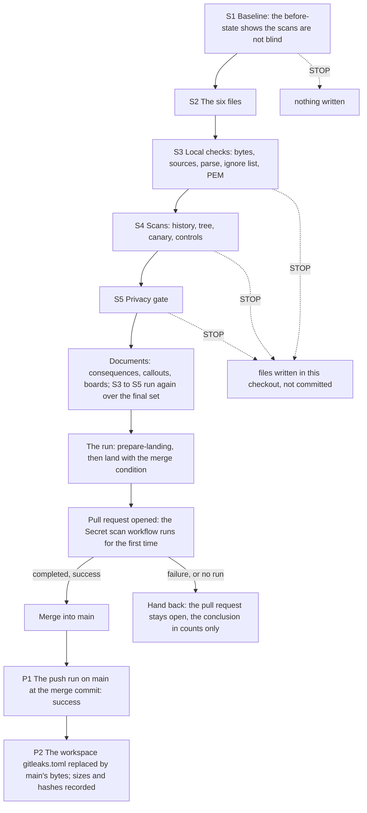

> **Superseded by [`../plan.md`](../plan.md).** This is the version of the plan the six files were first built to. The current plan adds the allowlist controls (a seventh file, run by the procedure and by one more step of the workflow), checks of the scan wrapper's failure paths, checks of the workflow's shell blocks and pins, further ignore-list tests, and expected results for the reads after the landing. Its relative links are rewritten to resolve from this folder.

# Phase 0 · 4 — KotlinBottools repository hygiene: implementation plan

- **Covers:** [SpartanLaboratories/KotlinBottools#24](https://github.com/SpartanLaboratories/KotlinBottools/issues/24),
  *"Phase 0 · 4 — KotlinBottools repository hygiene: .gitignore, gitleaks configuration and CI, README and CHANGELOG"*, a
  sub-issue of [#2](https://github.com/SpartanLaboratories/KotlinBottools/issues/2) (parent chain #24 → #2 → #1).
- **Architecture:** [`../architecture.md`](../../architecture.md), unit `repository-hygiene` (§15, order 4) and §10, with §5.2
  (the workspace copies), §6.5 (the privacy gate), §8 (the unit's failure row), §11 (version control), §12.3 and §13 (the
  contracts of the CI artefacts). The evidence is [`research/README.md`](../research/README.md), whose Summary is this plan's
  design input, and the two findings files beside it.
- **Branch:** `chore/issue-24-repository-hygiene`, cut from the rewritten `main` of the fresh repository. It exists and
  holds this unit's research. This plan is committed with the unit's other documents in the same pull request as the six
  files it describes (Version control); the issue's resolution comment links the pull request.
- **What this plans:** the six changes the unit lands through its own pull request: a root-anchored `.gitignore`; the
  gitleaks configuration with one scoped allowlist table; the scan wrapper; the `Secret scan` workflow; the README
  correction; and a new `CHANGELOG.md`. It also plans the checks before the landing, the merge condition of the landing,
  and the replacement of the workspace copy of the configuration after the merge.
- **Status:** planning only.
- **Target version:** none. No version moves; the commit types fit the content (`ci:`, `chore:`, `docs:`).

Everything this unit writes to GitHub is the landing, which the run sends as a request; nothing in the procedure below
writes to GitHub. The implementer writes the six files in this checkout and runs the checks (S1 to S5) in this checkout and
in scratch folders under the workspace. The run sends the landing and, after its reply, carries out the post-merge steps.

---

## Requirements

**Goals.** The unit lands, through one pull request into `main`, six changes:

1. **`.gitignore`**, root-anchored for the files and folders that collide with source packages. It is the parent research's
   §6.6 list ([`bot-repository-history-purge.md`](../../../research/bot-repository-history-purge.md)) plus the existing file's IDE
   and build patterns: the `bin/` block with its two exceptions, the `build/` and `out/` exceptions, the jar exception, the
   Eclipse, NetBeans and STS lines, and the four editor lines `.nbproject/`, `*.swp`, `*.swo`, `*~`. LF line endings.
2. **`.gitleaks.toml`**: the earlier configuration (`[extend] useDefault = true`, MagicBot's three rules, `legacy-key-file`,
   `legacy-state-directory`) plus exactly one `[[allowlists]]` table:
   - `targetRules = ["curl-auth-user"]` and `condition = "AND"`;
   - one anchored, slash-form `paths` entry for the one research document that holds the known false positive,
     `docs/plans/1-bottools-consolidation/2-phase-0-history-rewrite/research/github-residual-exposure-and-visibility.md`;
   - one anchored `regexes` entry pinned to the exact text the rule captures as its secret there, the quoted
     command-substitution credential;
   - a `description` giving the reason.

   There is no global allowlist, and the header comment's allowlist paragraph describes the one table. The exact bytes are the
   complete file of [`research/scoped-allowlist-semantics.md` §6.1](../research/scoped-allowlist-semantics.md#61-the-complete-file).
3. **`.github/scripts/secret_scan.py`**, byte for byte as [§6.4 of the earlier gitleaks findings](../../research/gitleaks-local-and-ci.md#64-the-wrapper-secret_scanpy)
   give it, which equals the workspace copy.
4. **`.github/workflows/secret-scan.yml`**, byte for byte as [§6.9 of the same findings](../../research/gitleaks-local-and-ci.md#69-the-workflow-githubworkflowssecret-scanyml)
   give it. No platform change forces an edit: `ubuntu-latest` and both pins stay.
5. **The README correction**, only what became false:
   - `key.txt`, `BotData.xml` and `WebParseKeys.xml` marked local and untracked in the project tree, and `guildData/` marked as
     created at run time;
   - one short list of the files a clone must supply, beside the `key.txt` instruction, which stays;
   - one sentence naming the workflow and `.gitleaks.toml`.
6. **A new `CHANGELOG.md`** in the Keep a Changelog layout, with this change's entry under `[Unreleased]`: Added (the workflow,
   its wrapper and its configuration) and Changed (the root-anchored `.gitignore`). There is no back-filled entry for the
   history rewrite. The header names the Keep a Changelog format and makes no versioning claim; Phase 1 sets the versioning.

**Before the landing:**

- the tree scans clean;
- the three CI files are byte-identical to their sources;
- no file spells out both PEM private-key markers;
- the privacy gate over the branch reports `GATE: 0 blocking hit(s)`.

**The landing.** The change merges only once the `Secret scan` workflow has passed on its pull request. That run is the
workflow's first on GitHub, and a missing run is not a pass: a pull request with a merge conflict starts no `pull_request`
run. A red or missing check stops the landing before the merge, hands back with the run's conclusion in counts only, and leaves
the pull request open.

**The workspace copy.** `%USERPROFILE%/BotWS/tools/gitleaks.toml` follows the committed file: after the merge it is replaced by
the committed bytes, with the new size and sha256 recorded. `secret_scan.py` in the workspace is unchanged.

**Done when:** the change is merged into `main` through its own pull request, and the `Secret scan` workflow has passed on that
pull request and on `main`.

**Acceptance criteria**, with what proves each:

| Criterion | Proved by |
|---|---|
| The six files hold their recorded bytes | S3 (`bytes`, `sources`, `toml`) |
| The ignore list ignores the root files and folders and nothing that is tracked or a source package | S3 (`ignore-list`) |
| No file holds both PEM markers | S3 (`pem`) |
| The change set scans clean, in history (both ref sets) and in the tree, the canary fires, and the negative controls are still reported | S4 |
| The privacy gate reports no blocking hit over the change set | S5 |
| The `Secret scan` check passed on the pull request before the merge | Landing (LR) |
| The workflow passed on `main` at the merge commit | Post-merge (P1) |
| The workspace configuration equals the committed one | Post-merge (P2) |

---

## Current state

**Baseline.** The branch descends from `main` at the merge of the pull request of #23 and holds three research commits, all
touching only this unit's `research/` folder. `main` is the fresh repository's rewritten history. This checkout is realigned
onto it ([#23 as built, §3.4](../../23-kotlinbottools-rewrite-and-swap/final-implementation.md#34-the-realignment)). The working
tree holds uncommitted generated boards and the dated callouts on the parent `architecture.md`; both belong to the document set
of this change (Version control).

**The repository, as read on 2026-11-11.**

- `SpartanLaboratories/KotlinBottools`, id 1453296798, private, default branch `main`, on the organisation's GitHub Free plan.
- Actions are enabled for all actions, with read-only default workflow permissions and no approval of pull requests by
  Actions. No workflow exists (`total_count` 0). Branch protection and rulesets answer 403 while the repository is private, so
  the passed check is a condition of the landing, not a platform rule.
- The branches are `main` and this one. The highest number in use is #33, an unrelated issue; the pull request takes the next
  free number.
- `main` holds no `.github/`, no `CHANGELOG.md` and no `.gitleaks.toml`. Its `.gitignore` is the planning branch's unanchored
  version (blob `e5af5646b742416ddf932d170829158c3e84bc46`); its `README.md` is blob `4fcbffd452e72043d9e9bcdca6ccf983e02a7531`.
- `.gitattributes` is `* text=auto` and `core.autocrlf` is `true` on this machine, so a working tree holds CRLF for text files
  that git has checked out, while every blob is LF. 126 files are tracked on the branch.
- `.git/info/exclude` holds `docs/plans/.live/` and `graphify-out/`: the boards' convention for machine-local output. They stay
  out of `.gitignore`.
- `src/main/kotlin/bottools/services/` is a tracked source package, which is why `/services/` is anchored. No `res/`, `logs/` or
  `guildData/` path is tracked.

**What the README says and the code still does** ([`purge-blast-radius.md` §3.E](../../research/purge-blast-radius.md)):

| Local file | Where the code reads or creates it |
|---|---|
| `key.txt` | `src/main/kotlin/bottools/main/Bot.kt:65` |
| `BotData.xml` | `src/main/kotlin/bottools/dataprocessing/KotGDP.kt:17` |
| `guildData/` (created) | `KotGDP.kt:28` |
| `WebParseKeys.xml` | `src/main/kotlin/bottools/dataprocessing/SourceKeyParser.kt:11` |
| `services/<name>.xml` | `src/main/kotlin/bottools/services/ServicePacketReader.kt:20` |
| `res/temp.png` | `src/main/kotlin/bottools/botactions/online/OnlineAction.kt:33` |
| `./logs` | `src/main/resources/logback.xml:10` |

The README lines concerned are 69 to 75 (the `key.txt` instruction), 233 to 235 (the tree's three lines), 261 to 265 (the
`guildData/` entries) and the Development section's code block, which ends at line 323.

**The build** resolves `com.spartanlabs:GeneralTools:1.2.0c` only from a local Maven repository: it is not on Maven Central and
not in `~/.m2`. The README's build lines never worked on another machine, so they did not become false with the rewrite, and
Phase 1 replaces the build and the README.

**The known finding.** With the earlier configuration, the history of `main` reports 2 findings of the default rule
`curl-auth-user` and the tree 1, all in the one research document named above. The history findings are the commit that added
the document and the merge that carried it (`-m` reads a merge once per parent). The match is a command example whose
basic-auth credential is a shell command substitution that reads the GitHub CLI's token at run time: no literal credential is
involved ([`research/README.md`](../research/README.md#verification-results)). It is recorded as a known gap in
[#23's consequences §5](../../23-kotlinbottools-rewrite-and-swap/consequences.md#5-known-gaps), where it holds the visibility change
of #25.

**Verified outside-world facts this unit rests on** (read on 2026-11-11):

- **gitleaks 8.30.1** (the newest release): a `[[allowlists]]` table with `targetRules` attaches to the named rule after
  `[extend]` has merged the default rules, and an unknown id is a load error; `condition = "AND"` requires every criterion the
  table defines to hold for the same finding; a `paths` entry is an unanchored search on the slash-separated path; a `regexes`
  entry is tested against the finding's secret, which for this rule is the whole quoted credential argument, quotes included;
  unknown keys are ignored. [`scoped-allowlist-semantics.md` §3](../research/scoped-allowlist-semantics.md#3-findings).
- **The hosted runner.** `ubuntu-latest` is moving from Ubuntu 24.04 to 26.04 between 2026-10-19 and 2026-11-19, so a first run
  can get either image. Both carry `python3` 3.12.3 or 3.14.4 (the wrapper needs 3.11 or newer), git 2.56.0, `curl` and `tar`.
  Ubuntu 26.04 ships Rust coreutils; the source of its `sha256sum` supports the step's `--check --strict -`, and a failure there
  is loud. The checkout action's pinned commit is v7.0.1 on the `node24` runtime, the runners' current default. The gitleaks
  Linux archive is at its URL with the pinned sha256. [`workflow-on-the-hosted-runner.md` §3](../research/workflow-on-the-hosted-runner.md#3-findings).
- **Minutes.** A private repository of a GitHub Free organisation draws on $12 of included compute a month, about 2,000 standard
  Linux minutes; the job's timeout is 15 minutes.
- **A pull request with a merge conflict starts no `pull_request` run**, and `gh run list --workflow secret-scan.yml` answers 404
  until the file is on the default branch, so the pull request's run is read through the runs API by commit id (LR).

**Workspace tools, as read on 2026-11-11.**

| File | Size | sha256 |
|---|---|---|
| `tools/gitleaks-8.30.1/gitleaks.exe` | 22,575,104 | `17157e2ee8b76fc8b1d8bee607a250e34b8a8023c8bc81822d4b5ee4d78fcb7c` |
| `tools/secret_scan.py` | 12,073 | `b661e2dc1b0a3ca1893109bca0bd975efb761c4a2f2e3c7059af292eb8dcdd98` |
| `tools/gitleaks.toml` (the earlier configuration) | 2,373 | `4e68f75c709bd2937253ee9efee3f8fd28f891aa3eb7b00de7b830a28f5396eb` |

Two workspace scripts pin the old `gitleaks.toml` value: `k0-ready.sh` (line 34, the readiness check of the rewrite-and-swap
unit) and `save-tools.sh` (line 29, the preparation unit's tool, which re-saves `gitleaks.toml` from the earlier findings' §6.3
lines on `main`). After this unit lands, `k0-ready.sh` fails its `gitleaks.toml` row and a re-run of `save-tools.sh` would write
the old bytes back. Neither tool is changed here; the consequence is recorded for the units that reuse them (Interfaces,
Sequencing).

**Checked on scratch copies only.** Every value below was reproduced; the commands are the procedure's.

- The six files, built from the sources below, have the recorded sizes, sha256 values and blob ids; `tomllib` parses the
  configuration.
- The scans of a clone of the branch with the six files committed in the clone only, with `--config .gitleaks.toml`, print
  `RESULT: CLEAN` for `--refs all`, `--refs branches` and `dir .`. With the workspace (earlier) configuration, a clone of the
  branch alone prints `RESULT: FINDINGS` with only `curl-auth-user`: 2 findings in 1 file for each ref set, 1 in 1 for the tree.
- The canary prints `CANARY OK` for both ref sets with the expected per-rule counts. Of the negative controls, the document with
  a literal credential added at its path and the document at another path are reported (1 finding in 1 file, in `git` and in
  `dir` mode); the unchanged document at its path is clean.
- The ignore-list tests of S3 pass, and the set of ignored paths of this checkout, with `.git/info/exclude`, is identical under
  the new file and under today's.
- The privacy gate, run read-only over the scratch clone with the allow-list in the data folder, prints
  `GATE: 0 blocking hit(s)`.

---

## Assumptions

| # | Assumption | If false |
|---|---|---|
| A1 | The `.gitignore` is the union of the parent research §6.6 list and the existing file's IDE and build patterns, as the text in File-by-file changes gives it. It drops only what the broader entries already cover: `.idea/modules.xml`, `.idea/jarRepositories.xml`, `.idea/compiler.xml` and `.idea/libraries/` (covered by `.idea/`), and the file's section comments. | The owner names a pattern to keep or to add; the text, its recorded bytes and the tests of S3 change, and nothing else does. |
| A2 | The `CHANGELOG.md` is the text in File-by-file changes: Added and Changed entries under `[Unreleased]`, a header that names the format and makes no versioning claim, and no back-filled entry for the rewrite. | The text changes; the file's recorded bytes change with it. |
| A3 | Byte checks compare blob content. `.gitattributes` is `* text=auto` and `core.autocrlf` is `true`, so the working tree holds CRLF after a checkout and a size or hash of the working file would differ from the blob. `git hash-object <path>` prints the blob id through the clean filter whatever the working tree holds, and a size and sha256 taken after removing carriage returns equal the blob's. | A check on the raw working file fails on a correct file. The checks of S3 and S4 are written on blobs; a re-written check that reads the raw file reports a false difference. |
| A4 | The pre-landing tree scan runs on a clean clone of the branch with the change set committed in the clone. A scan of this checkout's root would also read ignored IDE and build folders (`.idea/`, `.gradle/`, `build/`, `.kotlin/`), which the landed tree never holds. | A finding in an ignored folder fails a scan that the workflow would pass. The scan is not repeated on the checkout. |
| A5 | Every document this unit commits is scanned with the committed configuration before its commit: the scratch clone of S4 holds every pending file of the checkout, and S3 to S5 run again over the final set before the landing request. | A document that trips a rule enters the history the workflow scans, and the job stays red until the history is rewritten again. |
| A6 | The workflow runs on the hosted runner as the research found. If the first run fails at the "Install gitleaks" step on an Ubuntu 26.04 image with a message naming the checksum tool, that is a new decision for the owner: pin `runs-on: ubuntu-24.04`, or rewrite the check without `--strict -`. A red run at any other step is not explained by the platform changes found. | The landing stops at its merge condition (Stops); the pull request stays open and the run hands back with the failing step's name and the run's conclusion. |
| A7 | The 8.30.1 Linux binary applies the scoped table as the Windows binary does. The release binaries of both platforms are built from the same configuration with the same regular-expression engine, history paths come from git in slash form on every platform, and the Linux walk path is already in slash form ([§6.3 of the allowlist findings](../research/scoped-allowlist-semantics.md#63-what-the-windows-runs-leave-unproven-on-linux-argued-from-source)). | The first run reports `RESULT: FINDINGS` with the one `curl-auth-user` finding. The landing stops; the owner decides whether the table is rewritten or the document is changed. |
| A8 | `main` does not move between the baseline check and the landing: no other branch lands a change to `README.md` or `.gitignore`. Phase 1 may start once #23 has landed, so this is checked, not assumed. | S1 stops on a different blob id of `README.md` or `.gitignore`; a conflict at the landing's sync is reported by the landing and the edits are re-derived from the new `main`. |
| A9 | The landing request can state the merge condition and the landing honours it: it waits for the `Secret scan (gitleaks)` check of the pull request before the merge and stops without merging on a failure or on no run. | The run does not send the landing without the condition; it hands back to the owner for a route that holds the merge. After a merge that happened without a passed run, LR and P1 show the conclusion, and a red run is reported as it is. |
| A10 | The privacy gate meets no key that nobody has decided: the allow-list in the data folder, with the owner's recorded decisions, covers the change set. | The gate stops on the new key. The run takes the confirmation path of the rewrite-and-swap unit, with the allow-list tool: `propose h24`, the owner's answers, `write`, `verify h24`, `check`. A rejected key hands the unit back, because a real name in what becomes public needs a decision about the texts. |
| A11 | No YAML parser exists on this machine (PyYAML and `yq` are absent, and Node has none built in), so the workflow's validity is not parsed before the first run. It rests on its byte identity with the text the earlier findings verified, and on GitHub's parser at the first run. | A YAML error shows as a failed run with no job (a workflow-file error); the landing stops and the run hands back with the run's conclusion. |

---

## Non-goals

- Any change to Kotlin source, tests, build files or version numbers. No version moves.
- The README's build and run instructions: they depend on a local Maven repository and never worked elsewhere. Phase 1 replaces
  the build and the README.
- A back-filled `CHANGELOG.md` entry for the history rewrite, and any versioning claim in the changelog.
- Phase 1's `ci.yml`. The workflow here shares no name, job id or concurrency group with it.
- Aligning MagicBot's `.gitleaks.toml` (Phase 13).
- A `.gitleaksignore`, an inline `gitleaks:allow` marker, a global allowlist, `condition = "OR"` and `regexTarget = "match"` or
  `"line"`: each would hide more than the one known match ([`scoped-allowlist-semantics.md` §6](../research/scoped-allowlist-semantics.md#6-recommendation-for-this-repository)).
- A newer `actions/checkout` or gitleaks release: a version change also moves the verified baseline of the canary and the scans.
- A fixed runner image (`ubuntu-24.04`): it is a design change, and the one unverified point fails closed (A6).
- Branch protection or a required status check: not available while the repository is private.
- The visibility change, secret scanning, Gate 3 and the id-reference check: #25.
- Changes to the workspace scripts `k0-ready.sh`, `save-tools.sh` and `secret_scan.py`. The two pins are recorded for the later
  units.
- Running the Linux gitleaks binary or a YAML parser: neither exists here; the first run is that test.

---

## Design

### Shape of the procedure

Five stages, run in order, each re-runnable. Each call ends with `ok` lines, or with a `STOP` line that ends the call. The
landing and the steps after the merge are not stages: they are the run's, in Procedure.

| id | name | brief | kind | steps |
|---|---|---|---|---|
| S1 | Baseline | The branch, the six paths, the workspace tools and the repository's settings are as recorded, and the scans of the branch with the workspace configuration report only the one known finding | check | branch: The branch and the six paths; helpers: The scratch helpers; tools: The workspace tools; github: The repository's settings; before: The scans before the change |
| S2 | The six files | The six files are written from their sources, each with its recorded size, sha256 and blob id | work | ignore: The .gitignore; config: The .gitleaks.toml; wrapper: The scan wrapper; workflow: The workflow; readme: The README correction; changelog: The CHANGELOG |
| S3 | Local checks | The six files match their recorded bytes and sources, the configuration parses, the ignore list behaves as designed and no file holds both PEM markers | check | bytes: Sizes, hashes and blob ids; sources: The sources and the workspace wrapper; toml: The configuration parses; ignore-list: The ignore-list tests; pem: No file holds both PEM markers |
| S4 | Scans | The history and the tree of the change set scan clean with the committed configuration, the canary shows the rules fire, and the negative controls are still reported | check | clone: The scratch clone of the change set; scans: History and tree; canary: The canary; controls: The negative controls |
| S5 | Privacy gate | The privacy gate over the change set reports no blocking hit | check | gate: The gate over the scratch clone |



### The change set

| Path | Source of the bytes | Bytes | sha256 | git blob id |
|---|---|---|---|---|
| `.gitignore` | the text under File-by-file changes | 743 | `595973a6f08808688af99a69c168d96be4ce84c868e8f38630a226dcde43c33a` | `6c0d866ecd8ae25af0864ea808e960cfe40c4f16` |
| `.gitleaks.toml` | the first fenced block under "6.1 The complete file" of `research/scoped-allowlist-semantics.md` (lines 279 to 342) | 3360 | `9d0149e389991db6e893b4d198fe71bab6206b8e295517bca454877063a6f0b7` | `bbd0301e6d351f79ab5cd363bf7a287f88d1722e` |
| `.github/scripts/secret_scan.py` | the first fenced block under "6.4 The wrapper" of `research/gitleaks-local-and-ci.md` on `main` (lines 486 to 777); equal to the workspace copy | 12073 | `b661e2dc1b0a3ca1893109bca0bd975efb761c4a2f2e3c7059af292eb8dcdd98` | `a3727a723dd793e7cf6b980c52adcb84a39ce601` |
| `.github/workflows/secret-scan.yml` | the first fenced block under "6.9 The workflow" of the same file (lines 974 to 1074) | 4532 | `b518b52717073c5667302a113814cb1a76f5aa8c9188a7d7e41346278d772c2e` | `4f2db9a0d45cc3482e0d9d31232c7cfd535a4512` |
| `README.md` | `main`'s README with the four edits of File-by-file changes | 9646 | `c0f1e85e5ead860570e1050182c7fb0607641bedce40f4f8eb6b2ba0afaae6a6` | `78246ea8ab99d8bdb98442d4ff06acce9bcf6eed` |
| `CHANGELOG.md` | the text under File-by-file changes | 1214 | `3f20a7851b5093d053bf505ec5d9d21f4bf63ec7791e2f10af05e01402cb6cc6` | `46da96f67dd78d475dfed1b007562043d30b4ec1` |

Sizes and sha256 values are of the LF bytes. The blob id is what `git hash-object <path>` prints with the clean filter, whatever
line endings the working tree holds: it is the byte check that needs no staging (A3). The three CI files are extracted from the
committed blobs by the heading of their block, not by line numbers, so a later edit that shifts lines cannot change what is
extracted; the line ranges above are checked as a second channel (S3, `sources`). If a source does not hash as recorded, the
step stops.

The files are written with Git Bash `cat` and heredocs, which add neither a byte-order mark nor CRLF. An editor that may add
either is not used.

### The scoped allowlist table

The configuration is the earlier findings' file plus one table. The table is attached to the rule `curl-auth-user`, not global.
Its two criteria are joined by `condition = "AND"`, so it applies only to a finding that is in that one document **and** whose
captured secret is that one quoted text. A literal credential added to the same document, and the same text in any other file,
are still reported.

Four properties of 8.30.1 make the table fragile in specific ways, and S4's controls exist for them:

- **Unknown keys are ignored.** A misspelled `targetRules` makes the table global (a `dir` scan then skips the document for
  every rule); a misspelled `paths` lets the text through in any file; a misspelled `regexes` hides the whole document from the
  rule; a missing `condition` does both. Only the negative controls show these cases, so the controls run whenever the table,
  the rule set or the gitleaks pin changes.
- **The pin is exact.** An edit to the command example in the document is a new match, and the table no longer applies. That
  is intended: the table is then dead text and is removed or re-pinned.
- **A table whose rule stops matching stays as dead text,** and nothing reports it. It needs a periodic read of the
  configuration, not a scan.
- **A renamed or removed rule, or a changed capture group, is loud or fails closed:** the id is validated at load (`GATE
  FAILED`), and a changed group makes the pinned regex stop matching, so the finding returns.

### The workflow

Committed byte for byte. Its workflow name is `Secret scan` and its one job is `Secret scan (gitleaks)`; that job name is the
check the landing waits for. It runs on `push` and `pull_request` to `main` and on `workflow_dispatch`, with
`permissions: contents: read`, a concurrency group per ref (a new push to a pull request cancels its earlier run, and a
cancelled run is not a pass), and a 15-minute timeout. Its steps: check out with `fetch-depth: 0` and
`persist-credentials: false`; install gitleaks 8.30.1 from its release URL, checked against the pinned sha256; check that the
configuration and wrapper exist and no `.gitleaksignore` or `GITLEAKS_CONFIG` is set; run the canary on both ref sets; scan the
full history with `--refs all`; scan the working tree with `dir .`. Its log shows counts by rule id only.

What a run's checkout holds ([`workflow-on-the-hosted-runner.md` §3.4](../research/workflow-on-the-hosted-runner.md)): on a
`pull_request` event, every branch as `refs/remotes/origin/*`, every tag, and the merge commit, checked out detached; on a `push`
to `main`, the same plus a local `main`. The wrapper's `git log --all` count covers all of them.

The workflow's first run is on this unit's pull request, because the "Run workflow" button exists only once the file is on the
default branch. Its second is the push run on `main` at the merge commit.

### The ignore list

Root-anchored (`/key.txt`, `/BotData.xml`, `/WebParseKeys.xml`, `/guildData/`, `/services/`, `/res/`, `/logs/`) where a name
collides with a source package or is only ever a root file; unanchored for patterns that are file kinds (`*.pem`, `*.key`,
`*.log`, databases, `.env` files, `*.exe`). Kept from today's file: the `bin/`, `build/` and `out/` blocks with their
`src/main` and `src/test` exceptions; the jar exception; the Eclipse, NetBeans and STS lines; the IDE and editor folders; and
the four editor lines. Added from the parent research's list: credentials and local configuration, runtime state and data,
databases and logs, and downloaded or compiled binaries. S3 proves four properties: no tracked file is ignored; the ignored set
of this checkout is identical under the new file and under today's; the root files and folders are ignored; and source packages
named `services`, `build`, `bin` and `out` stay un-ignored.

### The landing and its merge condition

```mermaid
sequenceDiagram
    participant R as The run
    participant V as Version control, on request
    participant G as GitHub
    R->>V: prepare-landing (the change set committed, the branch synced with main)
    V-->>R: done
    R->>V: land, carrying the merge condition
    V->>G: push, open the pull request
    G->>G: Secret scan (gitleaks) runs on the pull request (its first run)
    alt completed with success
        V->>G: merge, resolution comment, delete the branch
        V-->>R: done (pull request, merge commit)
        R->>G: P1 read the push run on main at the merge commit
        R->>R: P2 replace the workspace gitleaks.toml
    else failure, cancelled, or no run
        V-->>R: stopped (the pull request stays open; the run's conclusion in counts only)
        R->>R: hand back
    end
```

The condition is stated in the request: **merge only after the `Secret scan (gitleaks)` check of the pull request has completed
with success; on a failure, a cancellation or no run, do not merge, leave the pull request open and reply with the run's
conclusion.** A merge conflict starts no run, so the branch is brought up to date with `main` before the pull request opens;
the landing's own sync does this, and a conflict there is reported and not merged around. After the reply the run reads GitHub
itself (LR, P1) and takes nothing from the reply's wording.

### The workspace copy

`BotWS/tools/gitleaks.toml` is the file `env.sh` exports as `CFG`, the configuration every later unit's scans use. After the merge
it is replaced by the committed bytes, read from `main` through the contents API without changing the checkout, so that it is
the landed file and not the research text. The old size and sha256 (2,373 bytes, `4e68f75c…`) and the new (3,360 bytes,
`9d0149e3…`, blob `bbd0301e…`) are recorded. The table is inert in the other repositories the later units scan with it: their
histories hold no such path.

### Error handling and logging

This unit adds no Kotlin: there is no new or changed function signature, so `Result` does not apply and no KDoc is written. The
failure design of what it does add is the following.

| Artefact | Failure it returns | Expected failure (a status or a marker) versus programmer error | Where it is unwrapped |
|---|---|---|---|
| `secret_scan.py scan` | exit 0 clean; 1 findings with every consistency check passed; 2 `GATE FAILED: <why>` (a failed git call, an `ERR`/`FTL` line in gitleaks' log, a commit count that differs from `git log`'s, an unreadable report, no bytes scanned) | findings and an unverifiable scan are statuses, never exceptions. A defect in the wrapper is an uncaught exception, which also exits non-zero, so it cannot read as a pass | the workflow's step: any non-zero status fails the job and prints an error annotation with the status; the implementer reads the marker in S4 |
| `secret_scan.py canary-check` | exit 2 and `CANARY FAILED` when a per-rule count differs | an expected failure | the canary step (`set -euo pipefail`) and S4 |
| The workflow's steps | the job fails | every step runs under `set -euo pipefail`; the install step's checksum or version mismatch ends the job | GitHub's run conclusion, read at LR and P1 |
| The procedure's `expect LABEL WANT GOT` | `STOP  <label>: expected '<x>', got '<y>'` and the call ends | an expected failure; its output is the label and two values the plan defines (sizes, hashes, counts, ids of the repository, rule ids), never content | the implementer, per the stop table |
| `fence`, `blobsum`, `gscan`, `rules` (scratch helpers) | a non-zero status of the command inside, which `expect` turns into a `STOP` | helpers that print counts only | the `expect` that wraps each use |
| The README script | `STOP an edit matches N times` and status 1 | an expected failure when `main`'s README is not the recorded blob | S2 `readme` |

**Events logged.** The workflow's log lines: `gitleaks 8.30.1 installed`; the canary's per-rule counts and `CANARY OK`; for each
scan the commit or byte count, `gitleaks_exit=…`, the per-rule counts and `RESULT: CLEAN` or `RESULT: FINDINGS`; on a failure an
`::error title=Secret scan::` annotation naming the scan and the status. The procedure's lines are `ok`, `RECORD`, `STOP` and the
wrapper's own counts. Nothing logs a path, a match or a credential; reports and logs of local scans stay in the scratch folder
under the workspace and are never printed.

### The output rule

The checks print sizes, sha256 values, blob ids of the six files, counts, rule ids, fixed markers and exit statuses. They never
print a finding's path, match or secret, a name, a guild, an id of a person or any text of a report. The privacy gate is run
through `allow_tool.py`, which masks every corpus label. A fixture credential is generated at run time and written only into its
fixture file: it is never typed, printed or committed. A `STOP` is reported by the step and the marker, never content.

### Stops and the state each leaves

| Where | The stop | State left | Next |
|---|---|---|---|
| S1 | the branch, a blob id of `main`, a tool's size or hash, a repository setting, or a scan other than the one known finding | nothing written | read the cause; fix the cause or hand back. A moved `main` (A8) is re-derived, never patched |
| S2 | a recorded size, hash or blob id differs after a write; the README script reports a count other than 1 | the file written differs from its record; nothing committed | rewrite the file from its source; if the source itself does not hash as recorded, stop and hand back |
| S3 | a check of the six files, the parse, an ignore-list test or the PEM check | the six files are in this checkout, uncommitted | fix the file; re-run S3 |
| S4 | a scan other than `RESULT: CLEAN`, a canary count, or a control that is not reported | the scratch clone only | the marker names the scan. A finding in the change set is a stop that hands back: never allow-listed by the run |
| S5 | the gate reports a blocking hit, or meets a key nobody decided | the scratch clone only | A10's confirmation path; a rejected key hands the unit back |
| Landing | the check is red, cancelled or missing | the pull request is open, nothing merged | the run hands back with the conclusion in counts, and the failing step's name; A6 and A7 name the two foreseeable causes that need the owner |
| P1 | the push run on `main` is not `completed` and `success` | merged; the workflow is on `main` | the run reports the conclusion and does not carry out P2; the owner decides |
| P2 | the downloaded bytes are not the recorded ones | the workspace configuration unchanged | read `main`'s file again; a persistent difference means `main` holds other bytes than the plan, and the run hands back |

---

## File-by-file changes

No Kotlin source, test source or build file changes. The README correction and the CHANGELOG entry are this unit's own scope,
written in S2; the later documentation pass confirms them and adds nothing.

### `.gitignore`

Replaced by exactly these lines: LF, one trailing newline, blank lines as shown. 743 bytes, sha256
`595973a6f08808688af99a69c168d96be4ce84c868e8f38630a226dcde43c33a`, blob `6c0d866ecd8ae25af0864ea808e960cfe40c4f16`.

```
# credentials and local configuration
/key.txt
/keys.txt
*.pem
*.key
.env
.env.*
!.env.example

# runtime state and bot data
/BotData.xml
/WebParseKeys.xml
/guildData/
/services/
/res/
/logs/
*.log
*.db
*.db-wal
*.db-shm
*.sqlite
*.sqlite3

# build output
.gradle/
.kotlin/
build/
!gradle/wrapper/gradle-wrapper.jar
!**/src/main/**/build/
!**/src/test/**/build/
out/
!**/src/main/**/out/
!**/src/test/**/out/
bin/
!**/src/main/**/bin/
!**/src/test/**/bin/

# IDE and editor files
.idea/
*.iml
*.ipr
*.iws
.project
.classpath
.settings/
.factorypath
.apt_generated
.springBeans
.sts4-cache
/nbproject/private/
/nbbuild/
/dist/
/nbdist/
/.nb-gradle/
.nbproject/
.vscode/
.fleet/
.DS_Store
*.swp
*.swo
*~

# downloaded or compiled binaries
*.exe
```

Failure and logging: none at run time. A pattern that ignored a tracked file would show in S3's first ignore-list check.

### `.gitleaks.toml`

New; the complete file of [`research/scoped-allowlist-semantics.md` §6.1](../research/scoped-allowlist-semantics.md#61-the-complete-file),
extracted by S2 and not retyped here. Against the earlier configuration only the header's allowlist paragraph and the appended
table differ. Contents: `title`; `[extend] useDefault = true`; the five rules `discord-bot-token`, `bare-token-file`,
`legacy-bot-data-file`, `legacy-key-file` and `legacy-state-directory`; one `[[allowlists]]` table with the keys `description`,
`targetRules`, `condition`, `paths` and `regexes` (the values are described under Requirements and in the design above). Its
header comment is the ring-3 documentation of the file: what the rules are for, why there is no global allowlist, and the rule
for any later suppression (one rule, one path, a stated reason, its own table). Failure design: an unknown rule id in
`targetRules` is a load error that the wrapper reports as `GATE FAILED`; every other failure of the table is silent and is
covered by the controls (S4). The workspace copy is replaced by these bytes after the merge (P2).

### `.github/scripts/secret_scan.py`

New; the first fenced block under "6.4 The wrapper" of `research/gitleaks-local-and-ci.md`, byte for byte, equal to the workspace
copy. A tool with a command-line contract, not an API: `scan`, `control`, `canary-make`, `canary-check`; exit status 0 clean, 1
findings, 2 the scan could not be verified. Its module docstring is its ring-3 documentation. Run with `python -I`; needs Python
3.11 or newer (`tomllib`). No execute bit is needed: the workflow calls it as `python3 -I <path>`.

### `.github/workflows/secret-scan.yml`

New; the first fenced block under "6.9 The workflow", byte for byte. Its header comment is its ring-3 documentation, and the
constants `GITLEAKS_VERSION` and `GITLEAKS_LINUX_X64_SHA256` carry the rule for upgrading them together (the canary re-run
locally, the hash confirmed on a second channel).

### `README.md`

Four exact replacements in the LF text of `main`'s README; each must match once. In each, the old text is first and the new
text second.

**1. After the Never-commit line** (the existing blank line before `3. **Build & Run**` stays). Old:

```
⚠️ **Never commit `key.txt`!**
```

New: the same line, then a blank line, then:

```
⚠️ **Never commit `key.txt`!**

A clone holds none of the bot's local files: they are untracked and ignored. Supply these before the first run:

- `key.txt`: the bot token;
- `BotData.xml`: the bot's global data;
- `WebParseKeys.xml`: the scraping markers the online commands read;
- a `services/` directory: the polling state of the background services, one XML file per service;
- a `res/` directory: where images are saved before they are sent.

`guildData/` and `logs/` are created at run time.
```

**2. The project tree's three lines**, every arrow at column 31 as the `key.txt` line's is. Old:

```
├── key.txt                    ← Bot token (KEEP SECRET)
├── BotData.xml
├── WebParseKeys.xml
```

New:

```
├── key.txt                    ← Bot token (local, untracked; KEEP SECRET)
├── BotData.xml                ← local, untracked
├── WebParseKeys.xml           ← local, untracked
```

**3. The `guildData/` entry.** Old: `├── guildData/`. New: `├── guildData/                 ← created at run time, untracked`.

**4. After the Development section's code block** (the closing fence after `<logger name="bottools" level="DEBUG"/>`), a blank
line and:

```
Every push and pull request to `main` runs the `Secret scan` workflow (`.github/workflows/secret-scan.yml`), which scans the full history and the working tree with gitleaks and the rules in `.gitleaks.toml`.
```

Result: 9646 bytes, sha256 `c0f1e85e5ead860570e1050182c7fb0607641bedce40f4f8eb6b2ba0afaae6a6`, blob
`78246ea8ab99d8bdb98442d4ff06acce9bcf6eed`. The `key.txt` instruction at lines 69 to 75 stays. The `services/` bullet
follows the code: each background service reads and writes `services/<its name>.xml` (`ServicePacketReader.kt:20`), and the
names of the game services put their files in sub-folders (`GameStatsCommand.kt:108`, `UserGameService.kt`).

### `CHANGELOG.md`

New; exactly this text, LF, one trailing newline: 1214 bytes, sha256 `3f20a7851b5093d053bf505ec5d9d21f4bf63ec7791e2f10af05e01402cb6cc6`,
blob `46da96f67dd78d475dfed1b007562043d30b4ec1`.

```
# Changelog

All notable changes to this project are documented in this file.

The format is based on [Keep a Changelog](https://keepachangelog.com/en/1.1.0/).

## [Unreleased]

### Added

- The `Secret scan` workflow (`.github/workflows/secret-scan.yml`). On every push and pull request to `main`, it scans
  the full history and the working tree with gitleaks 8.30.1, pinned and checked against its checksum, through the scan
  wrapper `.github/scripts/secret_scan.py`, after a canary has shown that the rules fire. Its log shows counts by rule
  id only.
- The gitleaks configuration, `.gitleaks.toml`: gitleaks' default rules, plus rules for Discord bot tokens, the bot's
  token file, its legacy data files, the older bots' key files and their runtime-state directories. One allowlist entry,
  scoped to one rule, one document and one exact text, exempts a single known false positive.

### Changed

- `.gitignore` ignores the bot's local files and runtime folders (`key.txt`, `BotData.xml`, `WebParseKeys.xml`,
  `guildData/`, `services/`, `res/`, `logs/`) at the repository root only, so source packages of the same name stay
  tracked, and adds patterns for credential files, databases, logs and binaries.
```

### The workspace file

`%USERPROFILE%/BotWS/tools/gitleaks.toml`: replaced in P2 by the committed bytes. It is not a repository file.

---

## Procedure

### Conventions

- **Shell.** Git Bash. Each call starts a fresh shell, so every call begins with this prelude; no machine path is typed:

  ```bash
  . "$(cygpath -m "$USERPROFILE")/BotWS/tools/env.sh"; . "$TOOLS/lib.sh"
  KB="$KBT"; W="$WS/tmp/h24"; mkdir -p "$W"; [ -f "$W/h24lib.sh" ] && . "$W/h24lib.sh"
  cd "$KB" || exit 1
  DOC=docs/plans/1-bottools-consolidation/2-phase-0-history-rewrite
  ```

  `env.sh` exports `KBT` (this checkout), `WS`, `TOOLS`, `GL` (the gitleaks binary), `SS` (the workspace wrapper), `CFG` (the
  workspace configuration), `DATA`, and defines `gitnet`; `lib.sh` defines `expect LABEL WANT GOT`. Native programs get
  mixed-form paths, which these variables hold. Python always runs with `python -I`.
- **Reading the output.** A call succeeded when every `expect` printed `ok` and the call ended without a `STOP`. A `STOP` ends
  the call: stop and report the step and the marker, never content. `RECORD` lines are results, not stops.
- **Scratch.** `$W` is `BotWS/tmp/h24`. It holds clones, fixtures, reports and logs, which hold history and findings: it stays
  under the workspace, which is deleted by the last unit of the phase, and nothing in it is printed or copied out.
- **Timeouts.** Every call runs in the foreground within the default timeout; a scan of this repository takes seconds.
- **Re-running.** S1 to S5 are idempotent: S2 rewrites the same bytes, and S1 and S4 recreate their scratch folders. S3 to S5 are
  run again after the documents are final (Sequencing).

### S1 — Baseline

**`branch`**: the branch descends from `main` and adds nothing outside `docs/plans/` (this unit's research and documents, and
the boards); the six paths are as `main` has them, on `main` and on the branch.

```bash
expect "the branch" chore/issue-24-repository-hygiene "$(git rev-parse --abbrev-ref HEAD)"
git merge-base --is-ancestor main HEAD; expect "the branch descends from main" 0 $?
expect "main is the remote's main" "$(git rev-parse main)" "$(gitnet ls-remote origin refs/heads/main | cut -f1)"
expect "the branch adds nothing outside docs/plans/" 0 "$(git diff --name-only main HEAD | grep -vc '^docs/plans/')"
git diff --quiet main HEAD -- .gitignore README.md CHANGELOG.md .gitleaks.toml .github; expect "the branch's six paths equal main's" 0 $?
expect "main's .gitignore" e5af5646b742416ddf932d170829158c3e84bc46 "$(git rev-parse main:.gitignore)"
expect "main's README.md" 4fcbffd452e72043d9e9bcdca6ccf983e02a7531 "$(git rev-parse main:README.md)"
expect "main holds none of the four other paths" 0 "$(git ls-tree -r --name-only main | grep -cE '^(CHANGELOG\.md|\.gitleaks\.toml|\.github/)')"
```

Expected: eight `ok` lines.

**`helpers`**: the scratch helpers, written once and sourced by every later call.

```bash
cat > "$W/h24lib.sh" <<'LIB'
# h24lib.sh -- helpers of this unit's checks. Source it after env.sh and lib.sh. It prints counts, rule ids and fixed markers only.
fence() { # HEADING: the first fenced block after the line that starts with HEADING, read from standard input
  awk -v h="$1" 'BEGIN{s=0} s==0 && index($0,h)==1 {s=1; next} s==1 && /^```/ {s=2; next} s==2 && /^```/ {exit} s==2 {print}'; }
blobsum() { # PATH: "<size> <sha256> <blob id>" of the LF bytes the file holds; a CRLF working tree reads as its blob
  printf '%s %s %s' "$(tr -d '\r' < "$1" | wc -c | tr -d ' ')" "$(tr -d '\r' < "$1" | sha256sum | cut -d' ' -f1)" "$(git hash-object "$1")"; }
gscan() { # LABEL DIR MODE REFS CONFIG: one wrapper scan, run from DIR; the report and the log stay in $W; prints the wrapper's lines
  ( cd "$2" && python -I "$SS" scan --gitleaks "$GL" --mode "$3" --repo . --config "$5" --refs "$4" --report "$W/$1.json" --log "$W/$1.log" ); }
rules() { grep '^rule ' | tr -d '\r' | paste -sd, -; }
LIB
. "$W/h24lib.sh"; expect "the helpers" ok "$(type fence blobsum gscan rules > /dev/null && echo ok)"
```

Expected: `ok    the helpers`.

**`tools`**: the workspace binary, wrapper and configuration are at their recorded values.

```bash
sha() { sha256sum "$1" | cut -d' ' -f1; }
expect "gitleaks.exe sha256" 17157e2ee8b76fc8b1d8bee607a250e34b8a8023c8bc81822d4b5ee4d78fcb7c "$(sha "$GL")"
expect "the gitleaks version" 8.30.1 "$("$GL" version | tr -d '\r')"
expect "secret_scan.py size and sha256" "12073 b661e2dc1b0a3ca1893109bca0bd975efb761c4a2f2e3c7059af292eb8dcdd98" "$(wc -c < "$SS" | tr -d ' ') $(sha "$SS")"
expect "gitleaks.toml size and sha256" "2373 4e68f75c709bd2937253ee9efee3f8fd28f891aa3eb7b00de7b830a28f5396eb" "$(wc -c < "$CFG" | tr -d ' ') $(sha "$CFG")"
```

Expected: four `ok` lines. The configuration is the earlier one until P2.

**`github`**: the repository's settings are as recorded (reads only).

```bash
R=SpartanLaboratories/KotlinBottools
expect "the repository id" 1453296798 "$(gh api repos/$R --jq .id)"
expect "the repository is private" true "$(gh api repos/$R --jq .private)"
expect "Actions are enabled for all actions" true,all "$(gh api repos/$R/actions/permissions --jq '[.enabled,.allowed_actions]|join(",")')"
expect "the default workflow permissions" read "$(gh api repos/$R/actions/permissions/workflow --jq .default_workflow_permissions)"
expect "no workflow exists yet" 0 "$(gh api repos/$R/actions/workflows --jq .total_count)"
echo "RECORD the repository's branches: $(gh api repos/$R/branches --jq 'length') ($(gh api repos/$R/branches --jq '[.[].name]|sort|join(" ")'))"
```

Expected: five `ok` lines and the `RECORD` of the branches: `main` and this one when this plan was written. Every branch on
GitHub is part of what the workflow's first run scans (its checkout holds every branch), so S4's clone fetches them all; another
branch is not a stop here, and its content is scanned there.

**`before`**: with the workspace configuration, the history and the tree of a clone of the branch report only the known finding.
This is the before-state that shows the scans are not blind.

```bash
BASE="$W/base"; rm -rf "$BASE"
git clone --quiet --no-local --branch chore/issue-24-repository-hygiene "$KB" "$BASE"; expect "the scratch clone" 0 $?
for refs in all branches; do
  out=$(gscan "before-$refs" "$BASE" git "$refs" "$CFG"); rc=$?; echo "$out" | sed -n '1,2p'
  expect "history $refs: status (1 = findings)" 1 "$rc"
  expect "history $refs: the one known finding" "rule curl-auth-user findings=2 files=1" "$(echo "$out" | rules)"
done
out=$(gscan before-tree "$BASE" dir all "$CFG"); rc=$?; echo "$out" | sed -n '1,2p'
expect "tree: status (1 = findings)" 1 "$rc"
expect "tree: the one known finding" "rule curl-auth-user findings=1 files=1" "$(echo "$out" | rules)"
```

Expected, per scan, the first two wrapper lines (`commits_scanned=N expected_commits=N` with equal numbers, 93 when this plan was written;
`bytes_scanned=<n>` for the tree; then `gitleaks_exit=2 error_lines=0 findings=2` or `findings=1`), and the `ok` lines. Any other rule
id, or another count, is a STOP: the baseline is not the one the design rests on.

### S2 — The six files

Each step writes a file in this checkout and ends with an `expect` on its size, sha256 and blob id.

**`ignore`**:

```bash
cat > .gitignore <<'EOF'
# credentials and local configuration
/key.txt
/keys.txt
*.pem
*.key
.env
.env.*
!.env.example

# runtime state and bot data
/BotData.xml
/WebParseKeys.xml
/guildData/
/services/
/res/
/logs/
*.log
*.db
*.db-wal
*.db-shm
*.sqlite
*.sqlite3

# build output
.gradle/
.kotlin/
build/
!gradle/wrapper/gradle-wrapper.jar
!**/src/main/**/build/
!**/src/test/**/build/
out/
!**/src/main/**/out/
!**/src/test/**/out/
bin/
!**/src/main/**/bin/
!**/src/test/**/bin/

# IDE and editor files
.idea/
*.iml
*.ipr
*.iws
.project
.classpath
.settings/
.factorypath
.apt_generated
.springBeans
.sts4-cache
/nbproject/private/
/nbbuild/
/dist/
/nbdist/
/.nb-gradle/
.nbproject/
.vscode/
.fleet/
.DS_Store
*.swp
*.swo
*~

# downloaded or compiled binaries
*.exe
EOF
expect ".gitignore" "743 595973a6f08808688af99a69c168d96be4ce84c868e8f38630a226dcde43c33a 6c0d866ecd8ae25af0864ea808e960cfe40c4f16" "$(blobsum .gitignore)"
```

**`config`**:

```bash
git show HEAD:$DOC/24-repository-hygiene/research/scoped-allowlist-semantics.md | fence '### 6.1 The complete file' > .gitleaks.toml
expect ".gitleaks.toml" "3360 9d0149e389991db6e893b4d198fe71bab6206b8e295517bca454877063a6f0b7 bbd0301e6d351f79ab5cd363bf7a287f88d1722e" "$(blobsum .gitleaks.toml)"
```

**`wrapper`**:

```bash
mkdir -p .github/scripts
git show main:$DOC/research/gitleaks-local-and-ci.md | fence '### 6.4 The wrapper' > .github/scripts/secret_scan.py
expect "secret_scan.py" "12073 b661e2dc1b0a3ca1893109bca0bd975efb761c4a2f2e3c7059af292eb8dcdd98 a3727a723dd793e7cf6b980c52adcb84a39ce601" "$(blobsum .github/scripts/secret_scan.py)"
```

**`workflow`**:

```bash
mkdir -p .github/workflows
git show main:$DOC/research/gitleaks-local-and-ci.md | fence '### 6.9 The workflow' > .github/workflows/secret-scan.yml
expect "secret-scan.yml" "4532 b518b52717073c5667302a113814cb1a76f5aa8c9188a7d7e41346278d772c2e 4f2db9a0d45cc3482e0d9d31232c7cfd535a4512" "$(blobsum .github/workflows/secret-scan.yml)"
```

**`readme`**: the four exact replacements, applied to the LF text of `main`'s README. The script's escapes are the arrow, the
box-drawing characters and the warning sign with its variation selector, so the script itself is ASCII.

```bash
cat > "$W/mkreadme.py" <<'PY'
"""Apply the four README edits to the LF text of main's README. usage: mkreadme.py SOURCE DESTINATION
Each edit is an exact replacement that must match exactly once; anything else stops the script with status 1."""
import sys

src, dst = sys.argv[1], sys.argv[2]
text = open(src, "rb").read().decode("utf-8")
if "\r" in text:
    sys.exit("STOP the source holds a carriage return")


def replace(old, new):
    global text
    if text.count(old) != 1:
        sys.exit("STOP an edit matches %d times: %s" % (text.count(old), old[:30].encode("ascii", "replace").decode()))
    text = text.replace(old, new)


def column31(s):  # the arrows of the project tree sit at column 31
    return s.ljust(31)


BOX = "├── "
WARN = "⚠️ **Never commit `key.txt`!**\n"
replace(WARN, WARN + """
A clone holds none of the bot's local files: they are untracked and ignored. Supply these before the first run:

- `key.txt`: the bot token;
- `BotData.xml`: the bot's global data;
- `WebParseKeys.xml`: the scraping markers the online commands read;
- a `services/` directory: the polling state of the background services, one XML file per service;
- a `res/` directory: where images are saved before they are sent.

`guildData/` and `logs/` are created at run time.
""")
replace(BOX + "key.txt                    ← Bot token (KEEP SECRET)\n",
        column31(BOX + "key.txt") + "← Bot token (local, untracked; KEEP SECRET)\n")
replace(BOX + "BotData.xml\n", column31(BOX + "BotData.xml") + "← local, untracked\n")
replace(BOX + "WebParseKeys.xml\n", column31(BOX + "WebParseKeys.xml") + "← local, untracked\n")
replace(BOX + "guildData/\n", column31(BOX + "guildData/") + "← created at run time, untracked\n")
LOGGER = '<logger name="bottools" level="DEBUG"/>\n```\n'
replace(LOGGER, LOGGER + "\nEvery push and pull request to `main` runs the `Secret scan` workflow "
        "(`.github/workflows/secret-scan.yml`), which scans the full history and the working tree with gitleaks "
        "and the rules in `.gitleaks.toml`.\n")
open(dst, "wb").write(text.encode("utf-8"))
PY
git show main:README.md > "$W/README.main.md"
expect "main's README: carriage returns and blob id" "0 4fcbffd452e72043d9e9bcdca6ccf983e02a7531" "$(tr -cd '\r' < "$W/README.main.md" | wc -c | tr -d ' ') $(git hash-object "$W/README.main.md")"
python -I "$W/mkreadme.py" "$W/README.main.md" README.md; expect "the README script's status" 0 $?
expect "README.md" "9646 c0f1e85e5ead860570e1050182c7fb0607641bedce40f4f8eb6b2ba0afaae6a6 78246ea8ab99d8bdb98442d4ff06acce9bcf6eed" "$(blobsum README.md)"
```

**`changelog`**:

```bash
cat > CHANGELOG.md <<'EOF'
# Changelog

All notable changes to this project are documented in this file.

The format is based on [Keep a Changelog](https://keepachangelog.com/en/1.1.0/).

## [Unreleased]

### Added

- The `Secret scan` workflow (`.github/workflows/secret-scan.yml`). On every push and pull request to `main`, it scans
  the full history and the working tree with gitleaks 8.30.1, pinned and checked against its checksum, through the scan
  wrapper `.github/scripts/secret_scan.py`, after a canary has shown that the rules fire. Its log shows counts by rule
  id only.
- The gitleaks configuration, `.gitleaks.toml`: gitleaks' default rules, plus rules for Discord bot tokens, the bot's
  token file, its legacy data files, the older bots' key files and their runtime-state directories. One allowlist entry,
  scoped to one rule, one document and one exact text, exempts a single known false positive.

### Changed

- `.gitignore` ignores the bot's local files and runtime folders (`key.txt`, `BotData.xml`, `WebParseKeys.xml`,
  `guildData/`, `services/`, `res/`, `logs/`) at the repository root only, so source packages of the same name stay
  tracked, and adds patterns for credential files, databases, logs and binaries.
EOF
expect "CHANGELOG.md" "1214 3f20a7851b5093d053bf505ec5d9d21f4bf63ec7791e2f10af05e01402cb6cc6 46da96f67dd78d475dfed1b007562043d30b4ec1" "$(blobsum CHANGELOG.md)"
```

Expected for S2: one `ok` per `expect` (the README step prints three).

### S3 — Local checks

**`bytes`**: the six blob ids, and size and sha256 per file.

```bash
while read -r p size sha blob; do expect "$p" "$size $sha $blob" "$(blobsum "$p")"; done <<'ROWS'
.gitignore 743 595973a6f08808688af99a69c168d96be4ce84c868e8f38630a226dcde43c33a 6c0d866ecd8ae25af0864ea808e960cfe40c4f16
.gitleaks.toml 3360 9d0149e389991db6e893b4d198fe71bab6206b8e295517bca454877063a6f0b7 bbd0301e6d351f79ab5cd363bf7a287f88d1722e
.github/scripts/secret_scan.py 12073 b661e2dc1b0a3ca1893109bca0bd975efb761c4a2f2e3c7059af292eb8dcdd98 a3727a723dd793e7cf6b980c52adcb84a39ce601
.github/workflows/secret-scan.yml 4532 b518b52717073c5667302a113814cb1a76f5aa8c9188a7d7e41346278d772c2e 4f2db9a0d45cc3482e0d9d31232c7cfd535a4512
README.md 9646 c0f1e85e5ead860570e1050182c7fb0607641bedce40f4f8eb6b2ba0afaae6a6 78246ea8ab99d8bdb98442d4ff06acce9bcf6eed
CHANGELOG.md 1214 3f20a7851b5093d053bf505ec5d9d21f4bf63ec7791e2f10af05e01402cb6cc6 46da96f67dd78d475dfed1b007562043d30b4ec1
ROWS
```

**`sources`**: the three CI files equal their sources by a second channel (the line ranges), and the wrapper equals the workspace
copy. The committed configuration is expected to differ from the workspace configuration until P2, and that is not checked here.

```bash
expect "the configuration equals lines 279-342 of its findings" "$(git hash-object .gitleaks.toml)" "$(git show HEAD:$DOC/24-repository-hygiene/research/scoped-allowlist-semantics.md | sed -n '279,342p' | git hash-object --stdin)"
expect "the wrapper equals lines 486-777 of its findings" "$(git hash-object .github/scripts/secret_scan.py)" "$(git show main:$DOC/research/gitleaks-local-and-ci.md | sed -n '486,777p' | git hash-object --stdin)"
expect "the workflow equals lines 974-1074 of its findings" "$(git hash-object .github/workflows/secret-scan.yml)" "$(git show main:$DOC/research/gitleaks-local-and-ci.md | sed -n '974,1074p' | git hash-object --stdin)"
expect "the wrapper equals the workspace copy" "$(sha256sum < "$SS")" "$(tr -d '\r' < .github/scripts/secret_scan.py | sha256sum)"
```

**`toml`**: `tomllib` parses the configuration, which has five rules and one allowlist table with five keys and no global
`[allowlist]`. (No YAML parser is installed; the workflow's validity is stated under A11.)

```bash
expect "the configuration parses" "3360 9d0149e3 0 True" "$(python -I -c "import hashlib,sys,tomllib;b=open(sys.argv[1],'rb').read();tomllib.loads(b.decode());print(len(b),hashlib.sha256(b).hexdigest()[:8],b.count(b'\r'),b.endswith(b'\n') and not b.endswith(b'\n\n'))" .gitleaks.toml)"
expect "5 rules, one table with five keys, no global allowlist" "5 1 condition,description,paths,regexes,targetRules True" "$(python -I -c "import sys,tomllib;d=tomllib.load(open(sys.argv[1],'rb'));print(len(d['rules']),len(d['allowlists']),','.join(sorted(d['allowlists'][0])),'allowlist' not in d)" .gitleaks.toml)"
```

**`ignore-list`**: no tracked file is ignored; the ignored set of this checkout is identical under the new file and under
today's; the root files and folders are ignored; the six new paths and the source packages are not.

```bash
expect "no tracked file is ignored" 0 "$(git ls-files -c -i --exclude-standard | wc -l | tr -d ' ')"
git show main:.gitignore > "$W/gitignore.old"
git ls-files -o -i --directory --exclude-from="$W/gitignore.old" --exclude-from=.git/info/exclude | sort > "$W/ignored.old"
git ls-files -o -i --directory --exclude-from=.gitignore --exclude-from=.git/info/exclude | sort > "$W/ignored.new"
expect "the ignored set equals the old file's" "$(sha256sum < "$W/ignored.old")" "$(sha256sum < "$W/ignored.new")"
echo "RECORD ignored entries: $(wc -l < "$W/ignored.new" | tr -d ' ')"
ignored() { git check-ignore --no-index -q "$1"; echo $?; }   # 0 ignored, 1 not ignored
for p in key.txt keys.txt BotData.xml WebParseKeys.xml "guildData/g/GuildData.xml" "services/game services/Dota 2.xml" res/temp.png logs/app.log x.pem; do
  expect "ignored at the root: $p" 0 "$(ignored "$p")"; done
for p in .gitignore .gitleaks.toml .github/scripts/secret_scan.py .github/workflows/secret-scan.yml README.md CHANGELOG.md .env.example gradle/wrapper/gradle-wrapper.jar \
  src/main/kotlin/bottools/services/ServiceCommand.kt src/main/kotlin/bottools/services/New.kt src/main/kotlin/bottools/build/New.kt src/main/kotlin/bottools/bin/New.kt src/test/kotlin/bottools/out/New.kt; do
  expect "not ignored: $p" 1 "$(ignored "$p")"; done
```

Expected: all `ok`; `RECORD ignored entries: 6` in this checkout when this plan was written (`.gradle/`, `.idea/`, `.kotlin/`,
`build/`, `docs/plans/.live/`, `graphify-out/`).

**`pem`**: no file of the checkout, tracked or untracked and not ignored, holds both PEM private-key markers. The patterns are
regular expressions that need five real dashes, so this plan does not itself spell a marker. The check has its own positive
control: a scratch repository whose one file holds both markers, built at run time from fragments, is listed.

```bash
b=$(git grep -lI --untracked -E -e '-{5}BEGIN [A-Z ]*PRIVATE KEY-{5}' | sort); e=$(git grep -lI --untracked -E -e '-{5}END [A-Z ]*PRIVATE KEY-{5}' | sort)
expect "no file holds both PEM markers" 0 "$(comm -12 <(printf '%s\n' "$b") <(printf '%s\n' "$e") | grep -c .)"
P="$W/pem"; rm -rf "$P"; git init -q "$P"; python -I -c "import sys;d='-'*5;open(sys.argv[1],'w').write(d+'BEGIN PRIVATE KEY'+d+'\n'+d+'END PRIVATE KEY'+d+'\n')" "$P/both.txt"
bp=$(cd "$P" && git grep -lI --no-index -E -e '-{5}BEGIN [A-Z ]*PRIVATE KEY-{5}'); ep=$(cd "$P" && git grep -lI --no-index -E -e '-{5}END [A-Z ]*PRIVATE KEY-{5}')
expect "the check lists a file that holds both" both.txt "$(comm -12 <(printf '%s\n' "$bp") <(printf '%s\n' "$ep"))"
```

### S4 — Scans

**`clone`**: a scratch clone of the branch, with every pending file of this checkout (the six files, the unit's documents, the
boards) copied in and committed in the clone only, and every branch of the repository on GitHub fetched into it. The clone then
holds what the pull request's first run will scan: the change set as the landing will carry it, and every other branch of the
repository. The checkout's ignored folders are not in it (A4).

```bash
CL="$W/clone"; rm -rf "$CL"
git clone --quiet --no-local --branch chore/issue-24-repository-hygiene "$KB" "$CL"; expect "the clone" 0 $?
gitnet -C "$CL" fetch --quiet https://github.com/SpartanLaboratories/KotlinBottools.git '+refs/heads/*:refs/remotes/github/*'; expect "every GitHub branch fetched into the clone" 0 $?
echo "RECORD branches fetched from GitHub: $(git -C "$CL" for-each-ref refs/remotes/github | wc -l | tr -d ' ')"
git ls-files -m -o --exclude-standard -z | while IFS= read -r -d '' p; do [ -f "$KB/$p" ] || continue; mkdir -p "$CL/$(dirname "$p")"; cp "$KB/$p" "$CL/$p"; done
git -C "$CL" add -A 2>/dev/null; git -C "$CL" -c user.name=h24 -c user.email=h24@example.invalid commit --quiet -m "scratch: the pending change set"
expect "the clone's tip holds the six files" 6 "$(git -C "$CL" ls-tree -r --name-only HEAD -- .gitignore .gitleaks.toml .github README.md CHANGELOG.md | wc -l | tr -d ' ')"
for p in .gitignore .gitleaks.toml .github/scripts/secret_scan.py .github/workflows/secret-scan.yml README.md CHANGELOG.md; do
  expect "the clone's blob of $p" "$(git hash-object "$p")" "$(git -C "$CL" rev-parse "HEAD:$p")"; done
```

Expected: nine `ok` lines and the `RECORD` of the fetched branches (2 when this plan was written; the `git add` line-ending
warnings are discarded).

**`scans`**: history for both ref sets and the tree, from the clone's root, passing the committed `.gitleaks.toml` with
`--config`.

```bash
CL="$W/clone"
for refs in all branches; do
  out=$(gscan "history-$refs" "$CL" git "$refs" .gitleaks.toml); rc=$?; echo "$out" | sed -n '1,2p;$p'
  expect "history $refs: status" 0 "$rc"
  expect "history $refs: the wrapper's counts are equal" 1 "$(echo "$out" | sed -n 's/^commits_scanned=\([0-9]*\) expected_commits=\([0-9]*\)$/\1 \2/p' | awk '{print ($1==$2 && $1>0)}')"
  expect "history $refs: the verdict" "RESULT: CLEAN" "$(echo "$out" | tail -n 1 | tr -d '\r')"
done
out=$(gscan tree "$CL" dir all .gitleaks.toml); rc=$?; echo "$out" | sed -n '1,2p;$p'
expect "tree: status" 0 "$rc"; expect "tree: the verdict" "RESULT: CLEAN" "$(echo "$out" | tail -n 1 | tr -d '\r')"
```

Expected, per scan: `commits_scanned=N expected_commits=N` (94 for the clone of the branch plus the one scratch commit when
this plan was written) or `bytes_scanned=<n>`, then `gitleaks_exit=0 error_lines=0 findings=0`, then `RESULT: CLEAN`, status 0.

**`canary`**: the canary, as the workflow runs it, with the committed configuration. It plants fake secrets generated at run
time; the per-rule counts are the expected ones of the earlier findings, and the wrapper's own checks run inside each scan.

```bash
CL="$W/clone"; rm -rf "$W/canary"
python -I "$SS" canary-make "$W/canary/src" > /dev/null; expect "canary-make" 0 $?
git clone --quiet --mirror --no-local "$W/canary/src" "$W/canary/canary.git"; expect "the canary mirror" 0 $?
for refs in all branches; do
  out=$(python -I "$SS" scan --gitleaks "$GL" --repo "$W/canary/canary.git" --config "$CL/.gitleaks.toml" --refs "$refs" --report "$W/canary-$refs.json" --log "$W/canary-$refs.log"); rc=$?
  expect "canary $refs: status (1 = findings, every consistency check passed)" 1 "$rc"
  if [ "$refs" = all ]; then DB="rule discord-bot-token findings=5 files=4"; else DB="rule discord-bot-token findings=4 files=3"; fi
  expect "canary $refs: findings by rule" "rule bare-token-file findings=1 files=1,$DB,rule legacy-bot-data-file findings=3 files=3,rule legacy-key-file findings=2 files=2,rule legacy-state-directory findings=2 files=2,rule private-key findings=1 files=1" "$(echo "$out" | rules)"
  expect "canary $refs: the marker" "CANARY OK" "$(python -I "$SS" canary-check --report "$W/canary-$refs.json" --refs "$refs" | tail -n 1 | tr -d '\r')"
done
expect "the wrapper's control agrees with git for the four path rules" "4 4" "$(python -I "$SS" control --repo "$W/canary/canary.git" --config "$CL/.gitleaks.toml" --refs all --report "$W/canary-all.json" | awk '/^rule /{n++; split($3,a,"="); split($4,b,"="); if (a[2]==b[2] && NF==4) m++} END{print n, m}')"
```

Expected: the canary scans cover 6 commits for `--refs all` and 5 for `--refs branches` (`commits_scanned=6 expected_commits=6`,
`=5 =5`), with `findings=14` and `findings=13` respectively.

**`controls`**: the negative controls. They prove the table suppresses the one match and only that: **A**, the document at its
path plus a literal credential generated now, and **B**, the document at another path, are still reported, in `git` and in
`dir` mode; **D**, the document unchanged at its path, is clean. The tool name inside the literal's line is built from
fragments, so that this plan and the script hold no such line.

```bash
CL="$W/clone"; RES=$DOC/research/github-residual-exposure-and-visibility.md
git -C "$CL" show "HEAD:$RES" > "$W/doc.md"
cat > "$W/mkfx.py" <<'PY'
"""Build three one-commit throwaway repositories for the allowlist's controls.
usage: python -I mkfx.py OUTPUT-DIR SOURCE-DOCUMENT DOCUMENT-PATH-IN-REPOSITORY
A  the document at its path, plus a literal credential generated now (never printed, never typed)
B  the document, unchanged, at another path
D  the document, unchanged, at its path"""
import os
import secrets
import subprocess
import sys

out, source, rel = sys.argv[1:4]
text = open(source, "rb").read()
tool = "cu" + "rl"
flag = "-" + "u"
pw = secrets.token_hex(12)
literal = "\n```\n" + tool + " -s " + flag + ' "svc:' + pw + '" https://api.example.invalid/v1/items\n```\n'
env = dict(os.environ, GIT_AUTHOR_NAME="fx", GIT_AUTHOR_EMAIL="fx@example.invalid", GIT_COMMITTER_NAME="fx", GIT_COMMITTER_EMAIL="fx@example.invalid")


def make(name, path, body):
    root = os.path.join(out, name)
    target = os.path.join(root, *path.split("/"))
    os.makedirs(os.path.dirname(target), exist_ok=True)
    with open(target, "wb") as f:
        f.write(body)
    for cmd in (["init", "-q"], ["add", "-A"], ["commit", "-q", "-m", "fixture"]):
        subprocess.run(["git", "-C", root] + cmd, check=True, env=env)


make("A", rel, text + literal.encode())
make("B", "docs/other/copy.md", text)
make("D", rel, text)
PY
rm -rf "$W/fx"; python -I "$W/mkfx.py" "$W/fx" "$W/doc.md" "$RES" 2>/dev/null; expect "the fixtures" 0 $?
for f in A B D; do for mode in git dir; do
  out=$(gscan "fx-$f-$mode" "$W/fx/$f" "$mode" all "$CL/.gitleaks.toml"); rc=$?
  if [ "$f" = D ]; then expect "control $f $mode: clean" "0 RESULT: CLEAN" "$rc $(echo "$out" | tail -n 1 | tr -d '\r')"
  else expect "control $f $mode: still reported" "1 rule curl-auth-user findings=1 files=1" "$rc $(echo "$out" | rules)"; fi
done; done
```

Expected: `ok` for the fixtures and for the six control lines. If the repository's document is later edited so that its pinned text
changes, D reports a finding: the table is then re-pinned or removed, and the controls run again.

### S5 — Privacy gate

**`gate`**: the gate over the same scratch clone, through `allow_tool.py run`, which masks every corpus label. The corpus has a
name of its own, `h24`, and holds the clone (the gate reads every text blob of every ref and every commit message and identity).
The tool is called directly, as the rewrite and swap unit's Gate 1 called it, and not through the stage runner, whose log would
keep the arguments' machine paths.

```bash
G="$DATA/run/gate"; CL="$W/clone"; ak() { python -X utf8 -I "$TOOLS/allow_tool.py" "$@"; }
printf '%s\n' --repo "$CL" > "$G/corpus-h24.args"
ak check | tail -n 2; expect "the allow-list is the confirmed one" 0 "${PIPESTATUS[0]}"
ak run h24 --allow "$G/allow.txt" > "$W/gate-h24.txt"; rc=$?
expect "the gate's verdict" "GATE: 0 blocking hit(s)" "$(grep '^GATE:' "$W/gate-h24.txt" | tr -d '\r')"
expect "the gate's status" 0 "$rc"
```

Expected: the confirmation lines of `check`, then three `ok` lines. The gate's output is never read beyond its verdict line; a
masked proposal, if needed, is printed by the tool only. A key nobody has decided stops the gate (A10): then `ak propose h24`
prints the masked keys, the owner answers each (`ak decide KEY confirmed|rejected CATEGORY`), and `ak write`, `ak verify h24`
and `ak check` follow, before S5 runs again. The run never allow-lists a hit itself.

### Before the landing request

S3, S4 and S5 are run again over the final set once every document of the change is written: the consequences, the dated callouts,
this plan, the regenerated boards and any as-built text. Each document is scanned with the committed configuration before it is
committed (A5): S4's clone carries every pending file, so a clean S4 is that scan. Commits are then requested in the split of
Version control.

The documents the Document step writes after the six files are committed (the as-built record, the reconciled consequences, the
dated notes of Documentation impact and the boards it regenerates) reach the history in its last commit. The run therefore runs S4
and S5 once more, immediately before it requests that commit, over the checkout as it then stands; a finding stops the commit, and
the document is reworded before anything is committed.

### L — The landing

The run sends `prepare-landing` and then `land` with the merge condition of the design above, naming the six paths as the change
set. After the reply, **LR** reads GitHub and takes nothing from the reply's wording (`PR` and `HEADSHA` are the pull request's number and head commit, typed
from the reply):

```bash
R=SpartanLaboratories/KotlinBottools; PR=<the pull request's number>
HEADSHA="$(gh pr view "$PR" -R $R --json headRefOid --jq .headRefOid)"
gh api "repos/$R/actions/runs?head_sha=$HEADSHA&event=pull_request" --jq '.workflow_runs[]|[.name,.status,.conclusion,.updated_at]|@tsv'
gh pr view "$PR" -R $R --json mergedAt,state --jq '[.state,.mergedAt]|@tsv'
```

Expected: one row `Secret scan  completed  success  <time>` and `MERGED  <time>` later than the run's time. The runs API is used
because `gh run list --workflow secret-scan.yml` answers 404 until the file is on `main`. If the run is still in progress, read it
with `gh run watch <id> -R $R --exit-status`. No row, a cancelled run or a failure means the condition was not met: the run reports
the conclusion and the failing step's name, in counts only, and the pull request stays open.

### P — After the merge

Carried out by the run once the `land` has reported, together with confirming the run on `main`. `M` is the merge commit's id from
the reply.

**P1** The push run on `main` at the merge commit completed with success (read only):

```bash
R=SpartanLaboratories/KotlinBottools; M=<the merge commit's id>
gh run list -R $R --workflow secret-scan.yml --branch main --event push --json databaseId,headSha,status,conclusion --jq ".[]|select(.headSha==\"$M\")|[.databaseId,.status,.conclusion]|@tsv"
```

Expected: one row ending `completed  success`. A run that has not started is read again after a minute; no row after ten minutes
is a hand-back. The run's counts are read from its log by their fixed markers
(`gh run view <id> -R $R --log | grep -E 'RESULT: |CANARY |commits_scanned=|bytes_scanned='`): `CANARY OK` twice, `RESULT: FINDINGS`
twice (the canary's two scans) and `RESULT: CLEAN` twice (the history and the tree).

**P2** The workspace configuration follows the committed file, read from `main` without changing the checkout:

```bash
. "$(cygpath -m "$USERPROFILE")/BotWS/tools/env.sh"; . "$TOOLS/lib.sh"; KB="$KBT"; W="$WS/tmp/h24"; . "$W/h24lib.sh"; cd "$KB" || exit 1
R=SpartanLaboratories/KotlinBottools; N="$W/gitleaks.toml.main"
gh api "repos/$R/contents/.gitleaks.toml?ref=main" --jq .content | base64 -d > "$N"
expect "main's configuration" "3360 9d0149e389991db6e893b4d198fe71bab6206b8e295517bca454877063a6f0b7 bbd0301e6d351f79ab5cd363bf7a287f88d1722e" "$(blobsum "$N")"
echo "RECORD old workspace configuration: $(wc -c < "$CFG" | tr -d ' ') bytes, sha256 $(sha256sum < "$CFG" | cut -d' ' -f1)"
cp "$N" "$CFG"
expect "the workspace configuration" "3360 9d0149e389991db6e893b4d198fe71bab6206b8e295517bca454877063a6f0b7 bbd0301e6d351f79ab5cd363bf7a287f88d1722e" "$(blobsum "$CFG")"
expect "the workspace wrapper is unchanged" "12073 b661e2dc1b0a3ca1893109bca0bd975efb761c4a2f2e3c7059af292eb8dcdd98" "$(wc -c < "$SS" | tr -d ' ') $(sha256sum < "$SS" | cut -d' ' -f1)"
expect "the workspace configuration parses" 5 "$(python -I -c "import sys,tomllib;print(len(tomllib.load(open(sys.argv[1],'rb'))['rules']))" "$CFG")"
```

Expected: `RECORD old workspace configuration: 2373 bytes, sha256 4e68f75c…` and four `ok` lines.

**P3** The run records, in its report, the old values (2,373 bytes, `4e68f75c709bd2937253ee9efee3f8fd28f891aa3eb7b00de7b830a28f5396eb`)
and the new (3,360 bytes, `9d0149e389991db6e893b4d198fe71bab6206b8e295517bca454877063a6f0b7`, blob
`bbd0301e6d351f79ab5cd363bf7a287f88d1722e`), the two runs' conclusions, and that the pins in `k0-ready.sh` (line 34) and
`save-tools.sh` (line 29) still name the old value and were not changed.

---

## Documentation impact

**Rings.** No Kotlin code changes, so the in-editor ring (region markers, `TODO`) and the component ring (KDoc) do not move.

| Ring | What moves |
|---|---|
| 1. In-editor navigation | nothing |
| 2. Component and API contracts | nothing: no public Kotlin API changes; the wrapper's docstring is its contract and is unchanged |
| 3. Boundary and integration | the workflow, the configuration and the wrapper are repository infrastructure; their header comments and docstrings, as written in the sources, are their documentation: the workflow's header and its upgrade comment, the configuration's header with the paragraph on the one table, and the wrapper's module docstring |
| 4. Architectural topology | the dated callouts on the parent `architecture.md` (below) |

**The README delta and the CHANGELOG entry are this unit's own scope,** written by the implementer in S2. The later
documentation pass confirms them and adds nothing, so it must not duplicate them. The README is updated in the same change
because the change alters a workflow and the files a clone must supply; the changelog entry is under `[Unreleased]` because no
version moves.

**What lands beside the files** (written with this plan; the implementer does not write them):

- this unit's `research/`, this plan and `consequences.md`;
- the dated callouts of 2026-11-11 on the parent [`architecture.md`](../../architecture.md):
  - §5.2: once this change has merged, the workspace `gitleaks.toml` holds the committed configuration's bytes (3,360 bytes,
    `9d0149e3…`), and `secret_scan.py` stays byte-identical to the research text;
  - §10: the known finding; the committed configuration is the research configuration plus one table that names the rule, the
    document's path and the exact text, all three required, with its reason in `description`, and no global allowlist; before
    the landing the wrapper and the workflow equal the research text and the configuration the bytes this plan records; the
    workspace copy takes them after the merge;
  - §15: unit 4 settles the default-rule finding unit 3 recorded, so unit 5's visibility change no longer waits on it, its other
    gates unchanged;
  - §16: the one suppression, inert in the five legacy repositories, with every other default-rule finding still handled as the
    risk row states;
- at the reconcile step, a dated note in [`21-preparation/consequences.md` §4](../../21-preparation/consequences.md) recording that
  the workspace `gitleaks.toml` that unit saved at 2,373 bytes with sha256 `4e68f75c…` is no longer current, as the
  rewrite-and-swap unit's note records for the privacy gate;
- at the reconcile step, a dated note in [`23-kotlinbottools-rewrite-and-swap/consequences.md`](../../23-kotlinbottools-rewrite-and-swap/consequences.md)
  marking closed, with a link to this unit, its §5 known gap "A default-rule finding of gitleaks in a kept file" and the §6
  follow-up "The default-rule finding of §5, judged before the visibility changes";
- the parent `consequences.md`: the one link line for this unit at reconcile, and a dated note under its §3 first bullet, which
  says the configuration has "no allowlist";
- the regenerated boards: the state board of the system `repository-hygiene` moves from planned to built; it is produced by the
  boards service in the Document step, not by the implementer.

The earlier findings (`research/gitleaks-local-and-ci.md`) keep their §6.3 text, which says there is no allowlist and which the
committed configuration now supersedes: a landed document takes only the dated notes above, and the committed file is the
current text.

---

## Test plan

There is no product code and no test source in this unit: the checks are the procedure's own, and nothing from the scratch folder
is committed. The five levels map as in the rehearsal unit's plan.

| Level | Package segment (the unit has no packages; the segment names the folder a level would have) | What proves it here |
|---|---|---|
| 1. Gating | `testing.gating` | S1 (the branch, the six paths on `main`, the workspace tools at their recorded values, the repository's settings and the before-scans) and S3 (the six blob ids with size and sha256, the three sources by two channels, the `tomllib` parse and the shape of the configuration, the ignore-list tests, the PEM check with its own positive control) |
| 2. Component | `testing.component` | The canary of S4: its per-rule counts for both ref sets (6 and 5 commits; 14 and 13 findings), `canary-check`'s `CANARY OK`, the wrapper's own checks inside every scan (commit count equal to `git log`'s, no `ERR`/`FTL` line, exit status and report agree, bytes scanned), and `control`'s agreement for the four path rules |
| 3. Integration | `testing.integration` | S4's scans with the real 8.30.1 binary over a real clone of the branch (history for both ref sets, and the tree), S1's reads of GitHub and S5's privacy gate over the clone |
| 4a. Deterministic | `testing.deterministic` | The exact bytes: sizes, sha256 values and blob ids of the six files and of the replaced workspace file; the ignore-list membership tests (nine root paths ignored; the six new paths, `.env.example`, the wrapper jar and five source-package paths not); the identity of the ignored set under the old and the new file |
| 4b. End to end | `testing.e2e` | The workflow's first run on the pull request (LR) and its run on `main` at the merge commit (P1): the full pipeline on the hosted runner, install through the tree scan |
| 4c. Non-functional | `testing.nonfunctional` | The job's 15-minute timeout and the Actions minutes budget (about 2,000 standard Linux minutes a month for the organisation; one run is bounded at 15 minutes and costs a few); the counts-only log, read by its fixed markers; the negative controls A, B and D |
| 5. UAT | `testing.uat` | None is needed. The owner may read the run's log, which holds counts by rule id only |

**What cannot be automated.** GitHub's parse of the workflow file before its first run (no YAML parser is installed, so validity
rests on byte identity with the verified text); which image the run gets (`ubuntu-24.04` or `ubuntu-26.04` before 2026-11-19);
and the Linux 8.30.1 binary, which was not run: its behaviour on the table is argued from source (A7) and proven only by the first
run. The first run is also the only test of the hosted runner's `sha256sum`.

**Limits of the checks.** The scans run on the Windows binary; the negative controls were measured on it, and the Linux run's
`RESULT: CLEAN` on the document is the one observation of the table on that platform. The controls cover the table's silent
failure modes only for the keys that are present; a later key added to the table needs its own control.

---

## Risks and edge cases

- **The first run is red for a reason unrelated to secrets** (YAML, runner Python, tarball, the checksum tool on Ubuntu 26.04).
  The check gates the merge, so the pull request stays open and the run hands back with the failing step. The one foreseeable case
  is A6.
- **The first run reports the known finding** (A7): the table did not apply on Linux. The landing stops; nothing is merged.
- **A missing run is read as a pass.** A merge conflict starts no `pull_request` run; the branch is synced before the pull request
  opens, and LR requires a row. A cancelled run (a new push to the branch cancels the earlier run of the same ref) is not a pass.
- **A merge without the condition** (A9). LR compares the run's time with the merge time and P1 reads the run on `main`; a red run
  on `main` is reported as it is and the owner decides.
- **A silent widening of the table.** A typo in one key hides more than the one match without an error. The bytes are extracted,
  not typed, and S4's controls A and B would show the widening in `git` and `dir` modes.
- **A first commit that trips a rule keeps the job red until history is rewritten again.** Every document this unit commits is
  scanned first (A5), including the plan, which quotes no matched text and builds no credential-shaped line.
- **A character the scan rules read as a secret in this plan or the research** would fail S4. The plan states the shape of the
  matched command in words, never its text.
- **`.gitignore` ignores a file a later change needs** (for example a `*.key` or `*.pem` resource, or a `*.exe`). No tracked file is
  ignored today (S3). A later unit adds such a file with `git add -f` or a negation; Phase 1 is told (Interfaces).
- **Line endings.** Every blob is LF; a Windows checkout holds CRLF. The checks are on blobs (A3). The workflow runs on Linux and
  reads LF.
- **The pinned versions float with the image only for what the workflow does not pin.** `python3`, git and `sha256sum` float; the
  binary and the action do not. Nothing in the file depends on a minor version.
- **Concurrency.** One run per ref at a time; a pull request's older run is cancelled by a newer push. Nothing in the procedure
  runs in parallel.
- **Performance and cost.** The history and tree scans take seconds locally; the job's timeout is 15 minutes; a private repository
  of a Free organisation has about 2,000 Linux minutes a month. The runs of this unit are a handful.
- **Cross-repository impact.** None on MagicBot or WebTools. The workspace configuration's table is inert in the repositories the
  later units scan with it, because their histories hold no such path. The two pinned scripts of the workspace are a consequence
  for #26 and #27 (Interfaces).
- **Public exposure.** Everything this unit commits becomes public with the repository at #25. The privacy gate (S5) and the
  scan rules (S4) are run over it before the landing, and #25 runs Gate 3 again over the whole repository.
- **Breaking changes.** None for consumers: no published artefact moves, and the `.gitignore` only widens what is ignored for files
  that are not tracked.

---

## Version control

- **Branch:** `chore/issue-24-repository-hygiene` (it exists, with the research commits).
- **Commit sequence,** each a coherent unit, requested by the run (the implementer commits nothing):
  1. `ci:` `.gitleaks.toml`, `.github/scripts/secret_scan.py` and `.github/workflows/secret-scan.yml`;
  2. `chore:` `.gitignore`;
  3. `docs:` `README.md` and `CHANGELOG.md`;
  4. `docs(plans):` this plan, the unit's `consequences.md`, the dated callouts on the parent documents and the issue's board
     files. The regenerated boards are committed by the boards service in the Document step.

  All four land in one pull request, which binds the plan to the files it describes. No version bump. No pull request or commit id
  is written into any document: the issue's resolution comment links the pull request.
- **The landing:** a single pull request on the fresh repository, closing #24 only, never #2 or #1. The landing request carries the
  merge condition (Design) and the change set `.gitignore`, `.gitleaks.toml`, `.github/scripts/secret_scan.py`,
  `.github/workflows/secret-scan.yml`, `README.md` and `CHANGELOG.md`, with this plan. It merges only after the
  `Secret scan (gitleaks)` check of the pull request has completed with success. A failure, or no run at all, stops the landing:
  the pull request stays open and the run hands back with the run's conclusion in counts only.
- **After the merge** the run carries out P1 to P3. The workspace replacement is a local write to the workspace, not a
  version-control request.
- **Unrelated pre-existing working-tree changes:** none. What is pending in this checkout (the generated boards of the earlier
  units and of the phase, and the callouts on `architecture.md`) is the document set of this change and goes in commit 4 or with
  the boards service's commit. Anything else that `git status` lists at S4 is a stop and a separate commit. `docs/plans/.live/` and
  `graphify-out/` stay excluded.

---

## Interfaces with sibling units

- **Expects from `kotlinbottools-rewrite-and-swap` (#23, landed):**
  - the rewritten `main` on the fresh repository, with this checkout realigned;
  - the known default-rule finding recorded in its consequences §5, which this unit settles with the scoped table;
  - the corrected privacy gate and the allow-list in the data folder.
- **Provides to `kotlinbottools-publish` (#25):**
  - the workflow on `main`, its first runs passed;
  - the finding settled, so the visibility change no longer waits on it;
  - the workspace `gitleaks.toml` equal to `main`'s `.gitleaks.toml` (3,360 bytes, `9d0149e3…`), which its re-check before the
    visibility change uses. Unit 5 confirms the run on `main` green again.
- **Provides to `gkb2-gkb-rewrite` (#26) and `bottools-trumpbot-support-rewrite` (#27):**
  - the new workspace configuration, whose one table is inert in their repositories;
  - the stale pins in `k0-ready.sh` (line 34) and `save-tools.sh`, which their readiness checks must take at the new value and
    never re-save from the research text.
- **Provides to `residual-report-and-cleanup` (#28):** its tools copy carries the new configuration.

**Neighbouring issue, Phase 1 (#3).** It finds the `CHANGELOG.md` to extend and to set the versioning of; the secret-scan workflow
beside which it adds its own `ci.yml`; a `.gitignore` that ignores `*.key`, `*.pem`, `*.exe` and databases (a later file of those
kinds needs `git add -f` or a negation); and the README, which its rewrite replaces.

---

## Sequencing and follow-ups

**Order.** S1, S2, S3, S4, S5; then the documents (the consequences, the callouts, the boards); then S3 to S5 again over the final
set; then `prepare-landing` and `land` with the merge condition; then LR, P1, P2 and P3; then the reconcile step (the as-built
record, the dated notes of Documentation impact). The unit starts after #23 has landed, which it has, and blocks #25.

**Follow-ups this work leaves,** recorded in `consequences.md`:

- the pins in `k0-ready.sh` and `save-tools.sh`, for #26 and #27 (the new value, never a re-save from the research text);
- the negative controls of S4 run again whenever the table, the rule set or the gitleaks pin changes, and a periodic read of the
  configuration for a table whose rule no longer matches;
- the Phase 1 build override for the local Maven repository, and Phase 1's versioning of the changelog;
- MagicBot's `.gitleaks.toml`, aligned in Phase 13 (the scoped table is the shape to adopt in place of its global allowlist).

---

## Considerations

None.
