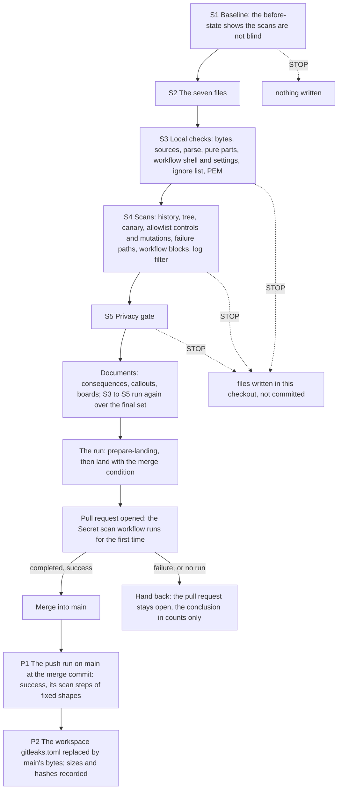

> **Superseded by [`../plan.md`](../plan.md).** This is the version of the plan the seven files were first committed to. The current plan adds two sentences to the configuration's header comment, on the allowlist controls and on how a `dir` scan must be run, with the configuration's new recorded bytes and the steps that build and check it; it also states which documents land with the change and what is read after the merge. Its relative links are rewritten to resolve from this folder.

# Phase 0 · 4 — KotlinBottools repository hygiene: implementation plan

- **Covers:** [SpartanLaboratories/KotlinBottools#24](https://github.com/SpartanLaboratories/KotlinBottools/issues/24),
  *"Phase 0 · 4 — KotlinBottools repository hygiene: .gitignore, gitleaks configuration and CI, README and CHANGELOG"*, a
  sub-issue of [#2](https://github.com/SpartanLaboratories/KotlinBottools/issues/2) (parent chain #24 → #2 → #1).
- **Architecture:** [`../architecture.md`](../../architecture.md), unit `repository-hygiene` (§15, order 4) and §10, with §5.2
  (the workspace copies), §6.5 (the privacy gate), §8 (the unit's failure row), §11 (version control), §12.3 and §13 (the
  contracts of the CI artefacts). The evidence is [`research/README.md`](../research/README.md), whose Summary is this plan's
  design input, and the two findings files beside it.
- **Branch:** `chore/issue-24-repository-hygiene`, cut from the rewritten `main` of the fresh repository. It exists and
  holds this unit's research. This plan is committed with the unit's other documents in the same pull request as the seven
  files it describes (Version control); the issue's resolution comment links the pull request.
- **What this plans:** the seven files the unit lands through its own pull request: a root-anchored `.gitignore`; the
  gitleaks configuration with one scoped allowlist table; the scan wrapper; the allowlist controls, which show on every run
  that the table exempts its one match and nothing else; the `Secret scan` workflow, with a step that runs those controls;
  the README correction; and a new `CHANGELOG.md`. It also plans the checks before the landing, the merge condition of the
  landing, and the replacement of the workspace copy of the configuration after the merge.
- **Status:** planning only.
- **Target version:** none. No version moves; the commit types fit the content (`ci:`, `chore:`, `docs:`).

Everything this unit writes to GitHub is the landing, which the run sends as a request; nothing in the procedure below
writes to GitHub. The implementer writes the seven files in this checkout and runs the checks (S1 to S5) in this checkout and
in scratch folders under the workspace. The run sends the landing and, after its reply, carries out the post-merge steps.

---

## Requirements

**Goals.** The unit lands, through one pull request into `main`, seven files. The issue's scope names six; the seventh,
the allowlist controls (item 7), exists because the scoped table of item 2 can widen silently: gitleaks ignores a misspelled
key without an error. Only a scan of fixtures shows that the table exempts its one match and nothing else. Run by the workflow,
the controls hold on every push and pull request, on the platform that gates merges, and they outlive the workspace that the
phase deletes.

1. **`.gitignore`**, root-anchored for the files and folders that collide with source packages. It is the parent research's
   §6.6 list ([`bot-repository-history-purge.md`](../../../research/bot-repository-history-purge.md)) plus the existing file's IDE
   and build patterns: the `bin/` block with its two exceptions, the `build/` and `out/` exceptions, the jar exception, the
   Eclipse, NetBeans and STS lines, and the four editor lines `.nbproject/`, `*.swp`, `*.swo`, `*~`. LF line endings.
2. **`.gitleaks.toml`**: the earlier configuration (`[extend] useDefault = true`, MagicBot's three rules, `legacy-key-file`,
   `legacy-state-directory`) plus exactly one `[[allowlists]]` table:
   - `targetRules = ["curl-auth-user"]` and `condition = "AND"`;
   - one anchored, slash-form `paths` entry for the one research document that holds the known false positive,
     `docs/plans/1-bottools-consolidation/2-phase-0-history-rewrite/research/github-residual-exposure-and-visibility.md`;
   - one anchored `regexes` entry pinned to the exact text the rule captures as its secret there, the quoted
     command-substitution credential;
   - a `description` giving the reason.

   There is no global allowlist, and the header comment's allowlist paragraph describes the one table. The exact bytes are the
   complete file of [`research/scoped-allowlist-semantics.md` §6.1](../research/scoped-allowlist-semantics.md#61-the-complete-file).
3. **`.github/scripts/secret_scan.py`**, byte for byte as [§6.4 of the earlier gitleaks findings](../../research/gitleaks-local-and-ci.md#64-the-wrapper-secret_scanpy)
   give it, which equals the workspace copy.
4. **`.github/workflows/secret-scan.yml`**: the text [§6.9 of the same findings](../../research/gitleaks-local-and-ci.md#69-the-workflow-githubworkflowssecret-scanyml)
   gives, with one step inserted after the canary, before the history scan: `Allowlist controls`, which runs item 7. Nothing
   else changes. No platform change forces an edit: `ubuntu-latest` and both pins stay.
5. **The README correction**, only what became false:
   - `key.txt`, `BotData.xml` and `WebParseKeys.xml` marked local and untracked in the project tree, and `guildData/` marked as
     created at run time;
   - one short list of the files a clone must supply, beside the `key.txt` instruction, which stays;
   - one sentence naming the workflow and `.gitleaks.toml`.
6. **A new `CHANGELOG.md`** in the Keep a Changelog layout, with this change's entry under `[Unreleased]`: Added (the workflow,
   its wrapper, its configuration and the allowlist controls) and Changed (the root-anchored `.gitignore`). There is no
   back-filled entry for the history rewrite. The header names the Keep a Changelog format and makes no versioning claim;
   Phase 1 sets the versioning.
7. **`.github/scripts/allowlist_controls.py`**, new, the text under File-by-file changes. It builds throwaway repositories at
   run time from the repository's own committed document and scans each through the wrapper with the configuration, in git
   mode and in dir mode: the document unchanged at its path is clean, and each of these is reported: a literal credential
   beside it; the document at any other path; the exempted text with one more character inside its quotes; a colon and a word
   joined after its closing quote or before its opening quote; and another rule's finding at the path. It prints counts, rule
   ids and fixed markers only, and the credentials and words it generates are never printed. It needs nothing from the
   workspace: gitleaks, Python 3.11 or newer, and git.

**Before the landing:**

- the tree scans clean;
- the wrapper and the configuration are byte-identical to their sources, the workflow equals its source with the one step
  inserted, and the controls equal the text of this plan;
- the controls print `CONTROLS OK`, and fail on each of ten mutations of the table, the removal of each anchor among them;
- each of the workflow's shell blocks, run here, passes on the change set and stops on each failure it guards against;
- no file spells out both PEM private-key markers;
- the privacy gate over the branch reports `GATE: 0 blocking hit(s)`.

**The landing.** The change merges only once the `Secret scan` workflow has passed on its pull request. That run is the
workflow's first on GitHub, and a missing run is not a pass: a pull request with a merge conflict starts no `pull_request`
run. A red or missing check stops the landing before the merge, hands back with the run's conclusion in counts only, and leaves
the pull request open.

**The workspace copy.** `%USERPROFILE%/BotWS/tools/gitleaks.toml` follows the committed file: after the merge it is replaced by
the committed bytes, with the new size and sha256 recorded. `secret_scan.py` in the workspace is unchanged.

**Done when:** the change is merged into `main` through its own pull request, and the `Secret scan` workflow has passed on that
pull request and on `main`.

**Acceptance criteria**, with what proves each:

| Criterion | Proved by |
|---|---|
| The seven files hold their recorded bytes, and the README's list of local files matches the code | S3 (`bytes`, `sources`, `toml`) |
| The two Python files parse, and their pure parts give their recorded results | S3 (`python`) |
| The workflow's shell blocks parse, and its names, runner, timeout, concurrency, triggers, permissions and pins are as recorded | S3 (`workflow`) |
| The ignore list ignores what each pattern names and nothing that is tracked, a source package or below the root of an anchored pattern | S3 (`ignore-list`) |
| No file holds both PEM markers | S3 (`pem`) |
| The change set scans clean, in history (both ref sets) and in the tree, and the canary fires | S4 (`scans`, `canary`) |
| The allowlist controls print `CONTROLS OK`, and fail on each of ten mutations of the table | S4 (`controls`, `mutations`) |
| The controls' and the wrapper's failure paths answer status 2 with a fixed marker, or fail closed | S4 (`controls`, `negatives`) |
| Each of the workflow's shell blocks passes on the change set and stops on each failure it guards against | S4 (`workflow-run`) |
| Every scan prints only counts, rule ids and fixed markers, and nothing on standard error; the filter for the hosted logs finds a line of another shape | S1 and S4, through `shapes`; S4 (`log-filter`) |
| The privacy gate, its selftest passed, reports no blocking hit over the change set | S5 |
| The `Secret scan` check passed on the pull request before the merge, its controls included, and its scan steps printed only fixed shapes | Landing (LR) |
| The workflow passed on `main` at the merge commit, its controls included, and its scan steps printed only fixed shapes | Post-merge (P1) |
| The workspace configuration equals the committed one | Post-merge (P2) |

---

## Current state

**Baseline.** The branch descends from `main` at the merge of the pull request of #23 and holds three research commits, all
touching only this unit's `research/` folder. `main` is the fresh repository's rewritten history. This checkout is realigned
onto it ([#23 as built, §3.4](../../23-kotlinbottools-rewrite-and-swap/final-implementation.md#34-the-realignment)). The working
tree holds uncommitted generated boards and the dated callouts on the parent `architecture.md`; both belong to the document set
of this change (Version control).

**The repository, as read on 2026-11-11.**

- `SpartanLaboratories/KotlinBottools`, id 1453296798, private, default branch `main`, on the organisation's GitHub Free plan.
- Actions are enabled for all actions, with read-only default workflow permissions and no approval of pull requests by
  Actions. No workflow exists (`total_count` 0). Branch protection and rulesets answer 403 while the repository is private, so
  the passed check is a condition of the landing, not a platform rule.
- The branches are `main` and this one. The highest number in use is #33, an unrelated issue; the pull request takes the next
  free number.
- `main` holds no `.github/`, no `CHANGELOG.md` and no `.gitleaks.toml`. Its `.gitignore` is the planning branch's unanchored
  version (blob `e5af5646b742416ddf932d170829158c3e84bc46`); its `README.md` is blob `4fcbffd452e72043d9e9bcdca6ccf983e02a7531`.
- `.gitattributes` is `* text=auto` and `core.autocrlf` is `true` on this machine, so a working tree holds CRLF for text files
  that git has checked out, while every blob is LF. 126 files are tracked on the branch.
- `.git/info/exclude` holds `docs/plans/.live/` and `graphify-out/`: the boards' convention for machine-local output. They stay
  out of `.gitignore`.
- `src/main/kotlin/bottools/services/` is a tracked source package, which is why `/services/` is anchored. No `res/`, `logs/` or
  `guildData/` path is tracked.

**What the README says and the code still does** ([`purge-blast-radius.md` §3.E](../../research/purge-blast-radius.md)):

| Local file | Where the code reads or creates it |
|---|---|
| `key.txt` | `src/main/kotlin/bottools/main/Bot.kt:65` |
| `BotData.xml` | `src/main/kotlin/bottools/dataprocessing/KotGDP.kt:17` |
| `guildData/` (created) | `KotGDP.kt:28` |
| `WebParseKeys.xml` | `src/main/kotlin/bottools/dataprocessing/SourceKeyParser.kt:11` |
| `services/<name>.xml` | `src/main/kotlin/bottools/services/ServicePacketReader.kt:20` |
| `res/temp.png` | `src/main/kotlin/bottools/botactions/online/OnlineAction.kt:33` |
| `./logs` | `src/main/resources/logback.xml:10` |

The README lines concerned are 69 to 75 (the `key.txt` instruction), 233 to 235 (the tree's three lines), 261 to 265 (the
`guildData/` entries) and the Development section's code block, which ends at line 323.

**The build** resolves `com.spartanlabs:GeneralTools:1.2.0c` only from a local Maven repository: it is not on Maven Central and
not in `~/.m2`. The README's build lines never worked on another machine, so they did not become false with the rewrite, and
Phase 1 replaces the build and the README.

**The known finding.** With the earlier configuration, the history of `main` reports 2 findings of the default rule
`curl-auth-user` and the tree 1, all in the one research document named above. The history findings are the commit that added
the document and the merge that carried it (`-m` reads a merge once per parent). The match is a command example whose
basic-auth credential is a shell command substitution that reads the GitHub CLI's token at run time: no literal credential is
involved ([`research/README.md`](../research/README.md#verification-results)). It is recorded as a known gap in
[#23's consequences §5](../../23-kotlinbottools-rewrite-and-swap/consequences.md#5-known-gaps), where it holds the visibility change
of #25.

**Verified outside-world facts this unit rests on** (read on 2026-11-11):

- **gitleaks 8.30.1** (the newest release): a `[[allowlists]]` table with `targetRules` attaches to the named rule after
  `[extend]` has merged the default rules, and an unknown id is a load error; `condition = "AND"` requires every criterion the
  table defines to hold for the same finding; a `paths` entry is an unanchored search on the slash-separated path; a `regexes`
  entry is tested against the finding's secret, which for this rule is the whole quoted credential argument, quotes included;
  unknown keys are ignored. [`scoped-allowlist-semantics.md` §3](../research/scoped-allowlist-semantics.md#3-findings).
- **The hosted runner.** `ubuntu-latest` is moving from Ubuntu 24.04 to 26.04 between 2026-10-19 and 2026-11-19, so a first run
  can get either image. Both carry `python3` 3.12.3 or 3.14.4 (the wrapper needs 3.11 or newer), git 2.56.0, `curl` and `tar`.
  Ubuntu 26.04 ships Rust coreutils; the source of its `sha256sum` supports the step's `--check --strict -`, and a failure there
  is loud. The checkout action's pinned commit is v7.0.1 on the `node24` runtime, the runners' current default. The gitleaks
  Linux archive is at its URL with the pinned sha256. [`workflow-on-the-hosted-runner.md` §3](../research/workflow-on-the-hosted-runner.md#3-findings).
- **Minutes.** A private repository of a GitHub Free organisation draws on $12 of included compute a month, about 2,000 standard
  Linux minutes; the job's timeout is 15 minutes.
- **A pull request with a merge conflict starts no `pull_request` run**, and `gh run list --workflow secret-scan.yml` answers 404
  until the file is on the default branch, so the pull request's run is read through the runs API by commit id (LR).
- **The form of a run's log.** `gh run view --log` (gh 2.100.0) prints each line as the job's name, a tab, the step's name, a
  tab, a time stamp and the runner's line. When the run's log archive holds the job's log only, which is what GitHub serves for a
  recent run, the step's name is `UNKNOWN STEP` on every line. In that log a `run:` step opens with the line `##[group]Run`
  followed by the first line of its script, its output follows its `##[endgroup]` line, and the checkout's closing step opens
  with `Post job cleanup.` and no group line. Read on 2026-11-11 from gh's source and from a recent run of the organisation's
  WebTools repository.

**Workspace tools, as read on 2026-11-11.**

| File | Size | sha256 |
|---|---|---|
| `tools/gitleaks-8.30.1/gitleaks.exe` | 22,575,104 | `17157e2ee8b76fc8b1d8bee607a250e34b8a8023c8bc81822d4b5ee4d78fcb7c` |
| `tools/secret_scan.py` | 12,073 | `b661e2dc1b0a3ca1893109bca0bd975efb761c4a2f2e3c7059af292eb8dcdd98` |
| `tools/gitleaks.toml` (the earlier configuration) | 2,373 | `4e68f75c709bd2937253ee9efee3f8fd28f891aa3eb7b00de7b830a28f5396eb` |

Two workspace scripts pin the old `gitleaks.toml` value: `k0-ready.sh` (line 34, the readiness check of the rewrite-and-swap
unit) and `save-tools.sh` (line 29, the preparation unit's tool, which re-saves `gitleaks.toml` from the earlier findings' §6.3
lines on `main`). After this unit lands, `k0-ready.sh` fails its `gitleaks.toml` row and a re-run of `save-tools.sh` would write
the old bytes back. Neither tool is changed here; the consequence is recorded for the units that reuse them (Interfaces,
Sequencing).

**Checked on scratch copies only.** Every value below was reproduced; the commands are the procedure's.

- The seven files, built from the sources below, have the recorded sizes, sha256 values and blob ids; `tomllib` parses the
  configuration. The workflow's six `run:` blocks pass `bash -n`.
- The scans of a clone of the branch with the change set committed in the clone only, with `--config .gitleaks.toml`, print
  `RESULT: CLEAN` for `--refs all`, `--refs branches` and `dir .`. With the workspace (earlier) configuration, a clone of the
  branch alone prints `RESULT: FINDINGS` with only `curl-auth-user`: 2 findings in 1 file for each ref set, 1 in 1 for the tree.
- The canary prints `CANARY OK` for both ref sets with the expected per-rule counts, over 6 and 5 commits.
- The allowlist controls print `CONTROLS OK`: all 22 controls (eleven fixtures, each in git and dir mode) as expected, in about
  half a minute with the Windows binary. On each of the ten mutations of S4 `mutations` they print `CONTROLS FAILED` with the
  count and the set of unexpected controls that step records, and exit with status 2; each of their failure paths in S4
  `controls` exits with status 2 and its fixed reason. The binary named by its bare name on `PATH` passes, and so does a run
  that reads the document from a bare clone.
- The wrapper's failure paths answer as designed:
  - status 2 with the expected `GATE FAILED` line for each of its consistency conditions, each sub-case of an unreadable report
    and each direction of a status that disagrees with the report, for a git failure, and for a configuration that does not
    load;
  - status 2 and `CANARY FAILED` for a canary report checked against the other ref set;
  - `IMPOSSIBLE` and the two probe lines from `control` on a forged report;
  - status 2 for missing arguments;
  - status 1 with no verdict line for each uncaught exception: a missing binary, a log folder that does not exist, a report
    whose entries lack their two keys, a missing report for `canary-check` or for `control`, a missing configuration for
    `control`, and a `canary-make` folder that exists already.

  A stand-in passed as `--gitleaks` (a `.cmd` file that calls Python) reaches the conditions the real binary cannot be made to
  produce.
- The workflow's six `run:` blocks, run here as S4 `workflow-run` runs them, pass on the change set and stop on each failure
  they guard against, with the exit status and the line or annotation recorded there. The install block's passing side stops at
  its last check, the Linux binary's version, which cannot run here.
- `logshapes.py` reads logs built in the form above from those blocks' output: 62 lines in the four scan steps of a passed run,
  none of another shape, and it finds a line of another shape when one is added.
- The ignore-list tests of S3 pass, and the set of ignored paths of this checkout, with `.git/info/exclude`, is identical under
  the new file and under today's.
- The privacy gate, run read-only over the scratch clone with the allow-list in the data folder, prints
  `GATE: 0 blocking hit(s)`.

---

## Assumptions

| # | Assumption | If false |
|---|---|---|
| A1 | The `.gitignore` is the union of the parent research §6.6 list and the existing file's IDE and build patterns, as the text in File-by-file changes gives it. Against today's file it drops what the broader entries already cover (`.idea/modules.xml`, `.idea/jarRepositories.xml`, `.idea/compiler.xml` and `.idea/libraries/`, covered by `.idea/`) and the file's section comments. It also narrows three patterns to directories, as the parent research writes them: `.gradle/`, `.kotlin/` and `.settings/` in place of `.gradle`, `.kotlin` and `.settings`, so a plain file of one of those names is no longer ignored. No such file exists, and S3 tests the narrowing. | The owner names a pattern to keep or to add; the text, its recorded bytes and the tests of S3 change, and nothing else does. |
| A2 | The `CHANGELOG.md` is the text in File-by-file changes: Added entries for the workflow, the configuration and the allowlist controls, a Changed entry for the ignore list, all under `[Unreleased]`, a header that names the format and makes no versioning claim, and no back-filled entry for the rewrite. | The text changes; the file's recorded bytes change with it. |
| A3 | Byte checks compare blob content. `.gitattributes` is `* text=auto` and `core.autocrlf` is `true`, so the working tree holds CRLF after a checkout and a size or hash of the working file would differ from the blob. `git hash-object <path>` prints the blob id through the clean filter whatever the working tree holds, and a size and sha256 taken after removing carriage returns equal the blob's. | A check on the raw working file fails on a correct file. The checks of S3 and S4 are written on blobs; a re-written check that reads the raw file reports a false difference. |
| A4 | The pre-landing tree scan runs on a clean clone of the branch with the change set committed in the clone. A scan of this checkout's root would also read ignored IDE and build folders (`.idea/`, `.gradle/`, `build/`, `.kotlin/`), which the landed tree never holds. | A finding in an ignored folder fails a scan that the workflow would pass. The scan is not repeated on the checkout. |
| A5 | Every document this unit commits is scanned with the committed configuration before its commit: the scratch clone of S4 holds every pending file of the checkout, and S3 to S5 run again over the final set before the landing request. | A document that trips a rule enters the history the workflow scans, and the job stays red until the history is rewritten again. |
| A6 | The workflow runs on the hosted runner as the research found. If the first run fails at the "Install gitleaks" step on an Ubuntu 26.04 image with a message naming the checksum tool, that is a new decision for the owner: pin `runs-on: ubuntu-24.04`, or rewrite the check without `--strict -`. A red run at any other step is not explained by the platform changes found. | The landing stops at its merge condition (Stops); the pull request stays open and the run hands back with the failing step's name and the run's conclusion. |
| A7 | The 8.30.1 Linux binary applies the scoped table as the Windows binary does. The release binaries of both platforms are built from the same configuration with the same regular-expression engine, history paths come from git in slash form on every platform, and the Linux walk path is already in slash form ([§6.3 of the allowlist findings](../research/scoped-allowlist-semantics.md#63-what-the-windows-runs-leave-unproven-on-linux-argued-from-source)). The `Allowlist controls` step tests exactly this on every run, so the first run on the pull request is its proof. | The controls step fails with `control … UNEXPECTED` lines, or the history or tree scan reports the one `curl-auth-user` finding. The landing stops and nothing is merged. This is a new decision for the owner: the table, the controls or the document has to change. |
| A8 | `main` does not move between the baseline check and the landing: no other branch lands a change to `README.md` or `.gitignore`. Phase 1 may start once #23 has landed, so this is checked, not assumed. | S1 stops on a different blob id of `README.md` or `.gitignore`; a conflict at the landing's sync is reported by the landing and the edits are re-derived from the new `main`. |
| A9 | The landing request can state the merge condition and the landing honours it: it waits for the `Secret scan (gitleaks)` check of the pull request before the merge and stops without merging on a failure or on no run. | The run does not send the landing without the condition; it hands back to the owner for a route that holds the merge. After a merge that happened without a passed run, LR and P1 show the conclusion, and a red run is reported as it is. |
| A10 | The privacy gate meets no key that nobody has decided: the allow-list in the data folder, with the owner's recorded decisions, covers the change set. | The gate stops on the new key. The run takes the confirmation path of the rewrite-and-swap unit, with the allow-list tool: `propose h24`, the owner's answers, `write`, `verify h24`, `check`. A rejected key hands the unit back, because a real name in what becomes public needs a decision about the texts. |
| A11 | No YAML parser exists on this machine (PyYAML and `yq` are absent, and Node has none built in), so the workflow's YAML is not parsed before the first run. It rests on the identity of everything but the inserted step with the text the earlier findings verified; on S3's checks of the shell of every `run:` block (`bash -n`) and of the triggers, permissions and pins; and on GitHub's parser at the first run. | A YAML error shows as a failed run with no job (a workflow-file error); the landing stops and the run hands back with the run's conclusion. |
| A12 | The controls' fixtures are faithful: the document is committed at the path the table names, and it holds the exempted text exactly once, within its quotes. The controls read the document from the repository's `HEAD`, not from the working tree. | The controls print `CONTROLS FAILED` with a fixed reason (`the document is not in the repository`, or `the exempted text is not in the document exactly once`) and exit with status 2, so the step is red. A changed document or a moved table means the table and the controls change together. That is a new decision for the owner only when the document itself was meant to change. |
| A13 | The controls step runs on the hosted runner as it runs here: Python 3.11 or newer, as the script needs (the images carry 3.12.3 or 3.14.4), git, and the binary the install step extracted. | The step fails with `CONTROLS FAILED: <exception class>`, `CONTROLS FAILED: the gitleaks binary is not found` or a missing interpreter. The landing stops; a cause in the runner image is handled as A6, and any other cause is a defect of the script, fixed in this unit before the merge. |
| A14 | A hosted run's log has the form the filter reads (Current state): every `run:` step opens with `##[group]Run set -euo pipefail`, because each block's first line is `set -euo pipefail` (S3 `workflow`); the four scan steps are the third to the sixth; and the checkout's closing step opens with `Post job cleanup.`. S4 `log-filter` tests the filter on logs of that form, and LR is its first test on a real one. | LR's shape check stops with a step-header count other than 6 or a line count other than 62, after the merge, since LR reads after the landing's reply. The run hands back with the three counts. The log is private until #25; a line of another shape in it, or a filter that reads the log wrongly, is a decision for the owner before the visibility change. |

---

## Non-goals

- Any change to Kotlin source, tests, build files or version numbers. No version moves.
- The README's build and run instructions: they depend on a local Maven repository and never worked elsewhere. Phase 1 replaces
  the build and the README.
- A back-filled `CHANGELOG.md` entry for the history rewrite, and any versioning claim in the changelog.
- Phase 1's `ci.yml`. The workflow here shares no name, job id or concurrency group with it.
- Aligning MagicBot's `.gitleaks.toml` (Phase 13).
- A `.gitleaksignore`, an inline `gitleaks:allow` marker, a global allowlist, `condition = "OR"` and `regexTarget = "match"` or
  `"line"`: each would hide more than the one known match ([`scoped-allowlist-semantics.md` §6](../research/scoped-allowlist-semantics.md#6-recommendation-for-this-repository)).
- A newer `actions/checkout` or gitleaks release: a version change also moves the verified baseline of the canary and the scans.
- A fixed runner image (`ubuntu-24.04`): it is a design change, and the one unverified point fails closed (A6).
- Branch protection or a required status check: not available while the repository is private.
- The visibility change, secret scanning, Gate 3 and the id-reference check: #25.
- Changes to the workspace scripts `k0-ready.sh`, `save-tools.sh` and `secret_scan.py`. The two pins are recorded for the later
  units.
- Running the Linux gitleaks binary or a YAML parser here: neither exists on this machine; the first run is that test.
- Checks of the wrapper's own failure paths, of the controls' failure paths and of the table's mutations in the workflow: they
  test byte-pinned files that change only with an upgrade or an edit of the table, when the procedure's S4 runs them again.
  Only the allowlist controls, which guard a configuration that is edited by hand, run in the workflow.
- A deliberately red run on GitHub to exercise the workflow's failing sides there: S4 `workflow-run` runs each block's failing
  side here, and what it cannot run is the first hosted run's to test (Test plan, Limits of the checks).
- Any other change to the workflow: its header comment, triggers, permissions and other steps stay as the earlier findings give
  them.

---

## Design

### Shape of the procedure

Five stages, run in order, each re-runnable. Each call ends with `ok` lines, or with a `STOP` line that ends the call. The
landing and the steps after the merge are not stages: they are the run's, in Procedure.

| id | name | brief | kind | steps |
|---|---|---|---|---|
| S1 | Baseline | The branch, the paths of the change set on `main`, the workspace tools and the repository's settings are as recorded, and the scans of the branch with the workspace configuration report only the one known finding | check | branch: The branch and the paths of the change set; helpers: The scratch helpers; tools: The workspace tools; github: The repository's settings and branches; before: The scans before the change |
| S2 | The seven files | The seven files are written from their sources, each with its recorded size, sha256 and blob id | work | ignore: The .gitignore; config: The .gitleaks.toml; wrapper: The scan wrapper; controls: The allowlist controls; workflow: The workflow with its controls step; readme: The README correction; changelog: The CHANGELOG |
| S3 | Local checks | The seven files match their recorded bytes and sources, the configuration and both Python files parse, the pure parts give their recorded results, the workflow's shell blocks parse and its settings and pins hold, the ignore list behaves as designed and no file holds both PEM markers | check | bytes: Sizes, hashes and blob ids; sources: The sources, the workspace wrapper and the README's list; toml: The configuration parses; python: The Python files and their pure parts; workflow: The workflow's shell, settings and pins; ignore-list: The ignore-list tests; pem: No file holds both PEM markers |
| S4 | Scans | The history and the tree of the change set scan clean with the committed configuration, the canary shows the rules fire, the allowlist controls pass and fail on each mutation of the table, the controls' and the scan wrapper's failure paths answer as designed, the workflow's shell blocks pass and stop as designed, and the filter for the hosted logs reads their form | check | clone: The scratch clone of the change set; scans: History and tree; canary: The canary; controls: The allowlist controls and their failure paths; mutations: The table's mutations; negatives: The wrapper's failure paths; workflow-run: The workflow's shell blocks, run on both sides; log-filter: The filter for the hosted logs |
| S5 | Privacy gate | The privacy gate over the change set reports no blocking hit | check | gate: The gate over the scratch clone |



### The change set

| Path | Source of the bytes | Bytes | sha256 | git blob id |
|---|---|---|---|---|
| `.gitignore` | the text under File-by-file changes | 743 | `595973a6f08808688af99a69c168d96be4ce84c868e8f38630a226dcde43c33a` | `6c0d866ecd8ae25af0864ea808e960cfe40c4f16` |
| `.gitleaks.toml` | the first fenced block under "6.1 The complete file" of `research/scoped-allowlist-semantics.md` (lines 279 to 342) | 3360 | `9d0149e389991db6e893b4d198fe71bab6206b8e295517bca454877063a6f0b7` | `bbd0301e6d351f79ab5cd363bf7a287f88d1722e` |
| `.github/scripts/secret_scan.py` | the first fenced block under "6.4 The wrapper" of `research/gitleaks-local-and-ci.md` on `main` (lines 486 to 777); equal to the workspace copy | 12073 | `b661e2dc1b0a3ca1893109bca0bd975efb761c4a2f2e3c7059af292eb8dcdd98` | `a3727a723dd793e7cf6b980c52adcb84a39ce601` |
| `.github/scripts/allowlist_controls.py` | the text under File-by-file changes | 8482 | `170fc4c359ba03e6f0b0adb7eb8ee2c393a5da09fe8868d88b24f76e86d3eac8` | `6c7ab689043428558e0bde471eb70b8deb47ec9a` |
| `.github/workflows/secret-scan.yml` | the first fenced block under "6.9 The workflow" of the same file (lines 974 to 1074: 4532 bytes, sha256 `b518b52717073c5667302a113814cb1a76f5aa8c9188a7d7e41346278d772c2e`), with the controls step of File-by-file changes inserted before the history scan | 4820 | `6ec9118b78c04f33f7ef4515a80a831fab0ca9d3dbcc7549340c298dc397db94` | `70519c2c9e3c0b912db237ee5f9e9acc2dbf4d39` |
| `README.md` | `main`'s README with the four edits of File-by-file changes | 9646 | `c0f1e85e5ead860570e1050182c7fb0607641bedce40f4f8eb6b2ba0afaae6a6` | `78246ea8ab99d8bdb98442d4ff06acce9bcf6eed` |
| `CHANGELOG.md` | the text under File-by-file changes | 1465 | `8f84f556e345a553eeaaf5410a0f7d3f2ee106c69ae2642e0939d119f479d364` | `c2dfbd13c345a2f3b27a47f2a1a1871aa535c28c` |

Sizes and sha256 values are of the LF bytes. The blob id is what `git hash-object <path>` prints with the clean filter, whatever
line endings the working tree holds: it is the byte check that needs no staging (A3). The configuration, the wrapper and the
workflow's base text are extracted from the committed blobs by the heading of their block, not by line numbers, so a later edit
that shifts lines cannot change what is extracted; the line ranges above are checked as a second channel (S3, `sources`). If a
source does not hash as recorded, the step stops.

The files are written with Git Bash `cat` and heredocs, which add neither a byte-order mark nor CRLF. An editor that may add
either is not used.

### The scoped allowlist table

The configuration is the earlier findings' file plus one table. The table is attached to the rule `curl-auth-user`, not global.
Its two criteria are joined by `condition = "AND"`, so it applies only to a finding that is in that one document **and** whose
captured secret is that one quoted text. A literal credential added to the same document, and the same text in any other file,
are still reported.

Four properties of 8.30.1 make the table fragile in specific ways, and the allowlist controls exist for them:

- **Unknown keys are ignored.** A misspelled `targetRules` makes the table global (a `dir` scan then skips the document for
  every rule); a misspelled `paths` lets the text through in any file; a misspelled `regexes` hides the whole document from the
  rule; a missing `condition` does both. Only fixtures show these cases. The controls run them on every run of the workflow, so
  a widened table turns the check red, and S4 `mutations` holds each of these widenings, and the removal of each anchor, as a
  step the controls must fail.
- **The pin is exact.** An edit to the command example in the document is a new match, and the table no longer applies. That
  is intended. The controls then report the change (the exempted text is no longer in the document once), and the table and
  the controls are re-pinned or removed together.
- **A table whose rule stops matching** would stay as unused text. The controls show it: the fixtures with one more character in
  the exempted text, or with the document at another path, are then no longer reported, and their lines read `UNEXPECTED`.
- **A renamed or removed rule, or a changed capture group, is loud or fails closed:** the id is validated at load (`GATE
  FAILED`), and a changed group makes the pinned regex stop matching, so the finding returns.

### The allowlist controls

`.github/scripts/allowlist_controls.py` is the table's own test, committed beside the wrapper and run in two places: by S4 here,
with the Windows binary, and by the workflow's `Allowlist controls` step on every push and pull request, with the Linux binary.
It reads the document from the repository's `HEAD` at the path the table names, builds eleven throwaway repositories from it in
a new work directory, and scans each through the wrapper with the configuration under test, in git mode and in dir mode:

| Fixture | What it holds | Expected |
|---|---|---|
| `unchanged` | the document at its path | clean: status 0, no rule line |
| `literal` | the document at its path, and a literal basic-auth credential generated at run time | `rule curl-auth-user findings=1 files=1` |
| `elsewhere` | the document at `docs/other/copy.md` | the same |
| `prefixed-path` | the document under one more leading directory | the same |
| `longer-name` | the document with one more character before `.md` | the same |
| `suffixed-path` | the document's path with `.bak` after it | the same |
| `text-suffix` | the exempted text with one more character at its end, inside the quotes | the same |
| `text-prefix` | the exempted text with one more character before it, inside the quotes | the same |
| `after-quotes` | a colon and a word generated at run time, joined after the closing quote | the same |
| `before-quotes` | a word generated at run time and a colon, joined before the opening quote | the same |
| `other-rule` | the document at its path, and a token of the shape `discord-bot-token` matches, generated at run time | `rule discord-bot-token findings=1 files=1` |

A fixture holds exactly one file, so every expected result is one finding in one file. The fixtures test both anchors of the
table's path and of its pinned text, the text between the quotes, the table's attachment to one rule, and its `condition`.
The pinned regex includes the quotes, so a character added inside them fails the regex whether its anchors are there or not.
The rule also captures a colon and a word joined outside the quotes as part of the secret, so only the regex's end anchor keeps
`after-quotes` reported, and only its start anchor keeps `before-quotes` reported. The joined word is hexadecimal, so it can
never spell one of the placeholder words the rule's own allowlist exempts.

- **Output.** It prints one line per control (`control <fixture> <git|dir> status=<n> rules=<rule:findings:files,…|-> ok`, or
  `UNEXPECTED` in place of `ok`), then `CONTROLS OK` or `CONTROLS FAILED: <reason>`. The credentials and words it generates
  are written only into the fixtures. Fixture reports are redacted by the wrapper and stay in the work directory, which is never
  uploaded.
- **Exit status.** 0 when every control is as expected; 2 when a control is not, when the document or the exempted text is
  missing, when the gitleaks binary is not found (on Linux this also covers a file that exists but is not executable, which
  `shutil.which` does not return), when the work directory already exists (it never overwrites one), or when a git or file
  operation fails; 2 also for an argument error, through `argparse`.
- **Order of its checks.** It reads the document, checks the exempted text and resolves the binary before it creates the work
  directory. A run that fails one of those checks leaves no work directory behind, so a second run with the same `--work`
  gives the same reason.
- **Its contract** is a command line, as the wrapper's is: `--gitleaks` and `--work` are required, and `--repo`, `--config` and
  `--wrapper` default to the checkout's own files. `--gitleaks` takes a path or a command on `PATH`; it is resolved with
  `shutil.which`, which also finds `gitleaks.exe` for `gitleaks` on Windows.
- **The mutations.** S4 `mutations` writes ten copies of the committed configuration, each with one exact change to the table:
  its `condition` line removed; `targetRules` misspelled, or naming a rule that does not exist; `paths` or `regexes` misspelled;
  the start or the end anchor removed from the pinned text and from the path; and the table removed. The controls must fail each
  one, with the count of unexpected controls it gives with the real binary.
- **Change rule.** The script names the document's path and the exempted text, as the table does. The table and the controls
  change together, in the same commit; the controls' fixtures and the procedure's mutations are extended for any further
  table; and S4 `controls` and `mutations` run again after any change to the table, the controls or the gitleaks pin.

### Alternatives for the known finding

The finding is answered by the one scoped table. These alternatives do not fit:

- **A table scoped to the rule and the document only, without the pinned text.** Any credential of that rule in that one
  document would then be exempt, a literal one included. Pinning the text costs one line and keeps the exemption to the one
  match.
- **A wrapper and workflow that tolerate default-rule findings** (failing only on the five custom rules and `private-key`). This
  changes two files away from their verified text, and a real secret that only a default rule catches, an API key for example,
  would pass the check in any later commit.
- **Merging with the check red,** the configuration left as the earlier findings give it. Every later run on `main` would stay
  red until the configuration changed, so the check would stop distinguishing a new finding from the known one. The issue's
  "Done when" asks for a passed run.
- **A table scoped to the two commits that hold the line, with the document reworded on `main`.** This edits a landed research
  document and pins commit ids in the configuration: more moving parts for the same result.
- **A `.gitleaksignore` fingerprint, an inline `gitleaks:allow` marker, a global allowlist, `condition = "OR"`, or a
  `regexTarget` of `match` or `line`:** each hides more than the one match, misses the history, or edits the kept document
  ([`scoped-allowlist-semantics.md` §6](../research/scoped-allowlist-semantics.md#6-recommendation-for-this-repository)).

### The workflow

The earlier findings' text with one step inserted, and nothing else changed. Its workflow name is `Secret scan` and its one job
is `Secret scan (gitleaks)`; that job name is the check the landing waits for. It runs on `push` and `pull_request` to `main`
and on `workflow_dispatch`, with `permissions: contents: read`, a concurrency group per ref (a new push to a pull request cancels
its earlier run, and a cancelled run is not a pass), and a 15-minute timeout. Its steps:

1. check out with `fetch-depth: 0` and `persist-credentials: false`;
2. install gitleaks 8.30.1 from its release URL, checked against the pinned sha256;
3. check that the configuration and wrapper exist and no `.gitleaksignore` or `GITLEAKS_CONFIG` is set;
4. run the canary on both ref sets;
5. **the inserted step,** `Allowlist controls (the one allowlist entry exempts only its own match)`, which runs
   `allowlist_controls.py` with the installed binary and a work directory under `$RUNNER_TEMP`;
6. scan the full history with `--refs all`;
7. scan the working tree with `dir .`.

Its log shows counts by rule id and the fixed markers only; LR and P1 check every line its four scan steps print against the
same fixed shapes as the procedure's scans. The inserted step adds 22 scans of one-commit fixtures to a run, seconds on the
runner.

What a run's checkout holds ([`workflow-on-the-hosted-runner.md` §3.4](../research/workflow-on-the-hosted-runner.md)): on a
`pull_request` event, every branch as `refs/remotes/origin/*`, every tag, and the merge commit, checked out detached; on a `push`
to `main`, the same plus a local `main`. The wrapper's `git log --all` count covers all of them.

The workflow's first run is on this unit's pull request, because the "Run workflow" button exists only once the file is on the
default branch. Its second is the push run on `main` at the merge commit.

### The ignore list

Root-anchored (`/key.txt`, `/BotData.xml`, `/WebParseKeys.xml`, `/guildData/`, `/services/`, `/res/`, `/logs/`) where a name
collides with a source package or is only ever a root file; unanchored for patterns that are file kinds (`*.pem`, `*.key`,
`*.log`, databases, `.env` files, `*.exe`). Kept from today's file: the `bin/`, `build/` and `out/` blocks with their
`src/main` and `src/test` exceptions; the jar exception; the Eclipse, NetBeans and STS lines; the IDE and editor folders; and
the four editor lines. Added from the parent research's list: credentials and local configuration, runtime state and data,
databases and logs, and downloaded or compiled binaries. S3 proves four properties: no tracked file is ignored; the ignored set
of this checkout is identical under the new file and under today's; the root files and folders are ignored; and source packages
named `services`, `build`, `bin` and `out` stay un-ignored.

### The landing and its merge condition

```mermaid
sequenceDiagram
    participant R as The run
    participant V as Version control, on request
    participant G as GitHub
    R->>V: prepare-landing (the change set committed, the branch synced with main)
    V-->>R: done
    R->>V: land, carrying the merge condition
    V->>G: push, open the pull request
    G->>G: Secret scan (gitleaks) runs on the pull request (its first run)
    alt completed with success
        V->>G: merge, resolution comment, delete the branch
        V-->>R: done (pull request, merge commit)
        R->>G: P1 read the push run on main at the merge commit
        R->>R: P2 replace the workspace gitleaks.toml
    else failure, cancelled, or no run
        V-->>R: stopped (the pull request stays open; the run's conclusion in counts only)
        R->>R: hand back
    end
```

The condition is stated in the request: **merge only after the `Secret scan (gitleaks)` check of the pull request has completed
with success; on a failure, a cancellation or no run, do not merge, leave the pull request open and reply with the run's
conclusion.** A merge conflict starts no run, so the branch is brought up to date with `main` before the pull request opens;
the landing's own sync does this, and a conflict there is reported and not merged around. After the reply the run reads GitHub
itself (LR, P1) and takes nothing from the reply's wording.

### The workspace copy

`BotWS/tools/gitleaks.toml` is the file `env.sh` exports as `CFG`, the configuration every later unit's scans use. After the merge
it is replaced by the committed bytes, read from `main` through the contents API without changing the checkout, so that it is
the landed file and not the research text. The old size and sha256 (2,373 bytes, `4e68f75c…`) and the new (3,360 bytes,
`9d0149e3…`, blob `bbd0301e…`) are recorded. The table is inert in the other repositories the later units scan with it: their
histories hold no such path.

### Error handling and logging

This unit adds no Kotlin: there is no new or changed function signature, so `Result` does not apply and no KDoc is written. The
failure design of what it does add is the following.

| Artefact | Failure it returns | Expected failure (a status or a marker) versus programmer error | Where it is unwrapped |
|---|---|---|---|
| `secret_scan.py scan` | exit 0 clean; 1 findings with every consistency check passed; 2 `GATE FAILED: <why>` (a failed git call, an `ERR`/`FTL` line in gitleaks' log, a gitleaks status other than 0 or 2, an unreadable report (missing, not JSON, or not a JSON array), a finding count that differs between log and report, a status that disagrees with the report either way, fewer than one scannable commit, a commit count that differs from `git log`'s, no bytes scanned); 2 also for an argument error | findings and an unverifiable scan are statuses, never exceptions. A defect in the wrapper, a missing binary, a log folder that does not exist, or a report whose entries lack `RuleID` or `File` is an uncaught exception, which exits with status 1, the number of "findings"; it prints no `RESULT` line, and any non-zero status fails the job, so it cannot read as a pass. S4 `negatives` reaches each condition and each kind of uncaught exit named here | the workflow's step: any non-zero status fails the job and prints an error annotation with the status; the implementer reads the marker in S4 |
| `secret_scan.py canary-check` | exit 2 and `CANARY FAILED` when a per-rule count differs; a missing report is an uncaught exception, status 1 with no `CANARY` line | an expected failure, or one that fails closed | the canary step (`set -euo pipefail`) and S4 |
| `secret_scan.py control` | exit 0, with ` IMPOSSIBLE` after a path rule whose report holds more files than git does; a missing report or configuration is an uncaught exception, status 1 with no line | an expected marker, read by its caller, or a failure that fails closed | S4 `negatives` |
| `secret_scan.py canary-make` | exit 0 and `canary repository created`; a folder that exists already is an uncaught exception, status 1 with no line | a failure that fails closed: the canary step stops | the canary step (`set -euo pipefail`) and S4 `negatives` |
| `allowlist_controls.py` | exit 0 and `CONTROLS OK`; exit 2 and `CONTROLS FAILED: <n> unexpected`, with the `UNEXPECTED` lines; exit 2 and `CONTROLS FAILED: <fixed reason or exception class>` when a fixture cannot be built (the document missing, the exempted text not there once, the gitleaks binary not found, the work directory already present, a git or file error) | a control not as expected and an unbuildable fixture are statuses with fixed markers; an argument error exits 2 through `argparse` | the workflow's controls step (`set -euo pipefail`), and S4 `controls` and `mutations`, which reach every one of these |
| The workflow's steps | the job fails | every step runs under `set -euo pipefail`; the install step's checksum or version mismatch ends the job; the scan steps print an error annotation with the status | GitHub's run conclusion, read at LR and P1; S4 `workflow-run` runs each step's failing side here |
| The procedure's `expect LABEL WANT GOT` | `STOP  <label>: expected '<x>', got '<y>'` and the call ends | an expected failure; its output is the label and two values the plan defines (sizes, hashes, counts, ids of the repository, rule ids, exit statuses, fixed lines of the tools), never content | the implementer, per the stop table |
| `fence`, `blobsum`, `gscan`, `errbytes`, `rules`, `shapes`, `logshapes.py` (scratch helpers) | a non-zero status or an empty result, which `expect` turns into a `STOP` | helpers that print counts only; each has a check of its own: in S1 `helpers`, and for `gscan` the scans of S1 `before` | the `expect` that wraps each use |
| The README and workflow scripts, and the mutation script | `STOP an edit matches N times`, `STOP the anchor matches N times`, `STOP … carriage return` or `STOP mutation <name> matches N times`, and status 1, with nothing written | an expected failure when a source is not the recorded text; S3 `sources` and S4 `mutations` reach each refusal | S2 `readme`, S2 `workflow`, S4 `mutations` |
| The stand-in for gitleaks (S4 `negatives`), the run-block runner and the log builder (S4 `workflow-run`, `log-filter`) | the log, report and status its case names; a block's status; a log of the hosted form | test doubles and scaffolding in the scratch folder, never committed | S4 |

**Events logged.** The workflow's log lines: `gitleaks 8.30.1 installed`; the canary's per-rule counts and `CANARY OK`; one line
per allowlist control and `CONTROLS OK`; for each scan the commit or byte count, `gitleaks_exit=…`, the per-rule counts and
`RESULT: CLEAN` or `RESULT: FINDINGS`; on a failure an `::error title=Secret scan::` annotation naming the scan and the status.
The procedure's lines are `ok`, `RECORD`, `STOP` and the wrapper's and the controls' own lines. Nothing logs a path, a match or a
credential; reports and logs of local scans stay in the scratch folder under the workspace and are never printed.

### The output rule

The checks print sizes, sha256 values, blob ids of the seven files, counts, rule ids, fixed markers, fixture names and exit
statuses. They never print a finding's path, match or secret, a name, a guild, an id of a person or any text of a report. Every
scan's standard output is checked against the fixed line shapes (`shapes`, S1 and S4), before any of its lines is echoed, so a
line of any other shape is a stop; its standard error goes to a file and is expected empty. The hosted runs' logs are checked
against the same shapes at LR and P1 (`logshapes.py`), because the log of a public repository's run is public.
The privacy gate is run through `allow_tool.py`, which masks every corpus label. A fixture credential is generated at run time
and written only into its fixture file: it is never typed, printed or committed. A `STOP` is reported by the step and the
marker, never content.

### Stops and the state each leaves

| Where | The stop | State left | Next |
|---|---|---|---|
| S1 | the branch, a blob id of `main`, a tool's size or hash, a repository setting, or a scan other than the one known finding | nothing written | read the cause; fix the cause or hand back. A moved `main` (A8) is re-derived, never patched |
| S2 | a recorded size, hash or blob id differs after a write; the README script reports an edit that matches other than once, or a carriage return in its source; the workflow script reports an anchor that matches other than once, or a carriage return in an input | the file written differs from its record, or a script that refuses has written nothing; nothing committed | rewrite the file from its source; if the source itself does not hash as recorded, stop and hand back |
| S3 | a check of the seven files, the parse, a workflow shell or pin check, an ignore-list test or the PEM check | the seven files are in this checkout, uncommitted | fix the file; re-run S3 |
| S4 | a scan other than `RESULT: CLEAN`, a canary count, `CONTROLS FAILED` with the committed configuration, controls that pass a mutated table or fail it with another count, a failure path that does not answer as designed, a workflow block that passes or stops otherwise than recorded, the log filter's counts, an output line of another shape, or bytes on standard error | the scratch folder only | the marker names the scan, the control or the case. A finding in the change set is a stop that hands back: never allow-listed by the run |
| S5 | the gate reports a blocking hit, or meets a key nobody decided | the scratch clone only | A10's confirmation path; a rejected key hands the unit back |
| Landing | the check is red, cancelled or missing | the pull request is open, nothing merged | the run hands back with the conclusion in counts, and the failing step's name. A6 (the install step), A7 (the controls step or the scans, on the table's behaviour on Linux), A12 (the controls' fixtures) and A13 (the controls step's runtime) name the foreseeable causes; A6 and A7 need the owner |
| LR, after the merge | the scan steps' shape counts are not `6 62 0` | merged; the log of the run is on GitHub, private until #25 | the run hands back with the three counts (A14); the owner decides on the log before the visibility change |
| P1 | the push run on `main` is not `completed` and `success`, or its scan steps' shape counts are not `6 62 0` | merged; the workflow is on `main` | the run reports the conclusion or the counts and does not carry out P2; the owner decides |
| P2 | the downloaded bytes are not the recorded ones | the workspace configuration unchanged | read `main`'s file again; a persistent difference means `main` holds other bytes than the plan, and the run hands back |

---

## File-by-file changes

No Kotlin source, test source or build file changes. The README correction and the CHANGELOG entry are this unit's own scope,
written in S2; the later documentation pass confirms them and adds nothing.

### `.gitignore`

Replaced by exactly these lines: LF, one trailing newline, blank lines as shown. 743 bytes, sha256
`595973a6f08808688af99a69c168d96be4ce84c868e8f38630a226dcde43c33a`, blob `6c0d866ecd8ae25af0864ea808e960cfe40c4f16`.

```
# credentials and local configuration
/key.txt
/keys.txt
*.pem
*.key
.env
.env.*
!.env.example

# runtime state and bot data
/BotData.xml
/WebParseKeys.xml
/guildData/
/services/
/res/
/logs/
*.log
*.db
*.db-wal
*.db-shm
*.sqlite
*.sqlite3

# build output
.gradle/
.kotlin/
build/
!gradle/wrapper/gradle-wrapper.jar
!**/src/main/**/build/
!**/src/test/**/build/
out/
!**/src/main/**/out/
!**/src/test/**/out/
bin/
!**/src/main/**/bin/
!**/src/test/**/bin/

# IDE and editor files
.idea/
*.iml
*.ipr
*.iws
.project
.classpath
.settings/
.factorypath
.apt_generated
.springBeans
.sts4-cache
/nbproject/private/
/nbbuild/
/dist/
/nbdist/
/.nb-gradle/
.nbproject/
.vscode/
.fleet/
.DS_Store
*.swp
*.swo
*~

# downloaded or compiled binaries
*.exe
```

Failure and logging: none at run time. A pattern that ignored a tracked file would show in S3's first ignore-list check.

### `.gitleaks.toml`

New; the complete file of [`research/scoped-allowlist-semantics.md` §6.1](../research/scoped-allowlist-semantics.md#61-the-complete-file),
extracted by S2 and not retyped here. Against the earlier configuration only the header's allowlist paragraph and the appended
table differ. Contents: `title`; `[extend] useDefault = true`; the five rules `discord-bot-token`, `bare-token-file`,
`legacy-bot-data-file`, `legacy-key-file` and `legacy-state-directory`; one `[[allowlists]]` table with the keys `description`,
`targetRules`, `condition`, `paths` and `regexes` (the values are described under Requirements and in the design above). Its
header comment is the ring-3 documentation of the file: what the rules are for, why there is no global allowlist, and the rule
for any later suppression (one rule, one path, a stated reason, its own table). Failure design: an unknown rule id in
`targetRules` is a load error that the wrapper reports as `GATE FAILED`; every other failure of the table is silent in gitleaks
and is caught by the allowlist controls, in S4 and in the workflow's controls step. The workspace copy is replaced by these bytes
after the merge (P2).

### `.github/scripts/secret_scan.py`

New; the first fenced block under "6.4 The wrapper" of `research/gitleaks-local-and-ci.md`, byte for byte, equal to the workspace
copy. A tool with a command-line contract, not an API: `scan`, `control`, `canary-make`, `canary-check`; exit status 0 clean, 1
findings, 2 the scan could not be verified. Its module docstring is its ring-3 documentation. Run with `python -I`; needs Python
3.11 or newer (`tomllib`). No execute bit is needed: the workflow calls it as `python3 -I <path>`.

### `.github/scripts/allowlist_controls.py`

New; exactly the text below, LF, one trailing newline: 8482 bytes, sha256
`170fc4c359ba03e6f0b0adb7eb8ee2c393a5da09fe8868d88b24f76e86d3eac8`, blob `6c7ab689043428558e0bde471eb70b8deb47ec9a`. S2 writes
it from this block. It needs Python 3.11 or newer and imports only the standard library. Its module docstring is its ring-3
documentation: the fixtures and what each must give, the output rule, the usage and the exit statuses. The design is under "The
allowlist controls" above. A command line with a literal credential is built from fragments at run time, so that the file
itself holds no such line; the credentials and the words joined outside the quotes are drawn from `secrets` and written only
into the fixtures.

```python
#!/usr/bin/env python3
"""Controls for the one scoped allowlist entry of .gitleaks.toml.

The configuration exempts a single known match of the default rule curl-auth-user: a command example in one research
document whose credential is a shell command substitution, not a literal. These controls build throwaway repositories
at run time and scan each one through secret_scan.py with the configuration, in git mode and in dir mode, to show that
the entry exempts that match and nothing else:

  unchanged       the document at its path, as committed ................ clean
  literal         the document at its path, plus a literal credential .... reported
  elsewhere       the document at another path ........................... reported
  prefixed-path   the document under one more leading directory ......... reported   (the path's start anchor)
  longer-name     the document's name with one more character ........... reported
  suffixed-path   the document's path with a suffix after it ............ reported   (the path's end anchor)
  text-suffix     one more character inside the quotes, at the end ...... reported   (the exempted text itself)
  text-prefix     one more character inside the quotes, at the start .... reported   (the exempted text itself)
  after-quotes    a colon and a word after the closing quote ............ reported   (the text's end anchor)
  before-quotes   a word and a colon before the opening quote ........... reported   (the text's start anchor)
  other-rule      the document at its path, plus another rule's finding .. reported, as that rule

Every line this script prints is a fixture name, a mode, an exit status, rule ids with counts, or a fixed marker. The
credentials and words the fixtures hold are generated at run time and never printed. The fixtures, reports and logs stay
in the work directory.

usage: python3 -I allowlist_controls.py --gitleaks BINARY --work NEW-DIRECTORY
                                        [--repo DIRECTORY] [--config FILE] [--wrapper FILE]
Exit status: 0 every control as expected; 2 a control not as expected, or a fixture that could not be built.
"""
import argparse
import os
import re
import secrets
import shutil
import string
import subprocess
import sys

DOCUMENT = "docs/plans/1-bottools-consolidation/2-phase-0-history-rewrite/research/github-residual-exposure-and-visibility.md"
EXEMPT = b"x-access-token:$(gh auth token)"  # the credential text the entry exempts, without its quotes
QUOTED = b'"' + EXEMPT + b'"'  # the secret the rule captures from the document, quotes included
RULE = "curl-auth-user"
ALPHABET = string.ascii_letters + string.digits + "_-"
RULE_LINE = re.compile(r"^rule (\S+) findings=(\d+) files=(\d+)$")


class Failed(Exception):
    """A fixture that could not be built; printed as CONTROLS FAILED with a fixed reason."""


def rnd(n):
    return "".join(secrets.choice(ALPHABET) for _ in range(n))


def word():
    # Hexadecimal, so that it can never spell one of the placeholder words the rule's own allowlist exempts.
    return secrets.token_hex(6).encode()


def literal_block():
    # A command line with a literal basic-auth credential, generated now. The tool's name and its option are built
    # from fragments, so that this file holds no such line itself.
    tool, option = "cu" + "rl", "-" + "u"
    line = '%s -s %s "svc:%s" https://api.example.invalid/v1/items' % (tool, option, secrets.token_hex(12))
    return ("\n```\n" + line + "\n```\n").encode()


def token_block():
    # A token of the shape the discord-bot-token rule matches, generated now, as the scan wrapper's canary makes it.
    return ("\nM" + secrets.choice("DTjz") + rnd(22) + "." + rnd(6) + "." + rnd(38) + "\n").encode()


def fixtures(doc):
    """(name, path in the fixture, content, the rule ids the scan must report, one finding in one file each)."""
    if doc.count(EXEMPT) != 1 or doc.count(QUOTED) != 1:
        raise Failed("the exempted text is not in the document exactly once")
    return [
        ("unchanged", DOCUMENT, doc, []),
        ("literal", DOCUMENT, doc + literal_block(), [RULE]),
        ("elsewhere", "docs/other/copy.md", doc, [RULE]),
        ("prefixed-path", "x/" + DOCUMENT, doc, [RULE]),
        ("longer-name", DOCUMENT[:-len(".md")] + "X.md", doc, [RULE]),
        ("suffixed-path", DOCUMENT + ".bak", doc, [RULE]),
        ("text-suffix", DOCUMENT, doc.replace(EXEMPT, EXEMPT + b"X"), [RULE]),
        ("text-prefix", DOCUMENT, doc.replace(EXEMPT, b"X" + EXEMPT), [RULE]),
        ("after-quotes", DOCUMENT, doc.replace(QUOTED, QUOTED + b":" + word()), [RULE]),
        ("before-quotes", DOCUMENT, doc.replace(QUOTED, word() + b":" + QUOTED), [RULE]),
        ("other-rule", DOCUMENT, doc + token_block(), ["discord-bot-token"]),
    ]


def git(args, root, env):
    subprocess.run(["git", "-c", "core.autocrlf=false", "-c", "commit.gpgsign=false", "-C", root] + args,
                   check=True, capture_output=True, env=env)


def build(work, name, path, content, env):
    root = os.path.join(work, name)
    target = os.path.join(root, *path.split("/"))
    os.makedirs(os.path.dirname(target))
    with open(target, "wb") as f:
        f.write(content)
    git(["init", "-q"], root, env)
    git(["add", "-A"], root, env)
    git(["commit", "-q", "-m", "fixture"], root, env)
    return root


def scan(a, root, mode, tag):
    """Run the wrapper from the fixture's root; return its exit status and its rule lines, sorted."""
    cmd = [sys.executable, "-I", a.wrapper, "scan", "--gitleaks", a.gitleaks, "--mode", mode, "--repo", ".",
           "--config", a.config, "--refs", "all",
           "--report", os.path.join(a.work, tag + ".json"), "--log", os.path.join(a.work, tag + ".log")]
    proc = subprocess.run(cmd, cwd=root, capture_output=True, text=True)
    lines = [line.strip() for line in proc.stdout.splitlines()]
    return proc.returncode, sorted(line for line in lines if RULE_LINE.match(line))


def run(a):
    env = dict(os.environ, GIT_AUTHOR_NAME="controls", GIT_AUTHOR_EMAIL="controls@example.invalid",
               GIT_COMMITTER_NAME="controls", GIT_COMMITTER_EMAIL="controls@example.invalid")
    shown = subprocess.run(["git", "-C", a.repo, "show", "HEAD:" + DOCUMENT], capture_output=True)
    if shown.returncode != 0:
        raise Failed("the document is not in the repository")
    planned = fixtures(shown.stdout)
    binary = shutil.which(a.gitleaks)
    if binary is None:
        raise Failed("the gitleaks binary is not found")
    a.gitleaks = os.path.abspath(binary)
    os.makedirs(a.work)  # a new directory: an existing one is refused, so nothing is ever overwritten
    unexpected = 0
    for name, path, content, want in planned:
        root = build(a.work, name, path, content, env)
        for mode in ("git", "dir"):
            status, rules = scan(a, root, mode, name + "-" + mode)
            expected = sorted("rule %s findings=1 files=1" % rule for rule in want)
            ok = status == (1 if want else 0) and rules == expected
            unexpected += 0 if ok else 1
            counts = ",".join("%s:%s:%s" % RULE_LINE.match(line).groups() for line in rules) or "-"
            print("control %s %s status=%d rules=%s %s" % (name, mode, status, counts, "ok" if ok else "UNEXPECTED"))
    if unexpected:
        print("CONTROLS FAILED: %d unexpected" % unexpected)
        return 2
    print("CONTROLS OK")
    return 0


def main():
    p = argparse.ArgumentParser(description="Controls for the one scoped allowlist entry of .gitleaks.toml.")
    p.add_argument("--gitleaks", required=True, help="the gitleaks binary: a path, or a command on PATH")
    p.add_argument("--work", required=True, help="a directory that does not exist yet; the fixtures are built in it")
    p.add_argument("--repo", default=".", help="the repository whose committed document the fixtures copy")
    p.add_argument("--config", default=".gitleaks.toml", help="the configuration under test")
    p.add_argument("--wrapper", default=".github/scripts/secret_scan.py", help="the scan wrapper")
    a = p.parse_args()
    a.work, a.repo, a.config, a.wrapper = (os.path.abspath(x) for x in (a.work, a.repo, a.config, a.wrapper))
    try:
        return run(a)
    except Failed as e:
        print("CONTROLS FAILED: " + str(e))
    except (OSError, subprocess.CalledProcessError) as e:
        print("CONTROLS FAILED: " + type(e).__name__)
    return 2


if __name__ == "__main__":
    sys.exit(main())
```

### `.github/workflows/secret-scan.yml`

New; the first fenced block under "6.9 The workflow" (4532 bytes, sha256 `b518b527…`), with this step inserted before the line
`      - name: Scan the full history`, and nothing else changed:

```yaml
      - name: Allowlist controls (the one allowlist entry exempts only its own match)
        run: |
          set -euo pipefail
          python3 -I .github/scripts/allowlist_controls.py --gitleaks "$RUNNER_TEMP/gitleaks/gitleaks" \
            --work "$RUNNER_TEMP/allowlist-controls"

```

The block ends with one blank line, as every step of the file does. Result: 4820 bytes, sha256
`6ec9118b78c04f33f7ef4515a80a831fab0ca9d3dbcc7549340c298dc397db94`, blob `70519c2c9e3c0b912db237ee5f9e9acc2dbf4d39`. The step
runs after the canary, so the binary is installed and proven before the controls use it, and before the history scan, so a
widened table fails the job before any scan result is read. The header comment and the constants `GITLEAKS_VERSION` and
`GITLEAKS_LINUX_X64_SHA256` are unchanged. They are the file's ring-3 documentation and carry the rule for upgrading the version
and its checksum together (the canary re-run locally, the hash confirmed on a second channel). After an upgrade S4 `controls`,
`mutations`, `negatives` and `workflow-run` run again too, since a newer gitleaks may treat the table, the wrapper's checks or
the blocks differently.

### `README.md`

Four exact replacements in the LF text of `main`'s README; each must match once. In each, the old text is first and the new
text second.

**1. After the Never-commit line** (the existing blank line before `3. **Build & Run**` stays). Old:

```
⚠️ **Never commit `key.txt`!**
```

New: the same line, then a blank line, then:

```
⚠️ **Never commit `key.txt`!**

A clone holds none of the bot's local files: they are untracked and ignored. Supply these before the first run:

- `key.txt`: the bot token;
- `BotData.xml`: the bot's global data;
- `WebParseKeys.xml`: the scraping markers the online commands read;
- a `services/` directory: the polling state of the background services, one XML file per service;
- a `res/` directory: where images are saved before they are sent.

`guildData/` and `logs/` are created at run time.
```

**2. The project tree's three lines**, every arrow at column 31 as the `key.txt` line's is. Old:

```
├── key.txt                    ← Bot token (KEEP SECRET)
├── BotData.xml
├── WebParseKeys.xml
```

New:

```
├── key.txt                    ← Bot token (local, untracked; KEEP SECRET)
├── BotData.xml                ← local, untracked
├── WebParseKeys.xml           ← local, untracked
```

**3. The `guildData/` entry.** Old: `├── guildData/`. New: `├── guildData/                 ← created at run time, untracked`.

**4. After the Development section's code block** (the closing fence after `<logger name="bottools" level="DEBUG"/>`), a blank
line and:

```
Every push and pull request to `main` runs the `Secret scan` workflow (`.github/workflows/secret-scan.yml`), which scans the full history and the working tree with gitleaks and the rules in `.gitleaks.toml`.
```

Result: 9646 bytes, sha256 `c0f1e85e5ead860570e1050182c7fb0607641bedce40f4f8eb6b2ba0afaae6a6`, blob
`78246ea8ab99d8bdb98442d4ff06acce9bcf6eed`. The `key.txt` instruction at lines 69 to 75 stays. The `services/` bullet
follows the code: each background service reads and writes `services/<its name>.xml` (`ServicePacketReader.kt:20`), and the
names of the game services put their files in sub-folders (`GameStatsCommand.kt:108`, `UserGameService.kt`). The workflow's
sentence stays true with the controls step: it names the workflow and its two scans, and the controls are a check of the
configuration those scans use, so the README is unchanged by them.

### `CHANGELOG.md`

New; exactly this text, LF, one trailing newline: 1465 bytes, sha256 `8f84f556e345a553eeaaf5410a0f7d3f2ee106c69ae2642e0939d119f479d364`,
blob `c2dfbd13c345a2f3b27a47f2a1a1871aa535c28c`.

```
# Changelog

All notable changes to this project are documented in this file.

The format is based on [Keep a Changelog](https://keepachangelog.com/en/1.1.0/).

## [Unreleased]

### Added

- The `Secret scan` workflow (`.github/workflows/secret-scan.yml`). On every push and pull request to `main`, it scans
  the full history and the working tree with gitleaks 8.30.1, pinned and checked against its checksum, through the scan
  wrapper `.github/scripts/secret_scan.py`, after a canary has shown that the rules fire. Its log shows counts by rule
  id only.
- The gitleaks configuration, `.gitleaks.toml`: gitleaks' default rules, plus rules for Discord bot tokens, the bot's
  token file, its legacy data files, the older bots' key files and their runtime-state directories. One allowlist entry,
  scoped to one rule, one document and one exact text, exempts a single known false positive.
- The allowlist controls, `.github/scripts/allowlist_controls.py`, which the workflow runs on every push and pull
  request. They build throwaway repositories at run time and show that the one allowlist entry exempts its own match
  and nothing else.

### Changed

- `.gitignore` ignores the bot's local files and runtime folders (`key.txt`, `BotData.xml`, `WebParseKeys.xml`,
  `guildData/`, `services/`, `res/`, `logs/`) at the repository root only, so source packages of the same name stay
  tracked, and adds patterns for credential files, databases, logs and binaries.
```

### The workspace file

`%USERPROFILE%/BotWS/tools/gitleaks.toml`: replaced in P2 by the committed bytes. It is not a repository file.

---

## Procedure

### Conventions

- **Shell.** Git Bash. Each call starts a fresh shell, so every call begins with this prelude; no machine path is typed:

  ```bash
  . "$(cygpath -m "$USERPROFILE")/BotWS/tools/env.sh"; . "$TOOLS/lib.sh"
  KB="$KBT"; W="$WS/tmp/h24"; mkdir -p "$W"; [ -f "$W/h24lib.sh" ] && . "$W/h24lib.sh"
  cd "$KB" || exit 1
  DOC=docs/plans/1-bottools-consolidation/2-phase-0-history-rewrite; PLAN=$DOC/24-repository-hygiene/plan.md
  ```

  `env.sh` exports `KBT` (this checkout), `WS`, `TOOLS`, `GL` (the gitleaks binary), `SS` (the workspace wrapper), `CFG` (the
  workspace configuration), `DATA`, and defines `gitnet`; `lib.sh` defines `expect LABEL WANT GOT` and `yn PATH` (1 when the
  path exists, else 0). Native programs get mixed-form paths, which these variables hold. Python always runs with `python -I`;
  a step that imports a module of the change set adds `-B`, so that no bytecode is written beside it.
- **Running a block.** Each block is run as a script: the prelude and the block, exactly as written (LR, P1 and P2 carry their
  own prelude), are saved to a file outside the checkout and run with `bash <file>`, never passed as one long command. The shell
  tool hands a command to Git Bash as a single argument, and on this machine a command of about 7.6 KB was cut while one of
  6.8 KB passed whole; S1 `helpers`, S4 `negatives` and S4 `workflow-run` are longer than that. A cut command ends in a syntax
  error or a `STOP`, so it cannot pass; the rule is the same for every block.
- **Reading the output.** A call succeeded when every `expect` printed `ok` and the call ended without a `STOP`. A `STOP` ends
  the call: stop and report the step and the marker, never content. `RECORD` lines are results, not stops. The expected
  number of `ok` lines is given for each step.
- **Standard error.** Every scan, canary, control and run block of S1 and S4 writes its standard error to a file in `$W`, and
  the step expects that file empty wherever the tool has nothing to report there; nothing a tool writes there reaches the
  console. The shape check of a scan's output runs before any of its lines is echoed.
- **Scratch.** `$W` is `BotWS/tmp/h24`. It holds clones, fixtures, reports and logs, which hold history and findings: it stays
  under the workspace, which is deleted by the last unit of the phase, and nothing in it is printed or copied out.
- **Timeouts.** Most calls finish within the default timeout of two minutes. Three take longer and are run with a ten-minute
  timeout: S4 `controls` (about two and a half minutes), `mutations` (ten runs of the controls, about six minutes) and
  `workflow-run` (about three minutes; it downloads the release archive twice). A call may also run in the background, its
  output read once it ends.
- **Re-running.** S1 to S5 are idempotent: S2 rewrites the same bytes, and every step that builds a scratch folder removes it
  first. S3 to S5 are run again after the documents are final (Sequencing).

### S1 — Baseline

**`branch`**: the branch descends from `main` and adds nothing outside `docs/plans/` (this unit's research and documents, and
the boards); the paths of the change set are as `main` has them (its `.gitignore` and `README.md`; no `CHANGELOG.md`,
`.gitleaks.toml` or `.github/`), on `main` and on the branch. Local reads only.

```bash
expect "this checkout is on the unit's branch" chore/issue-24-repository-hygiene "$(git rev-parse --abbrev-ref HEAD)"
git merge-base --is-ancestor main HEAD; expect "the branch descends from main" 0 $?
expect "the branch adds nothing outside docs/plans/" 0 "$(git diff --name-only main HEAD | grep -vc '^docs/plans/')"
git diff --quiet main HEAD -- .gitignore README.md CHANGELOG.md .gitleaks.toml .github; expect "the branch's paths of the change set equal main's" 0 $?
expect "main's .gitignore is the recorded blob" e5af5646b742416ddf932d170829158c3e84bc46 "$(git rev-parse main:.gitignore)"
expect "main's README.md is the recorded blob" 4fcbffd452e72043d9e9bcdca6ccf983e02a7531 "$(git rev-parse main:README.md)"
expect "main holds no CHANGELOG.md, .gitleaks.toml or .github/" 0 "$(git ls-tree -r --name-only main | grep -cE '^(CHANGELOG\.md|\.gitleaks\.toml|\.github/)')"
```

Expected: seven `ok` lines.

**`helpers`**: the scratch helpers, written once and sourced by every later call, each with a check of its own: here, and for
`gscan` the scans of `before`, which run it over a real clone. `shapes` counts the lines of a scan's standard output that have
none of the fixed shapes the wrapper and the controls print; every scan of S1 and S4 expects 0. `logshapes.py` applies the same shapes to the output of the scan steps in a hosted run's log (LR, P1);
it finds the steps by the text of the log, as its docstring says, and S4 `log-filter` tests it on logs of that form.

```bash
cat > "$W/h24lib.sh" <<'LIB'
# h24lib.sh -- helpers of this unit's checks. Source it after env.sh and lib.sh. It prints counts, rule ids and fixed markers only.
fence() { # HEADING: the first fenced block after the line that starts with HEADING, read from standard input
  awk -v h="$1" 'BEGIN{s=0} s==0 && index($0,h)==1 {s=1; next} s==1 && /^```/ {s=2; next} s==2 && /^```/ {exit} s==2 {print}'; }
blobsum() { # PATH: "<size> <sha256> <blob id>" of the LF bytes the file holds; a CRLF working tree reads as its blob
  printf '%s %s %s' "$(tr -d '\r' < "$1" | wc -c | tr -d ' ')" "$(tr -d '\r' < "$1" | sha256sum | cut -d' ' -f1)" "$(git hash-object "$1")"; }
gscan() { # LABEL DIR MODE REFS CONFIG: one wrapper scan, run from DIR; its report, log and standard error stay in $W; prints its lines
  ( cd "$2" && python -I "$SS" scan --gitleaks "$GL" --mode "$3" --repo . --config "$5" --refs "$4" --report "$W/$1.json" --log "$W/$1.log" 2> "$W/$1.err" ); }
errbytes() { wc -c < "$W/$1.err" | tr -d ' '; }   # LABEL: the bytes a scan wrote to standard error
rules() { grep '^rule ' | tr -d '\r' | paste -sd, -; }
SHAPES='^(commits_scanned=-?[0-9]+ expected_commits=[0-9]+|bytes_scanned=[0-9]+|gitleaks_exit=-?[0-9]+ error_lines=[0-9]+ findings=[0-9]+'
SHAPES="$SHAPES"'|rule [a-z0-9-]+ findings=[0-9]+ files=[0-9]+|rule [a-z0-9-]+ report_files=[0-9]+ git_files=[0-9]+( IMPOSSIBLE)?'
SHAPES="$SHAPES"'|probe [a-z0-9-]+ (file|prefix)=[A-Za-z0-9_./-]+( findings=[0-9]+| report_files=[0-9]+ git_files=[0-9]+)'
SHAPES="$SHAPES"'|canary rule [a-z0-9-]+ files=[0-9]+ expected=[0-9]+|CANARY (OK|FAILED)|canary repository created'
SHAPES="$SHAPES"'|control [a-z-]+ (git|dir) status=-?[0-9]+ rules=([a-z0-9-]+:[0-9]+:[0-9]+(,[a-z0-9-]+:[0-9]+:[0-9]+)*|-) (ok|UNEXPECTED)'
SHAPES="$SHAPES"'|CONTROLS (OK|FAILED: [A-Za-z0-9 ]+)|GATE FAILED: [A-Za-z0-9 ,/()]+|RESULT: (CLEAN|FINDINGS))$'
shapes() { tr -d '\r' | grep -v '^$' | grep -cvE "$SHAPES"; }   # standard input: a scan's output; prints the count of other lines
LIB
cat > "$W/logshapes.py" <<'PY'
"""Count the output lines of the secret-scan workflow's four scan steps in a run's log, and how many of them have none of
the fixed shapes. usage: logshapes.py LOG-FILE SHAPES-REGEX. Prints '<headers> <selected> <other>'.

The log is the text 'gh run view --log' prints. Each line is the job's name, a tab, the step's name ('UNKNOWN STEP' when the
run's archive holds the job's log only, as GitHub serves it now), a tab, a time stamp and the runner's line. The steps are
found in the log text itself, so the result does not depend on how the log names them:
  - each 'run:' step of the workflow opens with the line '##[group]Run set -euo pipefail', and the four scan steps (the
    canary, the allowlist controls, the history scan and the tree scan) are the third to the sixth of them;
  - a step's output is every line after its '##[endgroup]' up to the next '##[group]' line, or up to 'Post job cleanup.',
    which opens the checkout's closing step;
  - empty lines and the runner's own lines (those that start with '##[') are left out."""
import re
import sys

STAMP = re.compile(r"^\d{4}-\d\d-\d\dT\d\d:\d\d:\d\d(?:\.\d+)?Z ?")
HEADER = "##[group]Run set -euo pipefail"
CLOSING = "Post job cleanup."
log, shape = sys.argv[1], re.compile(sys.argv[2])
headers = selected = other = 0
state = None  # None, "header" (inside a scan step's group) or "output" (after it)
with open(log, encoding="utf-8", errors="replace") as f:
    for raw in f.read().split("\n"):
        text = raw.split("\t", 2)[-1].rstrip("\r").lstrip("\ufeff")
        line = STAMP.sub("", text, count=1).lstrip("\ufeff")
        if line.startswith("##[group]"):
            headers += 1 if line == HEADER else 0
            state = "header" if line == HEADER and 3 <= headers <= 6 else None
            continue
        if line.startswith("##[endgroup]"):
            state = "output" if state == "header" else state
            continue
        if line == CLOSING:
            state = None
            continue
        if state != "output" or not line.strip() or line.startswith("##["):
            continue
        selected += 1
        other += 0 if shape.match(line) else 1
print(headers, selected, other)
PY
. "$W/h24lib.sh"; expect "the helper functions are defined" ok "$(type fence blobsum gscan errbytes rules shapes > /dev/null && echo ok)"
printf '%s\r\n' 'commits_scanned=94 expected_commits=94' 'bytes_scanned=12' 'gitleaks_exit=0 error_lines=0 findings=0' \
  'rule curl-auth-user findings=2 files=1' 'rule bare-token-file report_files=1 git_files=0 IMPOSSIBLE' \
  'probe bare-token-file prefix=nowhere/ report_files=1 git_files=0' 'canary rule discord-bot-token files=4 expected=4' 'CANARY OK' \
  'canary repository created' 'control unchanged git status=0 rules=- ok' 'control other-rule dir status=1 rules=discord-bot-token:1:1 UNEXPECTED' \
  'CONTROLS FAILED: 2 unexpected' 'GATE FAILED: report unreadable (ValueError)' 'RESULT: FINDINGS' > "$W/shapes-sample.txt"
expect "shapes passes a line of each fixed shape, with CRLF endings" 0 "$(shapes < "$W/shapes-sample.txt")"
expect "shapes counts the lines of another shape, a trailing space included" 2 "$(printf 'RESULT: CLEAN\nsomething else\nRESULT: CLEAN \n' | shapes)"
expect "fence prints the block under a heading, and nothing for an absent one" "x|0" "$(printf '### a\n\x60\x60\x60\nx\n\x60\x60\x60\n' | fence '### a')|$(printf '### a\n\x60\x60\x60\nx\n\x60\x60\x60\n' | fence '### b' | wc -c | tr -d ' ')"
printf 'a\nb\n' > "$W/lf.txt"; printf 'a\r\nb\r\n' > "$W/crlf.txt"
expect "blobsum reads a CRLF file as its LF blob" "$(blobsum "$W/lf.txt")" "$(blobsum "$W/crlf.txt")"
printf 'abc' > "$W/errbytes-sample.err"; expect "errbytes counts the bytes a scan wrote to standard error" 3 "$(errbytes errbytes-sample)"
expect "rules joins the rule lines and drops the carriage returns" "rule a findings=1 files=1,rule b findings=2 files=1" "$(printf 'commits_scanned=1 expected_commits=1\r\nrule a findings=1 files=1\r\nrule b findings=2 files=1\r\nRESULT: FINDINGS\r\n' | rules)"
printf 'job\tUNKNOWN STEP\t2026-01-01T00:00:00.0000000Z %s\n' '##[group]Run set -euo pipefail' '##[endgroup]' 'not read' \
  '##[group]Run set -euo pipefail' '##[endgroup]' '##[group]Run set -euo pipefail' '##[endgroup]' 'RESULT: CLEAN' \
  '##[group]Run set -euo pipefail' '##[endgroup]' 'a line of another shape' '##[group]Run set -euo pipefail' '##[endgroup]' \
  '##[group]Run set -euo pipefail' '##[endgroup]' 'Post job cleanup.' 'not read either' > "$W/logshapes-sample.txt"
expect "logshapes.py reads the output of the third to the sixth run step only" "6 2 1" "$(python -I "$W/logshapes.py" "$W/logshapes-sample.txt" "$SHAPES")"
```

Expected: eight `ok` lines.

**`tools`**: the workspace binary, wrapper and configuration are at their recorded values. Local reads only.

```bash
sha() { sha256sum "$1" | cut -d' ' -f1; }
expect "the workspace gitleaks binary holds its recorded sha256" 17157e2ee8b76fc8b1d8bee607a250e34b8a8023c8bc81822d4b5ee4d78fcb7c "$(sha "$GL")"
expect "the workspace gitleaks reports version 8.30.1" 8.30.1 "$("$GL" version | tr -d '\r')"
expect "the workspace wrapper holds its recorded size and sha256" "12073 b661e2dc1b0a3ca1893109bca0bd975efb761c4a2f2e3c7059af292eb8dcdd98" "$(wc -c < "$SS" | tr -d ' ') $(sha "$SS")"
expect "the workspace configuration holds the earlier configuration's size and sha256" "2373 4e68f75c709bd2937253ee9efee3f8fd28f891aa3eb7b00de7b830a28f5396eb" "$(wc -c < "$CFG" | tr -d ' ') $(sha "$CFG")"
```

Expected: four `ok` lines. The configuration is the earlier one until P2.

**`github`**: GitHub's state is as recorded (reads only): `main` on GitHub is this checkout's `main`, and the repository's
settings.

```bash
R=SpartanLaboratories/KotlinBottools
expect "this checkout's main is GitHub's main" "$(git rev-parse main)" "$(gitnet ls-remote origin refs/heads/main | cut -f1)"
expect "the repository id" 1453296798 "$(gh api repos/$R --jq .id)"
expect "the repository is private" true "$(gh api repos/$R --jq .private)"
expect "Actions are enabled for all actions" true,all "$(gh api repos/$R/actions/permissions --jq '[.enabled,.allowed_actions]|join(",")')"
expect "the default workflow permissions are read-only" read "$(gh api repos/$R/actions/permissions/workflow --jq .default_workflow_permissions)"
expect "no workflow exists yet" 0 "$(gh api repos/$R/actions/workflows --jq .total_count)"
echo "RECORD the repository's branches: $(gh api repos/$R/branches --jq 'length') ($(gh api repos/$R/branches --jq '[.[].name]|sort|join(" ")'))"
```

Expected: six `ok` lines and the `RECORD` of the branches: `main` and this one when this plan was written. Every branch on
GitHub is part of what the workflow's first run scans (its checkout holds every branch), so S4's clone fetches them all; another
branch is not a stop here, and its content is scanned there.

**`before`**: with the workspace configuration, the history and the tree of a clone of the branch report only the known finding.
This is the before-state that shows the scans are not blind.

```bash
BASE="$W/base"; rm -rf "$BASE"
git clone --quiet --no-local --branch chore/issue-24-repository-hygiene "$KB" "$BASE"; expect "the branch clones into a scratch folder" 0 $?
for refs in all branches; do
  out=$(gscan "before-$refs" "$BASE" git "$refs" "$CFG"); rc=$?
  expect "history $refs: every line has a fixed shape" 0 "$(echo "$out" | shapes)"
  expect "history $refs: nothing on standard error" 0 "$(errbytes "before-$refs")"
  echo "$out" | sed -n '1,2p'
  expect "history $refs: exits 1 (findings)" 1 "$rc"
  expect "history $refs: the one known finding" "rule curl-auth-user findings=2 files=1" "$(echo "$out" | rules)"
done
out=$(gscan before-tree "$BASE" dir all "$CFG"); rc=$?
expect "tree: every line has a fixed shape" 0 "$(echo "$out" | shapes)"
expect "tree: nothing on standard error" 0 "$(errbytes before-tree)"
echo "$out" | sed -n '1,2p'
expect "tree: exits 1 (findings)" 1 "$rc"
expect "tree: the one known finding" "rule curl-auth-user findings=1 files=1" "$(echo "$out" | rules)"
```

Expected: thirteen `ok` lines, and per scan the first two wrapper lines (`commits_scanned=N expected_commits=N` with equal
numbers, 93 when this plan was written; `bytes_scanned=<n>` for the tree; then `gitleaks_exit=2 error_lines=0 findings=2` or
`findings=1`). Any other rule id, or another count, is a STOP: the baseline is not the one the design rests on.

S1 prints thirty-eight `ok` lines in all.

### S2 — The seven files

Each step writes a file in this checkout and ends with an `expect` on its size, sha256 and blob id. The controls, the workflow's
inserted step and the changelog are read from this plan's own blocks (File-by-file changes), so the plan is their one source.

**`ignore`**:

```bash
cat > .gitignore <<'EOF'
# credentials and local configuration
/key.txt
/keys.txt
*.pem
*.key
.env
.env.*
!.env.example

# runtime state and bot data
/BotData.xml
/WebParseKeys.xml
/guildData/
/services/
/res/
/logs/
*.log
*.db
*.db-wal
*.db-shm
*.sqlite
*.sqlite3

# build output
.gradle/
.kotlin/
build/
!gradle/wrapper/gradle-wrapper.jar
!**/src/main/**/build/
!**/src/test/**/build/
out/
!**/src/main/**/out/
!**/src/test/**/out/
bin/
!**/src/main/**/bin/
!**/src/test/**/bin/

# IDE and editor files
.idea/
*.iml
*.ipr
*.iws
.project
.classpath
.settings/
.factorypath
.apt_generated
.springBeans
.sts4-cache
/nbproject/private/
/nbbuild/
/dist/
/nbdist/
/.nb-gradle/
.nbproject/
.vscode/
.fleet/
.DS_Store
*.swp
*.swo
*~

# downloaded or compiled binaries
*.exe
EOF
expect ".gitignore holds its recorded bytes" "743 595973a6f08808688af99a69c168d96be4ce84c868e8f38630a226dcde43c33a 6c0d866ecd8ae25af0864ea808e960cfe40c4f16" "$(blobsum .gitignore)"
```

Expected: one `ok` line.

**`config`**:

```bash
git show HEAD:$DOC/24-repository-hygiene/research/scoped-allowlist-semantics.md | fence '### 6.1 The complete file' > .gitleaks.toml
expect ".gitleaks.toml holds its recorded bytes" "3360 9d0149e389991db6e893b4d198fe71bab6206b8e295517bca454877063a6f0b7 bbd0301e6d351f79ab5cd363bf7a287f88d1722e" "$(blobsum .gitleaks.toml)"
```

Expected: one `ok` line.

**`wrapper`**:

```bash
mkdir -p .github/scripts
git show main:$DOC/research/gitleaks-local-and-ci.md | fence '### 6.4 The wrapper' > .github/scripts/secret_scan.py
expect "secret_scan.py holds its recorded bytes" "12073 b661e2dc1b0a3ca1893109bca0bd975efb761c4a2f2e3c7059af292eb8dcdd98 a3727a723dd793e7cf6b980c52adcb84a39ce601" "$(blobsum .github/scripts/secret_scan.py)"
```

Expected: one `ok` line.

**`controls`**: the allowlist controls, from the block under their heading in File-by-file changes.

```bash
mkdir -p .github/scripts
tr -d '\r' < "$PLAN" | fence '### `.github/scripts/allowlist_controls.py`' > .github/scripts/allowlist_controls.py
expect "allowlist_controls.py holds its recorded bytes" "8482 170fc4c359ba03e6f0b0adb7eb8ee2c393a5da09fe8868d88b24f76e86d3eac8 6c7ab689043428558e0bde471eb70b8deb47ec9a" "$(blobsum .github/scripts/allowlist_controls.py)"
```

Expected: one `ok` line.

**`workflow`**: the earlier findings' workflow, with the controls step of File-by-file changes inserted before the history scan.

```bash
mkdir -p .github/workflows
git show main:$DOC/research/gitleaks-local-and-ci.md | fence '### 6.9 The workflow' > "$W/secret-scan.research.yml"
expect "the workflow's source text holds its recorded bytes" "4532 b518b52717073c5667302a113814cb1a76f5aa8c9188a7d7e41346278d772c2e 4f2db9a0d45cc3482e0d9d31232c7cfd535a4512" "$(blobsum "$W/secret-scan.research.yml")"
tr -d '\r' < "$PLAN" | fence '### `.github/workflows/secret-scan.yml`' > "$W/controls-step.yml"
cat > "$W/mkworkflow.py" <<'PY'
"""Insert the controls step into the workflow text, before the history scan. usage: mkworkflow.py SOURCE STEP DESTINATION
The anchor must match exactly once, and neither input may hold a carriage return; anything else stops with status 1."""
import sys

src, step, dst = sys.argv[1:4]
text = open(src, "rb").read().decode("utf-8")
block = open(step, "rb").read().decode("utf-8")
anchor = "      - name: Scan the full history\n"
if "\r" in text + block:
    sys.exit("STOP an input holds a carriage return")
if text.count(anchor) != 1:
    sys.exit("STOP the anchor matches %d times" % text.count(anchor))
open(dst, "wb").write(text.replace(anchor, block + anchor).encode("utf-8"))
PY
python -I "$W/mkworkflow.py" "$W/secret-scan.research.yml" "$W/controls-step.yml" .github/workflows/secret-scan.yml; expect "the workflow script inserts the step" 0 $?
expect "secret-scan.yml holds its recorded bytes" "4820 6ec9118b78c04f33f7ef4515a80a831fab0ca9d3dbcc7549340c298dc397db94 70519c2c9e3c0b912db237ee5f9e9acc2dbf4d39" "$(blobsum .github/workflows/secret-scan.yml)"
```

Expected: three `ok` lines.

**`readme`**: the four edits, applied to the LF text of `main`'s README as six exact replacements: the edit to the project tree
replaces its three lines one by one. The script holds the README's own non-ASCII characters (the warning sign with its variation
selector, the box-drawing characters and the arrow) as UTF-8, as the heredoc writes them.

```bash
cat > "$W/mkreadme.py" <<'PY'
"""Apply the four README edits to the LF text of main's README. usage: mkreadme.py SOURCE DESTINATION
Each replacement must match exactly once; anything else stops the script with status 1."""
import sys

src, dst = sys.argv[1], sys.argv[2]
text = open(src, "rb").read().decode("utf-8")
if "\r" in text:
    sys.exit("STOP the source holds a carriage return")


def replace(old, new):
    global text
    if text.count(old) != 1:
        sys.exit("STOP an edit matches %d times: %s" % (text.count(old), old[:30].encode("ascii", "replace").decode()))
    text = text.replace(old, new)


def column31(s):  # the arrows of the project tree sit at column 31
    return s.ljust(31)


BOX = "├── "
WARN = "⚠️ **Never commit `key.txt`!**\n"
replace(WARN, WARN + """
A clone holds none of the bot's local files: they are untracked and ignored. Supply these before the first run:

- `key.txt`: the bot token;
- `BotData.xml`: the bot's global data;
- `WebParseKeys.xml`: the scraping markers the online commands read;
- a `services/` directory: the polling state of the background services, one XML file per service;
- a `res/` directory: where images are saved before they are sent.

`guildData/` and `logs/` are created at run time.
""")
replace(BOX + "key.txt                    ← Bot token (KEEP SECRET)\n",
        column31(BOX + "key.txt") + "← Bot token (local, untracked; KEEP SECRET)\n")
replace(BOX + "BotData.xml\n", column31(BOX + "BotData.xml") + "← local, untracked\n")
replace(BOX + "WebParseKeys.xml\n", column31(BOX + "WebParseKeys.xml") + "← local, untracked\n")
replace(BOX + "guildData/\n", column31(BOX + "guildData/") + "← created at run time, untracked\n")
LOGGER = '<logger name="bottools" level="DEBUG"/>\n```\n'
replace(LOGGER, LOGGER + "\nEvery push and pull request to `main` runs the `Secret scan` workflow "
        "(`.github/workflows/secret-scan.yml`), which scans the full history and the working tree with gitleaks "
        "and the rules in `.gitleaks.toml`.\n")
open(dst, "wb").write(text.encode("utf-8"))
PY
git show main:README.md > "$W/README.main.md"
expect "main's README holds no carriage return and is the recorded blob" "0 4fcbffd452e72043d9e9bcdca6ccf983e02a7531" "$(tr -cd '\r' < "$W/README.main.md" | wc -c | tr -d ' ') $(git hash-object "$W/README.main.md")"
python -I "$W/mkreadme.py" "$W/README.main.md" README.md; expect "the README script applies its six replacements" 0 $?
expect "README.md holds its recorded bytes" "9646 c0f1e85e5ead860570e1050182c7fb0607641bedce40f4f8eb6b2ba0afaae6a6 78246ea8ab99d8bdb98442d4ff06acce9bcf6eed" "$(blobsum README.md)"
```

Expected: three `ok` lines.

**`changelog`**: from the block under its heading in File-by-file changes.

```bash
tr -d '\r' < "$PLAN" | fence '### `CHANGELOG.md`' > CHANGELOG.md
expect "CHANGELOG.md holds its recorded bytes" "1465 8f84f556e345a553eeaaf5410a0f7d3f2ee106c69ae2642e0939d119f479d364 c2dfbd13c345a2f3b27a47f2a1a1871aa535c28c" "$(blobsum CHANGELOG.md)"
```

Expected: one `ok` line. S2 prints eleven `ok` lines in all.

### S3 — Local checks

**`bytes`**: the seven blob ids, and size and sha256 per file.

```bash
while read -r p size sha blob; do expect "$p holds its recorded bytes" "$size $sha $blob" "$(blobsum "$p")"; done <<'ROWS'
.gitignore 743 595973a6f08808688af99a69c168d96be4ce84c868e8f38630a226dcde43c33a 6c0d866ecd8ae25af0864ea808e960cfe40c4f16
.gitleaks.toml 3360 9d0149e389991db6e893b4d198fe71bab6206b8e295517bca454877063a6f0b7 bbd0301e6d351f79ab5cd363bf7a287f88d1722e
.github/scripts/secret_scan.py 12073 b661e2dc1b0a3ca1893109bca0bd975efb761c4a2f2e3c7059af292eb8dcdd98 a3727a723dd793e7cf6b980c52adcb84a39ce601
.github/scripts/allowlist_controls.py 8482 170fc4c359ba03e6f0b0adb7eb8ee2c393a5da09fe8868d88b24f76e86d3eac8 6c7ab689043428558e0bde471eb70b8deb47ec9a
.github/workflows/secret-scan.yml 4820 6ec9118b78c04f33f7ef4515a80a831fab0ca9d3dbcc7549340c298dc397db94 70519c2c9e3c0b912db237ee5f9e9acc2dbf4d39
README.md 9646 c0f1e85e5ead860570e1050182c7fb0607641bedce40f4f8eb6b2ba0afaae6a6 78246ea8ab99d8bdb98442d4ff06acce9bcf6eed
CHANGELOG.md 1465 8f84f556e345a553eeaaf5410a0f7d3f2ee106c69ae2642e0939d119f479d364 c2dfbd13c345a2f3b27a47f2a1a1871aa535c28c
ROWS
```

Expected: seven `ok` lines.

**`sources`**: the configuration, the wrapper and the workflow equal their sources by a second channel (the line ranges), and
the wrapper equals the workspace copy; the two scripts of S2 refuse a source that is not the recorded text; and the README's new
list of local files matches the code that reads or creates each one. The committed configuration differs from the workspace
configuration until P2, and that is not checked here.

```bash
expect "the configuration equals lines 279-342 of its findings" "$(git hash-object .gitleaks.toml)" "$(git show HEAD:$DOC/24-repository-hygiene/research/scoped-allowlist-semantics.md | sed -n '279,342p' | git hash-object --stdin)"
expect "the wrapper equals lines 486-777 of its findings" "$(git hash-object .github/scripts/secret_scan.py)" "$(git show main:$DOC/research/gitleaks-local-and-ci.md | sed -n '486,777p' | git hash-object --stdin)"
git show main:$DOC/research/gitleaks-local-and-ci.md | sed -n '974,1074p' > "$W/secret-scan.lines.yml"
python -I "$W/mkworkflow.py" "$W/secret-scan.lines.yml" "$W/controls-step.yml" "$W/secret-scan.check.yml"
expect "the workflow equals lines 974-1074 of its findings with the controls step inserted" "$(git hash-object .github/workflows/secret-scan.yml)" "$(git hash-object "$W/secret-scan.check.yml")"
expect "the wrapper equals the workspace copy" "$(sha256sum < "$SS")" "$(tr -d '\r' < .github/scripts/secret_scan.py | sha256sum)"
grep -v '^      - name: Scan the full history$' "$W/secret-scan.research.yml" > "$W/no-anchor.yml"; sed 's/$/\r/' "$W/secret-scan.research.yml" > "$W/crlf.yml"
for c in no-anchor:"STOP the anchor matches 0 times" crlf:"STOP an input holds a carriage return"; do
  rm -f "$W/refused.yml"; python -I "$W/mkworkflow.py" "$W/${c%%:*}.yml" "$W/controls-step.yml" "$W/refused.yml" 2> "$W/refused.err"; rc=$?
  expect "the workflow script refuses the ${c%%:*} source and writes nothing" "1|${c#*:}|0" "$rc|$(tr -d '\r' < "$W/refused.err")|$(yn "$W/refused.yml")"; done
grep -v 'logger name="bottools"' "$W/README.main.md" > "$W/README.no-target.md"; sed 's/$/\r/' "$W/README.main.md" > "$W/README.crlf.md"
for c in no-target:"STOP an edit matches 0 times" crlf:"STOP the source holds a carriage return"; do
  rm -f "$W/README.refused.md"; python -I "$W/mkreadme.py" "$W/README.${c%%:*}.md" "$W/README.refused.md" 2> "$W/refused.err"; rc=$?
  expect "the README script refuses the ${c%%:*} source and writes nothing" "1|1|0" "$rc|$(tr -d '\r' < "$W/refused.err" | grep -c "^${c#*:}")|$(yn "$W/README.refused.md")"; done
got=$(while read -r f a b text; do git show "main:$f" | sed -n "${a},${b}p" | grep -c -- "$text"; done <<'ROWS' | paste -sd' ' -
src/main/kotlin/bottools/main/Bot.kt 65 65 key.txt
src/main/kotlin/bottools/dataprocessing/KotGDP.kt 17 17 BotData.xml
src/main/kotlin/bottools/dataprocessing/KotGDP.kt 27 28 guildData/\|mkdirs
src/main/kotlin/bottools/dataprocessing/SourceKeyParser.kt 11 11 WebParseKeys.xml
src/main/kotlin/bottools/services/ServicePacketReader.kt 20 20 services/
src/main/kotlin/bottools/botactions/online/OnlineAction.kt 33 33 res/
src/main/resources/logback.xml 10 10 ./logs
ROWS
)
expect "the README's list matches the code: each local file is read or created at the line Current state cites" "1 1 2 1 1 1 1" "$got"
```

Expected: nine `ok` lines.

**`toml`**: `tomllib` parses the configuration, which has five rules and one allowlist table with five keys and no global
`[allowlist]`.

```bash
expect "the configuration parses: size, sha256 prefix, carriage returns, one trailing newline" "3360 9d0149e3 0 True" "$(python -I -c "import hashlib,sys,tomllib;b=open(sys.argv[1],'rb').read();tomllib.loads(b.decode());print(len(b),hashlib.sha256(b).hexdigest()[:8],b.count(b'\r'),b.endswith(b'\n') and not b.endswith(b'\n\n'))" .gitleaks.toml)"
expect "5 rules, one table with five keys, no global allowlist" "5 1 condition,description,paths,regexes,targetRules True" "$(python -I -c "import sys,tomllib;d=tomllib.load(open(sys.argv[1],'rb'));print(len(d['rules']),len(d['allowlists']),','.join(sorted(d['allowlists'][0])),'allowlist' not in d)" .gitleaks.toml)"
```

Expected: two `ok` lines.

**`python`**: both Python files parse, and the pure parts they hold give their recorded results: the wrapper's `scannable` for
its four cases and `log_opts` for both ref sets; the controls' rule-line pattern, the eleven fixtures with the rule each must
report, where each fixture puts its change, the refusal of a document without the exempted text, and the word the two fixtures
join outside the quotes: 12 hexadecimal characters, in each of 200 draws. The two modules are
loaded from their files without running their `main` and, with `-B`, without writing bytecode beside them.

```bash
for f in secret_scan.py allowlist_controls.py; do
  python -I -c "import ast,sys;ast.parse(open(sys.argv[1],'rb').read(),sys.argv[1])" ".github/scripts/$f"; expect "$f parses as Python" 0 $?; done
got=$(python -I -B - .github/scripts/secret_scan.py <<'PY'
import importlib.util, sys
spec = importlib.util.spec_from_file_location("wrapper", sys.argv[1]); m = importlib.util.module_from_spec(spec); spec.loader.exec_module(m)
print(" ".join(str(m.scannable(a, d)) for a, d in ((b"-", b"-"), (b"0", b"0"), (b"1", b"0"), (b"0", b"1"))) + "|" + m.log_opts("all") + "|" + m.log_opts("branches"))
PY
)
expect "the wrapper's scannable gives its four cases, and log_opts its two option strings" "False False True True|--full-history --all --no-renames -m --diff-filter=tuxdb|--full-history --branches --tags --no-renames -m --diff-filter=tuxdb" "$(echo "$got" | tr -d '\r')"
got=$(python -I -B - .github/scripts/allowlist_controls.py <<'PY'
import importlib.util, re, sys
spec = importlib.util.spec_from_file_location("controls", sys.argv[1]); m = importlib.util.module_from_spec(spec); spec.loader.exec_module(m)
pattern = [bool(m.RULE_LINE.match(s)) for s in ("rule curl-auth-user findings=1 files=1", "rule curl-auth-user report_files=1 git_files=0", "rule curl-auth-user findings=1")]
doc = b"head\n" + m.QUOTED + b"\ntail\n"
fx = {name: (path, content, want) for name, path, content, want in m.fixtures(doc)}
wants = ",".join("%s:%s" % (name, "+".join(want) or "-") for name, (_, _, want) in fx.items())
D, WORD, Q = m.DOCUMENT, rb"[0-9a-f]{12}", re.escape(m.QUOTED)
placed = [fx["unchanged"][:2] == (D, doc), fx["literal"][0] == D and fx["literal"][1].startswith(doc),
          fx["elsewhere"][0] == "docs/other/copy.md", fx["prefixed-path"][0] == "x/" + D,
          fx["longer-name"][0] == D[:-3] + "X.md", fx["suffixed-path"][0] == D + ".bak",
          fx["text-suffix"][1].count(m.EXEMPT + b'X"') == 1, fx["text-prefix"][1].count(b'"X' + m.EXEMPT) == 1,
          len(re.findall(Q + b":" + WORD + rb"\n", fx["after-quotes"][1])) == 1,
          len(re.findall(rb"\n" + WORD + b":" + Q, fx["before-quotes"][1])) == 1,
          fx["other-rule"][0] == D and fx["other-rule"][1].startswith(doc)]
try:
    m.fixtures(b"head\ntail\n")
    refused = "accepted"
except m.Failed:
    refused = "refused"
words = all(re.fullmatch(WORD, m.word()) for _ in range(200))
print(" ".join(map(str, pattern)), wants, sum(placed), refused, words)
PY
)
expect "the controls' rule-line pattern, their eleven fixtures with the rule each must report, where each puts its change, the refusal of a document without the text, and the joined word: 12 hexadecimal characters in 200 draws" "True False False unchanged:-,literal:curl-auth-user,elsewhere:curl-auth-user,prefixed-path:curl-auth-user,longer-name:curl-auth-user,suffixed-path:curl-auth-user,text-suffix:curl-auth-user,text-prefix:curl-auth-user,after-quotes:curl-auth-user,before-quotes:curl-auth-user,other-rule:discord-bot-token 11 refused True" "$(echo "$got" | tr -d '\r')"
```

Expected: four `ok` lines.

**`workflow`**: the shell of every `run:` block parses; every block starts with `set -euo pipefail`; and the workflow's name,
the job's name, its runner, timeout and concurrency, the triggers, the permissions, the one action's pin, the checkout's
options, both constants and the place of the controls step are as recorded. No YAML parser is installed (A11), so the blocks
are found by indentation.

```bash
cat > "$W/runblocks.py" <<'PY'
"""Write each 'run: |' block of a workflow file to its own file, found by indentation (no YAML parser is installed on
this machine). usage: runblocks.py WORKFLOW OUTPUT-DIR. Prints the number of blocks written."""
import os
import sys

src, out = sys.argv[1], sys.argv[2]
os.makedirs(out, exist_ok=True)
lines = open(src, encoding="utf-8").read().split("\n")
count, i = 0, 0
while i < len(lines):
    line = lines[i]
    i += 1
    if line.strip() != "run: |":
        continue
    indent = len(line) - len(line.lstrip())
    body = []
    while i < len(lines) and (not lines[i].strip() or len(lines[i]) - len(lines[i].lstrip()) > indent):
        body.append(lines[i])
        i += 1
    pad = min(len(b) - len(b.lstrip()) for b in body if b.strip())
    count += 1
    with open(os.path.join(out, "run-%d.sh" % count), "w", encoding="utf-8", newline="\n") as f:
        f.write("\n".join(b[pad:] for b in body).rstrip("\n") + "\n")
print(count)
PY
Y=.github/workflows/secret-scan.yml; rm -rf "$W/runs"; y() { tr -d '\r' < "$Y"; }
expect "the workflow has six run blocks" 6 "$(python -I "$W/runblocks.py" "$Y" "$W/runs")"
for n in 1 2 3 4 5 6; do bash -n "$W/runs/run-$n.sh"; expect "the shell of run block $n parses" 0 $?; done
expect "six run keys, each a block" "6 6" "$(y | grep -cE '^ +run: ') $(y | grep -cE '^ +run: \|$')"
expect "every run block's first line is set -euo pipefail, and no other line is" "6 6" "$(head -qn 1 "$W"/runs/run-*.sh | grep -cx 'set -euo pipefail') $(y | grep -c 'set -euo pipefail')"
expect "the workflow's name, which LR selects runs by" "Secret scan" "$(y | sed -n '1s/^name: //p')"
expect "the job's name, the check the landing waits for" "Secret scan (gitleaks)" "$(y | sed -n 's/^    name: //p')"
expect "the job runs on ubuntu-latest" ubuntu-latest "$(y | sed -n 's/^    runs-on: //p')"
expect "the job's timeout is 15 minutes" 15 "$(y | sed -n 's/^    timeout-minutes: //p')"
expect "the concurrency group is one per ref" 'secret-scan-${{ github.ref }}' "$(y | sed -n 's/^  group: //p')"
expect "a newer run cancels an older one on pull requests only" "\${{ github.event_name == 'pull_request' }}" "$(y | sed -n 's/^  cancel-in-progress: //p')"
expect "the triggers are push, pull_request and workflow_dispatch" "push: pull_request: workflow_dispatch:" "$(y | grep -E '^  (push|pull_request|workflow_dispatch):' | sed 's/^ *//' | paste -sd' ' -)"
expect "both triggers name main" 2 "$(y | grep -c '^    branches: \[main\]$')"
expect "the token's permissions are contents: read" "contents: read" "$(y | sed -n '/^permissions:$/{n;p}' | sed 's/^ *//')"
expect "one action, pinned to its full commit" "actions/checkout@3d3c42e5aac5ba805825da76410c181273ba90b1" "$(y | grep -E '^ *- uses: ' | sed 's/^ *- uses: //' | paste -sd' ' -)"
expect "the full history, and no credential kept" "fetch-depth: 0 persist-credentials: false" "$(y | grep -E '^ *(fetch-depth|persist-credentials):' | sed 's/^ *//' | paste -sd' ' -)"
expect "the workflow pins gitleaks 8.30.1" '"8.30.1"' "$(y | sed -n 's/^  GITLEAKS_VERSION: //p')"
expect "the workflow pins the release archive's sha256" '"551f6fc83ea457d62a0d98237cbad105af8d557003051f41f3e7ca7b3f2470eb"' "$(y | sed -n 's/^  GITLEAKS_LINUX_X64_SHA256: //p')"
expect "the controls step, once, after the canary and before the history scan" "Canary|Allowlist controls|Scan the full history" "$(y | grep -oE '^      - name: (Canary|Allowlist controls|Scan the full history)' | sed 's/^      - name: //' | paste -sd'|' -)"
```

Expected: twenty-three `ok` lines.

**`ignore-list`**: no tracked file is ignored; the ignored set of this checkout is identical under the new file and under
today's, and not empty; every pattern of the new file ignores a path it names; and these are not ignored: the files of the
change set, `.env.example` (the one negation that overrides a pattern), `gradle/wrapper/gradle-wrapper.jar` (no pattern of the
file matches a jar, so its exception line only keeps the wrapper jar safe from a later pattern), a path under each of the six
source-package exceptions, the source package `services`, a path below the root for each root-anchored pattern, and the three
names narrowed to directories. The checks read an empty file in place of the user-level ignore file (`core.excludesFile`),
which exists on this machine and would otherwise take part.

```bash
: > "$W/no-excludes"; X=(-c "core.excludesFile=$W/no-excludes")
expect "no tracked file is ignored" 0 "$(git "${X[@]}" ls-files -c -i --exclude-standard | wc -l | tr -d ' ')"
git show main:.gitignore > "$W/gitignore.old"
git ls-files -o -i --directory --exclude-from="$W/gitignore.old" --exclude-from=.git/info/exclude | sort > "$W/ignored.old"
git ls-files -o -i --directory --exclude-from=.gitignore --exclude-from=.git/info/exclude | sort > "$W/ignored.new"
expect "the ignored set equals the old file's" "$(sha256sum < "$W/ignored.old")" "$(sha256sum < "$W/ignored.new")"
expect "the ignored set is not empty" 1 "$(awk 'END{print (NR>0)}' "$W/ignored.new")"
echo "RECORD ignored entries: $(wc -l < "$W/ignored.new" | tr -d ' ')"
ignored() { git "${X[@]}" check-ignore --no-index -q "$1"; echo $?; }   # 0 ignored, 1 not ignored
for p in key.txt keys.txt x.pem x.key .env .env.local BotData.xml WebParseKeys.xml guildData/g/GuildData.xml "services/game services/Dota 2.xml" \
  res/temp.png logs/app.txt app.log src/x/app.log x.db x.db-wal x.db-shm x.sqlite x.sqlite3 .gradle/caches/x .kotlin/sessions/x build/classes/x \
  out/production/x bin/main/x .idea/workspace.xml x.iml x.ipr x.iws .project .classpath .settings/org.eclipse.core.resources.prefs .factorypath \
  .apt_generated .springBeans .sts4-cache nbproject/private/x nbbuild/x dist/x nbdist/x .nb-gradle/x .nbproject/x .vscode/settings.json .fleet/x \
  .DS_Store x.swp x.swo 'x~' x.exe; do
  expect "ignored: $p" 0 "$(ignored "$p")"; done
for p in .gitignore .gitleaks.toml .github/scripts/secret_scan.py .github/scripts/allowlist_controls.py .github/workflows/secret-scan.yml README.md \
  CHANGELOG.md .env.example gradle/wrapper/gradle-wrapper.jar src/main/kotlin/bottools/build/New.kt src/test/kotlin/bottools/build/New.kt \
  src/main/kotlin/bottools/out/New.kt src/test/kotlin/bottools/out/New.kt src/main/kotlin/bottools/bin/New.kt src/test/kotlin/bottools/bin/New.kt \
  src/main/kotlin/bottools/services/ServiceCommand.kt src/main/kotlin/bottools/services/New.kt docs/x/key.txt docs/x/keys.txt docs/x/BotData.xml \
  docs/x/WebParseKeys.xml src/test/guildData/g.xml src/main/res/x.png src/main/logs/x.txt src/nbproject/private/x src/nbbuild/x src/dist/x \
  src/nbdist/x src/.nb-gradle/x x/.gradle x/.kotlin x/.settings; do
  expect "not ignored: $p" 1 "$(ignored "$p")"; done
```

Expected: eighty-three `ok` lines: three for the sets, forty-eight ignored paths (one or more per pattern of the file) and
thirty-two paths not ignored; and `RECORD ignored entries: 6` in this checkout when this plan was written (`.gradle/`, `.idea/`,
`.kotlin/`, `build/`, `docs/plans/.live/`, `graphify-out/`). That count depends on this machine's untracked folders, so it is
recorded, not expected; the identity of the two sets is the check. The names narrowed to directories are tested below a folder
that does not exist (`x/.gradle`), because `.gradle` and `.kotlin` exist here as directories.

**`pem`**: no file of the checkout, tracked or untracked and not ignored, holds both PEM private-key markers. The patterns are
regular expressions that need five real dashes, so this plan does not itself spell a marker. The check has its own positive
control: a scratch repository whose one file holds both markers, built at run time from fragments, is listed.

```bash
b=$(git grep -lI --untracked -E -e '-{5}BEGIN [A-Z ]*PRIVATE KEY-{5}' | sort); e=$(git grep -lI --untracked -E -e '-{5}END [A-Z ]*PRIVATE KEY-{5}' | sort)
expect "no file holds both PEM markers" 0 "$(comm -12 <(printf '%s\n' "$b") <(printf '%s\n' "$e") | grep -c .)"
P="$W/pem"; rm -rf "$P"; git init -q "$P"; python -I -c "import sys;d='-'*5;open(sys.argv[1],'w').write(d+'BEGIN PRIVATE KEY'+d+'\n'+d+'END PRIVATE KEY'+d+'\n')" "$P/both.txt"
bp=$(cd "$P" && git grep -lI --no-index -E -e '-{5}BEGIN [A-Z ]*PRIVATE KEY-{5}'); ep=$(cd "$P" && git grep -lI --no-index -E -e '-{5}END [A-Z ]*PRIVATE KEY-{5}')
expect "the check lists a file that holds both" both.txt "$(comm -12 <(printf '%s\n' "$bp") <(printf '%s\n' "$ep"))"
```

Expected: two `ok` lines. S3 prints a hundred and thirty `ok` lines in all.

### S4 — Scans

**`clone`**: a scratch clone of the branch, with every pending file of this checkout (the seven files, the unit's documents,
the boards) copied in and committed in the clone only, and every branch of the repository on GitHub fetched into it. The clone
then holds what the pull request's first run will scan: the change set as the landing will carry it, and every other branch of
the repository. The checkout's ignored folders are not in it (A4). As the workflow's input check does, the step confirms that
nothing silently changes what gitleaks reads: no `.gitleaksignore` in the clone, and no configuration named by the environment.
It also extracts the earlier configuration from `main`'s findings, which later steps scan with to show a finding.

```bash
CL="$W/clone"; rm -rf "$CL"
git clone --quiet --no-local --branch chore/issue-24-repository-hygiene "$KB" "$CL"; expect "the branch clones into a scratch folder" 0 $?
gitnet -C "$CL" fetch --quiet https://github.com/SpartanLaboratories/KotlinBottools.git '+refs/heads/*:refs/remotes/github/*'; expect "every GitHub branch is fetched into the clone" 0 $?
echo "RECORD branches fetched from GitHub: $(git -C "$CL" for-each-ref refs/remotes/github | wc -l | tr -d ' ')"
git ls-files -m -o --exclude-standard -z | while IFS= read -r -d '' p; do [ -f "$KB/$p" ] || continue; mkdir -p "$CL/$(dirname "$p")"; cp "$KB/$p" "$CL/$p"; done
git -C "$CL" add -A 2>/dev/null; git -C "$CL" -c user.name=h24 -c user.email=h24@example.invalid commit --quiet -m "scratch: the pending change set"
expect "the clone's tip holds the seven files" 7 "$(git -C "$CL" ls-tree -r --name-only HEAD -- .gitignore .gitleaks.toml .github README.md CHANGELOG.md | wc -l | tr -d ' ')"
for p in .gitignore .gitleaks.toml .github/scripts/secret_scan.py .github/scripts/allowlist_controls.py .github/workflows/secret-scan.yml README.md CHANGELOG.md; do
  expect "the clone holds this checkout's $p" "$(git hash-object "$p")" "$(git -C "$CL" rev-parse "HEAD:$p")"; done
expect "no .gitleaksignore in the clone" 0 "$(yn "$CL/.gitleaksignore")"
expect "no gitleaks configuration named by the environment" "" "${GITLEAKS_CONFIG:-}${GITLEAKS_CONFIG_TOML:-}"
git show main:$DOC/research/gitleaks-local-and-ci.md | fence '### 6.3 The configuration' > "$W/earlier.toml"
expect "the earlier configuration, from main's findings, holds its recorded size and sha256" "2373 4e68f75c709bd2937253ee9efee3f8fd28f891aa3eb7b00de7b830a28f5396eb" "$(wc -c < "$W/earlier.toml" | tr -d ' ') $(sha256sum < "$W/earlier.toml" | cut -d' ' -f1)"
```

Expected: thirteen `ok` lines and the `RECORD` of the fetched branches (2 when this plan was written; the `git add` line-ending
warnings are discarded).

**`scans`**: history for both ref sets and the tree, from the clone's root, passing the committed `.gitleaks.toml` with
`--config`.

```bash
CL="$W/clone"
for refs in all branches; do
  out=$(gscan "history-$refs" "$CL" git "$refs" .gitleaks.toml); rc=$?
  expect "history $refs: every line has a fixed shape" 0 "$(echo "$out" | shapes)"
  expect "history $refs: nothing on standard error" 0 "$(errbytes "history-$refs")"
  echo "$out" | sed -n '1,2p;$p'
  expect "history $refs: exits 0 (clean)" 0 "$rc"
  expect "history $refs: the wrapper's counts are equal" 1 "$(echo "$out" | sed -n 's/^commits_scanned=\([0-9]*\) expected_commits=\([0-9]*\)\r*$/\1 \2/p' | awk '{print ($1==$2 && $1>0)}')"
  expect "history $refs: reports RESULT: CLEAN" "RESULT: CLEAN" "$(echo "$out" | tail -n 1 | tr -d '\r')"
done
out=$(gscan tree "$CL" dir all .gitleaks.toml); rc=$?
expect "tree: every line has a fixed shape" 0 "$(echo "$out" | shapes)"
expect "tree: nothing on standard error" 0 "$(errbytes tree)"
echo "$out" | sed -n '1,2p;$p'
expect "tree: exits 0 (clean)" 0 "$rc"; expect "tree: reports RESULT: CLEAN" "RESULT: CLEAN" "$(echo "$out" | tail -n 1 | tr -d '\r')"
```

Expected: fourteen `ok` lines, and per scan `commits_scanned=N expected_commits=N` (94 for the clone of the branch plus the one
scratch commit when this plan was written) or `bytes_scanned=<n>`, then `gitleaks_exit=0 error_lines=0 findings=0`, then
`RESULT: CLEAN`, status 0.

**`canary`**: the canary, as the workflow runs it, with the committed configuration. It plants fake secrets generated at run
time; the commit counts and the per-rule counts are the expected ones of the earlier findings, and the wrapper's own checks run
inside each scan.

```bash
CL="$W/clone"; rm -rf "$W/canary"
python -I "$SS" canary-make "$W/canary/src" > "$W/canary-make.out" 2> "$W/canary-make.err"; expect "the canary repository is made" 0 $?
expect "canary-make prints its one line, and nothing on standard error" "canary repository created|0" "$(tr -d '\r' < "$W/canary-make.out")|$(errbytes canary-make)"
git clone --quiet --mirror --no-local "$W/canary/src" "$W/canary/canary.git"; expect "the canary is mirrored into a bare repository" 0 $?
for refs in all branches; do
  out=$(python -I "$SS" scan --gitleaks "$GL" --repo "$W/canary/canary.git" --config "$CL/.gitleaks.toml" --refs "$refs" --report "$W/canary-$refs.json" --log "$W/canary-$refs.log" 2> "$W/canary-$refs.err"); rc=$?
  expect "canary $refs: every scan line has a fixed shape" 0 "$(echo "$out" | shapes)"
  expect "canary $refs: nothing on the scan's standard error" 0 "$(errbytes "canary-$refs")"
  echo "$out" | sed -n '1p'
  if [ "$refs" = all ]; then C=6; DB="rule discord-bot-token findings=5 files=4"; else C=5; DB="rule discord-bot-token findings=4 files=3"; fi
  expect "canary $refs: exits 1 (findings, every consistency check passed)" 1 "$rc"
  expect "canary $refs: scans the canary's commits, as many as git counts" "commits_scanned=$C expected_commits=$C" "$(echo "$out" | sed -n '1p' | tr -d '\r')"
  expect "canary $refs: each rule finds its planted secrets" "rule bare-token-file findings=1 files=1,$DB,rule legacy-bot-data-file findings=3 files=3,rule legacy-key-file findings=2 files=2,rule legacy-state-directory findings=2 files=2,rule private-key findings=1 files=1" "$(echo "$out" | rules)"
  chk=$(python -I "$SS" canary-check --report "$W/canary-$refs.json" --refs "$refs" 2> "$W/canary-check-$refs.err")
  expect "canary $refs: every check line has a fixed shape" 0 "$(echo "$chk" | shapes)"
  expect "canary $refs: nothing on the check's standard error" 0 "$(errbytes "canary-check-$refs")"
  expect "canary $refs: canary-check passes" "CANARY OK" "$(echo "$chk" | tail -n 1 | tr -d '\r')"
done
c=$(python -I "$SS" control --repo "$W/canary/canary.git" --config "$CL/.gitleaks.toml" --refs all --report "$W/canary-all.json" 2> "$W/canary-control.err")
expect "canary control: every line has a fixed shape, nothing on standard error" "0 0" "$(echo "$c" | shapes) $(errbytes canary-control)"
expect "the wrapper's control agrees with git for the four path rules" "4 4" "$(echo "$c" | tr -d '\r' | awk '/^rule /{n++; split($3,a,"="); split($4,b,"="); if (a[2]==b[2] && NF==4) m++} END{print n, m}')"
```

Expected: twenty-one `ok` lines, and per scan its first line, `commits_scanned=6 expected_commits=6` for `--refs all` and
`commits_scanned=5 expected_commits=5` for `--refs branches`.

**`controls`**: the committed allowlist controls, run from the clone's root as the workflow runs them, with the committed
configuration; then each of their failure paths, reached once:

- an argument error (no arguments);
- a gitleaks binary that is not found, a repository without the document, and documents whose exempted text is absent, there
  twice, or without its quotes: each a fixed reason, with no work directory created, so a second run with the same `--work`
  gives the same reason;
- a work directory that exists already;
- git missing from `PATH`, and a git command that fails (a template whose pre-commit hook refuses every commit);
- the binary named by its bare name on `PATH`, which must pass;
- the document read through `--repo` from a bare clone of the clone, which has no working tree, which must pass: the controls
  read the document from `HEAD`.

After the committed run, one expect checks every control line in order: each fixture in each mode, with its status and its one
finding.

```bash
CL="$W/clone"; CT=.github/scripts/allowlist_controls.py; K="$W/controls"; rm -rf "$K"; mkdir -p "$K"; PY="$(command -v python)"
ctl() { # LABEL WANT-STATUS WANT-LAST-LINE [NAME=VALUE...] -- ARGS...: run the controls from the clone's root; check the status,
        # then the shapes of every line and an empty standard error, then the last line
  local label="$1" want="$2" last="$3" envs=(); shift 3; while [ "$1" != -- ]; do envs+=("$1"); shift; done; shift
  ( cd "$CL" && env "${envs[@]}" "$PY" -I "$CT" "$@" ) > "$K/$label.out" 2> "$K/$label.err"; local rc=$?
  expect "$label: exits $want" "$want" "$rc"
  expect "$label: every line has a fixed shape, nothing on standard error" "0 0" "$(shapes < "$K/$label.out") $(wc -c < "$K/$label.err" | tr -d ' ')"
  expect "$label: ends with its verdict" "$last" "$(tail -n 1 "$K/$label.out" | tr -d '\r')"; }
ctl committed 0 "CONTROLS OK" -- --gitleaks "$GL" --work "$K/w-committed"
expect "committed: every control as expected" 22 "$(tr -d '\r' < "$K/committed.out" | grep -c ' ok$')"
want=$(for f in unchanged literal elsewhere prefixed-path longer-name suffixed-path text-suffix text-prefix after-quotes before-quotes other-rule; do
  case $f in unchanged) r="status=0 rules=-";; other-rule) r="status=1 rules=discord-bot-token:1:1";; *) r="status=1 rules=curl-auth-user:1:1";; esac
  printf '%s git %s ok\n%s dir %s ok\n' "$f" "$r" "$f" "$r"; done | paste -sd'|' -)
expect "committed: each fixture, in each mode, gives its status and its one finding, in order" "$want" "$(tr -d '\r' < "$K/committed.out" | sed -n 's/^control //p' | paste -sd'|' -)"
git init -q "$K/empty-repo"; mkdir -p "$K/template/hooks" "$K/bin"; printf '#!/bin/sh\nexit 1\n' > "$K/template/hooks/pre-commit"; cp "$GL" "$K/bin/"
git clone --quiet --bare --no-local "$CL" "$K/bare.git"
git -C "$CL" show "HEAD:$DOC/research/github-residual-exposure-and-visibility.md" > "$K/document.md"
made=$(python -I -B - "$CL/$CT" "$K/document.md" "$K" <<'PY'
import importlib.util, os, subprocess, sys
spec = importlib.util.spec_from_file_location("controls", sys.argv[1]); m = importlib.util.module_from_spec(spec); spec.loader.exec_module(m)
doc, out = open(sys.argv[2], "rb").read(), sys.argv[3]
variants = {"text-absent": doc.replace(m.EXEMPT, b"gone"), "text-twice": doc + doc, "text-unquoted": doc.replace(m.QUOTED, m.EXEMPT)}
for name, content in variants.items():
    root = os.path.join(out, name + "-repo")
    path = os.path.join(root, *m.DOCUMENT.split("/"))
    os.makedirs(os.path.dirname(path))
    with open(path, "wb") as f:
        f.write(content)
    for args in (["init", "-q"], ["add", "-A"], ["-c", "user.name=h24", "-c", "user.email=h24@example.invalid", "commit", "-q", "-m", "fixture"]):
        subprocess.run(["git", "-c", "core.autocrlf=false", "-C", root] + args, check=True)
print(" ".join("%d:%d" % (c.count(m.EXEMPT), c.count(m.QUOTED)) for c in variants.values()))
PY
)
expect "the failure cases' inputs: the exempted text's counts, unquoted and quoted, in the three documents; the empty repository, the hook, the binary and the bare clone" "0:0 2:2 1:0 1 1 1 1" "$(echo "$made" | tr -d '\r') $(yn "$K/empty-repo/.git") $(yn "$K/template/hooks/pre-commit") $(yn "$K/bin/$(basename "$GL")") $(yn "$K/bare.git/HEAD")"
( cd "$CL" && "$PY" -I "$CT" ) > "$K/no-arguments.out" 2> "$K/no-arguments.err"; rc=$?
expect "no-arguments: status 2, nothing on standard output, a usage line on standard error" "2 0 1" "$rc $(grep -c . "$K/no-arguments.out") $(grep -c '^usage: ' "$K/no-arguments.err")"
ctl binary-absent 2 "CONTROLS FAILED: the gitleaks binary is not found" -- --gitleaks "$K/absent/gitleaks.exe" --work "$K/w-binary"
ctl document-absent 2 "CONTROLS FAILED: the document is not in the repository" -- --gitleaks "$GL" --work "$K/w-document" --repo "$K/empty-repo"
ctl document-absent-again 2 "CONTROLS FAILED: the document is not in the repository" -- --gitleaks "$GL" --work "$K/w-document" --repo "$K/empty-repo"
for v in text-absent text-twice text-unquoted; do
  ctl "$v" 2 "CONTROLS FAILED: the exempted text is not in the document exactly once" -- --gitleaks "$GL" --work "$K/w-$v" --repo "$K/$v-repo"; done
expect "a check that fails before any fixture is built creates no work directory" "0 0 0 0 0" "$(for d in binary document text-absent text-twice text-unquoted; do yn "$K/w-$d"; done | paste -sd' ' -)"
mkdir -p "$K/w-exists"; ctl work-exists 2 "CONTROLS FAILED: FileExistsError" -- --gitleaks "$GL" --work "$K/w-exists"
ctl git-absent 2 "CONTROLS FAILED: FileNotFoundError" PATH=/nonexistent -- --gitleaks "$GL" --work "$K/w-git-absent"
ctl git-fails 2 "CONTROLS FAILED: CalledProcessError" GIT_TEMPLATE_DIR="$K/template" -- --gitleaks "$GL" --work "$K/w-git-fails"
ctl bare-name 0 "CONTROLS OK" PATH="$(cygpath -u "$K/bin"):$PATH" -- --gitleaks gitleaks --work "$K/w-bare-name"
expect "bare-name: every control as expected" 22 "$(tr -d '\r' < "$K/bare-name.out" | grep -c ' ok$')"
ctl head-only 0 "CONTROLS OK" -- --gitleaks "$GL" --work "$K/w-head-only" --repo "$K/bare.git"
```

Expected: forty-two `ok` lines: five for the committed run, one for the inputs, one for the argument error, three for each of
the eleven cases run through `ctl` after it, one for the work directories, and one more for the run with the bare name. The
fixtures, the documents and their outputs stay in `$W/controls`; nothing in them is printed. If the repository's document is
later edited so that its exempted text changes, the committed run fails with a fixed reason; the table and the controls are then
re-pinned or removed together, and this step and `mutations` run again.

**`mutations`**: the controls on ten mutated copies of the committed configuration, each one exact change to the table, which
they must fail with the count of unexpected controls each mutation gives. The mutations are the table's failure modes: its
`condition` line removed; `targetRules` misspelled, or naming a rule that does not exist; `paths` or `regexes` misspelled;
the start or the end anchor removed from the pinned text and from the path; and the table removed. Each row of the table in
the block names a mutation, its count, and the controls it turns unexpected, by fixture: a name alone stands for both modes,
`name/dir` for the dir mode only.

```bash
CL="$W/clone"; CT=.github/scripts/allowlist_controls.py; M="$W/mutations"; rm -rf "$M"; mkdir -p "$M"
cat > "$W/mutate.py" <<'PY'
"""Write the mutated copies of the configuration that the allowlist controls must fail. usage: mutate.py CONFIG OUTPUT-DIR
Each mutation is one exact replacement that must match exactly once; anything else stops with status 1. Prints the names."""
import os
import sys

src, out = sys.argv[1], sys.argv[2]
text = open(src, "rb").read().decode("utf-8").replace("\r\n", "\n")
TABLE = "\n[[allowlists]]\n"
MUTATIONS = [
    ("no-condition", 'condition = "AND"\n', ""),
    ("target-misspelled", "targetRules = ", "targetRule = "),
    ("target-unknown", 'targetRules = ["curl-auth-user"]', 'targetRules = ["curl-auth-usr"]'),
    ("paths-misspelled", "\npaths = ", "\npathz = "),
    ("regexes-misspelled", "\nregexes = ", "\nregexez = "),
    ("text-start-unanchored", "regexes = ['''^\"", "regexes = ['''\""),
    ("text-end-unanchored", "\\)\"$''']", "\\)\"''']"),
    ("path-start-unanchored", "paths = ['''^docs/", "paths = ['''docs/"),
    ("path-end-unanchored", "visibility\\.md$''']", "visibility\\.md''']"),
    ("no-table", TABLE, None),
]
os.makedirs(out, exist_ok=True)
for name, old, new in MUTATIONS:
    if text.count(old) != 1:
        sys.exit("STOP mutation %s matches %d times" % (name, text.count(old)))
    mutated = text[:text.index(TABLE) + 1] if new is None else text.replace(old, new)
    with open(os.path.join(out, name + ".toml"), "w", encoding="utf-8", newline="\n") as f:
        f.write(mutated)
print(" ".join(name for name, _, _ in MUTATIONS))
PY
unexpected() { # OUT-FILE: the controls a run reports as not as expected, by fixture: the name alone for both modes, name/mode for one
  tr -d '\r' < "$1" | awk '/ UNEXPECTED$/{if(!($2 in m)){o[++n]=$2}; m[$2]=m[$2] $3} END{for(i=1;i<=n;i++){f=o[i]; printf "%s%s", (i>1?",":""), ((m[f]=="gitdir")?f:f"/"m[f])}; print ""}'; }
expect "the ten mutated copies are written, each from one exact replacement" "no-condition target-misspelled target-unknown paths-misspelled regexes-misspelled text-start-unanchored text-end-unanchored path-start-unanchored path-end-unanchored no-table" "$(python -I "$W/mutate.py" "$CL/.gitleaks.toml" "$M" | tr -d '\r')"
python -I "$W/mutate.py" "$W/earlier.toml" "$M/refused" > /dev/null 2> "$M/refused.err"; rc=$?
expect "the mutation script refuses a configuration without the table" "1 1" "$rc $(grep -c '^STOP mutation ' "$M/refused.err")"
while read -r m n set; do
  ( cd "$CL" && python -I "$CT" --gitleaks "$GL" --work "$M/$m" --config "$M/$m.toml" ) > "$M/$m.out" 2> "$M/$m.err"; rc=$?
  expect "$m: the controls exit 2" 2 "$rc"
  expect "$m: every line has a fixed shape, nothing on standard error" "0 0" "$(shapes < "$M/$m.out") $(wc -c < "$M/$m.err" | tr -d ' ')"
  expect "$m: the controls report $n unexpected" "CONTROLS FAILED: $n unexpected" "$(tail -n 1 "$M/$m.out" | tr -d '\r')"
  expect "$m: the controls that are not as expected" "$set" "$(unexpected "$M/$m.out")"
done <<'ROWS'
no-condition 18 literal,elsewhere,prefixed-path,longer-name,suffixed-path,text-suffix,text-prefix,after-quotes,before-quotes
target-misspelled 7 unchanged/dir,literal/dir,text-suffix/dir,text-prefix/dir,after-quotes/dir,before-quotes/dir,other-rule/dir
target-unknown 22 unchanged,literal,elsewhere,prefixed-path,longer-name,suffixed-path,text-suffix,text-prefix,after-quotes,before-quotes,other-rule
paths-misspelled 8 elsewhere,prefixed-path,longer-name,suffixed-path
regexes-misspelled 10 literal,text-suffix,text-prefix,after-quotes,before-quotes
text-start-unanchored 2 before-quotes
text-end-unanchored 2 after-quotes
path-start-unanchored 2 prefixed-path
path-end-unanchored 2 suffixed-path
no-table 6 unchanged,literal,other-rule
ROWS
```

Expected: forty-two `ok` lines. The counts and the sets are the ones the real binary gives here. Removing the text's start anchor
lets `before-quotes` through and removing its end anchor lets `after-quotes` through; removing the path's anchors lets
`prefixed-path` and `suffixed-path` through; each in both modes. A misspelled key or a missing `condition` widens the table
more; a misspelled `targetRules` makes it global, so each dir fixture at the document's path scans no bytes and fails its scan;
without the table the document's own match is reported; and an unknown rule is a load error that fails every control.

**`negatives`**: the wrapper's failure paths, each reached once:

- with the real binary: a configuration that does not load, a non-repository, an empty repository and an empty directory;
- with a stand-in for gitleaks: a `.cmd` file that runs a small script writing the log, report and status of a chosen case. The
  stand-in reaches the conditions the real binary cannot be made to produce: a status other than 0 or 2; a report that is
  missing, not JSON, or not a JSON array; a log and report that disagree on the count; a status that disagrees with the report,
  either way; an `ERR` line; and a commit count that differs from git's;
- the canary's `all` report checked as `branches`;
- `control` on a forged report;
- missing arguments;
- the uncaught exceptions, which exit with status 1 and print no verdict: a missing binary, a log folder that does not exist,
  a report whose entries lack `RuleID` and `File` (from the stand-in), a missing report for `canary-check`, a `canary-make`
  folder that exists already, and a missing report or a missing configuration for `control`.

Every case run through `neg` prints its exact `GATE FAILED`, `CANARY FAILED` or `IMPOSSIBLE` line. An uncaught exception
exits with status 1, the number of "findings", with no verdict line; what it printed before the exception is of the fixed
shapes (two lines for the report without keys, nothing for the others). The workflow fails on any non-zero status, so it fails
closed.

```bash
N="$W/neg"; CL="$W/clone"; WR="$CL/.github/scripts/secret_scan.py"; C="$CL/.gitleaks.toml"
rm -rf "$N"; mkdir -p "$N/plain" "$N/emptydir"; git init -q "$N/emptyrepo"
cat > "$N/stub.py" <<'PY'
"""A stand-in for gitleaks, for the scan wrapper's negative checks. It prints the log of the case named in stub.case beside it,
writes that case's report (none, raw text, or JSON) to the --report-path it is given, and exits with that case's status."""
import json
import os
import sys

case = open(os.path.join(os.path.dirname(os.path.abspath(__file__)), "stub.case")).read().strip()
args = sys.argv[1:]
report = args[args.index("--report-path") + 1]
finding = [{"RuleID": "stub-rule", "File": "stub.txt"}]
scanned, clean = "scanned ~10 bytes in 1ms", "no leaks found"
cases = {
    "exit": ([scanned, clean], [], 1),
    "unreadable": ([scanned, clean], None, 0),
    "malformed": ([scanned, clean], "this is not JSON", 0),
    "not-an-array": ([scanned, clean], {}, 0),
    "count": ([scanned, "leaks found: 3"], finding, 2),
    "disagree": ([scanned, "leaks found: 1"], finding, 0),
    "empty-with-status-2": ([scanned, clean], [], 2),
    "errline": (["1:00PM ERR a stand-in error", scanned, clean], [], 0),
    "commits": (["1 commits scanned.", scanned, clean], [], 0),
    "keyless": ([scanned, "leaks found: 1"], [{}], 2),
}
log, content, status = cases[case]
print("\n".join(log))
if content is None:
    if os.path.exists(report):
        os.remove(report)
else:
    with open(report, "w", encoding="utf-8") as f:
        if isinstance(content, str):
            f.write(content)
        else:
            json.dump(content, f)
sys.exit(status)
PY
printf '@python -I "%%~dp0stub.py" %%*\r\n' > "$N/stub.cmd"; ST="$N/stub.cmd"
printf '[{"RuleID":"bare-token-file","File":"nowhere/key.txt"}]' > "$N/forged.json"
expect "the stand-in and the fixtures are in place" "1 1 1 1" "$(yn "$N/stub.py") $(yn "$ST") $(yn "$N/emptyrepo/.git") $(yn "$N/forged.json")"
neg() { # LABEL WANT-STATUS DIR MARKER ARGS...: run the wrapper from DIR; check its status, then the shapes and standard error,
        # then one exact marker line
  local label="$1" want="$2" dir="$3" marker="$4"; shift 4
  ( cd "$dir" && python -I "$WR" "$@" ) > "$N/$label.out" 2> "$N/$label.err"; local rc=$?
  expect "$label: exits $want" "$want" "$rc"
  expect "$label: every line has a fixed shape, nothing on standard error" "0 0" "$(shapes < "$N/$label.out") $(wc -c < "$N/$label.err" | tr -d ' ')"
  expect "$label: $marker" 1 "$(tr -d '\r' < "$N/$label.out" | grep -cxF -- "$marker")"; }
uncaught() { # LABEL VERDICT-PREFIX LINES DIR ARGS...: an uncaught exception: status 1, no verdict line, a traceback on standard
             # error, and LINES lines of fixed shapes on standard output, those the wrapper printed before the exception
  local label="$1" verdict="$2" lines="$3" dir="$4"; shift 4
  ( cd "$dir" && python -I "$WR" "$@" ) > "$N/$label.out" 2> "$N/$label.err"; local rc=$?
  expect "$label: exits 1 (an uncaught exception)" 1 "$rc"
  expect "$label: no $verdict line, a traceback on standard error, $lines lines before it, none of another shape" "0 1 $lines 0" "$(grep -c "^$verdict" "$N/$label.out") $(grep -c '^Traceback ' "$N/$label.err") $(grep -c . "$N/$label.out") $(shapes < "$N/$label.out")"; }
neg config-absent 2 "$N" "GATE FAILED: log has 1 ERR/FTL lines" scan --gitleaks "$GL" --repo "$CL" --config "$N/absent.toml" --refs all --report "$N/n1.json" --log "$N/n1.log"
neg not-a-repository 2 "$N" "GATE FAILED: git log failed with status 128" scan --gitleaks "$GL" --repo "$N/plain" --config "$C" --refs all --report "$N/n2.json" --log "$N/n2.log"
neg empty-repository 2 "$N" "GATE FAILED: fewer than one scannable commit" scan --gitleaks "$GL" --repo "$N/emptyrepo" --config "$C" --refs all --report "$N/n3.json" --log "$N/n3.log"
neg empty-directory 2 "$N/emptydir" "GATE FAILED: no bytes scanned" scan --gitleaks "$GL" --mode dir --repo . --config "$C" --report "$N/n4.json" --log "$N/n4.log"
echo exit > "$N/stub.case"; neg stand-in-status 2 "$N/emptydir" "GATE FAILED: gitleaks exit status 1" scan --gitleaks "$ST" --mode dir --repo . --config "$C" --report "$N/s1.json" --log "$N/s1.log"
echo unreadable > "$N/stub.case"; neg stand-in-unreadable 2 "$N/emptydir" "GATE FAILED: report unreadable (FileNotFoundError)" scan --gitleaks "$ST" --mode dir --repo . --config "$C" --report "$N/s2.json" --log "$N/s2.log"
echo malformed > "$N/stub.case"; neg stand-in-malformed 2 "$N/emptydir" "GATE FAILED: report unreadable (JSONDecodeError)" scan --gitleaks "$ST" --mode dir --repo . --config "$C" --report "$N/s7.json" --log "$N/s7.log"
echo not-an-array > "$N/stub.case"; neg stand-in-not-an-array 2 "$N/emptydir" "GATE FAILED: report unreadable (ValueError)" scan --gitleaks "$ST" --mode dir --repo . --config "$C" --report "$N/s8.json" --log "$N/s8.log"
echo count > "$N/stub.case"; neg stand-in-count 2 "$N/emptydir" "GATE FAILED: log says 3 findings, report holds 1" scan --gitleaks "$ST" --mode dir --repo . --config "$C" --report "$N/s3.json" --log "$N/s3.log"
echo disagree > "$N/stub.case"; neg stand-in-disagree 2 "$N/emptydir" "GATE FAILED: exit status and report disagree" scan --gitleaks "$ST" --mode dir --repo . --config "$C" --report "$N/s4.json" --log "$N/s4.log"
echo empty-with-status-2 > "$N/stub.case"; neg stand-in-empty-with-status-2 2 "$N/emptydir" "GATE FAILED: exit status and report disagree" scan --gitleaks "$ST" --mode dir --repo . --config "$C" --report "$N/s9.json" --log "$N/s9.log"
echo errline > "$N/stub.case"; neg stand-in-errline 2 "$N/emptydir" "GATE FAILED: log has 1 ERR/FTL lines" scan --gitleaks "$ST" --mode dir --repo . --config "$C" --report "$N/s5.json" --log "$N/s5.log"
echo commits > "$N/stub.case"; neg stand-in-commits 2 "$N" "GATE FAILED: scanned commits differ from the independent count" scan --gitleaks "$ST" --repo "$CL" --config "$C" --refs all --report "$N/s6.json" --log "$N/s6.log"
neg canary-other-refs 2 "$N" "CANARY FAILED" canary-check --report "$W/canary-all.json" --refs branches
neg control-forged 0 "$N" "rule bare-token-file report_files=1 git_files=0 IMPOSSIBLE" control --repo "$CL" --config "$C" --refs all --report "$N/forged.json" --probe-name bare-token-file:nowhere/key.txt --probe-prefix bare-token-file:nowhere/
expect "control-forged: the name probe counts the forged finding" 1 "$(tr -d '\r' < "$N/control-forged.out" | grep -cxF 'probe bare-token-file file=nowhere/key.txt findings=1')"
expect "control-forged: the prefix probe finds the file in the report and none in git" 1 "$(tr -d '\r' < "$N/control-forged.out" | grep -cxF 'probe bare-token-file prefix=nowhere/ report_files=1 git_files=0')"
( cd "$N" && python -I "$WR" scan ) > "$N/no-arguments.out" 2> "$N/no-arguments.err"; rc=$?
expect "no-arguments: exits 2 (an argument error)" 2 "$rc"
expect "no-arguments: nothing on standard output, a usage line on standard error" "0 1" "$(grep -c . "$N/no-arguments.out") $(grep -c '^usage: ' "$N/no-arguments.err")"
uncaught missing-binary RESULT: 0 "$N" scan --gitleaks "$N/absent.exe" --repo "$CL" --config "$C" --refs all --report "$N/n8.json" --log "$N/n8.log"
uncaught log-folder-absent RESULT: 0 "$N" scan --gitleaks "$GL" --mode dir --repo "$N/emptydir" --config "$C" --report "$N/n9.json" --log "$N/no-such-folder/n9.log"
echo keyless > "$N/stub.case"; uncaught report-without-keys RESULT: 2 "$N/emptydir" scan --gitleaks "$ST" --mode dir --repo . --config "$C" --report "$N/s10.json" --log "$N/s10.log"
uncaught report-absent CANARY 0 "$N" canary-check --report "$N/no-such-report.json" --refs all
uncaught canary-folder-exists "canary repository created" 0 "$N" canary-make "$N/plain"
uncaught control-report-absent rule 0 "$N" control --repo "$CL" --config "$C" --refs all --report "$N/no-such-report.json"
uncaught control-config-absent rule 0 "$N" control --repo "$CL" --config "$N/absent.toml" --refs all --report "$N/forged.json"
```

Expected: sixty-four `ok` lines: one for the stand-in and the fixtures, three for each of the fifteen cases run through `neg`,
two for the probes, two for the missing arguments, and two for each of the seven uncaught exceptions. The stand-in, the fixtures
and their outputs stay in `$W/neg`; nothing in them is printed.

**`workflow-run`**: the workflow's six `run:` blocks, extracted from the clone's workflow and run here as the runner would run
them, on both sides: each passes on the change set, and stops on each failure it guards against. A block runs from a folder
that holds the inputs of its case, with the workflow's two constants in its environment, a `RUNNER_TEMP` of its own holding the
Windows binary where the install step puts the Linux one, and a `python3` that runs Python. The input check runs traced, so its
expect names the line it stopped at. The install block downloads the release archive: with the workflow's values it passes the
checksum and extracts the Linux binary, whose version check cannot run here (Test plan, Limits of the checks).

```bash
CL="$W/clone"; X="$W/workflow-run"; rm -rf "$X"; mkdir -p "$X"; Y="$CL/.github/workflows/secret-scan.yml"
expect "the clone's workflow has six run blocks" 6 "$(python -I "$W/runblocks.py" "$Y" "$X/runs")"
V="$(tr -d '\r' < "$Y" | sed -n 's/^  GITLEAKS_VERSION: "\(.*\)"$/\1/p')"; S="$(tr -d '\r' < "$Y" | sed -n 's/^  GITLEAKS_LINUX_X64_SHA256: "\(.*\)"$/\1/p')"
for d in earlier widened unloadable; do git clone --quiet --no-local "$CL" "$X/$d"; done
python -I "$W/mutate.py" "$CL/.gitleaks.toml" "$X/mutated" > /dev/null
cp "$W/earlier.toml" "$X/earlier/.gitleaks.toml"; cp "$X/mutated/no-condition.toml" "$X/widened/.gitleaks.toml"; printf '[[rules]\n' > "$X/unloadable/.gitleaks.toml"
for d in inputs-ignorefile inputs-noconfig inputs-nowrapper canary-inert canary-defaults; do mkdir -p "$X/$d/.github/scripts"; done
for d in inputs-ignorefile inputs-noconfig canary-inert canary-defaults; do cp "$CL/.github/scripts/secret_scan.py" "$X/$d/.github/scripts/"; done
cp "$CL/.gitleaks.toml" "$X/inputs-ignorefile/"; cp "$CL/.gitleaks.toml" "$X/inputs-nowrapper/"; : > "$X/inputs-ignorefile/.gitleaksignore"
printf 'title = "inert"\n' > "$X/canary-inert/.gitleaks.toml"; printf '[extend]\nuseDefault = true\n' > "$X/canary-defaults/.gitleaks.toml"
expect "the constants, and each case folder with its one changed input" "8.30.1 64 2373 0 1 0 0" "$V ${#S} $(wc -c < "$X/earlier/.gitleaks.toml" | tr -d ' ') $(grep -c '^condition' "$X/widened/.gitleaks.toml") $(yn "$X/inputs-ignorefile/.gitleaksignore") $(yn "$X/inputs-noconfig/.gitleaks.toml") $(ls "$X/inputs-nowrapper/.github/scripts" | wc -l | tr -d ' ')"
rb() { # LABEL BLOCK DIR [NAME=VALUE...]: run one extracted block from DIR as the runner would; prints the block's status
  local label="$1" n="$2" dir="$3"; shift 3; local rt="$X/rt/$label" sh=(bash)
  [ -d "$dir" ] || { echo "no folder"; return; }
  [ "$n" = 2 ] && sh=(BASH_XTRACEFD=9 bash -x)
  mkdir -p "$rt/gitleaks" "$rt/bin"; cp "$GL" "$rt/gitleaks/"; printf '#!/bin/sh\nexec python "$@"\n' > "$rt/bin/python3"; chmod +x "$rt/bin/python3"
  ( cd "$dir" && env PATH="$(cygpath -u "$rt/bin"):$PATH" RUNNER_TEMP="$(cygpath -u "$rt")" GITLEAKS_VERSION="$V" GITLEAKS_LINUX_X64_SHA256="$S" "$@" \
      "${sh[@]}" "$X/runs/run-$n.sh" 9> "$X/$label.trace" ) > "$X/$label.out" 2> "$X/$label.err"; echo $?; }
lines() { tr -d '\r' < "$X/$1.out" | grep -c .; }; traced() { tail -n 1 "$X/$1.trace" | tr -d '\r'; }
vet() { echo "$(shapes < "$X/$1.out") $(wc -c < "$X/$1.err" | tr -d ' ')"; }   # LABEL: lines of another shape, bytes on standard error
last() { if [ "$(shapes < "$X/$1.out")" = 0 ]; then tail -n 1 "$X/$1.out" | tr -d '\r'; else echo "(not shown: a line of another shape)"; fi; }
clean() { echo "$(lines "$1") $(shapes < "$X/$1.out") $(wc -c < "$X/$1.err" | tr -d ' ')"; }   # LABEL: lines, lines of another shape, bytes on standard error
error() { tr -d '\r' < "$X/$1.out" | grep -c "^::error title=Secret scan::$2 scan status $3 "; }   # LABEL SCAN STATUS: the annotation
rc=$(rb install-checksum 1 "$CL" GITLEAKS_LINUX_X64_SHA256=0000000000000000000000000000000000000000000000000000000000000000)
expect "install with a wrong checksum: status 1, the archive fails its check, nothing extracted" "1 1 0" "$rc $(tr -d '\r' < "$X/install-checksum.out" | grep -c ': FAILED$') $(ls "$X/rt/install-checksum/gitleaks" | grep -cx gitleaks)"
rc=$(rb install-download 1 "$CL" GITLEAKS_VERSION=0.0.0)
expect "install of a version with no release: status 22 from the download, no archive" "22 0" "$rc $(ls "$X/rt/install-download/gitleaks" | grep -c '\.tar\.gz$')"
rc=$(rb install-archive 1 "$CL")
expect "install with the workflow's values: the archive passes its check and holds a Linux binary, whose version check cannot run here" "1 1 7f454c46" "$rc $(tr -d '\r' < "$X/install-archive.out" | grep -c ': OK$') $(od -An -tx1 -N4 "$X/rt/install-archive/gitleaks/gitleaks" | tr -d ' \n')"
rc=$(rb inputs-pass 2 "$CL"); expect "the input check passes from the clone's root" "0 0 + test -z ''" "$rc $(lines inputs-pass) $(traced inputs-pass)"
rc=$(rb inputs-noconfig 2 "$X/inputs-noconfig"); expect "the input check stops without the configuration" "1 + test -f .gitleaks.toml" "$rc $(traced inputs-noconfig)"
rc=$(rb inputs-nowrapper 2 "$X/inputs-nowrapper"); expect "the input check stops without the wrapper" "1 + test -f .github/scripts/secret_scan.py" "$rc $(traced inputs-nowrapper)"
rc=$(rb inputs-ignorefile 2 "$X/inputs-ignorefile"); expect "the input check stops beside a .gitleaksignore" "1 + test '!' -e .gitleaksignore" "$rc $(traced inputs-ignorefile)"
rc=$(rb inputs-config 2 "$CL" GITLEAKS_CONFIG=elsewhere.toml); expect "the input check stops when GITLEAKS_CONFIG is set" "1 + test -z elsewhere.toml" "$rc $(traced inputs-config)"
rc=$(rb inputs-config-toml 2 "$CL" GITLEAKS_CONFIG_TOML=x); expect "the input check stops when GITLEAKS_CONFIG_TOML is set" "1 + test -z x" "$rc $(traced inputs-config-toml)"
rc=$(rb canary-pass 3 "$CL"); expect "the canary block passes: status, lines, lines of another shape, bytes on standard error" "0 33 0 0" "$rc $(clean canary-pass)"
rc=$(rb canary-inert 3 "$X/canary-inert"); expect "the canary block stops when the rules find nothing: status, last line, lines of another shape, bytes on standard error" "1 RESULT: CLEAN 0 0" "$rc $(last canary-inert) $(vet canary-inert)"
rc=$(rb canary-defaults 3 "$X/canary-defaults"); expect "the canary block stops when a rule's count differs: status, last line, lines of another shape, bytes on standard error" "2 CANARY FAILED 0 0" "$rc $(last canary-defaults) $(vet canary-defaults)"
rc=$(rb controls-pass 4 "$CL"); expect "the controls block passes: status, lines, lines of another shape, bytes on standard error" "0 23 0 0" "$rc $(clean controls-pass)"
rc=$(rb controls-widened 4 "$X/widened"); expect "the controls block stops on a table without its condition: status, last line, lines of another shape, bytes on standard error" "2 CONTROLS FAILED: 18 unexpected 0 0" "$rc $(last controls-widened) $(vet controls-widened)"
rc=$(rb history-pass 5 "$CL"); expect "the history block passes: status, lines, lines of another shape, bytes on standard error" "0 3 0 0" "$rc $(clean history-pass)"
rc=$(rb history-findings 5 "$X/earlier"); expect "the history block stops on a finding, with its annotation" "1 1" "$rc $(error history-findings history 1)"
rc=$(rb history-unverified 5 "$X/unloadable"); expect "the history block stops on a scan it cannot verify, with its annotation" "2 1" "$rc $(error history-unverified history 2)"
rc=$(rb tree-pass 6 "$CL"); expect "the tree block passes: status, lines, lines of another shape, bytes on standard error" "0 3 0 0" "$rc $(clean tree-pass)"
rc=$(rb tree-findings 6 "$X/earlier"); expect "the tree block stops on a finding, with its annotation" "1 1" "$rc $(error tree-findings tree 1)"
rc=$(rb tree-unverified 6 "$X/unloadable"); expect "the tree block stops on a scan it cannot verify, with its annotation" "2 1" "$rc $(error tree-unverified tree 2)"
```

Expected: twenty-two `ok` lines. The blocks' outputs, traces and temporary folders stay in `$W/workflow-run`; nothing in them is
printed. The passing outputs of the canary, the controls and the two scans are the input of `log-filter`.

**`log-filter`**: `logshapes.py` on logs in the form `gh run view --log` prints for a run of this workflow, built from the passing
outputs of `workflow-run`: a passed run; the same with one line of another shape in the controls step; a run without the
controls step; and the same passed run with a step name in place of `UNKNOWN STEP`. LR and P1 read the real logs with it.

```bash
X="$W/workflow-run"; L="$W/log-filter"; rm -rf "$L"; mkdir -p "$L"
cat > "$W/mklog.py" <<'PY'
"""Write a stand-in for 'gh run view --log' of a run of the secret-scan workflow, in the job-level form GitHub serves:
each line is the job's name, a tab, 'UNKNOWN STEP', a tab, a time stamp and the runner's line, and the log opens with a
byte-order mark. The scan steps hold the output the same run blocks printed when they ran here.
usage: mklog.py OUTPUT CANARY CONTROLS HISTORY TREE VARIANT
VARIANT: passed; foreign-line (one line of another shape in the controls step); without-controls (no controls step);
step-names (a step name in place of 'UNKNOWN STEP')."""
import sys

out, canary, controls, history, tree, variant = sys.argv[1:7]


def lines(path):
    with open(path, encoding="utf-8") as f:
        return [line for line in f.read().replace("\r", "").split("\n") if line]


def step(script, output):
    return (["##[group]Run set -euo pipefail"] + ["\x1b[36;1m%s\x1b[0m" % s for s in script]
            + ["shell: /usr/bin/bash -e {0}", "env:", "  GITLEAKS_VERSION: 8.30.1", "##[endgroup]"] + output)


body = ["Current runner version: '2.338.2'", "##[group]Runner Image", "Image: ubuntu-24.04", "##[endgroup]",
        "##[group]Run actions/checkout@3d3c42e5aac5ba805825da76410c181273ba90b1", "with:", "  fetch-depth: 0", "##[endgroup]",
        "Syncing repository: SpartanLaboratories/KotlinBottools", "##[group]Getting Git version info", "git version 2.56.0",
        "##[endgroup]"]
body += step(["set -euo pipefail", 'dir="$RUNNER_TEMP/gitleaks"'], ["gitleaks_8.30.1_linux_x64.tar.gz: OK", "gitleaks 8.30.1 installed"])
body += step(["set -euo pipefail", "test -f .gitleaks.toml"], [])
body += step(["set -euo pipefail", "scan=.github/scripts/secret_scan.py"], lines(canary))
if variant != "without-controls":
    extra = ["docs/other/leaked/path.txt"] if variant == "foreign-line" else []
    body += step(["set -euo pipefail", "python3 -I .github/scripts/allowlist_controls.py"], lines(controls) + extra)
body += step(["set -euo pipefail", "rc=0"], lines(history))
body += step(["set -euo pipefail", "rc=0"], lines(tree))
body += ["Post job cleanup.", "[command]/usr/bin/git version", "git version 2.56.0", "Cleaning up orphan processes"]
name = "a step" if variant == "step-names" else "UNKNOWN STEP"
with open(out, "w", encoding="utf-8", newline="\n") as f:
    for i, line in enumerate(body):
        bom = "\ufeff" if i == 0 else ""
        f.write("Secret scan (gitleaks)\t%s\t%s2026-11-11T21:00:%02d.%07dZ %s\n" % (name, bom, i // 100, i, line))
PY
for v in passed foreign-line without-controls step-names; do
  python -I "$W/mklog.py" "$L/$v.txt" "$X/canary-pass.out" "$X/controls-pass.out" "$X/history-pass.out" "$X/tree-pass.out" "$v"; done
expect "the filter reads a passed run's log: six step headers, 62 lines, none of another shape" "6 62 0" "$(python -I "$W/logshapes.py" "$L/passed.txt" "$SHAPES")"
expect "the filter finds a line of another shape in a scan step" "6 63 1" "$(python -I "$W/logshapes.py" "$L/foreign-line.txt" "$SHAPES")"
expect "the filter counts five step headers when the controls step is missing" "5 39 0" "$(python -I "$W/logshapes.py" "$L/without-controls.txt" "$SHAPES")"
expect "the filter reads a log with step names in place of UNKNOWN STEP the same" "6 62 0" "$(python -I "$W/logshapes.py" "$L/step-names.txt" "$SHAPES")"
```

Expected: four `ok` lines. The 62 lines of a passed run are the canary's 33, the controls' 23, and three for each scan. S4 prints
two hundred and twenty-two `ok` lines in all.

### S5 — Privacy gate

**`gate`**: the gate over the same scratch clone, through `allow_tool.py run`, which masks every corpus label. The corpus has a
name of its own, `h24`, and holds the clone (the gate reads every text blob of every ref and every commit message and identity).
The tool is called directly, as the rewrite and swap unit's Gate 1 called it, and not through the stage runner, whose log would
keep the arguments' machine paths. Before the run, the tool's own selftest runs the real gate over made-up data and a fixture
corpus with planted hits, which shows the gate is not blind.

```bash
G="$DATA/run/gate"; CL="$W/clone"; ak() { python -X utf8 -I "$TOOLS/allow_tool.py" "$@"; }
expect "the gate's selftest passes on its planted hits" "ok    allow_tool selftest: 50 checks passed" "$(ak selftest 2> "$W/gate-selftest.err" | tr -d '\r')"
printf '%s\n' --repo "$CL" > "$G/corpus-h24.args"
ak check | tail -n 2; expect "the allow-list is the confirmed one" 0 "${PIPESTATUS[0]}"
ak run h24 --allow "$G/allow.txt" > "$W/gate-h24.txt"; rc=$?
expect "the gate reports no blocking hit" "GATE: 0 blocking hit(s)" "$(grep '^GATE:' "$W/gate-h24.txt" | tr -d '\r')"
expect "the gate exits 0" 0 "$rc"
```

Expected: five lines that start with `ok`: the selftest's `expect`, the one line `check` prints (`ok    allow-list confirmed: …`),
then the three other `expect` lines. The selftest takes under half a minute. The gate's output is never read beyond its verdict
line; a masked proposal, if needed, is printed by the tool only. A key nobody has decided stops the gate (A10): then `ak propose
h24` prints the masked keys, the owner answers each (`ak decide KEY confirmed|rejected CATEGORY`), and `ak write`, `ak verify
h24` and `ak check` follow, before S5 runs again. The run never allow-lists a hit itself.

### Before the landing request

S3, S4 and S5 are run again over the final set once every document of the change is written: the consequences, the dated callouts,
this plan, the regenerated boards and any as-built text. Each document is scanned with the committed configuration before it is
committed (A5): S4's clone carries every pending file, so a clean S4 is that scan. Commits are then requested in the split of
Version control.

The documents the Document step writes after the seven files are committed (the as-built record, the reconciled consequences, the
dated notes of Documentation impact and the boards it regenerates) reach the history in its last commit. The run therefore runs S4
and S5 once more, immediately before it requests that commit, over the checkout as it then stands; a finding stops the commit, and
the document is reworded before anything is committed.

### LR — The landing read

The run sends `prepare-landing` and then `land` with the merge condition of the design above, naming the seven paths as the
change set. After the reply, LR reads GitHub and takes nothing from the reply's wording. `PR` is the pull request's number,
typed from the reply. LR and P1 use the helpers S1 `helpers` wrote to `$W`; if `$W` no longer holds them, S1 `helpers` is run
again first.

```bash
. "$(cygpath -m "$USERPROFILE")/BotWS/tools/env.sh"; . "$TOOLS/lib.sh"; W="$WS/tmp/h24"; mkdir -p "$W"; . "$W/h24lib.sh"
R=SpartanLaboratories/KotlinBottools; PR=<the pull request's number>
HEADSHA="$(gh pr view "$PR" -R $R --json headRefOid --jq .headRefOid)"; Q="repos/$R/actions/runs?head_sha=$HEADSHA&event=pull_request"
expect "LR one run of Secret scan on the pull request's head" 1 "$(gh api "$Q" --jq '[.workflow_runs[]|select(.name=="Secret scan")]|length')"
expect "LR the run's conclusion" "completed success" "$(gh api "$Q" --jq '.workflow_runs[]|select(.name=="Secret scan")|[.status,.conclusion]|join(" ")')"
RUN="$(gh api "$Q" --jq '.workflow_runs[]|select(.name=="Secret scan")|.id')"; DONE="$(gh api "$Q" --jq '.workflow_runs[]|select(.name=="Secret scan")|.updated_at')"
gh run view "$RUN" -R $R --log 2>/dev/null | tr -d '\r' > "$W/lr.log"; expect "LR the run's log is read" 1 "$(awk 'END{print (NR>0)}' "$W/lr.log")"
expect "LR markers: CANARY OK, CONTROLS OK, RESULT: FINDINGS, RESULT: CLEAN" "2 1 2 2" "$(for m in 'CANARY OK' 'CONTROLS OK' 'RESULT: FINDINGS' 'RESULT: CLEAN'; do grep -c " $m\$" "$W/lr.log"; done | paste -sd' ' -)"
expect "LR the scan steps print only fixed shapes: step headers, lines, lines of another shape" "6 62 0" "$(python -I "$W/logshapes.py" "$W/lr.log" "$SHAPES")"
expect "LR the pull request is merged" MERGED "$(gh pr view "$PR" -R $R --json state --jq .state)"
MERGED_AT="$(gh pr view "$PR" -R $R --json mergedAt --jq .mergedAt)"; expect "LR the merge came after the run completed" 1 "$([[ "$MERGED_AT" > "$DONE" ]] && echo 1 || echo 0)"
```

Expected: seven `ok` lines. The marker counts are those of a passed run: the canary's two checks and its two scans (the canary's
scans find its planted secrets), the controls' one verdict, and the clean history and tree scans. The shape check applies the
fixed shapes to every line the four scan steps printed (A14): 62 lines in a passed run, none of another shape. The runs API is
used because `gh run list --workflow secret-scan.yml` answers 404 until the file is on `main`. If the run is still in progress,
it is read again after `gh run watch <id> -R $R --exit-status`. No row, a cancelled run or a failure means the condition was not
met: the run reports the conclusion and the failing step's name, in counts only, and the pull request stays open.

### P — After the merge

Carried out by the run once the `land` has reported, together with confirming the run on `main`. `M` is the merge commit's id from
the reply.

**P1** The push run on `main` at the merge commit completed with success, and its scan steps printed only fixed shapes (read
only):

```bash
. "$(cygpath -m "$USERPROFILE")/BotWS/tools/env.sh"; . "$TOOLS/lib.sh"; W="$WS/tmp/h24"; mkdir -p "$W"; . "$W/h24lib.sh"
R=SpartanLaboratories/KotlinBottools; M=<the merge commit's id>
expect "P1 one push run on main at the merge commit" 1 "$(gh run list -R $R --workflow secret-scan.yml --branch main --event push --json headSha --jq "[.[]|select(.headSha==\"$M\")]|length")"
expect "P1 the run's conclusion" "completed success" "$(gh run list -R $R --workflow secret-scan.yml --branch main --event push --json headSha,status,conclusion --jq ".[]|select(.headSha==\"$M\")|[.status,.conclusion]|join(\" \")")"
RUN="$(gh run list -R $R --workflow secret-scan.yml --branch main --event push --json headSha,databaseId --jq ".[]|select(.headSha==\"$M\")|.databaseId")"
gh run view "$RUN" -R $R --log 2>/dev/null | tr -d '\r' > "$W/p1.log"; expect "P1 the run's log is read" 1 "$(awk 'END{print (NR>0)}' "$W/p1.log")"
expect "P1 markers: CANARY OK, CONTROLS OK, RESULT: FINDINGS, RESULT: CLEAN" "2 1 2 2" "$(for m in 'CANARY OK' 'CONTROLS OK' 'RESULT: FINDINGS' 'RESULT: CLEAN'; do grep -c " $m\$" "$W/p1.log"; done | paste -sd' ' -)"
expect "P1 the scan steps print only fixed shapes: step headers, lines, lines of another shape" "6 62 0" "$(python -I "$W/logshapes.py" "$W/p1.log" "$SHAPES")"
```

Expected: five `ok` lines. A run that has not started is read again after a minute; no row after ten minutes is a hand-back.

**What no run of this unit exercises.** Two parts of the workflow run in none of its runs, and are accepted as they are. The
`workflow_dispatch` trigger becomes available only once the file is on `main`; its run would be the same job as the push run of
P1. The `cancel-in-progress` setting of the concurrency group acts only when a later push to an open pull request supersedes a run
still in progress, and a cancelled run is not a pass (LR). S3 `workflow` checks both settings' text.

**P2** The workspace configuration follows the committed file, read from `main` without changing the checkout:

```bash
. "$(cygpath -m "$USERPROFILE")/BotWS/tools/env.sh"; . "$TOOLS/lib.sh"; KB="$KBT"; W="$WS/tmp/h24"; . "$W/h24lib.sh"; cd "$KB" || exit 1
R=SpartanLaboratories/KotlinBottools; N="$W/gitleaks.toml.main"
gh api "repos/$R/contents/.gitleaks.toml?ref=main" --jq .content | base64 -d > "$N"
expect "main's configuration holds its recorded bytes" "3360 9d0149e389991db6e893b4d198fe71bab6206b8e295517bca454877063a6f0b7 bbd0301e6d351f79ab5cd363bf7a287f88d1722e" "$(blobsum "$N")"
echo "RECORD old workspace configuration: $(wc -c < "$CFG" | tr -d ' ') bytes, sha256 $(sha256sum < "$CFG" | cut -d' ' -f1)"
cp "$N" "$CFG"
expect "the workspace configuration holds main's bytes" "3360 9d0149e389991db6e893b4d198fe71bab6206b8e295517bca454877063a6f0b7 bbd0301e6d351f79ab5cd363bf7a287f88d1722e" "$(blobsum "$CFG")"
expect "the workspace wrapper is unchanged" "12073 b661e2dc1b0a3ca1893109bca0bd975efb761c4a2f2e3c7059af292eb8dcdd98" "$(wc -c < "$SS" | tr -d ' ') $(sha256sum < "$SS" | cut -d' ' -f1)"
expect "the workspace configuration parses, with its five rules" 5 "$(python -I -c "import sys,tomllib;print(len(tomllib.load(open(sys.argv[1],'rb'))['rules']))" "$CFG")"
```

Expected: `RECORD old workspace configuration: 2373 bytes, sha256 4e68f75c…` and four `ok` lines.

**P3** The run records, in its report, the old values (2,373 bytes, `4e68f75c709bd2937253ee9efee3f8fd28f891aa3eb7b00de7b830a28f5396eb`)
and the new (3,360 bytes, `9d0149e389991db6e893b4d198fe71bab6206b8e295517bca454877063a6f0b7`, blob
`bbd0301e6d351f79ab5cd363bf7a287f88d1722e`), the two runs' conclusions with their marker counts and their shape counts, and that
the pins in `k0-ready.sh` (line 34) and `save-tools.sh` (line 29) still name the old value and were not changed.

---

## Documentation impact

**Rings.** No Kotlin code changes, so the in-editor ring (region markers, `TODO`) and the component ring (KDoc) do not move.

| Ring | What moves |
|---|---|
| 1. In-editor navigation | nothing |
| 2. Component and API contracts | nothing in Kotlin: no public API changes. The wrapper's docstring is its contract and is unchanged; the controls' module docstring is theirs: the fixtures and what each must give, the output rule, the usage and the exit statuses |
| 3. Boundary and integration | the workflow, the configuration, the wrapper and the controls are repository infrastructure; their header comments and docstrings are their documentation: the workflow's header and its upgrade comment (the inserted step is named for what it shows), the configuration's header with the paragraph on the one table, the wrapper's module docstring, and the controls' module docstring |
| 4. Architectural topology | the dated callouts on the parent `architecture.md` (below) |

**The README delta and the CHANGELOG entry are this unit's own scope,** written by the implementer in S2. The later
documentation pass confirms them and adds nothing, so it must not duplicate them. The README is updated in the same change
because the change alters a workflow and the files a clone must supply. Its one sentence on the workflow stays true with the
controls step (File-by-file changes), so the README is unchanged by the controls. The changelog entry is under `[Unreleased]`
because no version moves, and it names the controls.

**What lands beside the files** (written with this plan; the implementer does not write them):

- this unit's `research/`, this plan and `consequences.md`;
- the dated callouts of 2026-11-11 on the parent [`architecture.md`](../../architecture.md):
  - §5.2: once this change has merged, the workspace `gitleaks.toml` holds the committed configuration's bytes (3,360 bytes,
    `9d0149e3…`), and `secret_scan.py` stays byte-identical to the research text;
  - §10: the known finding; the committed configuration is the research configuration plus one table that names the rule, the
    document's path and the exact text, all three required, with its reason in `description`, and no global allowlist; the
    change set holds a fifth file beside the four of the table, the allowlist controls, and the workflow gains one step that
    runs them, so it no longer equals the research text; before the landing the wrapper equals the research text, and the
    configuration, the workflow and the controls the bytes this plan records; the workspace copy of the configuration takes its
    bytes after the merge;
  - §15: unit 4 settles the default-rule finding unit 3 recorded, so unit 5's visibility change no longer waits on it, its other
    gates unchanged; unit 4's scope gains the allowlist controls and the workflow's step that runs them;
  - §16: the one suppression, inert in the five legacy repositories, with every other default-rule finding still handled as the
    risk row states;
- at the reconcile step, a dated note in [`21-preparation/consequences.md` §4](../../21-preparation/consequences.md) recording that
  the workspace `gitleaks.toml` that unit saved at 2,373 bytes with sha256 `4e68f75c…` is no longer current, as the
  rewrite-and-swap unit's note records for the privacy gate;
- at the reconcile step, a dated note in [`23-kotlinbottools-rewrite-and-swap/consequences.md`](../../23-kotlinbottools-rewrite-and-swap/consequences.md)
  marking closed, with a link to this unit, its §5 known gap "A default-rule finding of gitleaks in a kept file" and the §6
  follow-up "The default-rule finding of §5, judged before the visibility changes";
- the parent `consequences.md`: the one link line for this unit at reconcile, and a dated note under its §3 first bullet, which
  says the configuration has "no allowlist";
- the regenerated boards: the state board of the system `repository-hygiene` moves from planned to built; it is produced by the
  boards service in the Document step, not by the implementer.

The earlier findings (`research/gitleaks-local-and-ci.md`) keep their §6.3 and §6.9 texts: the configuration there has no
allowlist, and the workflow there has no controls step. The committed files now supersede both. A landed document takes only the
dated notes above, and the committed files are the current text.

---

## Test plan

There is no product code and no test source in this unit: the checks are the procedure's own, and nothing from the scratch folder
is committed. The five levels map as in the rehearsal unit's plan. S1's local steps (`branch`, `helpers`, `tools`) and its
read of GitHub (`github`) are preconditions of the run, not tests of the change; S1 `helpers` checks the helpers themselves.

| Level | Package segment (the unit has no packages; the segment names the folder a level would have) | What proves it here |
|---|---|---|
| 1. Gating | `testing.gating` | S3 alone, which checks the change in this checkout before it is committed and reads nothing outside this machine: the seven blob ids with size and sha256; the sources by a second channel, and the two S2 scripts' refusals; the README's list against the code; the `tomllib` parse and the shape of the configuration; the parse of both Python files; the workflow's shell blocks (`bash -n`), their first lines, its names, runner, timeout, concurrency, triggers, permissions, pins and step order; the ignore-list tests, with the user-level ignore file left out; the PEM check with its own positive control |
| 2. Component | `testing.component` | The wrapper's logic with every external call replaced or absent, in S4 `negatives`: the cases with the stand-in for gitleaks in dir mode (a status other than 0 or 2; a report missing, not JSON or not a JSON array; a log and report that disagree on the count; a status that disagrees with the report, either way; an `ERR` line; a report whose entries lack their keys), `canary-check` on a report checked as the other ref set and on a missing report, `control` with a missing report or configuration, `canary-make` onto a folder that exists, the argument error, and the log folder that does not exist. The controls' argument error in S4 `controls` |
| 3. Integration | `testing.integration` | The steps that run the real gitleaks binary and git, or reach GitHub: S1 `before` (the real 8.30.1 binary over a real clone, with the earlier configuration); S4 `clone` (every GitHub branch fetched), `scans` (history for both ref sets, and the tree, with the committed configuration) and `canary` (the planted secrets, `canary-check` and `control` over a real mirror); S4 `controls` (the committed controls with the real binary, the bare-name binary, and every fixture-building failure: the document, the text, the binary, the work directory, git missing and git failing); S4 `mutations` (the ten mutated tables against the real binary); the four real-binary cases, the stand-in's commit count that differs from git's (the wrapper's own `git log` runs over the clone), `control` on a forged report and the missing binary of S4 `negatives`; S4 `workflow-run` (each run block on both sides, with the real binary, git and the release download) |
| 4a. Deterministic | `testing.deterministic` | The exact bytes: sizes, sha256 values and blob ids of the seven files and of the replaced workspace file; the pure parts of S3 `python` (the wrapper's `scannable` for its four cases and `log_opts` for both ref sets; the controls' rule-line pattern, their eleven fixtures with the rule each must report and where each puts its change, their refusal of a document without the text, and the form of the word joined outside the quotes); the ignore-list membership tests (forty-eight paths ignored, at least one for each pattern; thirty-two not ignored: the files of the change set, `.env.example`, the wrapper jar, the six source-package exceptions, the source package `services`, a path below the root for each root-anchored pattern and the three names narrowed to directories); the identity of the ignored set under the old and the new file; the helpers' own checks; every control line of the committed run and the set of controls each mutation turns unexpected; S4 `log-filter` on logs of the hosted form |
| 4b. End to end | `testing.e2e` | The workflow's first run on the pull request (LR) and its run on `main` at the merge commit (P1): the full pipeline on the hosted runner, install through the tree scan, each run's conclusion and its marker counts (`CANARY OK` 2, `CONTROLS OK` 1, `RESULT: FINDINGS` 2, `RESULT: CLEAN` 2) read with `expect` |
| 4c. Non-functional | `testing.nonfunctional` | The privacy gate of S5 over the change set, after the gate's selftest on planted hits; the counts-only output, checked with `shapes` and an empty standard error on every scan, control and block of S1 and S4, and on the hosted runs' scan steps with `logshapes.py` at LR and P1 (`6 62 0`); the table's narrowness, shown by the allowlist controls on Windows in S4 and on Linux in every run, and by the ten mutations of S4 `mutations`; the job's 15-minute timeout, checked in S3 `workflow`, and the Actions minutes budget (about 2,000 standard Linux minutes a month for the organisation; one run, the controls' 22 fixture scans included, takes a few) |
| 5. UAT | `testing.uat` | None is run by this unit. The owner's acceptance is the acceptance criteria under Requirements, each with the step that proves it; the run's report gives LR's, P1's and P3's values for the last three. The owner may read the run's log, which holds counts by rule id and the controls' lines only |

**What cannot be automated, or is accepted unexercised.**

- **Not checked before the first run:**
  - GitHub's parse of the workflow file. No YAML parser is installed, so its validity rests on byte identity with the verified
    text outside the inserted step, on S3's shell and settings checks, and on the first run.
  - Which image the run gets: `ubuntu-24.04` or `ubuntu-26.04` before 2026-11-19.
  - The Linux 8.30.1 binary, which runs here in no step. The first run tests it, the controls step included, and is also the
    only test of the hosted runner's `sha256sum`.
  - The form of a real run's log, which S4 `log-filter` tests only on logs built in that form (A14). LR is the filter's first
    real log.
- **Not exercised by any run of this unit:** the `workflow_dispatch` trigger and the `cancel-in-progress` setting. Both are
  accepted as they are (P, "What no run of this unit exercises"); S3 `workflow` checks their text.

**Limits of the checks.**

- The controls cover the table's failure modes for the keys it has. A further table needs its own fixtures in the controls and
  its own mutations in S4 `mutations`. One mutation of the path would pass the controls: the dot before `md` with its escape
  removed, which widens the path only to names with another character in that place. No fixture holds such a name; the widening
  is immaterial, and it is recorded in `consequences.md`.
- The wrapper's and the controls' failure paths are reached on Windows only. Their logic is the scripts' own Python, which runs
  the same on Linux; the hosted job reaches only the paths a real failure would.
- The workflow's shell blocks run here on both sides (S4 `workflow-run`), under Git Bash with the Windows binary in place of the
  Linux one and a `python3` that runs the local Python. What no local run executes is the install block's passing side past its
  checksum and extraction, that is the Linux binary's version check, and the hosted image's own `sha256sum`, `tar`, `curl` and
  `python3`. The first hosted run executes them, as the parent design's assumption on the workflow states: it runs on GitHub's
  Ubuntu runner as its steps ran on the fixtures, and a red first run stops this change before its merge
  ([`../architecture.md` §3](../../architecture.md#3-assumptions)).

---

## Risks and edge cases

- **The first run is red for a reason unrelated to secrets** (YAML, runner Python, tarball, the checksum tool on Ubuntu 26.04).
  The check gates the merge, so the pull request stays open and the run hands back with the failing step. The one foreseeable case
  is A6.
- **The controls step is red on Linux** (A7, A12, A13).
  - `control … UNEXPECTED` lines mean the table, or a rule, behaves differently on the Linux binary than here. That is a new
    decision for the owner.
  - `CONTROLS FAILED` with a fixed reason means a fixture could not be built: a document that changed or moved, a binary the
    step did not find, or a work directory already present. It is fixed in this unit before the merge.
  - Either way the landing stops and nothing is merged.
- **The first run reports the known finding** (A7): the table did not apply on Linux. The landing stops; nothing is merged.
- **The user-level ignore file takes part in a membership test.** It exists on this machine with one pattern, so the
  ignore-list checks name an empty file in its place (S3).
- **A missing run is read as a pass.** A merge conflict starts no `pull_request` run; the branch is synced before the pull request
  opens, and LR requires a row. A cancelled run (a new push to the branch cancels the earlier run of the same ref) is not a pass.
- **A merge without the condition** (A9). LR compares the run's time with the merge time and P1 reads the run on `main`; a red run
  on `main` is reported as it is and the owner decides.
- **A silent widening of the table.** A typo in one key, or a lost anchor, hides more than the one match without an error. The
  bytes are extracted, not typed, and the allowlist controls show any widening in `git` and `dir` modes, in S4 and on every run
  of the workflow. S4 `mutations` runs them on ten mutated tables, each key misspelled, each anchor of the text and of the path
  removed, the `condition` line removed, an unknown rule named and the table removed, and they fail each one with its count.
- **A line of another shape in a hosted run's log.** The log of a public repository's run is public. The scan steps' output is
  checked line by line against the fixed shapes at LR and P1, so such a line is found while the repository is still private
  (A14).
- **The controls and the table drift apart.** Each names the document's path and the exempted text. A change to one without the
  other turns the controls step red, which is the intended coupling: the two change together, in one commit.
- **A first commit that trips a rule keeps the job red until history is rewritten again.** Every document this unit commits is
  scanned first (A5), including the plan, which quotes no matched text and builds no credential-shaped line.
- **A character the scan rules read as a secret in this plan or the research** would fail S4. The plan states the shape of the
  matched command in words, never its text.
- **`.gitignore` ignores a file a later change needs** (for example a `*.key` or `*.pem` resource, or a `*.exe`). No tracked file is
  ignored today (S3). A later unit adds such a file with `git add -f` or a negation; Phase 1 is told (Interfaces).
- **Line endings.** Every blob is LF; a Windows checkout holds CRLF. The checks are on blobs (A3). The workflow runs on Linux and
  reads LF.
- **The pinned versions float with the image only for what the workflow does not pin.** `python3`, git and `sha256sum` float; the
  binary and the action do not. Nothing in the file depends on a minor version.
- **Concurrency.** One run per ref at a time; a pull request's older run is cancelled by a newer push. Nothing in the procedure
  runs in parallel.
- **Performance and cost.** The history and tree scans take seconds locally, and one run of the controls about half a minute;
  S4 as a whole takes several minutes (Conventions, Timeouts). The job's timeout is 15 minutes; a private repository of a Free
  organisation has about 2,000 Linux minutes a month. The runs of this unit are a handful.
- **Cross-repository impact.** None on MagicBot or WebTools. The workspace configuration's table is inert in the repositories the
  later units scan with it, because their histories hold no such path. The two pinned scripts of the workspace are a consequence
  for #26 and #27 (Interfaces).
- **Public exposure.** Everything this unit commits becomes public with the repository at #25. The privacy gate (S5) and the
  scan rules (S4) are run over it before the landing, and #25 runs Gate 3 again over the whole repository.
- **Breaking changes.** None for consumers: no published artefact moves, and the `.gitignore` only widens what is ignored for files
  that are not tracked.

---

## Version control

- **Branch:** `chore/issue-24-repository-hygiene` (it exists, with the research commits).
- **Commit sequence,** each a coherent unit, requested by the run (the implementer commits nothing):
  1. `ci:` `.gitleaks.toml`, `.github/scripts/secret_scan.py`, `.github/scripts/allowlist_controls.py` and
     `.github/workflows/secret-scan.yml`;
  2. `chore:` `.gitignore`;
  3. `docs:` `README.md` and `CHANGELOG.md`;
  4. `docs(plans):` this plan, the unit's `consequences.md`, the dated callouts on the parent documents and the issue's board
     files. The regenerated boards are committed by the boards service in the Document step.

  All four land in one pull request, which binds the plan to the files it describes. No version bump. No pull request or commit id
  is written into any document: the issue's resolution comment links the pull request.
- **The landing:** a single pull request on the fresh repository, closing #24 only, never #2 or #1. The landing request carries the
  merge condition (Design) and the change set of seven files, `.gitignore`, `.gitleaks.toml`, `.github/scripts/secret_scan.py`,
  `.github/scripts/allowlist_controls.py`, `.github/workflows/secret-scan.yml`, `README.md` and `CHANGELOG.md`, with this plan.
  It merges only after the `Secret scan (gitleaks)` check of the pull request has completed with success, its controls step
  included. A failure, or no run at all, stops the landing: the pull request stays open and the run hands back with the run's
  conclusion in counts only.
- **After the merge** the run carries out LR (if not already read), P1, P2 and P3. The workspace replacement is a local write to
  the workspace, not a version-control request.
- **Unrelated pre-existing working-tree changes:** none. What is pending in this checkout (the generated boards of the earlier
  units and of the phase, and the callouts on `architecture.md`) is the document set of this change and goes in commit 4 or with
  the boards service's commit. Anything else that `git status` lists at S4 is a stop and a separate commit. `docs/plans/.live/` and
  `graphify-out/` stay excluded.

---

## Interfaces with sibling units

- **Expects from `kotlinbottools-rewrite-and-swap` (#23, landed):**
  - the rewritten `main` on the fresh repository, with this checkout realigned;
  - the known default-rule finding recorded in its consequences §5, which this unit settles with the scoped table;
  - the corrected privacy gate and the allow-list in the data folder.
- **Provides to `kotlinbottools-publish` (#25):**
  - the workflow on `main`, with its allowlist controls step, its first runs passed;
  - the finding settled, so the visibility change no longer waits on it;
  - the workspace `gitleaks.toml` equal to `main`'s `.gitleaks.toml` (3,360 bytes, `9d0149e3…`), which its re-check before the
    visibility change uses. Unit 5 confirms the run on `main` green again;
  - the shape check of a run's log (LR, P1, with `logshapes.py` and the fixed shapes of S1 `helpers`), which its confirmation of
    the run on `main` can apply before the logs become public with the repository.
- **Provides to `gkb2-gkb-rewrite` (#26) and `bottools-trumpbot-support-rewrite` (#27):**
  - the new workspace configuration, whose one table is inert in their repositories;
  - the stale pins in `k0-ready.sh` (line 34) and `save-tools.sh`, which their readiness checks must take at the new value and
    never re-save from the research text.
- **Provides to `residual-report-and-cleanup` (#28):** its tools copy carries the new configuration.

**Neighbouring issue, Phase 1 (#3).** It finds:

- the `CHANGELOG.md` to extend and to set the versioning of;
- the secret-scan workflow, beside which it adds its own `ci.yml`;
- a `.gitignore` that ignores `*.key`, `*.pem`, `*.exe` and databases (a later file of those kinds needs `git add -f` or a
  negation);
- the README, which its rewrite replaces;
- the allowlist controls, which name the research document's path. A later move of that document changes the table and the
  controls with it.

**Neighbouring issue, MagicBot's Phase 13.** The allowlist controls are the pattern its own configuration can adopt if it ever
scopes a false positive the same way.

---

## Sequencing and follow-ups

**Order.** S1, S2, S3, S4, S5; then the documents (the consequences, the callouts, the boards); then S3 to S5 again over the final
set; then `prepare-landing` and `land` with the merge condition; then LR, P1, P2 and P3; then the reconcile step (the as-built
record, the dated notes of Documentation impact). The unit starts after #23 has landed, which it has, and blocks #25.

**Follow-ups this work leaves,** recorded in `consequences.md`:

- the pins in `k0-ready.sh` and `save-tools.sh`, for #26 and #27 (the new value, never a re-save from the research text);
- the allowlist controls and the table changing together, and the controls and the mutations extended for any further table;
- the procedure's checks run again on a later change: S4 `controls` and `mutations` when the table, the controls or the gitleaks
  pin changes; S4 `negatives` when the wrapper or the pin changes; S4 `workflow-run` and `log-filter` when the workflow
  changes;
- the Phase 1 build override for the local Maven repository, and Phase 1's versioning of the changelog;
- MagicBot's `.gitleaks.toml`, aligned in Phase 13 (the scoped table is the shape to adopt in place of its global allowlist).

---

## Considerations

None.
