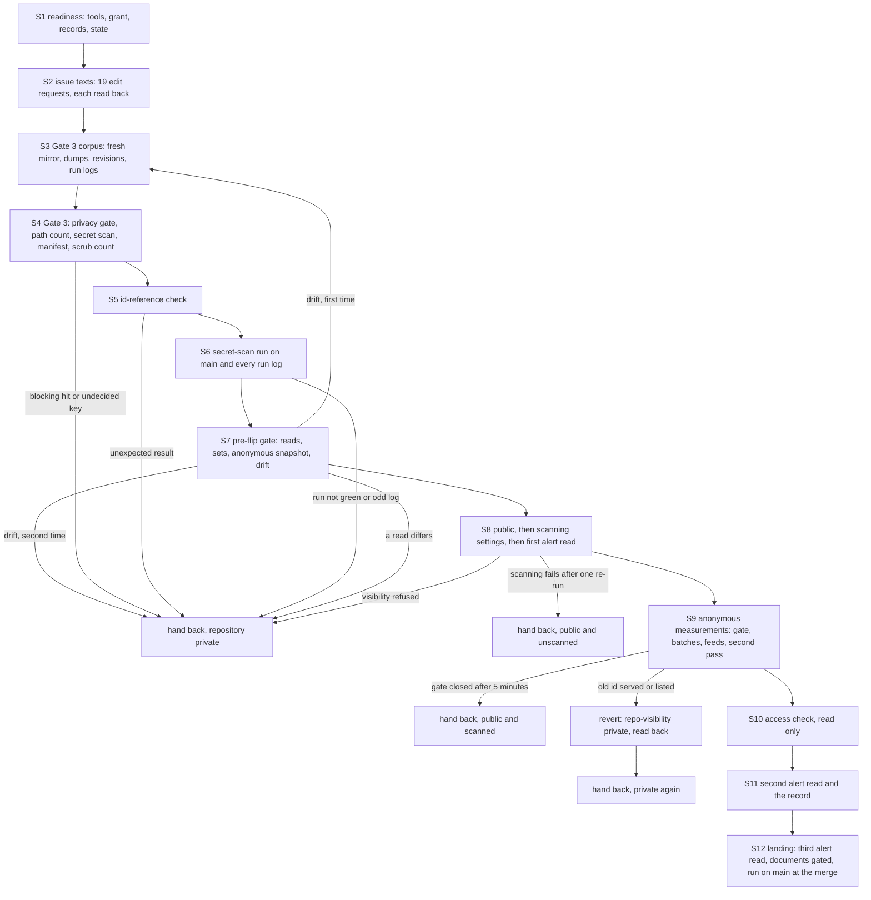

> **Superseded by [`../plan.md`](../plan.md).** This is the version of the plan the run started from. The current plan reads the committed configuration's bytes in the pre-flip gate without an argument that the shell rewrites before git receives it, states the number of earlier revisions that the issue-body edits leave, states its settled design where this version set out open points, and carries the changes that the later copy, [`plan-2-2026-11-12.md`](plan-2-2026-11-12.md), lists. Its relative links are rewritten to resolve from this folder.

# Phase 0 · 5 — Making KotlinBottools public: implementation plan

- **Covers:** [SpartanLaboratories/KotlinBottools#25](https://github.com/SpartanLaboratories/KotlinBottools/issues/25),
  *"Phase 0 · 5 — Make KotlinBottools public with secret scanning and push protection"*, a sub-issue of
  [#2](https://github.com/SpartanLaboratories/KotlinBottools/issues/2) (parent chain #25 → #2 → #1).
- **Architecture:** [`../architecture.md`](../../architecture.md), unit `kotlinbottools-publish` (§15, order 5, with its dated note),
  with §1.1 items 9 and 10, §1.2 items 2, 5 and 9, §2.4, §5, §6.5, §6.6, §7.5, §7.6, §8, §11, §12.4, §13 and §16. The evidence is
  [`research/README.md`](../research/README.md), whose Summary is this plan's design input, and the two findings files beside it:
  [`publication-and-scanning-api.md`](../research/publication-and-scanning-api.md) and
  [`anonymous-reads-after-publication.md`](../research/anonymous-reads-after-publication.md).
- **Branch:** `chore/issue-25-make-repository-public`. It exists and holds this unit's research. This plan is committed in the
  landing's one pull request, together with the unit's other documents, after the change to public; from the start of Gate 3's corpus
  (S3) to the end of the measurements (S10) nothing of this unit is committed or pushed to the repository. The issue's resolution
  comment links the pull request.
- **What this plans:** one continuous procedure that makes the repository public and checks it. It edits the planning-branch
  links in the bodies of issues #1 to #19, gates everything that becomes public (Gate 3 and the id-reference check), confirms the
  secret-scan run on `main`, makes the repository public, enables secret scanning and push protection, measures what an anonymous
  reader can reach, runs the read-only access check, and records the unit's counts. No repository source, test or build file changes.
- **Status:** planning only. The run that follows the plan's completion carries out the procedure below.
- **Target version:** none. The landing carries documents and generated boards only.

Every GitHub write of this unit is a request that carries this plan's exact procedure, inputs and checks, and is verified by
reading GitHub back before the next step (Design, "The requests"). The implementer does the local work itself, in this checkout and
in scratch folders under the workspace, and the reads of GitHub it makes itself.

---

## Requirements

**R1 — One continuous procedure, with no stop for a person before the change of visibility.** The temporary permission the owner
grants at the request service's console before the run starts (Preconditions, in Design) is the go-ahead for the whole run. The
order is: readiness (S1); the issue-body edits (S2); Gate 3's corpus and Gate 3 (S3, S4); the id-reference check (S5); the
confirmation of the secret-scan run on `main` (S6); the pre-flip gate with its drift check (S7); the change to public and the
scanning settings with the first alert read (S8); the anonymous measurements (S9); the access check (S10); the second alert read and
the record (S11). A failing verification before the change stops the run with the repository private.

**R2 — Every GitHub write is a request.** It carries the plan's procedure, inputs and checks, `permissionReason`
`phase-0-kotlinbottools-publish`, `github` and `target` `SpartanLaboratories/KotlinBottools`, and is verified by a read of GitHub; no
exit status alone counts. The writes are exactly: `edit-issue-body` for each of #1 to #19; `repo-visibility` to public, once;
`repo-security` enabling `secret_scanning` and `secret_scanning_push_protection` (re-sent at once on failure, as two ordered requests,
secret scanning first); and `repo-visibility` to private, only on the revert trigger (R9). There is no other write: no ruleset or
branch protection, no settings write, no comment, no label. The run's own GitHub reads and local work are not writes.

**R3 — The issue-body edits come before Gate 3, so that Gate 3 reads the final texts.** In the bodies of #1 to #19 only:

- every link `https://github.com/SpartanLaboratories/KotlinBottools/blob/docs/issue-1-bottools-consolidation/<path>[#anchor]`
  becomes `.../blob/main/<path>[#anchor]`: 3 in #1 and 2 in each of #2 to #19, 39 in all. Every target path and every anchor
  exists on `main`, except `docs/plans/1-bottools-consolidation/impact.md`, which is now `consequences.md`: #1's
  `[impact](…/impact.md)` becomes `[consequences](…/blob/main/docs/plans/1-bottools-consolidation/consequences.md)`;
- #1's clause ``; on branch `docs/issue-1-bottools-consolidation` until Phase 0 opens its pull request.`` is made true, because the
  documents are on `main`, with the least change: it becomes ``; on `main`.``;
- #2's line ``- **Plan:** written in `docs/plans/1-bottools-consolidation/0-<slug>/` when this phase is planned`` names the phase's
  folder with the least change: `0-<slug>` becomes `2-phase-0-history-rewrite`. The replaced text is the whole path in backticks;
  #13's line holds `10-<slug>` and is not touched;
- nothing else in any body changes. The references the transfers rewrote to `SpartanLaboratories/KotlinBottools-next#N` stay. Bodies
  are LF-only and end with one newline today, and the new bodies keep both;
- each edit is one request, guarded inside its procedure by the sha256 of the body the run read (a body that changed since is a stop
  of that edit only), and read back: the body equals the intended text exactly, and the issue's sub-issue and "blocked by" edges are
  the same before and after. A failed or refused edit is recorded and does not block the change of visibility;
- afterwards the 40 occurrences of the branch's name in the bodies (the 39 links and the clause) are 0. The one link in a comment on
  #1, the 16 in MagicBot #1 to #8 and the 1 in WebTools #55 stay, as follow-ups: no request edits a comment, and those repositories
  are not in this unit's writes;
- the new bodies pass the privacy gate, the id check and the machine-local path count before the first request.

**R4 — Gate 3 runs over everything that becomes public**, through `privacy_gate.py` by `allow_tool.py run` with the existing
allow-list. A new key goes through the allow-list's proposal and the owner's confirmation of each key, as the rewrite and swap unit's
plan describes ([`../23-kotlinbottools-rewrite-and-swap/plan.md`](../../23-kotlinbottools-rewrite-and-swap/plan.md#the-allow-list)); an
undecided or rejected key is a stop before the change. The corpus (`corpus-g3.args` under `$DATA/run/gate/`) holds:

- a fresh `git clone --mirror` of the repository taken for this gate: every ref, `refs/pull/*` included, so every text blob of every
  commit, every commit message and every identity;
- the dumps of issues, placeholders, pull requests, comments, review comments and reviews (`swap.py dump g3 T`, which writes
  `g3-*.json` and leaves Gate 2's `fresh-*.json` untouched);
- a dump of the earlier revisions of every edited issue body, pull-request body, comment, review and review comment, and of the
  earlier titles (GraphQL `userContentEdits` and renamed-title events). Today #1 has 5 revisions and #22 has 2, all clean; the 19 edits
  of S2 add one revision each;
- the full logs of every Actions run of the repository.

With Gate 3 also: the machine-local path count (the scrub's expressions, `scrub_check.py`'s `load_exprs` over `$SCRUB`) over the
texts, the revisions and the logs, recorded, a hit being a follow-up (an issue edit on request) and never a stop; the gitleaks scan of
the fresh mirror, history (both ref sets) and tree, through `secret_scan.py` with the workspace configuration (expected
`RESULT: CLEAN`); the purged-blob manifest reachable from no ref of the fresh mirror; and the scrub's zero count over every file of
every commit and every commit message of every ref of the fresh mirror (architecture §1.2 item 9).

**R5 — The id-reference check.** A token is 7 to 40 hexadecimal digits that is a prefix of a pre-rewrite commit id of any of the six
repositories (`oldid_refs.py`'s rule). The check runs over: every version, in the fresh mirror's history, of every file under the
phase folder `docs/plans/1-bottools-consolidation/2-phase-0-history-rewrite/` and of the repository work board
(`docs/plans/index.html`, `board.json`, `board.js`); every commit message of every ref; the text dumps; the revisions; the run logs.
The expected results, measured on 2026-11-12, are the check's data; the run fails on anything else:

- every phase document (`.md`), in every version: 0;
- the boards (`plan.json`, `plan.js`, `dashboard.html` of the phase's issue and tracking boards, and the repository work board):
  tokens in board files only; 10 distinct ids at the current tips and 13 distinct over every version, every one a pre-rewrite
  KotlinBottools commit. At the tips they sit in the JSON fields `asBuilt.merge`, `asBuilt.sha`, `asBuilt.commits[].sha`,
  `baseline.sha`, `milestones[].note`, `trail[].label`, `rows[].asBuilt.statements[].text`, `wip.stages[].report`,
  `wip.history.implementation[].stages[].report`, `rows[].unit.landing.merge`, `wip.landing.merge` and `rows[].landed.merge` (the
  repository work board); over every version also in `tree.sha`, `rows[].unit.live.stages[].report` and
  `rows[].unit.live.history.implementation[].stages[].report`. All are accepted: under the swap the pre-rewrite objects live only in
  the private legacy repository, so none resolves in the public repository;
- the comments: the 3 accepted ids of `$DATA/run/swap/accepted-ids.txt`, only in the resolution comments of #2, #21 and #22, 35
  tokens by this rule (the 26 occurrences the parent's note counts are the 40-digit forms);
- everything else (bodies, titles, placeholders, pull-request texts, review texts, revisions, commit messages, logs): 0.

The check prints counts, file classes, file names and field paths, never an id. It writes the distinct board ids to files under
`$DATA` for the anonymous probes and checks they are a subset of the 87 pre-rewrite KotlinBottools commits.

**R6 — The secret-scan run on `main` is confirmed before the change.** The latest `Secret scan` run on `main` at the head Gate 3
read is `completed success`. Every Actions run of the repository (four today: the pull-request and push runs of #34 and of #35) has
its log read and shape-checked with `logshapes.py` and the fixed shapes of the repository hygiene unit, because the logs become
visible to anyone with an account once the repository is public. Each run of the current workflow reads `6 62 0`. After the
landing's merge the push run on `main` at the merge commit is read the same way and reported in the issue's resolution comment.

**R7 — The pre-flip gate**, immediately before the change, is made of reads only: the repository is private, by id at the name; no
fork (`forks_count` 0 and the forks list empty); the numbers 1 to 31 are still reproduced (each exists, with the kinds of
`$DATA/run/swap/census.json`: issues, and closed `not_planned` placeholders at 20, 30 and 31); the organisation role is `admin`; the
authenticated core rate limit is at least 1000; `security_and_analysis` is null and the alerts list answers 404; the legacy
repository (id 562658298, `KotlinBottools-legacy`) is private and archived and answers 404 anonymously; the workspace configuration
equals `main`'s `.gitleaks.toml`; Gate 3, the id check and the run confirmation passed in this run; the anonymous harness snapshot
(web page 404, REST 404 with `x-ratelimit-limit: 60`, `info/refs` 401, credential-less `git ls-remote` exit 128); and the **drift
check**: the refs equal those of Gate 3's mirror, the highest number is unchanged, no issue, pull request, comment or review was
updated after Gate 3's dump, and no Actions run is newer than those checked. On drift, Gate 3, the id check and the run confirmation
run again once over the new state; a second drift hands back with the repository private.

**R8 — The change and the scanning settings.** `repo-visibility` public: `PATCH /repos/SpartanLaboratories/KotlinBottools` with
`visibility` only (never `private`), guarded by the id check at the name, with `X-GitHub-Api-Version: 2022-11-28`, the response
projected to `visibility` and `private` (the first read), then a `GET` (the verifying read): `public false`. Then at once
`repo-security`: the second `PATCH` with the body file `{"security_and_analysis":{"secret_scanning":{"status":"enabled"},"secret_scanning_push_protection":{"status":"enabled"}}}`
(never `advanced_security`), read back as `enabled enabled`, with generic patterns and validity checks not `enabled` and AI detection
and `advanced_security` absent or not `enabled`. The design's "same minute" is bounded by the request service's turnaround: in the
earlier units a repository write took about 2 to 3 minutes from request to reply, so the scanning request is sent the moment the
visibility read-back holds, the times of both read-backs are recorded, and the gap is reported (Considerations). A failed scanning
update is re-run at once as two ordered requests and reported; a 422 is reported with its message and no other field is tried; the
repository then stays public and the run hands back at once.

**R9 — The alert reads** (the secret-scanning alerts list with `hide_secret=true`, `per_page=100`, `--paginate`, projected to
`secret_type` and `state` counts; never a value) happen right after the scanning update (200 required; a 404 is retried 4 times at
5 s, then treated as a failed scanning update), again when the measurements end, and once more before the unit's documents land. An
empty list is recorded as "no alert yet", never as "the scan has finished": no completion read exists on this plan. An alert is
reported by type and count and does not revert the change.

**R10 — The anonymous measurements** ([findings §6](../research/anonymous-reads-after-publication.md#6-recommendation-for-this-repo)):

- the readiness gate after the change: web page 200, `info/refs?service=git-upload-pack` 200, credential-less `git ls-remote` exit 0,
  then one anonymous REST read with `visibility` public; polled every 10 s for at most 5 minutes, a 5xx or 429 meaning wait. A gate
  still closed at 5 minutes is reported and the run hands back with the repository public;
- controls from the fresh mirror (the root commit of `main`, its tree, a blob of that tree, and a made-up id), each route's batch
  bracketed before and after; a batch whose closing control fails is void;
- the route sets: web `HEAD /commit/<id>` for all 87 pre-rewrite commits; protocol-v2 `want` (HTTP 200 required, the body decides)
  for the 87 commits, the trees of the old tips and first-changed commits, and an evenly spaced sample of at most 60 purged blobs;
  anonymous REST `HEAD` on `git/commits`, `git/trees` (where 422 means present, as a blob) and `git/blobs` for the controls and a
  sample of at most 20, old tips first; a second web pass over the 13 board ids, the tips and the first-changed commits at least 6
  minutes after the first;
- every anonymous call is proved anonymous (`x-ratelimit-limit` 60), REST stops when `x-ratelimit-remaining` falls below 8, the pace
  is 0.4 s, and any status outside a route's two answers stops the set;
- the feeds: the web `/activity` page, then REST `activity` and `events`, membership of the 87 ids counted, valid only when the same
  response lists a current id, and read again at least 6 minutes later.

Expected: every probe absent and every feed 0 old ids. **Revert trigger:** any pre-rewrite id served on any route, or listed in any
feed. The run records `forks_count` and the forks list, sends the prepared `repo-visibility` private request at once, reads back
(`private` true; `security_and_analysis` as read; alerts 404; anonymous page 404) and hands back. The record says the revert recalls
nothing already copied. Any other deviation is reported, never reverted.

**R11 — The access check** reads and changes nothing ([findings §6.6](../research/anonymous-reads-after-publication.md#66-the-access-check)).
Anonymously: the page 200; the REST representation 200 with `visibility` public, `private` false, `archived` false, `fork` false,
`forks_count` 0, `has_wiki` false, `has_issues` true, `default_branch` `main`, and neither `security_and_analysis` nor `permissions`
in the body; credential-less `git ls-remote --refs` exit 0 with the same refs as the authenticated listing; an issue page 200; the
Actions run list 200; a run's logs 403. With the token: one collaborator, role `admin`, the organisation administrator; no team;
`allow_forking` recorded without a verdict (it governs private forks); `has_wiki` false; the workflow token `read` with approving
off; the fork pull-request approval policy 200 `first_time_contributors` (the documented default; any other value reported);
`fork-pr-workflows-private-repos` 422. A deviation is reported.

**R12 — The record.** The unit's counts (gates, checks, probes, feeds, alerts, access) and the KotlinBottools row for the residual
report of `residual-report-and-cleanup` (#28): the anonymous tallies, the activity-feed membership, the public window of the
pre-rewrite repository (from 2026-11-08 to 2026-11-11T06:11:18Z, the time the rewrite and swap unit recorded), and the time of the
change to public. They are written under `$DATA/run/publish/record/` with a checksum list.

**R13 — The unit's own documents** (this plan, `consequences.md`, `final-implementation.md`, the dated notes, the regenerated boards)
are committed in the landing after the change. Each is run through the privacy gate, the id check (no new resolving token), the
machine-local path count (0) and the gitleaks dir scan with the committed configuration before its commit (S12).

**R14 — The output rule.** Nothing is printed but counts, statuses, rule ids, setting values, field paths and fixed markers: no
pre-rewrite id, purged blob id, name, guild, id-shaped number, secret or machine path. Every id, dump and log lives under `$DATA` or a
scratch folder under `$WS/tmp`, never in the checkout.

---

## Current state

Read on 2026-11-12, unless a source is linked. The baseline is `main` at `3596cbe` (a documents-only merge of pull request #35,
reached from `3d1b890`, where the branch was cut).

**The repository.**

- KotlinBottools, repository id 1453296798, is private; `security_and_analysis` is null and the secret-scanning alerts list answers
  404. Branch protection and rulesets answer 403 while it is private, the organisation is on the free plan, the signed-in account is
  an organisation administrator (`role: admin`) and its token scopes include `repo`.
- `allow_forking` is false, the wiki is off, the workflow token is `read` with approving off, and the fork pull-request approval
  endpoint answers 422 while private. There is one collaborator (the administrator), and no team, fork, star, watcher, hook, deploy
  key, secret, variable, environment, release, tag or Pages site; no project is linked.
- Numbers 1 to 35: 32 issues (1 to 31 reproduced by the swap, with closed placeholders at 20, 30 and 31; #33 is new) and 3 merged
  pull requests (#32, #34, #35). Refs: `main`, the topic branch, `refs/pull/32/head`, `refs/pull/34/head`, `refs/pull/35/head`.
- Four `Secret scan` runs, all `success`: the pull-request and push runs of #34 and of #35. The repository hygiene unit read the first
  two at `6 62 0`; the two runs of #35 have not been shape-checked yet.

**Baselines measured read-only.** The privacy gate over `main`'s tree and every issue, pull-request and comment text reports
`GATE: 0 blocking hit(s)`; over the 7 earlier revisions of #1 and #22: 0. The scrub's expressions over 87 texts and the 7 revisions:
0. The activity feed (20 entries) and the events (51) hold no pre-rewrite id. The id-check expectations of R5 are the measured values.

**Also read while this plan was written** (each by the procedure's own code, against GitHub or a copy, with no write):

- the logs of the four Actions runs, through `logshapes.py` and the fixed shapes: each reads `6 62 0` with markers `2 1 2 2`, the two
  runs of #35 included;
- the anonymous snapshot of a private repository: the page 404, the REST representation 404 with `x-ratelimit-limit: 60`, a GET of
  `info/refs?service=git-upload-pack` 401 (a HEAD answers 405, so the gate uses a GET), a credential-less `git ls-remote` exit 128; the
  legacy repository private and archived by its id, 404 anonymously by name and by id;
- the revisions dump: 43 issue-side objects, 2 with earlier revisions (7 revisions in all), 1 earlier title, no pull-request
  revision;
- the secret scan, through `secret_scan.py` with the workspace configuration, over a mirror of this checkout (106 commits, the topic
  branch's research documents included): `RESULT: CLEAN` for both ref sets and for the tree;
- the anonymous helpers against a public repository of the organisation with its current objects: the controls of all five routes
  answered, a made-up id was absent on each, and a blob id on `git/trees` answered "present" (422);
- the organisation administrator reads `collaborators` as one `admin`; `collaborators?affiliation=direct` reads 0 for an
  organisation owner, so that read is recorded without a verdict.

**The issue bodies.** Bodies #1 to #19 are LF-only and end with one newline. The branch's name occurs 40 times in them: 3 links in #1
and 2 in each of #2 to #19 (39), and the clause in #1. Every target path and every anchor exists on `main`, except `impact.md`, which
is now `consequences.md`. Outside the bodies: 1 link in a comment on #1, 16 in MagicBot #1 to #8 and 1 in WebTools #55.

**The workspace tools** (`$WS/tools`; sizes and sha256 are in Appendix A's table of reused tools): `oldid_refs.py` (2718 bytes), `privacy_gate.py` (11615,
sha256 `0caea1411a4f3db7a32a0ac54e41d65b6df427545df16c7233d539a860747760`), `allow_tool.py`, `probe.sh` (2121), `k14-residual.sh`
(5634), `k12-gate2.sh`, `kcorpus.sh` (its corpora are `s0`, `s5` and `s12`; it is not modified, and this unit writes its own corpus
file), `scrub_check.py`, `secret_scan.py` (12073, equal to the file the repository carries), `gitleaks.toml` (3824 bytes, equal to
`main`'s `.gitleaks.toml`, blob `457a49a781e7e77e4e9b80a250690ddd8b2bc547`), `swap/swap.py` (177954), `env.sh` (sets `WS`, `DATA`,
`TOOLS`, `CFG`, `SS`, `SCRUB`, `KBT`), `lib.sh` (`expect`, `yn`, `tally`), `klib.sh` (`note`, `klisting`), and
`gitleaks-8.30.1/gitleaks.exe`. `$WS/tmp/h24/` holds the hygiene unit's `h24lib.sh` and `logshapes.py`; the scratch folder is not
permanent, so this unit carries its own copy of `logshapes.py` (Appendix A) and of the fixed shapes.

**The records** (`env.sh`'s `repo_env KotlinBottools` sets `RM=$DATA/rewrite/KotlinBottools` and
`MANIFEST=$DATA/manifests/KotlinBottools.blobs`): `$RM/commit-map` (the 87 pre-rewrite commits), `ref-map`, `first-changed-commits`;
the manifest of 346 purged blobs; `$DATA/run/swap/census.json` (`N` and `items[{n, kind, state, reason}]`),
`$DATA/run/swap/accepted-ids.txt` (3 ids), `$DATA/run/gate/allow.txt` and `allow.record`, `$DATA/run/swap/legacy-private-at`. The
five static repositories' backups are in `$WS/backup/`. Two stale pins, in `k0-ready.sh` and `save-tools.sh`, name the earlier
configuration value; `save-tools.sh` is never run again, because it would write the earlier bytes back.

**What GitHub documents and does** (sources in the findings, claims verified at source):

- `PATCH /repos/{owner}/{repo}` takes `visibility`; `private` has a documented default of `false` and is never sent; the response is
  the full repository, and `security_and_analysis` is shown only to an administrator
  ([REST: update a repository](https://docs.github.com/en/rest/repos/repos#update-a-repository),
  [findings §7 claims 1 to 5](../research/publication-and-scanning-api.md#7-load-bearing-claims)).
- A public repository of a free organisation has secret scanning and push protection without a purchase; generic patterns, validity
  checks and AI detection are paid and stay off; `advanced_security` is never sent
  ([findings §7 claims 13, 14](../research/publication-and-scanning-api.md#7-load-bearing-claims)).
- The scan of the existing history starts when scanning is enabled, takes an undocumented time, and has no completion read on this
  plan; the alerts list is `[]` both before the scan ends and after a clean scan
  ([findings §5](../research/publication-and-scanning-api.md#5-pitfalls)).
- A change to public publishes the code, the Actions history and logs, and the activity; it erases nothing and allows forks. A change
  back to private erases stars and watchers (0 here), detaches forks into their own public network, ends the scanning settings and
  recalls nothing already copied
  ([setting repository visibility](https://docs.github.com/en/repositories/managing-your-repositorys-settings-and-features/managing-repository-settings/setting-repository-visibility),
  [findings §3.5](../research/publication-and-scanning-api.md#3-findings)).
- Anonymous REST calls are limited to 60 an hour per address; the REST activity and events answers are cached for 60 and 300 seconds
  and events can lag up to 6 hours; the web `/commit/<id>` route answers 200 or 404 only for commits; the protocol-v2 `want` answers
  `packfile` or `not our ref` with HTTP 200; an anonymous `git/trees` request for a blob id answers 422
  ([findings §3 and §7](../research/anonymous-reads-after-publication.md#3-findings)).
- In the earlier units a repository write took about 2 to 3 minutes from request to reply.

---

## Assumptions

Each assumption is what the plan relies on and could not establish, with what changes if it is false.

- **A1 — Nothing lands on KotlinBottools, and no issue, pull request or comment is added, from S3 to S9.** The drift check (S7)
  guards it. If it fails, S3 to S6 run once more over the new state; a second failure hands back with the repository private.
- **A2 — The request service carries out each request within minutes, as it did in the earlier units.** The scanning gap and the
  length of S2 (nineteen requests, 40 to 60 minutes) follow from it. If it is much slower the gap is longer, which the record states.
- **A3 — The one-request form of the scanning update is accepted on a newly public repository.** The tests could not write. If the
  `PATCH` fails or the read shows a setting not `enabled` after the check's 5 reads (a first and four more at 5 s), `security-a` and `security-b` are sent in order.
- **A4 — The readiness gate opens within 5 minutes of the change.** No document says how soon a repository answers anonymously. If
  it does not, the run reports the gate closed and hands back with the repository public.
- **A5 — The anonymous throttles allow the paced batches** (about 125 web calls, about 180 `want` calls and at most 45 REST calls).
  A 429 or a status outside a route's two answers stops the set and the run hands back; a later resume starts with fresh controls.
- **A6 — The fork pull-request approval policy of a converted repository reads the documented default,
  `first_time_contributors`.** If it reads another value, the check reports it and changes nothing.
- **A7 — The allow-list needs no new key for Gate 3's corpus.** Gate 1 and Gate 2 read the same kinds of text. If a key is new, the
  owner's confirmation of each key is a stop, with the repository private, until it is given.
- **A8 — The "current tips" of R5 are the tips of `refs/heads/*` in the fresh mirror, and the 10 and 13 distinct board ids were
  measured over them.** If the expected counts differ while every token is in an expected field and every id is one of the 87, the
  difference is a recorded result to settle before the change, because the check treats any other count as a failure.
- **A9 — `gh api -F body=@file` sends the file's bytes unchanged, trailing newline included, and the request service writes
  `inputs.files` as the first check says.** Both are proved for each edit by the guard on the file's sha256 before the `PATCH` and by
  the read-back after it; a difference ends that edit only.
- **A10 — The request service reads `issue` of an `edit-issue-body` request as the issue to edit and `body` as its text.** The
  protocol's field table says so. If it refuses the form, the reply says why, nothing is written, and each edit is recorded as refused.
- **A11 — GitHub returns an Actions run's log to the account that runs the procedure for every completed run of the repository.** If
  a log is unavailable, S3 stops, because a log that cannot be read cannot be gated.

---

## Non-goals

- No ruleset, branch protection or required status check: Phase 1 (#3) sets the required check.
- No edit of a comment, of MagicBot's or WebTools' issues, or of the `KotlinBottools-next#N` references.
- No settings change beyond visibility and the two scanning settings: no description, topics, Dependabot alerts, private
  vulnerability reporting or fork pull-request approval change; no generic patterns, validity checks or AI detection.
- No test push to show push protection working, no webhook or scan-history read to learn when the scan ends (both need paid
  features, and a push is a protocol write).
- No README or CHANGELOG change, and no version.
- No change to another unit's tools: `kcorpus.sh`, `swap.py`, `probe.sh`, `k14-residual.sh` and the others stay as recorded.

---

## Design

### Shape of the procedure



The procedure is one run. Nothing in it waits for a person: the grant at the request service's console, given before S1 starts, is
the go-ahead, and every verification before S8 either passes or stops the run with the repository private. The only writes before S8
are the nineteen body edits, which change texts that are public the moment the repository becomes public anyway, and which Gate 3
reads in their final form.

### The stages

| id | name | brief | kind | steps |
|---|---|---|---|---|
| S1 | Readiness | The tools, the grant, the data records and the repository's state are as recorded, with the repository private and nothing written. | check | S1.save: The tools and blocks saved; S1.tools: The tools at their recorded bytes; S1.selftests: The tools' self-tests; S1.grant: The grant read; S1.state: The repository and the records read; S1.ids: The id sets built |
| S2 | Issue texts | The bodies of issues 1 to 19 name `main` instead of the deleted planning branch, each edit read back. | work | S2.texts: The new bodies built and audited; S2.gate: The new bodies gated; S2.edits: The nineteen edits; S2.after: The remaining occurrences counted |
| S3 | Gate 3's corpus | Everything that becomes public is gathered: a fresh mirror, the text dumps, the earlier revisions and the run logs. | work | S3.mirror: A fresh mirror; S3.dumps: The text dumps; S3.revisions: The earlier revisions; S3.logs: The run logs; S3.corpus: The corpus file |
| S4 | Gate 3 | The privacy gate, the path count, the secret scans, the purged-blob manifest and the scrub's count pass over the corpus. | check | S4.gate: The privacy gate; S4.paths: The machine-local path count; S4.scan: The secret scans; S4.manifest: The purged-blob manifest; S4.scrub: The scrub's zero count |
| S5 | The id-reference check | No token in the public material resolves to a pre-rewrite commit apart from the expected ones. | check | S5.check: The id-reference check |
| S6 | The run on main | The latest secret-scan run on `main` passed and every run's log holds only fixed shapes. | check | S6.runs: The runs read |
| S7 | The pre-flip gate | Immediately before the change, every read shows the repository private and unchanged since the corpus was taken. | check | S7.reads: The pre-flip reads; S7.sets: The probe sets and controls; S7.anon: The anonymous snapshot; S7.drift: The drift check and the requests |
| S8 | The change and the scanning settings | The repository is public with secret scanning and push protection on, each read back. | work | S8.public: The change to public; S8.security: The scanning settings; S8.alerts: The first alert read |
| S9 | The anonymous measurements | No pre-rewrite id is served or listed anonymously; otherwise the repository is made private again. | check | S9.gate: The readiness gate; S9.batches: The route batches; S9.feeds: The first feed read; S9.second: The second pass and feed read; S9.revert: The revert, only on the trigger |
| S10 | The access check | Reading only, the repository is reachable as a public repository should be and its settings are as recorded. | check | S10.anon: The anonymous half; S10.auth: The authenticated half |
| S11 | The close | The second alert read and the record of the unit's counts and its row for the residual report. | check | S11.alerts: The second alert read; S11.record: The record |

The reads around the landing (S12: the third alert read, the documents gated before they are committed, and the run on `main` after
the merge) are not a stage of the change: they belong to the landing, and their steps are described in the procedure after S11.

### Preconditions

Before S1 starts, the owner gives the grant at the request service's console, as one section of the repository's
temporary-permissions file (`%USERPROFILE%\.claude\<the service's folder>\temp-permissions\SpartanLaboratories-KotlinBottools.md`; the
file name is the repository's name with the owner and a hyphen in front, as the service names it). The exact text, with the date of the day it
is given:

```text file=grant.txt
## phase-0-kotlinbottools-publish
Granted: <date>
Permissions: edit-issue-body, repo-visibility, repo-security
Scope: SpartanLaboratories/KotlinBottools#25, branch chore/issue-25-make-repository-public; github and target SpartanLaboratories/KotlinBottools only; edit-issue-body on issues #1 to #19 only; repo-visibility to public once, and to private only as the plan's revert when a pre-rewrite id is served anonymously or listed in the anonymous activity feed or events; repo-security enabling secret scanning and push protection only, re-sent at once if it fails
Ends: when #25 lands
```

S1 reads that file, read only, and stops if the section is missing, does not name the three actions, issue #25 and an end, or has
ended; a wording that differs from this text in anything else is recorded. No deny rule of the
request service's launcher settings is affected: every write is a `gh api` call.

### The requests

A request is a JSON document that `p25_writes.py request <key>` writes into `$DATA/run/publish/requests/<key>.json` immediately
before it is sent; no request file is ever committed. The run sends the file's contents as one request and waits for the reply; on
`done` the key's check runs.

**Fields of every request**

| Field | Value |
|---|---|
| `permissionReason` | `phase-0-kotlinbottools-publish`, the job's name |
| `github` | `SpartanLaboratories/KotlinBottools`, the repository the job is recorded under |
| `action` | `edit-issue-body`, `repo-visibility` or `repo-security` (table below) |
| `target` | `SpartanLaboratories/KotlinBottools`, by the name it holds |
| `issue` | for `edit-issue-body`, the number of the issue to edit (1 to 19); otherwise 25, this unit's issue |
| `procedure` | the literal commands, in order, run in one shell (a command that sets a variable is on the same line as the command that uses it); `gh api` for every write; at least 3 s between writes |
| `inputs` | `key` (the request's key) and `files` (file name → exact text) where a command reads `@file` or `--input`. The body files keep their LF line endings **and their trailing newline**: the earlier units wrote their files with no trailing newline, and this unit's files differ in that. The procedure verifies the written file's sha256 before it uses it |
| `checks` | the facts the reply must show; where a command reads a file, the first check tells the run to write each entry of `inputs.files` byte for byte (UTF-8, no BOM, LF line endings, the trailing newline kept) into the working folder |
| `v`, `id`, `attempt`, `from` | supplied by the run: the request protocol's envelope, added when the file is sent; `id` is `<sender>/25/<key>` and `attempt` is the number of stored replies for the key plus one |

Fields of one action only: `body` (`edit-issue-body`: the new text, equal to the file in `inputs.files`); `visibility` (`repo-visibility`:
`public` or `private`); `security` (`repo-security`: the `security_and_analysis` object that the settings file holds).

**The requests, in order**

| Key | Action | Target | Fields beyond the common ones | Pre-write check inside the request | Verified by `check` |
|---|---|---|---|---|---|
| `edit-1` … `edit-19` | `edit-issue-body` | `SpartanLaboratories/KotlinBottools` | `issue` N, `body`, `inputs.files` `body-N.md` | the id at the name is 1453296798; the written file's sha256 is the manifest's; the body read by `gh api … --jq .body` hashes to the old body's or (done already) the new body's, else `STOP` for this edit only | the body of #N equals the intended text byte for byte; the issue's sub-issue and "blocked by" edges equal those read before S2 |
| `public` | `repo-visibility` | `SpartanLaboratories/KotlinBottools` | `visibility` `public` | the id at the name; the state is `private true` (`public false` is `ALREADY-PUBLIC`) | first read `public false`, then a verifying `GET`: `public false`; the two times recorded |
| `security` | `repo-security` | `SpartanLaboratories/KotlinBottools` | `security`, `inputs.files` `security.json` | the id; the state is `public false`; the file's sha256 | first read `enabled enabled`; the `GET`: `enabled enabled disabled disabled` and AI detection and advanced security absent or `disabled` (a value not yet `enabled` is read again, up to 4 more times at 5 s) |
| `security-a`, `security-b` | `repo-security` | `SpartanLaboratories/KotlinBottools` | `security` (one setting each), `inputs.files` `security-a.json` or `security-b.json` | as `security`; `security-b` also needs secret scanning `enabled` | the `GET` shows the setting just sent `enabled`, the paid settings not `enabled` |
| `private` | `repo-visibility` | `SpartanLaboratories/KotlinBottools` | `visibility` `private` | the id; forks recorded before (`forks_count`, `network_count`, the forks list length); `private true` is `ALREADY-PRIVATE` | first read `private true`; the `GET`: `private true` with `security_and_analysis` as GitHub holds it; the revert only |

**What a reply is.** Each reply is stored with `p25_writes.py reply <key> <status>`, the reply text on standard input, as `done` (the
procedure reported success), `failed` (a command failed; GitHub's message is in the text), `refused` (the request was not carried out:
no grant, an action not defined, a permission refused; nothing was written) or `stopped` (a guard inside the procedure stopped it; the
text says which). After any status the key's `check` is read before anything else, because a reply is only the service's account.

**Retry and routes.** The tool never retries. `edit-N` is repeated by running `request edit-N` again, which reads first and prints
`SKIP` when the write landed. A refused or failed edit is recorded with `note-edit` and the run goes on to the next edit. `public`
is never repeated blind: `request public` reads the state and prints `SKIP` once public. A `security` that failed, or whose read
shows a setting not `enabled` after the check's 5 reads, is followed at once by `security-a`, then `security-b`, each with its check; a 422
is reported with its message and no other field is tried. `private` is sent once and checked.

### The tools

All new tools live in `$WS/tools/p25/`, saved from Appendix A by S1 (each checked by size and sha256) and copied with the workspace
tools at the phase's cleanup. Existing tools are reused unchanged.

| Tool | Role |
|---|---|
| `p25lib.sh` | constants by role (names, ids that are public, folders), the tool runners (`pw`, `prv`, `pid`, `prd`, `ak`), `must`, `stamp`, `since`, `mark_ok`, `marked`, `blobsum`, and the fixed output shapes |
| `anon.sh` | the anonymous helpers: `anon_web`, `anon_api`, `anon_repo`, `anon_info`, `anon_ls`, `anon_want`, `classify`, `one`, `ctl_ok`, `probe_ids`, `batch`, `run_batch`, `feed_read`, `run_feed`; no call carries a credential |
| `p25_writes.py` | the body reader, builder and auditor; the request builders, pre-write checks and verifying reads; the reply store |
| `p25_revisions.py` | the earlier revisions and titles of every edited text (GraphQL), for Gate 3 |
| `p25_idcheck.py` | the id-reference check, the check of the documents the landing carries, and the machine-local path count |
| `p25_reads.py` | the number census, the drift check, the alert reads and the authenticated settings read |
| `logshapes.py` | the hygiene unit's log-shape filter, byte for byte |
| `tools.sums`, `p25tools.sums`, `grant.txt` | data: the pinned existing tools, the pinned new tools, and the grant's text |

Reused unchanged: `privacy_gate.py` and `allow_tool.py` (Gate 3 and the documents' gate, always through `allow_tool.py run`),
`swap.py dump` (the text dumps), `scrub_check.py` (`load_exprs`), `scrub_count.py` (the scrub's zero count over a mirror),
`secret_scan.py` with `gitleaks.exe` and the workspace configuration, `oldid_refs.py` (the rule, and the check of the new bodies),
`env.sh`, `lib.sh` and `klib.sh`. `kcorpus.sh` is not used: this unit writes its own corpus file.

### Where the records live

`$DATA/run/publish/` holds this unit's records and none is ever committed: `bodies/` (the bodies as read, the new bodies, the edges,
the manifest of old and new sha256), `requests/`, `replies/`, `logs/` (the Actions run logs), `ids/` (the id sets and the probe sets),
`record/` (the times, the tallies, the feeds, the alert reads, the edit notes, the final row and its checksum list), `status/` (one
marker per passed stage) and `main-paths.txt`, the `g3-refs.txt` and `g3-runs.tsv` of each pass. `$DATA/run/gate/` holds
`g3-*.json` and `corpus-g3.args`, `corpus-bodies.args`, `corpus-docs.args`. Scratch lives in `$WS/tmp/p25/`: the mirror, the tree
clone, the scan reports and logs, and the blocks of the plan saved as scripts. A second Gate 3 pass uses the label `g3b`.

### Error handling and logging

- **Failure design.** Each Python tool has one failure type, `Stop`, for an expected failure (a read that differs, a count that is not
  the expected one, a refused reply, a git or GraphQL failure): it prints `STOP  <why>` and exits 1. A bug is an ordinary traceback
  with exit 1. Drift is not a failure of the tool: `p25_reads.py drift` exits 2 and prints one `DRIFT` line per difference. The shell
  blocks end through `expect` (`STOP  <label>: expected '<x>', got '<y>'`, exit 1), `must` (`STOP  <label>: status <n>`) and, in S9,
  through `run_batch` and `run_feed`, which end the block with status 9 on a served or listed id (the revert trigger) and status 1 on
  a stop or a void tally. `note` prints `RECORD` and never stops.
- **Recorded, not stopped:** a refused or failed body edit; the machine-local path count's hits; the anchors not found in a link
  target; the alerts; an invalid feed read (no current id listed); the access check's deviations; the remaining occurrences of the
  branch's name outside the bodies; the number of runs, caches, and the gap between the two read-backs.
- **Where a failure is unwrapped.** The implementer reads the last lines of every call and acts on a `STOP`, a status 2 (drift) or 9
  (revert trigger), or a missing `ok` line, as Conventions states. No Kotlin code is written, so no `Result` is built; the tools'
  `Stop` plays the part of an encapsulated expected failure and is unwrapped once, in each tool's `main`.
- **Events logged** (a console line, and for the requests a file under `$DATA/run/publish/`): each request built, sent (a `stamp`),
  replied (the reply stored whole) and checked; each guard's result; each gate's verdict; each stage's marker; each batch's tally;
  each feed read; each alert read with its time; each stop with its step id. Levels: the line carries its status (`ok`, `RECORD`,
  `DRIFT`, `STOP`, `VOID`, `REVERT TRIGGER`).

### The output rule

The tools print counts, numbers, repository ids, statuses, rule ids, setting values and fixed markers. The privacy gate is never
printed raw: every run goes through `allow_tool.py`, which masks every corpus label. Never printed or quoted: a text, a pre-rewrite
commit id, a blob id, a path of the legacy guild data or of its logs, a name, a guild, a Discord id, a secret value, an alert's literal secret
(the alert read projects to type and state inside `gh`, so no value reaches the tool), a token, a machine-local path. The anonymous
helpers keep only the first 120 bytes of a `want` answer and never save a page beyond counting it. The plan's own text contains none
of these: its constants are named by role, and the ids live only in files under `$DATA`.

### Stops and the state each leaves

This extends [architecture §7.6](../../architecture.md#76-stop-and-hand-back-points-of-the-swap) for this unit.

| Where | The stop | State left | Next |
|---|---|---|---|
| S1 | a missing or different grant section; a tool or file differing from its recorded bytes; a self-test, a record or a read differing | nothing written anywhere; private | fix the cause, or the owner gives the grant; re-run S1 |
| S2 | a blocking gate hit or an undecided key over the new bodies; a link target that is not a path on `main`; a count of replacements that differs | nothing written; private | fix; re-run S2 from `S2.texts` |
| S2 | an edit refused, failed or stopped by its guard (the body changed since it was read) | that body unedited, the others as far as they went; private | recorded with `note-edit`; the run goes on; the remaining occurrences are a follow-up |
| S3 | an open pull request, or a ref other than `main`, the topic branch and the pull requests' head refs; a run not completed; a log that cannot be read; an artifact; a dump that fails | nothing public changed; private | fix, or wait for the pull request or the run; re-run S3 |
| S4 | the gate meets a hit or an undecided or rejected allow-list key; a scan that is not `RESULT: CLEAN`; a manifest blob reachable; a non-zero scrub count | private; nothing else written | for an undecided key the proposal is printed and the owner answers each key, then `write`, `verify`, `check`, and S4 again; a hit is never allow-listed by the run; anything else hands back |
| S5 | any result outside the check's expected data | private | hand back with the counts and field paths; no id is quoted |
| S6 | the latest run on `main` is not `completed success`, or a run's log has a line of another shape or other marker counts | private | hand back; the shape check is the owner's before the change |
| S7 | any read of the pre-flip gate differs | private | hand back with the read |
| S7 | drift (the refs, the highest number, an update after the dump, a new run) | private | S3 to S6 and S7 run again once with the label `g3b`; a second drift hands back, private |
| S8 | `public` fails (a 403 or 422 is an organisation restriction, not retried another way) | private; the HTTP status and message reported | hand back |
| S8 | `public` is done but its read-back is not `public false` after the check's 5 reads | state unknown, read once more by hand | hand back with the reads |
| S8 | `security` fails or reads a setting not `enabled`; then `security-a` and `security-b` fail or a 422 | public and unscanned | reported at once; the message is quoted; no other field is tried; hand back |
| S8 | the alerts list answers 404 after the scanning update, 4 times at 5 s | public; scanning treated as failed | `security-a` and `security-b` as for a failed update; report |
| S9 | the readiness gate is still closed after 5 minutes | public and scanned | reported; the run hands back; nothing is concluded about the old ids |
| S9 | a status outside a route's two answers, a budget stop or a void tally | public and scanned | reported; a later resume starts with fresh controls (and the REST routes wait out the hour) |
| S9 | **the revert trigger:** a pre-rewrite id served on any route, or listed in any feed | private again, after `private` and its check; forks, `security_and_analysis` and alerts recorded | hand back; the record says the revert recalls nothing already copied; a later change to public repeats S7 and S8 |
| S9 | an alert | public; scanned | reported by type and count; never a revert |
| S10 | a deviation of the access check | public; scanned | reported, never reverted |
| S11 | the record's counts cannot be built | public; scanned | fix the record; the unit's documents wait |
| S12 | a document with a hit, a resolving token or a machine-local path; a run on `main` at the merge that is not green | documents uncommitted, or committed and the run red | reword the document and re-run S12; a red run is reported in the resolution comment |

### What the unit creates on GitHub

Nineteen edited issue bodies (and the 19 revisions they leave), the change of the repository to public, its secret-scanning and
push-protection settings and, only on the revert trigger, the change back to private. It sends no comment, no label, no deletion, no
ruleset and no other settings write.

---

## Procedure

### Conventions

- **Shell.** Git Bash. Each call starts a fresh shell. S1's `save` step writes every block of this plan to a script under the
  workspace, with the prelude below prepended, so every other call is `bash "$B/<id>.sh"` with `B` set as in the first line. No
  machine path is typed:

  ```bash
  B="$(cygpath -m "$USERPROFILE")/BotWS/tmp/p25/blocks"; bash "$B/S4.gate.sh"
  ```

  Each saved script starts with the prelude (`env.sh`, `lib.sh`, `klib.sh`, `p25lib.sh`, `anon.sh`: `env.sh` exports `WS`, `DATA`,
  `TOOLS`, `KBT`, `CFG`, `SS`, `GL`, `SCRUB` and defines `gitnet`; `lib.sh` defines `expect LABEL WANT GOT` and `yn PATH`; `klib.sh`
  defines `note LABEL WANT GOT` and `klisting`; `p25lib.sh` and `anon.sh` are Appendix A's). Python always runs with `-I`; the tool
  runners add `-X utf8 -B`, so no bytecode is written beside a tool.
- **Running a block.** A block is run as a script, never passed as one long command: the shell tool hands a command to Git Bash as a
  single argument, and on this machine a command of about 7.6 KB was cut while one of 6.8 KB passed whole. S1 saves the blocks of
  this plan to files for that reason, and each is run from its file, whatever its size.
- **Reading the output.** A call succeeded when every `expect` printed `ok` and the call ended without a `STOP`. A `STOP` ends the
  call: stop and report the step id, the marker and the numbers on the line, never content. `RECORD` lines are results, not stops.
  A `DRIFT` line (exit status 2) is the drift of S7, and an exit status of 9 is the revert trigger of S9; both are handled where
  their step says. The expected number of `ok` lines is given for each step: the lines the step's `expect` calls print, and the
  lines of the tools it calls.
- **A STEP `<key>`** is the unit of every write:
  1. `bash "$B/pw.sh" request <key>`. It prints `PROCEED  REQUEST <key> -> requests/<key>.json (<action>)`, or `PREPARED …` with
     `--offline`, or `SKIP  <key>: already done`, or a `STOP`. On `SKIP` go to 4; on a `STOP` the step ends with what the stop table
     says.
  2. The run sends the contents of `$DATA/run/publish/requests/<key>.json` as a request and waits for the reply.
  3. The implementer stores the reply with the reply text pasted into a heredoc that ends at the line `REPLY_END`:

     ```bash
     bash "$B/pw.sh" reply <key> done <<'REPLY_END'
     (the reply text)
     REPLY_END
     ```

     with `done`, `failed`, `refused` or `stopped` in place of `done` (Design, "The requests").
  4. The key's check: `bash "$B/pw.sh" check <key>` for an edit, and `bash "$B/check-retry.sh" <key>` for `public`, `security`,
     `security-a`, `security-b` and `private`, which reads again up to 5 times at 5-second intervals (a read can lag a write; the
     last line of the call decides, and the `STOP` lines before it are the lag).
- **What is never done.** No write is typed: only a request writes. No `gh issue edit`, no `gh repo edit` and no `gh api` with a
  write method outside a request's procedure. No request is sent without the `PROCEED` or `PREPARED` line that wrote its file, and no
  file is sent twice after a failure: `request` is run again, which reads first. Nothing is committed or pushed from S3 to the end of
  S10. A rerun of a stage starts at its first step; a stage's marker is removed by its first step and written by its last.
- **Timeouts.** Calls run in the foreground with a 10-minute timeout. `S3.mirror`, `S3.logs`, `S4.scan`, `S9.batches` and `S9.second`
  can take several minutes (S9.second waits 6 minutes by design); a call may run in the background and be read when it ends. A
  request's wait is the service's turnaround.
- **Scratch.** `$WS/tmp/p25` holds the mirror, the tree clone, the scan reports and the saved blocks; it holds history and findings,
  stays under the workspace, which the last unit of the phase deletes, and nothing in it is printed or copied out.

### S1 — Readiness

Nothing is written to GitHub; everything is a read, a local check or a self-test.

**`S1.save`**: the tools and the blocks are saved from this plan. This is the only call that is typed whole; it must run from the
checkout that holds this plan. A block fenced `bash block=<id>` becomes `$WS/tmp/p25/blocks/<id>.sh` with the prelude on top; a block
fenced `file=<name>` becomes `$WS/tools/p25/<name>`; carriage returns are stripped.

```bash
. "$(cygpath -m "$USERPROFILE")/BotWS/tools/env.sh"; . "$TOOLS/lib.sh"
PLAN="$KBT/docs/plans/1-bottools-consolidation/2-phase-0-history-rewrite/25-kotlinbottools-publish/plan.md"
T="$TOOLS/p25"; B="$WS/tmp/p25/blocks"; rm -rf "$B"; mkdir -p "$T" "$B"
PRE='. "$(cygpath -m "$USERPROFILE")/BotWS/tools/env.sh"; . "$TOOLS/lib.sh"; . "$TOOLS/klib.sh"; . "$TOOLS/p25/p25lib.sh"; . "$TOOLS/p25/anon.sh"'
tr -d '\r' < "$PLAN" | awk -v t="$T" -v b="$B" -v pre="$PRE" '
  /^```[a-z]* (file|block)=/ { split($2, kv, "="); out = (kv[1] == "file") ? t "/" kv[2] : b "/" kv[2] ".sh"; if (kv[1] == "block") print pre > out; inside = 1; next }
  /^```$/ && inside { inside = 0; close(out); next }
  inside { print > out }'
expect "the tool and data files are saved" 10 "$(ls "$T" | wc -l | tr -d ' ')"
expect "the blocks are saved" 41 "$(ls "$B" | wc -l | tr -d ' ')"
```

Expected: two `ok` lines.

**`S1.tools`**: every reused tool and every saved file holds its recorded size and sha256, and the workspace configuration is the
committed one. The pins are the data blocks `tools.sums` (sizes and hashes relative to `$WS`) and `p25tools.sums` (relative to
`$WS/tools/p25`), listed in Appendix A.

```bash block=S1.tools
while read -r size sum rel; do
  [ -n "$rel" ] || continue
  expect "$rel holds its recorded size and sha256" "$size $sum" "$(sz "$WS/$rel") $(sha "$WS/$rel")"
done < "$T25/tools.sums"
while read -r size sum rel; do
  [ -n "$rel" ] || continue
  expect "p25/$rel holds its recorded size and sha256" "$size $sum" "$(sz "$T25/$rel") $(sha "$T25/$rel")"
done < "$T25/p25tools.sums"
expect "the workspace configuration is the committed one (size, sha256, blob id)" "3824 c046de1754bd4bb3d92a62cd1651f3ea8bb2383ace96472595ee3ea49887568f 457a49a781e7e77e4e9b80a250690ddd8b2bc547" "$(blobsum "$CFG")"
expect "the gitleaks binary reports its version" 8.30.1 "$("$GL" version | tr -d '\r')"
bad=0; for f in "$WS/tmp/p25/blocks"/*.sh "$T25"/*.sh; do bash -n "$f" 2> /dev/null || bad=$((bad + 1)); done
expect "every saved block and shell tool parses (bash -n)" 0 "$bad"
expect "every Python tool compiles" 0 "$(python -I -c 'import ast,sys;[ast.parse(open(p,encoding="utf-8").read()) for p in sys.argv[1:]]' "$T25"/*.py; echo $?)"
```

Expected: 25 `ok` lines (12 reused tools, 9 saved files, the configuration, the binary's version and the two parse checks). A
different size or hash is a stop: the tool is not the tested one.

**`S1.selftests`**: the new tools' self-tests, and the anonymous helpers against stand-ins that stand for the network (no call
leaves the machine).

```bash block=S1.selftests
expect "p25_writes self-test" "ok    p25_writes selftest: 42 checks passed" "$(pw selftest | tail -n 1 | tr -d '\r')"
expect "p25_revisions self-test" "ok    p25_revisions selftest: 10 checks passed" "$(prv selftest | tail -n 1 | tr -d '\r')"
expect "p25_idcheck self-test" "ok    p25_idcheck selftest: 20 checks passed" "$(pid selftest | tail -n 1 | tr -d '\r')"
expect "p25_reads self-test" "ok    p25_reads selftest: 15 checks passed" "$(prd selftest | tail -n 1 | tr -d '\r')"
PUB="$P25/selftest"; mkdir -p "$PUB/record"; : > "$P25/.lim"
t() { expect "classify $1 $2" "$3" "$(classify "$1" "$2")"; }
t web 200 served; t web 404 absent; t web 429 stop; t web 503 stop; t want SERVED served; t want NOT-SERVED absent; t want STOP:200 stop
t api-tree 422 served; t api-commit 422 stop; t api-blob 422 stop; t api-commit 403 stop; t api-tree 404 absent
CTL_COMMIT=c1; CTL_TREE=t1; CTL_BLOB=b1; CTL_NEG=n1
printf '%s\n' a1 a2 a3 > "$P25/st-clean.txt"; printf '%s\n' a1 PLANTED a3 > "$P25/st-planted.txt"; printf '%s\n' a1 BAD a3 > "$P25/st-bad.txt"
sleep() { :; }
anon_web() { case "$1" in */commit/c1) echo 200 ;; */commit/n1) echo 404 ;; */commit/PLANTED) echo 200 ;; */commit/BAD) echo 503 ;; *) echo 404 ;; esac; }
out=$(batch web "$P25/st-clean.txt" web-c); rc=$?
expect "a clean batch: its tally and status" "web-c: absent x3  |0" "$out|$rc"
( batch web "$P25/st-planted.txt" web-p > /dev/null ); expect "a served id returns 9" 9 "$?"
( batch web "$P25/st-bad.txt" web-b > /dev/null ); expect "a status outside the two answers returns 1" 1 "$?"
( run_batch web "$P25/st-planted.txt" web-r > /dev/null ); expect "run_batch ends the block with 9 on a served id" 9 "$?"
anon_web() { case "$1" in */commit/n1) echo 404 ;; *) echo 404 ;; esac; }
( batch web "$P25/st-clean.txt" web-v > /dev/null ); expect "a failing positive control voids the batch (3)" 3 "$?"
printf '%s\n' aaaaaaa > "$P25/old-ids.txt"; printf '%s\n' bbbbbbb > "$P25/current-ids.txt"; printf 'x bbbbbbb y\nbbbbbbb aaaaaaa\n' > "$P25/st-feed.txt"
expect "feed_counts: old ids found, distinct current ids found" "1 1" "$(feed_counts "$P25/st-feed.txt")"
rm -rf "$P25/selftest" "$P25"/st-*.txt "$P25/old-ids.txt" "$P25/current-ids.txt" "$P25/.lim"
```

Expected: 22 `ok` lines (the four self-tests; twelve `classify` cases; the clean, served, stopped, `run_batch`, void and feed
cases). The self-tests of the tools it runs print their own totals, which are the recorded counts (42, 10, 20 and 15).

**`S1.grant`**: the grant is in the permissions file, read only.

```bash block=S1.grant
F="$(ls "$P_HOME"/.claude/*/temp-permissions/SpartanLaboratories-KotlinBottools.md 2> /dev/null | head -n 1)"   # the one folder of the request service that holds the repository's file
expect "the permissions file exists" 1 "$(yn "$F")"
tr -d '\r' < "$F" | awk '/^## /{s=($0=="## phase-0-kotlinbottools-publish")} s' | grep -v '^$' > "$P25/grant-found.txt"
expect "the grant's section exists once" 1 "$(grep -c '^## phase-0-kotlinbottools-publish$' "$P25/grant-found.txt")"
expect "the grant's date line has the form of a date" 1 "$(grep -c -E '^Granted: [0-9]{4}-[0-9]{2}-[0-9]{2}$' "$P25/grant-found.txt")"
expect "the section names the three actions" "1 1 1" "$(for a in edit-issue-body repo-visibility repo-security; do grep '^Permissions:' "$P25/grant-found.txt" | grep -c -w -- "$a"; done | paste -sd' ' -)"
expect "the section's scope names this issue of the repository" 1 "$(grep '^Scope:' "$P25/grant-found.txt" | grep -c -F 'SpartanLaboratories/KotlinBottools#25')"
expect "the section says when it ends" 1 "$(grep -c '^Ends:' "$P25/grant-found.txt")"
expect "the grant has not ended" 0 "$(grep -c -E '^(Ended|Revoked):' "$P25/grant-found.txt")"
if [ "$(grep -v '^Granted:' "$T25/grant.txt" | grep -v '^$' | sha256sum)" = "$(grep -v '^Granted:' "$P25/grant-found.txt" | sha256sum)" ]; then
  echo "ok    the section equals the plan's text apart from the date"; else echo "RECORD the section's wording differs from the plan's text; its actions, scope and end are as the plan needs"; fi
```

Expected: eight `ok` lines, or seven and the `RECORD` line when the section is worded differently from the plan's text but names the
same actions, issue and end. A missing section, a missing action or an ended grant is a stop with nothing written: the
owner gives the grant (Preconditions) and S1 runs again. The section is the request service's record of the grant; this step only
stops early, and the service itself refuses any request the grant does not cover.

**`S1.state`**: the checkout, the repository, the organisation, the legacy repository and the records, all as read-only checks.

```bash block=S1.state
cd "$KBT" || exit 1
expect "this checkout is on the unit's branch" "$TOPIC" "$(git rev-parse --abbrev-ref HEAD)"
expect "the local head is the branch's head on GitHub" "$(git rev-parse HEAD)" "$(gitnet ls-remote origin "refs/heads/$TOPIC" | cut -f1)"
git rev-parse HEAD > "$PUB/record/head-at-s1.txt"
expect "no tracked file is modified but generated board files" 0 "$(git diff --name-only | grep -v -c -E '^docs/plans/.*(plan\.json|plan\.js|dashboard\.html|board\.json|board\.js|index\.html)$')"
expect "this plan is in the working tree" 1 "$(yn "$UNIT/plan.md")"
expect "the token's scopes include repo" 1 "$(gh api -i user | tr -d '\r' | grep -i '^x-oauth-scopes' | grep -c -w repo)"
expect "the repository at the name is the fresh one, private" "$FRESH_ID private true" "$(gh api "repos/$R" --jq '[.id,.visibility,(.private|tostring)]|join(" ")')"
expect "no fork: forks_count and the forks list" "0 0" "$(gh api "repos/$R" --jq .forks_count) $(gh api "repos/$R/forks" --jq length)"
expect "security_and_analysis is null" null "$(gh api "repos/$R" --jq '.security_and_analysis|tostring')"
must "the alerts list answers 404" prd alerts404
expect "the organisation role is admin" admin "$(gh api "orgs/$OWNER/memberships/$(gh api user --jq .login)" --jq .role)"
expect "the legacy repository is private and archived, by its id" "$OWNER/$LEGACY true true" "$(gh api "repositories/$LEGACY_ID" --jq '[.full_name,(.private|tostring),(.archived|tostring)]|join(" ")')"
expect "the pre-rewrite commits: 87" 87 "$(awk 'NR>1' "$RM/commit-map" | wc -l | tr -d ' ')"
expect "the manifest holds 346 purged blobs" 346 "$(wc -l < "$MANIFEST" | tr -d ' ')"
expect "the accepted ids: 3" 3 "$(grep -c -E '^[0-9a-f]{40}$' "$DATA/run/swap/accepted-ids.txt")"
expect "the scrub's expression file has 3 lines" 3 "$(grep -c . "$SCRUB")"
expect "the allow-list files exist" "1 1" "$(yn "$G/allow.txt") $(yn "$G/allow.record")"
expect "the rewrite records, the backup, the census and the window's end exist" "1 1 1 1 1" "$(yn "$RM/ref-map") $(yn "$RM/first-changed-commits") $(yn "$BK") $(yn "$DATA/run/swap/census.json") $(yn "$DATA/run/swap/legacy-private-at")"
expect "the five static backups exist" 5 "$(for r in $REPOS_STATIC; do yn "$BKROOT/$r.git"; done | grep -c 1)"
out=$(prd settings); echo "$out" | tail -n 2
expect "the settings reads work: the two deviations of a private repository" "RECORD access check, authenticated half: 2 deviation(s)" "$(echo "$out" | tail -n 1 | tr -d '\r')"
```

Expected: 19 `ok` lines (eighteen `expect` lines and the alerts line of the tool) and the last two lines of the settings read, which, while the repository is private, deviates exactly twice (the
fork pull-request approval policy answers 422 and `fork-pr-workflows-private-repos` answers 200). The read is a dry run that proves
the S10 reads work. The record notes `allow_forking` and the direct-affiliation count it prints.

**`S1.ids`**: the id sets the checks and the probes use. They are written under `$DATA/run/publish/ids/` and hold ids: nothing is
printed but counts.

```bash block=S1.ids
I="$PUB/ids"
awk 'NR>1 {print $1}' "$RM/commit-map" | tr -d '\r' | LC_ALL=C sort -u > "$I/old-kbt.txt"
expect "the pre-rewrite commits of this repository: 87" 87 "$(wc -l < "$I/old-kbt.txt" | tr -d ' ')"
{ cat "$I/old-kbt.txt"; for r in $REPOS_STATIC; do git --git-dir "$BKROOT/$r.git" rev-list --all; done; } | LC_ALL=C sort -u > "$I/old-all.txt"
expect "every id of the six repositories is a full commit id" 0 "$(grep -c -v -E '^[0-9a-f]{40}$' "$I/old-all.txt")"
expect "the six repositories hold at least the 87 commits" 1 "$([ "$(wc -l < "$I/old-all.txt" | tr -d ' ')" -ge 87 ] && echo 1 || echo 0)"
expect "the untouched backup holds every old commit of this repository" 0 "$(git --git-dir "$BK" cat-file --batch-check < "$I/old-kbt.txt" | grep -c missing)"
awk 'NR>1 && $3 ~ /^refs\/heads\// {print $1}' "$RM/ref-map" | tr -d '\r' | LC_ALL=C sort -u > "$I/old-tips.txt"
awk '{print $1}' "$RM/first-changed-commits" | tr -d '\r' | LC_ALL=C sort -u > "$I/old-firsts.txt"
expect "the old tips and first-changed commits are among the 87" 0 "$(cat "$I/old-tips.txt" "$I/old-firsts.txt" | LC_ALL=C sort -u | LC_ALL=C comm -23 - "$I/old-kbt.txt" | wc -l | tr -d ' ')"
cat "$I/old-tips.txt" "$I/old-firsts.txt" | LC_ALL=C sort -u | while read -r c; do git --git-dir "$BK" rev-parse "$c^{tree}"; done | LC_ALL=C sort -u > "$I/old-trees.txt"
expect "the trees of the old tips and first-changed commits are read" 1 "$([ -s "$I/old-trees.txt" ] && echo 1 || echo 0)"
STEP=$(( ($(wc -l < "$MANIFEST") + 59) / 60 )); [ "$STEP" -ge 1 ] || STEP=1
tr -d '\r' < "$MANIFEST" | awk -v s="$STEP" 'NR % s == 1 || s == 1' | head -n 60 > "$I/manifest-sample.txt"
expect "the purged-blob sample holds at most 60 ids" 1 "$([ "$(wc -l < "$I/manifest-sample.txt" | tr -d ' ')" -le 60 ] && echo 1 || echo 0)"
cat "$I/old-tips.txt" "$I/old-firsts.txt" | awk '!s[$0]++' | head -n 8 > "$I/api-commit.txt"
head -n 6 "$I/old-trees.txt" > "$I/api-tree.txt"
awk 'NR % 10 == 1' "$I/manifest-sample.txt" | head -n 6 > "$I/api-blob.txt"
expect "the REST sample holds at most 20 ids" 1 "$([ "$(cat "$I/api-commit.txt" "$I/api-tree.txt" "$I/api-blob.txt" | wc -l | tr -d ' ')" -le 20 ] && echo 1 || echo 0)"
echo "RECORD the sets: old tips $(wc -l < "$I/old-tips.txt" | tr -d ' '), first-changed $(wc -l < "$I/old-firsts.txt" | tr -d ' '), old trees $(wc -l < "$I/old-trees.txt" | tr -d ' '), purged-blob sample $(wc -l < "$I/manifest-sample.txt" | tr -d ' '), REST sample $(cat "$I/api-commit.txt" "$I/api-tree.txt" "$I/api-blob.txt" | wc -l | tr -d ' ')"
```

Expected: eight `ok` lines and one `RECORD` line of counts (the old tips and first-changed commits are a few each; the trees are
about as many; the sample holds 58 blobs for 346 manifest entries).

S1 prints 84 `ok` lines in all (the sum of its steps' expected lines: 2, 25, 22, 8, 19 and 8), or 83 and the grant's `RECORD` line.

### S2 — The issue texts

The bodies are edited before Gate 3, so that Gate 3 reads their final form. The two steps before the edits are local reads and
checks; the nineteen edits are requests; a failed or refused edit does not stop the run.

**`S2.texts`**: read the bodies and their edges, build the new bodies with exactly the replacements of R3, and audit them.
`p25_writes.py read` also proves that the printed form of a body (`gh api … --jq .body`) hashes to the body and one newline, which
is what each request's guard computes; `build` refuses any replacement count other than the expected one for each issue (3 branch
links in #1 of which one is the `impact` link, the clause once, and 2 links in every other issue; the plan line once in #2), a link
whose target is not a path on `main`, and any body that is not LF-only with a final newline.

```bash block=S2.texts
must "the bodies and their edges are read" pw read
must "the new bodies are built" pw build
must "the new bodies are audited" pw audit
```

Expected: three `ok` lines: `read: 19 bodies and their edges, <n> entries on main`; `build: 19 bodies; branch links 39 (impact 1),
clause 1, plan line 1; anchors not found 0`; `audit: 19 new bodies equal the manifest, LF-only, a final newline, 0 occurrences of the
planning branch's name`. Anchors not found above 0 is a stop to read: a link target's heading is not on `main`.

**`S2.gate`**: the new bodies through the privacy gate, the id check and the machine-local path count, before the first request.

```bash block=S2.gate
A="$G/corpus-bodies.args"; : > "$A"; F=()
for n in $(seq 1 19); do printf '%s\n' --file "$PUB/bodies/new-$n.md" >> "$A"; F+=(--file "$PUB/bodies/new-$n.md"); done
ak check | tail -n 1; expect "the allow-list is the confirmed one" 0 "${PIPESTATUS[0]}"
ak run bodies --allow "$G/allow.txt" > "$P25/gate-bodies.txt"; rc=$?
expect "the gate's verdict over the new bodies" "GATE: 0 blocking hit(s)" "$(grep '^GATE:' "$P25/gate-bodies.txt" | tr -d '\r')"
expect "the gate exits 0" 0 "$rc"
expect "no token of the new bodies resolves to a pre-rewrite commit" "TOTAL: 0 resolving token(s) in 0 file/issue location(s)" "$(python -I "$TOOLS/oldid_refs.py" --ids "$PUB/ids/old-all.txt" "${F[@]}" | tail -n 1 | sed 's/; .*//' | tr -d '\r')"
expect "the scrub's expressions match nothing in the new bodies" 1 "$(pid paths --scrub-check "$TOOLS/scrub_check.py" --exprs "$SCRUB" "${F[@]}" | tee "$P25/paths-bodies.txt" | grep -c '^ok ')"
```

Expected: six `ok` lines (the allow-list check prints one of its own). An undecided or rejected allow-list key is a stop before the
first request, with nothing written: `ak propose bodies` prints the masked proposal, the owner answers each key, and S2 runs again.

**`S2.edits`**: for N from 1 to 19, in order, the STEP of the key `edit-N` (Conventions): `request edit-N`, send, `reply`, `check`.

- `request edit-N` prints `PROCEED` when the body on GitHub is the one read, `SKIP` when it already is the intended text, and a
  `STOP` when it is neither (it changed since the read). On that `STOP`, record it and go to the next N:
  `bash "$B/note-edit.sh" edit-N stopped`.
- A reply of `refused` or `failed`: record it (`bash "$B/note-edit.sh" edit-N refused`), run `check edit-N`, and go on to the next
  N whatever it prints. The check of an edit that did not land prints `STOP  edit-N: the body of #N is not the intended text`;
  that is the record, not the end of S2.
- `check edit-N` prints `ok    edit-N: the body of #N equals the intended text byte for byte; its sub-issue and 'blocked by' edges
  equal those read before`.
- The request's own procedure pauses 3 s after each write, which meets the rule of at least 3 s between writes.

```bash block=pw
pw "$@"
```

```bash block=check-retry
key="$1"
for i in 1 2 3 4 5; do pw check "$key" && exit 0; [ "$i" -lt 5 ] && sleep 5; done
exit 1
```

```bash block=note-edit
echo "$1 $2 $(utc)" >> "$PUB/record/edits.txt"; echo "RECORD $1 $2"
```

Expected: nineteen `ok` check lines when every edit lands. Each edit takes the request service's turnaround, so S2 takes about 40
to 60 minutes. Edits that did not land are listed in `$DATA/run/publish/record/edits.txt`.

**`S2.after`**: what the edits left.

```bash block=S2.after
must "the remaining occurrences of the branch's name in the bodies of #1 to #19" pw after
N='blob/docs/issue-1-bottools-consolidation/'
c=$(gh api "repos/$R/issues/1/comments?per_page=100" --paginate --jq '.[].body' | grep -o "$N" | wc -l | tr -d ' ')
note "links to the planning branch in the comments on #1" 1 "$c"
m=$(gh api "repos/$OWNER/MagicBot/issues?state=all&per_page=100" --paginate --jq '.[]|select(.number<=8)|(.body // "")' | grep -o "$N" | wc -l | tr -d ' ')
note "links to the planning branch in MagicBot #1 to #8" 16 "$m"
w=$(gh api "repos/$OWNER/WebTools/issues/55" --jq '.body // ""' | grep -o "$N" | wc -l | tr -d ' ')
note "links to the planning branch in WebTools #55" 1 "$w"
echo "RECORD the edits not landed: $(grep -c . "$PUB/record/edits.txt" 2>/dev/null || echo 0)"
```

Expected: the `RECORD occurrences … : 0 (expected 0 …)` line from `pw after`, then three `ok` lines (1, 16 and 1 remaining links, which are
the follow-ups) or `RECORD` lines with other counts, and `RECORD the edits not landed: 0`. Counts only; a different count is a
result for the as-built record, not a stop.

### S3 — Gate 3's corpus

The corpus is one fresh state of everything that becomes public. A rerun after drift uses the label `g3b`: the call starts with
`G3=g3b` in front of `bash`, e.g. `G3=g3b bash "$B/S3.mirror.sh"`. `S3.mirror` is also the first moment from which nothing is
committed or pushed.

**`S3.mirror`**: a fresh `git clone --mirror` of the repository, every ref.

```bash block=S3.mirror
rm -rf "$MIR"; gitnet clone --quiet --mirror "https://github.com/$R.git" "$MIR"; expect "the fresh mirror is cloned" 0 $?
git --git-dir "$MIR" for-each-ref --format='%(objectname) %(refname)' | LC_ALL=C sort > "$PUB/$G3-refs.txt"
gh api "repos/$R/pulls?state=all&per_page=100" --paginate --jq '.[]|"\(.number) \(.state)"' | tr -d '\r' > "$PUB/$G3-pulls.txt"
expect "every pull request of the repository is closed (merged or not)" 0 "$(awk '$2 != "closed"' "$PUB/$G3-pulls.txt" | wc -l | tr -d ' ')"
expect "the mirror holds main, the topic branch and one head ref per pull request, and nothing else" \
  "$( { echo "refs/heads/$TOPIC"; echo refs/heads/main; awk '{print "refs/pull/" $1 "/head"}' "$PUB/$G3-pulls.txt"; } | LC_ALL=C sort | paste -sd' ' -)" \
  "$(cut -d' ' -f2 "$PUB/$G3-refs.txt" | LC_ALL=C sort | paste -sd' ' -)"
expect "the mirror's main is GitHub's main" "$(git --git-dir "$MIR" rev-parse refs/heads/main)" "$(gitnet ls-remote "https://github.com/$R.git" refs/heads/main | cut -f1)"
expect "the mirror passes fsck" 0 "$(git --git-dir "$MIR" fsck --no-progress > /dev/null 2>&1; echo $?)"
expect "the checkout's head has not moved since S1" "$(cat "$PUB/record/head-at-s1.txt")" "$(git -C "$KBT" rev-parse HEAD)"
stamp "$G3-mirror-taken"
```

Expected: six `ok` lines. When this plan was written the refs were the five of Current state (`main`, the topic branch and the
head refs of #32, #34 and #35); a landing before S3 adds its pull request's head ref, which the mirror then carries into Gate 3's
corpus. An open pull request, or any ref other than these, is a stop: wait until it is closed, or hand back (A1).

**`S3.dumps`**: the text dumps through the walk tool's `dump`, which writes `$DATA/run/gate/g3-{issues,comments,pulls,pull-comments,reviews}.json`.

```bash block=S3.dumps
bash "$TOOLS/run-stage.sh" swap-step dump "$G3" T; expect "the dumps are taken" 0 $?
stamp "$G3-dump-taken"
for k in issues comments pulls pull-comments reviews; do expect "the $k dump exists" 1 "$(yn "$G/$G3-$k.json")"; done
read -r c h <<< "$(python -I -c 'import json,sys;x=json.load(open(sys.argv[1],encoding="utf-8"));print(len(x),max(i["number"] for i in x))' "$G/$G3-issues.json")"
expect "the issues dump holds every number up to the highest (35 when this plan was written)" "$h" "$c"
echo "RECORD the dumps: highest number $h, pull requests $(python -I -c 'import json,sys;print(len(json.load(open(sys.argv[1],encoding="utf-8"))))' "$G/$G3-pulls.json")"
```

Expected: seven `ok` lines (the tool prints its own `ok    dump g3: …` counts line before them, an eighth) and the `RECORD` line (35 and 3).

**`S3.revisions`**: the earlier revisions of every edited text.

```bash block=S3.revisions
must "the revisions are dumped" prv dump "$G3"
expect "the revisions dump exists" 1 "$(yn "$G/$G3-revisions.json")"
```

Expected: the tool's line (`issues: 43 objects, 20 with earlier revisions, 26 revisions, 1 earlier titles; pulls: 3 objects, 0 with earlier revisions, 0 revisions, 0
earlier titles` when every edit landed: the 7 revisions of #1 and #22 and the 19 edits; the object count follows the comments) and
one `ok` line. The counts are a record: a failed edit leaves fewer.

**`S3.logs`**: the full log of every Actions run, and the artifacts.

```bash block=S3.logs
rm -f "$PUB"/logs/run-*.log
gh api "repos/$R/actions/runs?per_page=100" --paginate --jq '.workflow_runs[]|[.id,.name,.event,.status,.conclusion,.head_sha]|@tsv' | tr -d '\r' > "$PUB/$G3-runs.tsv"
echo "RECORD the runs the repository has: $(wc -l < "$PUB/$G3-runs.tsv" | tr -d ' ') (four when this plan was written)"
expect "every run is completed" 0 "$(awk -F'\t' '$4 != "completed"' "$PUB/$G3-runs.tsv" | wc -l | tr -d ' ')"
while IFS=$'\t' read -r id rest; do
  gh run view "$id" -R "$R" --log 2> /dev/null | tr -d '\r' > "$PUB/logs/run-$id.log"
  expect "the log of a run is read" 1 "$(awk 'END{print (NR>0)}' "$PUB/logs/run-$id.log")"
done < "$PUB/$G3-runs.tsv"
expect "the logs read are the runs listed" "$(wc -l < "$PUB/$G3-runs.tsv" | tr -d ' ')" "$(ls "$PUB"/logs/run-*.log | wc -l | tr -d ' ')"
expect "the repository holds no workflow artifact" 0 "$(gh api "repos/$R/actions/artifacts" --jq .total_count)"
echo "RECORD the caches: $(gh api "repos/$R/actions/caches" --jq .total_count)"
```

Expected: 1 + 4 + 1 + 1 = 7 `ok` lines for the four runs and two `RECORD` lines. A run not completed is a wait: read again later.

**`S3.corpus`**: the corpus arguments of this pass for the privacy gate, one argument per line.

```bash block=S3.corpus
A="$G/corpus-$G3.args"
{ echo --repo; echo "$MIR"
  for k in issues comments pulls pull-comments reviews revisions; do echo --json; echo "$G/$G3-$k.json"; done
  for f in "$PUB"/logs/run-*.log; do echo --file; echo "$f"; done; } > "$A"
expect "the corpus names one repository, six dumps and the run logs" "1 6 $(wc -l < "$PUB/$G3-runs.tsv" | tr -d ' ')" "$(grep -c -x -e '--repo' "$A") $(grep -c -x -e '--json' "$A") $(grep -c -x -e '--file' "$A")"
```

Expected: one `ok` line.

### S4 — Gate 3

**`S4.gate`**: the privacy gate over the corpus, through `allow_tool.py run`, which masks every corpus label. Before the run the
tool's own self-test runs the real gate over made-up data and a fixture corpus with planted hits, which shows the gate is not blind.

```bash block=S4.gate
rm -f "$PUB/status/s4.ok"
expect "the allow-list tool's self-test passes on its planted hits" "ok    allow_tool selftest: 50 checks passed" "$(ak selftest 2> "$P25/gate-selftest.err" | tr -d '\r')"
ak check | tail -n 1; expect "the allow-list is the confirmed one" 0 "${PIPESTATUS[0]}"
ak run "$G3" --allow "$G/allow.txt" > "$P25/gate-$G3.txt"; rc=$?
if [ "$(grep '^GATE:' "$P25/gate-$G3.txt" | tr -d '\r')" != "GATE: 0 blocking hit(s)" ]; then
  echo "RECORD Gate 3 meets a name or id that no one decided: the masked proposal follows; the owner confirms or rejects each key; the run stops here, private"
  ak propose "$G3"
fi
expect "the gate's verdict line" "GATE: 0 blocking hit(s)" "$(grep '^GATE:' "$P25/gate-$G3.txt" | tr -d '\r')"
expect "the gate exits 0" 0 "$rc"
```

Expected: five `ok` lines (the allow-list check prints one of its own). The gate's output is never read beyond its verdict line.
On a new key the owner answers each one (`ak decide KEY confirmed|rejected CATEGORY`), then `ak write`, `ak verify g3` and `ak check`
follow, before S4 runs again; the run never allow-lists a hit itself, and a rejected key hands back with the repository private.

**`S4.paths`**: the machine-local path count over the texts, the revisions and the logs; recorded, never a stop.

```bash block=S4.paths
pid paths --scrub-check "$TOOLS/scrub_check.py" --exprs "$SCRUB" --json "$G/$G3-issues.json" --json "$G/$G3-comments.json" --json "$G/$G3-pulls.json" \
  --json "$G/$G3-pull-comments.json" --json "$G/$G3-reviews.json" --json "$G/$G3-revisions.json" --dir "$PUB/logs" | tee "$PUB/record/paths-$G3.txt"
expect "the count ran" 1 "$(grep -c -E '^(ok   |RECORD) the scrub' "$PUB/record/paths-$G3.txt")"
```

Expected: `ok    the scrub's expressions over the public texts: <n> texts, expression 1: 0, expression 2: 0, expression 3: 0 (…)`, and one `ok`
line. A `RECORD` line with a non-zero expression is a follow-up (an issue edit on request), reported in the as-built record.

**`S4.scan`**: the gitleaks scans of the fresh mirror, with the workspace configuration: history for both ref sets and the tree of
`main`. Each scan's output is shape-checked before any line is echoed, and nothing a scan writes to standard error reaches the console.

```bash block=S4.scan
gscan() { # LABEL DIR MODE REFS REPO: one wrapper scan, run from DIR; its report, log and standard error stay in $P25; prints its lines
  ( cd "$2" && python -I "$SS" scan --gitleaks "$GL" --mode "$3" --repo "$5" --refs "$4" --config "$CFG" --report "$P25/$1.json" --log "$P25/$1.log" 2> "$P25/$1.err" ); }
for refs in all branches; do
  out=$(gscan "$G3-hist-$refs" "$P25" git "$refs" "$MIR"); rc=$?
  expect "history $refs: every line has a fixed shape" 0 "$(echo "$out" | shapes)"
  expect "history $refs: nothing on standard error" 0 "$(wc -c < "$P25/$G3-hist-$refs.err" | tr -d ' ')"
  echo "$out" | sed -n '1,2p'
  expect "history $refs: exits 0 and reports CLEAN" "0 RESULT: CLEAN" "$rc $(echo "$out" | grep '^RESULT:' | tr -d '\r')"
done
rm -rf "$P25/$G3-tree"; git clone --quiet --no-local --branch main "$MIR" "$P25/$G3-tree"; expect "the tree of main is checked out" 0 $?
out=$(gscan "$G3-tree" "$P25/$G3-tree" dir all .); rc=$?
expect "tree: every line has a fixed shape" 0 "$(echo "$out" | shapes)"
expect "tree: nothing on standard error" 0 "$(wc -c < "$P25/$G3-tree.err" | tr -d ' ')"
echo "$out" | sed -n '1,2p'
expect "tree: exits 0 and reports CLEAN" "0 RESULT: CLEAN" "$rc $(echo "$out" | grep '^RESULT:' | tr -d '\r')"
```

Expected: ten `ok` lines and, per scan, its first two wrapper lines (`commits_scanned=N expected_commits=N` with equal numbers; `gitleaks_exit=0
error_lines=0 findings=0`; for the tree `bytes_scanned=<n>` first). The dir scan runs from the clone's root so that the configuration's
anchored allowlist applies as it does in the workflow. A finding of any rule is a stop: hand back with the rule id and count.

**`S4.manifest`**: no purged blob is reachable from any ref of the fresh mirror.

```bash block=S4.manifest
expect "every purged blob is missing from the fresh mirror (missing, total)" "$(wc -l < "$MANIFEST" | tr -d ' ') $(wc -l < "$MANIFEST" | tr -d ' ')" "$(tally "$MANIFEST" "$MIR")"
```

Expected: one `ok` line (346 and 346).

**`S4.scrub`**: the scrub's three expressions match nothing in any file of any commit and any commit message of any ref of the
fresh mirror (architecture §1.2 item 9). The stage's marker is written when it passes.

```bash block=S4.scrub
python -I "$TOOLS/scrub_count.py" "$MIR" "$SCRUB" > "$DATA/run/scrub/after-$G3.txt"; expect "scrub_count status" 0 $?
for i in 1 2 3; do expect "the scrub's zero count, expression $i" "expr=$i pairs=0 matches=0 message_lines=0" "$(sed -n "${i}p" "$DATA/run/scrub/after-$G3.txt" | tr -d '\r')"; done
mark_ok s4
```

Expected: four `ok` lines. S4 prints 22 `ok` lines in all (5, 2, 10, 1 and 4 for its steps).

### S5 — The id-reference check

```bash block=S5.check
rm -f "$PUB/status/s5.ok"
pid check --mirror "$MIR" --kbt "$PUB/ids/old-kbt.txt" --all "$PUB/ids/old-all.txt" --accepted "$DATA/run/swap/accepted-ids.txt" \
  --gate "$G" --label "$G3" --logs "$PUB/logs" --out "$PUB/ids" | tee "$PUB/record/idcheck-$G3.txt"; rc=${PIPESTATUS[0]}
expect "the id-reference check passes" 0 "$rc"
mark_ok s5
```

Expected output (counts, file classes and file names only):

```text
idcheck md (phase folder): <n> files, <v> versions, 0 resolving tokens (expected 0)
idcheck other (phase folder): 0 files, 0 versions, 0 resolving tokens (expected 0)
idcheck boards: distinct ids at the tips 10 (expected 10), over every version 13 (expected 13); outside the expected fields 0
ok    the 13 board ids are among the 87 pre-rewrite commits of this repository
idcheck commit messages of every ref: <n> commits, 0 resolving tokens (expected 0)
idcheck issues dump: 35 items, 0 resolving tokens (expected 0)
idcheck comments dump: <n> items, 35 resolving tokens in 3 issues (expected 35 in 3), 3 distinct ids
ok    the comments' ids are exactly the 3 accepted ids
idcheck pulls dump: 3 items, 0 resolving tokens (expected 0)
idcheck pull-comments dump: <n> items, 0 resolving tokens (expected 0)
idcheck reviews dump: <n> items, 0 resolving tokens (expected 0)
idcheck revisions dump: <n> items, 0 resolving tokens (expected 0)
idcheck run logs: 4 logs, 0 resolving tokens (expected 0)
ok    the id-reference check: every result is the expected one
```

then one `ok` line of the `expect` (four `ok` lines in all). Any `FAIL` line, or any other count, is a stop: hand back with the counts and field paths on the
lines; no id is ever quoted. The check also wrote `board-ids-tips.txt` (10 ids) and `board-ids.txt` (13) under `$DATA/run/publish/ids/`.

### S6 — The secret-scan run on `main`

```bash block=S6.runs
rm -f "$PUB/status/s6.ok"
TAB=$'\t'; HEAD_MAIN=$(git --git-dir "$MIR" rev-parse refs/heads/main)
expect "the latest push run on main is at main's head and passed" "$HEAD_MAIN${TAB}Secret scan${TAB}completed${TAB}success" \
  "$(gh api "repos/$R/actions/runs?branch=main&event=push&per_page=1" --jq '.workflow_runs[0]|[.head_sha,.name,.status,.conclusion]|@tsv' | tr -d '\r')"
n=0
while IFS=$'\t' read -r id name event status concl sha; do
  [ -n "$id" ] || continue
  n=$((n + 1)); L="$PUB/logs/run-$id.log"
  expect "run $n is a Secret scan run that completed with success" "Secret scan completed success" "$name $status $concl"
  expect "run $n: markers CANARY OK, CONTROLS OK, RESULT: FINDINGS, RESULT: CLEAN" "2 1 2 2" "$(for m in 'CANARY OK' 'CONTROLS OK' 'RESULT: FINDINGS' 'RESULT: CLEAN'; do grep -c " $m\$" "$L"; done | paste -sd' ' -)"
  expect "run $n: the scan steps print only fixed shapes (step headers, lines, lines of another shape)" "6 62 0" "$(python -I "$T25/logshapes.py" "$L" "$SHAPES")"
done < "$PUB/$G3-runs.tsv"
echo "RECORD runs read: $n"
mark_ok s6
```

Expected: 1 + 3 per run: 13 `ok` lines for the four runs, and the `RECORD`. The two runs of #35 are read here for the first time. The
marker counts are those of a passed run: the canary's two checks and two scans, the controls' one verdict, and the history and tree
scans (the same workflow ran in every run; a run of another workflow is not covered by this shape check and is a stop). A shape that
differs (`6 62 0` is the headers, the lines and the lines of another shape) hands back to the owner before the change, because the
logs become visible to anyone with an account once the repository is public.

### S7 — The pre-flip gate

Every item is a read. S7 runs immediately before S8; nothing is written between its last step and the `public` request.

**`S7.reads`**: the repository, the organisation, the legacy repository, the configuration and the stages' markers.

```bash block=S7.reads
expect "the repository at the name is the fresh one, private" "$FRESH_ID private true" "$(gh api "repos/$R" --jq '[.id,.visibility,(.private|tostring)]|join(" ")')"
expect "no fork: forks_count and the forks list" "0 0" "$(gh api "repos/$R" --jq .forks_count) $(gh api "repos/$R/forks" --jq length)"
must "the numbers 1 to 31 are still reproduced" prd census
expect "the organisation role is admin" admin "$(gh api "orgs/$OWNER/memberships/$(gh api user --jq .login)" --jq .role)"
expect "the authenticated core rate limit is at least 1000" 1 "$([ "$(gh api rate_limit --jq .resources.core.remaining)" -ge 1000 ] && echo 1 || echo 0)"
expect "security_and_analysis is null" null "$(gh api "repos/$R" --jq '.security_and_analysis|tostring')"
must "the alerts list answers 404" prd alerts404
expect "the legacy repository is private and archived, by its id" "$OWNER/$LEGACY true true" "$(gh api "repositories/$LEGACY_ID" --jq '[.full_name,(.private|tostring),(.archived|tostring)]|join(" ")')"
expect "the legacy repository answers 404 anonymously, by name and by id" "404 404" "$(anon_web "https://github.com/$OWNER/$LEGACY") $(anon_web "https://api.github.com/repositories/$LEGACY_ID")"
expect "the workspace configuration equals main's committed one (size, sha256, blob id)" "$(blobsum "$CFG")" \
  "$(git --git-dir "$MIR" show refs/heads/main:.gitleaks.toml | wc -c | tr -d ' ') $(git --git-dir "$MIR" show refs/heads/main:.gitleaks.toml | sha256sum | cut -d' ' -f1) $(git --git-dir "$MIR" rev-parse refs/heads/main:.gitleaks.toml)"
expect "Gate 3, the id check and the run confirmation passed in this run" "1 1 1" "$(marked s4) $(marked s5) $(marked s6)"
```

Expected: 11 `ok` lines (nine `expect` lines and the census and alerts lines of the two tools). Any other value is a stop with the repository
private and nothing written.

**`S7.sets`**: the probe sets and the controls, from local files only. The controls come from the fresh mirror: the root commit of
`main`, its tree and a blob of that tree are current objects that are not tips and that no old id equals.

```bash block=S7.sets
I="$PUB/ids"
ROOT=$(git --git-dir "$MIR" rev-list --max-parents=0 refs/heads/main | head -n 1)
TREE=$(git --git-dir "$MIR" rev-parse "$ROOT^{tree}")
BLOB=$(git --git-dir "$MIR" ls-tree "$TREE" | awk '$2=="blob"{print $3; exit}')
expect "the three controls are full ids" "40 40 40" "${#ROOT} ${#TREE} ${#BLOB}"
NEG=$(printf '7%.0s' $(seq 1 40))   # a made-up id: forty sevens, which is no object and not the all-zero id
printf 'CTL_COMMIT=%s\nCTL_TREE=%s\nCTL_BLOB=%s\nCTL_NEG=%s\n' "$ROOT" "$TREE" "$BLOB" "$NEG" > "$P25/ctl.env"
expect "the control objects are none of the old ones" 0 "$(cat "$I/old-kbt.txt" "$I/old-trees.txt" "$MANIFEST" | tr -d '\r' | grep -c -F -x -e "$ROOT" -e "$TREE" -e "$BLOB")"
expect "the board id sets: 10 at the tips, 13 over every version" "10 13" "$(wc -l < "$I/board-ids-tips.txt" | tr -d ' ') $(wc -l < "$I/board-ids.txt" | tr -d ' ')"
cat "$I/old-tips.txt" "$I/old-firsts.txt" "$I/board-ids.txt" | LC_ALL=C sort -u > "$P25/pass2.txt"
expect "the second web pass holds the 13 board ids, the tips and the first-changed commits" 1 "$([ "$(wc -l < "$P25/pass2.txt" | tr -d ' ')" -ge 13 ] && echo 1 || echo 0)"
{ cat "$I/old-kbt.txt"; cut -c1-7 "$I/old-kbt.txt"; } > "$P25/old-ids.txt"
{ git --git-dir "$MIR" for-each-ref --format='%(objectname)' refs/heads; echo "$ROOT"; } | LC_ALL=C sort -u > "$P25/cur.txt"
{ cat "$P25/cur.txt"; cut -c1-7 "$P25/cur.txt"; } > "$P25/current-ids.txt"
expect "the old ids for the feeds: the 87 and their 7-digit prefixes" 174 "$(wc -l < "$P25/old-ids.txt" | tr -d ' ')"
expect "no current id is an old one" 0 "$(grep -c -F -x -f "$I/old-kbt.txt" "$P25/cur.txt")"
rm -f "$P25/.rem" "$P25/.lim"
```

Expected: six `ok` lines.

**`S7.anon`**: the anonymous harness's own negative control, while the repository is private: the harness sends no credential and
reads what an anonymous caller reads.

```bash block=S7.anon
expect "the web page answers 404" 404 "$(anon_web "https://github.com/$R")"
read -r st rem lim <<< "$(anon_repo)"; expect "the REST representation answers 404, with limit 60" "404 60" "$st $lim"
expect "info/refs answers 401" 401 "$(anon_info)"
anon_ls > /dev/null; expect "git ls-remote with no credential exits 128" 128 $?
```

Expected: four `ok` lines.

**`S7.drift`**: nothing changed since Gate 3's corpus was taken; then the requests are written, so that S8 sends them without a pause.

```bash block=S7.drift
drift=0
now_refs=$(gitnet ls-remote --refs "https://github.com/$R.git" | tr '\t' ' ' | grep -v -E ' refs/pull/[0-9]+/merge$' | LC_ALL=C sort)
if [ "$now_refs" = "$(cat "$PUB/$G3-refs.txt")" ]; then echo "ok    the refs equal those of Gate 3's mirror"; else echo "DRIFT the refs differ from Gate 3's mirror"; drift=1; fi
prd drift "$G3"; rc=$?
case $rc in 0) ;; 2) drift=1 ;; *) echo "STOP  the drift check could not read GitHub"; exit 1 ;; esac
if [ "$drift" = 1 ]; then
  if [ "$G3" = g3 ]; then echo "DRIFT: S3 to S6 run again once over the new state (G3=g3b), then S7 again; the repository stays private"; exit 2
  else echo "DRIFT: a second drift: hand back with the repository private"; exit 3; fi
fi
expect "the checkout's head has not moved" "$(cat "$PUB/record/head-at-s1.txt")" "$(git -C "$KBT" rev-parse HEAD)"
out=$(pw request public); echo "$out"; expect "the visibility request is written" PROCEED "$(echo "$out" | cut -d' ' -f1)"
for k in security security-a security-b private; do out=$(pw request "$k" --offline); expect "request $k is prepared" PREPARED "$(echo "$out" | cut -d' ' -f1)"; done
stamp preflip-ok
```

Expected: eight `ok` lines (the refs, the drift tool's own line, the head, the visibility request and four prepared requests). Exit status 2
(first drift) or 3 (second) is the drift of R7: on status 2 the run goes back to S3 with `G3=g3b` and runs S3, S4, S5, S6 and S7
again, each call prefixed `G3=g3b`; on status 3 it hands back, private. The `private` request is built here and not sent: it is the
revert, and its procedure guards the id and the state again when it is sent.

S7 prints 29 `ok` lines in all (11, 6, 4 and 8).

### S8 — The change and the scanning settings

The two requests follow each other with nothing between them but their checks. The times of the two read-backs are recorded.

**`S8.public`**: the STEP of `public` (Conventions), with a `stamp` before the send and after the check:

```bash block=stamp
stamp "$1"
```

1. `bash "$B/stamp.sh" public-sent`; send `requests/public.json`; wait for the reply.
2. `bash "$B/pw.sh" reply public <status> <<'REPLY_END' … REPLY_END`.
3. `bash "$B/check-retry.sh" public` prints `ok    public: public false`; then `bash "$B/stamp.sh" public-readback`.

The reply must show the guard (`state ok`, or `ALREADY-PUBLIC`), the first read `public false` and the verifying read `public false`.
A 403 or 422 is an organisation restriction: the run reports GitHub's message, tries no other method and hands back with the
repository private. If the check does not print `public false` after its 5 reads, the state is read once more by hand
(`gh api repos/SpartanLaboratories/KotlinBottools --jq .visibility`) and the run hands back with the reads.

**`S8.security`**: the STEP of `security`, at once, with the same stamps (`security-sent`, `security-readback`).

1. `bash "$B/stamp.sh" security-sent`; send `requests/security.json`; wait for the reply.
2. `bash "$B/pw.sh" reply security <status> <<'REPLY_END' … REPLY_END`.
3. `bash "$B/check-retry.sh" security` prints `ok    security: enabled enabled disabled disabled absent absent` (the two paid settings
   `disabled`, AI detection and advanced security `absent`, or `disabled`); then `bash "$B/stamp.sh" security-readback`.

If the reply shows a failure, or the check fails after its 5 reads, the re-run is sent at once and reported: the STEP of
`security-a`, then the STEP of `security-b`, each with its check (`ok    security-a: enabled …`, `ok    security-b: enabled …`). A 422 is
reported with its message, no other field is tried, and the run hands back with the repository public and unscanned.

**`S8.alerts`**: the first alert read, and the gap between the two read-backs.

```bash block=S8.alerts
must "the first alert read" prd alerts first
stamp alerts1
a=$(since public-readback); b=$(since security-readback)
echo "RECORD the gap between the two read-backs: $((b - a)) s (the turnaround of the two requests; the repository's content was already gated)"
```

Expected: the tool's `alerts first at <time>: <n> alert(s)` line (`no alert yet` when the list is empty, which is not a finished scan),
one `alert <type> <state> x<n>` line per type, and the gap. The read must answer 200; a 404 is read again 4 times at 5 s, then
treated as a failed scanning update (the re-run above) and reported.

### S9 — The anonymous measurements

Each call below is a block; a block ending with exit status 9 is the revert trigger. Every anonymous call sends no credential, and a
batch is void unless its controls answer as expected before and after it.

**`S9.gate`**: the readiness gate, which spends no REST budget, then one anonymous REST read.

```bash block=S9.gate
deadline=$(( $(date -u +%s) + 300 )); open=0
while [ "$(date -u +%s)" -lt "$deadline" ]; do
  w=$(anon_web "https://github.com/$R"); i=$(anon_info); anon_ls --refs > /dev/null; l=$?
  if [ "$w" = 200 ] && [ "$i" = 200 ] && [ "$l" = 0 ]; then open=1; break; fi
  echo "gate: web $w, info/refs $i, ls-remote $l"; sleep 10
done
expect "the readiness gate opened within 5 minutes" 1 "$open"
stamp gate-open
read -r st rem lim <<< "$(anon_repo)"; expect "the anonymous REST representation answers 200, with limit 60" "200 60" "$st $lim"
expect "it shows visibility public" public "$(python -I -c 'import json,sys;print(json.load(open(sys.argv[1]))["visibility"])' "$P25/repo.json")"
```

Expected: three `ok` lines, preceded by one `gate: …` line per poll while the gate is closed (a 5xx or 429 is a poll that waits). A gate still
closed at 5 minutes is a stop: reported, the repository is public and scanned, and the run hands back.

**`S9.batches`**: the route sets. Each is a `batch`: the opening controls, the probes at 0.4 s, the same controls again.

```bash block=S9.batches
. "$P25/ctl.env"
run_batch web "$PUB/ids/old-kbt.txt" web-commits
stamp web1-end
run_batch want "$PUB/ids/old-kbt.txt" want-commits
run_batch want "$PUB/ids/old-trees.txt" want-trees
run_batch want "$PUB/ids/manifest-sample.txt" want-blobs
run_batch api-commit "$PUB/ids/api-commit.txt" api-commits
run_batch api-tree "$PUB/ids/api-tree.txt" api-trees
run_batch api-blob "$PUB/ids/api-blob.txt" api-blobs
stamp batches-end
```

Expected: seven tally lines, every one `absent` only: `web-commits: absent x87`, `want-commits: absent x87`, `want-trees: absent x<T>`,
`want-blobs: absent x<up to 60>`, `api-commits: absent x<up to 8>`, `api-trees: absent x<up to 6>`, `api-blobs: absent x<up to 6>`. The REST
batches spend at most 32 of the hour's 60 anonymous calls (20 probes and four controls for each of three routes); the helper stops REST
when the last `x-ratelimit-remaining` is below 8 or the limit read is not 60. A `served` count is the revert trigger. A `VOID` line
or a `STOP` line ends the block with status 1: reported, and a later resume starts with fresh controls.

**`S9.feeds`**: the feeds, first read.

```bash block=S9.feeds
. "$P25/ctl.env"
run_feed first
stamp feeds1
echo "RECORD feed reads that are not valid (no current id listed): $(grep -c 'not valid' "$PUB/record/feeds.txt")"
```

Expected: three `feed … first: old ids 0, current ids <n>` lines (the web page, `activity`, `events`); the events feed may list no
current id and read `(not valid …)`: it is reported, never concluded from. An old id in any feed ends the block with status 9.

**`S9.second`**: at least 6 minutes after the first web pass ended (past the REST caches' 60 and 300 seconds), the second web pass and
the second feed read.

```bash block=S9.second
. "$P25/ctl.env"
t0=$(since web1-end); expect "the first web pass's end was recorded" 1 "$([ -n "$t0" ] && echo 1 || echo 0)"
while [ $(( $(date -u +%s) - t0 )) -lt 360 ]; do sleep 10; done
run_batch web "$P25/pass2.txt" web-second-pass
run_feed second
stamp measurements-end
```

Expected: one `ok` line, `web-second-pass: absent x<n>` and three `feed … second: old ids 0, …` lines. The block waits for as much of the 6
minutes as is left.

**`S9.revert`** (only on the revert trigger: a block that ended with status 9). The sequence, with no pause:

1. `gh api repos/SpartanLaboratories/KotlinBottools --jq '[.forks_count,.network_count]|@tsv'` and `… /forks --jq length` are read by the
   `private` request's own procedure before the change, and printed in its reply; the run notes them.
2. The STEP of `private`: send the prepared file `requests/private.json` (the request's procedure guards the id and the state), store
   the reply, `bash "$B/check-retry.sh" private` prints `ok    private: private true` and the `security_and_analysis` value as GitHub
   holds it (null expected).
3. Then the read-back block:

```bash block=S9.revert
stamp reverted
expect "the repository is private again, by id" "$FRESH_ID private true" "$(gh api "repos/$R" --jq '[.id,.visibility,(.private|tostring)]|join(" ")')"
echo "RECORD security_and_analysis after the change back: $(gh api "repos/$R" --jq '.security_and_analysis|tostring')"
must "the alerts list answers 404" prd alerts404
for i in 1 2 3 4 5 6; do c=$(anon_web "https://github.com/$R"); [ "$c" = 404 ] && break; sleep 5; done
expect "the anonymous page answers 404" 404 "$c"
echo "RECORD forks after the change: $(gh api "repos/$R" --jq .forks_count) ($(gh api "repos/$R/forks" --jq length) listed)"
```

4. The hand-back reports: which route or feed showed an old id (counts only), the forks recorded before and after, the alerts read,
   and that the revert stops new anonymous reads through the repository and recalls nothing already copied (a fork made in the window
   stays public in its own network). A later change to public repeats S7 and S8, including the scanning request.

### S10 — The access check

Reading only, changing nothing. Every deviation is a `RECORD` line that is reported.

**`S10.anon`**: what an anonymous caller reaches.

```bash block=S10.anon
api_budget_ok || { echo "STOP  the anonymous REST budget is low: this step waits for the hour's reset"; exit 1; }
RUN_ID="$(gh api "repos/$R/actions/runs?per_page=1" --jq '.workflow_runs[0].id')"
note "the repository page answers" 200 "$(anon_web "https://github.com/$R")"
read -r st rem lim <<< "$(anon_repo)"; note "the REST representation answers 200, with limit 60" "200 60" "$st $lim"
note "its fields: visibility private archived disabled fork forks_count has_wiki has_issues default_branch, then whether security_and_analysis and permissions are present" \
  "public False False False False 0 False True main False False" \
  "$(python -I -c 'import json,sys;d=json.load(open(sys.argv[1]));print(" ".join(str(x) for x in [d["visibility"],d["private"],d["archived"],d["disabled"],d["fork"],d["forks_count"],d["has_wiki"],d["has_issues"],d["default_branch"],"security_and_analysis" in d,"permissions" in d]))' "$P25/repo.json")"
anon_ls --refs | tr '\t' ' ' | grep -v -E ' refs/pull/[0-9]+/merge$' | LC_ALL=C sort > "$P25/ls-anon.txt"; rc=${PIPESTATUS[0]}
note "git ls-remote --refs with no credential exits 0" 0 "$rc"
note "the anonymous refs equal the authenticated listing" "$(gitnet ls-remote --refs "https://github.com/$R.git" | tr '\t' ' ' | grep -v -E ' refs/pull/[0-9]+/merge$' | LC_ALL=C sort | sha256sum)" "$(sha256sum < "$P25/ls-anon.txt")"
note "an issue page answers" 200 "$(anon_web "https://github.com/$R/issues/1")"
note "the Actions run list answers" 200 "$(anon_api 'actions/runs?per_page=1' | cut -d' ' -f1)"
note "a run's logs answer 403 to an anonymous caller" 403 "$(anon_api "actions/runs/$RUN_ID/logs" | cut -d' ' -f1)"
echo "access check, anonymous half: $NOTES deviation(s)"
```

Expected: eight `ok` lines and `access check, anonymous half: 0 deviation(s)`. The block's output is also copied into the record (S11
reads `access-anon.txt`): the implementer runs it as `bash "$B/S10.anon.sh" | tee "$DATA/run/publish/record/access-anon.txt"`.

**`S10.auth`**: who can do what, read with the token.

```bash block=S10.auth
prd settings | tee "$PUB/record/access-auth.txt"
```

Expected: seven `ok` lines (collaborators, teams, `has_wiki`, the workflow token, the fork pull-request approval policy, the private-repository
fork setting, and `access check, authenticated half: 0 deviation(s)`) and two `RECORD` lines of values recorded without a verdict
(`allow_forking`, which governs private forks only, and the direct-affiliation collaborator count, which is 0 for an organisation owner).

### S11 — The close

**`S11.alerts`**: the second alert read, when the measurements and the access check have ended.

```bash block=S11.alerts
must "the second alert read" prd alerts second
stamp alerts2
```

Expected: the tool's lines (counts by type and state; `no alert yet` is not evidence that the scan has finished).

**`S11.record`**: the unit's counts and the KotlinBottools row for the residual report, under `$DATA/run/publish/record/`, with a
checksum list.

```bash block=S11.record
R_="$PUB/record"; L=$(tr -d '\r' < "$DATA/run/swap/legacy-private-at")
t() { awk -v n="$1" '$1==n {x=$3} END{print x}' "$R_/times.txt"; }
{ echo "KotlinBottools row for the residual report (counts only)"
  echo "made public (read-back) at $(t public-readback); scanning enabled (read-back) at $(t security-readback); gap between the read-backs $(( $(since security-readback) - $(since public-readback) )) s; readiness gate open at $(t gate-open)"
  echo "public window of the pre-rewrite repository: from 2026-11-08 to $L (no measurement can exclude a copy taken in it)"
  echo "anonymous probe tallies:"; cat "$R_/anon-tallies.txt"
  echo "feeds:"; cat "$R_/feeds.txt"
  echo "alert reads:"; cat "$R_/alerts.txt"
  echo "machine-local path count: $(tail -n 1 "$R_/paths-$G3.txt")"
  echo "issue edits not landed: $(grep -c . "$R_/edits.txt" 2> /dev/null || echo 0)"; } > "$R_/row.txt"
{ echo "gates: Gate 3 passed for pass $G3; the id check passed; the run confirmation read $(grep -c . "$PUB/$G3-runs.tsv") runs"
  echo "probes: $(grep -c ': ' "$R_/anon-tallies.txt") batches; batches with an id served: $(grep -c 'served x' "$R_/anon-tallies.txt")"
  echo "feeds: $(grep -c '^feed ' "$R_/feeds.txt") reads; valid: $(grep '^feed ' "$R_/feeds.txt" | grep -vc 'not valid'); old ids listed: $(grep -c -E 'old ids [1-9]' "$R_/feeds.txt")"
  echo "alerts: $(grep -c '^alerts ' "$R_/alerts.txt") reads; alert lines: $(grep -c '^alert ' "$R_/alerts.txt")"
  echo "access: anonymous half $(grep -c '^RECORD' "$R_/access-anon.txt") deviations; authenticated half: $(tail -n 1 "$R_/access-auth.txt" | tr -d '\r')"; } > "$R_/counts.txt"
expect "the row and the counts are written" "1 1" "$(yn "$R_/row.txt") $(yn "$R_/counts.txt")"
expect "no batch served an old id and no feed listed one" "0 0" "$(grep -c 'served x' "$R_/anon-tallies.txt") $(grep -c -E 'old ids [1-9]' "$R_/feeds.txt")"
( cd "$R_" && rm -f SHA256SUMS && sha256sum $(ls) > SHA256SUMS )
expect "the checksum list covers every file of the record" "$(ls "$R_" | grep -vc '^SHA256SUMS$')" "$(wc -l < "$R_/SHA256SUMS" | tr -d ' ')"
cat "$R_/counts.txt"
```

Expected: three `ok` lines and the counts. The record is read by the owner; no acceptance test runs.

### S12 — The landing's reads

The landing is the ordinary landing of the run (a commit request for the unit's documents, then `prepare-landing` and `land`, outside the
job and its grant), with no version bump. S12 is the reads and gates around it. It is not one of the stages of the change: `S12.alerts`
and `S12.docs` run while the unit's documents are finished, before the document commit, and `S12.landed` after the merge.

**`S12.alerts`**: the third alert read, before the unit's documents land.

```bash block=S12.alerts
must "the third alert read" prd alerts third
stamp alerts3
```

**`S12.docs`**: each document the landing carries is gated before it is committed (R13). The pending set is every file under `docs/`
that `git status` lists as modified or untracked: this plan, `consequences.md`, `final-implementation.md`, the dated notes and the regenerated
boards. It is run once the documents are final, and again immediately before the commit request.

```bash block=S12.docs
cd "$KBT" || exit 1
expect "no CHANGELOG change" 0 "$(git status --porcelain -- CHANGELOG.md | wc -l | tr -d ' ')"
expect "no README change but the boards' pointer lines" 0 "$(git diff -U0 -- README.md | grep -E '^[+-]' | grep -v -E '^(\+\+\+|---) ' | grep -v -c 'docs/dashboards')"
git status --porcelain --untracked-files=all -- . | sed -E 's/^.{3}//' | LC_ALL=C sort > "$P25/pending.txt"
expect "every pending file lies under docs/plans/ or docs/dashboards/, or is the README" 0 "$(grep -c -v -E '^(docs/(plans|dashboards)/|README\.md$)' "$P25/pending.txt")"
expect "the unit's plan, consequences and as-built record are pending" 3 "$(grep -c -E "^$UNIT/(plan|consequences|final-implementation)\.md\$" "$P25/pending.txt")"
A="$G/corpus-docs.args"; : > "$A"; F=(); PF=()
while read -r p; do printf '%s\n' --file "$KBT/$p" >> "$A"; F+=("$KBT/$p"); PF+=(--file "$KBT/$p"); done < "$P25/pending.txt"
ak check | tail -n 1; expect "the allow-list is the confirmed one" 0 "${PIPESTATUS[0]}"
ak run docs --allow "$G/allow.txt" > "$P25/gate-docs.txt"; rc=$?
expect "the gate's verdict over the documents" "GATE: 0 blocking hit(s)" "$(grep '^GATE:' "$P25/gate-docs.txt" | tr -d '\r')"
expect "the gate exits 0" 0 "$rc"
cat "$PUB/ids/board-ids.txt" "$DATA/run/swap/accepted-ids.txt" | tr -d '\r' | LC_ALL=C sort -u > "$PUB/ids/allowed.txt"
must "the documents carry no new resolving token" pid docs --all "$PUB/ids/old-all.txt" --allowed "$PUB/ids/allowed.txt" "${F[@]}"
expect "the scrub's expressions match nothing in the documents" 1 "$(pid paths --scrub-check "$TOOLS/scrub_check.py" --exprs "$SCRUB" "${PF[@]}" | grep -c '^ok ')"
D="$P25/docs-scan"; rm -rf "$D"; mkdir -p "$D"
while read -r p; do mkdir -p "$D/$(dirname "$p")"; cp "$KBT/$p" "$D/$p"; done < "$P25/pending.txt"
out=$( cd "$D" && python -I "$SS" scan --gitleaks "$GL" --mode dir --repo . --config "$KBT/.gitleaks.toml" --refs all --report "$P25/docs.json" --log "$P25/docs.log" 2> "$P25/docs.err" ); rc=$?
expect "the dir scan with the committed configuration: every line has a fixed shape" 0 "$(echo "$out" | shapes)"
expect "the dir scan: nothing on standard error" 0 "$(wc -c < "$P25/docs.err" | tr -d ' ')"
expect "the dir scan exits 0 and reports CLEAN" "0 RESULT: CLEAN" "$rc $(echo "$out" | grep '^RESULT:' | tr -d '\r')"
```

Expected: 12 `ok` lines and the `idcheck docs: <n> files, 0 resolving tokens in documents (expected 0), <n> in other files, 0 of them outside the allowed ids
(expected 0)` line. The pending set may hold the state boards the landing regenerates under `docs/dashboards/`, and the README may
change only in its lines that point at the boards, which the board service writes; the README is otherwise not changed by this unit. The boards of the landing may carry the ids the boards already carry (the allowed set); a new resolving token, a hit of the
gate, a machine-local path or a scan finding stops the commit and the document is reworded before anything is committed.

**`S12.landed`**: after the landing's merge, the push run on `main` at the merge commit, read the same way as S6. The merge commit's id
is typed from the landing's reply (a rewritten-history id, public); the call is `bash "$B/S12.landed.sh" <merge commit id>`.

```bash block=S12.landed
MERGE="$1"
expect "the argument is a full commit id" 1 "$(echo "$MERGE" | grep -c -E '^[0-9a-f]{40}$')"
expect "one push run of Secret scan on main at the merge commit" 1 "$(gh run list -R "$R" --workflow secret-scan.yml --branch main --event push --json headSha --jq "[.[]|select(.headSha==\"$MERGE\")]|length")"
expect "the run completed with success" "completed success" "$(gh run list -R "$R" --workflow secret-scan.yml --branch main --event push --json headSha,status,conclusion --jq ".[]|select(.headSha==\"$MERGE\")|[.status,.conclusion]|join(\" \")")"
RUN="$(gh run list -R "$R" --workflow secret-scan.yml --branch main --event push --json headSha,databaseId --jq ".[]|select(.headSha==\"$MERGE\")|.databaseId")"
gh run view "$RUN" -R "$R" --log 2> /dev/null | tr -d '\r' > "$P25/landed.log"; expect "the run's log is read" 1 "$(awk 'END{print (NR>0)}' "$P25/landed.log")"
expect "markers: CANARY OK, CONTROLS OK, RESULT: FINDINGS, RESULT: CLEAN" "2 1 2 2" "$(for m in 'CANARY OK' 'CONTROLS OK' 'RESULT: FINDINGS' 'RESULT: CLEAN'; do grep -c " $m\$" "$P25/landed.log"; done | paste -sd' ' -)"
expect "the scan steps print only fixed shapes" "6 62 0" "$(python -I "$T25/logshapes.py" "$P25/landed.log" "$SHAPES")"
```

Expected: six `ok` lines. A run that has not started is read again after a minute; no row after ten minutes is a hand-back. The issue's resolution comment
reports this run's conclusion and counts, the third alert read, the time of the change to public and the gap between the two read-backs.

---

## File-by-file changes

No Kotlin, source, test, build or configuration file of any repository changes. The unit adds files to the workspace and to the data
folder, and its landing adds documents and regenerated boards to the repository.

**In the repository (the landing, after the change to public):**

| Path | Change |
|---|---|
| `docs/plans/1-bottools-consolidation/2-phase-0-history-rewrite/25-kotlinbottools-publish/plan.md` | this plan |
| `…/25-kotlinbottools-publish/consequences.md` | new: published artifacts, blast radius, adoption, sibling units, known gaps, follow-ups, and the outcome of this plan's assumptions |
| `…/25-kotlinbottools-publish/final-implementation.md` | new: the as-built record, acceptance, measurements (counts only) and every deviation from this plan |
| `…/architecture.md`, `…/consequences.md`, `…/23-kotlinbottools-rewrite-and-swap/consequences.md`, `…/24-repository-hygiene/consequences.md` | dated notes only (Documentation impact) |
| the generated boards (`plan.json`, `plan.js`, `dashboard.html` of the issue and tracking boards, `docs/plans/board.json`, `board.js`, `index.html`) | regenerated by the board service |

**In the workspace (`$WS/tools/p25/`, copied with the workspace tools at the phase's cleanup):** `p25lib.sh`, `anon.sh`, `p25_writes.py`,
`p25_revisions.py`, `p25_idcheck.py`, `p25_reads.py`, `logshapes.py` and the data files `tools.sums`, `p25tools.sums`, `grant.txt` (Appendix A).

**In the data folder (`$DATA/run/publish/`, never committed):** the records of Design, "Where the records live".

**Style and failure design of the tools.** Each Python tool separates pure functions from reads and writes. The pure functions are
`transform` (a body and the expected counts in, the new body and the counts out), `slugs`, `build_request`, `Resolver.resolve` and
`found`, `walk`, `klass`, `tokens_of`, `flatten` and, in the shell, `classify`; the reads and writes are small functions around
`gh api`, which every tool reaches through one replaceable name (`GH` or `GQL`), so that each self-test runs the whole logic against an
in-memory stand-in. Constants are module-level and never mutated; every collection a function returns is built fresh.

| Tool and entry points | Returns on failure | Expected failures (a `Stop`) | Programmer errors (a traceback) | Unwrapped |
|---|---|---|---|---|
| `p25_writes.py`: `read`, `build`, `audit`, `after`, `request`, `reply`, `check`, `selftest`; `transform(n, body, paths, anchors) -> (str, dict)`; `build_request(key) -> dict`; `precheck(key) -> "PROCEED"\|"SKIP"`; `check_post(key)` | `STOP  <why>` and exit 1; nothing is retried | a read that fails; a replacement count other than the issue's; the branch name remaining; a body with a carriage return or no final newline; a link target not on `main`; a body that changed since it was read; a state other than the key expects; a repository whose id at the name is not 1453296798; a reply status outside the four | a missing environment variable; a malformed manifest | once, in `main` |
| `p25_revisions.py`: `dump LABEL`; `flatten(kind, nodes) -> (list, dict)`; `pages(kind)` | `STOP  <why>`, exit 1 | a GraphQL error; a nested connection with a next page; more than 50 revisions of one object | a malformed reply | `main` |
| `p25_idcheck.py`: `check`, `docs`, `paths`, `selftest`; `Resolver`, `walk`, `tokens_of`, `tree_files` | `STOP` for a missing input or a git failure; a result outside the expected data is a `FAIL` line and exit 1 | the above; a board file that does not parse; a board token outside the expected fields; ids that are not those expected | a malformed id file shape beyond the checks | `main` |
| `p25_reads.py`: `census`, `drift`, `alerts`, `alerts404`, `settings`, `selftest` | `STOP`, exit 1; drift is exit 2 with `DRIFT` lines; a deviation of `settings` is a `RECORD` line | a missing number, a placeholder in the wrong state, a read that fails, an alerts list that stays 404 or is not 404 where it must be | a malformed census | `main` |
| `anon.sh`: `classify`, `one`, `ctl_ok`, `probe_ids`, `batch`, `run_batch`, `feed_read`, `run_feed` | status 1 (a stop: a status outside a route's two answers, the REST budget), 3 (a void batch), 9 (a served or listed id); `run_batch` and `run_feed` end the block with that status | the three statuses above | a missing control variable | the block's last line |
| `p25lib.sh`: `must`, `stamp`, `since`, `mark_ok`, `marked`, `blobsum` | `must` ends the block with `STOP  <label>: status <n>`; the others return empty | a tool's non-zero status | an unset `DATA` or `WS` | the block |

**Concurrency.** Every tool is one process doing sequential work. The races are with GitHub, not within the tools: another writer
to the repository or to an issue between a read and a write. Each write is guarded inside its request by a read of what the plan
assumes (the id at the name, the state, the body's hash), and each is read back.

---

## Documentation impact

**Rings.** No Kotlin code changes, so the in-editor ring (region markers, `TODO`) and the component ring (KDoc) do not move; the
tools carry header docstrings and usage lines (Appendix A), which are their component-ring contracts. The boundary ring moves in two places:
the table of requests (Design) is the contract with the request protocol for this unit's three actions, and the corrected anonymous
probe rules in `anon.sh` are the integration contract with the units that measure the other public repositories. The architectural
ring moves through the dated notes below.

| Ring | What moves |
|---|---|
| 1. In-editor navigation | nothing in a repository |
| 2. Component and API contracts | the tools' docstrings and usage lines (Appendix A); no public API of any library changes |
| 3. Boundary and protocol | the requests table and the grant text (Design); the anonymous probe rules (`classify`, `anon_want`, `batch`) |
| 4. Architectural topology | the dated notes below; the regenerated boards |

**Dated notes, written before the landing and landing with it** (their wording is settled when the build has run; this list is the
contract):

- **Parent `architecture.md`:**
  - §1.1 item 9: the boards hold 10 distinct pre-rewrite ids at their tips and 13 over their history, in the fields of R5; the
    comments' 3 ids count 35 tokens by the check's prefix rule (the 26 occurrences of the earlier note are the 40-digit forms); all are
    accepted with the existing exception;
  - §6.5: Gate 3's corpus also holds the earlier revisions of edited texts, the earlier titles and the run logs, and the id check
    reads every version in history of the phase folder and the repository work board;
  - §7.5: the access check is defined as R11; the scanning request follows the visibility read-back as the next request rather than
    in the same minute (the request protocol carries one action per request);
  - §7.6: the rows after the change (the revert trigger, the alerts);
  - §15, unit 5: its scope includes the issue-body edits of #1 to #19; the required status check is Phase 1's.
- **Parent `consequences.md`:** the link line for this unit in §4; dated notes under the §6 follow-ups on the planning-branch links
  (done in the bodies of #1 to #19; the remaining links in comments and in MagicBot and WebTools), on the issue edits of §2.6 and on
  the machine-local paths in issue texts (the count of Gate 3).
- **`23-kotlinbottools-rewrite-and-swap/consequences.md` §6**, "One pass of issue-text edits": the KotlinBottools bodies are done and
  the rest remains.
- **`24-repository-hygiene/consequences.md` §6**, "A required check": Phase 1 sets it.
- **This unit's `consequences.md` and `final-implementation.md`**, and the regenerated boards.

**README.** No change: the landing carries documents and boards only, and the README describes nothing the change makes false: it
describes the project's structure and the secret-scan workflow, and does not say whether the repository is private or public.
**CHANGELOG.** No entry: a documents-only landing adds none, and no version moves.

---

## Test plan

No product code changes; the tools' self-tests and the stages' checks are the tests. The five levels map as follows. The tools have no
packages; the "package segment" names the folder a level would have.

| Level | Package segment | What proves it here | Limits |
|---|---|---|---|
| Gating (local gating before any write) | `testing.gating` | S1: every tool's size and sha256 (reused and saved), `bash -n` of every saved block and a compile of every Python tool, the grant read, the checkout's state, the settings read as a dry run (two expected deviations while private), `p25_writes.py` building and auditing the real new bodies against the real bodies (S2.texts), the privacy gate and the id and path counts over the new bodies before the first request | proves the tools are the tested ones and the plan's inputs are as recorded; says nothing about the writes |
| Component (isolated behaviour, external calls mocked) | `testing.component` | `p25_writes.py selftest` (42 checks: the replacement counts and every refusal, the anchors, each request builder, each pre-write check and verifying read against an in-memory stand-in for GitHub); `p25_revisions.py selftest` (10); `p25_idcheck.py selftest` (20: planted made-up ids in a fixture repository, the expected-data failures, the path count); `p25_reads.py selftest` (15: census, drift, alerts against a stand-in); S1.selftests' 18 stand-in cases of `anon.sh` (every `classify` pair, a clean, a served, a stopped, a voided batch, `run_batch`'s status 9, `feed_counts`); `allow_tool.py selftest` (50) | the stand-ins model GitHub's answers as documented, not as GitHub behaves |
| Integration (real interfaces) | `testing.integration` | the real reads and gates and the real requests with their read-backs: S2 to S11 (the bodies read and edited, the dumps, the revisions, the logs, the gate over the real corpus, the scans, the id check, the run confirmation, the pre-flip reads, the change and its read-backs, the alert reads, the anonymous batches against the public site, the access check) | a single run of each; GitHub's lag is read, not controlled |
| Deterministic (input to output) | `testing.deterministic` | the exact replacement counts (39 links, 1 clause, 1 plan line, 1 `impact` link) and the expected sets (10, 13, 35, 3, 87, 346; the refs of `main`, the topic branch and the pull requests' head refs), the tool hashes, `classify`, the slug rule, the shape counts `6 62 0` and the marker counts `2 1 2 2` | none beyond the data |
| End to end | `testing.e2e` | S1 to S11 as one run ending with the record, and S12's reads around the landing | one run; no repeat |
| Non-functional | `testing.nonfunctional` | the output rule's shape checks (`shapes`, `logshapes.py`), the REST budget guard (limit 60, at least 8 left), the 0.4 s pace, the readiness gate's 5 minutes, the 6-minute spacing of the second pass, the timing of the two read-backs and their gap | the throttles' real thresholds are not documented |
| Acceptance (UAT) | `testing.uat` | none run: the owner reads the record and the resolution comment | cannot be automated |

**What cannot be tested automatically:** how soon the repository answers anonymously after the change (the gate measures it, once);
when GitHub's scan of the history completes (no completion read exists on this plan: the three alert reads are samples); whether
anything was copied while the repository is public (no measurement can show it); the revert's effect on forks, caches and
third-party copies; the request service's real behaviour for `edit-issue-body`, `repo-visibility` and `repo-security`, which no
earlier unit has exercised for these three actions (the first edit is its own proof, and a refusal is read as a refusal); and the
revert path itself, which can be built and guarded offline but, unless the trigger fires, is never sent.

---

## Risks and edge cases

- **The request turnaround and the unscanned window.** The change to public and the scanning settings are separate requests, so the
  repository is public and unscanned for about 2 to 4 minutes (R8, Considerations). During it the repository's content is already
  gated and clean, it has one collaborator and nothing else may push to it; only GitHub's own scanning and push protection start
  later. The times of both read-backs are recorded and the gap reported. The edits take 40 to 60 minutes in S2 while the repository
  is private, which is why they come first.
- **A concurrent edit of an issue body.** Another writer between the run's read and a request. Each edit's guard compares the body's
  hash and stops that edit only; the next `request edit-N` reads first.
- **Drift between Gate 3 and the change.** Anything that lands or is edited after S3. The refs, the highest number, every
  `updated_at` and the run list are compared in S7; one drift repeats S3 to S7 over the new state, the second hands back.
- **Anonymous throttling and 5xx.** Sixty anonymous REST calls an hour: the plan spends at most 50 and stops below 8 remaining.
  Web and `want` calls are outside it and paced at 0.4 s; a 429 or 5xx on a route stops the set (a 5xx during the readiness gate only
  means wait). A resume starts with fresh controls and waits out the REST hour.
- **The readiness gate.** No document says how soon the repository answers; a gate closed after 5 minutes is reported with the
  repository public and scanned.
- **A scanning 422, or a setting that does not read `enabled`.** The one-request form is the plan's default; the two ordered
  requests are the re-run; a 422 hands back with the repository public and unscanned, the message quoted.
- **Alerts.** An alert is reported by type and count and never reverts the change: the repository's content passed Gate 3's scan
  with the same configuration, and an alert would be a finding of GitHub's own pattern set. An empty list is no evidence the scan
  finished.
- **Forks made in the window.** Anyone can fork a public repository; the revert detaches a fork into its own public network and
  cannot reach it. `forks_count` and the forks list are read before the revert.
- **The revert's limits.** It stops new anonymous reads through the repository; it recalls nothing already copied, and the
  public-timeline archives keep what they recorded. A later change back to public sends the scanning request again, because the
  stored settings are not documented to return.
- **The 6-hour events lag.** The events feed can lag up to 6 hours: a read at minutes after the change can miss an entry that
  appears later; the second read and the object probes are the checks, and the feeds are never concluded from alone.
- **An interruption between the two writes.** The run resumes with the scanning request first (`request security` reads the state and
  prints `PROCEED` or `SKIP`), before anything else.
- **The topic branch's head moving.** It must not move until the landing; the checkout's head is compared with S1's record in S3 and
  S7, and the refs of the mirror with GitHub's in S7.
- **The edited bodies' revisions.** Each edit leaves the old body in the issue's edit history, which is public after the change; the
  old bodies passed Gate 2 and are in Gate 3's corpus as revisions.
- **Artifacts, caches and logs.** The repository holds no artifact (S3 stops otherwise); the logs of the runs become visible and are
  read and shape-checked before the change.
- **Cross-repository impact.** MagicBot's Phase 13 (MagicBot#2) may start once this unit lands. Texts of MagicBot and WebTools that
  cite KotlinBottools issues resolve publicly from the change; their 16 and 1 planning-branch links, and the one in a comment on #1,
  stay broken until a follow-up edits them.
- **Breaking changes and compatibility.** None: no API, protocol or schema of a library changes. The request fields follow the
  request protocol's table.

---

## Version control

- **Branch:** `chore/issue-25-make-repository-public`. It exists, was cut from `main` at `3d1b890`, and holds this unit's research
  commits. It is brought up to date with `main` when the landing opens, not before: its head does not move from S3 to the end of S10.
- **Commits, in one landing** (each a coherent unit; each document gated by S12.docs before it is committed):
  1. `docs(plans): publication unit plan, consequences and as-built record (#25)`: this plan, `consequences.md` and
     `final-implementation.md` (the plan is committed with the unit it describes);
  2. `docs(plans): dated notes on the architecture and the earlier units' consequences (#25)`;
  3. `docs: regenerate the work boards for the publication unit`: the boards.
- **One pull request**, closing #25 only; no version bump; documents only. The issue's resolution comment links the pull request and
  reports the third alert read and the landing's run on `main` (S12).
- **Pre-existing working-tree changes.** The working tree already holds regenerated boards of the phase and of the repository hygiene
  unit and the unit's own new boards; they are the generated boards of this landing and go in commit 3. Nothing unrelated is carried:
  S12.docs stops on any pending file outside `docs/plans/` and `docs/dashboards/` other than the README's lines that point at the
  boards.
- **No trailer.** No commit message or pull-request text carries an attribution trailer.

---

## Interfaces with sibling units

**Expects from `kotlinbottools-rewrite-and-swap` (#23, landed):**

- the fresh repository, id 1453296798, under the name `KotlinBottools`, and the legacy repository (id 562658298) private and archived,
  with `$DATA/run/swap/legacy-private-at`;
- the corrected privacy gate and `allow_tool.py` with the confirmed allow-list and its record (`allow.txt`, `allow.record`), a new key
  taking the same proposal, confirmation, `write`, `verify` and `check` path;
- `swap.py dump <label> T` and the state it reads (`state.json`, role `T`), writing `<label>-{issues,comments,pulls,pull-comments,reviews}.json`;
- `census.json` (`N`, `items[{n, kind, state, reason}]`), `accepted-ids.txt` (the 3 accepted ids), `$RM/commit-map` (87 pre-rewrite
  commits), `ref-map`, `first-changed-commits`, the manifest of 346 purged blobs and the five static backups;
- `scrub_check.py`, `scrub_count.py` and the scrub's expression file; `env.sh`, `lib.sh` and `klib.sh`; `probe.sh` and `k14-residual.sh`
  as the base of the anonymous probes, whose rules this unit corrects.

**Expects from `repository-hygiene` (#24, landed):**

- the `Secret scan` workflow on `main` with its controls step, and its four runs, all green;
- the workspace `gitleaks.toml` equal to `main`'s `.gitleaks.toml` (3,824 bytes, sha256 `c046de17…`, blob `457a49a7…`), `secret_scan.py`
  and `gitleaks.exe` 8.30.1;
- `logshapes.py` and the fixed shapes (a run of the workflow reads `6 62 0`, markers `2 1 2 2`), which S6 and S12 apply to the logs
  before they become public.

**Provides to `gkb2-gkb-rewrite` (#26) and `bottools-trumpbot-support-rewrite` (#27):**

- the corrected anonymous probe rules in `anon.sh` (`classify`, `anon_want`, `batch`), for the anonymous measurements of their public
  repositories: a 422 on `git/trees` means the id is present, as a blob; a protocol-v2 `want` needs HTTP 200 and its body read
  (`packfile` or `not our ref`); a probe counts only between controls that answered as expected, and any status outside a route's two
  answers stops the set;
- the stale pins in `k0-ready.sh` and `save-tools.sh` are left to them: they take the new configuration value at readiness and never
  re-save the configuration from the earlier findings' text.

**Provides to `residual-report-and-cleanup` (#28):**

- the KotlinBottools row for the residual report (`$DATA/run/publish/record/row.txt`, `counts.txt`, with `SHA256SUMS`): the
  anonymous tallies, the activity-feed membership, the alert reads, the follow-ups (the planning-branch links that remain in comments
  and in MagicBot and WebTools, any machine-local path found by the count), the public window of the pre-rewrite repository and the
  time of the change to public;
- its tools in `$WS/tools/p25/`, which the cleanup copies with the workspace tools.

**Neighbouring:** Phase 1 (#3) sets the required status check, which this unit does not; MagicBot#2 (Phase 13) may start once this
unit lands.

---

## Sequencing and follow-ups

**Order.** S1 to S11 as the stage table, in one run after the owner's grant; S12 around the landing. The unit starts after #24 has
landed, which it has, and blocks #28 and MagicBot#2. Nothing is written to GitHub before S2; the only writes before S8 are the body edits.

**Follow-ups this work leaves,** recorded in `consequences.md`:

- the links to the planning branch that remain in a comment on #1 (1), MagicBot #1 to #8 (16) and WebTools #55 (1): they need an
  action that edits a comment and a grant that reaches those repositories;
- any machine-local path the count found in a text, as an issue edit on request;
- a later read of the alerts (GitHub's scan of the history has no completion read on this plan);
- Phase 1's required status check on `main`, and MagicBot's `.gitleaks.toml` in Phase 13;
- the `-next` references in the moved texts, which keep resolving through the redirect.

---

## Considerations

**The gap between the change to public and the scanning settings.** The parent architecture (§7.5 step 3) puts the scanning update
"in the same minute" as the change. Each write is a separate request, and in the phase's earlier units a repository write took about 2 to
3 minutes from request to reply, so the scanning settings land about 2 to 4 minutes after the change. Options: (a) send the scanning
request the moment the visibility read-back holds, record both read-back times and report the gap; during it the repository's content is
already gated, it has one collaborator, nothing else may push to it, and only GitHub's own scanning and push protection start minutes
later; (b) carry both writes in one request, which the request protocol does not offer today (one request is one action), so the owner
would first add such an action at the request service's console. Recommendation: (a). The plan is written for (a).

---

## Appendix A — The tools

Every file below is saved by S1's `save` step byte for byte, carriage returns stripped, into `$WS/tools/p25/`, and checked in `S1.tools`
against its size and sha256, which are recorded here. Self-tests ran before these values were recorded: `p25_writes.py selftest`
printed `ok    p25_writes selftest: 42 checks passed`, `p25_revisions.py selftest` 10, `p25_idcheck.py selftest` 20 and `p25_reads.py
selftest` 15; the stand-in cases of `anon.sh` and the harness against a public repository's current objects answered as the helpers
expect. The data files `tools.sums` and `p25tools.sums` (Appendix B) pin the reused tools and these files.

| File | Size (bytes) | sha256 |
|---|---|---|
| `p25lib.sh` | 3896 | `02b559639baf1b6b045e18d6de503c25eb288dce294b891c5eaa35b1d7fe9b82` |
| `anon.sh` | 8368 | `3b3a44b948d51dda6f2a8bce18e5a81aa682657e6af4df5166d320e1a5bffc42` |
| `p25_writes.py` | 32638 | `b53fc337c16a795b120143fbdd5e1e30675a4aff6497a8de3453468b9a97002e` |
| `p25_revisions.py` | 9030 | `b0acff908296c6a3352f9b9489657b9823d0fa20aec51b36f31cd22024db4284` |
| `p25_idcheck.py` | 19593 | `2624504053ba052fd618431a356b093f6d08531ff1fcbffb7fe635ce4ba65e5e` |
| `p25_reads.py` | 14234 | `2c9edaec42a644d4b289f2e6c1af416ec18a100a442d9dde9009df2cb8c7a55d` |
| `logshapes.py` | 2181 | `5d02f87d76803c98e1cc987498e117bb3a6bf99a8a9a377c7811da7b2ff18b3c` |

### `p25lib.sh`

```bash file=p25lib.sh
# p25lib.sh -- sourced by every block of the publication unit, after env.sh, lib.sh and klib.sh. It defines names and functions and prints nothing itself.
# Constants by role (a repository's id is public; no name, no commit id and no machine path appears here):
OWNER=SpartanLaboratories; REPO=KotlinBottools; R="$OWNER/$REPO"; FRESH_ID=1453296798; LEGACY=KotlinBottools-legacy; LEGACY_ID=562658298
JOB=phase-0-kotlinbottools-publish; TOPIC=chore/issue-25-make-repository-public
DOC=docs/plans/1-bottools-consolidation/2-phase-0-history-rewrite; UNIT="$DOC/25-kotlinbottools-publish"
T25="$TOOLS/p25"; PUB="$DATA/run/publish"; G="$DATA/run/gate"; P25="$WS/tmp/p25"; G3="${G3:-g3}"; MIR="$P25/$G3-mirror.git"
mkdir -p "$PUB/bodies" "$PUB/requests" "$PUB/replies" "$PUB/logs" "$PUB/ids" "$PUB/record" "$PUB/status" "$P25"; export PUB DATA TOOLS WS
repo_env KotlinBottools   # env.sh: RM (the rewrite records), BK (the untouched backup), MANIFEST (346 purged blobs), LIST, and REPO, which equals the value above
sha()  { sha256sum "$1" | cut -d' ' -f1; }                                       # FILE: its sha256
sz()   { wc -c < "$1" | tr -d ' '; }                                              # FILE: its size in bytes
blobsum() { printf '%s %s %s' "$(tr -d '\r' < "$1" | wc -c | tr -d ' ')" "$(tr -d '\r' < "$1" | sha256sum | cut -d' ' -f1)" "$(git hash-object "$1")"; }   # FILE: "<size> <sha256> <blob id>" of the LF bytes it holds
utc()  { date -u +%Y-%m-%dT%H:%M:%SZ; }
must() { local label="$1"; shift; "$@"; local rc=$?; [ "$rc" -eq 0 ] || { echo "STOP  $label: status $rc"; exit 1; }; }   # LABEL COMMAND...: run it, which prints its own lines; stop unless its status is 0
stamp() { echo "$1 $(date -u +%s) $(utc)" >> "$PUB/record/times.txt"; }          # NAME: a timestamped marker of the run
since() { awk -v n="$1" '$1==n {t=$2} END{print t}' "$PUB/record/times.txt"; }  # NAME: the epoch seconds of its last marker
pw()  { python -X utf8 -I -B "$T25/p25_writes.py" "$@"; }                        # the issue-body edits and every request
prv() { python -X utf8 -I -B "$T25/p25_revisions.py" "$@"; }                     # the earlier revisions of edited texts
pid() { python -X utf8 -I -B "$T25/p25_idcheck.py" "$@"; }                       # the id-reference check and the machine-local path count
prd() { python -X utf8 -I -B "$T25/p25_reads.py" "$@"; }                         # the census, the drift check, the alert reads, the settings read
ak()  { python -X utf8 -I "$TOOLS/allow_tool.py" "$@"; }                         # the allow-list tool, which masks every corpus label
mark_ok() { echo "$G3 $(utc)" > "$PUB/status/$1.ok"; }                           # NAME: written by the last line of a stage that passed
marked()  { [ "$(cut -d' ' -f1 "$PUB/status/$1.ok" 2>/dev/null)" = "$G3" ] && echo 1 || echo 0; }   # NAME: 1 when it passed for this pass's label
# The fixed output shapes of the secret-scan workflow's scan steps, as the repository hygiene unit recorded them (the same text):
SHAPES='^(commits_scanned=-?[0-9]+ expected_commits=[0-9]+|bytes_scanned=[0-9]+|gitleaks_exit=-?[0-9]+ error_lines=[0-9]+ findings=[0-9]+'
SHAPES="$SHAPES"'|rule [a-z0-9-]+ findings=[0-9]+ files=[0-9]+|rule [a-z0-9-]+ report_files=[0-9]+ git_files=[0-9]+( IMPOSSIBLE)?'
SHAPES="$SHAPES"'|probe [a-z0-9-]+ (file|prefix)=[A-Za-z0-9_./-]+( findings=[0-9]+| report_files=[0-9]+ git_files=[0-9]+)'
SHAPES="$SHAPES"'|canary rule [a-z0-9-]+ files=[0-9]+ expected=[0-9]+|CANARY (OK|FAILED)|canary repository created'
SHAPES="$SHAPES"'|control [a-z-]+ (git|dir) status=-?[0-9]+ rules=([a-z0-9-]+:[0-9]+:[0-9]+(,[a-z0-9-]+:[0-9]+:[0-9]+)*|-) (ok|UNEXPECTED)'
SHAPES="$SHAPES"'|CONTROLS (OK|FAILED: [A-Za-z0-9 ]+)|GATE FAILED: [A-Za-z0-9 ,/()]+|RESULT: (CLEAN|FINDINGS))$'
shapes() { tr -d '\r' | grep -v '^$' | grep -cvE "$SHAPES"; }   # standard input: a scan's output; prints the count of other lines
```

### `anon.sh`

```bash file=anon.sh
# anon.sh -- sourced after env.sh, lib.sh, klib.sh and p25lib.sh. Every call below is anonymous: curl and git are given no credential, and `gh api` is never used here.
# It prints statuses, tallies and counts only: never an id, a body or a header value but the rate-limit numbers.
UA=probe/1
anon_web() {   # URL: an anonymous HEAD; prints the HTTP status
  curl -s -I -m 20 -A "$UA" -o /dev/null -w '%{http_code}' "$1"; }
anon_api() {   # PATH below /repos/$R (never empty: a trailing slash answers 404): an anonymous REST HEAD; prints "<status> <remaining> <limit>" and keeps the two numbers
  local h="$P25/.hdr" c rem lim
  c=$(curl -s -I -m 20 -A "$UA" -D "$h" -o /dev/null -w '%{http_code}' -H 'Accept: application/vnd.github+json' "https://api.github.com/repos/$R/$1")
  rem=$(grep -i '^x-ratelimit-remaining' "$h" | tr -d '\r' | cut -d' ' -f2); lim=$(grep -i '^x-ratelimit-limit' "$h" | tr -d '\r' | cut -d' ' -f2)
  printf '%s' "$rem" > "$P25/.rem"; printf '%s' "$lim" > "$P25/.lim"; echo "$c $rem $lim"; rm -f "$h"; }
api_budget_ok() {   # true before the first REST call; then only when the last call was anonymous (limit 60) and left at least 8 of the hour's calls
  [ -s "$P25/.lim" ] || return 0
  [ "$(cat "$P25/.lim")" = 60 ] && [ "$(cat "$P25/.rem")" -ge 8 ]; }
anon_repo() {   # the REST representation, body kept in $P25/repo.json; prints "<status> <remaining> <limit>"
  local h="$P25/.hdr" c
  c=$(curl -s -m 20 -A "$UA" -D "$h" -o "$P25/repo.json" -w '%{http_code}' -H 'Accept: application/vnd.github+json' "https://api.github.com/repos/$R")
  echo "$c $(grep -i '^x-ratelimit-remaining' "$h" | tr -d '\r' | cut -d' ' -f2) $(grep -i '^x-ratelimit-limit' "$h" | tr -d '\r' | cut -d' ' -f2)"; rm -f "$h"; }
anon_info() {   # the smart-protocol advertisement (v2); prints the HTTP status
  curl -s -m 20 -A "$UA" -o /dev/null -w '%{http_code}' -H 'Git-Protocol: version=2' "https://github.com/$R.git/info/refs?service=git-upload-pack"; }   # a GET: the endpoint answers a HEAD with 405
anon_ls() {     # git ls-remote with no credential, no prompt and no helper; its arguments go before the URL
  GIT_TERMINAL_PROMPT=0 git -c credential.helper= -c core.askPass= ls-remote "$@" "https://github.com/$R.git" 2>/dev/null; }
anon_want() {   # a full 40-digit id (commit, tree or blob): prints SERVED, NOT-SERVED or STOP:<http status>; only the first 120 bytes of the answer are kept
  local id="$1" req="$P25/.want.req" hdr="$P25/.want.hdr" body="$P25/.want.head" code
  pkt() { printf '%04x%s' $(( ${#1} + 4 )) "$1"; }
  { pkt $'command=fetch\n'; pkt $'object-format=sha1\n'; printf '0001'; pkt "want $id"$'\n'; pkt $'done\n'; printf '0000'; } > "$req"
  curl -s -m 20 -A "$UA" -X POST -D "$hdr" -H 'Content-Type: application/x-git-upload-pack-request' -H 'Git-Protocol: version=2' \
       --data-binary @"$req" "https://github.com/$R.git/git-upload-pack" 2>/dev/null | head -c 120 > "$body"
  code=$(head -1 "$hdr" | tr -d '\r' | awk '{print $2}')
  if   [ "$code" = 200 ] && grep -a -q packfile "$body";      then echo SERVED
  elif [ "$code" = 200 ] && grep -a -q 'not our ref' "$body"; then echo NOT-SERVED
  else echo "STOP:${code:-none}"; fi
  rm -f "$req" "$hdr" "$body"; }
classify() {   # ROUTE STATUS -> served | absent | stop ; the meaning of a status is per route (a 422 on git/trees means the id exists, as a blob)
  case "$1:$2" in
    web:200|api-commit:200|api-tree:200|api-blob:200|want:SERVED)        echo served ;;
    web:404|api-commit:404|api-tree:404|api-blob:404|want:NOT-SERVED)    echo absent ;;
    api-tree:422)                                                         echo served ;;
    *)                                                                    echo stop ;;
  esac; }
one() {   # ROUTE ID: one probe, classified
  local route="$1" id="$2" s
  case "$route" in
    web) s=$(anon_web "https://github.com/$R/commit/$id") ;;
    api-commit|api-tree|api-blob) api_budget_ok || { echo stop; return; }; s=$(anon_api "git/${route#api-}s/$id" | cut -d' ' -f1) ;;
    want) s=$(anon_want "$id") ;;
  esac
  classify "$route" "$s"; }
ctl_ok() {   # ROUTE: its positive controls (CTL_COMMIT, CTL_TREE, CTL_BLOB, set by the run) answer served and its negative control (CTL_NEG) answers absent
  local r="$1" k v
  case "$r" in want) set -- COMMIT TREE BLOB ;; web|api-commit) set -- COMMIT ;; api-tree) set -- TREE ;; api-blob) set -- BLOB ;; esac
  for k in "$@"; do eval "v=\$CTL_$k"; [ "$(one "$r" "$v")" = served ] || return 1; done
  [ "$(one "$r" "$CTL_NEG")" = absent ]; }
probe_ids() {   # FILE ROUTE LABEL: one tally line; a STOP line (return 1) on a status outside the route's two answers
  local f="$1" route="$2" label="$3" id k tally="$P25/.tally.$3"; : > "$tally"
  [ -s "$f" ] || { echo "STOP route=$route label=$label (no ids in the set)"; return 1; }
  while read -r id; do
    id="${id%$'\r'}"; [ -n "$id" ] || continue
    k=$(one "$route" "$id")
    [ "$k" = stop ] && { echo "STOP route=$route label=$label"; return 1; }
    echo "$k" >> "$tally"; sleep 0.4
  done < "$f"
  echo "$label: $(sort "$tally" | uniq -c | awk '{printf "%s x%s  ", $2, $1}')"; }
batch() {   # ROUTE FILE LABEL: controls, the batch, the same controls; the tally is void unless both sets of controls pass. Returns 0 clean, 1 stop, 3 void, 9 served
  local route="$1" f="$2" label="$3" line
  ctl_ok "$route" || { echo "VOID $label: the opening controls of route $route did not answer as expected"; return 3; }
  line=$(probe_ids "$f" "$route" "$label")
  case "$line" in STOP*) echo "$line"; return 1 ;; esac
  ctl_ok "$route" || { echo "VOID $label: the closing controls of route $route did not answer as expected"; return 3; }
  echo "$line" | tee -a "$PUB/record/anon-tallies.txt"
  case "$line" in *"served x"*) return 9 ;; esac
  return 0; }
feed_counts() {   # FILE: "<old ids found> <distinct current ids found>" in a saved feed; the id files hold the full ids and their 7-digit prefixes
  echo "$(grep -o -F -f "$P25/old-ids.txt" "$1" | wc -l | tr -d ' ') $(grep -o -F -f "$P25/current-ids.txt" "$1" | sort -u | wc -l | tr -d ' ')"; }
feed_read() {   # LABEL: the web activity page, then the REST activity and events (up to 3 pages each); a feed counts only when it lists a current id. Returns 9 on an old id
  local label="$1" name page a b oc c status=0 h="$P25/.feedhdr"
  curl -s -m 30 -A "$UA" -o "$P25/feed.html" "https://github.com/$R/activity"; read -r oc c <<< "$(feed_counts "$P25/feed.html")"
  echo "feed web $label: old ids $oc, current ids $c$([ "$c" -ge 1 ] || echo ' (not valid: no current id listed)')"; [ "$oc" -eq 0 ] || status=9
  for name in activity events; do
    oc=0; c=0
    for page in 1 2 3; do
      api_budget_ok || { echo "feed $name $label: stopped by the REST budget"; break; }
      curl -s -m 30 -A "$UA" -H 'Accept: application/vnd.github+json' -D "$h" -o "$P25/feed.json" "https://api.github.com/repos/$R/$name?per_page=100&page=$page"
      printf '%s' "$(grep -i '^x-ratelimit-remaining' "$h" | tr -d '\r' | cut -d' ' -f2)" > "$P25/.rem"; printf '%s' "$(grep -i '^x-ratelimit-limit' "$h" | tr -d '\r' | cut -d' ' -f2)" > "$P25/.lim"
      [ "$(head -1 "$h" | tr -d '\r' | awk '{print $2}')" = 200 ] || { echo "feed $name $label: a status other than 200 on page $page"; break; }
      read -r a b <<< "$(feed_counts "$P25/feed.json")"; oc=$((oc + a)); c=$((c + b))
      grep -qi '^link:.*rel="next"' "$h" || break
    done
    echo "feed $name $label: old ids $oc, current ids $c$([ "$c" -ge 1 ] || echo ' (not valid: no current id listed)')"; [ "$oc" -eq 0 ] || status=9
  done
  rm -f "$h" "$P25/feed.html" "$P25/feed.json"; return $status; }
run_batch() {   # ROUTE FILE LABEL: one batch; the block ends on anything but a clean tally: status 9 (the revert trigger) when an id is served, status 1 for a stop or a void tally
  batch "$@"; local rc=$?
  case $rc in 0) ;; 9) echo "REVERT TRIGGER: a pre-rewrite id is served on route $1"; exit 9 ;; *) echo "STOP  route $1: status $rc (a stop or a void tally; a later resume starts with fresh controls)"; exit 1 ;; esac; }
run_feed() {    # LABEL: the three feeds, their lines kept in the record; the block ends with status 9 when an old id is listed
  feed_read "$1" | tee -a "$PUB/record/feeds.txt"; local rc=${PIPESTATUS[0]}
  [ "$rc" = 0 ] || { echo "REVERT TRIGGER: a pre-rewrite id is listed in an anonymous feed"; exit 9; }; }
```

### `p25_writes.py`

```python file=p25_writes.py
#!/usr/bin/env python3
"""p25_writes.py -- every GitHub write of the publication unit: the issue-body edits, the visibility change, the scanning settings and the revert.

usage (python -X utf8 -I; PUB is $DATA/run/publish, set in the environment by p25lib.sh):
  p25_writes.py read                 read the bodies and the edges of #1..#19 and the paths of main: PUB/bodies/, PUB/main-paths.txt
  p25_writes.py build                apply exactly the replacements below, with an expected count per issue: PUB/bodies/new-N.md, manifest.json
  p25_writes.py request KEY [--offline]   the key's pre-write check, then PUB/requests/KEY.json; prints PROCEED, SKIP or STOP (--offline: no read, PREPARED)
  p25_writes.py reply KEY done|failed|refused|stopped      store the reply text (standard input) in PUB/replies/
  p25_writes.py check KEY            the verifying read of a request that was carried out
  p25_writes.py audit                the new bodies as files: LF only, one final newline, no branch name, equal to the manifest
  p25_writes.py after                the 19 bodies as GitHub holds them: occurrences of the planning branch's name (RECORD)
  p25_writes.py selftest             the pure logic and every request builder against an in-memory stand-in for GitHub (no network)
KEY: edit-1 .. edit-19, public, security, security-a, security-b, private.

Failure design: an expected failure (a read that differs, a count that is not the expected one, a refused reply) raises Stop, printed as `STOP  <why>`,
exit status 1; a bug is an ordinary traceback. Nothing is retried here. Prints counts, numbers, statuses, setting values and fixed markers only: never
an issue's text, a token or a secret.
"""
import contextlib, hashlib, io, json, os, re, subprocess, sys, tempfile, time

OWNER, REPO = "SpartanLaboratories", "KotlinBottools"
HOME = f"{OWNER}/{REPO}"
FRESH_ID = 1453296798
JOB = "phase-0-kotlinbottools-publish"
UNIT_ISSUE = 25
API_VERSION = "2022-11-28"
NUMBERS = range(1, 20)
BRANCH = "docs/issue-1-bottools-consolidation"
OLD_PREFIX = f"https://github.com/{HOME}/blob/{BRANCH}/"
NEW_PREFIX = f"https://github.com/{HOME}/blob/main/"
LINK = re.compile(re.escape(OLD_PREFIX) + r"([^\s)#]+)(#[^\s)]*)?")
IMPACT_OLD = f"[impact]({OLD_PREFIX}docs/plans/1-bottools-consolidation/impact.md)"
IMPACT_NEW = f"[consequences]({NEW_PREFIX}docs/plans/1-bottools-consolidation/consequences.md)"
CLAUSE_OLD = "; on branch `docs/issue-1-bottools-consolidation` until Phase 0 opens its pull request."
CLAUSE_NEW = "; on `main`."
PLAN_OLD = "`docs/plans/1-bottools-consolidation/0-<slug>/`"
PLAN_NEW = "`docs/plans/1-bottools-consolidation/2-phase-0-history-rewrite/`"
# the exact number of each replacement per issue; any other count refuses the build. "links" counts the remaining branch links (after the impact link).
EXPECT = {n: {"links": 2} for n in NUMBERS}
EXPECT[1] = {"links": 2, "impact": 1, "clause": 1}
EXPECT[2] = {"links": 2, "plan": 1}
FILES_CHECK = "first write each entry of inputs.files byte for byte (UTF-8, no BOM, LF line endings, the trailing newline kept) into the working folder"
SECURITY_BOTH = {"secret_scanning": {"status": "enabled"}, "secret_scanning_push_protection": {"status": "enabled"}}
SECURITY_A = {"secret_scanning": {"status": "enabled"}}
SECURITY_B = {"secret_scanning_push_protection": {"status": "enabled"}}
EDGE_LINK = "number repository { nameWithOwner }"
EDGE_QUERY = ("query($o: String!, $n: String!, $num: Int!) { repository(owner: $o, name: $n) { issue(number: $num) { number parent { " + EDGE_LINK + " } "
              + " ".join(f"{c}(first: 100) {{ pageInfo {{ hasNextPage }} nodes {{ {EDGE_LINK} }} }}" for c in ("subIssues", "blockedBy", "blocking")) + " } } }")


class Stop(Exception):
    """An expected failure: printed as a STOP line, exit status 1."""


def ok(msg): print("ok    " + msg)
def pub(*p): return os.path.join(os.environ.get("PUB", "."), *p)
def sha(b): return hashlib.sha256(b).hexdigest()
def now(): return time.strftime("%Y-%m-%dT%H:%M:%SZ", time.gmtime())


def real_gh(args, raw=False):
    """-> (exit status, standard output as bytes or text, standard error text). The token is never read here: gh holds it."""
    r = subprocess.run(["gh"] + list(args), capture_output=True)
    return r.returncode, (r.stdout if raw else r.stdout.decode("utf-8", "replace")), r.stderr.decode("utf-8", "replace")


GH = real_gh


def api(path, *extra, raw=False):
    rc, out, err = GH(["api", path] + list(extra), raw=raw)
    if rc: raise Stop("gh api %s failed (status %d): %s" % (path.split("?")[0], rc, (err or "")[:200].replace("\n", " ")))
    return out


def api_json(path, *extra): return json.loads(api(path, *extra))


def edges(n):
    """The sub-issue and 'blocked by' edges of issue n, as a sorted list of 'kind owner/repo#n' strings; a connection with a next page is a stop."""
    rc, out, err = GH(["api", "graphql", "-f", "query=" + EDGE_QUERY, "-f", f"o={OWNER}", "-f", f"n={REPO}", "-F", f"num={n}"])
    d = json.loads(out) if out.lstrip().startswith("{") else {}
    if rc or d.get("errors"): raise Stop(f"graphql edges of #{n} failed (status {rc})")
    it = d["data"]["repository"]["issue"]
    rf = lambda x: "%s#%d" % (x["repository"]["nameWithOwner"], x["number"])
    res = [] if it["parent"] is None else ["parent " + rf(it["parent"])]
    for c in ("subIssues", "blockedBy", "blocking"):
        if it[c]["pageInfo"]["hasNextPage"]: raise Stop(f"#{n}: {c} needs a continuation page")
        res += [f"{c} " + rf(x) for x in it[c]["nodes"]]
    return sorted(res)


def slugs(markdown):
    """The anchors GitHub gives the headings of a Markdown text: lower-case, punctuation other than hyphen and underscore removed, each space a hyphen,
    a repeated heading suffixed -1, -2; headings inside code fences are not headings."""
    seen, out, fence = {}, set(), False
    for line in markdown.splitlines():
        if line.lstrip().startswith("```"): fence = not fence; continue
        m = None if fence else re.match(r"^ {0,3}#{1,6}\s+(.*?)\s*#*\s*$", line)
        if not m: continue
        s = re.sub(r"[^\w\- ]", "", m.group(1).lower().replace("`", "")).replace(" ", "-")
        k = seen.get(s, 0); seen[s] = k + 1; out.add(s if k == 0 else f"{s}-{k}")
    return out


def transform(n, body, paths=None, anchors=None):
    """-> (new body, counts). Exactly the replacements of the plan, each with its expected count; anything else raises Stop.
    paths: the set of paths on main (every link's target must be in it); anchors: a function path -> set of anchors, or None."""
    if "\r" in body or not body.endswith("\n"): raise Stop(f"#{n}: the body is not LF-only with a final newline")
    counts = {"impact": body.count(IMPACT_OLD), "clause": body.count(CLAUSE_OLD), "plan": body.count(PLAN_OLD)}
    b = body.replace(IMPACT_OLD, IMPACT_NEW).replace(CLAUSE_OLD, CLAUSE_NEW).replace(PLAN_OLD, PLAN_NEW)
    links = []

    def rep(m):
        links.append((m.group(1), m.group(2)))
        return NEW_PREFIX + m.group(1) + (m.group(2) or "")
    b = LINK.sub(rep, b)
    counts["links"] = len(links)
    want = {k: EXPECT[n].get(k, 0) for k in counts}
    if counts != want: raise Stop(f"#{n}: replacement counts {counts}, expected {want}")
    if BRANCH in b: raise Stop(f"#{n}: the planning branch's name remains after the replacements")
    if paths is not None:
        for p, _ in links + ([("docs/plans/1-bottools-consolidation/consequences.md", None)] if counts["impact"] else []):
            if p not in paths: raise Stop(f"#{n}: a link target is not a path on main")
    if anchors is not None:
        counts["anchors_missing"] = sum(1 for p, a in links if a and a[1:] not in anchors(p))
    return b, counts


def read_bodies():
    d = pub("bodies"); os.makedirs(d, exist_ok=True)
    rid = api_json(f"repos/{HOME}")["id"]
    if rid != FRESH_ID: raise Stop(f"the repository at the name has id {rid}")
    for n in NUMBERS:
        it = api_json(f"repos/{HOME}/issues/{n}")
        if it["number"] != n or "pull_request" in it: raise Stop(f"#{n} is not an issue")
        body = it["body"] or ""
        printed = sha(api(f"repos/{HOME}/issues/{n}", "--jq", ".body", raw=True))
        if printed != sha(body.encode("utf-8") + b"\n"): raise Stop(f"#{n}: the printed form of the body is not the body and a newline")
        open(os.path.join(d, f"old-{n}.md"), "wb").write(body.encode("utf-8"))
        json.dump(edges(n), open(os.path.join(d, f"edges-before-{n}.json"), "w"))
    tree = api_json(f"repos/{HOME}/git/trees/main?recursive=1")
    if tree.get("truncated"): raise Stop("the tree of main is truncated")
    open(pub("main-paths.txt"), "w", newline="\n").write("\n".join(sorted(x["path"] for x in tree["tree"] if x["type"] == "blob")) + "\n")
    ok(f"read: {len(NUMBERS)} bodies and their edges, {len(tree['tree'])} entries on main")


def build_bodies():
    d = pub("bodies"); paths = set(open(pub("main-paths.txt"), encoding="utf-8").read().split("\n")); cache = {}

    def anchors(p):
        if p not in cache: cache[p] = slugs(api(f"repos/{HOME}/contents/{p}?ref=main", "-H", "Accept: application/vnd.github.raw"))
        return cache[p]
    man, tot = {}, {"impact": 0, "clause": 0, "plan": 0, "links": 0, "anchors_missing": 0}
    for n in NUMBERS:
        old = open(os.path.join(d, f"old-{n}.md"), "rb").read().decode("utf-8")
        new, c = transform(n, old, paths, anchors)
        ob, nb = old.encode("utf-8"), new.encode("utf-8")
        open(os.path.join(d, f"new-{n}.md"), "wb").write(nb)
        man[str(n)] = {"old": sha(ob), "new": sha(nb), "old_printed": sha(ob + b"\n"), "new_printed": sha(nb + b"\n"), "counts": c}
        for k in tot: tot[k] += c.get(k, 0)
    json.dump(man, open(os.path.join(d, "manifest.json"), "w"), indent=1)
    ok(f"build: {len(NUMBERS)} bodies; branch links {tot['links'] + tot['impact']} (impact {tot['impact']}), clause {tot['clause']}, plan line {tot['plan']}; anchors not found {tot['anchors_missing']}")


def manifest(): return json.load(open(pub("bodies", "manifest.json")))


def audit_files():
    d, man = pub("bodies"), manifest(); occ = 0
    for n in NUMBERS:
        nb = open(os.path.join(d, f"new-{n}.md"), "rb").read()
        if sha(nb) != man[str(n)]["new"]: raise Stop(f"new-{n}.md differs from the manifest")
        if b"\r" in nb or not nb.endswith(b"\n"): raise Stop(f"new-{n}.md is not LF-only with a final newline")
        occ += nb.count(BRANCH.encode())
    if occ: raise Stop(f"the planning branch's name occurs {occ} times in the new bodies")
    ok(f"audit: {len(NUMBERS)} new bodies equal the manifest, LF-only, a final newline, 0 occurrences of the planning branch's name")


def after():
    occ = sum(((api_json(f"repos/{HOME}/issues/{n}")["body"] or "").count(BRANCH)) for n in NUMBERS)
    print(f"RECORD occurrences of the planning branch's name in the bodies of #1 to #19: {occ} (expected 0; the rest of a failed edit is a follow-up)")


# region requests: one request is one action; procedure = literal commands (a variable lives on the line that uses it); gh api for every write
def request_doc(key, action, procedure, checks, issue=UNIT_ISSUE, files=None, **extra):
    d = {"permissionReason": JOB, "github": HOME, "action": action, "target": HOME, "issue": issue}
    d.update(extra)
    return {**d, "procedure": procedure, "inputs": {"key": key, **({"files": files} if files else {})}, "checks": ([FILES_CHECK] if files else []) + checks}


G_ID = f"test \"$(gh api repos/{HOME} --jq .id)\" = {FRESH_ID} && echo 'id ok' || {{ echo 'STOP id at the name'; exit 1; }}"
G_STATE = lambda want: f"test \"$(gh api repos/{HOME} --jq '[.visibility,(.private|tostring)]|join(\" \")')\" = '{want}' && echo 'state ok' || {{ echo 'STOP state is not {want}'; exit 1; }}"
PROJ_VIS = "[.visibility,(.private|tostring)]|join(\" \")"
PROJ_SEC = "[.security_and_analysis.secret_scanning.status,.security_and_analysis.secret_scanning_push_protection.status]|join(\" \")"
READ_SEC = (f"gh api repos/{HOME} -H 'X-GitHub-Api-Version: {API_VERSION}' --jq '.security_and_analysis|[.secret_scanning.status,.secret_scanning_push_protection.status,"
            ".secret_scanning_non_provider_patterns.status,.secret_scanning_validity_checks.status,(.secret_scanning_ai_detection.status // \"absent\"),"
            "(.advanced_security.status // \"absent\")]|join(\" \")'")


def edit_request(n, man):
    m = man[str(n)]; body = open(pub("bodies", f"new-{n}.md"), "rb").read().decode("utf-8")
    cur = f"gh api repos/{HOME}/issues/{n} --jq .body | sha256sum | cut -d' ' -f1"
    proc = [G_ID,
            f"test \"$(sha256sum body-{n}.md | cut -d' ' -f1)\" = {m['new']} && echo 'file ok' || {{ echo 'STOP the body file differs from the plan'; exit 1; }}",
            f"CUR=$({cur}); if [ \"$CUR\" = {m['new_printed']} ]; then echo ALREADY-DONE; exit 0; elif [ \"$CUR\" != {m['old_printed']} ]; then echo 'STOP the body changed since it was read'; exit 1; fi; echo 'guard ok'",
            f"gh api -X PATCH repos/{HOME}/issues/{n} -H 'X-GitHub-Api-Version: {API_VERSION}' -F body=@body-{n}.md --jq '[.number,(.body|length)]|@tsv'",
            "sleep 3",
            f"{cur}   # expected {m['new_printed']}",
            "sleep 3"]
    chk = [f"the guard printed 'guard ok' (or ALREADY-DONE and nothing else was written), or a STOP line and nothing was written",
           f"the PATCH reply shows issue number {n}", f"the last read prints {m['new_printed']}",
           "no other issue, comment, label, sub-issue or 'blocked by' edge was written"]
    return request_doc(f"edit-{n}", "edit-issue-body", proc, chk, issue=n, files={f"body-{n}.md": body}, body=body)


def public_request():
    proc = [G_ID, f"V=$(gh api repos/{HOME} --jq '{PROJ_VIS}'); if [ \"$V\" = 'public false' ]; then echo ALREADY-PUBLIC; exit 0; elif [ \"$V\" != 'private true' ]; then echo \"STOP state $V\"; exit 1; fi; echo 'state ok'",
            f"gh api -X PATCH repos/{HOME} -H 'X-GitHub-Api-Version: {API_VERSION}' -f visibility=public --jq '{PROJ_VIS}'   # first read: public false",
            "sleep 3",
            f"gh api repos/{HOME} -H 'X-GitHub-Api-Version: {API_VERSION}' --jq '{PROJ_VIS}'   # verifying read: public false"]
    chk = ["the id guard and the state guard passed (private true), or ALREADY-PUBLIC", "the first read and the verifying read both print: public false",
           "only `visibility` was sent: no `private`, no `security_and_analysis`, no other field", "on a 403 or 422 the whole message is in the reply and no other method was tried"]
    return request_doc("public", "repo-visibility", proc, chk, visibility="public")


def security_request(key, obj, files_name):
    text = json.dumps({"security_and_analysis": obj}, separators=(",", ":"))
    want = {"security": "enabled enabled", "security-a": "enabled", "security-b": "enabled"}[key]
    first = {"security": PROJ_SEC, "security-a": ".security_and_analysis.secret_scanning.status", "security-b": ".security_and_analysis.secret_scanning_push_protection.status"}[key]
    proc = [G_ID, G_STATE("public false"),
            f"test \"$(sha256sum {files_name} | cut -d' ' -f1)\" = {sha(text.encode())} && echo 'file ok' || {{ echo 'STOP the settings file differs from the plan'; exit 1; }}",
            f"gh api -X PATCH repos/{HOME} -H 'X-GitHub-Api-Version: {API_VERSION}' --input {files_name} --jq '{first}'   # first read: {want}",
            "sleep 3",
            READ_SEC + "   # verifying read: enabled enabled disabled disabled absent|disabled absent|disabled (a not-yet-enabled value is read again, 4 times at 5 s)"]
    chk = ["the id guard and the state guard passed (public false)", "the settings file equals the plan's text", f"the first read prints: {want}",
           "the verifying read shows both settings enabled, generic patterns and validity checks not enabled, AI detection and advanced security absent or not enabled",
           "only `security_and_analysis` was sent, with the status fields of the plan and nothing else; on a 422 the whole message is in the reply and no other field was tried"]
    return request_doc(key, "repo-security", proc, chk, files={files_name: text}, security=obj)


def private_request():
    proc = [G_ID, f"V=$(gh api repos/{HOME} --jq '{PROJ_VIS}'); if [ \"$V\" = 'private true' ]; then echo ALREADY-PRIVATE; exit 0; fi; echo \"state $V\"",
            f"gh api repos/{HOME} --jq '[.forks_count,.network_count]|@tsv'   # recorded before",
            f"gh api repos/{HOME}/forks --jq length   # recorded before",
            f"gh api -X PATCH repos/{HOME} -H 'X-GitHub-Api-Version: {API_VERSION}' -f visibility=private --jq '{PROJ_VIS}'   # first read: private true",
            "sleep 3",
            f"gh api repos/{HOME} --jq '[.visibility,(.private|tostring),(.security_and_analysis|tostring)]|@tsv'   # private true null (the actual value is recorded)"]
    chk = ["the id guard passed", "the forks count, the network count and the forks list length are printed before the change",
           "the first read prints: private true; the last read prints private true and the security_and_analysis value as GitHub holds it", "only `visibility` was sent"]
    return request_doc("private", "repo-visibility", proc, chk, visibility="private")


def build_request(key, man=None):
    if key.startswith("edit-"):
        n = int(key[5:])
        if n not in NUMBERS: raise Stop(f"{key}: not a key of this unit")
        return edit_request(n, man if man is not None else manifest())
    if key == "public": return public_request()
    if key == "security": return security_request(key, SECURITY_BOTH, "security.json")
    if key == "security-a": return security_request(key, SECURITY_A, "security-a.json")
    if key == "security-b": return security_request(key, SECURITY_B, "security-b.json")
    if key == "private": return private_request()
    raise Stop(f"{key}: not a key of this unit")
# endregion


# region pre-write checks and verifying reads
def repo_state():
    d = api_json(f"repos/{HOME}")
    if d["id"] != FRESH_ID: raise Stop(f"the repository at the name has id {d['id']}")
    sa = d.get("security_and_analysis") or {}
    return d["visibility"], d["private"], {k: (sa.get(k) or {}).get("status") for k in ("secret_scanning", "secret_scanning_push_protection")}


def print_body_sha(n): return sha(api(f"repos/{HOME}/issues/{n}", "--jq", ".body", raw=True))


def precheck(key):
    """-> 'PROCEED' or 'SKIP'; raises Stop when the state is neither."""
    if key.startswith("edit-"):
        n, m = int(key[5:]), manifest()[key[5:]]; cur = print_body_sha(n)
        if cur == m["new_printed"]: return "SKIP"
        if cur == m["old_printed"]: return "PROCEED"
        raise Stop(f"{key}: the body of #{n} is neither the one read nor the intended one (changed since it was read); this edit is recorded and skipped")
    vis, priv, sec = repo_state()
    if key == "public":
        if (vis, priv) == ("public", False): return "SKIP"
        if (vis, priv) == ("private", True): return "PROCEED"
    elif key in ("security", "security-a", "security-b"):
        if (vis, priv) != ("public", False): raise Stop(f"{key}: the repository is {vis}; scanning is enabled only on a public repository")
        need = {"security": ("secret_scanning", "secret_scanning_push_protection"), "security-a": ("secret_scanning",), "security-b": ("secret_scanning_push_protection",)}[key]
        if key == "security-b" and sec["secret_scanning"] != "enabled": raise Stop("security-b: secret scanning is not enabled yet")
        return "SKIP" if all(sec[k] == "enabled" for k in need) else "PROCEED"
    elif key == "private":
        if (vis, priv) == ("private", True): return "SKIP"
        if (vis, priv) == ("public", False): return "PROCEED"
    raise Stop(f"{key}: unexpected state {vis} {priv}")


def check_post(key):
    """The verifying read of a carried-out request. Prints ok lines; raises Stop on any difference."""
    if key.startswith("edit-"):
        n = int(key[5:]); m = manifest()[key[5:]]
        got = (api_json(f"repos/{HOME}/issues/{n}")["body"] or "").encode("utf-8")
        if sha(got) != m["new"]: raise Stop(f"{key}: the body of #{n} is not the intended text")
        if edges(n) != json.load(open(pub("bodies", f"edges-before-{n}.json"))): raise Stop(f"{key}: the sub-issue or 'blocked by' edges of #{n} differ from those read before")
        ok(f"{key}: the body of #{n} equals the intended text byte for byte; its sub-issue and 'blocked by' edges equal those read before"); return
    vis, priv, sec = repo_state()
    if key == "public":
        if (vis, priv) != ("public", False): raise Stop(f"public: the read prints {vis} {priv}, expected public False")
        ok("public: public false"); return
    if key == "private":
        if (vis, priv) != ("private", True): raise Stop(f"private: the read prints {vis} {priv}, expected private True")
        ok("private: private true"); print("RECORD security_and_analysis after the change back:", json.dumps(sec, sort_keys=True)); return
    full = api_json(f"repos/{HOME}").get("security_and_analysis") or {}
    st = lambda k: (full.get(k) or {}).get("status", "absent")
    need = {"security": ("secret_scanning", "secret_scanning_push_protection"), "security-a": ("secret_scanning",), "security-b": ("secret_scanning_push_protection",)}[key]
    for k in need:
        if st(k) != "enabled": raise Stop(f"{key}: {k} reads {st(k)}")
    for k in ("secret_scanning_non_provider_patterns", "secret_scanning_validity_checks", "secret_scanning_ai_detection", "advanced_security"):
        if st(k) == "enabled": raise Stop(f"{key}: {k} reads enabled, which this plan never asks for")
    ok(f"{key}: " + " ".join(st(k) for k in ("secret_scanning", "secret_scanning_push_protection", "secret_scanning_non_provider_patterns", "secret_scanning_validity_checks",
                                              "secret_scanning_ai_detection", "advanced_security")))
# endregion


def cmd_request(a):
    key, offline = a[0], "--offline" in a[1:]
    state = "PREPARED" if offline else precheck(key)
    if state == "SKIP": print(f"SKIP  {key}: already done"); return 0
    d = pub("requests"); os.makedirs(d, exist_ok=True)
    doc = build_request(key)
    json.dump(doc, open(os.path.join(d, key + ".json"), "w", encoding="utf-8", newline="\n"), ensure_ascii=False, indent=1)
    print(f"{'PREPARED' if offline else 'PROCEED'}  REQUEST {key} -> requests/{key}.json ({doc['action']})"); return 0


def cmd_reply(a):
    key, status = a[0], a[1]
    if status not in ("done", "failed", "refused", "stopped"): raise Stop("usage: reply KEY done|failed|refused|stopped")
    d = pub("replies"); os.makedirs(d, exist_ok=True)
    k = 1 + sum(1 for f in os.listdir(d) if f.startswith(key + "-"))
    open(os.path.join(d, f"{key}-{k}.txt"), "w", encoding="utf-8", newline="\n").write(f"{status}\n" + sys.stdin.read())
    ok(f"reply {key} {status} stored as attempt {k}")
    if status != "done": print(f"RECORD {key}: the reply is '{status}'; read GitHub with `check {key}` before anything else");
    return 0


def selftest():
    n_ok, fails = [0], []

    def t(label, want, got):
        n_ok[0] += 1
        if want != got: fails.append(f"{label}: expected {want!r}, got {got!r}")

    def refuses(label, fn):
        n_ok[0] += 1
        try: fn(); fails.append(f"{label}: no refusal")
        except Stop: pass
    one = f"[a]({OLD_PREFIX}docs/plans/1-bottools-consolidation/roadmap.md) [b]({OLD_PREFIX}docs/plans/1-bottools-consolidation/architecture.md#14-decomposition)\n"
    b1 = ("x " + f"[roadmap]({OLD_PREFIX}docs/plans/1-bottools-consolidation/roadmap.md), [architecture]({OLD_PREFIX}docs/plans/1-bottools-consolidation/architecture.md), "
          + IMPACT_OLD + ")" + CLAUSE_OLD + "\n")
    b1 = b1.replace(IMPACT_OLD + ")", IMPACT_OLD)
    paths = {"docs/plans/1-bottools-consolidation/roadmap.md", "docs/plans/1-bottools-consolidation/architecture.md", "docs/plans/1-bottools-consolidation/consequences.md"}
    new1, c1 = transform(1, b1, paths)
    t("issue 1: counts", {"impact": 1, "clause": 1, "plan": 0, "links": 2}, c1)
    t("issue 1: the impact link names consequences.md on main", True, f"[consequences]({NEW_PREFIX}docs/plans/1-bottools-consolidation/consequences.md)" in new1)
    t("issue 1: the clause", True, new1.endswith("anchors; on `main`.\n".replace("anchors", "")) or new1.endswith("; on `main`.\n"))
    t("issue 1: no branch name left", False, BRANCH in new1)
    t("issue 1: only the replaced spans differ", b1.replace(OLD_PREFIX, NEW_PREFIX).replace(IMPACT_OLD.replace(OLD_PREFIX, NEW_PREFIX), IMPACT_NEW).replace(CLAUSE_OLD, CLAUSE_NEW), new1)
    new3, c3 = transform(3, one, paths | {"docs/plans/1-bottools-consolidation/architecture.md"})
    t("issue 3: two links, the anchor kept", True, "architecture.md#14-decomposition" in new3 and c3["links"] == 2)
    refuses("a third link where two are expected", lambda: transform(3, one + one[:one.index(" ")] + "\n"))
    refuses("a body carrying the branch name outside a link", lambda: transform(3, one + "see docs/issue-1-bottools-consolidation\n"))
    refuses("applying the edit twice (the links are gone)", lambda: transform(3, new3))
    refuses("a body with a carriage return", lambda: transform(3, one.replace("\n", "\r\n")))
    refuses("a body with no final newline", lambda: transform(3, one.rstrip("\n")))
    refuses("a link to a path that is not on main", lambda: transform(3, one, {"docs/plans/1-bottools-consolidation/roadmap.md"}))
    two = "- **Plan:** written in " + PLAN_OLD + " when this phase is planned\n" + one
    new2, c2 = transform(2, two)
    t("issue 2: the plan line names the phase folder", True, "2-phase-0-history-rewrite/` when" in new2 and c2["plan"] == 1)
    t("issue 13 keeps its own folder line", True, transform(13, "`docs/plans/1-bottools-consolidation/10-<slug>/`\n" + one)[0].startswith("`docs/plans/1-bottools-consolidation/10-<slug>/`"))
    refuses("issue 2 without its plan line", lambda: transform(2, one))
    t("anchors: the heading forms", {"phase-0--history-rewrite", "14-decomposition", "a-b-1", "a-b"}, slugs("# Phase 0 — History rewrite\n## 14. Decomposition\n## A `b`\n## A b\n```\n# not a heading\n```\n") | {"a-b-1"})
    t("anchors: a missing anchor is counted", 1, transform(3, one, paths, lambda p: {"other"})[1]["anchors_missing"])
    # requests, against an in-memory stand-in for GitHub
    state = {"vis": "private", "private": True, "id": FRESH_ID, "sec": {}, "bodies": {n: ("old %d\n" % n) for n in NUMBERS}}
    printed = lambda s: sha(s.encode() + b"\n")
    os.environ["PUB"] = tempfile.mkdtemp()
    os.makedirs(pub("bodies"))
    man = {}
    for n in NUMBERS:
        nb = "new %d\n" % n; open(pub("bodies", f"new-{n}.md"), "w", newline="\n").write(nb)
        man[str(n)] = {"old": sha(state["bodies"][n].encode()), "new": sha(nb.encode()), "old_printed": printed(state["bodies"][n]), "new_printed": printed(nb), "counts": {}}
        json.dump([], open(pub("bodies", f"edges-before-{n}.json"), "w"))
    json.dump(man, open(pub("bodies", "manifest.json"), "w"))

    def fake(args, raw=False):
        p = args[1] if len(args) > 1 else ""
        m = re.match(rf"repos/{HOME}/issues/(\d+)$", p)
        if args[0] == "api" and p == "graphql":
            return 0, json.dumps({"data": {"repository": {"issue": {"number": 1, "parent": None, "subIssues": {"pageInfo": {"hasNextPage": False}, "nodes": []},
                                  "blockedBy": {"pageInfo": {"hasNextPage": False}, "nodes": []}, "blocking": {"pageInfo": {"hasNextPage": False}, "nodes": []}}}}}), ""
        if m and "--jq" in args: s = state["bodies"][int(m.group(1))].encode() + b"\n"; return 0, (s if raw else s.decode()), ""
        if m: return 0, json.dumps({"number": int(m.group(1)), "body": state["bodies"][int(m.group(1))]}), ""
        if p == f"repos/{HOME}":
            return 0, json.dumps({"id": state["id"], "visibility": state["vis"], "private": state["private"], "security_and_analysis": state["sec"] or None}), ""
        return 1, "", "unexpected " + p
    global GH
    saved, GH = GH, fake
    try:
        t("request edit-5 on the old body", "PROCEED", precheck("edit-5"))
        d5 = build_request("edit-5", man)
        t("edit request: action, job, issue, target", ("edit-issue-body", JOB, 5, HOME), (d5["action"], d5["permissionReason"], d5["issue"], d5["target"]))
        t("edit request: the body file is the new text with its newline", "new 5\n", d5["inputs"]["files"]["body-5.md"])
        t("edit request: the file check comes first", FILES_CHECK, d5["checks"][0])
        t("edit request: the procedure guards the id, the file and the body", True, all(s in " ".join(d5["procedure"]) for s in (str(FRESH_ID), man["5"]["new"], man["5"]["old_printed"], "-F body=@body-5.md")))
        state["bodies"][5] = "new 5\n"
        t("request edit-5 once done", "SKIP", precheck("edit-5"))
        state["bodies"][6] = "someone else's text\n"
        refuses("request edit-6 on a body that changed since it was read", lambda: precheck("edit-6"))
        state["bodies"][6] = "old 6\n"
        t("request public on a private repository", "PROCEED", precheck("public"))
        pr = build_request("public")
        t("public request: only visibility public is sent", (True, False, False), ("-f visibility=public" in " ".join(pr["procedure"]), "private=" in " ".join(pr["procedure"]), "security_and_analysis" in " ".join(pr["procedure"])))
        t("public request: fields", ("repo-visibility", "public", UNIT_ISSUE), (pr["action"], pr["visibility"], pr["issue"]))
        refuses("request security while private", lambda: precheck("security"))
        state.update(vis="public", private=False)
        t("request public once public", "SKIP", precheck("public"))
        t("request security on a public repository with no settings", "PROCEED", precheck("security"))
        refuses("request security-b before secret scanning is enabled", lambda: precheck("security-b"))
        sc = build_request("security")
        t("security request: the settings file is exactly the two statuses", '{"security_and_analysis":{"secret_scanning":{"status":"enabled"},"secret_scanning_push_protection":{"status":"enabled"}}}', sc["inputs"]["files"]["security.json"])
        t("security request: never advanced_security", False, "advanced_security\":" in sc["inputs"]["files"]["security.json"] or "-f advanced" in " ".join(sc["procedure"]))
        t("security-a and security-b carry one setting each", (SECURITY_A, SECURITY_B), (build_request("security-a")["security"], build_request("security-b")["security"]))
        state["sec"] = {"secret_scanning": {"status": "enabled"}, "secret_scanning_push_protection": {"status": "enabled"}, "secret_scanning_non_provider_patterns": {"status": "disabled"}}
        t("request security once enabled", "SKIP", precheck("security"))
        with contextlib.redirect_stdout(io.StringIO()) as out: check_post("security")
        t("check security prints the six settings", "ok    security: enabled enabled disabled absent absent absent", out.getvalue().strip())
        state["sec"]["secret_scanning_ai_detection"] = {"status": "enabled"}
        refuses("check security with a paid setting enabled", lambda: check_post("security"))
        pv = build_request("private")
        t("private request: only visibility private, forks recorded first", (True, True), ("-f visibility=private" in " ".join(pv["procedure"]), "forks" in pv["procedure"][2] + pv["procedure"][3]))
        t("request private on a public repository", "PROCEED", precheck("private"))
        state["id"] = 562658298
        refuses("a name that resolves to another repository", lambda: precheck("public"))
    finally:
        GH = saved
    refuses("a key of no unit", lambda: build_request("edit-20"))
    refuses("a key of no unit (2)", lambda: build_request("delete"))
    for f in fails: print("FAIL  " + f)
    if fails: raise Stop(f"selftest: {len(fails)} of {n_ok[0]} checks failed")
    ok(f"p25_writes selftest: {n_ok[0]} checks passed"); return 0


def main():
    cmds = {"read": lambda a: read_bodies(), "build": lambda a: build_bodies(), "request": cmd_request, "reply": cmd_reply, "check": lambda a: check_post(a[0]),
            "audit": lambda a: audit_files(), "after": lambda a: after(), "selftest": lambda a: selftest()}
    if len(sys.argv) < 2 or sys.argv[1] not in cmds: print(__doc__); return 1
    try: return cmds[sys.argv[1]](sys.argv[2:]) or 0
    except Stop as e: print("STOP  " + str(e)); return 1


if __name__ == "__main__": sys.exit(main())
```

### `p25_revisions.py`

```python file=p25_revisions.py
#!/usr/bin/env python3
"""p25_revisions.py -- the earlier revisions of every edited text of the repository, for the privacy gate.

usage (python -X utf8 -I; DATA is the data folder):
  p25_revisions.py dump LABEL     write DATA/run/gate/LABEL-revisions.json: for every issue, pull request, issue or pull-request comment, review and
                                  review comment, each earlier revision of its body (GraphQL `userContentEdits`), and every earlier title of an
                                  issue or pull request (the renamed-title events of its timeline); prints counts only
  p25_revisions.py selftest       the flattening, the pagination and the refusals, against an in-memory stand-in (no network)

Failure design: a GraphQL error, or a nested connection with a next page (the caps below are far above what the repository holds), raises Stop, printed as
`STOP  <why>`, exit status 1; nothing is retried. Prints counts and fixed markers only: never a revision's text.
"""
import contextlib, io, json, os, re, subprocess, sys, tempfile

OWNER, REPO = "SpartanLaboratories", "KotlinBottools"
EDITS = "userContentEdits(first: 50) { totalCount pageInfo { hasNextPage } nodes { editedAt diff } }"
TITLES = "timelineItems(first: 20, itemTypes: [RENAMED_TITLE_EVENT]) { pageInfo { hasNextPage } nodes { ... on RenamedTitleEvent { previousTitle currentTitle } } }"
COMMENTS = f"comments(first: 50) {{ pageInfo {{ hasNextPage }} nodes {{ databaseId {EDITS} }} }}"
REVIEWS = (f"reviews(first: 20) {{ pageInfo {{ hasNextPage }} nodes {{ databaseId {EDITS} comments(first: 20) {{ pageInfo {{ hasNextPage }} "
           f"nodes {{ databaseId {EDITS} }} }} }} }}")
QUERIES = {"issues": ("issues", 10, f"number {EDITS} {TITLES} {COMMENTS}"),
           "pulls": ("pullRequests", 5, f"number {EDITS} {TITLES} {COMMENTS} {REVIEWS}")}


class Stop(Exception):
    """An expected failure: printed as a STOP line, exit status 1."""


def real_gql(query, cursor):
    args = ["gh", "api", "graphql", "-f", "query=" + query, "-f", f"o={OWNER}", "-f", f"n={REPO}"] + (["-f", f"c={cursor}"] if cursor else [])
    r = subprocess.run(args, capture_output=True)
    out = r.stdout.decode("utf-8", "replace")
    d = json.loads(out) if out.lstrip().startswith("{") else {}
    if r.returncode or d.get("errors"): raise Stop(f"graphql failed (status {r.returncode})")
    return d["data"]


GQL = real_gql


def pages(kind):
    conn, size, inner = QUERIES[kind]
    q = ("query($o: String!, $n: String!, $c: String) { repository(owner: $o, name: $n) { %s(first: %d, after: $c) "
         "{ pageInfo { hasNextPage endCursor } nodes { %s } } } }" % (conn, size, inner))
    cursor = None
    while True:
        c = GQL(q, cursor)["repository"][conn]
        yield from c["nodes"]
        if not c["pageInfo"]["hasNextPage"]: return
        cursor = c["pageInfo"]["endCursor"]


def whole(conn, where):
    """The nodes of a nested connection; a next page is a stop, because the caps are far above what the repository holds."""
    if conn["pageInfo"]["hasNextPage"]: raise Stop(f"{where}: a nested connection has a next page")
    return conn["nodes"]


def edits(obj, kind, ref, where):
    if obj["userContentEdits"]["pageInfo"]["hasNextPage"]: raise Stop(f"{where}: more than 50 revisions")
    return [{"kind": kind, "ref": ref, "editedAt": e["editedAt"], "diff": e["diff"]} for e in obj["userContentEdits"]["nodes"]]


def flatten(kind, nodes):
    """-> (records, counts). One record per earlier revision and per earlier title; counts of the objects read and of the objects that have revisions."""
    rec, seen, with_edits = [], 0, 0
    for it in nodes:
        n, where = it["number"], f"{kind} #{it['number']}"
        seen += 1
        mine = edits(it, kind + "-body", n, where)
        rec += mine; with_edits += bool(mine)
        for ev in whole(it["timelineItems"], where):
            if ev.get("previousTitle") is not None: rec.append({"kind": kind + "-title", "ref": n, "previous": ev["previousTitle"], "current": ev["currentTitle"]})
        for c in whole(it["comments"], where):
            mine = edits(c, kind + "-comment", c["databaseId"], where); rec += mine; with_edits += bool(mine); seen += 1
        for rv in whole(it["reviews"], where) if "reviews" in it else []:
            mine = edits(rv, "review", rv["databaseId"], where); rec += mine; with_edits += bool(mine); seen += 1
            for c in whole(rv["comments"], where):
                mine = edits(c, "review-comment", c["databaseId"], where); rec += mine; with_edits += bool(mine); seen += 1
    return rec, {"objects": seen, "with_revisions": with_edits}


def dump(label):
    out, lines = [], []
    for kind in ("issues", "pulls"):
        rec, cnt = flatten(kind[:-1] if kind == "pulls" else "issue", list(pages(kind)))
        out += rec; lines.append(f"{kind}: {cnt['objects']} objects, {cnt['with_revisions']} with earlier revisions, {sum(1 for r in rec if 'diff' in r)} revisions, {sum(1 for r in rec if 'previous' in r)} earlier titles")
    d = os.path.join(os.environ.get("DATA", "."), "run", "gate"); os.makedirs(d, exist_ok=True)
    json.dump(out, open(os.path.join(d, f"{label}-revisions.json"), "w", encoding="utf-8", newline="\n"), ensure_ascii=False)
    print(f"ok    revisions {label}: " + "; ".join(lines)); return 0


def selftest():
    global GQL
    n, fails = [0], []

    def t(label, want, got):
        n[0] += 1
        if want != got: fails.append(f"{label}: expected {want!r}, got {got!r}")

    def refuses(label, fn):
        n[0] += 1
        try: fn(); fails.append(f"{label}: no refusal")
        except Stop: pass
    pg = lambda has=False: {"hasNextPage": has}
    ed = lambda *texts: {"totalCount": len(texts), "pageInfo": pg(), "nodes": [{"editedAt": "2026-01-0%dT00:00:00Z" % (i + 1), "diff": x} for i, x in enumerate(texts)]}
    node = lambda number, e, c=(), titles=(), rv=None: {"number": number, "userContentEdits": e, "timelineItems": {"pageInfo": pg(), "nodes": [{"previousTitle": a, "currentTitle": b} for a, b in titles] + [{}]},
                                                       "comments": {"pageInfo": pg(), "nodes": list(c)}, **({"reviews": rv} if rv else {})}
    issues = [node(1, ed("a", "b"), [{"databaseId": 7, "userContentEdits": ed("c")}], [("old", "new")]), node(2, ed()), node(3, ed("d"))]
    rec, cnt = flatten("issue", issues)
    t("issues: counts", {"objects": 4, "with_revisions": 3}, cnt)
    t("issues: four revisions and one earlier title", (4, 1), (sum(1 for r in rec if "diff" in r), sum(1 for r in rec if "previous" in r)))
    t("issues: the comment's revision is attributed to the comment", ["issue-comment"], [r["kind"] for r in rec if r["ref"] == 7])
    pull = node(5, ed("p"), [], [], {"pageInfo": pg(), "nodes": [{"databaseId": 9, "userContentEdits": ed("r"), "comments": {"pageInfo": pg(), "nodes": [{"databaseId": 11, "userContentEdits": ed("rc1", "rc2")}]}}]})
    rec, cnt = flatten("pull", [pull])
    t("pull request: body, review and two review-comment revisions", (4, 3), (len(rec), cnt["objects"]))
    refuses("a nested connection with a next page", lambda: flatten("issue", [{**node(1, ed()), "comments": {"pageInfo": pg(True), "nodes": []}}]))
    refuses("more than 50 revisions", lambda: flatten("issue", [node(1, {**ed("a"), "pageInfo": pg(True)})]))
    calls = []

    def fake(query, cursor):
        calls.append(cursor)
        k = "issues" if "issues(" in query else "pullRequests"
        nodes = {"issues": [node(1, ed("a")), node(2, ed())], "pullRequests": []}[k]
        return {"repository": {k: {"pageInfo": {"hasNextPage": cursor is None and k == "issues", "endCursor": "c1"}, "nodes": nodes if cursor is None else [node(3, ed("z"))]}}}
    GQL = fake
    try:
        t("paging follows the cursor", [1, 2, 3], [x["number"] for x in pages("issues")])
        t("the second call carries the cursor", [None, "c1"], calls)
        os.environ["DATA"] = tempfile.mkdtemp()
        with contextlib.redirect_stdout(io.StringIO()) as o: dump("t")
        pat = r'ok    revisions t: issues: \d+ objects, \d+ with earlier revisions, \d+ revisions, \d+ earlier titles; pulls: \d+ objects, \d+ with earlier revisions, \d+ revisions, \d+ earlier titles\n'
        t("the dump prints counts only", True, bool(re.fullmatch(pat, o.getvalue())))
        t("the dump file holds the revisions as records", True, os.path.exists(os.path.join(os.environ["DATA"], "run", "gate", "t-revisions.json")))
    finally:
        GQL = real_gql
    for f in fails: print("FAIL  " + f)
    if fails: raise Stop(f"selftest: {len(fails)} of {n[0]} checks failed")
    print(f"ok    p25_revisions selftest: {n[0]} checks passed"); return 0


def main():
    try:
        if len(sys.argv) == 3 and sys.argv[1] == "dump": return dump(sys.argv[2])
        if len(sys.argv) == 2 and sys.argv[1] == "selftest": return selftest()
        print(__doc__); return 1
    except Stop as e: print("STOP  " + str(e)); return 1


if __name__ == "__main__": sys.exit(main())
```

### `p25_idcheck.py`

```python file=p25_idcheck.py
#!/usr/bin/env python3
"""p25_idcheck.py -- the id-reference check and the machine-local path count of the publication unit. Never prints an id, a path of the history or a text.

usage (python -X utf8 -I):
  p25_idcheck.py check --mirror GITDIR --kbt FILE --all FILE --accepted FILE --gate DIR --label LABEL --logs DIR --out DIR
  p25_idcheck.py paths --scrub-check FILE --exprs FILE [--json FILE]... [--file FILE]... [--dir DIR]...
  p25_idcheck.py docs --all FILE --allowed FILE FILE...
  p25_idcheck.py selftest

check: a token is 7 to 40 hexadecimal digits (lower case, bounded by anything but a letter or digit) that is a prefix of a pre-rewrite commit id (--all: the
commit ids of the six repositories; --kbt: the 87 of this repository). It counts, over the fresh mirror's history, every version of every file under the
phase folder and of the repository work board; every commit message of every ref; the dumps LABEL-*.json (issues, comments, pulls, pull-comments, reviews,
revisions); and every *.log of --logs. The expected results are the data below; any other result is printed as FAIL and ends the run with exit status 1.
It writes the distinct ids of the boards to OUT/board-ids-tips.txt and OUT/board-ids.txt (for the anonymous probes) and prints counts, file classes,
file names and field paths only.
docs: for the documents the landing carries: a Markdown document may hold no resolving token; any other file may hold only ids of --allowed (the ids the boards already
hold and the accepted ones), so that no new resolving token reaches the repository. Prints counts only; exit status 1 on any other token.
paths: counts the scrub's expressions over every string of the JSON files, the whole text of the files and every file under the directories (counts only;
a hit is recorded, never a stop).
Failure design: an expected failure (a missing input, a git failure) raises Stop, printed as `STOP  <why>`, exit status 1; a result outside the expected data is
a FAIL line and exit status 1.
"""
import argparse, bisect, glob, importlib.util, json, os, re, subprocess, sys, tempfile

PHASE = "docs/plans/1-bottools-consolidation/2-phase-0-history-rewrite"
REPO_BOARD = ("docs/plans/index.html", "docs/plans/board.json", "docs/plans/board.js")
TOK = re.compile(r"(?<![0-9A-Za-z])[0-9a-f]{7,40}(?![0-9A-Za-z])")
# the fields (JSON paths, list positions as []) that hold ids at the current tips, and the three more that hold them in older versions
FIELDS_TIPS = {"asBuilt.merge", "asBuilt.sha", "asBuilt.commits[].sha", "baseline.sha", "milestones[].note", "trail[].label", "rows[].asBuilt.statements[].text",
               "wip.stages[].report", "wip.history.implementation[].stages[].report", "rows[].unit.landing.merge", "wip.landing.merge", "rows[].landed.merge"}
FIELDS_HISTORY = FIELDS_TIPS | {"tree.sha", "rows[].unit.live.stages[].report", "rows[].unit.live.history.implementation[].stages[].report"}
EXPECT = {"board_tips": 10, "board_history": 13, "comment_tokens": 35, "comment_issues": {2, 21, 22}, "accepted": 3}


class Stop(Exception):
    """An expected failure: printed as a STOP line, exit status 1."""


def git(gd, *a):
    r = subprocess.run(["git", "-c", "core.quotepath=off", "--git-dir", gd] + list(a), capture_output=True)
    if r.returncode: raise Stop(f"git {a[0]} failed (status {r.returncode})")
    return r.stdout


def load_ids(path):
    ids = {w[0] for w in (l.split() for l in open(path, encoding="utf-8", errors="replace")) if w and re.fullmatch(r"[0-9a-f]{40}", w[0]) and not re.fullmatch(r"0{40}", w[0])}
    if not ids: raise Stop("no commit ids loaded from an id file")
    return ids


class Resolver:
    def __init__(self, ids): self.ordered = sorted(ids)

    def resolve(self, tok):
        """-> the pre-rewrite id the token is a prefix of, or None."""
        i = bisect.bisect_left(self.ordered, tok)
        return self.ordered[i] if i < len(self.ordered) and self.ordered[i].startswith(tok) else None

    def found(self, text): return [x for x in (self.resolve(m.group(0)) for m in TOK.finditer(text)) if x]


def walk(node, path=""):
    """Every string of a JSON value with its normalised field path (list positions are [])."""
    if isinstance(node, dict):
        for k, v in node.items(): yield from walk(v, f"{path}.{k}" if path else k)
    elif isinstance(node, list):
        for v in node: yield from walk(v, path + "[]")
    elif isinstance(node, str): yield path, node


def klass(path):
    base = path.rsplit("/", 1)[-1]
    if path in REPO_BOARD: return {"index.html": "board-html", "board.json": "board-json", "board.js": "board-js"}[base]
    if base.endswith(".md"): return "md"
    return {"plan.json": "board-json", "plan.js": "board-js", "dashboard.html": "board-html"}.get(base, "other")


def tokens_of(kl, text, res):
    """-> list of (field path or '', id) for one file version."""
    if kl in ("board-json", "board-js"):
        try:
            i = 0 if kl == "board-json" else text.index("{")
            obj, _ = json.JSONDecoder().raw_decode(text[i:])
        except ValueError: raise Stop(f"a {kl} file does not parse")
        return [(p, x) for p, s in walk(obj) for x in res.found(s)]
    return [("", x) for x in res.found(text)]


def tree_files(gd, commit):
    out, files = git(gd, "ls-tree", "-r", "-z", commit, "--", PHASE, *REPO_BOARD), set()
    for rec in out.split(b"\0"):
        if rec:
            meta, path = rec.split(b"\t", 1); files.add((path.decode(), meta.split()[2].decode()))
    return files


def check(a):
    kbt, res = load_ids(a.kbt), Resolver(load_ids(a.all))
    accepted, fails, out = load_ids(a.accepted), [], []
    if not kbt <= load_ids(a.all): raise Stop("the 87 commits of this repository are not all in the id set of the six")

    def say(s): out.append(s); print(s)

    def fail(s): fails.append(s); say("FAIL  " + s)
    # --- the phase folder's documents and the boards, every version in the mirror's history
    commits = git(a.mirror, "rev-list", "--all").decode().split()
    heads = [l.split()[0] for l in git(a.mirror, "for-each-ref", "--format=%(objectname) %(refname)", "refs/heads").decode().splitlines()]
    all_versions = set().union(*(tree_files(a.mirror, c) for c in commits)); tips = set().union(*(tree_files(a.mirror, h) for h in heads))
    stat = {"md": [0, 0, 0], "other": [0, 0, 0]}   # files, versions, tokens
    ids_tips, ids_hist, fields_bad = set(), set(), 0
    names = {"md": set(), "other": set()}
    for path, blob in sorted(all_versions):
        kl = klass(path)
        text = git(a.mirror, "cat-file", "blob", blob).decode("utf-8", "replace")
        toks = tokens_of(kl, text, res); at_tip = (path, blob) in tips
        if kl in ("md", "other"):
            names[kl].add(path); stat[kl][1] += 1; stat[kl][2] += len(toks)
            continue
        for p, x in toks:
            ids_hist.add(x)
            if at_tip: ids_tips.add(x)
            if p and p not in (FIELDS_TIPS if at_tip else FIELDS_HISTORY): fields_bad += 1; fail(f"a board token in field {p} ({kl}) outside the expected fields")
    for kl in ("md", "other"): stat[kl][0] = len(names[kl])
    for kl in ("md", "other"):
        say(f"idcheck {kl} (phase folder): {stat[kl][0]} files, {stat[kl][1]} versions, {stat[kl][2]} resolving tokens (expected 0)")
        if stat[kl][2]: fail(f"{kl}: resolving tokens in a document")
    say(f"idcheck boards: distinct ids at the tips {len(ids_tips)} (expected {EXPECT['board_tips']}), over every version {len(ids_hist)} (expected {EXPECT['board_history']}); outside the expected fields {fields_bad}")
    if (len(ids_tips), len(ids_hist)) != (EXPECT["board_tips"], EXPECT["board_history"]): fail("the distinct board ids differ from the expected counts")
    if not ids_hist <= kbt: fail("a board id is not one of this repository's 87 pre-rewrite commits")
    else: say(f"ok    the {len(ids_hist)} board ids are among the 87 pre-rewrite commits of this repository")
    os.makedirs(a.out, exist_ok=True)
    open(os.path.join(a.out, "board-ids-tips.txt"), "w", newline="\n").write("".join(x + "\n" for x in sorted(ids_tips)))
    open(os.path.join(a.out, "board-ids.txt"), "w", newline="\n").write("".join(x + "\n" for x in sorted(ids_hist)))
    # --- every commit message of every ref
    msgs = git(a.mirror, "log", "--all", "--format=%B%x00").decode("utf-8", "replace")
    n = len(res.found(msgs)); say(f"idcheck commit messages of every ref: {len(commits)} commits, {n} resolving tokens (expected 0)")
    if n: fail("resolving tokens in commit messages")
    # --- the dumps and the logs
    resolved_in_comments, comment_tokens, comment_issues = set(), 0, set()
    for name in ("issues", "comments", "pulls", "pull-comments", "reviews", "revisions"):
        data = json.load(open(os.path.join(a.gate, f"{a.label}-{name}.json"), encoding="utf-8")); n = 0
        for item in data:
            for p, s in walk(item):
                f = res.found(s); n += len(f)
                if name == "comments" and f:
                    comment_tokens += len(f); resolved_in_comments |= set(f)
                    comment_issues.add(int(item["issue_url"].rsplit("/", 1)[1]))
        if name != "comments":
            say(f"idcheck {name} dump: {len(data)} items, {n} resolving tokens (expected 0)")
            if n: fail(f"resolving tokens in the {name} dump")
        else: say(f"idcheck comments dump: {len(data)} items, {comment_tokens} resolving tokens in {len(comment_issues)} issues (expected {EXPECT['comment_tokens']} in {len(EXPECT['comment_issues'])}), {len(resolved_in_comments)} distinct ids")
    if (comment_tokens, comment_issues) != (EXPECT["comment_tokens"], EXPECT["comment_issues"]): fail("the comments' resolving tokens differ from the expected count or issues")
    if resolved_in_comments != accepted or len(accepted) != EXPECT["accepted"]: fail("the ids resolved in comments are not exactly the accepted ids")
    else: say(f"ok    the comments' ids are exactly the {len(accepted)} accepted ids")
    logs = sorted(glob.glob(os.path.join(a.logs, "*.log"))); n = sum(len(res.found(open(p, encoding="utf-8", errors="replace").read())) for p in logs)
    say(f"idcheck run logs: {len(logs)} logs, {n} resolving tokens (expected 0)")
    if n or not logs: fail("resolving tokens in a run log, or no log read")
    if fails: print(f"STOP  the id-reference check: {len(fails)} unexpected results"); return 1
    print("ok    the id-reference check: every result is the expected one"); return 0


def docs(a):
    res, allowed = Resolver(load_ids(a.all)), load_ids(a.allowed); md = other = outside = 0
    for p in a.files:
        found = res.found(open(p, encoding="utf-8", errors="replace").read())
        if p.endswith(".md"): md += len(found)
        else: other += len(found); outside += sum(1 for x in found if x not in allowed)
    print(f"idcheck docs: {len(a.files)} files, {md} resolving tokens in documents (expected 0), {other} in other files, {outside} of them outside the allowed ids (expected 0)")
    return 1 if md or outside else 0


def paths(a):
    spec = importlib.util.spec_from_file_location("scrub_check", a.scrub_check); m = importlib.util.module_from_spec(spec); spec.loader.exec_module(m)
    exprs = m.load_exprs(a.exprs); total = [0] * len(exprs)

    def count(text):
        b = text.encode("utf-8", "replace")
        for i, (rx, _) in enumerate(exprs): total[i] += len(rx.findall(b))
    texts = 0
    for p in a.json:
        for item in json.load(open(p, encoding="utf-8")):
            for _, s in walk(item): texts += 1; count(s)
    files = list(a.file) + [os.path.join(dp, f) for d in a.dir for dp, _, fs in os.walk(d) for f in fs]
    for p in files: texts += 1; count(open(p, encoding="utf-8", errors="replace").read())
    line = f"{texts} texts, " + ", ".join(f"expression {i + 1}: {c}" for i, c in enumerate(total))
    print(("ok    " if not sum(total) else "RECORD ") + f"the scrub's expressions over the public texts: {line} (a match is a follow-up, never a stop)"); return 0


def selftest():
    n, fails = [0], []

    def t(label, want, got):
        n[0] += 1
        if want != got: fails.append(f"{label}: expected {want!r}, got {got!r}")
    old = [(seed * 8)[:40] for seed in ("a1b2c3d4", "01234567", "feedface")]   # made-up ids, built here so that no 40-digit literal is written
    res = Resolver(old)
    t("a 7-digit prefix resolves", old[0], res.resolve(old[0][:7]))
    t("a full id resolves", old[1], res.resolve(old[1]))
    t("a 7-digit token that is a prefix of no id does not resolve", None, res.resolve(old[0][:6] + "e"))
    t("tokens are found in a sentence, not inside a longer word", [old[0]], res.found(f"see {old[0][:10]} and x{old[0][:8]} but not {old[0][:7]}z"))
    t("a made-up 7-digit token that matches no id", [], res.found("deadbee 1234567"))
    t("walk gives list positions as []", [("a.b[].c", "x")], list(walk({"a": {"b": [{"c": "x"}]}})))
    t("classes", ["md", "board-json", "board-js", "board-html", "board-html", "other"], [klass(p) for p in (PHASE + "/x/plan.md", PHASE + "/plan.json", PHASE + "/plan.js", PHASE + "/dashboard.html", "docs/plans/index.html", PHASE + "/x/a.py")])
    t("a board.js file is read from its first brace", [("rows[].landed.merge", old[0])],
      tokens_of("board-js", '/* x */ window.dashboardLive&&window.dashboardLive("board", {"rows": [{"landed": {"merge": "%s"}}]} );' % old[0][:12], res))
    with tempfile.TemporaryDirectory() as d:
        gd, w = os.path.join(d, "m.git"), os.path.join(d, "w")
        run = lambda *c, cwd=None: subprocess.run(list(c), cwd=cwd, capture_output=True, check=True)
        run("git", "init", "-q", w); run("git", "-C", w, "config", "user.email", "t@example.invalid"); run("git", "-C", w, "config", "user.name", "t")
        ph = os.path.join(w, *PHASE.split("/")); os.makedirs(ph)

        def commit(msg, files):
            for k, v in files.items(): open(os.path.join(w, *k.split("/")), "w", newline="\n").write(v)
            run("git", "-C", w, "add", "-A"); run("git", "-C", w, "commit", "-q", "-m", msg)
        # the board ids: 3 at the tip, 1 more in an older version
        commit("one", {PHASE + "/plan.json": json.dumps({"tree": {"sha": old[2][:7]}, "baseline": {"sha": old[0]}}), PHASE + "/a.md": "no ids here\n"})
        commit("two", {PHASE + "/plan.json": json.dumps({"baseline": {"sha": old[0]}, "asBuilt": {"merge": old[1][:10]}})})
        run("git", "clone", "-q", "--mirror", w, gd)
        g = os.path.join(d, "gate"); os.makedirs(g)
        for nm in ("issues", "pulls", "pull-comments", "reviews", "revisions"): json.dump([{"body": "clean"}], open(os.path.join(g, f"t-{nm}.json"), "w"))
        json.dump([{"issue_url": "x/issues/2", "body": f"{old[0]} {old[0]}"}], open(os.path.join(g, "t-comments.json"), "w"))
        lg = os.path.join(d, "logs"); os.makedirs(lg); open(os.path.join(lg, "run-1.log"), "w").write("all clean\n")
        open(os.path.join(d, "kbt"), "w").write("\n".join(old) + "\n"); open(os.path.join(d, "acc"), "w").write(old[0] + "\n")
        ns = argparse.Namespace(mirror=gd, kbt=os.path.join(d, "kbt"), all=os.path.join(d, "kbt"), accepted=os.path.join(d, "acc"), gate=g, label="t", logs=lg, out=os.path.join(d, "out"))
        import contextlib, io
        with contextlib.redirect_stdout(io.StringIO()) as o: rc = check(ns)
        txt = o.getvalue()
        t("the planted ids do not match the expected counts: the check fails", 1, rc)
        t("it reports distinct board ids at the tips and over every version", True, "distinct ids at the tips 2 (expected 10), over every version 3 (expected 13)" in txt)
        t("it reports the comment tokens", True, "2 resolving tokens in 1 issues" in txt)
        t("it never prints an id", False, any(x[:7] in txt for x in old))
        t("the tip ids file holds 2 ids", 2, len(open(os.path.join(d, "out", "board-ids-tips.txt")).read().split()))
        t("the history ids file holds 3 ids", 3, len(open(os.path.join(d, "out", "board-ids.txt")).read().split()))
        # a token outside the expected fields and a document with a token
        commit("three", {PHASE + "/plan.json": json.dumps({"title": old[1][:9]}), PHASE + "/b.md": f"cited {old[2][:8]}\n"})
        run("git", "-C", gd, "fetch", "-q", w, "+refs/heads/*:refs/heads/*")
        with contextlib.redirect_stdout(io.StringIO()) as o: rc = check(ns)
        t("a document token and a board token in another field are reported", True, "FAIL  md: resolving tokens in a document" in o.getvalue() and "board token in field title" in o.getvalue())
        # the path count
        ex = os.path.join(d, "ex"); open(ex, "w").write("regex:localpath-[a-z]+==>X\nregex:zzz==>X\n")
        sc = os.path.join(d, "sc.py"); open(sc, "w").write("import re\ndef load_exprs(p):\n    return [(re.compile(l[6:].split(b'==>')[0]), b'') for l in open(p,'rb').read().split(b'\\n') if l]\n")
        open(os.path.join(d, "f1.txt"), "w").write("a localpath-bob b\n"); json.dump([{"x": "no path", "y": "localpath-al"}], open(os.path.join(d, "j.json"), "w"))
        with contextlib.redirect_stdout(io.StringIO()) as o: paths(argparse.Namespace(scrub_check=sc, exprs=ex, json=[os.path.join(d, "j.json")], file=[os.path.join(d, "f1.txt")], dir=[]))
        t("the path count finds the planted paths and no more", "RECORD the scrub's expressions over the public texts: 3 texts, expression 1: 2, expression 2: 0 (a match is a follow-up, never a stop)\n", o.getvalue())
    with tempfile.TemporaryDirectory() as d:
        ids, al = os.path.join(d, "ids"), os.path.join(d, "al"); open(ids, "w").write("\n".join(old) + "\n"); open(al, "w").write(old[0] + "\n")
        mk = lambda name, text: (open(os.path.join(d, name), "w").write(text), os.path.join(d, name))[1]
        run_docs = lambda *fs: docs(argparse.Namespace(all=ids, allowed=al, files=list(fs)))
        import contextlib, io
        with contextlib.redirect_stdout(io.StringIO()) as o: t("a document with no token passes", 0, run_docs(mk("a.md", "clean\n")))
        with contextlib.redirect_stdout(io.StringIO()) as o: t("a board file with an allowed id passes", 0, run_docs(mk("b.json", old[0][:9])))
        with contextlib.redirect_stdout(io.StringIO()) as o: t("a board file with another resolving id fails", 1, run_docs(mk("c.json", old[1][:9])))
        with contextlib.redirect_stdout(io.StringIO()) as o: t("a document with an allowed id still fails", 1, run_docs(mk("d.md", old[0][:9])))
    for f in fails: print("FAIL  " + f)
    if fails: raise Stop(f"selftest: {len(fails)} of {n[0]} checks failed")
    print(f"ok    p25_idcheck selftest: {n[0]} checks passed"); return 0


def main():
    ap = argparse.ArgumentParser(); sp = ap.add_subparsers(dest="cmd", required=True)
    c = sp.add_parser("check")
    for k in ("mirror", "kbt", "all", "accepted", "gate", "label", "logs", "out"): c.add_argument("--" + k, required=True)
    d = sp.add_parser("docs"); d.add_argument("--all", required=True); d.add_argument("--allowed", required=True); d.add_argument("files", nargs="+")
    p = sp.add_parser("paths"); p.add_argument("--scrub-check", required=True); p.add_argument("--exprs", required=True)
    p.add_argument("--json", action="append", default=[]); p.add_argument("--file", action="append", default=[]); p.add_argument("--dir", action="append", default=[])
    sp.add_parser("selftest")
    a = ap.parse_args()
    try: return {"check": check, "paths": paths, "docs": docs}.get(a.cmd, lambda _: selftest())(a)
    except Stop as e: print("STOP  " + str(e)); return 1


if __name__ == "__main__": sys.exit(main())
```

### `p25_reads.py`

```python file=p25_reads.py
#!/usr/bin/env python3
"""p25_reads.py -- the reads of the publication unit that need logic: the number census, the drift check, the alert reads and the settings read-back.

usage (python -X utf8 -I; DATA and PUB are set in the environment by p25lib.sh):
  p25_reads.py census              the numbers 1..31 are all there, with the kinds the census recorded; prints the highest number
  p25_reads.py drift LABEL         what GitHub holds now equals what the dump LABEL-*.json and PUB/LABEL-runs.tsv recorded (exit status 2 on drift)
  p25_reads.py alerts LABEL        the secret-scanning alerts as counts of secret type and state, never a value; 200 required (a 404 is read again 4 times at 5 s)
  p25_reads.py alerts404           the alerts list answers 404 (scanning is off)
  p25_reads.py settings            the authenticated read-back of the access check (every deviation is a RECORD, never a stop)
  p25_reads.py selftest            the logic against an in-memory stand-in for GitHub (no network)

Failure design: an expected failure raises Stop, printed as `STOP  <why>`, exit status 1; drift is exit status 2 with one DRIFT line per difference; a deviation of
the access check is a RECORD line. Prints counts, numbers, statuses and setting values only: never a text, a secret or a name.
"""
import collections, json, os, subprocess, sys, time

OWNER, REPO = "SpartanLaboratories", "KotlinBottools"
HOME = f"{OWNER}/{REPO}"
LAST = 31
PLACEHOLDERS = [20, 30, 31]


class Stop(Exception):
    """An expected failure: printed as a STOP line, exit status 1."""


def real_gh(args):
    r = subprocess.run(["gh"] + list(args), capture_output=True)
    return r.returncode, r.stdout.decode("utf-8", "replace"), r.stderr.decode("utf-8", "replace")


GH = real_gh
def ok(msg): print("ok    " + msg)
def now(): return time.strftime("%Y-%m-%dT%H:%M:%SZ", time.gmtime())
def data(*p): return os.path.join(os.environ.get("DATA", "."), *p)
def pub(*p): return os.path.join(os.environ.get("PUB", "."), *p)


def get(path, *extra):
    rc, out, err = GH(["api", path] + list(extra))
    if rc: raise Stop("gh api %s failed (status %d): %s" % (path.split("?")[0], rc, (out + err)[:160].replace("\n", " ")))
    return out


def rest_all(path):
    """Every item of a paginated REST list, flattened (gh --paginate --slurp gives a list of pages)."""
    pages = json.loads(get(path, "--paginate", "--slurp") or "[]")
    return [x for p in pages for x in (p if isinstance(p, list) else [p])]


def census():
    c = json.load(open(data("run", "swap", "census.json"), encoding="utf-8"))
    items = {it["n"]: it for it in c["items"]}
    if c["N"] != LAST or sorted(items) != list(range(1, LAST + 1)): raise Stop("the census does not hold the numbers 1 to %d" % LAST)
    pr_kind = items[PLACEHOLDERS[0]]["kind"]
    if sorted(n for n, it in items.items() if it["kind"] == pr_kind) != PLACEHOLDERS: raise Stop("the census's pull-request kind is not exactly numbers %s" % PLACEHOLDERS)
    live = {x["number"]: x for x in rest_all(f"repos/{HOME}/issues?state=all&per_page=100")}
    bad = [n for n in range(1, LAST + 1) if n not in live]
    if bad: raise Stop("numbers missing on GitHub: %d" % len(bad))
    for n in range(1, LAST + 1):
        x, ph = live[n], n in PLACEHOLDERS
        if "pull_request" in x: raise Stop(f"#{n} is a pull request, not an issue or a placeholder")
        if ph and not (x["state"] == "closed" and x.get("state_reason") == "not_planned" and (x["title"] or "").startswith("Placeholder for pull request ")):
            raise Stop(f"#{n} is not a closed, not-planned placeholder")
        if not ph and (x["title"] or "").startswith("Placeholder for pull request "): raise Stop(f"#{n} is a placeholder, the census says an issue")
    ok(f"census: the numbers 1 to {LAST} are all there, {LAST - len(PLACEHOLDERS)} issues and {len(PLACEHOLDERS)} closed not-planned placeholders at {PLACEHOLDERS}; highest number {max(live)}")


def drift(label):
    g = lambda k: json.load(open(data("run", "gate", f"{label}-{k}.json"), encoding="utf-8"))
    diffs = []

    def same(what, then, now_):
        if then != now_: diffs.append(f"DRIFT {what}: {len(then ^ now_) if isinstance(then, set) else 'differs'} difference(s)")
    pair = lambda xs, k: {(x[k], x["updated_at"]) for x in xs}
    issues_then, issues_now = g("issues"), rest_all(f"repos/{HOME}/issues?state=all&per_page=100")
    same("issues", pair(issues_then, "number"), pair(issues_now, "number"))
    if max(x["number"] for x in issues_then) != max(x["number"] for x in issues_now): diffs.append("DRIFT the highest number changed")
    same("issue comments", pair(g("comments"), "id"), pair(rest_all(f"repos/{HOME}/issues/comments?per_page=100"), "id"))
    pulls_now = rest_all(f"repos/{HOME}/pulls?state=all&per_page=100")
    same("pull requests", pair(g("pulls"), "number"), pair(pulls_now, "number"))
    same("review comments", pair(g("pull-comments"), "id"), pair(rest_all(f"repos/{HOME}/pulls/comments?per_page=100"), "id"))
    same("reviews", {x["id"] for x in g("reviews")}, {r["id"] for p in pulls_now for r in rest_all(f"repos/{HOME}/pulls/{p['number']}/reviews?per_page=100")})
    runs_then = {l.split("\t")[0] for l in open(pub(f"{label}-runs.tsv"), encoding="utf-8").read().splitlines() if l.strip()}
    runs_now = {str(r["id"]) for p in rest_all(f"repos/{HOME}/actions/runs?per_page=100") for r in p["workflow_runs"]}
    same("Actions runs", runs_then, runs_now)
    for d in diffs: print(d)
    if diffs: return 2
    ok(f"drift {label}: {len(issues_then)} issues, {len(g('comments'))} comments, {len(pulls_now)} pull requests, {len(g('pull-comments'))} review comments, "
       f"{len(g('reviews'))} reviews and {len(runs_then)} runs are those of the dump; the highest number is unchanged"); return 0


def alerts(label):
    path = f"repos/{HOME}/secret-scanning/alerts?hide_secret=true&per_page=100"
    for attempt in range(5):
        rc, out, err = GH(["api", path, "--paginate", "--jq", ".[]|[.secret_type,.state]|@tsv"])
        if rc == 0: break
        if "404" in out + err and attempt < 4: time.sleep(5); continue
        raise Stop("the alerts read failed: %s" % ("404 after 4 retries at 5 s" if "404" in out + err else "status %d" % rc))
    rows = collections.Counter(tuple(l.split("\t")) for l in out.splitlines() if l.strip())
    lines = [f"alerts {label} at {now()}: {sum(rows.values())} alert(s)" + ("; no alert yet (an empty list is not a finished scan)" if not rows else "")]
    lines += [f"alert {t} {s} x{n}" for (t, s), n in sorted(rows.items())]
    os.makedirs(pub("record"), exist_ok=True)
    open(pub("record", "alerts.txt"), "a", newline="\n").write("\n".join(lines) + "\n")
    for l in lines: print(("RECORD " if rows else "ok    ") + l if l is lines[0] else "      " + l)
    return 0


def alerts404():
    rc, out, err = GH(["api", f"repos/{HOME}/secret-scanning/alerts", "--silent"])
    if rc == 0 or "404" not in out + err: raise Stop("the alerts list does not answer 404 (status %d)" % rc)
    ok("the alerts list answers 404 (scanning is off)")


def settings():
    dev = []

    def rec(label, want, got):
        if want == got: ok(f"{label}: {got}")
        else: dev.append(label); print(f"RECORD {label}: expected {want}, got {got}")
    j = lambda p: json.loads(get(p))
    col = j(f"repos/{HOME}/collaborators")
    rec("collaborators", "1 admin", f"{len(col)} " + ",".join(sorted(c.get("role_name", "?") for c in col)))
    print(f"RECORD collaborators, direct affiliation: {len(j(f'repos/{HOME}/collaborators?affiliation=direct'))} (recorded without a verdict: an organisation owner's access is not direct)")
    rec("teams", "0", str(len(j(f"repos/{HOME}/teams"))))
    r = j(f"repos/{HOME}")
    print(f"RECORD allow_forking: {r.get('allow_forking')} (recorded without a verdict: it governs private forks)")
    rec("has_wiki", "False", str(r["has_wiki"]))
    w = j(f"repos/{HOME}/actions/permissions/workflow")
    rec("workflow token", "read False", f"{w['default_workflow_permissions']} {w['can_approve_pull_request_reviews']}")
    rc, out, err = GH(["api", f"repos/{HOME}/actions/permissions/fork-pr-contributor-approval"])
    rec("fork pull-request approval policy", "first_time_contributors", str(json.loads(out).get("approval_policy")) if rc == 0 else "status 422" if "422" in out + err else "status %d" % rc)
    rc, out, err = GH(["api", f"repos/{HOME}/actions/permissions/fork-pr-workflows-private-repos"])
    rec("fork-pr-workflows-private-repos", "422", "422" if "422" in out + err and rc else ("200" if rc == 0 else "status %d" % rc))
    print(f"{'ok    ' if not dev else 'RECORD '}access check, authenticated half: {len(dev)} deviation(s)"); return 0


def selftest():
    global GH
    n, fails = [0], []

    def t(label, want, got):
        n[0] += 1
        if want != got: fails.append(f"{label}: expected {want!r}, got {got!r}")

    def refuses(label, fn):
        n[0] += 1
        try: fn(); fails.append(f"{label}: no refusal")
        except Stop: pass
    import contextlib, io, tempfile
    os.environ["DATA"], os.environ["PUB"] = tempfile.mkdtemp(), tempfile.mkdtemp()
    os.makedirs(data("run", "swap")); os.makedirs(data("run", "gate"))
    items = [{"n": i, "kind": "pull" if i in PLACEHOLDERS else "issue", "state": "open", "reason": None} for i in range(1, LAST + 1)]
    json.dump({"N": LAST, "items": items}, open(data("run", "swap", "census.json"), "w"))
    live = {i: {"number": i, "title": "Placeholder for pull request %d: t" % i if i in PLACEHOLDERS else "t", "state": "closed" if i in PLACEHOLDERS else "open",
                "state_reason": "not_planned" if i in PLACEHOLDERS else None, "updated_at": "2026-01-01T00:00:00Z"} for i in range(1, LAST + 3)}
    state = {"issues": live, "comments": [{"id": 1, "updated_at": "u1"}], "pulls": [{"number": 32, "updated_at": "p"}], "pcomments": [], "reviews": [{"id": 5}], "runs": [{"id": 77}], "alerts": "", "alerts_rc": 0}

    def fake(args):
        p = args[1]
        page = lambda xs: (0, json.dumps([xs]), "")
        if p.startswith(f"repos/{HOME}/issues?"): return page(list(state["issues"].values()))
        if p.startswith(f"repos/{HOME}/issues/comments"): return page(state["comments"])
        if p.startswith(f"repos/{HOME}/pulls?"): return page(state["pulls"])
        if p.startswith(f"repos/{HOME}/pulls/comments"): return page(state["pcomments"])
        if "/reviews" in p: return page(state["reviews"])
        if p.startswith(f"repos/{HOME}/actions/runs"): return (0, json.dumps([{"workflow_runs": state["runs"]}]), "")
        if "secret-scanning" in p: return (state["alerts_rc"], state["alerts"], "gh: Not Found (HTTP 404)" if state["alerts_rc"] else "")
        return 1, "", "unexpected " + p
    GH = fake
    try:
        with contextlib.redirect_stdout(io.StringIO()) as o: census()
        t("census passes on the stand-in", True, "highest number 33" in o.getvalue())
        state["issues"][5]["title"] = "Placeholder for pull request 5: t"
        refuses("an issue that is a placeholder", census)
        state["issues"][5]["title"] = "t"
        state["issues"][20]["state_reason"] = "completed"
        refuses("a placeholder that is not not_planned", census)
        state["issues"][20]["state_reason"] = "not_planned"
        del state["issues"][12]
        refuses("a missing number", census)
        state["issues"][12] = {**live[11], "number": 12}
        for k, rows in (("issues", list(state["issues"].values())), ("comments", state["comments"]), ("pulls", state["pulls"]), ("pull-comments", []), ("reviews", state["reviews"])):
            json.dump(rows, open(data("run", "gate", f"g-{k}.json"), "w"))
        open(pub("g-runs.tsv"), "w").write("77\tSecret scan\n")
        with contextlib.redirect_stdout(io.StringIO()): t("no drift", 0, drift("g"))
        state["comments"][0]["updated_at"] = "u2"
        with contextlib.redirect_stdout(io.StringIO()) as o: t("a comment edited after the dump is drift (exit 2)", 2, drift("g"))
        t("the drift line names the class only", "DRIFT issue comments: 2 difference(s)\n", o.getvalue())
        state["comments"][0]["updated_at"] = "u1"
        state["runs"].append({"id": 78})
        with contextlib.redirect_stdout(io.StringIO()) as o: t("a new run is drift", 2, drift("g"))
        state["runs"].pop()
        state["issues"][34] = {**live[1], "number": 34}
        with contextlib.redirect_stdout(io.StringIO()) as o: t("a new issue is drift, and the highest number moved", 2, drift("g"))
        t("the highest number line is printed", True, "DRIFT the highest number changed" in o.getvalue())
        del state["issues"][34]
        state["alerts"] = "github_token\topen\ngithub_token\topen\nother\tresolved\n"
        with contextlib.redirect_stdout(io.StringIO()) as o: alerts("t1")
        t("alerts: counts by type and state", True, "3 alert(s)" in o.getvalue() and "alert github_token open x2" in o.getvalue())
        state["alerts"] = ""
        with contextlib.redirect_stdout(io.StringIO()) as o: alerts("t2")
        t("alerts: an empty list is no alert yet, not a finished scan", True, "no alert yet" in o.getvalue())
        state["alerts_rc"] = 1
        saved = time.sleep; time.sleep = lambda s: None
        try: refuses("alerts: a 404 stays a 404 after 4 retries", lambda: alerts("t3"))
        finally: time.sleep = saved
        with contextlib.redirect_stdout(io.StringIO()): alerts404()
        n[0] += 1
        state["alerts_rc"] = 0
        refuses("alerts404 on a 200", alerts404)
    finally:
        GH = real_gh
    for f in fails: print("FAIL  " + f)
    if fails: raise Stop(f"selftest: {len(fails)} of {n[0]} checks failed")
    print(f"ok    p25_reads selftest: {n[0]} checks passed"); return 0


def main():
    cmds = {"census": lambda a: census(), "drift": lambda a: drift(a[0]), "alerts": lambda a: alerts(a[0]), "alerts404": lambda a: alerts404(), "settings": lambda a: settings(), "selftest": lambda a: selftest()}
    if len(sys.argv) < 2 or sys.argv[1] not in cmds: print(__doc__); return 1
    try: return cmds[sys.argv[1]](sys.argv[2:]) or 0
    except Stop as e: print("STOP  " + str(e)); return 1


if __name__ == "__main__": sys.exit(main())
```

### `logshapes.py`

```python file=logshapes.py
"""Count the output lines of the secret-scan workflow's four scan steps in a run's log, and how many of them have none of
the fixed shapes. usage: logshapes.py LOG-FILE SHAPES-REGEX. Prints '<headers> <selected> <other>'.

The log is the text 'gh run view --log' prints. Each line is the job's name, a tab, the step's name ('UNKNOWN STEP' when the
run's archive holds the job's log only, as GitHub serves it now), a tab, a time stamp and the runner's line. The steps are
found in the log text itself, so the result does not depend on how the log names them:
  - each 'run:' step of the workflow opens with the line '##[group]Run set -euo pipefail', and the four scan steps (the
    canary, the allowlist controls, the history scan and the tree scan) are the third to the sixth of them;
  - a step's output is every line after its '##[endgroup]' up to the next '##[group]' line, or up to 'Post job cleanup.',
    which opens the checkout's closing step;
  - empty lines and the runner's own lines (those that start with '##[') are left out."""
import re
import sys

STAMP = re.compile(r"^\d{4}-\d\d-\d\dT\d\d:\d\d:\d\d(?:\.\d+)?Z ?")
HEADER = "##[group]Run set -euo pipefail"
CLOSING = "Post job cleanup."
log, shape = sys.argv[1], re.compile(sys.argv[2])
headers = selected = other = 0
state = None  # None, "header" (inside a scan step's group) or "output" (after it)
with open(log, encoding="utf-8", errors="replace") as f:
    for raw in f.read().split("\n"):
        text = raw.split("\t", 2)[-1].rstrip("\r").lstrip("\ufeff")
        line = STAMP.sub("", text, count=1).lstrip("\ufeff")
        if line.startswith("##[group]"):
            headers += 1 if line == HEADER else 0
            state = "header" if line == HEADER and 3 <= headers <= 6 else None
            continue
        if line.startswith("##[endgroup]"):
            state = "output" if state == "header" else state
            continue
        if line == CLOSING:
            state = None
            continue
        if state != "output" or not line.strip() or line.startswith("##["):
            continue
        selected += 1
        other += 0 if shape.match(line) else 1
print(headers, selected, other)
```

## Appendix B — The pins

The reused tools, with their size and sha256 as recorded on 2026-11-12; `S1.tools` stops when one differs. (`logshapes.py` above is
the hygiene unit's file, byte for byte.)

```text file=tools.sums
1834 fbd101cc37f893e4f90d9e37b1db35ae7a29510df5e69918c4075a57d6e8020a tools/env.sh
2479 74aed5f264bba29bf4c7cfd5e34585b18ac7a3226bef4d44405623e3886d5b69 tools/lib.sh
3651 445011f5207ae1e6adaa81cb7e53c2ca718545f75d6d14131cc3df2472760617 tools/klib.sh
2718 8f986727521e1e81c87779664d64802d171ac850ff47a22390fff49738360ec0 tools/oldid_refs.py
11615 0caea1411a4f3db7a32a0ac54e41d65b6df427545df16c7233d539a860747760 tools/privacy_gate.py
41825 a9ca21099ed4b1504579aa543d25fee1b2b6579b7ea0518a40fbc31fd25e886d tools/allow_tool.py
23670 2789a65c3de12fbf4e4b031ba13a8682a991a072a4c564ac6506cccc2fe1375b tools/scrub_check.py
2808 730a2fbe7d63f0cdd586f73627d3e0cb535a4a3be4d09f1cd2a21210dfeecbdf tools/scrub_count.py
12073 b661e2dc1b0a3ca1893109bca0bd975efb761c4a2f2e3c7059af292eb8dcdd98 tools/secret_scan.py
3824 c046de1754bd4bb3d92a62cd1651f3ea8bb2383ace96472595ee3ea49887568f tools/gitleaks.toml
177954 05698846872cfa30613a68c184aafbbdb71a147630d8a13ed2634b931cee6c65 tools/swap/swap.py
22575104 17157e2ee8b76fc8b1d8bee607a250e34b8a8023c8bc81822d4b5ee4d78fcb7c tools/gitleaks-8.30.1/gitleaks.exe
```

The saved files: `p25tools.sums` is checked after the files are saved, and `tools.sums` and `grant.txt` are among its entries.

```text file=p25tools.sums
3896 02b559639baf1b6b045e18d6de503c25eb288dce294b891c5eaa35b1d7fe9b82 p25lib.sh
8368 3b3a44b948d51dda6f2a8bce18e5a81aa682657e6af4df5166d320e1a5bffc42 anon.sh
32638 b53fc337c16a795b120143fbdd5e1e30675a4aff6497a8de3453468b9a97002e p25_writes.py
9030 b0acff908296c6a3352f9b9489657b9823d0fa20aec51b36f31cd22024db4284 p25_revisions.py
19593 2624504053ba052fd618431a356b093f6d08531ff1fcbffb7fe635ce4ba65e5e p25_idcheck.py
14234 2c9edaec42a644d4b289f2e6c1af416ec18a100a442d9dde9009df2cb8c7a55d p25_reads.py
2181 5d02f87d76803c98e1cc987498e117bb3a6bf99a8a9a377c7811da7b2ff18b3c logshapes.py
1089 f89d17fc28f84cc8d894d203c622e0f7793089a0043378e31ec44376a1ab9dea tools.sums
587 26b7022a9f14be97d940eae56d3c32a1309fedd6a2876abfafa58787d4240f7b grant.txt
```
