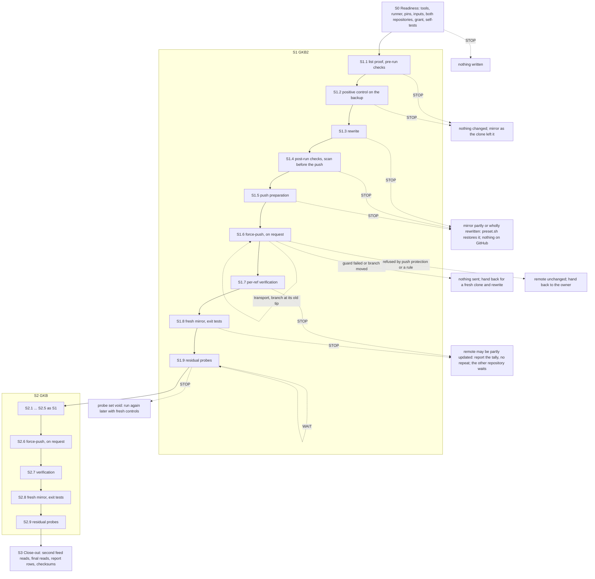
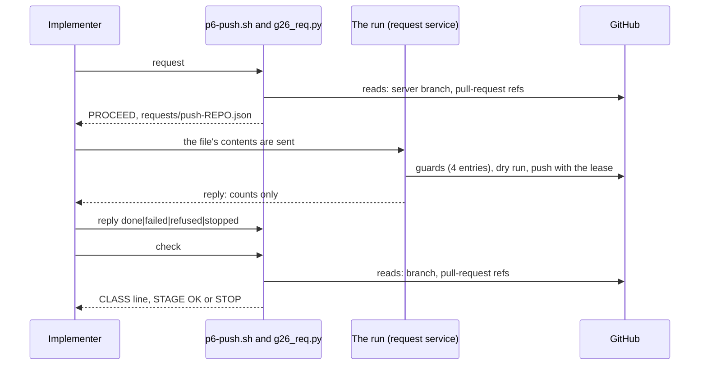

# Phase 0 · 6 — Rewriting GKB2 and GKB: implementation plan

- **Covers:** [SpartanLaboratories/KotlinBottools#26](https://github.com/SpartanLaboratories/KotlinBottools/issues/26),
  *"Phase 0 · 6 — Rewrite GKB2 and GKB"*, a sub-issue of [#2](https://github.com/SpartanLaboratories/KotlinBottools/issues/2),
  the history rewrite, which is a sub-issue of [#1](https://github.com/SpartanLaboratories/KotlinBottools/issues/1) (parent chain
  #26 → #2 → #1).
- **Architecture:** [`../architecture.md`](../architecture.md), unit `gkb2-gkb-rewrite` (§15, order 6), with §6.4 (the pipeline's
  stages 1 to 9), §6.6 (the residual measurement), §8 (order, gates and failure behaviour), §11 (every write to GitHub is a request
  that the unit verifies by reading), §12.4 (the report row), §5 (the workspace and the records), §6.1 and §6.2 (the toolchain, the
  backups and the manifests), §13 (policy as parameters) and the dated notes those sections carry. Its consequences are in
  [`../consequences.md`](../consequences.md) and in this folder; the evidence is [`research/README.md`](research/README.md) and
  [`research/force-push-and-push-protection.md`](research/force-push-and-push-protection.md).
- **Branch:** `chore/issue-26-rewrite-gkb2-and-gkb`. It exists, was cut from `main` at the merge of the publication unit's pull
  request, and holds this unit's research. This plan, the unit's `consequences.md`, its as-built record `final-implementation.md` and
  the regenerated boards land through the unit's one pull request, which closes #26 only. The plan is committed in the same commit as the
  unit's `consequences.md` and as-built record (the first commit of "Version control"), so that `git log --follow` binds the plan to the
  work it describes.
- **What this plans:** the rewrite of GKB2's history and then GKB's, each from its workspace mirror, checked unchanged since the
  preparation unit took it: one `git filter-repo` invocation each, every post-run check, a secret scan before the push, the
  force-push of the one branch of each repository, verified ref by ref, a fresh mirror and its exit tests, and the measurement of what
  GitHub still serves of the old histories. It is a literal procedure with its tools, which the implementer and the run carry out
  without making a decision.
- **Status:** planning only.
- **Target version:** none. Nothing is versioned; no product code, test source or build file changes. The landing adds documents and
  regenerated boards only.

This unit writes to GitHub twice: the force-push of `master` of `SpartanLaboratories/GKB2` and the force-push of `master` of
`SpartanLaboratories/GKB`. Each is a request, carried out on this machine under a grant that names it. The implementer types the local
commands, the reads and the checks, and stores each request's reply; the run sends each request and waits for its reply. The plan
never performs a write itself.

---

## Requirements

**Goals**

1. **Both histories are purged.** One `git filter-repo --sensitive-data-removal --invert-paths --paths-from-file <list>` run per
   mirror removes the purge list's paths: GKB2's 32 commits become 30 and GKB's 11 become 9; GKB2 keeps 82 paths and 211 blobs, GKB 60
   paths and 113 blobs; every manifest blob (81 and 58) is missing from the rewritten mirror, and the mirror passes the expectation
   check.
2. **The push is conditional and singular.** Each repository's `master` is updated by one forced update to its rewritten tip, which
   is made only if the server's branch is still at the tip the clone recorded. Nothing is created, moved or deleted on the server
   beside that branch.
3. **Every write is a request, and the unit reads each result.** After each push the unit compares the server's refs on two channels
   with the rewrite's records; a failing verification stops the unit before anything further, and the other repository waits.
4. **Both repositories are clean on a fresh mirror.** "Clean" means: no purged path and no manifest blob on any branch or tag, every
   count equal to its expectation, no binary but the Gradle wrapper jar, and no finding of the five custom rules. A default-rule
   finding in a kept file is recorded by rule id and count and becomes a follow-up.
5. **GKB2's pull-request residual is counted and recorded.** `refs/pull/6/head` keeps GKB2's old history reachable on GitHub: a fresh
   mirror holds the 30 rewritten commits and the 15 old commits that only that ref reaches (45 on every ref), and 70 of the 81
   manifest blobs stay reachable through it.
6. **What GitHub still serves is measured and reported in counts.** The old tips, the first-changed commits, their trees and a sample of
   at most 60 manifest blobs are probed on every route, authenticated and anonymous, between controls; the activity feed and the events
   are read for the old ids; the report row of each repository carries the tallies and what the probes cannot prove.
7. **Nothing sensitive is printed or kept outside the data folder.** The tools print counts, rule ids and fixed markers. No id of a
   history, no path, no name and no stream of a push or a scan is printed or written into a document.
8. **The run's log keeps no argument that can be a path.** The phase's runner is replaced by a corrected one (Design, "The corrected
   runner"), which closes the known gap the rewrite and swap unit left.
9. **The tools serve the next rewrite unit.** Every per-repository script takes a repository name and reads its policy from a
   parameter table and the preparation unit's expectation rows, so the unit that rewrites the remaining three repositories adds rows
   and extends only where its repositories differ.
10. **The documents this unit lands are clean.** No pre-rewrite commit id or purged blob id of either repository, no machine-local
    path, no hit of the privacy gate and no secret-shaped string in the plan or in any document the landing carries.

**Rules this unit keeps**

- **A failing verification stops the unit before anything irreversible; no stop waits for a person before a push** (architecture §1.1,
  item 10). Every stop before a push discards the mirror; every stop after a push reports the tally and repeats nothing.
- **The purge lists are not changed.** A refusal by push protection that needs a list change is the owner's decision and a new
  rewrite from the backup, which this unit hands back and does not make.
- **The preparation unit's records are never overwritten.** This unit writes new files beside its six records per repository.
- **The unit sends no bypass of push protection, no setting change and no deletion of any ref.**

**Preconditions only the owner can arrange** (`S0` checks what it can and stops otherwise, with nothing written):

- **A grant** for the job `phase-0-gkb2-gkb-rewrite`, given before `S0` starts in the request service's temporary-permissions file for
  this repository. Its exact text is Design, "The grant". The request service's own settings deny `git push --force`, `git push -f`
  and `git push --force-with-lease` as text patterns, to keep a force-push from being made unasked. The two pushes here are
  force-pushes by git's definition: a forced update is a non-fast-forward update whatever the flags that make it conditional. The
  grant therefore names them, in the exact form used, and lifts that rule for these two requests; the plan does not rely on a pattern
  failing to match the form.
- **From the mirror clone until the second push has been verified,** nothing is pushed to GKB2 or GKB by anyone else. The unit
  checks this before each push (the server's refs against the clone's) and again in the push itself (the lease).
- **The pushing account,** the organisation administrator, blocks no command-line push for the author of either tip (GitHub's
  setting for blocking pushes that expose a private e-mail address).

**Acceptance criteria** (the issue's "Done when", with what proves each):

| Criterion | Proved by |
|---|---|
| GKB2 and GKB each have every branch and tag clean on a fresh mirror | `STAGE <repo>.p8 OK` for each: the expectation check on the fresh mirror, the manifest comparison, the gitleaks scans |
| Every count equals its expectation | `p4` (the rewritten mirror) and `p8` (the fresh mirror) against the rows of `expected_rows.txt` and the parameter table |
| GKB2's pull-request residual is counted and recorded | `p8`'s `residual.txt` (70 of 81 expected) and the report row's line for it |
| Any default-rule finding is recorded as a follow-up | the `RECORD default-rule findings` lines of `p4` and `p8`, and the unit's `consequences.md` |
| Each push was verified by reading it back | `p6 check` (the class and the read-back) and `p7` (two channels) |

---

## Current state

**GitHub, read on 2026-11-13** (counts only; `S0` reads each fact again before anything is written):

- **GKB2** (id 677585353) and **GKB** (id 618954937) are public and not archived, with default branch `master`, one branch each, no
  fork, no tag, no release, no branch protection, no ruleset, no workflow, no webhook, no deploy key and no Pages site. Secret scanning
  and push protection are disabled on both. GKB has the wiki setting on, and no wiki repository exists.
- **GKB2** advertises `HEAD`, `refs/heads/master` and `refs/pull/6/head`. Pull request #6 is merged, its head branch is gone, it has no
  comments and no merge ref exists. GKB2 has 5 issues (4 open) beside that pull request; GKB has none. **GKB** advertises `HEAD` and
  `master`.
- **Activity and events:** the authenticated activity feed holds 19 entries for GKB2 and 9 for GKB; the events of the last 30 days
  hold none for either. The authenticated core rate limit had 4,978 of 5,000 calls left.
- **Each server's refs equal the listing recorded when the mirror was cloned.** The tip of each branch is authored by an account that
  also authored commits already pushed to KotlinBottools by the same pushing account.

**The workspace and the data folder** (`%USERPROFILE%\BotWS`, `%USERPROFILE%\BotLegacyData`; the preparation unit built them):

- Each repository has a mirror (`mirror/<repo>.git`) and an untouched backup (`backup/<repo>.git`), each with the listing taken at the
  clone (`ls-remote-at-clone.txt`) and a checksum list (`backup.SHA256SUMS`) over its 22 files. Both mirrors and both backups are
  byte for byte as recorded. GKB2's mirror holds two refs, `master` and the pull-request ref; GKB's holds one. Each mirror is bare,
  with one remote, `origin`, whose URL is the repository's and which has `remote.origin.mirror=true`.
- The manifests (`manifests/<repo>.blobs`, `.counts`, `.kept`, and for GKB2 `.pinned.blobs` and `.pinned.counts`), the expectation
  rows (`tools/expected_rows.txt`), the six purge lists (`lists/`, with `run/lists/SHA256SUMS`), the positive-control records of each
  repository (`gitleaks-before.txt`, `gitleaks-control.txt`, `gitleaks-kept.txt`, `expect-row.txt`), `COPY-VERIFIED` and
  `run/tool-versions.txt` are in place.
- **The lists:** GKB2's has 10 lines, 122 bytes, sha256 `ded94b46…c74a`; GKB's has 11 lines, 139 bytes, sha256 `3616f084…5c63`.
- **The expectation rows** (columns `repo T P after paths_kept blobs_kept blobs_total manifest shared largest_kept largest_kept_nonjar
  wrapper_jar pinned_blobs_kept pinned_manifest`): `GKB2 32 2 30 82 211 292 81 0 60756 27602 yes 281 11`; `GKB 11 2 9 60 113 171 58
  0 60756 27586 yes - -`.
- **The recorded controls,** which a re-run must equal line for line: GKB2 `commits_scanned=31 expected_commits=31`, `gitleaks_exit=2
  error_lines=0 findings=79`, bare-token-file 1/1, discord-bot-token 2/2, legacy-bot-data-file 59/31, legacy-key-file 1/1,
  legacy-state-directory 16/7, `RESULT: FINDINGS`, `CONTROL OK`, `total_kept=0`; GKB `10/10`, `findings=59`, bare-token-file 2/1,
  discord-bot-token 2/1, legacy-bot-data-file 39/31, legacy-state-directory 16/7, `CONTROL OK`, `total_kept=0`.
- **The tip trees:** GKB2's `master` holds 86 files, 14 of them under a purge entry; GKB's holds 114, 54 of them. Neither has a
  README, a CHANGELOG or a `.github` folder; both have a `.gitignore`.
- **GKB2's pull-request ref lies inside `master`** and reaches 15 old commits. After the push a fresh mirror holds the 30 rewritten
  commits and those 15, 45 on every ref, and 70 of the 81 manifest blobs stay reachable through the ref (81 − 11), the 11 others being
  missing and 281 distinct blobs reachable from every ref (the pinned variant of the manifest).

**Recent related work.** The preparation (#21), rewrite and swap (#23), repository hygiene (#24) and publication (#25) units have landed; the last merge on `main` is this unit's
baseline. The research for this unit is the only work on its branch.

**The tools, at their pins:** git 2.55.0.windows.5, Python 3.14.7, gh 2.100.0, git-filter-repo 2.47.0 (`--version` prefix
`a40bce548d2c`) and gitleaks 8.30.1. The reused files of the workspace hold the sizes and sha256 values that the pin table of
Appendix B records (for example `env.sh` 1,834 bytes, `lib.sh` 2,479, `plib.sh` 1,831, `klib.sh` 3,651, `expect_check.py` 4,141,
`secret_scan.py` 12,073). The workspace scan configuration is `main`'s `.gitleaks.toml`: 3,824 bytes, sha256
`c046de1754bd4bb3d92a62cd1651f3ea8bb2383ace96472595ee3ea49887568f`, blob `457a49a781e7e77e4e9b80a250690ddd8b2bc547`, with one scoped
allowlist table that matches one KotlinBottools document and nothing in GKB2 or GKB
([the hygiene unit's consequences, §2.3](../24-repository-hygiene/consequences.md)). Two workspace scripts still pin the earlier
2,373-byte configuration: `k0-ready.sh`, the rewrite and swap unit's own readiness check, line 34, and `save-tools.sh`, line 29,
which would write the earlier bytes back from the findings' text. This unit runs neither, and its own readiness check pins the current
configuration, so a re-save is caught before any rewrite.

**The runner and its gap.** `run-stage.sh` is the preparation unit's original: 470 bytes, sha256
`be30b3466e077c0b03f9b2628263d4a1ea365eddabcd3f0a1d4b60fecf02d034`. Its start line is `echo "== <time> <name> $*"`, so every argument
of a run is written into `as-run.log` in the data folder, and an argument can be a machine path. The rewrite and swap unit left it
unchanged and recorded the gap for the units that follow
([its consequences, §5](../23-kotlinbottools-rewrite-and-swap/consequences.md#5-known-gaps)).

**The request service and the account.** A write to GitHub is a request that the service carries out with the organisation
administrator's permissions under a named job. The service's temporary-permissions file for this repository holds no grant for this
unit yet. The push goes from a bare mirror whose `origin` is the repository itself, with `gh auth git-credential` as the only
credential helper, under an organisation administrator's classic token that holds `repo`.

**Outside facts this unit rests on** (verified at their sources, [research summary](research/README.md#verification-results)):

- Under `git push --mirror`, `--force`, `-f` or a leading `+` on the refspec, git ignores `--force-with-lease`: the documentation says
  so ([`git-push.adoc` at v2.55.0](https://github.com/git/git/blob/v2.55.0/Documentation/git-push.adoc)), and the source lets force win
  over the stale check ([`remote.c`](https://github.com/git/git/blob/v2.55.0/remote.c)). A refspec push with an explicit lease against
  a branch that moved prints one `!` line with `[rejected]` and `(stale info)`, exits 1 and leaves the branch unchanged; both were
  observed with git 2.55.0.windows.5 on throwaway repositories. A mirror-configured `origin` refuses a refspec (exit 128, nothing sent),
  so the push names the repository's URL.
- GitHub's push protection for users is on by default for every account, stops a push that carries a supported provider secret to a
  public repository whatever the repository's own setting, and lists the Discord bot token among the supported secrets
  ([push protection](https://docs.github.com/en/code-security/concepts/secret-security/push-protection),
  [for users](https://docs.github.com/en/code-security/how-tos/secure-your-secrets/prevent-future-leaks/manage-user-push-protection)).
  A block reads `remote: error: GH013: Repository rule violations found for refs/heads/<ref>.` with a `GITHUB PUSH PROTECTION`
  section on standard error and one `! … [remote rejected]` line on standard output; the push exits 1. A dry run never shows a block.
  The wording rests on two published logs (a 2024 post and a 2026 comment), so the unit counts fixed markers and takes the same stop
  for every refusal whatever those markers count.
- GitHub keeps serving unreferenced objects by id on every route, with no documented expiry, and hides `refs/pull/*` from a push
  ([findings 3 §3.1, §3.2](../research/github-residual-exposure-and-visibility.md)). A 422 from `git/trees` means the id exists, as a
  blob; a protocol-v2 `want` counts only with HTTP 200 and its body read; anonymous REST is limited to 60 calls an hour per address; a
  feed read counts only when it lists a current id and is read again at least 6 minutes later; events can lag up to 6 hours
  ([the publication unit's research summary, §2](../25-kotlinbottools-publish/research/README.md#2-the-anonymous-measurements-and-the-access-check)).

---

## Assumptions

| # | Assumption | If false |
|---|---|---|
| A1 | Nothing is pushed to GKB2 or GKB except this unit's two pushes. | `p5`'s comparison of the server's refs with the clone's, or the lease inside the push, stops that repository before anything is changed; its mirror is discarded (`preset.sh`) and the repository is cloned and rewritten again by a later run. |
| A2 | The real rewrite's counts equal the expectation rows (30 and 9 commits, 82 and 60 paths, 211 and 113 blobs, the bound on the largest blob, the wrapper jar). | A post-run check of `p4` differs and the repository stops before its push. |
| A3 | The kept history holds no secret of a type that push protection for users blocks. The purge lists remove every file the scan rules name, and the scan before the push is clean. | The push is refused (`GH013`); the remote is unchanged and the unit hands back with the class and the counts. Whether to extend a purge list and redo the rewrite, or to allow the secret through the block's URL as the pushing account and have the push requested again within three hours, is the owner's decision, made from the kept error file. |
| A4 | The pushing account blocks no command-line push for the author of either tip. | The push is refused by the server without GitHub's push-protection markers (`refused-rule` or `refused-unattributed`); the same stop. |
| A5 | GitHub's receive path honours the old value of the update that the lease sends. | The lease protects nothing on the server's side, and the comparison of `p5` and of the procedure's own first entries is the only guard against a branch that moved in the seconds between them; the unit's checks after the push still detect it. |
| A6 | The configuration's one scoped allowlist table is inert for these two repositories. | The positive control of `p2` differs from the preparation unit's record and the repository stops before it is rewritten. |
| A7 | No default-rule finding exists in the kept files. | Recorded by rule id and count and made a follow-up; the unit continues, because these repositories' kept files are already public. |
| A8 | Anonymous probes meet no throttle and the anonymous REST budget (60 calls an hour per address, shared by both repositories) is enough: 28 calls cover one repository's step 9 and 6 more its second feed read. | The step prints a `WAIT` line with the time the hour resets and ends with status 4 before any probe; the implementer waits and runs it again. A throttle on a web or `want` route is a status outside the route's answers and stops the set, which is run again later with fresh controls. |
| A9 | GKB2's residual is 70 of 81, 11 manifest blobs missing, 281 distinct blobs on every ref, 45 commits on every ref. | The residual is recorded as measured (it is a result, not a stop); the report says so. |
| A10 | The grant exists before `S0` starts, with the lift of the deny rule for these two requests. | `S0.grant` stops with nothing written. |
| A11 | The activity feed and the events may lag after a push (the events by up to 6 hours). | A read that lists no current id is recorded as not valid, never counted; the second read of `S3.feeds` is the further chance. |
| A12 | `gh auth git-credential` serves a push to a URL destination as it serves one to a named remote (it is keyed by host). | The push fails to authenticate (exit 128, no porcelain line): class `transport`, the branch unchanged, the same request may be sent again once the cause is fixed. |

---

## Non-goals

- **No secret scanning or push protection on GKB2 or GKB.** Both repositories are archived by Phase 17, not made scanned here.
- **No commit in a legacy repository,** and none to add a README, a `.gitignore` or a CHANGELOG: Phase 17 archives them with README
  pointers ([architecture §4](../architecture.md#4-non-goals)).
- **No path scrub:** the machine-local paths are replaced in KotlinBottools only.
- **No Support ticket,** and `refs/pull/6/head` stays: GKB2's residual is measured, not removed.
- **No edit of GKB2's issues or its pull request, and no edit of #26's body.**
- **No re-derivation of the manifests or the rows.** They are re-verified against the recorded values only.
- **No bypass of push protection** and no change to the pushing account's settings.
- **No change to `k0-ready.sh` or `save-tools.sh`.** They are not run, and nothing re-saves the earlier configuration.
- **BotTools, TrumpBot and Support** belong to the next rewrite unit (#27); **the report on #2** belongs to the cleanup unit (#28).

---

## Design

### Shape of the procedure

Four stages. `S0` reads and checks and writes nothing to GitHub or to any repository. `S1` rewrites, pushes and measures GKB2 in nine
steps, one per stage of the architecture's pipeline; `S2` does the same for GKB and starts only when `S1` has passed every step.
`S3` reads both repositories again and writes the records. The table is the board's list of the unit's stages.

| id | name | brief | kind | steps |
|---|---|---|---|---|
| S0 | Readiness | The tools, pins, inputs, grant and both repositories are as recorded, the self-tests pass, and nothing is written yet. | check | S0.save: Save the tools; S0.runner: The corrected runner; S0.tools: The tools and the configuration at their recorded bytes; S0.pins: The version pins; S0.inputs: Lists, data copy, mirrors, backups and records; S0.repos: Both repositories read; S0.grant: The grant read; S0.selftest: The self-tests |
| S1 | GKB2 | GKB2's history is rewritten, force-pushed on request, verified ref by ref and proven clean on a fresh mirror, and what GitHub still serves is measured. | work | below |
| S2 | GKB | The same for GKB, once GKB2 has passed every step. | work | below |
| S3 | Close-out | Both repositories are read again, and the report rows and records are written with their checksums. | check | S3.feeds: The second feed reads; S3.reads: Final reads of both repositories; S3.record: Report rows and checksums |

**Steps of S1**

- `S1.1`: List proof and pre-run checks
- `S1.2`: Positive control on the untouched backup
- `S1.3`: The rewrite
- `S1.4`: Post-run checks and the scan before the push
- `S1.5`: Push preparation
- `S1.6`: The force-push, on request
  - `S1.6.request`: The request read, rebuilt and checked
  - `S1.6.send`: The request sent
  - `S1.6.reply`: The reply stored
  - `S1.6.check`: The outcome classified and read back
- `S1.7`: Per-ref verification
- `S1.8`: Fresh mirror and exit tests
- `S1.9`: Residual probes

**Steps of S2**

- `S2.1`: List proof and pre-run checks
- `S2.2`: Positive control on the untouched backup
- `S2.3`: The rewrite
- `S2.4`: Post-run checks and the scan before the push
- `S2.5`: Push preparation
- `S2.6`: The force-push, on request
  - `S2.6.request`: The request read, rebuilt and checked
  - `S2.6.send`: The request sent
  - `S2.6.reply`: The reply stored
  - `S2.6.check`: The outcome classified and read back
- `S2.7`: Per-ref verification
- `S2.8`: Fresh mirror and exit tests
- `S2.9`: Residual probes



**Why this order.** Nothing is written to GitHub before step 6 of GKB2, so every step before it re-runs from its start after `preset.sh`.
GKB waits for GKB2 so that the one open question of the pipeline's first real force-push (push protection, the lease against GitHub's
receive path) is answered on the repository with the one pull-request ref before the second push is made.

### What the unit writes to GitHub

Exactly two force-pushes: `master` of `SpartanLaboratories/GKB2` and `master` of `SpartanLaboratories/GKB`, each a `push-mirror` request
under the job `phase-0-gkb2-gkb-rewrite`. It sends no issue, comment, label, setting, visibility or security change and deletes no ref.
The unit's landing on KotlinBottools is the run's ordinary landing and is not made under the job.

### The grant

Before `S0` starts, the owner gives the grant as one section of the repository's file in the request service's temporary-permissions
folder under the user profile. The exact text, with the date of the day it is given:

```text
## phase-0-gkb2-gkb-rewrite
Granted: <date>
Permissions: push-mirror, force-pushing (--force-with-lease)
Scope: SpartanLaboratories/KotlinBottools#26, branch chore/issue-26-rewrite-gkb2-and-gkb; github SpartanLaboratories/KotlinBottools; targets SpartanLaboratories/GKB2 and SpartanLaboratories/GKB only; one push-mirror request each, from the rewritten workspace mirror %USERPROFILE%\BotWS\mirror\<name>.git to its own repository, updating refs/heads/master alone with git push --porcelain --force-with-lease=refs/heads/master:<old tip> <url> refs/heads/master:refs/heads/master after its dry run (options before push included); sent again only after a read shows master still at its old tip
Ends: when #26 lands
```

`S0.grant` reads that file, read only, and stops (with nothing written) if the section is missing, does not name both actions, issue
#26, the branch and both targets, says no end, or has ended. A wording that differs from this text in anything else is recorded. The
text appears in the plan as the saved data block `grant.txt` (Appendix A).

### The push

**The form.** Per repository, from its bare mirror, after the rewrite's checks and the push preparation:

```text
git -c credential.helper= -c 'credential.helper=!gh auth git-credential' push --porcelain \
    --force-with-lease=refs/heads/master:<old tip> https://github.com/SpartanLaboratories/<repo>.git refs/heads/master:refs/heads/master
```

preceded by the same line with `--dry-run`. `<old tip>` is read from `ref-map` when the procedure runs, so the request carries no commit
id. The destination is the repository's URL, read from the mirror's `origin` configuration, because a mirror-configured `origin`
refuses a refspec.

**Why not `--mirror`.** Under `--mirror`, `--force`, `-f` or a refspec with a leading `+`, git ignores the lease, so a branch that moved
since the clone would be overwritten; `--mirror` would also delete a server branch created after the clone and send a local
`refs/pull/*` as a new ref, which GitHub rejects. The form above updates one ref, so it cannot create or delete anything and cannot
touch the pull-request refs. `--atomic` is not used: one ref makes it redundant.

**The guards.** The comparison of `p5` (the server's heads and tags equal `ref-map`'s old column, its pull-request refs equal the
clone's listing) is repeated inside the procedure, in its first four entries, immediately before the dry run, each entry ending the shell
with `exit 1` on a difference. The dry-run and push entries then each re-read the old tip from `ref-map`, re-read the URL from the
mirror's configuration and assert that their own argument list holds no `--force`, `-f`, `--mirror`, `--all`, `--delete`, `--prune`,
`--atomic` or `+` refspec; the push entry also requires the dry run's tally to be the expected one. The lease then binds `master` to its
recorded tip at the push's own ref advertisement, and the push protocol carries that old value with the update.

**The expected tally** of both the dry run and the push, by the phase's `porcelain_tally.awk`: `forced=1 fastforward=0 new=0 deleted=0
uptodate=0 rejected=0 done=1 pull_lines=0 other_refs=0 bad=0`, with exit status 0 and the same ref and flag in both. `Done` is printed
after a `!` line too, so the tally, not `Done`, decides.

**How a refusal reads, and the class it takes.** The procedure writes both streams of each run to files in the data folder and prints
only counts of fixed markers (`[remote rejected]`, `[rejected]`, `(stale info)` in standard output; `GH013`, `PUSH PROTECTION`,
`- commit:`, `Scan incomplete` in standard error). After a non-zero status it reads `master` and the pull-request refs once and ends the
shell with status 1. `g26_req.py classify` then names the class:

| Counted | Class | What follows |
|---|---|---|
| exit 0, clean tally, same ref and flag | `pushed` | `p7`, whatever the reply says; `Scan incomplete` with exit 0 is recorded, not a refusal |
| exit 1, `[remote rejected]`, `GH013`, `PUSH PROTECTION` | `refused-push-protection` | remote unchanged; stop and hand back; the owner decides from the kept error file: extend the purge list and redo the rewrite from the backup, or allow the secret through the block's URL as the pushing account and have the push requested again within three hours. The unit never bypasses |
| exit 1, `[remote rejected]`, `GH013`, no `PUSH PROTECTION` | `refused-rule` | the same stop; none is expected |
| exit 1, `[remote rejected]`, no `GH013` | `refused-unattributed` | the same stop |
| exit 1, `[rejected]`, `(stale info)`, no `GH013` | `branch-moved` | the lease refused; nothing was sent; hand back for a fresh clone and rewrite, because the old column no longer holds |
| exit 128, no porcelain line | `transport` | read back. Branch still at its old tip and pull-request refs unchanged: the same request may be sent again (same id, attempt + 1) after the cause is fixed. Branch at its new tip and pull-request refs unchanged: the push landed although its answer was lost; `RECORD`, step 6 passes and `p7`'s two channels decide. Anything else: stop |
| the procedure stopped on a guard (no push status) | `stopped-by-guard` | nothing was sent. A guard's stop can come from a failed read rather than from a moved branch, so the read-back decides: branch at its old tip and pull-request refs unchanged, fix the entry the reply names and send the same request again (same id, attempt + 1); branch moved (`other`) or refs changed, hand back for a fresh clone and rewrite |
| the request service refused the request | `refused-by-service` | nothing was written. With the read-back "old tip, pull-request refs unchanged": fix the cause (the grant, or the request service's deny rule) and send the request again under a new id, `<sender>/26/push-<repo>-r<n>`, with n the number of stored replies plus one, because the request protocol requires a new id after a `rejected` reply; otherwise hand back |
| anything else | `unclassified` | stop |

A push is never repeated blindly: after any reply, `p6-push.sh request` sends nothing unless the class is `transport`, `stopped-by-guard`
or `refused-by-service` (the push never ran, or never reached the server) and the read-back is "old tip, pull-request refs unchanged".
Every other class hands back.



### The requests

A request is a JSON document that `g26_req.py build` writes into `$DATA/run/g26/requests/push-<repo>.json` immediately before it is sent.
The run sends the file's contents as one request and waits for the reply.

| Field | Value |
|---|---|
| `permissionReason` | `phase-0-gkb2-gkb-rewrite`, the job's name |
| `github` | `SpartanLaboratories/KotlinBottools`, the repository the job is recorded under |
| `action` | `push-mirror` |
| `target` | `SpartanLaboratories/<repo>` |
| `issue` | 26 |
| `mirror` | the mirror's path in mixed form, written by the tool from the environment |
| `procedure` | six standalone shell commands (guards, dry run, push); a command that sets a variable is the command that uses it; every network `git` command has `gh auth git-credential` as its only credential helper |
| `inputs` | `key` (`push-<repo>`, or `push-<repo>-r<n>` for a resend after a refusal), `mirror`, `expectedTally` |
| `checks` | the facts the reply must show (the guards' markers, the two tallies, the same ref and flag; no forbidden argument; after a non-zero status, stop and never repeat) |
| `v`, `id`, `attempt`, `from` | supplied by the run when it sends the file; `id` is `<sender>/26/<key>`, where `<key>` is the file's `inputs.key`; `attempt` is the number of stored replies plus one. A resend after `transport` or `stopped` keeps the id and raises `attempt`; a resend after a refusal (a `rejected` reply) takes a new id, `<sender>/26/push-<repo>-r<n>`, with n the number of stored replies plus one |

**What a reply is.** The implementer stores each reply under one of four names, which map to the request protocol's replies:

- `done` is a `done` reply: the procedure reported success.
- `refused` is a `rejected` reply, or a refusal the service reports from its console: the request was not carried out (no grant, an action not defined, a permission refused) and nothing was written.
- `stopped` is a `stopped` reply: a guard or check of the procedure stopped it, and the text carries its step and state.
- `failed` is a reply whose text shows a command of the procedure that failed outside its guards.
- A `needs-user` reply is not stored: the run waits for the reply that follows it.

After any status the check reads the files and the server, because a reply is only the service's account.

### The tools

All new tools live in `$WS/tools/g26/`, saved from Appendix A by `S0.save` and checked by size and sha256 in `S0.tools`. They are copied
with the workspace tools at the phase's cleanup. Each step is a script run through the corrected runner,
`bash "$TOOLS/run-stage.sh" g26/<script> <repo> [argument]`, so its output reaches `DATA/run/as-run.log` with the repository's name
shown. No script but the parameter table names GKB2 or GKB.

| File | Role |
|---|---|
| `run-stage.sh` | the corrected runner, saved over the phase's runner by `S0.runner` |
| `g26lib.sh` | constants by role, `row` (reads the parameter table and the expectation rows), the step markers, the ref listings and `server_state`, `every_ref_commits`, the route classification and the authenticated probes, `batch`, the feed membership counts |
| `ganon.sh` | the anonymous helpers: `anon_web`, `anon_api`, `anon_need` (the REST budget), `feed_read` |
| `g26_req.py` | builds the push request, stores replies, classifies the outcome from the kept streams; its own self-test |
| `params.txt`, `grant.txt`, `tools.sums`, `g26tools.sums` | data: the parameter table, the grant's text, the pins of the reused tools and of these files |
| `s0-ready.sh` | `runner`, `tools`, `pins`, `inputs`, `repos`, `grant` of `S0` |
| `p1-prerun.sh` … `p9-residual.sh` | steps 1 to 9 of a repository; `p6-push.sh` has `request`, `reply` and `check` |
| `s3-close.sh` | `feeds`, `reads` and `record` of `S3` |
| `preset.sh` | the reset after a stop before the push |
| `gdocs.sh` | the landing's document checks `D.ids`, `D.paths`, `D.gate`, `D.scan` |
| `gselftest.sh` | `S0.selftest` |

Reused unchanged: `env.sh`, `lib.sh`, `plib.sh`, `klib.sh` (`note`, `ktally`), `expect_check.py`, `kept_findings.py`, `secret_scan.py` with
`gitleaks.exe` and `gitleaks.toml`, `porcelain_tally.awk`, `oldid_refs.py`, `scrub_check.py`, and `allow_tool.py` with `privacy_gate.py`
(for the landing's document checks only). The publication unit's `anon.sh` is not reused as it is: its batch treats a served id as the
trigger to revert and appends to that unit's record, and its stand-in cases write in the live scratch folder; `ganon.sh` has the same route
rules with "served" as the expected answer, appends only to this unit's records, and its stand-in cases run in a scratch folder of their own.
The rewrite and swap unit's `probe.sh` and `k14-residual.sh` are not reused either: they read every 422 as "absent" and never checked the HTTP status of a
`want`.

### The corrected runner

`run-stage.sh` is replaced by a version whose only change is the start line of the log: it names the stage, and shows an argument
verbatim only when it is a plain word (1 to 40 characters from `A-Z a-z 0-9 . _ = -` that are not a hexadecimal word of 7 or more
digits); every other argument is shown as `<arg>`. The script still receives each argument unchanged, and the exit status, the output
and the end line are as before. `S0.runner` checks that the runner in place is the recorded original, saves the corrected one over it
and checks the new pin; it runs directly, not through the runner it replaces. Lines already in the log stay: the log is local to the
data folder. A dated note in the preparation unit's consequences records, at the landing, that the runner's recorded pin is no longer
current.

### Parameters

Policy is a file, not a command (architecture §13). `params.txt` holds one row per repository: its id, its branch, the repository whose
step 9 must have passed first, the purge list's line count, byte count and sha256, the refs the server advertised at the clone (branches
and pull-request refs), the commits a fresh mirror holds on every ref, the expected residual, the bound on the manifest sample and the
positive control's probe arguments. The expectation rows (commits, pruned commits, paths, blobs, the bound on the largest blob, the
wrapper jar and the pinned variant) are read from `expected_rows.txt`, the preparation unit's file, so a row has one source. `S0.inputs`
proves the table against the data: the list against its recorded checksum, the probe arguments against the preparation unit's script,
the every-ref commit count against a derivation from the untouched backup. The next unit adds rows for its repositories.

### Records and where they live

`DATA/rewrite/<repo>/` holds this unit's new files beside the preparation unit's six, which are never written: `entries-before.txt`,
`entries-after.txt`, `g26-prerun.env`, `g26-control-scan.txt`, `g26-control.txt`, `g26-control-kept.txt`, `filter-repo.log`, `commit-map`,
`ref-map`, `changed-refs`, `first-changed-commits`, `suboptimal-issues`, `next-steps.txt`, `purge-list.txt`, `expect-check.txt`,
`gitleaks-prepush.txt`, `default-rule-findings-prepush.txt` (if any), `push-expect.txt`, `server-pull-refs.txt`, `push-dry.txt`,
`push-dry.err`, `push.txt`, `push.err`, `heads-after-push.txt`, `expect-check-fresh.txt`, `gitleaks-fresh-branches.txt`,
`gitleaks-fresh-all.txt`, `default-rule-findings.txt` (if any), `residual.txt`, `probe-ids/` (the id sets), `probe-tallies.txt`,
`feeds.txt`, `report-row.txt`, `SHA256SUMS`, `SHA256SUMS-fresh` and `g26.SHA256SUMS`. `DATA/run/g26/` holds `requests/`, `replies/`,
`status/` (the step markers), `push-<repo>.class`, `times.txt`, `records-at-s0.<repo>.sums` and, at the end, `SHA256SUMS`. Scratch is
`$WS/tmp/g26/` (the self-test sandbox, id files for the feeds, the ref listings); the fresh mirrors are `$WS/fresh/<repo>.git` and the
scan reports and logs are `$GR/<repo>-g26-*.json` and `.log`. Everything there holds pre-rewrite ids, paths or names and is never
committed, printed or quoted; the as-built record carries counts only.

### The probes (step 9)

Every result is a tally; nothing is printed but counts, statuses and fixed markers.

- **Sets:** the old tip of each branch; the first-changed commit; their trees (read from the untouched backup); an evenly spaced sample
  of at most 60 manifest blobs, the step being `(n + 59) / 60`, which gives 41 of GKB2's 81 and 58 of GKB's 58.
- **Controls:** a rewritten commit, its tree and one of its blobs (each expected served) and an id that exists nowhere (expected
  absent). They bracket every batch; a batch whose opening or closing control fails is void and stops the set.
- **Routes and rules.** Authenticated (token from `gh auth token`, never echoed): `git/commits`, `git/trees` and `git/blobs` by REST
  and a protocol-v2 `want` of each old tip, each expected served. Anonymously: the web `/commit/<id>` route for tips and first-changed
  commits, the `want` route for those, the trees and the blob sample, and anonymous REST only for the controls and a small sample (at
  most 4 commits, 3 trees, 3 blobs). A 422 from `git/trees` means the id exists; a `want` needs HTTP 200 and its body read; a status
  outside a route's answers stops the set.
- **The budget.** The anonymous REST limit is 60 calls an hour per address and is shared by both repositories. A repository's set needs
  28 calls and a margin of 8; `anon_need` reads `/rate_limit` (which spends nothing) first and, when the budget does not cover the set,
  prints a `WAIT` line with the reset time and ends with status 4 before any probe. That is a pause, not a stop.
- **The feeds.** The activity feed and the events are read authenticated (`gh api`), anonymously over REST and, for the activity, as the
  web page, each for membership of the pre-rewrite ids (expected at least one: the force-push's `before`, and every earlier entry). A
  read counts only when it lists a current id; `S3.feeds` reads them again at least 6 minutes after the first.
- **Answers that differ from the expectation are recorded** (`RECORD …`): they are results, not stops. A status outside a route's
  answers, a failed control or a void batch stops the probe set, which is run again later with fresh controls.
- **The report row** (`report-row.txt`, counts only) carries: commits before and after; paths and blobs kept; the manifest's size; the
  gitleaks results for branches and for every ref, with default-rule findings by rule id and count; the probe tallies, authenticated and
  anonymous, served and not found; the feed and events membership; for GKB2 the pull-request residual (of 81); and what the probes cannot
  prove: that GitHub has dropped the old objects, that cached views are gone, that no third-party copy exists and that secret scanning
  examined the old objects (architecture §6.6 and §12.4).

### Error handling and logging

- **Failure design.** The shell scripts end through `expect` (`STOP  <label>: expected '<x>', got '<y>'`, exit 1), `must`
  (`STOP  <label>: status <n>`) and `run_batch` (`STOP  route …: status <1|3>`); `note` prints `ok` or `RECORD` and never stops.
  `g26_req.py` has one failure type, `Stop`, for an expected failure (a missing variable, a status outside the four, an unreadable stream),
  printed once in `main` as `STOP  <why>` with exit 1; a bug is an ordinary traceback. A function that meets an expected failure ends the
  calling script, so it never runs inside `$( )`. The classes of a push are a value (`classify` is a pure function), unwrapped once, by
  `p6-push.sh check`. A `WAIT` is exit status 4.
- **Recorded, not stopped:** a default-rule finding in a kept file; the all-refs scan of GKB2 and its residual; every probe answer that
  differs from the expectation; a feed read that is not valid; the incomplete scan of a successful push; the rate-limit and activity
  counts of `S0.repos`.
- **Events logged,** each a console line that the runner appends to `as-run.log` (and, for the requests, a file under
  `$DATA/run/g26/`): each step's `ok` lines and its `STAGE <repo>.p<n> OK` line; each request built, its reply stored (a status and a
  number), each class and read-back; each probe batch's tally; each feed read with its validity; each `RECORD` and `WAIT`; each `STOP`.
  The level is the line's status word (`ok`, `RECORD`, `WAIT`, `NEXT`, `STOP`, `STAGE`).

### The output rule

The tools print counts, numbers, repository ids, statuses, rule ids and fixed markers. Never printed or quoted, in a console line, a
document or a request: a pre-rewrite commit id, a blob id, a path of the legacy guild data or of its logs, a member or guild name, a rule's
match, a secret, a token, a machine-local path, or any line of a push's or a scan's streams. The gitleaks reports, the push streams and
the id sets stay in the data folder and the workspace. The request's procedure counts markers with `grep -c -F … || true` and prints the
numbers. The plan's own text names no id: its constants are named by role.

### Stops and the state each leaves

| Where | The stop | State left | Next |
|---|---|---|---|
| S0 | a hash, a pin, a record, a self-test, a repository read that differs, the grant missing or ended | nothing written anywhere | fix the cause (or the owner gives the grant) and run S0 again |
| `p1` | the list, the mirror's or backup's checksums, a pre-run check | nothing changed | fix; run `p1` again |
| `p2` | the control differs from the preparation unit's record in any line | nothing changed | hand back: a difference here means the configuration's change is not inert for the repository |
| `p3`, `p4` | an invocation or post-run count, a surviving manifest blob, a custom-rule finding before the push | the mirror partly or wholly rewritten; nothing on GitHub | `preset.sh <repo>` restores the mirror from the backup; the repository restarts at `p1` after the cause is fixed |
| `p5` | local refs, the server's refs against the clone's, the server's pull-request refs | the mirror rewritten, local pull refs deleted; nothing sent | the server moved: hand back for a fresh clone and rewrite; otherwise fix and run `p5` again |
| `p6` | a class other than `pushed` | as the class table says; the remote unchanged for every refusal | hand back; a resend only for `transport`, `stopped-by-guard` or `refused-by-service` with the branch at its old tip and the pull-request refs unchanged (a new id after a refusal); `transport` with the branch at its new tip is recorded and `p7` decides; never a blind repeat |
| `p7`, `p8` | a verification after the push | the remote may be partly updated or holds the rewrite | report the tally; no repeat; the other repository waits; a custom-rule finding after the push hands back (the remote already holds the rewrite) |
| `p9` | a status outside a route's answers, a failed control, a void batch | the push done and verified | run `p9` again later, with fresh controls |
| `p9` | the anonymous REST budget | nothing probed | wait for the printed time (status 4); run `p9` again |
| S3 | a final read that differs, a feed WAIT | both repositories as left by `S1` and `S2` | fix or wait; run the step again |

---

## Procedure

### Conventions

- **Shell.** Git Bash. Each call starts a fresh shell, so every call begins with this prelude, which defines `g` (run a stage script of the
  unit through the runner); no machine path is typed:

  ```bash
  . "$(cygpath -m "$USERPROFILE")/BotWS/tools/env.sh"
  g() { local s="$1"; shift; bash "$TOOLS/run-stage.sh" "g26/$s" "$@"; }
  ```

  A step is then `g <script> <repo> [argument]`, for example `g p1-prerun GKB2`. `env.sh` exports `P_HOME`, `WS`, `DATA`, `TOOLS`,
  `OUT` (`DATA/rewrite`), `BKROOT`, `GR` (the gitleaks reports folder), `GL`, `CFG`, `SS`, `KBT` and the settings that keep git from
  prompting, and defines `gitnet` (git with `gh` as its only credential helper) and `repo_env`. Python always runs with `-I`.
- **Reading the output.** A step succeeded when its exit status is 0 and its last line is the `STAGE` line it names. A line that starts
  `STOP` is a stop: take no further step but the one the stop table names, and report the step id, the first `STOP` line and the numbers on
  it, never content. `RECORD` lines are results, not stops. A line that starts `WAIT` (exit status 4) is a pause: wait for the printed time
  and run the step again. A `NEXT` line is an instruction.
- **Timeouts.** Calls run in the foreground with a 10-minute timeout, except `gselftest`, `p2`, `p4`, `p8`, `p9` and `S3.feeds`, which may
  take longer and are run in the background and read from `as-run.log` when they end. `p9` may end with a `WAIT` for the anonymous REST
  budget (status 4); only `S3.feeds` waits, by design, for the 6-minute gap after the first feed read.
- **A request STEP** (`S1.6`, `S2.6`) is the unit of the one write:
  1. `g p6-push <repo> request` prints `PROCEED  REQUEST <key> -> requests/push-<repo>.json (attempt <n>; the run's id is <sender>/26/<key>)`, or `SKIP …` (the branch
     already holds the rewritten tip: go to 4), or a `STOP`. `<key>` is `push-<repo>`; it stays the same for a resend after `transport` or a guard's stop
     (the run keeps the id and raises `attempt`), and becomes `push-<repo>-r<n>` after a refusal, because the request protocol requires a new id after a
     `rejected` reply; the file's `inputs.key` carries it.
  2. The run sends the contents of `$DATA/run/g26/requests/push-<repo>.json` as a request and waits for the reply.
  3. The implementer stores the reply with the reply text pasted into a heredoc that ends at the line `REPLY_END`, with `done`, `failed`,
     `refused` or `stopped` in place of `done`:

     ```bash
     g p6-push <repo> reply done <<'REPLY_END'
     (the reply text)
     REPLY_END
     ```

  4. `g p6-push <repo> check` prints the `CLASS` line, the read-back and `STAGE <repo>.p6 OK`, or a `STOP`, or a `NEXT` (class
     `transport`, `stopped-by-guard` or `refused-by-service` with the branch at its old tip and the pull-request refs unchanged: fix the cause first, then run `request`
     again). A `transport` class with the branch at its new tip prints `RECORD the push landed although its answer was lost` and passes; `p7` then decides.
- **What is never done.** No write to GitHub is typed: only a request writes. No `--force`, `-f`, `--mirror` or `+` refspec is used anywhere.
  No request is sent without the `PROCEED` line that wrote its file in the same step, no file is sent twice after a failure (`request` is
  run again, which reads first), and no push is repeated except as the class table allows. `k0-ready.sh` and `save-tools.sh` are never
  run. The plan is not edited while the run's steps run, because `S0.save` reads the tools from it.

### Expected values

| | GKB2 (`S1`) | GKB (`S2`) |
|---|---|---|
| commits before / pruned / after (T / P / after) | 32 / 2 / 30 | 11 / 2 / 9 |
| refs in the mirror; pull-request refs on the server | 2; 1 (`refs/pull/6/head`) | 1; 0 |
| paths kept; blobs kept; bound on the largest blob | 82; 211; 60,756 | 60; 113; 60,756 |
| manifest blobs; sample probed | 81; 41 | 58; 58 |
| the control's scan | `commits_scanned=31 expected_commits=31`, `findings=79` | `commits_scanned=10 expected_commits=10`, `findings=59` |
| commits on every ref of a fresh mirror | 45 (30 + 15) | 9 |
| manifest blobs reachable from every ref | 70 (11 missing; 281 distinct blobs on every ref) | 0 (113 distinct blobs on every ref) |

### S0 — Readiness

Nothing is written to GitHub; everything is a read, a local check or a self-test. The only files written are the tools, the corrected
runner, the one record `records-at-s0.<repo>.sums` and the folders the scripts create.

**`S0.save`**: the unit's files are saved from this plan. This is the only call that is typed whole; it must run from the checkout that
holds this plan. Every fenced block of Appendix A whose info string carries `file=<name>` becomes `$WS/tools/g26/<name>`, byte for byte,
with carriage returns stripped.

```bash
cd "$(git rev-parse --show-toplevel)" || exit 1
P="$PWD/docs/plans/1-bottools-consolidation/2-phase-0-history-rewrite/26-gkb2-gkb-rewrite/plan.md"
test -f "$P" || { echo "STOP  plan file not found"; exit 1; }
T="$(cygpath -m "$USERPROFILE")/BotWS/tools"
{ test -f "$T/env.sh" && test -f "$T/run-stage.sh"; } || { echo "STOP  the earlier units' tools are not in place"; exit 1; }
rm -rf "$T/g26"; mkdir -p "$T/g26"
tr -d '\r' < "$P" | awk -v t="$T/g26" '
  /^```[a-z]* file=/ { split($2, kv, "="); out = t "/" kv[2]; inside = 1; next }
  /^```$/ && inside { inside = 0; close(out); next }
  inside { print > out }'
n="$(ls "$T/g26" | wc -l | tr -d ' ')"; [ "$n" = 22 ] || { echo "STOP  the plan's files are not all saved: $n of 22"; exit 1; }
echo "ok    22 files are saved under the workspace tools"
```

Expected: one `ok` line. The saved files are checked in `S0.tools`.

**`S0.runner`**: the corrected runner replaces the phase's runner. It runs directly, because it replaces the file the runner is executing.

```bash
. "$(cygpath -m "$USERPROFILE")/BotWS/tools/env.sh"; bash "$TOOLS/g26/s0-ready.sh" runner
```

Expected: `ok` lines for the saved copy's pin, the original's size and sha256 and the replacement, and `STAGE S0.runner OK`. A runner that is
neither the recorded original nor the corrected one is a stop with nothing changed. From here on every step is run through the corrected
runner, which writes `as-run.log`'s start line with the stage name and plain-word arguments only.

**`S0.tools`**: every reused tool and every saved file holds its recorded size and sha256 (the pins are `tools.sums`, relative to `$WS`, and
`g26tools.sums`, relative to `$WS/tools/g26`, in Appendix B), the workspace configuration is `main`'s (3,824 bytes), the gitleaks binary reports
8.30.1, every saved shell script parses and every Python tool compiles.

```bash
g s0-ready tools
```

Expected: 46 `ok` lines (21 reused files, 21 saved files, the configuration's size and sha256, the binary's version and the two parse checks)
and `STAGE S0.tools OK`. A different size or hash is a stop: the tool is not the tested one.

**`S0.pins`**: git, Python, gh, git-filter-repo and gitleaks are at the versions the preparation unit recorded, the module's sha256 equals the
record, and no gitleaks configuration is set in the environment.

```bash
g s0-ready pins
```

Expected: seven `ok` lines and `STAGE S0.pins OK`.

**`S0.inputs`**: for each row of the parameter table: the list against its line count, byte count and recorded sha256; the mirror's and
the backup's 22 files against `backup.SHA256SUMS`; the six earlier records exist and their checksums are recorded (a later run compares them);
the manifest's and the pinned manifest's sizes; the clone's listing against the table's refs; the control probes against the preparation
unit's `s8-row.sh`; the every-ref commit count derived from the backup against the table's.

```bash
g s0-ready inputs GKB2 GKB
```

Expected: `ok` lines for both repositories and `STAGE S0.inputs OK`.

**`S0.repos`**: each repository read from GitHub, with the values of Current state: id, public, not archived, not a fork, default branch,
no Pages site, no fork, secret scanning and push protection disabled, one branch (by id), the branch not protected, no tag, release,
ruleset, webhook, deploy key or workflow, and the server's refs equal to the clone's listing. The activity and event counts and the rate
limit are recorded.

```bash
g s0-ready repos GKB2 GKB
```

Expected: `ok` lines, one `RECORD` line per repository (19 and 9 activity entries, none of the events, the rate limit) and `STAGE S0.repos OK`.

**`S0.grant`**: the grant is in the permissions file (Design, "The grant"), read only.

```bash
g s0-ready grant
```

Expected: eight `ok` lines, or seven and a `RECORD` line when the wording differs from the plan's text but names the same actions, issue, branch,
targets and end; then `STAGE S0.grant OK`. A missing section, a missing action, a scope that lacks #26 or either target, or an ended grant is a stop
with nothing written: the owner gives the grant and `S0` runs again from this step.

**`S0.selftest`**: the unit's tools on made-up repositories, in a sandbox that stands in for the user profile (Test plan). It builds the fixtures
from the secret scanner's canary, which generates its secrets at run time, and removes its sandbox at the end. It runs in the background.

```bash
g gselftest
```

Expected: `ok` lines for every case and the last line `ok    gselftest: 132 checks passed` (the total recorded in Appendix B). A `STOP`
line is a tool that no longer behaves as recorded: nothing runs until it is understood.

### Steps 1 to 9 of a repository

The nine steps are the same for both repositories: run them for GKB2 (`S1.1` to `S1.9`) and then, when GKB2 has passed `S1.9`, for GKB
(`S2.1` to `S2.9`). `<repo>` is `GKB2` or `GKB`. A step marks its success in `$DATA/run/g26/status/`, and each step starts by requiring the
marker of the one before; GKB's first step requires GKB2's last. **A stop before `S?.6` discards the mirror:** `g preset <repo>` copies the
untouched backup back (`cp -a`), checks it against `backup.SHA256SUMS`, removes this unit's outputs of the repository and clears its
markers, and the repository restarts at `S?.1`. `preset.sh` refuses once a push of the repository was requested.

**`S?.1` List proof and pre-run checks** (`g p1-prerun <repo>`): the list's byte-wise proofs (no carriage return, pure ASCII, no NUL, a final
newline, only the allowed characters, no dangerous form, no blank line), its line count, byte count and sha256; the mirror and the backup
against `backup.SHA256SUMS`; the mirror is bare, has one remote `origin` with the repository's URL and `remote.origin.mirror=true`, no
`filter-repo/` folder, no stash, at most one pack, no case-colliding ref and a parseable configuration; `N_BEFORE` equals T and the refs equal
the table's; every list entry counts at least one commit. Expected: `ok    N_BEFORE=32 R_BEFORE=2` (GKB: `11`, `1`), `ok    every list entry counts at
least one commit`, `STAGE <repo>.p1 OK`. It reads only.

**`S?.2` Positive control on the untouched backup** (`g p2-control <repo>`): the scan configuration is `main`'s; `secret_scan.py scan --refs all` over the
backup and `secret_scan.py control` with the table's probes write `g26-control-scan.txt`, `g26-control.txt` and `g26-control-kept.txt` (new files; the
preparation unit's records and its report are not written); each equals its record line for line (the control ends with `CONTROL OK`). Expected: the
scan's first three lines (for GKB2 `commits_scanned=31 expected_commits=31`, `gitleaks_exit=2 error_lines=0 findings=79`, the first rule line),
`scan status=1`, the three equalities and `RECORD kept findings as recorded: total_kept=0`, then `STAGE <repo>.p2 OK`. A difference is a stop before
anything is rewritten: it means the configuration's change since the preparation is not inert here.

**`S?.3` The rewrite** (`g p3-rewrite <repo>`): exactly `git filter-repo --sensitive-data-removal --invert-paths --paths-from-file <list>`, with standard
input from `/dev/null` and output to `filter-repo.log`; no `--force`, `--partial`, `--refs`, `--no-fetch`, `--mailmap` or `--replace-text`; one invocation
per mirror. Its own checks: exit status 0, no error or warning line, the completion line, the next-steps block (whose own push advice is not followed:
this unit pushes by the form of Design, "The push") and `You rewrote 32 (of 32)` (GKB: 11). Expected: `STAGE <repo>.p3 OK`.

**`S?.4` Post-run checks and the scan before the push** (`g p4-postrun <repo>`): `commit-map` has T data rows, T changed rows and P pruned rows; one
`first-changed-commits` line; `changed-refs` are every ref of the mirror (GKB2: both) and `ref-map` has a row for each, none a tag and no head pruned away;
`origin` is retained with the repository's URL; commits after equal T − P; every list entry counts 0; the refs are unchanged in number; `fsck` is clean;
`expect_check.py` passes (branch commits, paths, blobs, the bound on the largest blob, the wrapper jar); every manifest blob is missing from the mirror
and present in the untouched backup, every first-changed and changed commit is missing and every unchanged commit present (`prove_removed`). The outputs
are copied to the data folder. Then `secret_scan.py scan --refs branches` over the rewritten mirror: `RESULT: CLEAN` is expected. A finding of one of the
five custom rules is a stop (a purged kind of file survived); a default-rule finding in a kept file, `private-key` included, is recorded by rule id and count
through `kept_findings.py` and the unit continues. Expected: `ok    commits after = T - P`, the `expect_check.py` lines ending `PASS`, `ok    gitleaks before the
push: RESULT: CLEAN`, `ok    outputs under the data folder: 13 files in SHA256SUMS`, `STAGE <repo>.p4 OK`.

**`S?.5` Push preparation** (`g p5-prep <repo>`): the mirror's local `refs/pull/*` are deleted (GKB2 1, GKB 0); only heads remain and equal `ref-map`'s new
column; `ref-map` holds no tag row and no head pruned away; the expected tally is written to `push-expect.txt`; the server's heads and tags equal `ref-map`'s old
column (nothing created, moved or deleted since the clone); the server's pull-request refs (merge refs left out; tab-separated listings read whatever
separates their columns) are listed into `server-pull-refs.txt` and equal the clone's listing; `fsck`; the request file is built. Expected:
`ok    expected tally of the dry run and the push: forced=1 fastforward=0 new=0 deleted=0 uptodate=0 rejected=0 done=1 pull_lines=0 other_refs=0 bad=0`,
`ok    pull-request refs on the server: 1 (recorded)` (GKB: 0), `ok    request written: requests/push-<repo>.json (6 commands, …)`, `STAGE <repo>.p5 OK`. A difference
between the server and the clone is a stop with nothing sent: the old column no longer holds, so the repository is cloned and rewritten again by a later run.

**`S?.6` The force-push, on request** (`g p6-push <repo> request`, the run's request, `reply`, `check`; Conventions, "A request STEP"): the procedure's six
commands repeat the guards, run the dry run and then the push by the form of Design, "The push", and print counts only. Expected reply lines: `MIRROR-AND-ORIGIN-OK`,
`LOCAL-REFS-ARE-THE-NEW-COLUMN`, `SERVER-HEADS-AND-TAGS-ARE-THE-OLD-COLUMN`, `SERVER-PULL-REFS-ARE-THE-RECORD`, `dry rc=0`, `dry tally: forced=1 …`, `push rc=0`,
`push tally: forced=1 …`, `SAME-REF-AND-FLAG`. Expected check: `CLASS pushed stage=push push_rc=0 dry_rc=0 tally_ok=1 same_flags=1 porcelain_lines=1 rr=0 cr=0 st=0 gh=0 pp=0
loc=0 inc=0`, `read back: the branch is at its new tip, the pull-request refs are unchanged: yes`, `STAGE <repo>.p6 OK`. Any other class stops as Design, "The push",
says; nothing here is repeated blindly. After a reply of any kind `S?.7` is run only once `check` has passed.

**`S?.7` Per-ref verification** (`g p7-verify <repo>`), read by the unit on two channels: `git ls-remote --refs <url> 'refs/heads/*' 'refs/tags/*'` and the REST branches listing
by repository id each equal the local heads (`ref-map`'s new column) and no tag exists; no head of the remote points at a pre-rewrite commit; the pull-request refs equal those recorded at
`S?.5` (GitHub hides them from a push, so GKB2's keeps its old commit); the default branch is `master`, the repository still public and not archived. Expected: `ok    the repository
holds 1 head(s), all rewritten, and 1 pull-request ref(s), as recorded` (GKB: 0), `STAGE <repo>.p7 OK`. A failure here means the remote may be partly updated: stop, report the tally, no repeat.

**`S?.8` Fresh mirror and exit tests** (`g p8-exit <repo>`), on `$WS/fresh/<repo>.git`, taken anew every time: the heads equal `ref-map`'s new column, there is no tag, the pull-request refs are as recorded;
commits on every ref equal the table's (45 for GKB2, 9 for GKB); `fsck`; `expect_check.py --scope heads` with the row's counts and `--all-commits`; manifest blobs reachable from branches and tags: 0 (a stop
otherwise); from every ref: GKB 0 (a stop otherwise), GKB2 the measured pull-request residual, expected 70, with 11 missing and 281 distinct blobs on every ref (a difference is recorded, not a stop);
`secret_scan.py` over branches and tags and over every ref, each through the wrapper with its own gate. On branches and tags a custom-rule finding is a stop (the remote already holds the rewrite: hand
back) and a default-rule finding in a kept file is recorded by rule id and count (a follow-up); for GKB the all-refs verdict must equal the branches' verdict; for GKB2 the all-refs scan reads the old history behind the
pull-request ref, so findings are expected, and it is recorded by rule. Expected for GKB2: `residual_blobs=70 manifest=81 missing=11 distinct_all=281 every_ref_commits=45`, `ok    gitleaks: RESULT: CLEAN on branches and tags`, a
`RECORD the all-refs scan also reads the old history …` line, `STAGE GKB2.p8 OK`; for GKB `residual_blobs=0 manifest=58 missing=58 distinct_all=113 every_ref_commits=9`, `STAGE GKB.p8 OK`.

**`S?.9` Residual probes** (`g p9-residual <repo>`; Design, "The probes"): the anonymous REST budget first (a `WAIT` ends the step before any probe), then the authenticated sets (old tips and first-changed commits, their
trees, the blob sample, a `want` of each old tip), the anonymous sets (web, `want`, REST sample), the feeds, and the report row. Every answer that differs from the expectation is a `RECORD` line. Expected:
`ok    anonymous REST budget: <n> calls left, 28 needed`, `RECORD the sets: old tips 1, first-changed 1, old trees <n>, manifest sample 41 of 81` (GKB: `58 of 58`), one tally line per batch ending `served x<n>`, the feeds' lines, `RECORD feed
reads that are valid …: anonymous <k> of 3`, the report row, `STAGE <repo>.p9 OK`.

### S3 — Close-out

After both repositories have passed step 9.

**`S3.feeds`**: the second read of the feeds of each repository, at least 6 minutes after its first (the step waits), authenticated and anonymous. A `WAIT` (status 4) means the anonymous budget does not cover it yet.

```bash
g s3-close feeds GKB2 GKB
```

Expected: the feed lines of both repositories with `second` in them, `RECORD <repo>: second feed read, anonymous reads valid: <k> of 3`, `STAGE S3.feeds OK`. Run it in the background.

**`S3.reads`**: both repositories read again: the branch equals `ref-map`'s new column, the pull-request refs are as recorded, public, not archived, default branch `master`; the preparation unit's six records in each data folder are as recorded at `S0.inputs`.

```bash
g s3-close reads GKB2 GKB
```

Expected: `ok` lines for both repositories and `STAGE S3.reads OK`.

**`S3.record`**: the report rows are completed with the second feed reads, and the checksum lists are written: `g26.SHA256SUMS` in each `DATA/rewrite/<repo>/` (over every file but the preparation unit's six) and `SHA256SUMS` in `DATA/run/g26/`.

```bash
g s3-close record GKB2 GKB
```

Expected: the two report rows (counts only), `ok` lines for the checksummed files and `STAGE S3.record OK`.

### The landing's document checks

Not a stage of the run: they belong to the landing and run while the unit's documents are finished, before the documents are committed, from the checkout that holds them. The pending set is every file under `docs/` that
`git status` lists as modified or untracked: this plan, `consequences.md`, `final-implementation.md`, the dated notes and the regenerated boards. The secret-scan workflow scans every commit of the landing, so the plan and every document must scan clean.

| id | Command | What it proves |
|---|---|---|
| `D.ids` | `g gdocs ids GKB2 GKB` | no token in the documents resolves to a pre-rewrite commit of GKB2 or GKB (`oldid_refs.py` with both commit-maps) or names a manifest blob (the same check with both manifests) |
| `D.paths` | `g gdocs paths` | no machine-local path: `scrub_check.py files` with the expression file reports zero matches |
| `D.gate` | `g gdocs gate` | the privacy gate over the documents through `allow_tool.py run` (every legacy word masked): zero blocking hits |
| `D.scan` | `g gdocs scan` | a `gitleaks` directory scan of copies of the documents with the repository's committed configuration reports `RESULT: CLEAN` |

A hit, a resolving token or a path is reworded in the document and the check is run again before anything is committed. Any token-shaped or key-shaped fixture of a document is built at run time from fragments.

---

## File-by-file changes

No Kotlin, source, test, build or configuration file of any repository changes. The unit adds files to the workspace and the data folder, and its landing adds documents and regenerated boards.

**In the repository (the landing):**

| Path | Change |
|---|---|
| `docs/plans/1-bottools-consolidation/2-phase-0-history-rewrite/26-gkb2-gkb-rewrite/plan.md` | this plan |
| `…/26-gkb2-gkb-rewrite/consequences.md` | new: published artifacts, blast radius, adoption, sibling units, known gaps, follow-ups and the outcome of this plan's assumptions |
| `…/26-gkb2-gkb-rewrite/final-implementation.md` | new: the as-built record, acceptance, measurements (counts only) and every deviation from this plan |
| `…/architecture.md`, `…/consequences.md`, `…/21-preparation/consequences.md`, `…/23-kotlinbottools-rewrite-and-swap/consequences.md`, `…/24-repository-hygiene/consequences.md`, `…/25-kotlinbottools-publish/consequences.md` | dated notes only (Documentation impact) |
| the generated boards (`plan.json`, `plan.js`, `dashboard.html` of the issue and tracking boards, `docs/plans/board.json`, `board.js`, `index.html`) | regenerated by the board service |

**In the workspace (`$WS/tools/g26/`, copied with the workspace tools at the phase's cleanup):** the 22 files of Appendix A. `$WS/tools/run-stage.sh` is replaced by the corrected runner.

**In the data folder:** the records of Design, "Records and where they live". **On GitHub:** the two force-pushes and nothing else.

**Style and failure design of the tools.** The shell scripts keep their functions small and put every policy value in `params.txt` or in a constant of `g26lib.sh`; each step prints counts and fixed markers only. `g26_req.py` separates pure functions
(`argv_offenders`, `build_procedure`, `build_request`, `tally_dict`, `parse_rc`, `count_markers`, `classify`, `flags`, `args_of`) from the functions that read or write a file (`cmd_build`, `cmd_reply`, `cmd_classify`, `read_bytes`, `porcelain_tally`); constants
are module-level and never mutated; every collection a function returns is built fresh.

| Tool and entry points | Returns on failure | Expected failures | Programmer errors | Unwrapped |
|---|---|---|---|---|
| `g26_req.py`: `build`, `reply`, `classify`, `selftest`; `classify(prc, tally_ok, same, c, porcelain, stage) -> str` | `STOP  <why>` and exit 1; `classify` returns a class value and never fails | a missing environment variable, a status outside the four, no stored reply, unreadable streams, a procedure with a forbidden argument; a class other than `pushed` ends `classify` with status 1 | a malformed stored reply | `main`, once; the class is unwrapped by `p6-push.sh check` |
| `g26lib.sh`: `row`, `need`, `prev_ok`, `must`, `run_batch` | a `STOP` line and `exit 1` of the calling script | a missing table row, a missing marker, a tool's non-zero status, a stop or void batch | an unset `DATA` or `WS` | the calling script |
| `g26lib.sh`: `classify`, `one`, `ctl_ok`, `probe_ids`, `batch` | `batch` returns 1 (a status outside a route's answers) or 3 (a void tally); the others return a value | those two statuses | a missing control variable | `run_batch` |
| `ganon.sh`: `anon_need`, `feed_read` | `anon_need` returns 4 with a `WAIT` line; `feed_read` returns 0 always | the budget; a feed status other than 200 | none | the step's last line |
| `s0-ready.sh`, `p1`–`p9`, `s3-close.sh`, `preset.sh`, `gdocs.sh` | `expect` ends the script with a `STOP` line and exit 1 | each check named in its `expect` label | an unset variable | the implementer, from the last lines of the output |

**Concurrency.** Every tool is one process doing sequential work. The races are with GitHub, not within the tools: another writer to either repository between a read and the push. The guards, the lease and the checks after the push are the answer.

---

## Documentation impact

**Rings.** No Kotlin code changes, so the in-editor ring (region markers, `TODO`) and the component ring (KDoc) do not move; the tools carry header comments and usage lines, which are their component-ring contracts. The boundary ring moves in two places: the request (Design, "The requests", with the
grant's text) is the contract with the request protocol for the `push-mirror` action used as a one-ref forced update, and the lease push pattern with its class table is the integration contract with the next rewrite unit. The architectural ring moves through the dated notes below.

| Ring | What moves |
|---|---|
| 1. In-editor navigation | nothing in a repository |
| 2. Component and API contracts | the tools' header comments and usage lines (Appendix A); no public API of any library changes |
| 3. Boundary and protocol | the request and the grant (Design); the push form and its classes; the anonymous probe rules in `ganon.sh` |
| 4. Architectural topology | the dated notes below; the regenerated boards |

**Dated notes, written at the landing, once the build has run** (their wording is settled by the build; this list is the contract):

- **Parent `architecture.md`:** §6.4 stage 6: the push is a refspec push with an explicit lease on the old tip, run first as a dry run, not `--mirror`, because under `--mirror`, `--force` or a leading `+` git ignores the lease, and `--mirror` deletes a server branch created after the clone;
  stage 7: per-ref equality is over heads and tags (the REST branches listing carries heads only), and the pull-request refs are compared with their record, because GKB2's pull-request ref legitimately keeps its old commit; §1.1 item 1: its statement that the histories are pushed with `git push --force --mirror` is made precise for GKB2 and GKB in the same way; and any other section the build departs from.
- **Parent `consequences.md`:** the link line for this unit in §4, and dated notes under §5's known gaps on:
  - the real histories: GKB2 and GKB are now rewritten and scanned (their counts are in the unit's as-built record);
  - gitleaks' default rules over the legacy repositories' kept sources, run for GKB2 and GKB, with any finding by rule id and count;
  - the first known gap, on the requests: a `push-mirror` request was used here as a forced update of one ref under a grant, its first use as such.
- **`21-preparation/consequences.md`:** the runner's recorded size and sha256 are no longer current (the corrected runner and its pin).
- **`23-kotlinbottools-rewrite-and-swap/consequences.md`:** §5's known gap (the runner writes a run's arguments into the log) and §6's follow-up are closed by the corrected runner, with a link.
- **`24-repository-hygiene/consequences.md` §6:** the workspace pins of `k0-ready.sh` and `save-tools.sh` are settled for this unit: neither is run, and this unit's readiness check pins the current configuration.
- **`25-kotlinbottools-publish/consequences.md` §6:** the follow-ups on the anonymous helpers' stand-in cases and comments are not triggered by this unit: it derives `ganon.sh`, whose stand-in cases run in a scratch folder of their own and whose comments state what each function does, and it does not save `anon.sh` again. `anon.sh`'s own comment follow-up stays open for any unit that saves it again; the publication unit's own files stay as recorded.
- **This unit's `consequences.md` and `final-implementation.md`,** and the regenerated boards.

**README.** No change: the landing carries documents and boards only, and no command, endpoint, module, dependency, build or run step of KotlinBottools changes. **CHANGELOG.** No entry: a documents-only landing adds none and no version moves. The legacy repositories get no README, `.gitignore` or CHANGELOG commit; Phase 17 archives them with README pointers (architecture §4).

---

## Test plan

No product code changes; the tools' self-test and the steps' checks are the tests. The five levels map as follows. The tools have no packages; the "package segment" names the folder a level would have.

| Test level | Package segment | What proves it here | Limits |
|---|---|---|---|
| Gating (the checks before any write) | `testing.gating` | `S0`: every tool's size and sha256 and the parse checks (`S0.tools`), the version pins, the parameter table against the data, the checksums of the mirrors, backups and records (`S0.inputs`), both repositories read from GitHub (`S0.repos`), the grant (`S0.grant`); then `p1`, `p2` and `p5`'s reads before the push | the reads reach GitHub and write nothing |
| Component (isolated behaviour; GitHub replaced) | `testing.component` | `g26_req.py selftest` (59 checks: the request's fields, the standalone commands, no commit id, no forbidden argument, `parse_rc`, `count_markers`, every row of `classify`, the reply store). `gselftest.sh` (Appendix B records its total): the route classification (14 cases including a 422 on `git/trees` as served and a `want` with a status other than 200 as a stop); the corrected runner (its masking of a path, an id, a word with a space, a 41-character word and a newline; the replacement of the original; the refusal on a runner that is neither); every step of `S0` on fixtures with their stops (a backup, a list and an earlier record that differ; each way the grant can be wrong); steps 1 to 9 of two repositories end to end (one with a pull-request ref inside its branch, one without), each stop before the push (a list that differs, a record that differs, a custom-rule finding, a server that moved) with the reset, a default-rule finding recorded, the lease refusing a branch that moved after the guards, a refusal by push protection (a hook that prints its markers), a transport failure and its resend, a refusal by the service and a guard's stop each followed by a resend (a new key after the refusal, the same key after the stop), a guard's stop on a moved branch handed back, an answer lost after a push that landed, the per-ref verification failing on a tag, the probes with a void control and a bad status, the budget wait, the feeds, the close-out and the landing's document checks. GitHub is replaced by local bare repositories behind a stand-in `git`, and `gh` and `curl` by stand-ins | the stand-ins model GitHub's answers as documented, not as GitHub behaves; fixtures are made from the scanner's canary, so their counts are not the real repositories' |
| Integration (real interfaces) | `testing.integration` | the real reads and the real requests with their read-backs: `S1` and `S2` as run (the rewrite on the real mirrors, the dry run and the push, `p7`'s two channels, the fresh mirror from GitHub, the probes against the public site), `S3` | a single run of each; GitHub's lag is read, not controlled |
| Deterministic (input to output) | `testing.deterministic` | the pure counts and derivations: the expected tally from `ref-map` (`forced=1`, everything else 0), 45 = 30 + 15, the sample of 41 of 81 and 58 of 58 and its step, the residual 70 = 81 − 11, the budget need 28 + 8 | none beyond the data |
| End to end | `testing.e2e` | `S0` to `S3` as one run ending with the report rows and the checksum lists | one run; no repeat |
| Non-functional | `testing.nonfunctional` | the anonymous REST budget and its `WAIT`, the 0.4 s pace, the 6-minute spacing of the feed reads and the output rule (the self-test checks that step 9's whole output holds no 40-digit id and no path, and the runner's masking of path-shaped arguments) | the throttles' real thresholds are not documented |
| Acceptance (UAT) | `testing.uat` | the owner's grant before `S0`; afterwards the owner may look at both repositories on GitHub | cannot be automated |

**What cannot be tested automatically:** GitHub's push protection on the real push (a dry run never shows it, and no test push to a public repository is made); GitHub's receive path's check of the update's old value; how long GitHub takes to reflect the push in its feeds and events; whether any copy of the old objects exists beyond what the probes reach; the request service's behaviour for a `push-mirror` request that is a forced update under a grant that lifts its deny rule (the first request is its own proof, and a refusal is read as a refusal).

---

## Risks and edge cases

- **Push protection blocks the push.** The remote is unchanged and the unit hands back with the class and the counts; the owner decides from the kept error file (extend the list and redo the rewrite, or allow the secret through the block's URL as the pushing account within three hours and have the push requested again). The unit never bypasses and never reads the stream's text aloud.
- **A branch moves between the clone and the push.** The comparison of `p5`, the procedure's own entries and the lease each stop it; nothing is sent and the repository is cloned and rewritten again by a later run.
- **A partial failure after the push.** One ref is pushed, so it is accepted or not; the read-back says which. A failing verification after the push stops the unit, reports the tally and repeats nothing; the other repository waits.
- **The grant and the deny rule.** The two pushes are force-pushes by git's definition. The grant names the form used and lifts the request service's text-pattern deny rule for these two requests; a form with options before `push` still force-pushes while looking different to a pattern, so the grant does not rely on a pattern matching.
- **GKB2's pull-request residual cannot be removed** by a push: 70 of the 81 manifest blobs stay reachable through `refs/pull/6/head`, and GitHub keeps serving every old object by id. The report states it; it does not claim removal.
- **Anonymous throttling.** Sixty REST calls an hour per address, shared by the two repositories: the step reads the budget first and waits. A 429 or 5xx on a web or `want` route stops the set; it is run again later with fresh controls.
- **Feeds lag.** A read that lists no current id is not valid and is not counted; the events can lag up to 6 hours.
- **A default-rule finding in a kept file** is recorded and becomes a follow-up. The kept files of both repositories are public as they are, so it exposes nothing new.
- **The mirror is large or the run is interrupted.** Every step is a separate call with its own marker; a stage re-run starts at its first step; `preset.sh` restores the mirror from the backup.
- **Cross-repository impact.** None beyond GKB2 and GKB. The branch `master` of each is rewritten; consumers' clones of these two legacy repositories fork from the old history (they are the owner's, and Phase 17 archives the repositories).
- **Breaking changes and compatibility.** None: no API, protocol or schema of a library changes. The request fields follow the request protocol's table.

---

## Version control

- **Branch:** `chore/issue-26-rewrite-gkb2-and-gkb`. It exists, was cut from `main` at the merge of the publication unit's pull request, and holds this unit's research commits. It is brought up to date with `main` when the landing opens, not before.
- **Commits, in one landing** (each a coherent unit; each document checked by `D.ids`, `D.paths`, `D.gate` and `D.scan` before it is committed):
  1. `docs(plans): GKB2 and GKB rewrite unit plan, consequences and as-built record (#26)`: this plan, `consequences.md` and `final-implementation.md` (the plan is committed with the unit it describes);
  2. `docs(plans): dated notes on the architecture and the earlier units' consequences (#26)`;
  3. `docs: regenerate the work boards for the GKB2 and GKB rewrite unit`: the boards.
- **One pull request,** closing #26 only; no version bump; documents only. The issue's resolution comment links the pull request and reports the two classes, the residual and the default-rule findings.
- **Pre-existing working-tree changes.** The working tree already holds regenerated boards of the phase and of the publication unit, and the unit's own new boards. They are the generated boards of this landing and go in commit 3. Nothing unrelated is carried: `D.*` stop on any pending file outside `docs/`.
- **No trailer.** No commit message or pull-request text carries an attribution trailer.

---

## Interfaces with sibling units

**Expects from `preparation` (#21, landed):**

- the workspace and data folders; the tools at their pins; each repository's mirror (`WS/mirror/<repo>.git`) and untouched backup (`WS/backup/<repo>.git`) with `DATA/rewrite/<repo>/ls-remote-at-clone.txt` and `backup.SHA256SUMS`, byte for byte as recorded;
- the manifests (`DATA/manifests/<repo>.blobs`, `.counts`, `.kept`, GKB2's `.pinned.blobs` and `.pinned.counts`), the expectation rows (`WS/tools/expected_rows.txt`), the positive-control records (`gitleaks-before.txt`, `gitleaks-control.txt`, `gitleaks-kept.txt`, `expect-row.txt`), the six lists with `DATA/run/lists/SHA256SUMS`, `COPY-VERIFIED`, `DATA/run/tool-versions.txt`;
- `env.sh`, `lib.sh`, `plib.sh`, `run-stage.sh` (the original, replaced by this unit), `s6-backups.sh` and `s8-row.sh` (whose control probe arguments the parameter table repeats and `S0.inputs` proves equal).

**Expects from `kotlinbottools-rewrite-and-swap` (#23, landed):** the pipeline as it ran (its plan's Design and Appendix A are this unit's worked examples), `klib.sh` (`note`, `ktally`, `klisting`), `kept_findings.py`, `scrub_check.py` (`files`, for the landing's path check), the privacy gate with `allow_tool.py` and the confirmed allow-list; and its recorded gap on the runner, which this unit closes.

**Expects from `repository-hygiene` (#24, landed):** the workspace `gitleaks.toml` equal to `main`'s `.gitleaks.toml` (3,824 bytes, sha256 `c046de17…`), `secret_scan.py` and `gitleaks.exe` 8.30.1; the two stale pins in `k0-ready.sh` and `save-tools.sh`, which this unit does not run.

**Expects from `kotlinbottools-publish` (#25, landed):** the corrected anonymous route rules (a 422 from `git/trees` means the id exists, as a blob; a protocol-v2 `want` needs HTTP 200 and its body read; controls bracket every batch and a failing closing control voids it; anonymous REST is limited to 60 calls an hour per address; a feed counts only when it lists a current id and is read again at least 6 minutes later), the anonymous helpers as the worked example `ganon.sh` derives from, and its follow-ups on those helpers.

**Provides to `bottools-trumpbot-support-rewrite` (#27):**

- the corrected runner and its new pin (`tools.sums`, Appendix B);
- the per-repository tools in `$WS/tools/g26/`, driven by `params.txt` and the preparation unit's expectation rows, to which #27 adds its own rows and extends where its repositories differ: BotTools has two branches (`main`, `Working-Branch`) and two pull-request refs, so its push is one request per branch, or one request with `--atomic` and an extension of the request's refspec list and of `p5`, `p7` and `p8`'s per-branch checks, because a push of several refs can be applied in part (this unit pushes one ref and uses neither `--atomic` nor several refs); TrumpBot and Support are private, so their step 9 has no anonymous probes;
- the lease push pattern: the refspec form with an explicit lease on a read-at-run-time old tip, the guards, the expected tally, the class table with its marker counts, and the grant's shape and the deny-rule decision (the grant names the push in the form used and lifts the text-pattern rule for the named requests);
- the readiness pattern that pins the current scan configuration, so an accidental re-save of the earlier one is caught before any rewrite;
- the anonymous helpers with served-expected semantics (`ganon.sh`), with the budget wait.

**Provides to `residual-report-and-cleanup` (#28):** GKB2's and GKB's report rows (`DATA/rewrite/<repo>/report-row.txt`), GKB2's pull-request residual (`residual.txt`: 70 of 81, 11 missing, 281 distinct blobs, 45 commits on every ref, as measured), any default-rule follow-up (by rule id and count), the tools to copy at cleanup (`$WS/tools/g26/` and the corrected runner), and the records with their checksum lists (`g26.SHA256SUMS` per repository and `DATA/run/g26/SHA256SUMS`).

---

## Sequencing and follow-ups

**Order.** The owner's grant; `S0` (the plan's tools saved, the runner replaced, the readiness checks and the self-test); `S1` for GKB2 and, only when it has passed `S1.9`, `S2` for GKB; `S3`; then the landing's document checks and the documents. The unit starts after #25 has landed (it has) and blocks #27 and #28.

**Follow-ups this work leaves,** recorded in `consequences.md`:

- any default-rule finding in a kept file, by rule id and count (the owner's decision, as the parent consequences' §6 states it: a `targetRules` allowlist for that one rule and path, or acceptance as recorded; and the credential rotated if it could still be live);
- the stale 2,373-byte pins of `k0-ready.sh` and `save-tools.sh`, which stay in the workspace unrun and are the cleanup unit's to delete with the workspace;
- the activity feed and events of both repositories, which may list the old ids until GitHub's own retention ends: the second read is the unit's one re-check;
- the pull-request residual of GKB2, which only a Support request or the repository's archive and removal would end, neither of which is in this phase;
- the report on #2 (cleanup unit) and the archive with README pointers (Phase 17).

---

## Considerations

None is open.

---

## Appendix A — The tools

Every file below is saved by `S0.save` byte for byte, carriage returns stripped, into `$WS/tools/g26/`, and checked in `S0.tools` against its size and sha256 (Appendix B).

### `run-stage.sh`

```bash file=run-stage.sh
#!/usr/bin/env bash
# run-stage.sh -- run one stage script of the phase, keep its output in the as-run log, return its status.
# usage: bash "$TOOLS/run-stage.sh" <stage-script-name-without-.sh> [argument]...      (a name may carry a folder: g26/p1-prerun)
# This is the second version of the runner. The first wrote every argument into the start line of the log; a manual argument can be a machine path.
# Now the start line names the stage and shows an argument only when it is a plain word: 1 to 40 characters from A-Z a-z 0-9 . _ = - that
# are not a hexadecimal word of 7 or more digits (the shape of a commit or blob id). Every other argument is shown as <arg>.
# The script still receives every argument unchanged; its exit status, its output and the end line are as before. Lines already in the log stay.
. "$(cygpath -m "$USERPROFILE")/BotWS/tools/env.sh"
name="$1"; shift
plain() { local LC_ALL=C; [[ ${#1} -ge 1 && ${#1} -le 40 && "$1" =~ ^[A-Za-z0-9._=-]+$ && ! "$1" =~ ^[0-9A-Fa-f]{7,}$ ]]; }
case "$name" in *[!A-Za-z0-9._/-]*) shown_name="<name>" ;; *) shown_name="$name" ;; esac
shown=""
for a in "$@"; do if plain "$a"; then shown="${shown:+$shown }$a"; else shown="${shown:+$shown }<arg>"; fi; done
{
  echo "== $(date -u +%Y-%m-%dT%H:%M:%SZ) $shown_name $shown"
  bash "$TOOLS/$name.sh" "$@"
  rc=$?
  echo "== $shown_name exit=$rc"
  exit "$rc"
} 2>&1 | tee -a "$DATA/run/as-run.log"
exit "${PIPESTATUS[0]}"
```

### `g26lib.sh`

```bash file=g26lib.sh
# g26lib.sh -- sourced by every stage script of the unit, after env.sh, lib.sh, plib.sh and klib.sh. It defines names and functions, creates the unit's
# record folder (G26D) and scratch folder (G26S) and prints nothing itself. It names no repository: `row` reads the parameter table (params.txt) and the
# expectation rows of the preparation unit (expected_rows.txt).
# Failure design: a function that meets an expected failure prints `STOP  <why>` and ends the calling script with `exit 1`, so such a function must run in
# the script's own shell, never inside `$( )`. A function that only measures prints or returns the measure. Nothing here prints an id of a history, a path
# or a name: counts, statuses and fixed markers only.
OWNER=SpartanLaboratories; HOME_REPO="$OWNER/KotlinBottools"; JOB=phase-0-gkb2-gkb-rewrite; ISSUE=26
G26T="$TOOLS/g26"; G26D="$DATA/run/g26"; G26S="${G26_SCRATCH:-$WS/tmp/g26}"
G26_PARAMS="${G26_PARAMS:-$G26T/params.txt}"; G26_ROWS="${G26_ROWS:-$TOOLS/expected_rows.txt}"
CFG_SIZE=3824; CFG_SHA=c046de1754bd4bb3d92a62cd1651f3ea8bb2383ace96472595ee3ea49887568f      # the workspace scan configuration is main's .gitleaks.toml
EXPECT_TALLY='forced=1 fastforward=0 new=0 deleted=0 uptodate=0 rejected=0 done=1 pull_lines=0 other_refs=0 bad=0'     # one forced update, nothing else
CUSTOM_RULES='bare-token-file|discord-bot-token|legacy-bot-data-file|legacy-key-file|legacy-state-directory'          # the five rules of this phase's configuration
UA=g26probe/1; ANON_MARGIN=8; PACE="${G26_PACE:-0.4}"
mkdir -p "$G26D/requests" "$G26D/replies" "$G26D/status" "$G26S"; export G26D G26S OWNER JOB ISSUE EXPECT_TALLY

sha() { sha256sum "$1" | cut -d' ' -f1; }                                       # FILE: its sha256
sz()  { wc -c < "$1" | tr -d ' '; }                                              # FILE: its size in bytes
utc() { date -u +%Y-%m-%dT%H:%M:%SZ; }
must() { local label="$1"; shift; "$@"; local rc=$?; [ "$rc" -eq 0 ] || { echo "STOP  $label: status $rc"; exit 1; }; }   # LABEL COMMAND...: run it; stop unless its status is 0
stamp() { echo "$1 $(date -u +%s) $(utc)" >> "$G26D/times.txt"; }               # NAME: append a timestamped marker to the unit's times file
since() { awk -v n="$1" '$1==n {t=$2} END{print t}' "$G26D/times.txt" 2>/dev/null; }   # NAME: the epoch seconds of its last marker, empty when none

# row REPO: read the repository's row of the parameter table and of the expectation rows into P_* and R_* (exported), and run repo_env. Ends the script when either row is missing.
# params.txt columns: repo id branch needs list_lines list_size list_sha heads pull_refs every_ref_commits residual sample_max probes (the rest of the line).
# expected_rows.txt columns: repo T P after paths blobs_kept blobs_total manifest shared largest largest_nonjar wrapper_jar pinned_kept pinned_manifest.
row() {
  local r="$1" line
  [ -n "$r" ] || { echo "STOP  no repository was given"; exit 1; }
  line="$(tr -d '\r' < "$G26_PARAMS" | awk -v r="$r" '!/^#/ && $1==r {print; exit}')"
  [ -n "$line" ] || { echo "STOP  the parameter table has no row for this repository"; exit 1; }
  read -r _n P_ID P_BRANCH P_NEEDS P_LINES P_SIZE P_SHA P_HEADS P_PULL P_EVERY P_RESIDUAL P_SAMPLE P_PROBES <<< "$line"
  line="$(tr -d '\r' < "$G26_ROWS" | awk -v r="$r" '$1==r {print; exit}')"
  [ -n "$line" ] || { echo "STOP  the expectation rows have no row for this repository"; exit 1; }
  read -r _n R_T R_P R_AFTER R_PATHS R_KEPT R_TOTAL R_MANI R_SHARED R_LARGE R_NONJAR R_JAR R_PIN_KEPT R_PIN_MANI <<< "$line"
  repo_env "$r"
  export P_ID P_BRANCH P_NEEDS P_HEADS P_PULL P_EVERY P_RESIDUAL P_SAMPLE R_T R_P R_AFTER R_PATHS R_KEPT R_MANI R_LARGE R_JAR
}
# Stage markers: each stage ends by `mark <stage>`; the next stage starts with `need <stage>`. p1 clears the repository's markers (a restart); p9 of the
# repository named in the `needs` column must have passed before this repository's p1 (prev_ok).
mark() { utc > "$G26D/status/$REPO.$1"; }
need() { [ -e "$G26D/status/$REPO.$1" ] || { echo "STOP  the step before has not passed for this repository ($1)"; exit 1; }; }
prev_ok() { [ "$P_NEEDS" = - ] || [ -e "$G26D/status/$P_NEEDS.p9" ] || { echo "STOP  the repository this one waits for has not passed every step"; exit 1; }; }
clear_marks() { rm -f "$G26D/status/$REPO".*; }
pushed_before() { [ "$(ls "$G26D/replies" 2>/dev/null | grep -c "^push-$REPO-")" -gt 0 ]; }       # a push of this repository was requested: the steps before the push never run again

# Listings, all sorted bytewise and with carriage returns dropped. heads_old and heads_new read ref-map (columns: old id, new id, ref; one header line):
# the old column is what the server held at the clone, the new one what the rewrite made. A head pruned away has an all-zero new id and is left out of heads_new.
heads_old() { awk 'NR>1 && $3 ~ /^refs\/heads\// {print $1" "$3}' "$RM/ref-map" | tr -d '\r' | LC_ALL=C sort; }
heads_new() { awk 'NR>1 && $3 ~ /^refs\/heads\// && $2 !~ /^0+$/ {print $2" "$3}' "$RM/ref-map" | tr -d '\r' | LC_ALL=C sort; }
# pull_list: a `git ls-remote` listing on standard input -> its pull-request refs as "<id> <ref>". The tab is turned into a space before any field is read,
# and merge refs (refs/pull/N/merge) are left out on every side, because the server recomputes them.
pull_list() { tr -d '\r' | tr '\t' ' ' | awk '$2 ~ /^refs\/pull\// && $2 !~ /\/merge$/' | LC_ALL=C sort; }
refs_listing() { tr -d '\r' | tr '\t' ' ' | LC_ALL=C sort; }
origin_url() { git --git-dir "$MIRROR" config --get remote.origin.url | tr -d '\r'; }     # the configured value (`remote get-url` would expand any url.*.insteadOf rule)
server_heads_tags() { gitnet --git-dir "$MIRROR" ls-remote --refs origin 'refs/heads/*' 'refs/tags/*' </dev/null | refs_listing; return "${PIPESTATUS[0]}"; }
server_pulls() { gitnet --git-dir "$MIRROR" ls-remote origin 'refs/pull/*' </dev/null | pull_list; return "${PIPESTATUS[0]}"; }
# server_state: prints old, new or other, the server's branch against ref-map's two columns; prints unreadable and returns 1 when the read fails.
server_state() {
  local now old new
  now="$(gitnet --git-dir "$MIRROR" ls-remote origin "refs/heads/$P_BRANCH" </dev/null 2>/dev/null | tr -d '\r' | cut -f1; exit "${PIPESTATUS[0]}")" || { echo unreadable; return 1; }
  old="$(awk -v b="refs/heads/$P_BRANCH" 'NR>1 && $3==b {print $1}' "$RM/ref-map" | tr -d '\r')"; new="$(awk -v b="refs/heads/$P_BRANCH" 'NR>1 && $3==b {print $2}' "$RM/ref-map" | tr -d '\r')"
  if [ -n "$now" ] && [ "$now" = "$old" ]; then echo old; elif [ -n "$now" ] && [ "$now" = "$new" ]; then echo new; else echo other; fi
}
# every_ref_commits: the commits a fresh mirror holds on every ref after the push, derived from the untouched backup: the rewritten commits plus the commits
# only the pull-request heads reach (none of them is rewritten on GitHub, which hides those refs from a push). Without pull-request refs it is R_AFTER.
every_ref_commits() {
  local extra=0
  [ "$P_PULL" -gt 0 ] && extra="$(git --git-dir "$BK" rev-list --count --glob='refs/pull/*/head' | tr -d '\r')"
  echo $(( R_AFTER + extra ))
}

# --- route classification, shared by the authenticated and the anonymous probes. A status means something per route: a 422 from git/trees means the id
# exists (as a blob); a protocol-v2 want counts only with HTTP 200 and its body read; any status outside a route's answers is a stop.
classify() {   # ROUTE STATUS -> served | absent | stop
  case "$1:$2" in
    web:200|api-commit:200|api-tree:200|api-blob:200|want:SERVED)        echo served ;;
    web:404|api-commit:404|api-tree:404|api-blob:404|want:NOT-SERVED)    echo absent ;;
    api-tree:422)                                                         echo served ;;
    *)                                                                    echo stop ;;
  esac; }
auth_api() {   # KIND(commit|tree|blob) ID: an authenticated REST HEAD on the git data API; prints the HTTP status only (needs TOK, which is never printed)
  curl -s -I -m 20 -A "$UA" -o /dev/null -w '%{http_code}' -H "Authorization: Bearer $TOK" -H 'Accept: application/vnd.github+json' -H 'X-GitHub-Api-Version: 2022-11-28' \
    "https://api.github.com/repos/$OWNER/$REPO/git/${1}s/$2"; }
want_probe() {   # MODE(auth|anon) ID: a protocol-v2 fetch of one unadvertised id; prints SERVED, NOT-SERVED or STOP:<http status>; only the first 120 bytes of the answer are kept
  local mode="$1" id="$2" req="$G26S/.want.req" hdr="$G26S/.want.hdr" body="$G26S/.want.head" code a=()
  [ "$mode" = auth ] && a=(-u "x-access-token:$TOK")
  pkt() { printf '%04x%s' $(( ${#1} + 4 )) "$1"; }
  { pkt $'command=fetch\n'; pkt $'object-format=sha1\n'; printf '0001'; pkt "want $id"$'\n'; pkt $'done\n'; printf '0000'; } > "$req"
  curl -s -m 20 -A "$UA" -X POST "${a[@]}" -D "$hdr" -H 'Content-Type: application/x-git-upload-pack-request' -H 'Git-Protocol: version=2' \
       --data-binary @"$req" "https://github.com/$OWNER/$REPO.git/git-upload-pack" 2>/dev/null | head -c 120 > "$body"
  code=$(head -n 1 "$hdr" | tr -d '\r' | awk '{print $2}')
  if   [ "$code" = 200 ] && grep -a -q packfile "$body";      then echo SERVED
  elif [ "$code" = 200 ] && grep -a -q 'not our ref' "$body"; then echo NOT-SERVED
  else echo "STOP:${code:-none}"; fi
  rm -f "$req" "$hdr" "$body"; }
# route_status MODE ROUTE ID: the raw answer of one probe. MODE is auth (the token) or anon (no credential, anon_* of ganon.sh). ROUTE is web (anonymous only), api-commit,
# api-tree, api-blob or want. An anonymous REST probe whose budget is spent answers STOP:budget.
route_status() {
  local mode="$1" route="$2" id="$3"
  case "$mode:$route" in
    anon:web)      anon_web "https://github.com/$OWNER/$REPO/commit/$id" ;;
    anon:api-*)    api_budget_ok || { echo STOP:budget; return; }; anon_api "git/${route#api-}s/$id" | cut -d' ' -f1 ;;
    auth:api-*)    auth_api "${route#api-}" "$id" ;;
    *:want)        want_probe "$mode" "$id" ;;
    *)             echo STOP:route ;;
  esac; }
one() { classify "$2" "$(route_status "$1" "$2" "$3")"; }          # MODE ROUTE ID: one probe, classified
ctl_ok() {   # MODE ROUTE: the route's positive controls (CTL_COMMIT, CTL_TREE, CTL_BLOB, set by the step) answer served and its negative control (CTL_NEG) answers absent
  local mode="$1" r="$2" k v
  case "$r" in want) set -- COMMIT TREE BLOB ;; web|api-commit) set -- COMMIT ;; api-tree) set -- TREE ;; api-blob) set -- BLOB ;; esac
  for k in "$@"; do eval "v=\$CTL_$k"; [ "$(one "$mode" "$r" "$v")" = served ] || return 1; done
  [ "$(one "$mode" "$r" "$CTL_NEG")" = absent ]; }
probe_ids() {   # MODE ROUTE FILE LABEL: one class per id; prints "<label>: served xN  absent xM"; the classes are kept in $G26S/tally.<label>; returns 1 with a STOP line on a stop answer
  local mode="$1" route="$2" f="$3" label="$4" id k t="$G26S/tally.$4"; : > "$t"
  [ -s "$f" ] || { echo "STOP route=$route label=$label (no ids in the set)"; return 1; }
  while read -r id; do
    id="${id%$'\r'}"; [ -n "$id" ] || continue
    k=$(one "$mode" "$route" "$id")
    [ "$k" = stop ] && { echo "STOP route=$route label=$label"; return 1; }
    echo "$k" >> "$t"; sleep "$PACE"
  done < "$f"
  echo "$label: $(sort "$t" | uniq -c | awk '{printf "%s x%s  ", $2, $1}')"; }
# batch MODE ROUTE FILE LABEL: the controls, the batch, the same controls again; the tally is void unless both sets of controls answer as expected. Appends the
# tally line to $RM/probe-tallies.txt. Returns 0 (the tally is a result whatever it shows), 1 (a stop answer) or 3 (void).
batch() {
  local mode="$1" route="$2" f="$3" label="$4" line
  ctl_ok "$mode" "$route" || { echo "VOID $label: the opening controls of route $route did not answer as expected"; return 3; }
  line=$(probe_ids "$mode" "$route" "$f" "$label")
  case "$line" in STOP*) echo "$line"; return 1 ;; esac
  ctl_ok "$mode" "$route" || { echo "VOID $label: the closing controls of route $route did not answer as expected"; return 3; }
  echo "$line" | tee -a "$RM/probe-tallies.txt"; return 0; }
run_batch() { batch "$@"; local rc=$?; [ "$rc" -eq 0 ] || { echo "STOP  route $2, set $4: status $rc (a stop answer or a void tally; the probe set is run again later with fresh controls)"; exit 1; }; }
served_of() { grep -c '^served$' "$G26S/tally.$1" 2>/dev/null || true; }     # LABEL: how many ids of the set answered served
absent_of() { grep -c '^absent$' "$G26S/tally.$1" 2>/dev/null || true; }

# --- the feeds. build_feed_ids writes the id files the membership counts use: every pre-rewrite commit of the backup and every rewritten commit, each as a full id and
# as its 7-digit prefix (the web page shows prefixes). member_counts FILE prints "<distinct old ids listed> <distinct current ids listed>".
build_feed_ids() {
  git --git-dir "$BK" rev-list --all | tr -d '\r' | LC_ALL=C sort -u > "$G26S/.old-full"
  awk 'NR>1 && $2 !~ /^0+$/ {print $2}' "$RM/commit-map" | tr -d '\r' | LC_ALL=C sort -u > "$G26S/.cur-full"
  { cat "$G26S/.old-full"; cut -c1-7 "$G26S/.old-full"; } > "$G26S/old-ids.txt"
  { cat "$G26S/.cur-full"; cut -c1-7 "$G26S/.cur-full"; } > "$G26S/current-ids.txt"; }
member_counts() { echo "$(grep -o -F -f "$G26S/old-ids.txt" "$1" | cut -c1-7 | LC_ALL=C sort -u | wc -l | tr -d ' ') $(grep -o -F -f "$G26S/current-ids.txt" "$1" | cut -c1-7 | LC_ALL=C sort -u | wc -l | tr -d ' ')"; }
# auth_feed LABEL: the authenticated REST activity feed and events, read for membership; prints one line per feed and appends it to $RM/feeds.txt. A read counts only when it lists a current id.
auth_feed() {
  local name jq st a b f="$G26S/feed.auth" out="$G26S/feed.lines"; : > "$out"
  for name in activity events; do
    case "$name" in activity) jq='.[] | .before, .after' ;; *) jq='.[] | (.payload.before // empty), (.payload.head // empty)' ;; esac
    gh api "repos/$OWNER/$REPO/$name?per_page=100" --paginate --jq "$jq" 2>/dev/null | tr -d '\r' > "$f"; st=${PIPESTATUS[0]}
    if [ "$st" -ne 0 ]; then echo "feed $name auth $1: not read (gh status $st)" >> "$out"; continue; fi
    read -r a b <<< "$(member_counts "$f")"
    echo "feed $name auth $1: old ids $a, current ids $b$([ "$b" -ge 1 ] || echo ' (not valid: no current id listed)')" >> "$out"
  done
  tee -a "$RM/feeds.txt" < "$out"; rm -f "$f" "$out"; }
```

### `ganon.sh`

```bash file=ganon.sh
# ganon.sh -- sourced after g26lib.sh. Every call below is anonymous: curl and git are given no credential, and `gh api` is never used. It prints statuses, tallies and
# counts only: never an id, a body or a header value but the rate-limit numbers. State lives in the scratch folder $G26S (files .rem, .lim, feed.lines).
# Derived from the publication unit's anonymous helpers with the same route rules (g26lib.sh `classify`), with these differences: a served id is the expected answer here, so no
# function ends the shell on one; every stand-in case of the self-test runs in a scratch folder of its own; the REST budget is read from /rate_limit before a set starts.
anon_web() {   # URL: an anonymous HEAD; prints the HTTP status (000 when no answer)
  curl -s -I -m 20 -A "$UA" -o /dev/null -w '%{http_code}' "$1"; }
anon_api() {   # PATH below /repos/$OWNER/$REPO (never empty): an anonymous REST HEAD; prints "<status> <remaining> <limit>" and keeps the two numbers in $G26S/.rem and .lim
  local h="$G26S/.hdr" c rem lim
  c=$(curl -s -I -m 20 -A "$UA" -D "$h" -o /dev/null -w '%{http_code}' -H 'Accept: application/vnd.github+json' "https://api.github.com/repos/$OWNER/$REPO/$1")
  rem=$(grep -i '^x-ratelimit-remaining' "$h" | tr -d '\r' | cut -d' ' -f2); lim=$(grep -i '^x-ratelimit-limit' "$h" | tr -d '\r' | cut -d' ' -f2)
  printf '%s' "$rem" > "$G26S/.rem"; printf '%s' "$lim" > "$G26S/.lim"; echo "$c $rem $lim"; rm -f "$h"; }
api_budget_ok() {   # true before the first REST call of the run; then only when the last call was anonymous (limit 60) and left at least ANON_MARGIN of the hour's calls
  [ -s "$G26S/.lim" ] || return 0
  [ "$(cat "$G26S/.lim")" = 60 ] && [ "$(cat "$G26S/.rem")" -ge "$ANON_MARGIN" ]; }
anon_left() {   # prints "<remaining> <reset epoch>" read from the headers of GET /rate_limit, which spends nothing; empty fields when the headers are missing
  local h="$G26S/.rlh"
  curl -s -m 20 -A "$UA" -D "$h" -o /dev/null -H 'Accept: application/vnd.github+json' https://api.github.com/rate_limit
  printf '%s %s\n' "$(grep -i '^x-ratelimit-remaining' "$h" | tr -d '\r' | cut -d' ' -f2)" "$(grep -i '^x-ratelimit-reset' "$h" | tr -d '\r' | cut -d' ' -f2)"; rm -f "$h"; }
# anon_need N: return 0 (and print an ok line) when the anonymous REST budget covers N calls plus ANON_MARGIN; otherwise print one WAIT line with the time the hour resets and
# return 4. A WAIT is a pause, not a stop: the implementer waits for that time and runs the step again. It appends nothing and changes no state but .rem and .lim, which it clears.
anon_need() {
  local n="$1" rem reset; read -r rem reset <<< "$(anon_left)"; rem="${rem:-0}"; reset="${reset:-0}"; rm -f "$G26S/.rem" "$G26S/.lim"
  if [ "$rem" -ge $(( n + ANON_MARGIN )) ]; then echo "ok    anonymous REST budget: $rem calls left, $n needed"; return 0; fi
  echo "WAIT  anonymous REST budget: $rem calls left, $(( n + ANON_MARGIN )) needed; the hour resets at $(date -u -d "@$reset" +%Y-%m-%dT%H:%M:%SZ 2>/dev/null || echo unknown); run the step again after it"; return 4; }
# feed_read LABEL: the web activity page, then the REST activity feed and events (up to 3 pages each), anonymously, each read for membership of the old and the current ids
# (build_feed_ids must have run). Prints one line per feed and appends the three lines to $RM/feeds.txt. A read counts only when it lists a current id: FEED_VALID is the number
# of valid reads of the three. It returns 0 always: the answers are results, and a REST budget stop or a status other than 200 is a printed line that makes that read not valid.
feed_read() {
  local label="$1" name page a b h="$G26S/.feedhdr" out="$G26S/feed.lines"; FEED_VALID=0; : > "$out"
  curl -s -m 30 -A "$UA" -o "$G26S/feed.html" "https://github.com/$OWNER/$REPO/activity"; read -r a b <<< "$(member_counts "$G26S/feed.html")"
  if [ "$b" -ge 1 ]; then FEED_VALID=$((FEED_VALID + 1)); echo "feed web $label: old ids $a, current ids $b" >> "$out"
  else echo "feed web $label: old ids $a, current ids $b (not valid: no current id listed)" >> "$out"; fi
  for name in activity events; do
    a=0; b=0
    for page in 1 2 3; do
      api_budget_ok || { echo "feed $name $label: stopped by the REST budget" >> "$out"; break; }
      curl -s -m 30 -A "$UA" -H 'Accept: application/vnd.github+json' -D "$h" -o "$G26S/feed.json" "https://api.github.com/repos/$OWNER/$REPO/$name?per_page=100&page=$page"
      printf '%s' "$(grep -i '^x-ratelimit-remaining' "$h" | tr -d '\r' | cut -d' ' -f2)" > "$G26S/.rem"; printf '%s' "$(grep -i '^x-ratelimit-limit' "$h" | tr -d '\r' | cut -d' ' -f2)" > "$G26S/.lim"
      [ "$(head -n 1 "$h" | tr -d '\r' | awk '{print $2}')" = 200 ] || { echo "feed $name $label: a status other than 200 on page $page" >> "$out"; break; }
      local x y; read -r x y <<< "$(member_counts "$G26S/feed.json")"; a=$((a + x)); b=$((b + y))
      grep -qi '^link:.*rel="next"' "$h" || break
    done
    if [ "$b" -ge 1 ]; then FEED_VALID=$((FEED_VALID + 1)); echo "feed $name $label: old ids $a, current ids $b" >> "$out"
    else echo "feed $name $label: old ids $a, current ids $b (not valid: no current id listed)" >> "$out"; fi
  done
  tee -a "$RM/feeds.txt" < "$out"; rm -f "$h" "$G26S/feed.html" "$G26S/feed.json" "$out"; return 0; }
```

### `g26_req.py`

```python file=g26_req.py
#!/usr/bin/env python3
"""g26_req.py -- the push request of the unit that rewrites GKB2 and GKB: build it, store its reply, classify the outcome from the kept streams.

usage (python -X utf8 -I -B; run by p5-prep.sh and p6-push.sh, with the environment that `row` of g26lib.sh exports):
  g26_req.py build REPO [KEY]      write $G26D/requests/push-REPO.json and print one ok line; KEY is the request's key (default push-REPO; push-REPO-r<n> for a resend after a refusal)
  g26_req.py reply REPO STATUS     store the reply text read from standard input as replies/push-REPO-<n>.txt; STATUS is done, failed, refused or stopped
  g26_req.py classify REPO         read the kept streams of the last attempt and the stored reply; print one CLASS line of counts; exit 0 only for `pushed`
  g26_req.py selftest              the pure functions and a request built from a made-up environment, in a temporary folder; no network, no repository

The request is a `push-mirror` request for ONE ref: `git push --porcelain --force-with-lease=<ref>:<old tip> <url> <ref>:<ref>`, run first with --dry-run. Neither --mirror,
--force, -f, --all, --delete, --prune, --atomic nor a leading + is ever used: under the first three and the last git ignores the lease, and under --mirror it also deletes and creates refs.
Failure design: an expected failure (a missing variable, a status outside the four, an unreadable stream) is raised as Stop and printed once, in main, as `STOP  <why>` with exit
status 1; a bug is an ordinary traceback. The pure functions return values and never print. The tool prints counts and fixed markers only, never the text of a stream, and the request
it writes holds no commit id: the old tip is read from ref-map when the request's procedure runs.
Environment (exported by `row`): WS DATA TOOLS RM MIRROR G26D OWNER JOB ISSUE P_BRANCH EXPECT_TALLY.
"""
import json, os, re, subprocess, sys, tempfile

HOME_REPO = "SpartanLaboratories/KotlinBottools"
FORBIDDEN = ("--force", "-f", "--mirror", "--all", "--delete", "--prune", "--atomic")
STATUSES = ("done", "failed", "refused", "stopped")
GITNET = "git -c credential.helper= -c 'credential.helper=!gh auth git-credential'"
# marker -> (text, stream): fixed texts counted in the kept streams; the streams themselves are never printed
MARKERS = {"rr": (b"[remote rejected]", "out"), "cr": (b"[rejected]", "out"), "st": (b"(stale info)", "out"), "gh": (b"GH013", "err"),
           "pp": (b"PUSH PROTECTION", "err"), "loc": (b"- commit:", "err"), "inc": (b"Scan incomplete", "err")}


class Stop(Exception):
    """An expected failure: printed as a STOP line by main, exit status 1."""


def need(env, name):
    """The value of a required environment variable; Stop when it is missing or empty."""
    v = env.get(name)
    if not v:
        raise Stop("the environment has no %s (run through the unit's scripts)" % name)
    return v


def argv_offenders(words):
    """The words of a push command line that defeat the lease or delete or create refs: --force, -f, --mirror, --all, --delete, --prune, --atomic, a leading +. Pure; [] is clean."""
    bare = [w.strip('"') for w in words]
    return [w for w in bare if w in FORBIDDEN or w.startswith("+")]


# The procedure's entries are literal shell commands, each standalone (a variable is set on the entry that uses it). @X@ placeholders are replaced by build_procedure.
GUARD_CASE = 'case "$a" in %s|+*) echo "STOP  a forbidden argument"; exit 1 ;; esac' % "|".join(FORBIDDEN)
PREP = (r'''{ cd "@M@" && OLD="$(awk 'NR>1 && $3=="refs/heads/@B@" {print $1}' "@O@/ref-map" | tr -d '\r')" && test "$(printf '%s' "$OLD" | grep -c -E '^[0-9a-f]{40}$')" = 1 '''
        r'''&& URL="$(git config --get remote.origin.url)" && test "$URL" = "@U@" '''
        r'''&& ARGS=(--porcelain "--force-with-lease=refs/heads/@B@:$OLD" "$URL" refs/heads/@B@:refs/heads/@B@) && for a in "${ARGS[@]}"; do ''' + GUARD_CASE + r'''; done; } '''
        r'''|| { echo "STOP  a guard before the push failed"; exit 1; }''')
MARKS = (r'''echo "markers @S@ rr=$(LC_ALL=C grep -c -F '[remote rejected]' "@O@/@S@.txt" 2>/dev/null || true) cr=$(LC_ALL=C grep -c -F '[rejected]' "@O@/@S@.txt" 2>/dev/null || true) '''
         r'''st=$(LC_ALL=C grep -c -F '(stale info)' "@O@/@S@.txt" 2>/dev/null || true) gh=$(LC_ALL=C grep -c -F 'GH013' "@O@/@S@.err" 2>/dev/null || true) '''
         r'''pp=$(LC_ALL=C grep -c -F 'PUSH PROTECTION' "@O@/@S@.err" 2>/dev/null || true) loc=$(LC_ALL=C grep -c -F -- '- commit:' "@O@/@S@.err" 2>/dev/null || true) '''
         r'''inc=$(LC_ALL=C grep -c -F 'Scan incomplete' "@O@/@S@.err" 2>/dev/null || true)"''')
READBACK = (r'''NOW="$(@G@ ls-remote origin refs/heads/@B@ </dev/null | tr -d '\r' | cut -f1)"; NEWTIP="$(awk 'NR>1 && $3=="refs/heads/@B@" {print $2}' "@O@/ref-map" | tr -d '\r')"; '''
            r'''if [ "$NOW" = "$OLD" ]; then echo "branch read back: at the old tip"; elif [ "$NOW" = "$NEWTIP" ]; then echo "branch read back: at the new tip"; else echo "branch read back: at another commit"; fi; '''
            r'''if [ "$(@G@ ls-remote origin 'refs/pull/*' </dev/null | tr -d '\r' | tr '\t' ' ' | awk '$2 ~ /^refs\/pull\// && $2 !~ /\/merge$/' | LC_ALL=C sort)" = "$(cat "@O@/server-pull-refs.txt")" ]; '''
            r'''then echo "pull refs read back: unchanged"; else echo "pull refs read back: CHANGED"; fi''')
TALLY = r'''LC_ALL=C awk -f "@T@/porcelain_tally.awk"'''
ENTRIES = [
    # 1 the mirror is bare and its origin is the repository itself
    r'''cd "@M@" && test "$(git rev-parse --is-bare-repository)" = true && test "$(git config --get remote.origin.url)" = "@U@" && echo MIRROR-AND-ORIGIN-OK || { echo "STOP  the mirror or its origin is not the expected one"; exit 1; }''',
    # 2 the local refs are exactly ref-map's new column (only heads: the pull-request refs were deleted locally)
    r'''cd "@M@" && test "$(git for-each-ref --format='%(objectname) %(refname)' | LC_ALL=C sort)" = "$(awk 'NR>1 && $3 ~ /^refs\/heads\// && $2 !~ /^0+$/ {print $2" "$3}' "@O@/ref-map" | tr -d '\r' | LC_ALL=C sort)" && echo LOCAL-REFS-ARE-THE-NEW-COLUMN || { echo "STOP  the local refs are not ref-map's new column"; exit 1; }''',
    # 3 the server's heads and tags are ref-map's old column: nothing was created, moved or deleted since the clone
    r'''cd "@M@" && test "$(@G@ ls-remote --refs origin 'refs/heads/*' 'refs/tags/*' </dev/null | tr -d '\r' | tr '\t' ' ' | LC_ALL=C sort)" = "$(awk 'NR>1 && $3 ~ /^refs\/heads\// {print $1" "$3}' "@O@/ref-map" | tr -d '\r' | LC_ALL=C sort)" && echo SERVER-HEADS-AND-TAGS-ARE-THE-OLD-COLUMN || { echo "STOP  the server's heads or tags are not ref-map's old column"; exit 1; }''',
    # 4 the server's pull-request refs are the ones recorded at the push preparation
    r'''cd "@M@" && test "$(@G@ ls-remote origin 'refs/pull/*' </dev/null | tr -d '\r' | tr '\t' ' ' | awk '$2 ~ /^refs\/pull\// && $2 !~ /\/merge$/' | LC_ALL=C sort)" = "$(cat "@O@/server-pull-refs.txt")" && echo SERVER-PULL-REFS-ARE-THE-RECORD || { echo "STOP  the server's pull-request refs are not the recorded ones"; exit 1; }''',
    # 5 the dry run, after the guards of this entry; its streams go to files and are never printed
    PREP + r'''; rm -f "@O@/push.txt" "@O@/push.err"; @G@ push --dry-run "${ARGS[@]}" > "@O@/push-dry.txt" 2> "@O@/push-dry.err"; DRC=$?; echo "dry rc=$DRC"; DT="$(''' + TALLY + r''' "@O@/push-dry.txt")"; echo "dry tally: $DT"; '''
    + MARKS.replace("@S@", "push-dry") + r'''; { test "$DRC" = 0 && test "$DT" = "@TALLY@"; } || { echo "STOP  the dry run is not the expected one"; exit 1; }''',
    # 6 the push, after the same guards; after a non-zero status it reads the branch and the pull-request refs once and ends the shell with status 1
    PREP + r'''; test "$(''' + TALLY + r''' "@O@/push-dry.txt")" = "@TALLY@" || { echo "STOP  the dry run's tally is not the expected one"; exit 1; }; '''
    r'''@G@ push "${ARGS[@]}" > "@O@/push.txt" 2> "@O@/push.err"; PRC=$?; echo "push rc=$PRC"; PT="$(''' + TALLY + r''' "@O@/push.txt")"; echo "push tally: $PT"; '''
    + MARKS.replace("@S@", "push") + r'''; if [ "$PRC" != 0 ]; then ''' + READBACK + r'''; exit 1; fi; '''
    r'''{ test "$PT" = "@TALLY@" && test "$(awk -F'\t' 'NR>1 && $0!="Done" {print $1 $2}' "@O@/push-dry.txt" | LC_ALL=C sort)" = "$(awk -F'\t' 'NR>1 && $0!="Done" {print $1 $2}' "@O@/push.txt" | LC_ALL=C sort)"; } '''
    r'''&& echo SAME-REF-AND-FLAG || { echo "STOP  the push's tally, ref or flag differs from the dry run's"; exit 1; }''',
]
CHECKS = [
    "the reply shows MIRROR-AND-ORIGIN-OK, LOCAL-REFS-ARE-THE-NEW-COLUMN, SERVER-HEADS-AND-TAGS-ARE-THE-OLD-COLUMN and SERVER-PULL-REFS-ARE-THE-RECORD",
    "the dry run: rc 0 and a tally equal to the expected tally",
    "the push: rc 0, a tally equal to the expected tally, and SAME-REF-AND-FLAG",
    "one ref only, by an explicit refspec with an explicit lease on its recorded old tip; no --force, -f, --mirror, --all, --delete, --prune, --atomic or leading + anywhere",
    "after any non-zero push status: stop, report the read-back and the marker counts, never repeat the push",
]


def build_procedure(m, o, t, branch, url, tally):
    """The request's procedure: a list of standalone shell commands, with the mirror path m, the records folder o, the tools folder t, the branch, the repository URL and the expected tally filled in. Pure."""
    subs = {"@M@": m, "@O@": o, "@T@": t, "@B@": branch, "@U@": url, "@G@": GITNET, "@TALLY@": tally}
    out = []
    for e in ENTRIES:
        for k, v in subs.items():
            e = e.replace(k, v)
        out.append(e)
    return out


def tally_dict(text):
    """"k=v k=v ..." -> {k: int}. Pure."""
    return {k: int(v) for k, v in (w.split("=", 1) for w in text.split())}


def build_request(env, repo, key=None):
    """The push-mirror request for the repository as a dict. The run adds v, id, attempt and from when it sends the file; its id is <sender>/26/<key>. KEY is push-REPO, or push-REPO-r<n>
    for a resend after a refusal (the request protocol requires a new id after a `rejected` reply). Stop on any other key. Pure apart from reading the environment mapping."""
    key = key or "push-%s" % repo
    if not re.fullmatch(r"push-%s(-r[0-9]+)?" % re.escape(repo), key):
        raise Stop("the request's key is push-<repo> or push-<repo>-r<n>")
    owner, branch, tally = need(env, "OWNER"), need(env, "P_BRANCH"), need(env, "EXPECT_TALLY")
    url = "https://github.com/%s/%s.git" % (owner, repo)
    mirror = need(env, "MIRROR")
    return {"permissionReason": need(env, "JOB"), "github": HOME_REPO, "action": "push-mirror", "target": "%s/%s" % (owner, repo), "issue": int(need(env, "ISSUE")),
            "mirror": mirror, "procedure": build_procedure(mirror, need(env, "RM"), need(env, "TOOLS"), branch, url, tally),
            "inputs": {"key": key, "mirror": mirror, "expectedTally": tally_dict(tally)}, "expectedTally": tally_dict(tally), "checks": list(CHECKS)}


def parse_rc(text, label):
    """The last `<label> rc=<n>` line of a reply text as an int, or None. Pure."""
    m = re.findall(r"(?m)^%s rc=(\d+)\s*$" % re.escape(label), text)
    return int(m[-1]) if m else None


def count_markers(out, err):
    """Counts of the fixed markers in the two streams (bytes). Pure. Keys: rr cr st gh pp loc inc."""
    src = {"out": out, "err": err}
    return {k: src[s].count(m) for k, (m, s) in MARKERS.items()}


def classify(prc, tally_ok, same, c, porcelain, stage="push"):
    """The class of the last attempt, from the exit status of its last stream, whether its tally equals the expected one, whether its ref and flag equal the dry run's, the marker
    counts and the number of porcelain status lines. One of: pushed, refused-push-protection, refused-rule, refused-unattributed, branch-moved, transport, unclassified. Pure."""
    if prc is None:
        return "unclassified"
    if prc == 0:
        return "pushed" if (stage == "push" and tally_ok and same) else "unclassified"
    if prc == 1:
        if c["rr"] >= 1 and c["gh"] >= 1 and c["pp"] >= 1:
            return "refused-push-protection"
        if c["rr"] >= 1 and c["gh"] >= 1:
            return "refused-rule"
        if c["rr"] >= 1:
            return "refused-unattributed"
        if c["cr"] >= 1 and c["st"] >= 1 and c["gh"] == 0:
            return "branch-moved"
        return "unclassified"
    if prc == 128 and porcelain == 0:
        return "transport"
    return "unclassified"


def reply_files(g26d, repo):
    """The stored replies of a push request, oldest first (a list of paths). Reads the folder."""
    d = os.path.join(g26d, "replies")
    names = sorted((n for n in os.listdir(d) if re.fullmatch(r"push-%s-\d+\.txt" % re.escape(repo), n)), key=lambda n: int(n.rsplit("-", 1)[1][:-4])) if os.path.isdir(d) else []
    return [os.path.join(d, n) for n in names]


def args_of(entry):
    """The words of the ARGS array a procedure entry builds, [] when it builds none. Pure."""
    m = re.search(r"ARGS=\((.*?)\) && for a in", entry)
    return m.group(1).split() if m else []


def cmd_build(repo, env, key=None):
    """Write the request file; Stop on a missing variable or a bad key. Returns 0."""
    req = build_request(env, repo, key)
    off = [w for e in req["procedure"] for w in argv_offenders(args_of(e))]
    if off:
        raise Stop("the procedure holds a forbidden argument")
    d = os.path.join(need(env, "G26D"), "requests"); os.makedirs(d, exist_ok=True)
    path = os.path.join(d, "push-%s.json" % repo)
    with open(path, "w", encoding="utf-8", newline="\n") as f:
        f.write(json.dumps(req, indent=2, ensure_ascii=False) + "\n")
    print("ok    request written: requests/push-%s.json (key %s, %d commands, expected tally %s)" % (repo, req["inputs"]["key"], len(req["procedure"]), need(env, "EXPECT_TALLY")))
    return 0


def cmd_reply(repo, status, env, text):
    """Store the reply text as the next replies/push-REPO-<n>.txt with a status header. Stop on a status outside the four. Returns 0."""
    if status not in STATUSES:
        raise Stop("the status is one of %s" % ", ".join(STATUSES))
    g26d = need(env, "G26D"); n = len(reply_files(g26d, repo)) + 1
    d = os.path.join(g26d, "replies"); os.makedirs(d, exist_ok=True)
    with open(os.path.join(d, "push-%s-%d.txt" % (repo, n)), "w", encoding="utf-8", newline="\n") as f:
        f.write("status=%s\n%s" % (status, text if text.endswith("\n") else text + "\n"))
    print("ok    stored reply %d for push-%s as %s" % (n, repo, status))
    return 0


def read_bytes(path):
    """A file's bytes, empty when it does not exist."""
    try:
        with open(path, "rb") as f:
            return f.read()
    except FileNotFoundError:
        return b""


def porcelain_tally(tools, path):
    """The expected-tally text for a porcelain stream, from the phase's awk script (the one source of the counting rule)."""
    r = subprocess.run(["awk", "-f", os.path.join(tools, "porcelain_tally.awk"), path], capture_output=True, env=dict(os.environ, LC_ALL="C"))
    if r.returncode:
        raise Stop("the porcelain tally could not be taken (awk status %d)" % r.returncode)
    return r.stdout.decode().strip()


def flags(data):
    """The set of "<flag><ref>" of the porcelain status lines of a stream (the first To line and Done left out). Pure."""
    out = set()
    for i, line in enumerate(data.decode("utf-8", "replace").splitlines()):
        if i == 0 or line == "Done" or not line.strip():
            continue
        p = line.split("\t")
        out.add(p[0] + (p[1] if len(p) > 1 else ""))
    return out


def cmd_classify(repo, env):
    """Classify the last attempt. Prints one CLASS line (counts only) and writes $G26D/push-REPO.class. Returns 0 only for `pushed`; Stop when nothing can be read."""
    g26d, rm, tools = need(env, "G26D"), need(env, "RM"), need(env, "TOOLS")
    files = reply_files(g26d, repo)
    if not files:
        raise Stop("no reply is stored for push-%s" % repo)
    text = read_bytes(files[-1]).decode("utf-8", "replace"); status = (text.split("\n", 1)[0].split("=", 1) + [""])[1]
    prc, drc = parse_rc(text, "push"), parse_rc(text, "dry")
    if status == "refused" or (prc is None and drc is None):
        cls = "refused-by-service" if status == "refused" else "stopped-by-guard"
        print("CLASS %s status=%s" % (cls, status)); _write_class(g26d, repo, cls); return 1
    stage = "push" if prc is not None else "dry"; stem = "push" if stage == "push" else "push-dry"
    out, err = read_bytes(os.path.join(rm, stem + ".txt")), read_bytes(os.path.join(rm, stem + ".err"))
    if not out and not err:
        raise Stop("the kept streams of the last attempt cannot be read")
    c = count_markers(out, err); porcelain = len(flags(out))
    tally = porcelain_tally(tools, os.path.join(rm, stem + ".txt")); tally_ok = tally == need(env, "EXPECT_TALLY")
    same = stage == "push" and flags(read_bytes(os.path.join(rm, "push-dry.txt"))) == flags(out) and len(flags(out)) == 1
    cls = classify(prc if stage == "push" else drc, tally_ok, same, c, porcelain, stage)
    _write_class(g26d, repo, cls)
    print("CLASS %s stage=%s push_rc=%s dry_rc=%s tally_ok=%d same_flags=%d porcelain_lines=%d rr=%d cr=%d st=%d gh=%d pp=%d loc=%d inc=%d"
          % (cls, stage, prc, drc, tally_ok, same, porcelain, c["rr"], c["cr"], c["st"], c["gh"], c["pp"], c["loc"], c["inc"]))
    return 0 if cls == "pushed" else 1


def _write_class(g26d, repo, cls):
    """Keep the class of the last attempt, which the next `request` reads to tell a first send from a resend."""
    with open(os.path.join(g26d, "push-%s.class" % repo), "w", encoding="utf-8", newline="\n") as f:
        f.write(cls + "\n")


# region selftest: the pure functions, and the file-writing commands against a temporary folder
def selftest():
    n = [0]

    def t(label, want, got):
        n[0] += 1
        if want != got:
            raise Stop("selftest %d (%s): expected %r, got %r" % (n[0], label, want, got))
    with tempfile.TemporaryDirectory() as tmp:
        env = {"WS": "Z:/ws", "DATA": tmp, "TOOLS": "Z:/ws/tools", "RM": tmp + "/rm", "MIRROR": "Z:/ws/mirror/FIX.git", "G26D": tmp + "/g26", "OWNER": "Owner", "JOB": "a-job",
               "ISSUE": "26", "P_BRANCH": "master", "EXPECT_TALLY": "forced=1 fastforward=0 new=0 deleted=0 uptodate=0 rejected=0 done=1 pull_lines=0 other_refs=0 bad=0"}
        r = build_request(env, "FIX")
        t("fields", ["permissionReason", "github", "action", "target", "issue", "mirror", "procedure", "inputs", "expectedTally", "checks"], list(r))
        t("action, target, issue, job", ("push-mirror", "Owner/FIX", 26, "a-job"), (r["action"], r["target"], r["issue"], r["permissionReason"]))
        t("inputs: key, mirror, tally", ("push-FIX", "Z:/ws/mirror/FIX.git", 1, 0), (r["inputs"]["key"], r["inputs"]["mirror"], r["inputs"]["expectedTally"]["forced"], r["inputs"]["expectedTally"]["rejected"]))
        t("six standalone commands", 6, len(r["procedure"]))
        t("a resend after a refusal takes a new key", "push-FIX-r2", build_request(env, "FIX", "push-FIX-r2")["inputs"]["key"])
        for badkey in ("push-OTHER", "push-FIX-r", "push-FIX-2"):
            try:
                build_request(env, "FIX", badkey); t("a key outside the two forms stops: " + badkey, True, False)
            except Stop:
                t("a key outside the two forms stops: " + badkey, True, True)
        text = json.dumps(r)
        t("no commit id in the request", 0, len(re.findall(r"(?<![0-9A-Za-z])[0-9a-f]{40}(?![0-9A-Za-z])", text)))
        t("no placeholder left", 0, len(re.findall(r"@[A-Z]+@", text)))
        t("the destination is the repository's URL, not a remote name", 1, int(all('"https://github.com/Owner/FIX.git"' in e for e in r["procedure"][:1] + r["procedure"][4:5])))
        t("the lease names the branch and the old tip read at run time", 2, sum(e.count('"--force-with-lease=refs/heads/master:$OLD"') for e in r["procedure"][4:]))
        push = r["procedure"][5]
        t("both push commands take the array and nothing else", (1, 1), tuple(len(re.findall(r"git-credential' push( --dry-run)? \"\$\{ARGS\[@\]\}\" >", r["procedure"][i])) for i in (4, 5)))
        t("the words of the array hold no forbidden argument", [[], []], [[w for w in argv_offenders(args_of(r["procedure"][i]))] for i in (4, 5)])
        t("the push is one refspec", 1, len(re.findall(r"refs/heads/master:refs/heads/master\)", push)))
        t("only the push of entry 6 pushes without --dry-run", (1, 1), (sum(" push \"${ARGS[@]}\"" in e for e in r["procedure"]), sum("push --dry-run" in e for e in r["procedure"])))
        for e in r["procedure"]:
            for var in ("OLD", "ARGS", "DRC", "PRC", "DT", "PT", "NOW", "NEWTIP", "URL"):
                if "$" + var in e or "${" + var in e:
                    t("variable %s is set before its use on the same command" % var, True, (var + "=") in e and e.index(var + "=") < min(i for i in (e.find("$" + var), e.find("${" + var)) if i >= 0))
        t("a guard ends the shell", 0, sum(1 for e in r["procedure"] if "STOP" in e and "exit 1" not in e))
        t("argv_offenders: clean", [], argv_offenders(["--porcelain", '"--force-with-lease=refs/heads/master:$OLD"', '"$URL"', "refs/heads/master:refs/heads/master"]))
        for bad in ("--force", "-f", "--mirror", "--all", "--delete", "--prune", "--atomic", "+refs/heads/master:refs/heads/master"):
            t("argv_offenders: " + bad, [bad], argv_offenders(["--porcelain", bad]))
        t("parse_rc: the last line", (0, 3, None), (parse_rc("dry rc=0\nx\npush rc=1\npush rc=3\n", "push") and 0, parse_rc("dry rc=0\npush rc=1\npush rc=3\n", "push"), parse_rc("nothing", "push")))
        t("parse_rc: dry", 128, parse_rc("dry rc=128\n", "dry"))
        c = count_markers(b"! [remote rejected] x\n! [rejected] (stale info)\n", b"remote: error: GH013: x\nGITHUB PUSH PROTECTION\n  - commit: a\n  - commit: b\n")
        t("count_markers", {"rr": 1, "cr": 1, "st": 1, "gh": 1, "pp": 1, "loc": 2, "inc": 0}, c)
        z = {k: 0 for k in MARKERS}
        t("class: pushed", "pushed", classify(0, True, True, z, 1))
        t("class: rc 0 with another tally is not pushed", "unclassified", classify(0, False, True, z, 1))
        t("class: a dry run never counts as pushed", "unclassified", classify(0, True, True, z, 1, "dry"))
        t("class: push protection", "refused-push-protection", classify(1, False, False, dict(z, rr=1, gh=1, pp=1, loc=2), 1))
        t("class: a rule", "refused-rule", classify(1, False, False, dict(z, rr=1, gh=1), 1))
        t("class: unattributed", "refused-unattributed", classify(1, False, False, dict(z, rr=1), 1))
        t("class: branch moved", "branch-moved", classify(1, False, False, dict(z, cr=1, st=1), 1))
        t("class: a stale lease with a GH013 line is not 'moved'", "unclassified", classify(1, False, False, dict(z, cr=1, st=1, gh=1), 1))
        t("class: transport", "transport", classify(128, False, False, z, 0))
        t("class: 128 with a porcelain line", "unclassified", classify(128, False, False, z, 1))
        t("class: no status", "unclassified", classify(None, False, False, z, 0))
        t("flags: the To line and Done are left out", {"+refs/heads/master:refs/heads/master"}, flags(b"To https://x\n+\trefs/heads/master:refs/heads/master\ta...b (forced update)\nDone\n"))
        try:
            build_request({k: v for k, v in env.items() if k != "MIRROR"}, "FIX"); t("a missing variable stops", True, False)
        except Stop:
            t("a missing variable stops", True, True)
        try:
            cmd_reply("FIX", "weird", env, "x"); t("a status outside the four stops", True, False)
        except Stop:
            t("a status outside the four stops", True, True)
        cmd_build("FIX", env)
        t("build wrote the file", True, os.path.isfile(tmp + "/g26/requests/push-FIX.json"))
        t("the file is LF-only JSON that loads", "push-mirror", json.loads(open(tmp + "/g26/requests/push-FIX.json", "rb").read().decode())["action"])
        cmd_reply("FIX", "done", env, "dry rc=0\npush rc=0"); cmd_reply("FIX", "failed", env, "x")
        t("replies are numbered", ["push-FIX-1.txt", "push-FIX-2.txt"], [os.path.basename(p) for p in reply_files(tmp + "/g26", "FIX")])
        t("a reply keeps its status header", "status=done", open(tmp + "/g26/replies/push-FIX-1.txt").read().split("\n")[0])
    print("ok    g26_req selftest: %d checks passed" % n[0])
    return 0
# endregion


def main(argv):
    """Entry point: dispatch the command; print an expected failure once as STOP and return 1."""
    try:
        a = argv[1:]
        if a[:1] == ["selftest"]:
            return selftest()
        if len(a) in (2, 3) and a[0] == "build":
            return cmd_build(a[1], os.environ, a[2] if len(a) == 3 else None)
        if len(a) == 3 and a[0] == "reply":
            return cmd_reply(a[1], a[2], os.environ, sys.stdin.read())
        if len(a) == 2 and a[0] == "classify":
            return cmd_classify(a[1], os.environ)
        print(__doc__)
        return 1
    except Stop as e:
        print("STOP  %s" % e)
        return 1


if __name__ == "__main__":
    sys.exit(main(sys.argv))
```

### `params.txt`

```text file=params.txt
# params.txt -- the parameter table of the unit: one row per repository, space separated. Policy lives here, not in a command.
# repo id branch needs list_lines list_size list_sha heads pull_refs every_ref_commits residual sample_max probes (the rest of the line)
#   id                the repository's id on GitHub (public)            branch    the one branch the push updates
#   needs             the repository whose step 9 must have passed first (- for none)
#   list_*            the purge list's line count, byte count and sha256
#   heads, pull_refs  the refs the server advertised at the clone: branches, and pull-request refs (merge refs left out)
#   every_ref_commits the commits a fresh mirror holds on every ref after the push (the rewritten ones plus those only a pull-request head reaches)
#   residual          the manifest blobs a fresh mirror still reaches through the pull-request refs (0 where there are none)
#   sample_max        the bound on the manifest blobs probed, evenly spaced
#   probes            the positive control's arguments (the preparation unit's, in its s8-row.sh), counted equal to that script by S0.inputs
# The expectation rows (commits, paths, blobs, bound, wrapper jar, pinned variant) are read from expected_rows.txt, the preparation unit's file.
GKB2 677585353 master - 10 122 ded94b467b48e4b3e1a8fc513425a4bb8dd40888ab6ac4ad8a836974ede8c74a 1 1 45 70 60 --probe-name bare-token-file:key.txt --probe-name legacy-key-file:keys.txt --probe-name discord-bot-token:key.txt --probe-name discord-bot-token:keys.txt --probe-name legacy-bot-data-file:BotData.xml --probe-name legacy-bot-data-file:WebParseKeys.xml --probe-prefix legacy-bot-data-file:guildData/ --probe-prefix legacy-state-directory:logs/ --probe-prefix legacy-state-directory:services/
GKB 618954937 master GKB2 11 139 3616f0848cb27c8edcb3c993f4eaac24516a6c47dbd643e24562989f99ff5c63 1 0 9 0 60 --probe-name bare-token-file:key.txt --probe-name discord-bot-token:key.txt --probe-name legacy-bot-data-file:BotData.xml --probe-name legacy-bot-data-file:WebParseKeys.xml --probe-prefix legacy-bot-data-file:guildData/ --probe-prefix legacy-state-directory:logs/ --probe-prefix legacy-state-directory:services/
```

### `grant.txt`

```text file=grant.txt
## phase-0-gkb2-gkb-rewrite
Granted: <date>
Permissions: push-mirror, force-pushing (--force-with-lease)
Scope: SpartanLaboratories/KotlinBottools#26, branch chore/issue-26-rewrite-gkb2-and-gkb; github SpartanLaboratories/KotlinBottools; targets SpartanLaboratories/GKB2 and SpartanLaboratories/GKB only; one push-mirror request each, from the rewritten workspace mirror %USERPROFILE%\BotWS\mirror\<name>.git to its own repository, updating refs/heads/master alone with git push --porcelain --force-with-lease=refs/heads/master:<old tip> <url> refs/heads/master:refs/heads/master after its dry run (options before push included); sent again only after a read shows master still at its old tip
Ends: when #26 lands
```

### `s0-ready.sh`

```bash file=s0-ready.sh
#!/usr/bin/env bash
. "$(cygpath -m "$USERPROFILE")/BotWS/tools/env.sh"
# s0-ready.sh STEP [REPO...] -- the readiness checks of the unit. STEP is runner, tools, pins, inputs, repos or grant; `inputs` and `repos` check the repositories named (default: every row of the table). Every step only reads, except `runner`, which replaces the phase's runner
# with the corrected one, and the folders and the one record (records-at-s0.<repo>.sums) the unit creates. Nothing on GitHub is written. Prints ok lines, RECORD lines and a STAGE line.
# `runner` is run directly (bash "$TOOLS/g26/s0-ready.sh" runner), never through the runner it replaces. Failure design: `expect` ends the script with a STOP line (exit 1).
. "$TOOLS/lib.sh"; . "$TOOLS/plib.sh"; . "$TOOLS/klib.sh"; . "$TOOLS/g26/g26lib.sh"
RUNNER_SIZE=470; RUNNER_SHA=be30b3466e077c0b03f9b2628263d4a1ea365eddabcd3f0a1d4b60fecf02d034        # the preparation unit's runner, as recorded
STEP="$1"; shift; ARGS=("$@")
repos() { if [ "${#ARGS[@]}" -gt 0 ]; then printf '%s
' "${ARGS[@]}"; else awk '!/^#/ && NF {print $1}' "$G26_PARAMS"; fi; }       # the repositories named on the command line, else every row of the table
case "$STEP" in
runner)
  N="$G26T/run-stage.sh"; want="$(awk '$3=="tools/run-stage.sh" {print $1" "$2}' "$G26T/tools.sums")"
  expect "the corrected runner is saved and holds its recorded size and sha256" "$want" "$(sz "$N") $(sha "$N")"
  if [ "$(sha "$TOOLS/run-stage.sh")" = "$(sha "$N")" ]; then echo "ok    the corrected runner is already in place"
  else
    expect "the runner in place is the recorded original: size" "$RUNNER_SIZE" "$(sz "$TOOLS/run-stage.sh")"
    expect "the runner in place is the recorded original: sha256" "$RUNNER_SHA" "$(sha "$TOOLS/run-stage.sh")"
    cp -f "$N" "$TOOLS/run-stage.sh.new" && mv -f "$TOOLS/run-stage.sh.new" "$TOOLS/run-stage.sh"; expect "the runner is replaced" 0 "$?"
  fi
  expect "the runner in place holds the new pin" "$want" "$(sz "$TOOLS/run-stage.sh") $(sha "$TOOLS/run-stage.sh")"
  echo "== $(utc) g26/s0-ready runner (run directly; the runner was replaced)" >> "$DATA/run/as-run.log"
  echo "STAGE S0.runner OK" ;;
tools)
  while read -r size sum rel; do [ -n "$rel" ] || continue; expect "$rel holds its recorded size and sha256" "$size $sum" "$(sz "$WS/$rel") $(sha "$WS/$rel")"; done < "$G26T/tools.sums"
  while read -r size sum rel; do [ -n "$rel" ] || continue; expect "g26/$rel holds its recorded size and sha256" "$size $sum" "$(sz "$G26T/$rel") $(sha "$G26T/$rel")"; done < "$G26T/g26tools.sums"
  expect "the workspace configuration is main's (size, sha256): the earlier configuration is not accepted" "$CFG_SIZE $CFG_SHA" "$(sz "$CFG") $(sha "$CFG")"
  expect "the gitleaks binary reports its version" "$GLV" "$("$GL" version | tr -d '\r')"
  bad=0; for f in "$G26T"/*.sh; do bash -n "$f" 2> /dev/null || bad=$((bad + 1)); done
  expect "every saved shell script parses (bash -n)" 0 "$bad"
  expect "every Python tool compiles" 0 "$(python -I -c 'import ast,sys;[ast.parse(open(p,encoding="utf-8").read()) for p in sys.argv[1:]]' "$G26T"/*.py; echo $?)"
  echo "STAGE S0.tools OK" ;;
pins)
  V="$DATA/run/tool-versions.txt"
  expect "git"             "$(sed -n 's/^git: //p' "$V" | tr -d '\r')" "$(git --version | tr -d '\r')"
  expect "python"          "$(sed -n 's/^python: //p' "$V" | tr -d '\r')" "$(python --version 2>&1 | tr -d '\r')"
  expect "gh"              "$(sed -n 's/^gh: //p' "$V" | tr -d '\r')" "$(gh --version | head -n 1 | tr -d '\r' | awk '{print $3}')"
  expect "git-filter-repo" "$(sed -n 's/^git-filter-repo version prefix: //p' "$V" | tr -d '\r')" "$(git filter-repo --version | tr -d '\r')"
  FRM="$(python -c 'import importlib.util as u; print(u.find_spec("git_filter_repo").origin)' | tr -d '\r')"
  expect "git-filter-repo module sha256" "$(sed -n 's/^git-filter-repo module sha256: //p' "$V" | tr -d '\r')" "$(sha256sum "$(cygpath -u "$FRM")" | cut -d' ' -f1)"
  expect "gitleaks"        "$GLV" "$("$GL" version | tr -d '\r')"
  expect "no gitleaks configuration in the environment" "" "${GITLEAKS_CONFIG:-}${GITLEAKS_CONFIG_TOML:-}"
  echo "STAGE S0.pins OK" ;;
inputs)
  expect "the data copy is verified" 1 "$(yn "$DATA/COPY-VERIFIED")"
  for r in $(repos); do
    row "$r"
    list_full "$LIST" "$P_LINES" "$P_SIZE" "$P_SHA"
    expect "$r: the list's checksum is the one recorded in the data folder" 1 "$(grep "^$P_SHA " "$DATA/run/lists/SHA256SUMS" | grep -c -F "$r-purge.txt")"
    for d in "$MIRROR" "$BK"; do
      expect "$r: the $(basename "$(dirname "$d")")'s files equal the recorded checksum list" 0 "$( (cd "$d" && find . -type f -print0 | sort -z | xargs -0 sha256sum) | cmp -s - "$RM/backup.SHA256SUMS"; echo $?)"
    done
    expect "$r: the six earlier records exist" 6 "$(for f in backup.SHA256SUMS expect-row.txt gitleaks-before.txt gitleaks-control.txt gitleaks-kept.txt ls-remote-at-clone.txt; do yn "$RM/$f"; done | grep -c 1)"
    ( cd "$RM" && sha256sum backup.SHA256SUMS expect-row.txt gitleaks-before.txt gitleaks-control.txt gitleaks-kept.txt ls-remote-at-clone.txt ) > "$G26S/records-now.sums"
    if [ -e "$G26D/records-at-s0.$r.sums" ]; then expect "$r: the earlier records equal those recorded at the first run of this step" 0 "$(cmp -s "$G26S/records-now.sums" "$G26D/records-at-s0.$r.sums"; echo $?)"
    else cp "$G26S/records-now.sums" "$G26D/records-at-s0.$r.sums"; echo "ok    $r: the checksums of the six earlier records are recorded"; fi
    expect "$r: the manifest holds the row's purged blobs" "$R_MANI" "$(wc -l < "$MANIFEST" | tr -d ' ')"
    [ "$R_PIN_MANI" = - ] || expect "$r: the pinned manifest holds the row's blobs" "$R_PIN_MANI" "$(wc -l < "$DATA/manifests/$r.pinned.blobs" | tr -d ' ')"
    expect "$r: the listing at the clone holds the heads and the pull-request refs of the table" "$P_HEADS $P_PULL" "$(refs_listing < "$RM/ls-remote-at-clone.txt" | awk '$2 ~ /^refs\/heads\//' | wc -l | tr -d ' ') $(pull_list < "$RM/ls-remote-at-clone.txt" | wc -l | tr -d ' ')"
    expect "$r: the control probes of the table are the preparation unit's" 1 "$(grep -c -F -e "$P_PROBES" "$TOOLS/s8-row.sh")"
    expect "$r: the commits a fresh mirror will hold on every ref, derived from the backup, equal the table's" "$P_EVERY" "$(every_ref_commits)"
  done
  echo "STAGE S0.inputs OK" ;;
repos)
  for r in $(repos); do
    row "$r"; R="$OWNER/$r"; sum() { awk '{s+=$1} END{print s+0}'; }
    expect "$r: id, private, archived, fork, default branch, pages, forks, scanning, push protection" "$P_ID false false false $P_BRANCH false 0 disabled disabled" \
      "$(gh api "repos/$R" --jq '[.id,.private,.archived,.fork,.default_branch,.has_pages,.forks_count,(.security_and_analysis.secret_scanning.status // "none"),(.security_and_analysis.secret_scanning_push_protection.status // "none")]|@tsv' | tr -d '\r' | tr '\t' ' ')"
    expect "$r: the branches (by id)" "$P_HEADS" "$(gh api "repositories/$P_ID/branches?per_page=100" --paginate --jq length | tr -d '\r' | sum)"
    expect "$r: the branch is not protected" false "$(gh api "repos/$R/branches/$P_BRANCH" --jq .protected | tr -d '\r')"
    for what in tags releases rulesets hooks keys; do expect "$r: no $what" 0 "$(gh api "repos/$R/$what?per_page=100" --paginate --jq length | tr -d '\r' | sum)"; done
    expect "$r: no workflow" 0 "$(gh api "repos/$R/actions/workflows" --jq .total_count | tr -d '\r')"
    gitnet ls-remote "https://github.com/$R.git" </dev/null | refs_listing > "$G26S/server-now.txt"; expect "$r: ls-remote status" 0 "${PIPESTATUS[0]}"
    refs_listing < "$RM/ls-remote-at-clone.txt" | grep -v -E ' refs/pull/[0-9]+/merge$' > "$G26S/clone-now.txt"; grep -v -E ' refs/pull/[0-9]+/merge$' "$G26S/server-now.txt" > "$G26S/server-nomerge.txt"
    expect "$r: the server's refs equal the listing taken at the clone (merge refs left out)" 0 "$(cmp -s "$G26S/server-nomerge.txt" "$G26S/clone-now.txt"; echo $?)"
    echo "RECORD $r: activity feed entries $(gh api "repos/$R/activity?per_page=100" --paginate --jq length | tr -d '\r' | sum), events $(gh api "repos/$R/events?per_page=100" --paginate --jq length | tr -d '\r' | sum), rate-limit core remaining $(gh api rate_limit --jq .resources.core.remaining | tr -d '\r')"
  done
  echo "STAGE S0.repos OK" ;;
grant)
  F="$(ls "$P_HOME"/.claude/*/temp-permissions/SpartanLaboratories-KotlinBottools.md 2> /dev/null | head -n 1)"        # the one folder of the request service that holds the repository's file
  expect "the permissions file exists" 1 "$(yn "$F")"
  tr -d '\r' < "$F" | awk -v j="## $JOB" '/^## /{s=($0==j)} s' | grep -v '^$' > "$G26S/grant-found.txt"
  expect "the grant's section exists once" 1 "$(grep -c "^## $JOB\$" "$G26S/grant-found.txt")"
  expect "the grant's date line has the form of a date" 1 "$(grep -c -E '^Granted: [0-9]{4}-[0-9]{2}-[0-9]{2}$' "$G26S/grant-found.txt")"
  expect "the section names both actions" "1 1" "$(for a in push-mirror force-pushing; do grep '^Permissions:' "$G26S/grant-found.txt" | grep -c -w -- "$a"; done | paste -sd' ' -)"
  expect "the scope names this issue and this branch of the repository" "1 1" "$(grep '^Scope:' "$G26S/grant-found.txt" | grep -c -F "$HOME_REPO#$ISSUE") $(grep '^Scope:' "$G26S/grant-found.txt" | grep -c -F 'chore/issue-26-rewrite-gkb2-and-gkb')"
  expect "the scope names both targets" "1 1" "$(grep '^Scope:' "$G26S/grant-found.txt" | grep -c -E "$OWNER/GKB2([^0-9A-Za-z]|\$)") $(grep '^Scope:' "$G26S/grant-found.txt" | grep -c -E "$OWNER/GKB([^0-9A-Za-z]|\$)")"
  expect "the section says when it ends" 1 "$(grep -c '^Ends:' "$G26S/grant-found.txt")"
  expect "the grant has not ended" 0 "$(grep -c -E '^(Ended|Revoked):' "$G26S/grant-found.txt")"
  if [ "$(grep -v '^Granted:' "$G26T/grant.txt" | grep -v '^$' | sha256sum)" = "$(grep -v '^Granted:' "$G26S/grant-found.txt" | sha256sum)" ]; then echo "ok    the section equals the plan's text apart from the date"
  else echo "RECORD the section's wording differs from the plan's text; its actions, scope and end are as the plan needs"; fi
  echo "STAGE S0.grant OK" ;;
*) echo "STOP  usage: s0-ready.sh runner|tools|pins|inputs|repos|grant [REPO...]"; exit 1 ;;
esac
```

### `p1-prerun.sh`

```bash file=p1-prerun.sh
#!/usr/bin/env bash
. "$(cygpath -m "$USERPROFILE")/BotWS/tools/env.sh"
# p1-prerun.sh REPO -- step 1 of a repository: the list proof and the pre-run checks in its mirror. Reads only (it clears the repository's step markers and writes g26-prerun.env).
# A stop here changes nothing: the mirror is as the clone left it. Prints ok lines, RECORD lines and a STAGE line; ends the script with a STOP line on any difference.
. "$TOOLS/lib.sh"; . "$TOOLS/plib.sh"; . "$TOOLS/klib.sh"; . "$TOOLS/g26/g26lib.sh"
row "$1" || exit 1
prev_ok
expect "no push of this repository was requested (the steps before the push never run again after one)" 0 "$(pushed_before && echo 1 || echo 0)"
clear_marks
M="$MIRROR"
list_full "$LIST" "$P_LINES" "$P_SIZE" "$P_SHA"
for d in "$M" "$BK"; do
  expect "the $(basename "$(dirname "$d")")'s files equal the recorded checksum list (unchanged since the clone)" 0 "$( (cd "$d" && find . -type f -print0 | sort -z | xargs -0 sha256sum) | cmp -s - "$RM/backup.SHA256SUMS"; echo $?)"
done
expect "bare mirror"            true "$(git --git-dir "$M" rev-parse --is-bare-repository | tr -d '\r')"
expect "one remote"             origin "$(git --git-dir "$M" remote | tr -d '\r')"
expect "origin is the repository's URL" "https://github.com/$OWNER/$REPO.git" "$(origin_url)"
expect "mirror remote flag"     true "$(git --git-dir "$M" config --get remote.origin.mirror | tr -d '\r')"
expect "no filter-repo folder"  0 "$(yn "$M/filter-repo")"
expect "no stash"               "" "$(git --git-dir "$M" for-each-ref refs/stash | tr -d '\r')"
expect "at most one pack"       1 "$(git --git-dir "$M" count-objects -v | tr -d '\r' | awk '$1=="packs:" {print ($2<=1)?1:0}')"
expect "no case-colliding ref"  0 "$(git --git-dir "$M" for-each-ref --format='%(refname)' | tr 'A-Z' 'a-z' | sort | uniq -d | wc -l | tr -d ' ')"
expect "config parses"          0 "$(git --git-dir "$M" config --list | grep -c -v '=')"
N_BEFORE=$(git --git-dir "$M" rev-list --all --count | tr -d '\r'); R_BEFORE=$(git --git-dir "$M" for-each-ref | wc -l | tr -d ' ')
expect "N_BEFORE is T"          "$R_T" "$N_BEFORE"
expect "the mirror's refs are the heads and pull-request refs of the table" "$(( P_HEADS + P_PULL ))" "$R_BEFORE"
echo "ok    N_BEFORE=$N_BEFORE R_BEFORE=$R_BEFORE"
printf 'N_BEFORE=%s\nR_BEFORE=%s\n' "$N_BEFORE" "$R_BEFORE" > "$RM/g26-prerun.env"
while IFS= read -r e; do printf '%s %s\n' "$(git --git-dir "$M" rev-list --all --full-history --count -- ":(top,literal)$e" | tr -d '\r')" "$e"; done < "$LIST" > "$RM/entries-before.txt"
expect "every list entry counts at least one commit" 0 "$(grep -c '^0 ' "$RM/entries-before.txt")"
mark p1; echo "STAGE $REPO.p1 OK"
```

### `p2-control.sh`

```bash file=p2-control.sh
#!/usr/bin/env bash
. "$(cygpath -m "$USERPROFILE")/BotWS/tools/env.sh"
# p2-control.sh REPO -- step 2: the positive control, run again on the untouched backup with the current scan configuration, into NEW record files. It must equal the preparation unit's
# recorded outputs line for line (the scan summary, the control file with its CONTROL OK line, the kept-findings file): that shows the configuration's change since then is inert here.
# The preparation unit's six records and its report $GR/<repo>-before.json are never written. Prints counts and fixed markers only; a difference ends the script with a STOP line.
. "$TOOLS/lib.sh"; . "$TOOLS/plib.sh"; . "$TOOLS/klib.sh"; . "$TOOLS/g26/g26lib.sh"
row "$1" || exit 1
need p1
expect "the scan configuration is main's" "$CFG_SIZE $CFG_SHA" "$(sz "$CFG") $(sha "$CFG")"
mkdir -p "$GR"
B="$RM/g26-control-scan.txt"; C="$RM/g26-control.txt"; K="$RM/g26-control-kept.txt"; J="$GR/$REPO-g26-control.json"
timeout 1800 python -I "$SS" scan --gitleaks "$GL" --repo "$BK" --config "$CFG" --refs all --report "$J" --log "$GR/$REPO-g26-control.log" > "$B"; SCAN=$?
head -n 3 "$B"; echo "scan status=$SCAN"
expect "the scan's own gate" 0 "$(grep -c '^GATE FAILED' "$B")"
expect "a verdict line exists" 1 "$(grep -c -E '^RESULT: (CLEAN|FINDINGS)$' "$B")"
expect "scan status (1: findings, the pass condition of a positive control)" 1 "$SCAN"
python -I "$SS" control --repo "$BK" --config "$CFG" --refs all --report "$J" $P_PROBES > "$C"; expect "control status" 0 "$?"
# every path rule: report files equal git's files; every named probe above zero except the token rule's; every prefix probe equal and above zero (the preparation unit's verdict, as it wrote it)
awk '
  /^rule /      { split($3,a,"="); split($4,b,"="); if (a[2]!=b[2] || $0 ~ /IMPOSSIBLE/) bad++ }
  /^probe .* findings=/ { split($NF,a,"="); if (a[2]<1 && $2!="discord-bot-token") bad++ }
  /^probe .* prefix=/   { split($(NF-1),a,"="); split($NF,b,"="); if (a[2]!=b[2] || b[2]<1) bad++ }
  END { print (bad ? "CONTROL FAILED (" bad ")" : "CONTROL OK") }' "$C" >> "$C"
expect "control verdict" "CONTROL OK" "$(tail -n 1 "$C" | tr -d '\r')"
python -I "$TOOLS/kept_findings.py" "$J" "$LIST" > "$K"; expect "kept-findings status" 0 "$?"
expect "the scan summary equals the preparation unit's record, line for line (differing lines: 0)" 0 "$(diff "$B" "$RM/gitleaks-before.txt" | grep -c '^[<>]')"
expect "the control file equals the preparation unit's record, line for line (differing lines: 0)" 0 "$(diff "$C" "$RM/gitleaks-control.txt" | grep -c '^[<>]')"
expect "the kept-findings file equals the preparation unit's record, line for line (differing lines: 0)" 0 "$(diff "$K" "$RM/gitleaks-kept.txt" | grep -c '^[<>]')"
echo "RECORD kept findings as recorded: $(tail -n 1 "$K" | tr -d '\r')"
mark p2; echo "STAGE $REPO.p2 OK"
```

### `p3-rewrite.sh`

```bash file=p3-rewrite.sh
#!/usr/bin/env bash
. "$(cygpath -m "$USERPROFILE")/BotWS/tools/env.sh"
# p3-rewrite.sh REPO -- step 3: the one filter-repo invocation, exactly `git filter-repo --sensitive-data-removal --invert-paths --paths-from-file <list>`, with standard input from /dev/null
# and the output in the repository's filter-repo.log. No --force, --partial, --refs, --no-fetch, --mailmap or --replace-text; one invocation per mirror (a second run in the same mirror stops).
# It checks the invocation's own result (exit status, no error line, the completion and next-steps markers, the rewrite counts). Every other post-run check is p4's.
# A stop here leaves a rewritten or partly rewritten mirror: preset.sh discards it and the repository restarts at step 1. The backup is never touched.
. "$TOOLS/lib.sh"; . "$TOOLS/plib.sh"; . "$TOOLS/klib.sh"; . "$TOOLS/g26/g26lib.sh"
row "$1" || exit 1
need p2
M="$MIRROR"; LOG="$RM/filter-repo.log"
expect "no filter-repo folder (one invocation per mirror)" 0 "$(yn "$M/filter-repo")"
cd "$M" || exit 1
git filter-repo --sensitive-data-removal --invert-paths --paths-from-file "$(cygpath -m "$LIST")" </dev/null >"$LOG" 2>&1
RC=$?
cd "$WS" || exit 1
expect "filter-repo exit status" 0 "$RC"
expect "no error or warning line"     0 "$(LC_ALL=C grep -c -E '^(fatal|error|Error|ERROR|Traceback|Aborting|warning|WARNING|Warning)' "$LOG")"
expect "completed line"               1 "$(grep -c 'Completely finished after' "$LOG")"
expect "next-steps block"             1 "$(grep -c 'NEXT STEPS FOR YOUR SENSITIVE DATA REMOVAL:' "$LOG")"
expect "rewrite counts C and T"       "$R_T $R_T" "$(sed -n 's/.*You rewrote \([0-9][0-9]*\) (of \([0-9][0-9]*\)) commits.*/\1 \2/p' "$LOG" | tr -d '\r')"
mark p3; echo "STAGE $REPO.p3 OK"
```

### `p4-postrun.sh`

```bash file=p4-postrun.sh
#!/usr/bin/env bash
. "$(cygpath -m "$USERPROFILE")/BotWS/tools/env.sh"
# p4-postrun.sh REPO -- step 4: every post-run check of the rewritten mirror, the outputs copied to the data folder with a checksum list, and the secret scan before the push.
# Prints counts, rule ids and fixed markers only. A stop (a count that differs, a manifest blob that survives, a finding of one of the five custom rules) discards the mirror: preset.sh.
# A default-rule finding in a kept file is recorded by rule id and count and becomes a follow-up; the unit continues, because these repositories' kept files are public already.
. "$TOOLS/lib.sh"; . "$TOOLS/plib.sh"; . "$TOOLS/klib.sh"; . "$TOOLS/g26/g26lib.sh"
row "$1" || exit 1
need p3; . "$RM/g26-prerun.env"
M="$MIRROR"; FR="$M/filter-repo"
expect "metadata files" "already_ran changed-refs commit-map first-changed-commits ref-map sensitive_data_removal suboptimal-issues " "$(ls "$FR" | grep -v '^analysis$' | tr '\n' ' ')"
expect "commit-map data rows = T"     "$R_T" "$(( $(wc -l < "$FR/commit-map") - 1 ))"
expect "commit-map changed rows = T"  "$R_T" "$(awk 'NR>1 && $1!=$2' "$FR/commit-map" | wc -l | tr -d ' ')"
expect "pruned commits = P"           "$R_P" "$(grep -c ' 0\{40\}$' "$FR/commit-map")"
expect "T - P = the expected commits after" "$R_AFTER" "$(( R_T - R_P ))"
expect "first-changed-commits lines"  1 "$(grep -c . "$FR/first-changed-commits")"
expect "changed-refs are every ref of the mirror" "$(git --git-dir "$M" for-each-ref --format='%(refname)' | sort | tr '\n' ' ')" "$(tr -d '\r' < "$FR/changed-refs" | sort | tr '\n' ' ')"
expect "ref-map rows are every ref of the mirror" "$(( P_HEADS + P_PULL ))" "$(( $(wc -l < "$FR/ref-map") - 1 ))"
expect "ref-map holds no tag row"     0 "$(awk 'NR>1 && $3 ~ /^refs\/tags\//' "$FR/ref-map" | wc -l | tr -d ' ')"
expect "suboptimal-issues first line" "No filtering problems encountered." "$(head -n 1 "$FR/suboptimal-issues" | tr -d '\r')"
cp -f "$FR/commit-map" "$FR/ref-map" "$FR/changed-refs" "$FR/first-changed-commits" "$FR/suboptimal-issues" "$RM/"; cp -f "$LIST" "$RM/purge-list.txt"
sed -n '/NEXT STEPS FOR YOUR SENSITIVE DATA REMOVAL:/,$p' "$RM/filter-repo.log" > "$RM/next-steps.txt"
expect "no head is pruned away"       "$P_HEADS" "$(heads_new | wc -l | tr -d ' ')"
expect "origin retained"              1 "$(git --git-dir "$M" remote | tr -d '\r' | grep -c '^origin$')"
expect "origin is still the repository's URL" "https://github.com/$OWNER/$REPO.git" "$(origin_url)"
expect "commits after = T - P"        "$R_AFTER" "$(git --git-dir "$M" rev-list --all --count | tr -d '\r')"
while IFS= read -r e; do printf '%s %s\n' "$(git --git-dir "$M" rev-list --all --full-history --count -- ":(top,literal)$e" | tr -d '\r')" "$e"; done < "$LIST" > "$RM/entries-after.txt"
expect "every list entry counts 0 after" "$(wc -l < "$LIST" | tr -d ' ')" "$(grep -c '^0 ' "$RM/entries-after.txt")"
expect "refs unchanged in number"     "$R_BEFORE" "$(git --git-dir "$M" for-each-ref | wc -l | tr -d ' ')"
git --git-dir "$M" fsck --full >/dev/null 2>&1; expect "fsck status" 0 "$?"
python -I "$TOOLS/expect_check.py" "$M" --branch-commits "$R_AFTER" --all-commits "$R_AFTER" --paths "$R_PATHS" --blobs "$R_KEPT" --max-blob "$R_LARGE" --wrapper-jar "$R_JAR" > "$RM/expect-check.txt"; RC=$?
cat "$RM/expect-check.txt"; expect "expect_check status" 0 "$RC"
prove_removed "$M"          # lib.sh: every first-changed and changed commit and every manifest blob is missing here and present in the untouched backup; unchanged commits are present
# --- the secret scan before the push: branches and tags of the rewritten mirror
J="$GR/$REPO-g26-prepush.json"; mkdir -p "$GR"
timeout 1800 python -I "$SS" scan --gitleaks "$GL" --repo "$M" --config "$CFG" --refs branches --report "$J" --log "$GR/$REPO-g26-prepush.log" > "$RM/gitleaks-prepush.txt"; SC=$?
head -n 3 "$RM/gitleaks-prepush.txt"; echo "scan[branches] status=$SC"
expect "scan: the scan's own gate" 0 "$(grep -c '^GATE FAILED' "$RM/gitleaks-prepush.txt")"
expect "scan: a verdict line exists" 1 "$(grep -c -E '^RESULT: (CLEAN|FINDINGS)$' "$RM/gitleaks-prepush.txt")"
if [ "$(grep -E '^RESULT:' "$RM/gitleaks-prepush.txt" | tr -d '\r')" = "RESULT: CLEAN" ]; then echo "ok    gitleaks before the push: RESULT: CLEAN"; rm -f "$RM/default-rule-findings-prepush.txt"
else
  printf 'nothing-is-purged-here\n' > "$G26S/no-list.txt"
  python -I "$TOOLS/kept_findings.py" "$J" "$G26S/no-list.txt" > "$RM/default-rule-findings-prepush.txt"; expect "kept_findings status" 0 "$?"
  cat "$RM/default-rule-findings-prepush.txt"
  expect "no finding of a custom rule (a purged kind of file that survived)" 0 "$(grep -c -E "^rule=($CUSTOM_RULES) " "$RM/default-rule-findings-prepush.txt")"
  echo "RECORD default-rule findings in kept files, by rule id and count above: a follow-up; the unit continues"
fi
( cd "$RM" && sha256sum filter-repo.log commit-map ref-map changed-refs first-changed-commits suboptimal-issues next-steps.txt purge-list.txt g26-prerun.env entries-before.txt entries-after.txt expect-check.txt gitleaks-prepush.txt > SHA256SUMS )
expect "checksum list written" 0 "$?"
echo "ok    outputs under the data folder: $(wc -l < "$RM/SHA256SUMS" | tr -d ' ') files in SHA256SUMS"
mark p4; echo "STAGE $REPO.p4 OK"
```

### `p5-prep.sh`

```bash file=p5-prep.sh
#!/usr/bin/env bash
. "$(cygpath -m "$USERPROFILE")/BotWS/tools/env.sh"
# p5-prep.sh REPO -- step 5: the push preparation. The mirror's local pull-request refs are deleted (GitHub never advertises them to a push), only heads remain and equal ref-map's new column;
# the expected tally is written; the server's heads and tags equal ref-map's old column (nothing created, moved or deleted since the clone); the server's pull-request refs are listed, recorded
# and equal to the clone's listing; fsck; the request file is built. Reads GitHub; writes only to the mirror's refs and the data folder. A stop leaves the mirror rewritten and nothing sent.
. "$TOOLS/lib.sh"; . "$TOOLS/plib.sh"; . "$TOOLS/klib.sh"; . "$TOOLS/g26/g26lib.sh"
row "$1" || exit 1
need p4
M="$MIRROR"
expect "the mirror's origin is the repository" "https://github.com/$OWNER/$REPO.git" "$(origin_url)"
expect "the mirror's local pull-request refs are those of the table" "$P_PULL" "$(git --git-dir "$M" for-each-ref refs/pull/ | wc -l | tr -d ' ')"
git --git-dir "$M" for-each-ref --format='delete %(refname)' refs/pull/ | git --git-dir "$M" update-ref --stdin; expect "local pull-request refs deleted" 0 "${PIPESTATUS[1]}"
expect "no refs/pull/ is left"                0 "$(git --git-dir "$M" for-each-ref refs/pull/ | wc -l | tr -d ' ')"
expect "only heads remain locally"            0 "$(git --git-dir "$M" for-each-ref --format='%(refname)' | grep -c -v '^refs/heads/')"
git --git-dir "$M" for-each-ref --format='%(objectname) %(refname)' | LC_ALL=C sort > "$G26S/local-heads.txt"
heads_new > "$G26S/new-heads.txt"; heads_old > "$G26S/old-heads.txt"
expect "the local heads are ref-map's new column" 0 "$(cmp -s "$G26S/local-heads.txt" "$G26S/new-heads.txt"; echo $?)"
expect "ref-map holds no tag row"             0 "$(awk 'NR>1 && $3 ~ /^refs\/tags\//' "$RM/ref-map" | wc -l | tr -d ' ')"
expect "no head is pruned away"               "$(wc -l < "$G26S/old-heads.txt" | tr -d ' ')" "$(wc -l < "$G26S/new-heads.txt" | tr -d ' ')"
printf '%s\n' "$EXPECT_TALLY" > "$RM/push-expect.txt"; echo "ok    expected tally of the dry run and the push: $EXPECT_TALLY"
server_heads_tags > "$G26S/server-ht.txt"; expect "ls-remote of the heads and tags: status" 0 "$?"
expect "the server's heads and tags equal ref-map's old column (nothing since the clone)" 0 "$(cmp -s "$G26S/server-ht.txt" "$G26S/old-heads.txt"; echo $?)"
server_pulls > "$RM/server-pull-refs.txt"; expect "ls-remote of the pull-request refs: status" 0 "$?"
pull_list < "$RM/ls-remote-at-clone.txt" > "$G26S/clone-pull.txt"
expect "the server's pull-request refs are the ones the clone listed" 0 "$(cmp -s "$RM/server-pull-refs.txt" "$G26S/clone-pull.txt"; echo $?)"
echo "ok    pull-request refs on the server: $(wc -l < "$RM/server-pull-refs.txt" | tr -d ' ') (recorded)"
git --git-dir "$M" fsck --full >/dev/null 2>&1; expect "fsck status before the push" 0 "$?"
must "the request file is built" python -X utf8 -I -B "$G26T/g26_req.py" build "$REPO"
mark p5; echo "STAGE $REPO.p5 OK"
```

### `p6-push.sh`

```bash file=p6-push.sh
#!/usr/bin/env bash
. "$(cygpath -m "$USERPROFILE")/BotWS/tools/env.sh"
# p6-push.sh REPO request | reply STATUS | check -- step 6, the one write of a repository: the force-push of its branch, which is a request.
#   request   read the server's branch and the state of earlier attempts; print PROCEED (the request file is rebuilt, so it is as new as the reads), SKIP (the branch already holds the rewritten
#             tip) or a STOP. A push is never repeated blindly: after a first attempt only the classes in which the push never ran or never reached the server (`transport`, `stopped-by-guard`,
#             `refused-by-service`) allow a resend, and only with the branch still at its old tip and the pull-request refs unchanged. After `transport` and `stopped-by-guard` the resend keeps the
#             request's id (attempt + 1); after a refusal it takes a new key, push-<repo>-r<n> with n the number of stored replies plus one, because the protocol requires a new id after `rejected`.
#   reply     store the reply text on standard input as the next reply of this request (STATUS: done, failed, refused or stopped).
#   check     classify the last attempt from the kept streams (counts of fixed markers, never the streams), read the branch and the pull-request refs back, and print the class and the next move.
# The streams of the push are kept in the data folder (push-dry.txt, push-dry.err, push.txt, push.err) and never printed. Exit status 1 ends every stop.
. "$TOOLS/lib.sh"; . "$TOOLS/plib.sh"; . "$TOOLS/klib.sh"; . "$TOOLS/g26/g26lib.sh"
row "$1" || exit 1
need p5
REQ() { python -X utf8 -I -B "$G26T/g26_req.py" "$@"; }
case "$2" in
request)
  st="$(server_state)" || { echo "STOP  the server's branch cannot be read"; exit 1; }
  n="$(ls "$G26D/replies" 2> /dev/null | grep -c "^push-$REPO-")"; last="$(tr -d '\r' < "$G26D/push-$REPO.class" 2> /dev/null)"
  KEY="$(tr -d '\r' < "$G26D/push-$REPO.key" 2> /dev/null)"; KEY="${KEY:-push-$REPO}"       # the key of the last request: a resend after a transport failure or a guard's stop keeps it
  case "$st" in
    new) echo "SKIP  push-$REPO: the branch already holds the rewritten tip"; exit 0 ;;
    old) case "$last:$n" in
           :0)                                echo "ok    the branch is at its old tip and no push was requested: the first send" ;;
           transport:*|stopped-by-guard:*)    echo "ok    the branch is at its old tip and the last attempt (class $last) did not reach the server: the same request may be sent again, with the same id and attempt + 1" ;;
           refused-by-service:*)              KEY="push-$REPO-r$(( n + 1 ))"; echo "ok    the branch is at its old tip and the service refused the last request: it may be sent again under a new id (key $KEY)" ;;
           *)                                 echo "STOP  the branch is at its old tip, $n replies are stored, the last class is '${last:-none}': a push is never repeated blindly"; exit 1 ;;
         esac ;;
    *)   echo "STOP  the branch is '$st', $n replies are stored, the last class is '${last:-none}': a push is never repeated blindly"; exit 1 ;;
  esac
  server_pulls > "$G26S/pulls-now.txt"; expect "the server's pull-request refs are the recorded ones" 0 "$(cmp -s "$G26S/pulls-now.txt" "$RM/server-pull-refs.txt"; echo $?)"
  must "the request file is rebuilt" REQ build "$REPO" "$KEY"
  printf '%s\n' "$KEY" > "$G26D/push-$REPO.key"
  echo "PROCEED  REQUEST $KEY -> requests/push-$REPO.json (attempt $(( n + 1 )); the run's id is <sender>/26/$KEY)" ;;
reply)
  REQ reply "$REPO" "$3" ;;
check)
  REQ classify "$REPO"; crc=$?
  cls="$(tr -d '\r' < "$G26D/push-$REPO.class" 2> /dev/null)"
  st="$(server_state)" || st=unreadable
  server_pulls > "$G26S/pulls-now.txt" 2> /dev/null; pst=$?
  if [ "$pst" -eq 0 ] && cmp -s "$G26S/pulls-now.txt" "$RM/server-pull-refs.txt"; then pu=yes; else pu=no; fi
  echo "read back: the branch is at its $st tip, the pull-request refs are unchanged: $pu"
  case "$cls" in
    pushed)
      expect "the branch holds the rewritten tip" new "$st"; expect "the pull-request refs are unchanged" yes "$pu"
      [ "$(grep -c -F 'Scan incomplete' "$RM/push.err" 2> /dev/null || true)" = 0 ] || echo "RECORD the push's scan was incomplete: GitHub scans after the push; a clean push proves nothing about a late scan"
      mark p6; echo "STAGE $REPO.p6 OK" ;;
    transport)
      if [ "$st" = old ] && [ "$pu" = yes ]; then echo "NEXT  the branch is at its old tip and the pull-request refs are unchanged: after the cause is fixed, run request again and send the same request (same id, attempt + 1)"; exit 1
      elif [ "$st" = new ] && [ "$pu" = yes ]; then echo "RECORD the push landed although its answer was lost: p7's two channels decide"; mark p6; echo "STAGE $REPO.p6 OK"
      else echo "STOP  transport class, but the read-back is neither 'old tip, pull refs unchanged' nor 'new tip, pull refs unchanged'"; exit 1; fi ;;
    refused-by-service|stopped-by-guard)
      if [ "$st" = old ] && [ "$pu" = yes ]; then
        if [ "$cls" = refused-by-service ]; then echo "NEXT  nothing was written: fix the cause first (the grant, or the request service's deny rule), then run request again; the resend takes a new id"
        else echo "NEXT  the shell ended on a guard before the push: fix the cause first (the entry the reply names), then run request again; the resend keeps the id (attempt + 1)"; fi
        exit 1
      elif [ "$cls" = stopped-by-guard ] && [ "$st" = other ]; then echo "STOP  stopped-by-guard with the branch moved: hand back for a fresh clone and rewrite (ref-map's old column no longer holds)"; exit 1
      else echo "STOP  $cls, and the read-back is not 'old tip, pull refs unchanged' (the branch is $st): hand back"; exit 1; fi ;;
    refused-push-protection) echo "STOP  refused by push protection: the remote is unchanged ($st). Hand back; the decision is the owner's from the kept error file (see Design); the unit never bypasses"; exit 1 ;;
    refused-rule|refused-unattributed) echo "STOP  $cls: the remote is $st; hand back with the class and the counts above"; exit 1 ;;
    branch-moved) echo "STOP  branch-moved: nothing was sent; hand back for a fresh clone and rewrite (ref-map's old column no longer holds)"; exit 1 ;;
    *) echo "STOP  unclassified (classify status $crc): the remote is $st; hand back"; exit 1 ;;
  esac ;;
*) echo "STOP  usage: p6-push.sh REPO request|reply STATUS|check"; exit 1 ;;
esac
```

### `p7-verify.sh`

```bash file=p7-verify.sh
#!/usr/bin/env bash
. "$(cygpath -m "$USERPROFILE")/BotWS/tools/env.sh"
# p7-verify.sh REPO -- step 7: the per-ref verification after the push, read by the unit on two channels. `git ls-remote --refs <url> heads tags` and the REST branches listing (by repository id) each
# equal the local heads, ref-map's new column, and no tag exists; no head of the remote points at a pre-rewrite commit; the pull-request refs equal those recorded at step 5 (GitHub hides them from a
# push, so GKB2's keeps its old commit); the default branch, visibility and archive state are as before. A stop here means the remote may be partly updated: report the tally, never repeat the push.
. "$TOOLS/lib.sh"; . "$TOOLS/plib.sh"; . "$TOOLS/klib.sh"; . "$TOOLS/g26/g26lib.sh"
row "$1" || exit 1
need p6
URL="$(origin_url)"; RT="$G26S"
gitnet --git-dir "$MIRROR" ls-remote --refs "$URL" 'refs/heads/*' 'refs/tags/*' </dev/null | refs_listing > "$RT/v-heads.txt"; expect "channel 1, ls-remote --refs: status" 0 "${PIPESTATUS[0]}"
expect "channel 1: the server's heads and tags are exactly ref-map's new column (no tag)" 0 "$(heads_new | cmp -s - "$RT/v-heads.txt"; echo $?)"
gh api "repositories/$P_ID/branches?per_page=100" --paginate --jq '.[] | .commit.sha + " refs/heads/" + .name' | tr -d '\r' | LC_ALL=C sort > "$RT/v-rest.txt"; expect "channel 2, REST branches: status" 0 "${PIPESTATUS[0]}"
expect "channel 2: the REST branches equal ref-map's new column" 0 "$(heads_new | cmp -s - "$RT/v-rest.txt"; echo $?)"
awk 'NR>1 && $1!=$2 {print $1}' "$RM/commit-map" | tr -d '\r' | LC_ALL=C sort -u > "$RT/v-old-changed.txt"
expect "no head of the remote points at a pre-rewrite commit" 0 "$(cut -d' ' -f1 "$RT/v-heads.txt" | LC_ALL=C sort -u | LC_ALL=C comm -12 - "$RT/v-old-changed.txt" | wc -l | tr -d ' ')"
server_pulls > "$RT/v-pulls.txt"; expect "ls-remote of the pull-request refs: status" 0 "$?"
expect "the pull-request refs are as recorded at step 5" 0 "$(cmp -s "$RT/v-pulls.txt" "$RM/server-pull-refs.txt"; echo $?)"
expect "the default branch, visibility and archive state are as before" "$P_BRANCH false false" "$(gh api "repositories/$P_ID" --jq '[.default_branch,.private,.archived]|@tsv' | tr -d '\r' | tr '\t' ' ')"
cp -f "$RT/v-heads.txt" "$RM/heads-after-push.txt"
echo "ok    the repository holds $(wc -l < "$RT/v-heads.txt" | tr -d ' ') head(s), all rewritten, and $(wc -l < "$RT/v-pulls.txt" | tr -d ' ') pull-request ref(s), as recorded"
mark p7; echo "STAGE $REPO.p7 OK"
```

### `p8-exit.sh`

```bash file=p8-exit.sh
#!/usr/bin/env bash
. "$(cygpath -m "$USERPROFILE")/BotWS/tools/env.sh"
# p8-exit.sh REPO -- step 8: a fresh mirror of the repository, taken anew every time, and the exit tests. Prints counts, rule ids and fixed markers only.
# Stops (the remote already holds the rewrite, so a stop hands back): a count that differs, a manifest blob reachable from a branch or tag, a gitleaks gate that fails, a finding of one of the five
# custom rules on branches and tags. Recorded, never a stop: a default-rule finding in a kept file (rule id and count, a follow-up); for a repository with pull-request refs, the all-refs scan
# and the manifest blobs they still reach (the pull-request residual, which is counted against its expectation); the residual is a stop for a repository without such refs.
. "$TOOLS/lib.sh"; . "$TOOLS/plib.sh"; . "$TOOLS/klib.sh"; . "$TOOLS/g26/g26lib.sh"
row "$1" || exit 1
need p7
URL="$(origin_url)"; FM="$WS/fresh/$REPO.git"; RT="$G26S"; mkdir -p "$WS/fresh" "$GR"
[ -e "$FM" ] && { rm -rf "${FM:?}"; echo "RECORD an earlier fresh mirror was removed: a fresh mirror is always taken anew"; }
gitnet clone --quiet --mirror "$URL" "$FM" </dev/null > "$RT/clone.out" 2>&1; expect "fresh mirror clone status" 0 "$?"
git --git-dir "$FM" for-each-ref --format='%(objectname) %(refname)' refs/heads | LC_ALL=C sort > "$RT/f-heads.txt"
expect "the fresh mirror's heads are ref-map's new column" 0 "$(heads_new | cmp -s - "$RT/f-heads.txt"; echo $?)"
expect "no tag" 0 "$(git --git-dir "$FM" for-each-ref refs/tags | wc -l | tr -d ' ')"
git --git-dir "$FM" for-each-ref --format='%(objectname) %(refname)' refs/pull/ | pull_list > "$RT/f-pulls.txt"
expect "the fresh mirror's pull-request refs are as recorded at step 5" 0 "$(cmp -s "$RT/f-pulls.txt" "$RM/server-pull-refs.txt"; echo $?)"
expect "the commits on every ref the backup predicts equal the table's" "$P_EVERY" "$(every_ref_commits)"
expect "commits on every ref: the rewritten ones plus those only the pull-request heads reach" "$P_EVERY" "$(git --git-dir "$FM" rev-list --all --count | tr -d '\r')"
git --git-dir "$FM" fsck --full >/dev/null 2>&1; expect "fsck status" 0 "$?"
python -I "$TOOLS/expect_check.py" "$FM" --scope heads --branch-commits "$R_AFTER" --all-commits "$P_EVERY" --paths "$R_PATHS" --blobs "$R_KEPT" --max-blob "$R_LARGE" --wrapper-jar "$R_JAR" > "$RM/expect-check-fresh.txt"; RC=$?
cat "$RM/expect-check-fresh.txt"; expect "expect_check on the fresh mirror (scope: branches and tags)" 0 "$RC"
# --- the manifest against what the fresh mirror reaches
git --git-dir "$FM" rev-list --objects --branches --tags | cut -d' ' -f1 | LC_ALL=C sort -u > "$RT/reach-branches.txt"
git --git-dir "$FM" rev-list --objects --all             | cut -d' ' -f1 | LC_ALL=C sort -u > "$RT/reach-all.txt"
tr -d '\r' < "$MANIFEST" | LC_ALL=C sort -u > "$RT/manifest.sorted"
expect "manifest blobs reachable from branches and tags" 0 "$(LC_ALL=C comm -12 "$RT/manifest.sorted" "$RT/reach-branches.txt" | wc -l | tr -d ' ')"
RES="$(LC_ALL=C comm -12 "$RT/manifest.sorted" "$RT/reach-all.txt" | wc -l | tr -d ' ')"
DISTINCT="$(cut -d' ' -f1 < <(git --git-dir "$FM" rev-list --objects --all) | git --git-dir "$FM" cat-file --batch-check='%(objecttype) %(objectname)' | awk '$1=="blob"' | wc -l | tr -d ' ')"
if [ "$P_RESIDUAL" = 0 ]; then
  expect "manifest blobs reachable from every ref" 0 "$RES"
  note "distinct blobs on every ref equal the blobs kept" "$R_KEPT" "$DISTINCT"
else
  note "the pull-request residual: manifest blobs still reachable through the pull-request refs" "$P_RESIDUAL" "$RES"
  note "manifest blobs reachable from no ref" "$R_PIN_MANI" "$(( R_MANI - RES ))"
  note "distinct blobs on every ref" "$R_PIN_KEPT" "$DISTINCT"
fi
echo "residual_blobs=$RES manifest=$R_MANI missing=$(( R_MANI - RES )) distinct_all=$DISTINCT every_ref_commits=$P_EVERY" > "$RM/residual.txt"; cat "$RM/residual.txt"
# --- gitleaks, branches and tags, then every ref
for v in branches all; do
  timeout 1800 python -I "$SS" scan --gitleaks "$GL" --repo "$FM" --config "$CFG" --refs "$v" --report "$GR/$REPO-g26-fresh-$v.json" --log "$GR/$REPO-g26-fresh-$v.log" > "$RM/gitleaks-fresh-$v.txt"; SC=$?
  head -n 3 "$RM/gitleaks-fresh-$v.txt"; echo "scan[$v] status=$SC"
  expect "scan[$v]: the scan's own gate" 0 "$(grep -c '^GATE FAILED' "$RM/gitleaks-fresh-$v.txt")"
  expect "scan[$v]: a verdict line exists" 1 "$(grep -c -E '^RESULT: (CLEAN|FINDINGS)$' "$RM/gitleaks-fresh-$v.txt")"
done
V1="$(grep -E '^RESULT:' "$RM/gitleaks-fresh-branches.txt" | tr -d '\r')"; V2="$(grep -E '^RESULT:' "$RM/gitleaks-fresh-all.txt" | tr -d '\r')"
if [ "$P_PULL" = 0 ]; then expect "the all-refs scan equals the branches scan (no pull-request ref exists)" "$V1" "$V2"
else echo "RECORD the all-refs scan also reads the old history behind the pull-request refs: $V2; by rule: $(grep -E '^rule [a-z0-9-]+ findings=' "$RM/gitleaks-fresh-all.txt" | tr -d '\r' | sed 's/^rule //' | paste -sd';' -)"; fi
if [ "$V1" = "RESULT: CLEAN" ]; then echo "ok    gitleaks: RESULT: CLEAN on branches and tags"; rm -f "$RM/default-rule-findings.txt"
else
  printf 'nothing-is-purged-here\n' > "$RT/no-list.txt"
  python -I "$TOOLS/kept_findings.py" "$GR/$REPO-g26-fresh-branches.json" "$RT/no-list.txt" > "$RM/default-rule-findings.txt"; expect "kept_findings status" 0 "$?"
  cat "$RM/default-rule-findings.txt"
  expect "no finding of a custom rule on branches and tags (a purged kind of file survived: the repository is not clean)" 0 "$(grep -c -E "^rule=($CUSTOM_RULES) " "$RM/default-rule-findings.txt")"
  echo "RECORD default-rule findings in kept files, by rule id and count above: a follow-up; the repository's kept files are public already"
fi
( cd "$RM" && sha256sum expect-check-fresh.txt gitleaks-fresh-branches.txt gitleaks-fresh-all.txt residual.txt heads-after-push.txt > SHA256SUMS-fresh )
mark p8; echo "STAGE $REPO.p8 OK"
```

### `p9-residual.sh`

```bash file=p9-residual.sh
#!/usr/bin/env bash
. "$(cygpath -m "$USERPROFILE")/BotWS/tools/env.sh"
# p9-residual.sh REPO -- step 9: what GitHub still serves of the old history, as tallies. Nothing is printed but counts, statuses and fixed markers; the id sets live in the data folder.
# Probes (a probe set is bracketed by positive and negative controls and is void when a closing control fails): authenticated REST (commits, trees, blobs) and a protocol-v2 want of each old tip;
# anonymously the web commit route, the want route, and a small REST sample within the hour's budget; the activity feed and the events, authenticated, anonymously and the web page. Every answer that
# differs from the expectation is RECORDED (it is a result); a status outside a route's answers, a failed control or a void batch stops the set, which is run again later with fresh controls.
# The anonymous REST budget (60 calls an hour per address, shared by both repositories) is read first: when it does not cover this repository's set the step prints a WAIT line with the reset
# time and ends with status 4 before any probe; that is a pause, not a stop. Writes $RM/probe-tallies.txt, feeds.txt, report-row.txt and the id sets in $RM/probe-ids/.
. "$TOOLS/lib.sh"; . "$TOOLS/plib.sh"; . "$TOOLS/klib.sh"; . "$TOOLS/g26/g26lib.sh"; . "$TOOLS/g26/ganon.sh"
row "$1" || exit 1
need p8
anon_need 28 || exit $?           # the anonymous REST calls of this step: 22 in the controls and samples, 6 in the first feed read
export TOK="$(gh auth token)"; [ -n "$TOK" ] || { echo "STOP  no token is available from gh"; exit 1; }
export REPO; I="$RM/probe-ids"; mkdir -p "$I"; : > "$RM/probe-tallies.txt"; : > "$RM/feeds.txt"; NOTES=0
heads_old | cut -d' ' -f1 | LC_ALL=C sort -u > "$I/tips.txt"
awk '{print $1}' "$RM/first-changed-commits" | tr -d '\r' | LC_ALL=C sort -u > "$I/first.txt"
cat "$I/tips.txt" "$I/first.txt" | LC_ALL=C sort -u > "$I/commits.txt"
while read -r c; do git --git-dir "$BK" rev-parse "$c^{tree}" | tr -d '\r'; done < "$I/commits.txt" | LC_ALL=C sort -u > "$I/trees.txt"
STEP=$(( ($(wc -l < "$MANIFEST") + P_SAMPLE - 1) / P_SAMPLE )); [ "$STEP" -ge 1 ] || STEP=1
tr -d '\r' < "$MANIFEST" | awk -v s="$STEP" 'NR % s == 1 || s == 1' | head -n "$P_SAMPLE" > "$I/blobs.txt"
head -n 4 "$I/commits.txt" > "$I/api-commits.txt"; head -n 3 "$I/trees.txt" > "$I/api-trees.txt"
awk -v n="$(wc -l < "$I/blobs.txt" | tr -d ' ')" 'NR==1 || NR==int((n+1)/2) || NR==n' "$I/blobs.txt" | awk '!s[$0]++' > "$I/api-blobs.txt"
NEWTIP="$(heads_new | head -n 1 | cut -d' ' -f1)"
export CTL_COMMIT="$NEWTIP" CTL_TREE="$(git --git-dir "$MIRROR" rev-parse "$NEWTIP^{tree}" | tr -d '\r')"
export CTL_BLOB="$(git --git-dir "$MIRROR" ls-tree -r "$NEWTIP" | awk '$2=="blob" {print $3; exit}')" CTL_NEG=ffffffffffffffffffffffffffffffffffffffff
expect "the controls are four full ids" 4 "$(printf '%s\n' "$CTL_COMMIT" "$CTL_TREE" "$CTL_BLOB" "$CTL_NEG" | grep -c -E '^[0-9a-f]{40}$')"
expect "the sample holds at most the table's bound" 1 "$([ "$(wc -l < "$I/blobs.txt" | tr -d ' ')" -le "$P_SAMPLE" ] && echo 1 || echo 0)"
echo "RECORD the sets: old tips $(wc -l < "$I/tips.txt" | tr -d ' '), first-changed $(wc -l < "$I/first.txt" | tr -d ' '), old trees $(wc -l < "$I/trees.txt" | tr -d ' '), manifest sample $(wc -l < "$I/blobs.txt" | tr -d ' ') of $R_MANI; REST samples $(cat "$I/api-commits.txt" "$I/api-trees.txt" "$I/api-blobs.txt" | wc -l | tr -d ' ')"
cnt() { wc -l < "$1" | tr -d ' '; }
# --- authenticated: every old id is expected served (200), a want of each old tip SERVED
run_batch auth api-commit "$I/commits.txt" auth-commits; note "authenticated: old tips and first-changed commits served" "$(cnt "$I/commits.txt")" "$(served_of auth-commits)"
run_batch auth api-tree   "$I/trees.txt"   auth-trees;   note "authenticated: their trees served" "$(cnt "$I/trees.txt")" "$(served_of auth-trees)"
run_batch auth api-blob   "$I/blobs.txt"   auth-blobs;   note "authenticated: manifest-sample blobs served" "$(cnt "$I/blobs.txt")" "$(served_of auth-blobs)"
run_batch auth want       "$I/tips.txt"    auth-want;    note "authenticated: protocol-v2 want of each old tip served" "$(cnt "$I/tips.txt")" "$(served_of auth-want)"
# --- anonymous: the web commit route, the want route, then the REST sample
run_batch anon web  "$I/commits.txt" anon-web;          note "anonymous web: old tips and first-changed commits served" "$(cnt "$I/commits.txt")" "$(served_of anon-web)"
run_batch anon want "$I/commits.txt" anon-want-commits; note "anonymous want: commits served" "$(cnt "$I/commits.txt")" "$(served_of anon-want-commits)"
run_batch anon want "$I/trees.txt"   anon-want-trees;   note "anonymous want: trees served" "$(cnt "$I/trees.txt")" "$(served_of anon-want-trees)"
run_batch anon want "$I/blobs.txt"   anon-want-blobs;   note "anonymous want: manifest-sample blobs served" "$(cnt "$I/blobs.txt")" "$(served_of anon-want-blobs)"
run_batch anon api-commit "$I/api-commits.txt" anon-rest-commits; note "anonymous REST: commits served" "$(cnt "$I/api-commits.txt")" "$(served_of anon-rest-commits)"
run_batch anon api-tree   "$I/api-trees.txt"   anon-rest-trees;   note "anonymous REST: trees served" "$(cnt "$I/api-trees.txt")" "$(served_of anon-rest-trees)"
run_batch anon api-blob   "$I/api-blobs.txt"   anon-rest-blobs;   note "anonymous REST: blobs served" "$(cnt "$I/api-blobs.txt")" "$(served_of anon-rest-blobs)"
# --- the feeds: membership of the pre-rewrite ids, authenticated and anonymous; a read counts only when it lists a current id
build_feed_ids
auth_feed first; feed_read first; stamp "$REPO.feeds1"
echo "RECORD feed reads that are valid (a current id listed): anonymous $FEED_VALID of 3"
note "the feeds list at least one pre-rewrite id (the force-push's before)" 1 "$([ "$(grep -c -E 'old ids [1-9]' "$RM/feeds.txt")" -ge 1 ] && echo 1 || echo 0)"
# --- the report row: counts only
{
  echo "report row, $REPO (counts only)"
  echo "commits before $R_T, after $R_AFTER; paths kept $R_PATHS; blobs kept $R_KEPT; manifest $R_MANI"
  echo "gitleaks before the push, branches and tags: $(grep -E '^RESULT:' "$RM/gitleaks-prepush.txt" | tr -d '\r')"
  echo "gitleaks fresh mirror, branches and tags: $(grep -E '^RESULT:' "$RM/gitleaks-fresh-branches.txt" | tr -d '\r'); every ref: $(grep -E '^RESULT:' "$RM/gitleaks-fresh-all.txt" | tr -d '\r')"
  [ -s "$RM/default-rule-findings.txt" ] && sed 's/^/default-rule finding, fresh mirror, /' "$RM/default-rule-findings.txt" | tr -d '\r'
  [ -s "$RM/default-rule-findings-prepush.txt" ] && sed 's/^/default-rule finding, before the push, /' "$RM/default-rule-findings-prepush.txt" | tr -d '\r'
  grep -E '^rule [a-z0-9-]+ findings=' "$RM/gitleaks-fresh-all.txt" | tr -d '\r' | sed 's/^/gitleaks every ref, /'
  sed 's/^/probe, /' "$RM/probe-tallies.txt"
  sed 's/^/feed, /' "$RM/feeds.txt"
  [ "$P_PULL" -gt 0 ] && echo "pull-request residual (of $R_MANI manifest blobs): $(tr -d '\r' < "$RM/residual.txt")"
  echo "answers other than the expected ones: $NOTES"
  echo "what the probes cannot prove: that GitHub has dropped the old objects; that cached views are gone; that no third-party copy exists; that secret scanning examined the old objects"
} | tee "$RM/report-row.txt"
[ "${PIPESTATUS[0]}" = 0 ] || { echo "STOP  the report row is incomplete"; exit 1; }
rm -f "$G26S"/.want.* "$G26S"/tally.*
mark p9; echo "STAGE $REPO.p9 OK"
```

### `s3-close.sh`

```bash file=s3-close.sh
#!/usr/bin/env bash
. "$(cygpath -m "$USERPROFILE")/BotWS/tools/env.sh"
# s3-close.sh feeds|reads|record REPO... -- the close-out of the repositories named (at least one), after each has passed step 9.
#   feeds   the second read of the feeds of each repository, at least 6 minutes after its first (it waits), recorded in $RM/feeds.txt; a WAIT (status 4) when the anonymous REST budget does not cover it.
#   reads   both repositories read again: the branch equals ref-map's new column, the pull-request refs are as recorded, public, not archived, default branch; the preparation unit's six records
#           in each data folder are as at the first S0.
#   record  the report rows are completed and the checksum lists are written over this unit's records ($RM per repository, and $G26D); prints the rows' lines of counts.
# Prints counts and fixed markers only. A stop here changes no record but those the step writes.
. "$TOOLS/lib.sh"; . "$TOOLS/plib.sh"; . "$TOOLS/klib.sh"; . "$TOOLS/g26/g26lib.sh"; . "$TOOLS/g26/ganon.sh"
SUB="$1"; shift; ARGS=("$@")
[ "${#ARGS[@]}" -gt 0 ] || { echo "STOP  name the repositories: s3-close.sh feeds|reads|record REPO..."; exit 1; }
repos() { printf '%s
' "${ARGS[@]}"; }
for r in $(repos); do row "$r"; need p9; done
case "$SUB" in
feeds)
  for r in $(repos); do
    row "$r"; t1="$(since "$REPO.feeds1")"; expect "the first feed read's time was recorded" 1 "$([ -n "$t1" ] && echo 1 || echo 0)"
    while [ $(( $(date -u +%s) - t1 )) -lt "${G26_FEED_GAP:-360}" ]; do sleep 10; done
    anon_need 6 || exit $?
    export REPO; build_feed_ids; auth_feed second; feed_read second; stamp "$REPO.feeds2"
    echo "RECORD $r: second feed read, anonymous reads valid: $FEED_VALID of 3"
    mark s3feeds
  done
  echo "STAGE S3.feeds OK" ;;
reads)
  for r in $(repos); do
    row "$r"; need s3feeds; URL="$(origin_url)"
    gitnet --git-dir "$MIRROR" ls-remote --refs "$URL" 'refs/heads/*' 'refs/tags/*' </dev/null | refs_listing > "$G26S/c-heads.txt"; expect "$r: ls-remote status" 0 "${PIPESTATUS[0]}"
    expect "$r: the server's heads and tags equal ref-map's new column" 0 "$(heads_new | cmp -s - "$G26S/c-heads.txt"; echo $?)"
    server_pulls > "$G26S/c-pulls.txt"; expect "$r: ls-remote of the pull-request refs: status" 0 "$?"
    expect "$r: the pull-request refs are as recorded" 0 "$(cmp -s "$G26S/c-pulls.txt" "$RM/server-pull-refs.txt"; echo $?)"
    expect "$r: public, not archived, default branch" "$P_BRANCH false false" "$(gh api "repositories/$P_ID" --jq '[.default_branch,.private,.archived]|@tsv' | tr -d '\r' | tr '\t' ' ')"
    ( cd "$RM" && sha256sum backup.SHA256SUMS expect-row.txt gitleaks-before.txt gitleaks-control.txt gitleaks-kept.txt ls-remote-at-clone.txt ) > "$G26S/records-now.sums"
    expect "$r: the preparation unit's six records are as at the first S0" 0 "$(cmp -s "$G26S/records-now.sums" "$G26D/records-at-s0.$r.sums"; echo $?)"
    mark s3reads
  done
  echo "STAGE S3.reads OK" ;;
record)
  for r in $(repos); do
    row "$r"; need s3reads
    { echo "second feed reads, appended: $(grep -c ' second:' "$RM/feeds.txt") lines"; grep ' second:' "$RM/feeds.txt" | sed 's/^/feed, /'; } >> "$RM/report-row.txt"
    ( cd "$RM" && find . -type f ! -name 'g26.SHA256SUMS' ! -name backup.SHA256SUMS ! -name expect-row.txt ! -name gitleaks-before.txt ! -name gitleaks-control.txt ! -name gitleaks-kept.txt ! -name ls-remote-at-clone.txt -print0 | sort -z | xargs -0 sha256sum > g26.SHA256SUMS )
    echo "ok    $r: $(wc -l < "$RM/g26.SHA256SUMS" | tr -d ' ') record files checksummed under the rewrite folder"
    cat "$RM/report-row.txt"
  done
  ( cd "$G26D" && find . -type f ! -name SHA256SUMS -print0 | sort -z | xargs -0 sha256sum > SHA256SUMS ); echo "ok    $(wc -l < "$G26D/SHA256SUMS" | tr -d ' ') run records checksummed"
  echo "STAGE S3.record OK" ;;
*) echo "STOP  usage: s3-close.sh feeds|reads|record"; exit 1 ;;
esac
```

### `preset.sh`

```bash file=preset.sh
#!/usr/bin/env bash
. "$(cygpath -m "$USERPROFILE")/BotWS/tools/env.sh"
# preset.sh REPO -- the reset after a stop BEFORE the push: discard the rewritten mirror, copy the untouched backup back (cp -a), check the copy against the recorded checksum list, remove this unit's
# outputs of the repository so no stale record is read, and clear its step markers. The repository then restarts at step 1. It refuses once a push of the repository was requested, and when the
# server's branch is no longer at its old tip. The backup, the preparation unit's six records and the manifests are never touched. Prints ok lines and a STAGE line.
. "$TOOLS/lib.sh"; . "$TOOLS/plib.sh"; . "$TOOLS/klib.sh"; . "$TOOLS/g26/g26lib.sh"
row "$1" || exit 1
expect "no push of this repository was requested" 0 "$(pushed_before && echo 1 || echo 0)"
if [ -e "$RM/ref-map" ]; then
  OLD="$(awk -v b="refs/heads/$P_BRANCH" 'NR>1 && $3==b {print $1}' "$RM/ref-map" | tr -d '\r')"
  expect "the server's branch is still at its old tip" "$OLD" "$(gitnet ls-remote "https://github.com/$OWNER/$REPO.git" "refs/heads/$P_BRANCH" </dev/null | tr -d '\r' | cut -f1)"
fi
expect "the mirror's path is the workspace's" "$WS/mirror/$REPO.git" "$MIRROR"
rm -rf "${MIRROR:?}"; cp -a "$BK" "$MIRROR"; expect "the backup is copied back" 0 "$?"
expect "the mirror's files equal the recorded checksum list" 0 "$( (cd "$MIRROR" && find . -type f -print0 | sort -z | xargs -0 sha256sum) | cmp -s - "$RM/backup.SHA256SUMS"; echo $?)"
for f in filter-repo.log commit-map ref-map changed-refs first-changed-commits suboptimal-issues next-steps.txt purge-list.txt entries-before.txt entries-after.txt expect-check.txt gitleaks-prepush.txt \
         default-rule-findings-prepush.txt SHA256SUMS g26-prerun.env push-expect.txt server-pull-refs.txt g26-control-scan.txt g26-control.txt g26-control-kept.txt; do rm -f "$RM/$f"; done
rm -f "$G26D/requests/push-$REPO.json" "$G26D/push-$REPO.key" "$G26D/push-$REPO.class"; clear_marks
echo "STAGE $REPO.reset OK"
```

### `gdocs.sh`

```bash file=gdocs.sh
#!/usr/bin/env bash
. "$(cygpath -m "$USERPROFILE")/BotWS/tools/env.sh"
# gdocs.sh ids REPO... | paths | gate | scan -- the landing's document checks, run from the checkout that holds the unit's documents, over every file under docs/ that `git status` lists as modified or
# untracked, before the documents are committed. Prints counts and fixed markers only.
#   ids    D.ids   no token in the documents resolves to a pre-rewrite commit of either repository (both commit-maps) or names a purged blob (both manifests): oldid_refs.py, exit status 0
#   paths  D.paths no machine-local path: scrub_check.py files with the expression file, zero matches
#   gate   D.gate  the privacy gate over the documents through allow_tool.py (every legacy word masked): zero blocking hits
#   scan   D.scan  a gitleaks directory scan of copies of the documents with the repository's committed configuration: RESULT: CLEAN
. "$TOOLS/lib.sh"; . "$TOOLS/plib.sh"; . "$TOOLS/klib.sh"; . "$TOOLS/g26/g26lib.sh"
SUB="$1"; shift; ARGS=("$@")
TOP="$(git rev-parse --show-toplevel)" || exit 1; cd "$TOP" || exit 1
git status --porcelain --untracked-files=all -- docs | sed -E 's/^.{3}//' | LC_ALL=C sort > "$G26S/pending.txt"
expect "every pending file is a document under docs/" 0 "$(grep -c -v '^docs/' "$G26S/pending.txt")"
expect "there is at least one pending document" 1 "$([ -s "$G26S/pending.txt" ] && echo 1 || echo 0)"
F=(); FA=(); while read -r p; do F+=("$TOP/$p"); FA+=(--file "$TOP/$p"); done < "$G26S/pending.txt"
G="$DATA/run/gate"
case "$SUB" in
ids)
  expect "the repositories whose commit-maps and manifests are checked are named" 1 "$([ "${#ARGS[@]}" -gt 0 ] && echo 1 || echo 0)"
  MAPS=(); BLOBS=(); for r in "${ARGS[@]}"; do MAPS+=("$DATA/rewrite/$r/commit-map"); BLOBS+=("$DATA/manifests/$r.blobs"); done
  for f in "${MAPS[@]}" "${BLOBS[@]}"; do expect "an id file exists" 1 "$(yn "$f")"; done
  python -I "$TOOLS/oldid_refs.py" --ids "${MAPS[@]}" "${FA[@]}" > "$G26S/d-ids-commits.txt"; expect "D.ids: no token resolves to a pre-rewrite commit" 0 "$?"
  python -I "$TOOLS/oldid_refs.py" --ids "${BLOBS[@]}" "${FA[@]}" > "$G26S/d-ids-blobs.txt"; expect "D.ids: no token names a purged blob" 0 "$?"
  echo "STAGE D.ids OK" ;;
paths)
  python -I "$TOOLS/scrub_check.py" files "$SCRUB" "${F[@]}" > "$G26S/d-paths.txt"; rc=$?
  expect "D.paths: the expression file's three expressions match no document" "3 0" "$(grep -c -E '^expr=[123] files_with_match=0 matches=0$' "$G26S/d-paths.txt") $rc"
  echo "STAGE D.paths OK" ;;
gate)
  A="$G/corpus-g26docs.args"; : > "$A"; for f in "${F[@]}"; do printf '%s\n' --file "$f" >> "$A"; done
  python -X utf8 -I "$TOOLS/allow_tool.py" check | tail -n 1; expect "the allow-list is the confirmed one" 0 "${PIPESTATUS[0]}"
  python -X utf8 -I "$TOOLS/allow_tool.py" run g26docs --allow "$G/allow.txt" > "$G26S/d-gate.txt"; rc=$?
  expect "D.gate: the verdict over the documents" "GATE: 0 blocking hit(s)" "$(grep '^GATE:' "$G26S/d-gate.txt" | tr -d '\r')"
  expect "D.gate: the gate exits 0" 0 "$rc"
  echo "STAGE D.gate OK" ;;
scan)
  D="$G26S/docs-scan"; rm -rf "$D"; mkdir -p "$D"
  while read -r p; do mkdir -p "$D/$(dirname "$p")"; cp "$TOP/$p" "$D/$p"; done < "$G26S/pending.txt"
  out=$( cd "$D" && python -I "$SS" scan --gitleaks "$GL" --mode dir --repo . --config "$TOP/.gitleaks.toml" --refs all --report "$G26S/docs.json" --log "$G26S/docs.log" 2> "$G26S/docs.err" ); rc=$?
  expect "D.scan: nothing on standard error" 0 "$(wc -c < "$G26S/docs.err" | tr -d ' ')"
  expect "D.scan: exit 0 and RESULT: CLEAN" "0 RESULT: CLEAN" "$rc $(echo "$out" | grep '^RESULT:' | tr -d '\r')"
  echo "STAGE D.scan OK" ;;
*) echo "STOP  usage: gdocs.sh ids|paths|gate|scan"; exit 1 ;;
esac
```

### `gselftest.sh`

```bash file=gselftest.sh
#!/usr/bin/env bash
. "$(cygpath -m "$USERPROFILE")/BotWS/tools/env.sh"
# gselftest.sh -- S0.selftest: the unit's tools on made-up repositories, in a sandbox that stands in for the user profile, with stand-ins for `git`'s network (local bare repositories for GitHub),
# `gh` and `curl`. What it proves: g26_req.py's own self-test; the route classification; the corrected runner; every step of S0 on fixtures; both repositories' steps 1 to 9 end to end (a repository with a
# pull-request ref inside its branch and one without), each stop before the push, the lease refusing a branch that moved, push protection, a transport failure and its resend, the per-ref verification, the
# probes with their controls, the budget wait, the feeds, the close-out and the landing's document checks. Fixtures are built from the secret scanner's canary: its secrets are generated at run time.
# It writes only under $G26S/selftest, which it removes at the end, touches nothing on GitHub, and prints ok lines and a total.
. "$TOOLS/lib.sh"; . "$TOOLS/plib.sh"; . "$TOOLS/klib.sh"; . "$TOOLS/g26/g26lib.sh"
PASS=0; t() { if [ "$2" = "$3" ]; then PASS=$((PASS + 1)); echo "ok    $1"; else echo "STOP  $1: expected '$2', got '$3'"; exit 1; fi; }
SB="$G26S/selftest"; REAL_TOOLS="$TOOLS"; REAL_GIT="$(command -v git)"; rm -rf "${SB:?}"; mkdir -p "$SB/bin" "$SB/srv" "$SB/stub" "$SB/w"
# ---------------------------------------------------------------- the pure parts
t "g26_req.py: its own self-test" "ok    g26_req selftest: 59 checks passed" "$(python -X utf8 -I -B "$G26T/g26_req.py" selftest | tail -n 1 | tr -d '\r')"
c() { t "classify $1 $2" "$3" "$(classify "$1" "$2")"; }
c web 200 served; c web 404 absent; c web 429 stop; c web 503 stop; c want SERVED served; c want NOT-SERVED absent; c want STOP:200 stop; c want STOP:502 stop
c api-tree 422 served; c api-commit 422 stop; c api-blob 422 stop; c api-commit 403 stop; c api-tree 404 absent; c api-blob 200 served
# ---------------------------------------------------------------- the sandbox: a user profile in miniature, and the stand-ins
H="$SB/home"; mkdir -p "$H/BotWS"/{tools,lists,tmp,backup,mirror,fresh,gitleaks} "$H/BotLegacyData"/{run/lists,rewrite,manifests,run/gate} "$H/.claude/svc/temp-permissions"
for f in "$REAL_TOOLS"/*; do [ -f "$f" ] && cp -f "$f" "$H/BotWS/tools/"; done
cp -r "$REAL_TOOLS/gitleaks-8.30.1" "$H/BotWS/tools/"; cp -r "$REAL_TOOLS/g26" "$H/BotWS/tools/g26"
echo "Z:/fixture/projects/KotlinBottools" > "$H/BotWS/tools/kbt-path.txt"; touch "$H/BotLegacyData/COPY-VERIFIED"
cat > "$SB/bin/git" <<'STUB'
#!/usr/bin/env bash
# a stand-in for git: every command runs the real git with the GitHub URLs of the fixtures redirected to local bare repositories; on a push the "To" line is turned back into the GitHub URL,
# and a failure can be injected with the file $STUB_FAIL_PUSH (what a lost connection looks like: status 128, no porcelain line)
is_push=0; for a in "$@"; do [ "$a" = push ] && is_push=1; done
if [ "$is_push" = 1 ] && [ -e "$STUB_FAIL_PUSH" ]; then echo "fatal: unable to access 'https://github.com/': Could not resolve host" >&2; exit 128; fi
if [ "$is_push" = 1 ]; then
  "$REAL_GIT" -c "url.$STUB_SERVERS/.insteadOf=https://github.com/SpartanLaboratories/" "$@" > "$STUB_TMP/push.out"; rc=$?
  sed 's#^To .*/\([A-Za-z0-9]*\)\.git$#To https://github.com/SpartanLaboratories/\1.git#' "$STUB_TMP/push.out"; exit $rc
fi
exec "$REAL_GIT" -c "url.$STUB_SERVERS/.insteadOf=https://github.com/SpartanLaboratories/" "$@"
STUB
cat > "$SB/bin/gh" <<'STUB'
#!/usr/bin/env bash
# a stand-in for gh: repository ids from $STUB_DIR/ids.txt ("<name> <id>"); a fixed set of answers for the reads the unit makes; every other call fails
[ "$1" = auth ] && [ "$2" = token ] && { echo faketoken; exit 0; }
[ "$1" = api ] || exit 1
shift; path="$1"; shift; jq=""; while [ $# -gt 0 ]; do [ "$1" = --jq ] && jq="$2"; shift; done
name_of_id() { awk -v i="$1" '$2==i {print $1}' "$STUB_DIR/ids.txt"; }
case "$path" in
  repos/SpartanLaboratories/*/branches/*) echo false ;;
  repos/SpartanLaboratories/*/actions/workflows) echo 0 ;;
  repos/SpartanLaboratories/*/activity*) n="${path#repos/SpartanLaboratories/}"; n="${n%%/*}"; if [ "$jq" = length ]; then echo 3; else cat "$STUB_DIR/authfeed.$n" 2> /dev/null; fi ;;
  repos/SpartanLaboratories/*/events*)   n="${path#repos/SpartanLaboratories/}"; n="${n%%/*}"; if [ "$jq" = length ]; then echo 2; else cat "$STUB_DIR/authfeed.$n" 2> /dev/null; fi ;;
  repos/SpartanLaboratories/*/*) echo 0 ;;
  repos/SpartanLaboratories/*) n="${path#repos/SpartanLaboratories/}"; printf '%s\tfalse\tfalse\tfalse\tmaster\tfalse\t0\tdisabled\tdisabled\n' "$(awk -v n="$n" '$1==n {print $2}' "$STUB_DIR/ids.txt")" ;;
  repositories/*/branches*) n="$(name_of_id "$(echo "$path" | cut -d/ -f2)")"; if [ "$jq" = length ]; then echo 1; else "$REAL_GIT" --git-dir "$STUB_SERVERS/$n.git" for-each-ref --format='%(objectname) refs/heads/%(refname:short)' refs/heads; fi ;;
  repositories/*) printf 'master\tfalse\tfalse\n' ;;
  rate_limit) echo 4900 ;;
  *) exit 1 ;;
esac
STUB
cat > "$SB/bin/curl" <<'STUB'
#!/usr/bin/env bash
# a stand-in for curl: status-only probes answer 200 for an id listed in $STUB_DIR/served.<repository> and 404 for the others; a protocol-v2 want answers packfile for a served id and "not our ref" for the others
# (with the HTTP status $STUB_WANT_CODE, default 200); an anonymous REST call spends one of the calls in $STUB_DIR/rem (limit 60); the feeds read $STUB_DIR/webfeed.<repository> and restfeed.<repository>
url=""; auth=0; hdr=""; out=""; wfmt=""; head=0; req=""
while [ $# -gt 0 ]; do
  case "$1" in
    -D) hdr="$2"; shift ;; -o) out="$2"; shift ;; -w) wfmt="$2"; shift ;; -I) head=1 ;; -X) shift ;; -u) auth=1; shift ;;
    -H) case "$2" in Authorization*) auth=1 ;; esac; shift ;; -A|-m) shift ;; --data-binary) req="${2#@}"; shift ;; http*) url="$1" ;;
  esac; shift
done
name="$(printf '%s' "$url" | sed -n 's#.*/SpartanLaboratories/\([A-Za-z0-9]*\)[/.].*#\1#p')"; served="$STUB_DIR/served.$name"; id="${url##*/}"
code=200; body=""; lim=5000; rem=4900; spend=0
case "$url" in https://api.github.com/*) [ "$auth" = 0 ] && { lim=60; rem="$(cat "$STUB_DIR/rem" 2> /dev/null || echo 60)"; spend=1; } ;; esac
case "$url" in
  https://api.github.com/rate_limit) spend=0 ;;
  https://api.github.com/repos/*/git/*) if grep -q -x "$id" "$served" 2> /dev/null; then code=200; else code=404; fi; [ -n "$STUB_API_CODE" ] && code="$STUB_API_CODE" ;;
  https://api.github.com/repos/*/activity*|https://api.github.com/repos/*/events*) case "$url" in *page=1*) body="$(cat "$STUB_DIR/restfeed.$name" 2> /dev/null)" ;; *) body='[]' ;; esac ;;
  https://github.com/*/commit/*) if grep -q -x "$id" "$served" 2> /dev/null; then code=200; else code=404; fi ;;
  https://github.com/*/activity) body="$(cat "$STUB_DIR/webfeed.$name" 2> /dev/null)" ;;
  https://github.com/*/git-upload-pack) code="${STUB_WANT_CODE:-200}"; w="$(tr -c '0-9a-f' ' ' < "$req" | grep -o -E '[0-9a-f]{40}' | head -n 1)"; if grep -q -x "$w" "$served" 2> /dev/null; then body=packfile; else body="not our ref"; fi ;;
esac
[ "$spend" = 1 ] && { rem=$((rem - 1)); echo "$rem" > "$STUB_DIR/rem"; }
[ -n "$hdr" ] && printf 'HTTP/2 %s\r\nx-ratelimit-limit: %s\r\nx-ratelimit-remaining: %s\r\nx-ratelimit-reset: %s\r\n\r\n' "$code" "$lim" "$rem" "$(( $(date +%s) + 1800 ))" > "$hdr"
[ -n "$wfmt" ] && printf '%s' "$wfmt" | sed "s/%{http_code}/$code/"
if [ "$head" = 0 ]; then if [ -z "$out" ]; then printf '%s' "$body"; elif [ "$out" != /dev/null ]; then printf '%s' "$body" > "$out"; fi; fi
exit 0
STUB
chmod +x "$SB/bin/git" "$SB/bin/gh" "$SB/bin/curl"
export USERPROFILE="$(cygpath -w "$H")" PATH="$(cygpath -u "$SB")/bin:$PATH" REAL_GIT STUB_DIR="$SB/stub" STUB_SERVERS="$SB/srv" STUB_TMP="$SB" STUB_FAIL_PUSH="$SB/fail-push"
export STUB_REM=60; echo 60 > "$SB/stub/rem"
unset TOOLS WS DATA G26T G26D G26S G26_PARAMS G26_ROWS G26_SCRATCH; export G26_PACE=0
. "$(cygpath -m "$USERPROFILE")/BotWS/tools/env.sh"; . "$TOOLS/lib.sh"; . "$TOOLS/plib.sh"; . "$TOOLS/klib.sh"; . "$TOOLS/g26/g26lib.sh"; . "$TOOLS/g26/ganon.sh"
S() { bash "$TOOLS/g26/$1.sh" "${@:2}" 2>&1 | tr -d '\r'; }
L() { tail -n 1; }
keep() { cp -p "$1" "$SB/keep.$(basename "$1")"; }; restore() { cp -p "$SB/keep.$(basename "$1")" "$1"; }      # a record is restored from a copy: an in-place edit would change its line endings
# ---------------------------------------------------------------- the corrected runner
printf '%s\n' '#!/usr/bin/env bash' '# run-stage.sh -- run one stage script of this unit, keep its output in the as-run log, return its status.' '# usage: bash "$TOOLS/run-stage.sh" <stage-script-name-without-.sh> [argument]' \
  '. "$(cygpath -m "$USERPROFILE")/BotWS/tools/env.sh"' 'name="$1"; shift' '{' '  echo "== $(date -u +%Y-%m-%dT%H:%M:%SZ) $name $*"' '  bash "$TOOLS/$name.sh" "$@"' '  rc=$?' '  echo "== $name exit=$rc"' '  exit "$rc"' \
  '} 2>&1 | tee -a "$DATA/run/as-run.log"' 'exit "${PIPESTATUS[0]}"' > "$SB/original-runner.sh"
t "the first runner, rebuilt from its text, holds the recorded size and sha256" "470 be30b3466e077c0b03f9b2628263d4a1ea365eddabcd3f0a1d4b60fecf02d034" "$(sz "$SB/original-runner.sh") $(sha "$SB/original-runner.sh")"
cp -f "$SB/original-runner.sh" "$TOOLS/run-stage.sh"
t "S0.runner replaces the recorded original" "STAGE S0.runner OK" "$(bash "$TOOLS/g26/s0-ready.sh" runner 2>&1 | tr -d '\r' | L)"
t "S0.runner again: already in place" "ok    the corrected runner is already in place" "$(bash "$TOOLS/g26/s0-ready.sh" runner 2>&1 | tr -d '\r' | sed -n 2p)"
printf 'changed\n' >> "$TOOLS/run-stage.sh"; cp -f "$SB/original-runner.sh" "$TOOLS/run-stage.sh.keep"
t "S0.runner stops on a runner that is neither the original nor the corrected one" 1 "$(bash "$TOOLS/g26/s0-ready.sh" runner 2>&1 | tr -d '\r' | grep -c '^STOP  the runner in place is the recorded original')"
cp -f "$G26T/run-stage.sh" "$TOOLS/run-stage.sh"; rm -f "$TOOLS/run-stage.sh.keep"
printf '#!/usr/bin/env bash\necho "stage says hi $#"\n' > "$G26T/zz-echo.sh"
bash "$TOOLS/run-stage.sh" g26/zz-echo FIXA a=b.c_d-e "C:/Us""ers/somebody/x" deadbeef1234 0123456789abcdef0123456789abcdef01234567 "two words" abcdefghijklmnopqrstuvwxyz0123456789abcdefgh "$(printf 'a\nb')" > "$SB/run.out" 2>&1; RC=$?
t "the runner returns the stage's status and its output" "0 stage says hi 8" "$RC $(sed -n 2p "$SB/run.out" | tr -d '\r' | sed 's/^stage says hi/stage says hi/')"
START="$(grep '^== 20' "$DATA/run/as-run.log" | tail -n 1 | tr -d '\r' | cut -d' ' -f3-)"
t "the start line names the stage and shows a plain word only: no path, no id, no word with a space, no 41-character word, no newline" "g26/zz-echo FIXA a=b.c_d-e <arg> <arg> <arg> <arg> <arg> <arg>" "$START"
t "the end line is as before" "== g26/zz-echo exit=0" "$(tail -n 1 "$DATA/run/as-run.log" | tr -d '\r')"
rm -f "$G26T/zz-echo.sh"
# ---------------------------------------------------------------- the fixtures: the canary, made into repositories of the shape the unit rewrites
python -I "$SS" canary-make "$SB/canary-src" > /dev/null; t "the canary is built" 0 "$?"
PROBES_A="$(awk '$1=="GKB2" {for (i=13; i<=NF; i++) printf "%s ", $i}' "$REAL_TOOLS/g26/params.txt" | sed 's/ $//')"
PROBES_B="$(awk '$1=="GKB" {for (i=13; i<=NF; i++) printf "%s ", $i}' "$REAL_TOOLS/g26/params.txt" | sed 's/ $//')"
echo "# the fixture's parameter table" > "$G26T/params.txt"; : > "$SB/stub/ids.txt"
FULL="key.txt keys.txt key.pem BotData.xml WebParseKeys.xml guildData/ logs/ services/ merge-only.txt"
mkfix() {   # NAME ID PULL NEEDS OMIT PROBES [SOURCE]: a repository of the shape of the real ones, with its records, manifests, rows and table row
  local n="$1" id="$2" pull="$3" needs="$4" omit="$5" probes="$6" S="$SB/srv/$1.git" B="$BKROOT/$1.git" LST="$WS/lists/$1-purge.txt" F="$OUT/$1" tmp="$SB/tmp-$1" T P AFTER PK PM every res
  git init -q --bare -b master "$S"; git --git-dir "$S" config receive.hideRefs refs/pull; git -C "${7:-$SB/canary-src}" push -q "$S" main:refs/heads/master
  [ "$pull" = 1 ] && git --git-dir "$S" update-ref refs/pull/1/head "$(git --git-dir "$S" rev-parse master~1)"
  git clone -q --mirror --no-local "$S" "$B"; git --git-dir "$B" remote set-url origin "https://github.com/$OWNER/$n.git"; cp -a "$B" "$WS/mirror/$n.git"
  mkdir -p "$F"; git --git-dir "$S" ls-remote "$S" > "$F/ls-remote-at-clone.txt"; ( cd "$B" && find . -type f -print0 | sort -z | xargs -0 sha256sum ) > "$F/backup.SHA256SUMS"
  printf '%s\n' $FULL | awk -v o="$omit" '$0 != o' > "$LST"; printf '%s *%s\n' "$(sha "$LST")" "$n-purge.txt" >> "$DATA/run/lists/SHA256SUMS"
  REPOS="$n" bash "$TOOLS/manifests.sh" > "$SB/manifests-$n.out" 2>&1; python -I "$TOOLS/expect_row.py" "$B" "$LST" > "$F/expect-row.txt"
  git clone -q --mirror --no-local "$B" "$tmp"; ( cd "$tmp" && git filter-repo --sensitive-data-removal --invert-paths --paths-from-file "$(cygpath -m "$LST")" < /dev/null > /dev/null 2>&1 )
  AFTER="$(git --git-dir "$tmp" rev-list --all --count)"; rm -rf "$tmp"; T="$(field "$F/expect-row.txt" commits_all)"; P=$(( T - AFTER )); PK=-; PM=-; every=$AFTER; res=0
  if [ "$pull" = 1 ]; then python -I "$TOOLS/blob_manifest.py" "$B" "$LST" "$DATA/manifests/$n.pinned.blobs" refs/pull/ > "$DATA/manifests/$n.pinned.counts"
    PK="$(field "$DATA/manifests/$n.pinned.counts" blobs_kept)"; PM="$(field "$DATA/manifests/$n.pinned.counts" manifest)"; every=$(( AFTER + $(git --git-dir "$B" rev-list --count --glob='refs/pull/*/head') )); res=$(( $(field "$F/expect-row.txt" manifest) - PM )); fi
  printf '%s %s %s %s %s %s %s %s %s %s %s no %s %s\n' "$n" "$T" "$P" "$AFTER" "$(field "$F/expect-row.txt" paths_kept)" "$(field "$F/expect-row.txt" blobs_kept)" "$(field "$F/expect-row.txt" blobs_total)" \
    "$(field "$F/expect-row.txt" manifest)" "$(field "$F/expect-row.txt" shared)" "$(field "$F/expect-row.txt" largest_kept)" "$(field "$F/expect-row.txt" largest_kept_nonjar)" "$PK" "$PM" >> "$TOOLS/expected_rows.txt"
  printf '%s %s master %s %s %s %s 1 %s %s %s 60 %s\n' "$n" "$id" "$needs" "$(wc -l < "$LST" | tr -d ' ')" "$(sz "$LST")" "$(sha "$LST")" "$pull" "$every" "$res" "$probes" >> "$G26T/params.txt"
  echo "$n $id" >> "$SB/stub/ids.txt"
  python -I "$SS" scan --gitleaks "$GL" --repo "$B" --config "$CFG" --refs all --report "$GR/$n-before.json" --log "$GR/$n-before.log" > "$F/gitleaks-before.txt"
  python -I "$SS" control --repo "$B" --config "$CFG" --refs all --report "$GR/$n-before.json" $probes > "$F/gitleaks-control.txt"
  awk '/^rule / { split($3,a,"="); split($4,b,"="); if (a[2]!=b[2] || $0 ~ /IMPOSSIBLE/) bad++ } /^probe .* findings=/ { split($NF,a,"="); if (a[2]<1 && $2!="discord-bot-token") bad++ }
       /^probe .* prefix=/ { split($(NF-1),a,"="); split($NF,b,"="); if (a[2]!=b[2] || b[2]<1) bad++ } END { print (bad ? "CONTROL FAILED (" bad ")" : "CONTROL OK") }' "$F/gitleaks-control.txt" >> "$F/gitleaks-control.txt"
  python -I "$TOOLS/kept_findings.py" "$GR/$n-before.json" "$LST" > "$F/gitleaks-kept.txt"
}
mkfix FIXA 11111 1 - "" "$PROBES_A"; mkfix FIXB 22222 0 FIXA "" "$PROBES_B"
git clone -q "$SB/canary-src" "$SB/canary-d" 2> /dev/null; printf 'run: %s -u %s:%s https://example.invalid/api
' "cu""rl" fixtureuser fixturepass12345 > "$SB/canary-d/notes.md"
git -C "$SB/canary-d" add -A 2> /dev/null; git -C "$SB/canary-d" -c user.name=a -c user.email=a@x commit -q -m "a note with a default-rule finding"
mkfix FIXC 33333 0 - BotData.xml "$PROBES_A"; mkfix FIXD 44444 0 - "" "$PROBES_A" "$SB/canary-d"; mkfix FIXE 55555 0 - "" "$PROBES_A"; mkfix FIXF 66666 0 - "" "$PROBES_A"; mkfix FIXG 77777 0 - "" "$PROBES_A"; mkfix FIXH 88888 0 - "" "$PROBES_A"; mkfix FIXI 99999 0 - "" "$PROBES_A"; mkfix FIXJ 10101 0 - "" "$PROBES_A"
t "the fixtures' rows and tables are written" "10 10" "$(grep -c '^FIX' "$G26T/params.txt") $(grep -c '^FIX' "$TOOLS/expected_rows.txt")"
t "every fixture's control reads CONTROL OK (the preparation unit's verdict)" 10 "$(tail -qn 1 "$OUT"/FIX*/gitleaks-control.txt | tr -d '\r' | grep -c '^CONTROL OK$')"
t "fixture A's row: 5 commits, 1 pruned by the purge, 4 after, a pull-request ref inside its branch" "5 1 4" "$(awk '$1=="FIXA" {print $2, $3, $4}' "$TOOLS/expected_rows.txt")"
# ---------------------------------------------------------------- S0 on the fixtures
t "S0.inputs on the fixtures" "STAGE S0.inputs OK" "$(S s0-ready inputs FIXA FIXB | L)"
t "S0.inputs records the earlier records' checksums" 1 "$(yn "$G26D/records-at-s0.FIXA.sums")"
keep "$BKROOT/FIXB.git/HEAD"; echo "x" >> "$BKROOT/FIXB.git/HEAD"; out="$(S s0-ready inputs FIXA FIXB)"; restore "$BKROOT/FIXB.git/HEAD"
t "S0.inputs stops on a backup that differs from its checksum list" 1 "$(echo "$out" | grep -c "^STOP  FIXB: the backup's files equal the recorded checksum list")"
keep "$WS/lists/FIXB-purge.txt"; echo "extra" >> "$WS/lists/FIXB-purge.txt"; out="$(S s0-ready inputs FIXA FIXB)"; restore "$WS/lists/FIXB-purge.txt"
t "S0.inputs stops on a list that differs" 1 "$(echo "$out" | grep -c '^STOP  line count')"
keep "$OUT/FIXA/gitleaks-kept.txt"; echo "tamper" >> "$OUT/FIXA/gitleaks-kept.txt"; out="$(S s0-ready inputs FIXA FIXB)"; restore "$OUT/FIXA/gitleaks-kept.txt"
t "S0.inputs stops when an earlier record changed since the first run" 1 "$(echo "$out" | grep -c '^STOP  FIXA: the earlier records equal those recorded at the first run')"
t "S0.repos on the fixtures (the stand-in answers as GitHub is recorded to)" "STAGE S0.repos OK" "$(S s0-ready repos FIXA FIXB | L)"
GF="$H/.claude/svc/temp-permissions/SpartanLaboratories-KotlinBottools.md"
sed 's/<date>/2026-11-13/' "$G26T/grant.txt" > "$GF"
t "S0.grant on the plan's own text" "STAGE S0.grant OK" "$(S s0-ready grant | L)"
sed 's/force-pushing (--force-with-lease)/something-else/' "$G26T/grant.txt" | sed 's/<date>/2026-11-13/' > "$GF"
t "S0.grant stops when an action is missing" 1 "$(S s0-ready grant | grep -c '^STOP  the section names both actions')"
{ sed 's/<date>/2026-11-13/' "$G26T/grant.txt"; echo "Ended: 2026-11-14"; } > "$GF"
t "S0.grant stops on a grant that has ended" 1 "$(S s0-ready grant | grep -c '^STOP  the grant has not ended')"
sed 's/#26/#27/; s/<date>/2026-11-13/' "$G26T/grant.txt" > "$GF"
t "S0.grant stops when the scope names another issue" 1 "$(S s0-ready grant | grep -c '^STOP  the scope names this issue')"
sed 's/ and SpartanLaboratories\/GKB only/ only/; s/<date>/2026-11-13/' "$G26T/grant.txt" > "$GF"
t "S0.grant stops when a target is missing" 1 "$(S s0-ready grant | grep -c '^STOP  the scope names both targets')"
rm -f "$GF"; t "S0.grant stops when the permissions file does not exist" 1 "$(S s0-ready grant | grep -c '^STOP  the permissions file exists')"
# ---------------------------------------------------------------- repository A, step by step
t "step 1 of B waits for A: B cannot start" 1 "$(S p1-prerun FIXB | grep -c '^STOP  the repository this one waits for has not passed every step')"
keep "$WS/lists/FIXA-purge.txt"; echo "x" >> "$WS/lists/FIXA-purge.txt"; out="$(S p1-prerun FIXA)"; restore "$WS/lists/FIXA-purge.txt"
t "p1 stops on a list that is not the recorded one" 1 "$(echo "$out" | grep -c '^STOP  line count')"
t "p1 passes" "STAGE FIXA.p1 OK" "$(S p1-prerun FIXA | L)"
t "p1 recorded the entries' counts" 9 "$(wc -l < "$OUT/FIXA/entries-before.txt" | tr -d ' ')"
t "p2 passes: the control equals the preparation unit's records line for line" "STAGE FIXA.p2 OK" "$(S p2-control FIXA | L)"
keep "$OUT/FIXA/gitleaks-control.txt"; echo "tamper" >> "$OUT/FIXA/gitleaks-control.txt"; out="$(S p2-control FIXA)"; restore "$OUT/FIXA/gitleaks-control.txt"
t "p2 stops when a recorded file differs" 1 "$(echo "$out" | grep -c '^STOP  the control file equals the preparation unit.s record')"
t "p2 wrote only new files: the six earlier records are as recorded" 0 "$(cd "$OUT/FIXA" && sha256sum backup.SHA256SUMS expect-row.txt gitleaks-before.txt gitleaks-control.txt gitleaks-kept.txt ls-remote-at-clone.txt | cmp -s - "$G26D/records-at-s0.FIXA.sums"; echo $?)"
S p2-control FIXA > /dev/null
t "p3 passes: the one invocation and its own checks" "STAGE FIXA.p3 OK" "$(S p3-rewrite FIXA | L)"
t "a second invocation in the same mirror stops (one invocation per mirror)" 1 "$(S p3-rewrite FIXA | grep -c '^STOP  no filter-repo folder')"
t "p4 passes: every post-run check, the outputs and the scan before the push" "STAGE FIXA.p4 OK" "$(S p4-postrun FIXA | L)"
t "p4 wrote the checksum list" 13 "$(wc -l < "$OUT/FIXA/SHA256SUMS" | tr -d ' ')"
git --git-dir "$WS/mirror/FIXA.git" update-ref refs/pull/9/head "$(git --git-dir "$WS/mirror/FIXA.git" rev-parse refs/heads/master)"
t "p5 stops when the mirror holds a pull-request ref the table does not list" 1 "$(S p5-prep FIXA | grep -c "^STOP  the mirror's local pull-request refs are those of the table")"
git --git-dir "$WS/mirror/FIXA.git" update-ref -d refs/pull/9/head
git clone -q "$SB/srv/FIXA.git" "$SB/w/a" 2> /dev/null; git -C "$SB/w/a" -c user.name=a -c user.email=a@x commit -q --allow-empty -m "landed meanwhile"; OLDA="$(git --git-dir "$SB/srv/FIXA.git" rev-parse master)"; git -C "$SB/w/a" push -q origin HEAD:master
t "p5 stops when the server's branch moved since the clone (before anything is sent)" 1 "$(S p5-prep FIXA | grep -c "^STOP  the server's heads and tags equal ref-map's old column")"
git --git-dir "$SB/srv/FIXA.git" update-ref refs/heads/master "$OLDA"
git --git-dir "$WS/mirror/FIXA.git" update-ref refs/pull/1/head "$(git --git-dir "$WS/mirror/FIXA.git" rev-parse refs/heads/master)" 2> /dev/null
t "p5 passes: local pull-request refs deleted, the server unchanged, the request built" "STAGE FIXA.p5 OK" "$(S p5-prep FIXA | L)"
t "no pull-request ref is left locally" 0 "$(git --git-dir "$WS/mirror/FIXA.git" for-each-ref refs/pull | wc -l | tr -d ' ')"
t "the request file holds no commit id and names no forbidden argument" "0 0" "$(grep -c -E '(^|[^0-9a-f])[0-9a-f]{40}([^0-9a-f]|$)' "$G26D/requests/push-FIXA.json") $(grep -o 'ARGS=([^)]*)' "$G26D/requests/push-FIXA.json" | grep -c -E '[( ](--force|--mirror|-f|--all|--delete|--prune|--atomic|\+)[ )]' || true)"
run_proc() {   # REPO [FIRST [LAST]]: carry the built request out as the request service does, each entry of its procedure in a shell of its own, in order, stopping at the first status other than 0; the reply text is what they print
  local r="$1" f="$G26D/requests/push-$1.json" i rc=0; : > "$SB/reply-$r.txt"
  for i in $(seq "${2:-0}" "${3:-5}"); do
    python -I -c 'import json,sys;sys.stdout.buffer.write(json.load(open(sys.argv[1]))["procedure"][int(sys.argv[2])].encode())' "$f" "$i" > "$SB/line.sh"
    bash "$SB/line.sh" >> "$SB/reply-$r.txt" 2>&1; rc=$?; [ "$rc" -eq 0 ] || break
  done; return $rc; }
t "p6 request: the first send" 1 "$(S p6-push FIXA request | grep -c '^PROCEED  REQUEST push-FIXA')"
run_proc FIXA; t "the procedure ends with status 0" 0 "$?"
t "the procedure printed its guards, both tallies and the same ref and flag" "1 1 1 1 1 1 1" "$(for m in MIRROR-AND-ORIGIN-OK LOCAL-REFS-ARE-THE-NEW-COLUMN SERVER-HEADS-AND-TAGS-ARE-THE-OLD-COLUMN SERVER-PULL-REFS-ARE-THE-RECORD 'dry tally: forced=1 fastforward=0 new=0 deleted=0 uptodate=0 rejected=0 done=1 pull_lines=0 other_refs=0 bad=0' 'push tally: forced=1 fastforward=0 new=0 deleted=0 uptodate=0 rejected=0 done=1 pull_lines=0 other_refs=0 bad=0' SAME-REF-AND-FLAG; do grep -c -F "$m" "$SB/reply-FIXA.txt"; done | paste -sd' ' -)"
t "p6 reply stores the text" "ok    stored reply 1 for push-FIXA as done" "$(S p6-push FIXA reply done < "$SB/reply-FIXA.txt" | L)"
out="$(S p6-push FIXA check)"; t "p6 check: class pushed, the branch at its new tip, pull-request refs unchanged" "STAGE FIXA.p6 OK" "$(echo "$out" | L)"
t "p6 check printed counts only" 1 "$(echo "$out" | grep -c '^CLASS pushed stage=push push_rc=0 dry_rc=0 tally_ok=1 same_flags=1 porcelain_lines=1 rr=0 cr=0 st=0 gh=0 pp=0 loc=0 inc=0$')"
t "the server's branch is now the rewritten tip" "$(awk 'NR>1 && $3=="refs/heads/master" {print $2}' "$OUT/FIXA/ref-map" | tr -d '
')" "$(git --git-dir "$SB/srv/FIXA.git" rev-parse master)"
t "p6 request after the push: SKIP" 1 "$(S p6-push FIXA request | grep -c '^SKIP  push-FIXA')"
git --git-dir "$SB/srv/FIXA.git" update-ref refs/tags/t1 "$(git --git-dir "$SB/srv/FIXA.git" rev-parse master)"
t "p7 stops on a tag the push did not make" 1 "$(S p7-verify FIXA | grep -c "^STOP  channel 1: the server's heads and tags are exactly ref-map's new column")"
git --git-dir "$SB/srv/FIXA.git" update-ref -d refs/tags/t1
t "p7 passes: two channels equal the new column, no old commit, pull-request refs as recorded" "STAGE FIXA.p7 OK" "$(S p7-verify FIXA | L)"
t "p8 passes: a fresh mirror, the exit tests, the residual measured" "STAGE FIXA.p8 OK" "$(S p8-exit FIXA | L)"
t "p8 measured the pull-request residual and the every-ref commits" "1" "$(grep -c -E '^residual_blobs=[0-9]+ manifest=[0-9]+ missing=[0-9]+ distinct_all=[0-9]+ every_ref_commits=[0-9]+$' "$OUT/FIXA/residual.txt")"
t "the residual equals the table's prediction (no RECORD of a difference)" "$(awk '$1=="FIXA" {print $11}' "$G26T/params.txt")" "$(sed -n 's/^residual_blobs=\([0-9]*\) .*/\1/p' "$OUT/FIXA/residual.txt")"
# --- step 9: the stand-ins serve every object of the old and the new history; the feeds list an old id and a current id
{ git --git-dir "$BKROOT/FIXA.git" cat-file --batch-all-objects --batch-check='%(objectname)'; git --git-dir "$SB/srv/FIXA.git" cat-file --batch-all-objects --batch-check='%(objectname)'; } | sort -u > "$SB/stub/served.FIXA"
OT="$(awk 'NR>1 && $3=="refs/heads/master" {print $1}' "$OUT/FIXA/ref-map" | tr -d '
')"; NT="$(awk 'NR>1 && $3=="refs/heads/master" {print $2}' "$OUT/FIXA/ref-map" | tr -d '
')"
printf 'push %s then %s\n' "${OT:0:7}" "${NT:0:7}" > "$SB/stub/webfeed.FIXA"; printf '[{"before":"%s","after":"%s"}]' "$OT" "$NT" > "$SB/stub/restfeed.FIXA"; printf '%s\n%s\n' "$OT" "$NT" > "$SB/stub/authfeed.FIXA"
echo 10 > "$SB/stub/rem"; out="$(S p9-residual FIXA)"
t "p9 waits (status 4, a WAIT line, nothing probed) when the anonymous REST budget does not cover its set" "1 4" "$(echo "$out" | grep -c '^WAIT  anonymous REST budget: 10 calls left, 36 needed') $(bash "$TOOLS/g26/p9-residual.sh" FIXA > /dev/null 2>&1; echo $?)"
echo 60 > "$SB/stub/rem"; grep -v -x "$NT" "$SB/stub/served.FIXA" > "$SB/stub/served.keep"; cp "$SB/stub/served.FIXA" "$SB/stub/served.all"; cp "$SB/stub/served.keep" "$SB/stub/served.FIXA"
out="$(S p9-residual FIXA)"; t "p9 stops with a void tally when the opening control does not answer as expected" 1 "$(echo "$out" | grep -c '^STOP  route .*: status 3')"
cp "$SB/stub/served.all" "$SB/stub/served.FIXA"; echo 60 > "$SB/stub/rem"; STUB_WANT_CODE=502 S p9-residual FIXA > "$SB/p9.out"
t "p9 stops on a want answered with another HTTP status" 1 "$(grep -c '^STOP  route want' "$SB/p9.out")"
echo 60 > "$SB/stub/rem"; out="$(S p9-residual FIXA)"; t "p9 passes: the probes, the feeds and the report row" "STAGE FIXA.p9 OK" "$(echo "$out" | L)"
t "p9: the authenticated and anonymous sets are all served" 0 "$(echo "$out" | grep -c '^RECORD authenticated\|^RECORD anonymous')"
t "p9: the REST budget spent is within its plan" 1 "$([ "$(cat "$SB/stub/rem")" -ge $((60 - 28)) ] && echo 1 || echo 0)"
t "p9: the feeds list an old and a current id (three reads valid)" "RECORD feed reads that are valid (a current id listed): anonymous 3 of 3" "$(echo "$out" | grep '^RECORD feed reads')"
t "p9: the report row has the expected parts" "1 1 1 1 1" "$(for m in '^report row, FIXA' '^commits before 5, after 4' '^pull-request residual' '^what the probes cannot prove' '^probe, auth-commits'; do grep -c -E "$m" "$OUT/FIXA/report-row.txt"; done | paste -sd' ' -)"
t "p9 printed no id: no 40-digit id and no path in its whole output" 0 "$(echo "$out" | grep -c -E '[0-9a-f]{40}|[A-Za-z]:/')"
# ---------------------------------------------------------------- repository B: no pull-request ref, so its residual must be zero
for s in p1-prerun p2-control p3-rewrite p4-postrun p5-prep; do S "$s" FIXB | L > "$SB/b.last"; done
t "B passes steps 1 to 5 once A has passed step 9" "STAGE FIXB.p5 OK" "$(cat "$SB/b.last")"
S p6-push FIXB request > /dev/null; run_proc FIXB; S p6-push FIXB reply done < "$SB/reply-FIXB.txt" > /dev/null
t "B: the push and its check" "STAGE FIXB.p6 OK" "$(S p6-push FIXB check | L)"
t "B: step 7" "STAGE FIXB.p7 OK" "$(S p7-verify FIXB | L)"
t "B: step 8, where the manifest blobs reachable from every ref must be 0" "STAGE FIXB.p8 OK" "$(S p8-exit FIXB | L)"
{ git --git-dir "$BKROOT/FIXB.git" cat-file --batch-all-objects --batch-check='%(objectname)'; git --git-dir "$SB/srv/FIXB.git" cat-file --batch-all-objects --batch-check='%(objectname)'; } | sort -u > "$SB/stub/served.FIXB"
OT="$(awk 'NR>1 {print $1; exit}' "$OUT/FIXB/ref-map")"; NT="$(awk 'NR>1 {print $2; exit}' "$OUT/FIXB/ref-map")"; printf 'push %s then %s\n' "${OT:0:7}" "${NT:0:7}" > "$SB/stub/webfeed.FIXB"; printf '[{"before":"%s","after":"%s"}]' "$OT" "$NT" > "$SB/stub/restfeed.FIXB"; printf '%s\n%s\n' "$OT" "$NT" > "$SB/stub/authfeed.FIXB"
echo 30 > "$SB/stub/rem"; out="$(S p9-residual FIXB)"
t "B: step 9 waits when the budget left by A's set does not cover it (30 left, 36 needed)" 1 "$(echo "$out" | grep -c '^WAIT  anonymous REST budget: 30 calls left, 36 needed')"
echo 60 > "$SB/stub/rem"; t "B: step 9" "STAGE FIXB.p9 OK" "$(S p9-residual FIXB | L)"
# ---------------------------------------------------------------- the close-out
t "S3.feeds (the 6-minute gap set to 0 for the test)" "STAGE S3.feeds OK" "$(echo 60 > "$SB/stub/rem"; G26_FEED_GAP=0 S s3-close feeds FIXA FIXB | L)"
t "S3.reads" "STAGE S3.reads OK" "$(S s3-close reads FIXA FIXB | L)"
t "S3.record" "STAGE S3.record OK" "$(S s3-close record FIXA FIXB | L)"
t "S3.record: a checksum list over each repository's records, and one over the run records" "1 1 1" "$(yn "$OUT/FIXA/g26.SHA256SUMS") $(yn "$OUT/FIXB/g26.SHA256SUMS") $(yn "$G26D/SHA256SUMS")"
t "the checksum list leaves out the preparation unit's six records" 0 "$(grep -c -E ' \./(backup.SHA256SUMS|expect-row.txt|gitleaks-before.txt|gitleaks-control.txt|gitleaks-kept.txt|ls-remote-at-clone.txt)$' "$OUT/FIXA/g26.SHA256SUMS")"
# ---------------------------------------------------------------- stops before the push: a custom-rule finding, and a default-rule finding that is only recorded
for s in p1-prerun p2-control p3-rewrite; do S "$s" FIXC > /dev/null; done
t "p4 stops on a finding of a custom rule in a kept file (nothing is sent; the mirror is discarded)" 1 "$(S p4-postrun FIXC | grep -c '^STOP  no finding of a custom rule')"
t "preset discards the mirror and restores the backup's bytes" "STAGE FIXC.reset OK" "$(S preset FIXC | L)"
t "after the reset the repository restarts at step 1" "STAGE FIXC.p1 OK" "$(S p1-prerun FIXC | L)"
for s in p1-prerun p2-control p3-rewrite; do S "$s" FIXD > /dev/null; done
out="$(S p4-postrun FIXD)"; t "p4 records a default-rule finding in a kept file and goes on" "1 STAGE FIXD.p4 OK" "$(echo "$out" | grep -c '^RECORD default-rule findings in kept files') $(echo "$out" | L)"
t "the finding is recorded by rule id and count" 1 "$(grep -c -E '^rule=curl-auth-user kept_findings=1 kept_files=1$' "$OUT/FIXD/default-rule-findings-prepush.txt")"
# ---------------------------------------------------------------- the push's failure classes, one repository each
to5() { for s in p1-prerun p2-control p3-rewrite p4-postrun p5-prep; do S "$s" "$1" | L > "$SB/to5.last"; done; cat "$SB/to5.last"; }
t "E reaches step 5" "STAGE FIXE.p5 OK" "$(to5 FIXE)"; t "request E" 1 "$(S p6-push FIXE request | grep -c '^PROCEED')"
run_proc FIXE 0 4; t "E: the guards and the dry run pass" 0 "$?"
git clone -q "$SB/srv/FIXE.git" "$SB/w/e" 2> /dev/null; git -C "$SB/w/e" -c user.name=a -c user.email=a@x commit -q --allow-empty -m "landed after the guards"; git -C "$SB/w/e" push -q origin HEAD:master
run_proc FIXE 5 5; t "E: the lease refuses a branch that moved after the guards (exit 1 from the shell, nothing sent)" 1 "$?"
S p6-push FIXE reply failed < "$SB/reply-FIXE.txt" > /dev/null; out="$(S p6-push FIXE check)"
t "E: class branch-moved, with the marker counts" "1 1" "$(echo "$out" | grep -c '^CLASS branch-moved .* cr=1 st=1 ') $(echo "$out" | grep -c '^STOP  branch-moved')"
t "E: the moved branch is untouched by the refused push" "landed after the guards" "$(git --git-dir "$SB/srv/FIXE.git" log -1 --format=%s master)"
t "E: a second send is refused (never repeated blindly)" 1 "$(S p6-push FIXE request | grep -c '^STOP  the branch is .other.')"
t "E: the reset refuses once a push was requested" 1 "$(S preset FIXE | grep -c '^STOP  no push of this repository was requested')"
t "F reaches step 5" "STAGE FIXF.p5 OK" "$(to5 FIXF)"; S p6-push FIXF request > /dev/null
printf '#!/usr/bin/env bash\necho "remote: error: GH013: Repository rule violations found for refs/heads/master." >&2\necho "remote: - GITHUB PUSH PROTECTION" >&2\necho "remote:   - commit: x" >&2\nexit 1\n' > "$SB/srv/FIXF.git/hooks/pre-receive"; chmod +x "$SB/srv/FIXF.git/hooks/pre-receive"
run_proc FIXF; t "F: a server that refuses the push: the procedure ends with status 1" 1 "$?"
t "F: the procedure read the branch and the pull-request refs back once, and printed no stream" "1 1 0" "$(grep -c 'branch read back: at the old tip' "$SB/reply-FIXF.txt") $(grep -c 'pull refs read back: unchanged' "$SB/reply-FIXF.txt") $(grep -c -F -e 'GITHUB PUSH PROTECTION' "$SB/reply-FIXF.txt")"
S p6-push FIXF reply failed < "$SB/reply-FIXF.txt" > /dev/null; out="$(S p6-push FIXF check)"
t "F: class refused-push-protection, with its counts" "1 1" "$(echo "$out" | grep -c -E '^CLASS refused-push-protection .* rr=1 .* gh=[1-9] pp=1 loc=1 ') $(echo "$out" | grep -c '^STOP  refused by push protection: the remote is unchanged (old)')"
t "F: the kept error file holds the block's markers, and the unit never printed them" "1" "$(grep -c -F 'GITHUB PUSH PROTECTION' "$OUT/FIXF/push.err")"
t "G reaches step 5" "STAGE FIXG.p5 OK" "$(to5 FIXG)"; S p6-push FIXG request > /dev/null; touch "$STUB_FAIL_PUSH"
run_proc FIXG; t "G: a lost connection ends the procedure at the dry run" 1 "$?"
S p6-push FIXG reply stopped < "$SB/reply-FIXG.txt" > /dev/null; out="$(S p6-push FIXG check)"
t "G: class transport, the branch still at its old tip, the pull-request refs unchanged: the same request may be sent again" "1 1" "$(echo "$out" | grep -c '^CLASS transport ') $(echo "$out" | grep -c '^NEXT  the branch is at its old tip')"
rm -f "$STUB_FAIL_PUSH"; t "G: the resend is allowed (attempt 2)" 1 "$(S p6-push FIXG request | grep -c 'PROCEED  REQUEST push-FIXG .* (attempt 2;')"
run_proc FIXG; S p6-push FIXG reply done < "$SB/reply-FIXG.txt" > /dev/null; t "G: the second attempt is pushed" "STAGE FIXG.p6 OK" "$(S p6-push FIXG check | L)"
t "G: replies are numbered, never overwritten" "push-FIXG-1.txt push-FIXG-2.txt" "$(ls "$G26D/replies" | grep FIXG | tr '\n' ' ' | sed 's/ $//')"
# --- a resend after a refusal by the service (a new id) and after a guard's stop (the same id); a guard's stop on a moved branch; an answer lost after the push
t "H reaches step 5" "STAGE FIXH.p5 OK" "$(to5 FIXH)"; t "H: the first send takes the plain key" 1 "$(S p6-push FIXH request | grep -c '^PROCEED  REQUEST push-FIXH -> ')"
S p6-push FIXH reply refused <<< "rejected: no grant for this action" > /dev/null; out="$(S p6-push FIXH check)"
t "H: class refused-by-service, the branch at its old tip: fix the cause first, nothing was written" "1 1" "$(echo "$out" | grep -c '^CLASS refused-by-service') $(echo "$out" | grep -c '^NEXT  nothing was written: fix the cause first')"
t "H: the resend after a refusal takes a new key (the number of stored replies plus one)" 1 "$(S p6-push FIXH request | grep -c '^PROCEED  REQUEST push-FIXH-r2 .*attempt 2;')"
t "H: the rebuilt request file carries the new key" "push-FIXH-r2" "$(python -I -c 'import json,sys;sys.stdout.write(json.load(open(sys.argv[1]))["inputs"]["key"])' "$G26D/requests/push-FIXH.json")"
S p6-push FIXH reply stopped <<< "the shell ended on the guard of entry 3" > /dev/null; out="$(S p6-push FIXH check)"
t "H: class stopped-by-guard with the read-back old and unchanged: fix the entry, then resend" "1 1" "$(echo "$out" | grep -c '^CLASS stopped-by-guard') $(echo "$out" | grep -c '^NEXT  the shell ended on a guard before the push')"
t "H: the resend after a guard's stop keeps the id and raises the attempt" 1 "$(S p6-push FIXH request | grep -c '^PROCEED  REQUEST push-FIXH-r2 .*attempt 3;')"
run_proc FIXH; S p6-push FIXH reply done < "$SB/reply-FIXH.txt" > /dev/null; t "H: the third attempt is pushed" "STAGE FIXH.p6 OK" "$(S p6-push FIXH check | L)"
t "I reaches step 5" "STAGE FIXI.p5 OK" "$(to5 FIXI)"; S p6-push FIXI request > /dev/null
git clone -q "$SB/srv/FIXI.git" "$SB/w/i" 2> /dev/null; git -C "$SB/w/i" -c user.name=a -c user.email=a@x commit -q --allow-empty -m "landed before the guards"; git -C "$SB/w/i" push -q origin HEAD:master
run_proc FIXI; t "I: a guard of the procedure ends the shell with status 1 when the branch moved" 1 "$?"
S p6-push FIXI reply stopped < "$SB/reply-FIXI.txt" > /dev/null; out="$(S p6-push FIXI check)"
t "I: class stopped-by-guard with the branch moved: hand back for a fresh clone" "1 1" "$(echo "$out" | grep -c '^CLASS stopped-by-guard') $(echo "$out" | grep -c '^STOP  stopped-by-guard with the branch moved')"
t "I: no resend" 1 "$(S p6-push FIXI request | grep -c "^STOP  the branch is 'other'")"
t "J reaches step 5" "STAGE FIXJ.p5 OK" "$(to5 FIXJ)"; S p6-push FIXJ request > /dev/null; run_proc FIXJ
: > "$OUT/FIXJ/push.txt"; printf 'fatal: the connection was lost\n' > "$OUT/FIXJ/push.err"       # the push landed; its answer did not come back
S p6-push FIXJ reply failed <<< "$(printf 'dry rc=0\npush rc=128\n')" > /dev/null; out="$(S p6-push FIXJ check)"
t "J: class transport with the branch at its new tip and the pull-request refs unchanged: recorded, step 6 passes, step 7 decides" "1 1 1" "$(echo "$out" | grep -c '^CLASS transport ') $(echo "$out" | grep -c '^RECORD the push landed although its answer was lost') $(echo "$out" | grep -c '^STAGE FIXJ.p6 OK')"
# ---------------------------------------------------------------- the landing's document checks, on a made-up checkout
D="$SB/docs-repo"; git init -q "$D"; mkdir -p "$D/docs/plans"; cp "$CFG" "$D/.gitleaks.toml"; printf 'a document with nothing to find\n' > "$D/docs/plans/a.md"
python -I "$TOOLS/scrub_expressions.py" "Z:/fixture/projects" "$SCRUB" > /dev/null || { mkdir -p "$(dirname "$SCRUB")"; python -I "$TOOLS/scrub_expressions.py" "Z:/fixture/projects" "$SCRUB" > /dev/null; }
D() { ( cd "$D" && bash "$TOOLS/g26/gdocs.sh" "$@" 2>&1 | tr -d '\r' ); }
t "D.ids on a clean document" "STAGE D.ids OK" "$(D ids FIXA FIXB | L)"
printf 'see %s for it\n' "$(awk 'NR==2 {print $1}' "$OUT/FIXA/commit-map")" > "$D/docs/plans/b.md"
t "D.ids stops on a token that resolves to a pre-rewrite commit" 1 "$(D ids FIXA FIXB | grep -c '^STOP  D.ids: no token resolves to a pre-rewrite commit')"
printf 'see %s for it\n' "$(sed -n 2p "$DATA/manifests/FIXA.blobs")" > "$D/docs/plans/b.md"
t "D.ids stops on a token that names a purged blob" 1 "$(D ids FIXA FIXB | grep -c '^STOP  D.ids: no token names a purged blob')"
printf 'see Z:/fixture/projects/x for it\n' > "$D/docs/plans/b.md"
t "D.paths stops on a machine-local path" 1 "$(D paths | grep -c '^STOP  D.paths')"
printf 'clean again\n' > "$D/docs/plans/b.md"
t "D.paths on clean documents" "STAGE D.paths OK" "$(D paths | L)"
t "D.ids on two clean documents (one --file for each)" "STAGE D.ids OK" "$(D ids FIXA FIXB | L)"
t "D.scan on clean documents" "STAGE D.scan OK" "$(D scan | L)"
rm -rf "${SB:?}"
echo "ok    gselftest: $PASS checks passed"
```

## Appendix B — The pins

The reused tools, with their size and sha256 as read on 2026-11-13: the files the earlier units saved and pinned, the corrected runner this unit saves over the first one, and the
gitleaks binary. `S0.tools` stops when one differs. Paths are relative to `$WS` (`%USERPROFILE%\BotWS`). The five rows after `gitleaks.toml` are files only the parameter table's proof and the
self-test use, pinned so that a changed tool cannot make them mean something else.

```text file=tools.sums
1834 fbd101cc37f893e4f90d9e37b1db35ae7a29510df5e69918c4075a57d6e8020a tools/env.sh
2479 74aed5f264bba29bf4c7cfd5e34585b18ac7a3226bef4d44405623e3886d5b69 tools/lib.sh
1831 d4cea3af6e6f9b04a9f22352a451518646514bfc86ab55d79cb7c547eae508fa tools/plib.sh
3651 445011f5207ae1e6adaa81cb7e53c2ca718545f75d6d14131cc3df2472760617 tools/klib.sh
4141 942bbc660ad2d1873e2ed8978c1029e24c2fcd202876629d23f661313d2efe34 tools/expect_check.py
256 1bf5d564e7fa6133abe51d30cdb8444c46c1752b358d069af7f4c7598ae7c048 tools/expected_rows.txt
1459 4574983eafe758175f5e24538a5de8050b4c6f95da062d0d134598cb41189b73 tools/kept_findings.py
12073 b661e2dc1b0a3ca1893109bca0bd975efb761c4a2f2e3c7059af292eb8dcdd98 tools/secret_scan.py
638 07dfb695ea8628a4e1893ea6ec37fac39040073e827ca9eab599766c235d5bb3 tools/porcelain_tally.awk
2718 8f986727521e1e81c87779664d64802d171ac850ff47a22390fff49738360ec0 tools/oldid_refs.py
23670 2789a65c3de12fbf4e4b031ba13a8682a991a072a4c564ac6506cccc2fe1375b tools/scrub_check.py
41825 a9ca21099ed4b1504579aa543d25fee1b2b6579b7ea0518a40fbc31fd25e886d tools/allow_tool.py
11615 0caea1411a4f3db7a32a0ac54e41d65b6df427545df16c7233d539a860747760 tools/privacy_gate.py
3824 c046de1754bd4bb3d92a62cd1651f3ea8bb2383ace96472595ee3ea49887568f tools/gitleaks.toml
6532 191e20a549896d7af5a0d3bad11ce13fc5c60528903b61588191e2f326c0af67 tools/s8-row.sh
4069 de73383d51c1b68bff75c0feb7870de34a2210bb782e3caa35ef79d106451999 tools/blob_manifest.py
2508 4f23fcf5bcbe890a004f10ab0743f52fb66f5fa7c055c970a9307ae0173a7ee6 tools/expect_row.py
1518 2b2bc0bd8ade46f0960ee7d93d0e567cd75da7cb5119cca0c7c09cde79e0672d tools/manifests.sh
1782 775bf1a67dad0f135082848c208c0f10b5c2b10501912a7d1d1bb6aed81ad4c9 tools/scrub_expressions.py
1428 9cdb381040caf266bb61576536a9cc45436f031fa797fd9358a041249909c428 tools/run-stage.sh
22575104 17157e2ee8b76fc8b1d8bee607a250e34b8a8023c8bc81822d4b5ee4d78fcb7c tools/gitleaks-8.30.1/gitleaks.exe
```

The files this plan saves are pinned by `g26tools.sums`, relative to `$WS/tools/g26`; `tools.sums` is among its rows, and the runner's row is the same as in `tools.sums`. Self-tests
ran before these values were recorded: `g26_req.py selftest` printed `ok    g26_req selftest: 59 checks passed` (it is the first case of `gselftest.sh`), and `gselftest.sh` printed `ok    gselftest: 132 checks passed`;
`S0.selftest` expects the second line.

```text file=g26tools.sums
1428 9cdb381040caf266bb61576536a9cc45436f031fa797fd9358a041249909c428 run-stage.sh
14270 d6be46b4b46c60412b802de8953002b3605b5a3b733d618d653ca66f65deb666 g26lib.sh
5264 e134de1798de467f8525837fc47331f9473651bc30ae10d761cbd9c3f1d8ab26 ganon.sh
25213 18d1f1e0f747aff705f1665f706b7ad9457f80ece995a856b5a943e310604431 g26_req.py
2213 9c8e324a9d8ecd54e98a3775c7fff386d91ebde58b7209452bfca039de558414 params.txt
714 e1129da0e210b589a2cb9b4ea0c703d2372b1a8ae4882555d5d1018aa67e1594 grant.txt
10145 277d1deffc89662041c38a67cffd9bf2eee2b9f080a1edcfa3b17dbdd3fd37e8 s0-ready.sh
2670 54fdae6ccd2a38913d5e7cf4b5569b663e2d3c2dd4931fdc62fbd6795113f528 p1-prerun.sh
2835 6b92e707e224b3e1e6cc07c3f56af34dceb0f0f28a49cc5cf6ac655871a2506b p2-control.sh
1741 f0d5ef26a6fbf0591f1706973cb7442b06b6aa80ac43230190e81ce6812461ff p3-rewrite.sh
5265 ae2cb555718990fe2fea0527b86eec157d430900d183af9eaa207f4e135194b1 p4-postrun.sh
3017 f3cf6c2b1f246f6c6eee186b64c154aa061b3c5742a5fbab3c96d6c790051ce7 p5-prep.sh
6451 ae7d93577dc305e85990de969a3e93a0a1f1b3e30f2539320f7f16b5048c11ff p6-push.sh
2470 f27f70423078a6f1c2293632d26b9c761d2a18e26821a6e7c41ae7b31b48c987 p7-verify.sh
5874 d9991623ad2ca426732e00303b3b5bb940338bdb8e87af0b00729287ee3738ea p8-exit.sh
7347 7ffb8638cd7840d5dac1204a45a4002525254c59c7b6f5b19457a3d58f5af840 p9-residual.sh
3904 e9c6cb0ae46822431b0ce3cfde89563e55c96a0410af625f0224eb097f734da3 s3-close.sh
2005 4997eb3667971587d7e256269cf08c38ef70f3f3bd8800f895e5b0be1136a489 preset.sh
3718 ceeaa93fcfc639048a09fc53a8eee0d7e0e62ee7abee380ddd635922f2bc4f51 gdocs.sh
39673 3ae3e70eeef044f2b137f8c1ac7f7985ea8743205bb0b3c7c8a4d3575ccecc9e gselftest.sh
1908 032109af2dfa1755879a2706061c281caaad36bb62e61cf3275c67d4d00fac1b tools.sums
```
