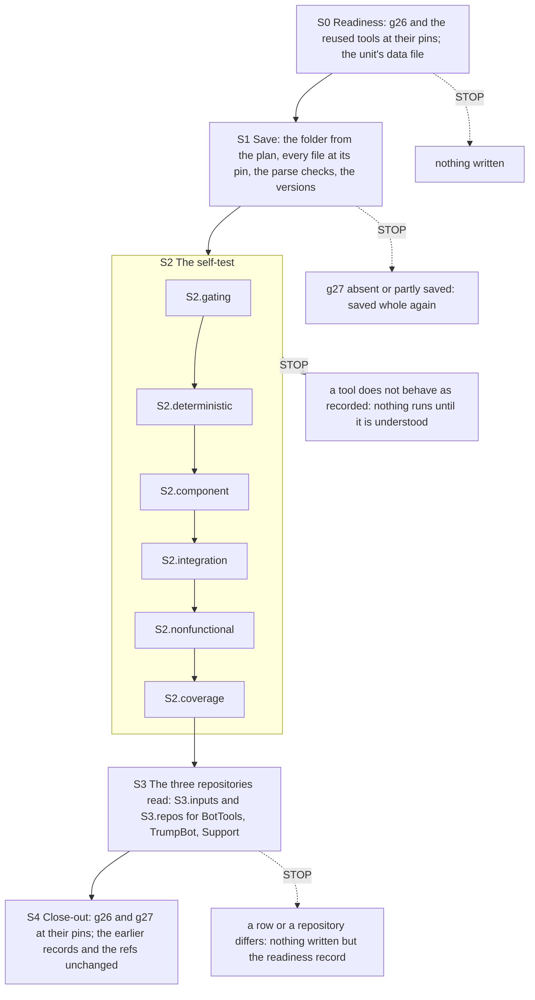
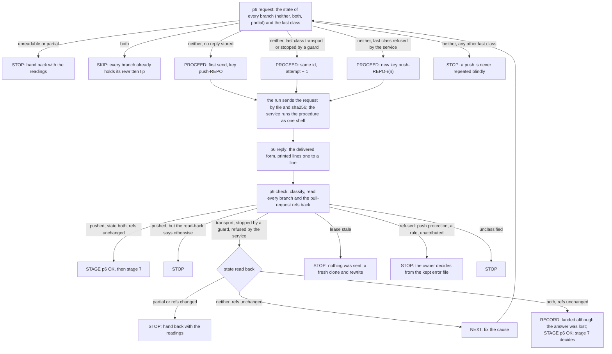
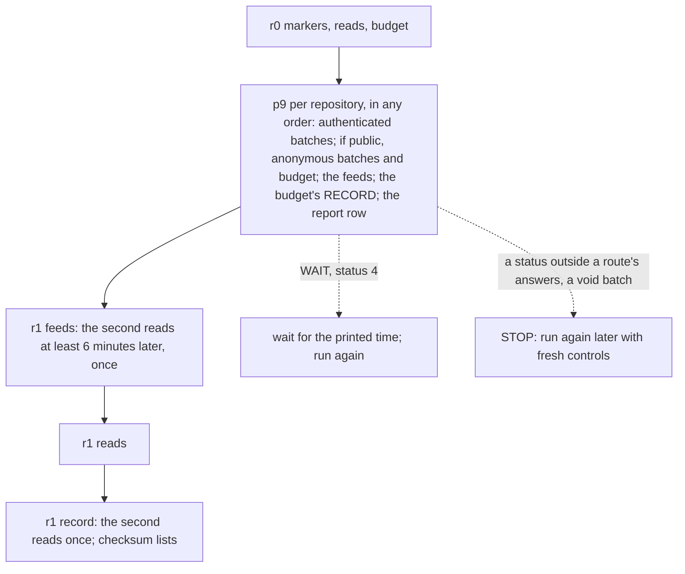
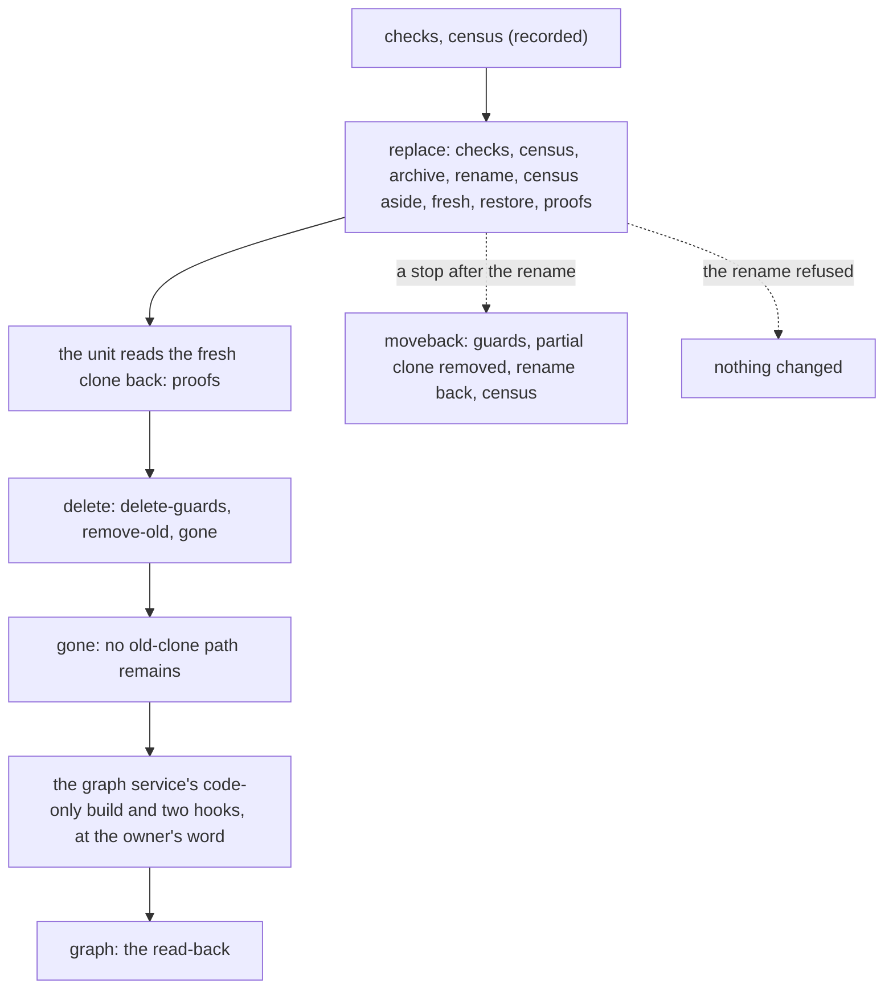

> **Superseded by [`plan-2026-11-14-3.md`](plan-2026-11-14-3.md) on 2026-11-14.** This version describes the tool folder whose pin list has the sha256 `99db334773265a54d44f0f550e5485d6cf03164ae1eacb4caddef8b7aeef418d`. Its relative links are rewritten to resolve from this folder.

# Phase 0 · 7.1 — Extending the workspace tools for BotTools, TrumpBot and Support: implementation plan

- **Covers:** [SpartanLaboratories/KotlinBottools#39](https://github.com/SpartanLaboratories/KotlinBottools/issues/39),
  *"Phase 0 · 7.1 — Extend the workspace tools for BotTools, TrumpBot and Support"*, unit 1 of
  [#27](https://github.com/SpartanLaboratories/KotlinBottools/issues/27) (*"Phase 0 · 7 — Rewrite BotTools and the private
  repositories, and replace the private repository clone"*), a sub-issue of
  [#2](https://github.com/SpartanLaboratories/KotlinBottools/issues/2), the history rewrite, which is a sub-issue of
  [#1](https://github.com/SpartanLaboratories/KotlinBottools/issues/1) (parent chain #39 → #27 → #2 → #1). Its siblings, none
  started, are #40 (the rewrites), #41 (the residual measurement) and #42 (the clone replacement).
- **Architecture:** [`../architecture.md`](../../architecture.md), unit `workspace-tools` (order 1 of §16), which is §7 (the tools)
  with §1.1 item 5, §1.2 criterion 9, §2.3, §2.4, §3, §4, §5 (the row "The tools") and §5.1 (the seams from this unit to units 2, 3
  and 4), §6, §7.1 to §7.5, §8 (the behaviour the push tools must deliver), §9 (what the residual set serves), §10 (what the clone set
  serves), §11 (stops per unit), §12 (the first row, and the form of a request), §13.3, §14 (policy as data), §16 and §17. Its
  consequences are in [`../consequences.md`](../../consequences.md); the evidence is [`../research/README.md`](../../research/README.md) and
  the three findings files it summarises, [`tool-changes-for-three-repositories.md`](../../research/tool-changes-for-three-repositories.md),
  [`two-branch-lease-push.md`](../../research/two-branch-lease-push.md) and
  [`clone-move-aside-on-windows.md`](../../research/clone-move-aside-on-windows.md). The earlier unit this one derives from is
  [the GKB2 and GKB unit](../../../26-gkb2-gkb-rewrite/plan.md), with [its as-built record](../../../26-gkb2-gkb-rewrite/final-implementation.md)
  and [its consequences](../../../26-gkb2-gkb-rewrite/consequences.md).
- **Branch:** `docs/issue-39-extend-workspace-tools`. It exists, was cut from `main` at the merge of pull request #38 and is pushed. This
  plan is committed in the same commit as the unit's consequences and as-built record (the first commit of "Version control"), so that
  `git log --follow` binds the plan to the work it describes. The unit lands through one pull request, which closes #39 only.
- **What this plans:** the new workspace tool folder `%USERPROFILE%\BotWS\tools\g27\` for the three repositories: its source and pins
  (Appendix A and B), its four tool sets (the rewrite set, the residual set, the clone set and the self-test), the closing of every gap
  and follow-up the earlier unit recorded for this work, the self-test by test kind with a total per kind and its coverage check, and the
  one read of the three repositories that proves the parameter rows against the data. It is a literal procedure the implementer and the
  run carry out without making a decision.
- **Status:** planning only.
- **Target version:** none. Nothing is versioned; no product code, test source, build file, README or CHANGELOG of any repository changes.
  The landing adds documents and regenerated boards only.

This unit writes nothing to GitHub, changes no repository and touches no checkout: its only contact with GitHub is reads
(`gh api` GET and `git ls-remote` through `gitnet`), and the TrumpBot clone is neither read nor touched (the clone set is proven on
made-up clones). What it writes is the new tool folder, its own scratch folder in the workspace, the run's lines in the run log and,
where a readiness step records something, that record in the unit's own record folder. The implementer types the commands; the plan
never performs a write itself.

---

## Requirements

**Goals**

1. **The folder is saved and every file equals its pin.** `%USERPROFILE%\BotWS\tools\g27\` holds the 25 files of Appendix A, byte for byte
   with carriage returns stripped, each equal to its row of `g27tools.sums`; the reused earlier tools and the corrected runner equal
   their rows of `tools.sums`. The save step writes nothing but `tools\g27`.
2. **The earlier folder is untouched.** `tools\g26\` equals its own pins before the save and after the close-out; it is never edited,
   saved again or run, and its self-test is never run (it writes into the real workspace).
3. **Four tool sets share one library.** The rewrite set (readiness, steps 1 to 8, the reset, the push request builder with the reply store
   and the classifier, the close-out), the residual set (its readiness, step 9, the second feed reads, the record step), the clone set
   (the read-only checks and the census, the builder of the three request procedures, the proofs, the read-back after the graph build)
   and the self-test, run by test kind with a total per kind.
4. **No script of the folder names a repository, an issue or a branch.** Each step takes the repository as its argument and reads the rest
   from data: the parameter table, the preparation unit's expectation rows, the running unit's data file, the clone's policy values, the
   measurement's constants.
5. **What changes against the earlier tools is built** (architecture §7.3): the atomic lease push of N branches with its classes, its
   read-back naming neither, both or partial and its resend rule; the stored reply taken in the form the request service delivers; the
   order gate at stage 8; the positive control of a repository with no probe arguments; visibility, default branch and webhook count read
   from the row; the probe selection by visibility; BotTools' webhook snapshot and delivery counts; the grant check reading its job from
   data; the clone scripts rebuilt as request procedures with a builder; the self-test's stand-in for the request service running a
   procedure as one shell.
6. **Every recorded gap and follow-up of the earlier unit's consequences is closed here, before the first push,** each with its change
   and its case (the closure table in Design), in the order of what guards a write; the thirteen documentation points go with the same
   save. The earlier unit's consequences take a dated note for each at the landing.
7. **The three repositories are read once and the parameter rows are proven against the data:** visibility, default branch, branches,
   webhook count and the scanning settings where a repository reports them; each purge list against its recorded checksum; each row's
   probe arguments against the preparation unit's `s8-row.sh`; each every-ref commit count against a derivation from the untouched backup.
8. **The self-test proves its own coverage:** every `expect` label and every `STOP` text of every step script, and of the shell text of the two Python tools' procedures, was reached as a stop by a case of its own script and arm.
9. **After the landing the folder is fixed.** A later unit that meets a defect stops; the correction is a new version of that file, carried
   whole with its new pin by the plan of the unit that makes it, with the covering test kind run again and a dated note in this unit's
   consequences.

**Rules this unit keeps**

- **No write to GitHub, no change to any repository or checkout, nothing asked of the owner up front.** Unit 1 needs no grant.
- **The earlier units' tools and records are never overwritten.** The folder is new; no step of it reads or writes `g26`, its pin files or
  any earlier unit's record folder beyond what the table says is read-only input.
- **Nothing sensitive is printed or written outside the data folder and the workspace:** counts, rule ids, fixed markers and file names only,
  and the output rule (Design) holds for every step and for the self-test's own output.
- **No version moves; no README or CHANGELOG changes.**

**Acceptance criteria** (the issue's "Done when", each with what proves it)

| Criterion | Proved by |
|---|---|
| The new tool folder is saved and every file equals its pin | `S1.save` (the count and the pin of the pin list), then `S1.tools` straight after it and `S4.tools` in the close-out: every row of `tools.sums` and of `g27tools.sums` |
| The self-test passes by test kind, with a total per kind | `gselftest.sh gating`, `deterministic`, `component`, `integration` and `nonfunctional`, each ending `ok    gselftest <kind>: <n> checks passed` with its total from Appendix B, then `coverage` |
| Every recorded gap and follow-up has its change and its case, and the earlier unit's consequences carry a dated note for each | the closure table (every row names its file, function and case labels), the coverage check, and the dated notes written at the reconciliation from the table's note column |
| The three repositories are read and the parameter rows equal the data | `S3.inputs` and `S3.repos` for the three repositories (the readiness tool prints `STAGE S0.inputs OK` and `STAGE S0.repos OK`: `S0.<step>` is the tool's name for a step, `S1` to `S4` are the run's), and the readings the as-built record carries (counts; the record is written at the reconciliation) |
| The earlier unit's tool folder equals its own pins before and after | `g26tools.sums` and `tools.sums` of `g26`, compared by the typed check before the save and in the close-out |

---

## Current state

**Baseline.** `main` is at the merge of pull request #38 (the preparation of this work's design). The workspace and data folder
(`%USERPROFILE%\BotWS`, `%USERPROFILE%\BotLegacyData`) were read on 2026-11-13; nothing below was changed.

**The earlier folder and the runner.** `tools\g26\` holds 22 files, each equal to its pin in `g26tools.sums`; the reused tools equal
`g26\tools.sums` (relative to the workspace). `tools\run-stage.sh` is the corrected runner: 1,428 bytes, sha256
`9cdb381040caf266bb61576536a9cc45436f031fa797fd9358a041249909c428`. The reused tools this folder calls are the 22 rows of Appendix B's
`tools.sums`; `lockprobe.py`, which the earlier folder did not pin, is added.

**GitHub, read-only reads made on 2026-11-13, the rulesets on 2026-11-14** (the unit's `S0.repos` reads each fact again before anything depends on it):

| | BotTools | TrumpBot | Support |
|---|---|---|---|
| Repository id | 540122713 | 540208924 | 540146440 |
| Visibility | public | private | private |
| Default branch; branches | `main`; `main`, `Working-Branch` | `main`; `main`, `feature/pokercommand` | `main`; `main` |
| Protected branches; tags | none; none | none; none | none; none |
| Rulesets | 200, none listed | 403, "Upgrade to GitHub Pro or make this repository public to enable this feature" | the same 403 |
| Archived, fork, forks, Pages | no, no, none, none | read by `S0.repos` | read by `S0.repos` |
| Secret scanning and push protection | `disabled`, `disabled` | `security_and_analysis` absent | absent |
| Webhooks | one, type `Repository`, active, events `fork, public, pull_request, push, repository`; its deliveries list is readable by the token and holds 0 deliveries | none | none |
| Authenticated activity feed; events | 0 entries; 0 | 0 entries; 3 (issue events only) | 0; 0 |
| Authenticated REST `git/commits` and `git/trees`; the same anonymously | (public) | 200; 404 | 200; 404 |

Each server's refs equal the listing recorded at the mirror clone (`DATA/rewrite/<repo>/ls-remote-at-clone.txt`: 5, 3 and 2 lines).
The webhook object's field names, read once with a read-only GET (names only, never a value), are `active`, `config`, `created_at`,
`deliveries_url`, `events`, `id`, `last_response`, `name`, `ping_url`, `test_url`, `type`, `updated_at` and `url`, and the
configuration's `content_type`, `insecure_ssl`, `secret` and `url`. The snapshot (Design) holds every field but `last_response` and the
secret, and holds the URL only as its sha256; that rests on A3, that a delivery changes `last_response` and nothing else of the object while a
configuration edit changes the others (`updated_at` included). No delivery has been observed on this webhook (its list holds 0), so A3 is the
documented behaviour and not a reading.

**The data folder.** BotTools and Support each hold 5 earlier records (`backup.SHA256SUMS`, `expect-row.txt`, `gitleaks-before.txt`,
`gitleaks-kept.txt`, `ls-remote-at-clone.txt`) and no control file; TrumpBot holds 6 (those and `gitleaks-control.txt`). No record of
this work exists yet. The purge lists (`WS/lists/<repo>-purge.txt`; each sha256 matches exactly one row of `DATA/run/lists/SHA256SUMS`)
hold 9 lines (107 bytes), 23 lines (241 bytes) and 6 lines (50 bytes). The expectation rows (`tools/expected_rows.txt`, no header; columns
`repo T P after paths blobs_kept blobs_total manifest shared largest largest_nonjar wrapper_jar pinned_kept pinned_manifest`) are
`BotTools 16 1 15 82 145 184 39 2 27168 27168 no 184 0`, `TrumpBot 11 2 9 56 106 305 199 0 25952 25952 no - -` and
`Support 2 1 1 29 29 7288 7259 0 14302 14302 no - -`; none of the three has a Gradle wrapper jar. The manifests hold 39 blobs (and a
pinned variant of 0, so BotTools' residual is 39 − 0 = 39), 199 and 7,259. The backups (counts): BotTools 16 commits on every ref, 2
heads, 2 pull-request refs (non-merge), 13 commits reachable from the pull-request heads and 0 only from them, no tag; TrumpBot 11
commits, 2 heads; Support 2 commits, 1 head. Every root commit holds a purged path, so every commit changes, and the every-ref commit
counts after the push are 28 (15 + 13), 9 and 1.

**The positive controls.** The preparation unit's `s8-row.sh` assigns nine probe arguments to TrumpBot (seven `--probe-name` file names
and two `--probe-prefix` folder names, of the kind the earlier table carried for GKB2 and GKB) and `PROBES=""` to BotTools and
Support, whose control is the scan alone: `RESULT: CLEAN` with none of the six owned rule ids (the five custom rules and the
private-key rule) in it.

**The request service.** The grant file for this repository is empty (0 bytes). A grant section has the form `## <job>`,
`Granted: <date>`, `Permissions: <actions>`, `Scope: <text>`, `Ends: <text>`, optionally `Settings:`, and `Ended:` once it moves to
history. A request is sent by file: the run sends the envelope with `requestFile` (the request file's absolute path) and
`requestFileSha256`; the service compares the hash and runs the file's procedure as one shell, its entries unchanged and in order, and
reports the procedure's exit status with the lines it printed. The delivered `done` reply of the earlier unit's push carried `result`
with the string fields `matched`, `ran` and `counts` and the list `printed`, one string per printed line (11 lines); a refused first
attempt came as a non-`done` reply whose `result` held string fields (`refused`, `matched`, `notTried`, `denyRule`, `staged`) and no
`printed`; the service's own rerun after its restart arrived under the same id with `attempt + 1`; the protocol's `stopped` reply
carries `result.step` and `result.state`. The actions the three later units use are `push-mirror` (the pushes) and `replace-clone`
(the clone procedures).

**The TrumpBot clone, as the design records it** (not read by this unit): 59 files git does not track (4 under `.idea/`, 55 under
`graphify-out/`), two non-sample hooks (`post-checkout`, `post-commit`), one non-comment line in `.git/info/exclude`, 12 local
configuration keys (the ten a plain clone writes, plus `submodule.active` and `lfs.repositoryformatversion`), one pack, no stash; the
system configuration's credential helper is `manager`, not `gh`.

**What the earlier tools assume,** and so what changes ([the tools findings, §3](../../research/tool-changes-for-three-repositories.md#3-inventory-what-each-tool-does-what-it-assumes-what-changes)):
one branch per repository; a public repository with no webhook; a positive control with probe arguments and a control record; a
reply stored as printed lines; the order gate on the other repository's stage 9; stage 9 right after each push; anonymous probes
unconditionally; the request service's stand-in running each entry in a shell of its own; two scripts naming GKB2 and GKB outside the
table. The earlier unit's recorded gaps are in [its consequences, §5 and §6](../../../26-gkb2-gkb-rewrite/consequences.md#5-known-gaps)
and its deviations in [its as-built record, §4](../../../26-gkb2-gkb-rewrite/final-implementation.md#4-deviations-from-the-plan).

**Outside facts this unit rests on** (verified at their sources; [the research README, "Verification results"](../../research/README.md)):

- A directory rename on Windows refuses with no effect while anything inside is open, and cannot cross volumes; across volumes `mv`
  copies and then removes ([the clone findings, §3.1](../../research/clone-move-aside-on-windows.md#31-what-a-move-is-on-windows-and-in-git-bash)).
- Several leases in one push are each checked on the client against the server's advertised value before anything is sent; with
  `--atomic` a stale lease on one ref sends nothing; a clean push of N forced refs tallies `forced=N` and `done=1`; a lost connection
  prints no `To` line and `fatal:` lines and leaves every branch at its old tip or every branch at its new one
  ([the push findings, §4](../../research/two-branch-lease-push.md#41-what-git-does-with-several-leases-and-with---atomic-documented-source-observed)).
- A repository webhook's deliveries are listed by `GET /repos/{owner}/{repo}/hooks/{hook_id}/deliveries`, which returns summaries and
  never a payload, and GitHub lists three days of them
  ([REST webhooks, "List deliveries for a repository webhook"](https://docs.github.com/en/rest/repos/webhooks?apiVersion=2022-11-28#list-deliveries-for-a-repository-webhook)).
- The events cover 30 days and can lag by up to 6 hours
  ([REST events](https://docs.github.com/en/rest/activity/events)).
- Bash processes redirections from left to right, and a failed open fails the redirection and prints the shell's own message with the
  file's path before a later `2> /dev/null` applies
  ([Bash reference manual, Redirections](https://www.gnu.org/software/bash/manual/html_node/Redirections.html)); the two lines of the
  earlier run that broke the output rule had this cause.
- `git ls-files -o` lists every file not in the index, ignored ones included, unless `--exclude-standard` is given
  ([git-ls-files](https://git-scm.com/docs/git-ls-files)).

---

## Assumptions

| # | Assumption | If false |
|---|---|---|
| A1 | The request service's delivered reply holds each printed line as a string entry of `result.printed`, and any other list of strings under `result`. | `classify` stops plainly on a reply it cannot read ("the reply holds neither a status nor a printed line it can read", or "the reply's lines are not the procedure's output" when they show no guard marker and no `STOP  ` line) and keeps no class; unit 2 reads the server and nothing is pushed or repeated on that stop, and `request` refuses a resend with no class kept. |
| A2 | The stand-ins of the self-test (a stand-in `git` with local bare repositories, `gh`, `curl`, `tasklist`, `mv`, `tar`, `rm`, `stat`) answer in the shapes GitHub and Windows answer in. | A step that passes the self-test and meets a different answer in a later unit's real run stops at its own check before its write; the correction is a new version of that file (Design, "After the landing"). |
| A3 | A webhook delivery changes `last_response` and no other field of the hook object, and a read-only GET returns the same `updated_at`, `created_at`, `events` and `config.content_type` until someone edits the hook. | Stage 7 of unit 2 reports the webhook as "differs" after a delivery; it stops after the push and hands back with the readings, which cannot repeat or undo the push. The snapshot's fields are then narrowed by the correcting unit. |
| A4 | The token that runs the unit can read the three repositories' settings, branches, tags, releases, workflows and keys, and BotTools' webhooks and their deliveries; the rulesets read answers 200 for BotTools and 403 with the upgrade wording for the two private repositories (the organization is on the free plan), which is a `RECORD`; the private repositories report no `security_and_analysis` object. | `S0.repos` stops on the first read that is refused or differs, with nothing written; the row's `scanning` column or the read itself is corrected by a new version of `s0-ready.sh` before unit 2 starts. |
| A5 | `git ls-files -o` without `--exclude-standard` lists ignored files, so the census counts the 55 graph files whatever the clone's exclude entry says. | The census's counts differ from the clone findings; unit 4's census reads the real clone, records the difference, and a count outside the two folders is a stop by the closed-set guard. |
| A6 | `stat -c %d` gives equal device numbers for two paths on one volume and different numbers for paths on two volumes, `tasklist` lists running `git.exe`, and `lockprobe.py` reports the files held open without sharing. | The clone checks stop before the rename (a wrongly reported volume or process only stops, never moves). |
| A7 | The gitleaks configuration (`tools/gitleaks.toml`, 3,824 bytes) and binary 8.30.1 are the ones the earlier unit ran and the preparation unit's records were made with, so a positive control on an untouched backup equals its record line for line. | `p2` of unit 2 stops before any rewrite; the control is read as a difference in the tools, not in the data. |
| A8 | The plan is not edited while the unit's steps run, because `S0.save` reads every file from it. | A changed plan saves different files; `S0.tools` stops on the pin that no longer matches. |
| A9 | The run's shell is Git Bash with the user profile's `.claude` folder in place, and `gh` is signed in as an account that may read the three repositories. | `S0.pins` or `S0.repos` stops before anything is recorded. |
| A10 | The tools the unit runs on the owner's machine (git, Python, gh, git-filter-repo with its module, gitleaks) are at the versions the preparation unit recorded in `DATA/run/tool-versions.txt`. | `S1.pins` stops with nothing written; a different version is a decision of the owner and a new record, never a silent accept. |
| A11 | The three real repositories answer `S3.repos` in the shapes the stand-ins model (the rulesets of a private repository corrected by A4). | `S3.repos` stops on the first read that is refused in another way or differs, with nothing written; the row or the step is corrected before anything depends on it. |
| A12 | The porcelain lines and the error text of a real refused or lost push have the wording the classifier's markers expect (`[remote rejected]`, `[rejected]`, `(stale info)`, `GH013`, `PUSH PROTECTION`, `fatal:`, git's atomic sibling wording). | A reply the markers do not explain classes `unclassified`, which ends in a stop that hands back with the counts; nothing is repeated. The first real push, refusal or lost connection of unit 2 is the check. |
| A13 | The real TrumpBot clone has the shape the design records: 59 files git does not track (4 under `.idea/`, 55 under `graphify-out/`), two non-sample hooks, one non-comment exclude line and 12 local configuration keys. | Unit 4's census reads the real clone and records the difference; a file outside the two folders is a stop by the closed-set guard, and a count that differs only moves a recorded number. The first real census is the check. |

---

## Non-goals

- **No run of any rewrite, push, probe or replacement.** Units 2, 3 and 4 run the sets this unit delivers; unit 1 proves them on made-up
  repositories and reads the three real ones.
- **No write to GitHub, no change to any repository, no read or touch of the TrumpBot clone,** and no grant, allow line or request.
- **No change to `tools\g26\` or to the earlier units' records,** no run of its tools or of its self-test, and no run of
  `k0-ready.sh` or `save-tools.sh` (the two workspace scripts that pin the earlier scan configuration).
- **No save of the stage runner.** `tools\run-stage.sh` is read at its existing pin. Its own header stays as pinned (the closure table's
  last row says what is closed in this folder's text instead).
- **No pre-flight of the private repositories' probe routes:** the residual measurement's own controls see them. The unit records what
  today's reads showed (authenticated REST 200, anonymous 404, for both).
- **No anonymous probe or anonymous feed read of TrumpBot or Support,** and no fourth repository: the procedure for one is a row.
- **No README, no CHANGELOG, no version move, no change to the registry** (the board service updates it).

---

## Design

### Shape of the unit's run

Five stages. `S0` reads and checks and writes nothing. `S1` saves the folder from this plan and checks it. `S2` runs the self-test, one
step per test kind and a last step for its coverage. `S3` reads the three real repositories and proves the parameter rows against the
data. `S4` is the close-out: the earlier folder and the new one at their pins, the preparation unit's records unchanged, the three
repositories' refs unchanged. The landing's document checks follow, outside the table, as in the earlier unit. Nothing is written to
GitHub, to any repository or to the clone at any stage; every stop leaves the state its row of "Stops and the state each leaves" names.

| id | name | brief | kind | steps |
|---|---|---|---|---|
| S0 | Readiness | The earlier tool folder and the reused tools are at their recorded pins and the unit's data file is written. | check | S0.g26: The earlier folder and the reused tools at their pins; S0.unit: The unit's data file |
| S1 | The folder saved | The new tool folder is saved from this plan, every file equals its pin and every script parses. | work | S1.save: Save the folder from this plan; S1.tools: Every file at its pin and the parse checks; S1.pins: The tool versions |
| S2 | The self-test | The tools pass their self-test by test kind, each kind with its total, and every expectation and stop of every step script was reached. | check | S2.gating: The gating checks; S2.deterministic: The deterministic cases; S2.component: The component tests; S2.integration: The integration tests; S2.nonfunctional: The non-functional cases; S2.coverage: The coverage check |
| S3 | The three repositories read | The three repositories are read once and each parameter row equals the data. | check | S3.inputs: The rows against the data; S3.repos: The repositories read |
| S4 | Close-out | The earlier folder and the new one equal their pins, the preparation unit's records and the three repositories' refs are as before. | check | S4.g26: The earlier folder at its pins; S4.tools: The new folder at its pins; S4.records: The earlier records and the refs unchanged |



### The folder

`%USERPROFILE%\BotWS\tools\g27\` is a new, self-contained folder derived from `g26\`. Nearly every file changes for these repositories (a
parameter row has columns the tools read by position, the push held one branch in a dozen places, the repositories differ in visibility,
webhooks and probes, and the documentation points touch almost every file), so the folder is the whole set of changed files. `g26\` stays
as it ran: its pins are the earlier unit's record, and an edit in place would make that record false. The folder is saved from
Appendix A by a typed step that writes only `tools\g27`, and checked by size and sha256 (Appendix B). It is copied with the workspace
tools at the phase's cleanup. The reused earlier tools and the corrected runner are read at their existing pins and are never saved
again. A file is run through the runner with `bash "$TOOLS/run-stage.sh" g27/<script> <args>`; **the runner shows a stage name with
characters outside `A-Z a-z 0-9 . _ / -` as `<name>`, and an argument that is not a plain word as `<arg>`** (the self-test's runner
cases check both).

| File | Set | Role |
|---|---|---|
| `g27lib.sh` | all | constants by role; the unit's data file (`unit_get`, `unit_load`, `unit_need`); the folders (`scratch_open`, `unit_open`); the parameter row (`row`, `expect_tally`); the step markers; the listings (`heads_old`, `heads_new`, `changed_heads`, `pull_list`, `refs_listing`, `server_heads_tags`, `server_pulls`, `state_vector`, `server_state`, `every_ref_commits`); the webhook reads (`hook_id`, `hook_snapshot`, `deliveries_count`); the grant helper `names`; the samples (`sample_step`, `sample_lines`, `rest_lines`); the route classification and the authenticated probes (`classify`, `auth_api`, `want_probe`, `route_status`, `ctl_ok`, `probe_ids`, `batch`, `run_batch`); the feed membership counts (`build_feed_ids`, `member_counts`, `auth_feed`) |
| `ganon.sh` | residual | the anonymous helpers, for a public repository only: `anon_web`, `anon_api`, `api_budget_ok`, `anon_left`, `anon_need`, `feed_read` |
| `g27_req.py` | rewrite | builds the push request, stores a reply in the form the service delivers, classifies the outcome from the kept streams; its own self-test (a deterministic and a component part) |
| `g27_clone.py` | clone | builds the three request procedures (the replacement, the way back, the deletion), stores a reply, reads how far a reply got; its own self-test |
| `g27_cover.py` | self-test | extracts every `expect` label and every `STOP` text of the step scripts and of the procedures' shell text, and checks each against the stop lines of its own script and arm that the cases provoked, one collection for each kind (`patterns`, `check`, `selftest`) |
| `params.txt` | all | the parameter table: the three rows |
| `tools.sums`, `g27tools.sums` | all | data: the pins of the reused tools (relative to `$WS`) and of every other file of this folder (relative to the folder) |
| `s0-ready.sh` | rewrite | `tools`, `pins`, `inputs`, `repos`, `grant` |
| `p1-prerun.sh` … `p8-exit.sh` | rewrite | steps 1 to 8 of a repository; `p6-push.sh` has `request`, `reply` and `check` |
| `preset.sh` | rewrite | the reset after a stop before a push |
| `c1-close.sh` | rewrite | the close-out of the rewrites: `reads`, `record` |
| `r0-ready.sh` | residual | `markers`, `reads`, `budget` |
| `p9-residual.sh` | residual | step 9 |
| `r1-close.sh` | residual | `feeds`, `reads`, `record` |
| `k1-clone.sh` | clone | `checks`, `census`, `archive`, `rename`, `fresh`, `restore`, `proofs`, `moveback-guards`, `remove-partial`, `rename-back`, `delete-guards`, `remove-old`, `gone`, `graph` |
| `gdocs.sh` | all | the landing's document checks `D.ids`, `D.paths`, `D.gate`, `D.scan` |
| `gselftest.sh` | self-test | `gating`, `deterministic`, `component`, `integration`, `nonfunctional`, `coverage`, `all` |

There is no `grant.txt` in the folder: the grant's text and data are the running unit's (below). There is no copy of the runner: its row
is in `tools.sums`.

### The running unit's data file

Every step reads one data file, named by the environment value `G27_UNIT` (a path in mixed form, with no default, so that no two units
share one). Key=value lines; a line that starts with `#` is a comment:

| Key | Meaning |
|---|---|
| `job` | the grant's job name |
| `issue` | the home repository's issue number (the number in the request's id and in the grant's scope) |
| `home` | the home repository, `owner/name`; the grant is looked up in the request service's file for it |
| `branch` | the branch the grant's scope must name |
| `actions` | the actions the grant must name, comma separated |
| `targets` | the strings the grant's scope must name, comma separated (repositories, folders) |
| `runs` | the folder name under `DATA/run` that holds this unit's records and nothing of any other unit's |
| `from` | the `runs` name of the unit whose markers and baselines this unit reads, read only; `-` for none |
| `wording` | the file, beside the data file, holding the grant section's text with `<date>` for the day |
| `carried_dir`, `other_dir`, `expect_carried`, `expect_other`, `move_to`, `rename_tries`, `rename_gap`, `graph_hooks` | the clone unit's policy values (the clone set reads them; others never do) |

`unit_load` stops, naming the key, on a file that is not named, absent, missing a key or holding a value of the wrong form (a job of
lower-case letters, digits and hyphens; a numeric issue; `owner/name`; plain names for `runs`, `from` and `wording`). Its folders are
`G27D = DATA/run/<runs>` (the unit's records), `G27F` (the records of the unit it follows; the same folder when `from=-`) and
`G27S = WS/tmp/g27/<runs>` (the unit's scratch folder). **Sourcing the library creates no folder:** a step that writes calls
`scratch_open` (scratch) or `unit_open` (scratch and the record folder with `requests`, `replies` and `status`). No step writes another
unit's records, an earlier unit's record or the preparation unit's. Unit 1's file (`runs=g27`, `from=-`; no grant, so `job`, `actions`,
`targets` and `wording` hold placeholders its steps never read) is written by `S0.unit`; units 2, 3 and 4 write their own, naming their
own `runs` folder, and unit 3 and unit 4 name unit 2's in `from`.

**Why unit 1 has a record folder.** `S0.inputs` records the checksums of the preparation unit's earlier records the first time it runs
for a repository (`records-at-s0.<repo>.sums`), and compares them at every later run; unit 1's close-out `S4.records` runs it again, which
proves its own run changed none of them. Those three small files are unit 1's only records, in `DATA/run/g27/`.

### The parameter table

`params.txt` holds one row per repository, space separated; policy is data, never inline in a command. A value that exists in the
expectation rows is read from them, so each value has one source; a count another column fixes is derived or proven equal.

| Column | Meaning |
|---|---|
| `repo`, `id` | the repository's name and its id on GitHub (read from the repository; `S0.repos` proves it) |
| `visibility` | `public` or `private`; a private repository gets no anonymous probe and no anonymous feed read |
| `default`, `branches` | the default branch; every branch the push updates in push order, comma separated, the default first. N, the number of branches, is the push's size |
| `needs` | the stage-8 marker of the repository whose push must be verified first: its name, `<repo>.p8`; `-` for none |
| `list_lines`, `list_size`, `list_sha` | the purge list's line count, byte count and sha256 |
| `pull_refs` | the pull-request refs the server advertised at the clone, merge refs left out |
| `every_ref_commits` | the commits a fresh mirror holds on every ref after the push |
| `sample_max` | the bound on the manifest blobs probed |
| `hooks` | the webhooks the repository holds |
| `scanning` | the status of secret scanning and push protection as GitHub reports it: `disabled`, or `absent` where the repository reports no setting |
| `probes` | the positive control's arguments (the rest of the line); `-` where the preparation unit's script assigns none |

| | BotTools | TrumpBot | Support | Where the value comes from |
|---|---|---|---|---|
| `id` | 540122713 | 540208924 | 540146440 | the repository itself (`S0.repos`) |
| `visibility`, `default` | public, `main` | private, `main` | private, `main` | the repository itself (`S0.repos`); the clone listing's `HEAD` (`S0.inputs`) |
| `branches` (N) | `main,Working-Branch` (2) | `main,feature/pokercommand` (2) | `main` (1) | the clone listing's heads (`S0.inputs`), the push order the request fixes |
| `needs` | `-` | `BotTools.p8` | `TrumpBot.p8` | the order BotTools, TrumpBot, Support |
| `list_lines`, `list_size` | 9, 107 | 23, 241 | 6, 50 | the purge lists; the row's sha256 matches one row of `DATA/run/lists/SHA256SUMS` |
| `list_sha` | `f2d66a9b…ea7e` (full in Appendix A) | `1af096ca…4ff6` | `37a8f46e…ca13` | the same |
| `pull_refs` | 2 | 0 | 0 | the clone listing's non-merge `refs/pull/` rows (`S0.inputs`) |
| `every_ref_commits` | 28 (15 + 13) | 9 | 1 | derived from the untouched backup by `every_ref_commits`: the expectation row's commits after, plus `git rev-list --count --glob='refs/pull/*/head'`; valid because every commit changes |
| `sample_max` | 60 | 60 | 60 | the design's bound on the blob sample; the sample takes the ceiling of blobs ÷ 60 as its step (all 39; 50 of 199; 60 of 7,259) |
| `hooks` | 1 | 0 | 0 | the repository itself (`S0.repos`) |
| `scanning` | `disabled` | `absent` | `absent` | the repository itself (`S0.repos`) |
| `probes` | `-` | nine arguments (seven `--probe-name`, two `--probe-prefix`) | `-` | the preparation unit's `s8-row.sh` (`S0.inputs`) |

Derived by `row`, never typed: **the heads** (the number of branches: 2, 2, 1), **the residual** (the manifest less the pinned variant's:
39 − 0 = 39 for BotTools, 0 for the others, which have no pinned variant), **the private flag**, and **the expected tally**
(`forced=N fastforward=0 new=0 deleted=0 uptodate=0 rejected=0 done=1 pull_lines=0 other_refs=0 bad=0`, from the heads). Every other
expectation (commits, paths, blobs, the bound on the largest blob, the wrapper jar, the pinned variant) stays in
`expected_rows.txt`. A fourth repository is a row; a second clone is a set of policy values.

### The grant check

`s0-ready.sh grant` reads the request service's permissions file for the home repository (found by the glob
`"$P_HOME"/.claude/*/temp-permissions/<owner>-<name>.md`, which names no service, the file name taken from `home`). It extracts the
section of the unit's job (from its `## <job>` line to the next `## ` line, blank lines dropped) and stops, with nothing written,
unless: the file exists; the section exists once (a missing section and a repeated one both fail); its `Granted:` line is a date
(`YYYY-MM-DD`); its `Permissions:` line names every action of the data file (whole words); its `Scope:` line names the issue
(`<home>#<issue>`), the branch and every target, each as a whole word (the character after it is not a letter, digit, underscore
or hyphen, so one repository never matches inside a longer name, a folder never inside a folder named with a suffix, and issue 7 never inside issue 70); the text reaches awk through its environment, so a Windows path with backslashes in the scope is read as it is; it has an
`Ends:` line; it has neither an `Ended:` nor a `Revoked:` line; and the unit's wording file exists. A section that differs from the
wording apart from its date is recorded (`RECORD`), never a stop. The check names no job, issue, branch, action or target.

### The push

The rewrites unit sends one request per repository carrying one atomic lease push of N branches, N taken from `ref-map`'s changed heads
(2, 2 and 1). The tools build it, class its outcome and read the server back; the plan states the contract.

**The builder (`g27_req.py build`, run by `p5-prep.sh` and again by `p6-push.sh request`).** It reads the branches from the row and builds
a `push-mirror` request: `permissionReason` (the job), `github` (the home repository), `action` (`push-mirror`), `target`, `issue`,
`mirror`, `procedure` (six standalone shell commands), `inputs` (`key`, `mirror`, `branches`, `expectedTally`), `expectedTally` and
`checks`. The key is `push-<repo>` or, after a refusal by the service, `push-<repo>-r<n>`; any other key is a stop. The builder asserts, on
the words each of the two push commands assembles, **exactly one `--atomic`, one `--force-with-lease=refs/heads/<b>:$OLD<k>` and one
refspec `refs/heads/<b>:refs/heads/<b>` per branch with each lease naming its own refspec's ref, and none of the forbidden arguments**
(`--force`, `-f`, `--mirror`, `--all`, `--delete`, `--prune`, a leading `+`); it stops on a branch list that is empty, repeats a name or
holds a name that is not a plain ref name, and on an expected tally that is not the one of N forced refs. The request holds no commit id: every
old tip is read from `ref-map` when its entry runs and must be 40 hexadecimal digits.

**The entries.** (1) the mirror is bare and its `origin` is the repository's URL; (2) the local refs equal `ref-map`'s new column; (3) the
server's heads and tags equal the old column; (4) the server's pull-request refs equal their record; (5) the dry run; (6) the push. Each
entry sets what it uses; each guard ends the shell with `exit 1`; every network `git` has `gh` as its only credential helper (an empty
`credential.helper=` first clears every inherited helper). Entries 5 and 6 run the same line,
`git push --porcelain --atomic --force-with-lease=…:$OLD1 [--force-with-lease=…:$OLD2] <url> <refspec> [<refspec>]`, the second without
`--dry-run`; the push entry requires the dry run's tally to be the expected one. Both streams of each run are kept in the data folder and
never printed: the procedure prints `dry rc=<n>`, `dry tally: …`, `markers push-dry rr=… cr=… st=… at=… to=… gh=… pp=… loc=… inc=… fa=…`
(counts of fixed markers), then the same for the push, and, after a non-zero push status, one reading per branch (`branch <k> read back:
at the old tip | at the new tip | at another commit`, an ordinal and never a name) and `pull refs read back: unchanged | CHANGED | unreadable` (a listing that cannot be read is never an empty one: entry 4 and `request` stop on it, and `check` takes it for a change).
The expected tally of both runs is `forced=N … done=1 … bad=0` with status 0, and `SAME-REF-AND-FLAG` closes a clean push.

**The envelope the run adds when it sends the file.** `v`, `id` (`<sender>/<issue>/<key>`), `attempt` (the number of stored replies plus
one), `from`, and the reference to the file: `requestFile` (its absolute path) and `requestFileSha256`; a note asks that the six entries run
as one shell, unchanged and in order, in a single call, with every printed line in the reply. The service compares the hash with the file
and runs the file's procedure. A resend after a transport failure or a guard's stop keeps the id and raises `attempt`; a resend after a
refusal by the service (a `rejected` reply) takes the new key `push-<repo>-r<n>`, hence a new id. **If the service's own check refuses
the call, nothing has run:** the unit reads the state, the allow line is placed, the service restarts and runs the same request again
itself under the same id with the next attempt number. The unit sends nothing a second time for it; it stores that reply with `reply` and
classes it with `check`, and does not run `request` in between.

**The class table.** One rule, read in this order, for the plan, `g27_req.py classify` and `p6-push.sh check`. Markers decide first,
whichever run printed them; a reply that ran no stage is read from its status alone; the **state** is then read from GitHub, never from the
reply.

| Class | Read from | What follows (by the state read back) |
|---|---|---|
| refused by the service | the stored status is `refused` | state neither and the pull-request refs unchanged: nothing was written; fix the cause, then `request` again, which takes a new key; state both and the pull-request refs unchanged: the push landed although its answer was lost, it is recorded and stage 7 decides; anything else hands back |
| stopped by a guard | a reply that shows the procedure ran (a guard marker or a `STOP  ` line it printed) and holds no `dry rc=` and no `push rc=` line (a guard of entries 1 to 4, or of 5 before its dry run); or a dry run, of status 0 or not, and no push status that no marker below explains, **including a dry run that exited 0 and a push entry that stopped on its own guard** | the state decides: neither: fix the entry the reply names, `request` again with the same id; both: the push landed although its answer was lost; recorded, stage 7 decides; partial: hand back |
| a lease was stale | `[rejected]` with `(stale info)` and no `GH013`; the other refs carry the atomic sibling wording (`(atomic push failed)`) | nothing was sent; the repository is handed back for a fresh clone and rewrite |
| refused by push protection | `[remote rejected]`, `GH013` and `PUSH PROTECTION` | stop and hand back; the owner decides from the kept error file; the unit never bypasses |
| refused by a rule | `[remote rejected]` and `GH013`, no `PUSH PROTECTION` | the same stop |
| refused, unattributed | `[remote rejected]` and no `GH013` (a hook, a lost race, an e-mail block; the sibling lines of the atomic wording count here too) | the same stop |
| transport | no `To` line on standard output and `fatal:` on standard error, **at any exit status** | the state decides, as for a guard's stop |
| pushed | push status 0, the expected tally, the same refs and flags in both runs | stage 7, once every branch reads at its new tip and the pull-request refs are unchanged |
| unclassified | anything else | stop |

After any non-zero status, and before any further step, one read of every branch and of the pull-request refs names the **state**:
**neither** (every branch at its old tip; the mirror and the backup stand), **both** (every branch at its new tip; the push landed
although its answer was lost, so it is recorded and stage 7's two channels decide) or **partial** (anything else; not expected under
`--atomic`, kept as a state because GitHub's receive path is not documented to apply an atomic push as one unit; the unit hands back with
each branch's reading and no push follows without a person's decision). A request is sent again only when the class is transport, stopped
by a guard or refused by the service, the state is neither **and** the pull-request refs are unchanged; every other class hands back,
and a branch at its old tip whose last class allows no resend stops `request` with "a push is never repeated blindly".



### The stored reply

`p6-push.sh reply STATUS` (STATUS: `done`, `failed`, `refused` or `stopped`) takes the reply in the form the service delivers, on standard
input: a line of text and one JSON document `{v, id, attempt, reply, lane, position, result, reason, waitingOn}`. The printed lines are
read from `result.printed` and from any other list of strings under `result`, each string split on its newlines, and stored one to a
line behind a `status=` header; text with no JSON document is taken as the printed lines themselves, one to a line, but **text that holds a `{` and no
document that parses as a JSON object (a truncated or a broken one) gives no line**. A refused reply, whose `result` holds string fields and no list,
stores no line. `classify` then reads the status lines (`dry rc=`, `push rc=`) at the start of a line. **A reply that is not a refusal and holds no
printed line stops plainly** ("the reply holds neither a status nor a printed line it can read"), and **so does one whose lines are not the
procedure's output**: it shows none of the four guard markers the first four entries print (`MIRROR-AND-ORIGIN-OK`, `LOCAL-REFS-ARE-THE-NEW-COLUMN`,
`SERVER-HEADS-AND-TAGS-ARE-THE-OLD-COLUMN`, `SERVER-PULL-REFS-ARE-THE-RECORD`) and no `STOP  ` line (a summary a person pasted is such a reply). Neither is
classed a guard's stop, and no class is kept: `classify` removes the class of the earlier attempt before it reads, so the stop leaves nothing for
`request` to read as a reason to send again, and with every branch at its old tip `request` then refuses ("a push is never repeated blindly").
Every guard of the six entries prints its `STOP  ` line, so a genuine guard's stop is classed as before. Numbered replies
(`replies/push-<repo>-<n>.txt`, numbered by the highest stored number plus one and created exclusively, counted by exact name) are never overwritten; `check` classes the last. The stored text holds no id of a history and no path.

### The residual set

- **Readiness (`r0-ready.sh`).** `markers`: the unit follows another unit's records and every repository named holds its stage-8 marker
  there. `reads`: the followed unit's records equal their checksum list, every branch of each repository is at its rewritten tip and its
  pull-request refs are as recorded. `budget`: a token is available from `gh`, and the anonymous REST budget covers the public repositories
  among those named (each one's step 9 and its second feed read plus the margin; a short budget is one `WAIT` line and status 4).
- **Step 9 (`p9-residual.sh`).** Needs the repository's stage-8 marker in the followed records. The probe selection is by the row's
  visibility: **every repository** gets the four authenticated batches (commits, trees, blobs, the protocol-v2 `want` of each old tip) and the
  authenticated feed reads; **a public repository only** gets the anonymous budget check (`anon_need 28`: at most 22 REST calls in the
  sets and 6 in the first feed read, plus the margin of 8), the anonymous batches (web, `want`, the bounded REST sample) and the anonymous
  feed reads. The blob sample takes every ⌈blobs ÷ bound⌉-th manifest blob at most `sample_max` of them; the anonymous REST sample is at most 4
  commits, 3 trees and the first, middle and last blob. Every batch is bracketed by controls (a rewritten commit, its tree and a blob,
  served; forty `f` digits, absent) and is void when its closing controls fail. At the end a `RECORD` is printed when the budget read at
  the start, less the last remaining count, exceeds the 28 calls the step can make: the reading was then higher than the budget really
  was. The events window is recorded (`RECORD events window: …`) from the push's time in the followed records: older than 30 days, or
  not recorded, makes an events read not valid, never absent. The report row (counts only) prints the anonymous lines for a public
  repository only, and, for a row with a webhook, the delivery counts the rewrites unit recorded.
- **Close-out (`r1-close.sh`).** `feeds` reads each repository's feeds a second time, at least `FEED_GAP` seconds (360) after the first,
  polling the clock every `FEED_POLL` seconds (10); a repository whose second read is recorded is passed over, and lines of a read that was
  cut short are dropped and the read made whole, so the step is safe to run twice. `reads` reads each repository again. `record` writes the
  second feed reads **once** (an earlier block of the row is replaced), and the checksum lists. Each step is safe to run twice.
- **Constants (policy as data in the library):** the pace between probes (`G27_PACE`, 0.4 s), the feed gap (`G27_FEED_GAP`, 360 s), the poll
  (`G27_FEED_POLL`, 10 s), the anonymous margin (8), the step's and the feed read's maximum anonymous calls (22 and 6), the events' window
  (30 days).



### The clone set

- **Policy values** come from the unit's data file: `carried_dir` (`.idea`), `other_dir` (`graphify-out`), `expect_carried` (4), `expect_other`
  (55), `move_to` (`TrumpBot-old`, a folder beside the clone), `rename_tries` (5) and `rename_gap` (2 s: the retry's bound and spacing),
  `graph_hooks` (`post-checkout,post-commit`).
- **The census (`k1-clone.sh census`).** It records every file git does not track, by folder (counted with no `--exclude-standard`, so the
  graph's ignored files count), the hooks beyond the samples (name, size, sha256), the exclude file's non-comment lines (count and sha256)
  and the local configuration keys (count and sha256), in `clone-census.txt` of the unit's record folder; a later run compares with that
  record. **The closed-set guard:** `carried_dir` and `other_dir` are plain names matched as literal prefixes (never as patterns), and any file outside them is a stop (it would be dropped silently); a count other
  than the expected 4 and 55 (59 in all) inside the two folders is a `RECORD`, never a stop.
- **The checks before the move (`checks`).** The unit follows the pushes' records and TrumpBot holds its stage-8 marker; the shell is outside
  the clone; the data copy is verified and the four rewrite outputs exist; the move target is absent; the clone and its parent are on the same
  volume (`stat -c %d`); tracked files unchanged; the local branch is the default branch only; only heads and remote-tracking refs; one
  worktree; one remote, `origin`, at the repository's URL; no stash; no running `git.exe`; no file held open (`lockprobe.py`); the server's
  heads equal `ref-map`'s new column (read through `gitnet`). The hooks, the exclude entries and the extra keys are **recorded, never stops.**
- **The three procedures (`g27_clone.py build replace | moveback | delete`).** Each entry changes into the workspace, exports the unit's data
  file, calls one step of `k1-clone.sh` and ends the shell on a failure: the replacement is `checks`, `census` (the clone), `archive`,
  `rename`, `census` (aside), `fresh`, `restore`, `proofs`; the way back is `moveback-guards`, `remove-partial`, `rename-back`, `census`; the
  deletion is `delete-guards`, `remove-old`, `gone`. The destructive commands live in the script, which writes every error of `mv`, `rm`, `tar`
  and `git` to a file in the scratch folder and only counts it; the fresh clone is made with `gh` as the only credential helper. The builder
  asserts that no entry holds a push, a reset, a force or a credential setting (no deny rule is lifted), and the request holds paths and no
  id, no stream line and no secret.
- **The rename** is a bounded retry (`rename_tries` times, `rename_gap` seconds apart) whose outcome is read from whether each of the two paths
  exists, never from `mv`'s status: the folder gone and the target present is a move; the folder present and the target absent is a refusal (a
  stop that changed nothing, and the only state a retry follows: after any other state a second `mv` would move the folder inside the target); anything else is a stop naming the pair at once. It refuses first unless the target is absent, the folder exists and
  both are on one volume. The move is recorded (`clone-moved.txt`: the recorded path the deletion will touch).
- **The archive** holds the carried files with a checksum list and the list of their names; it is never overwritten: a second run must find the
  same files byte for byte. **The restore** extracts with `tar --keep-old-files` (it refuses to overwrite), checks the checksum list and requires
  the files git does not track to equal the carried list.
- **The proofs (`proofs`),** made by the procedure and again by the unit before it requests the deletion: remote-tracking refs equal
  `ref-map`'s new column and the default branch equals its remote-tracking branch; one pack, no loose object, a clean `fsck`; every pre-rewrite
  commit and every manifest blob is missing (`prove_removed`); exactly the ten local keys of a plain clone; no hook beyond the samples; an exclude
  file of comment lines only; no `FETCH_HEAD`; the files git does not track are exactly the carried list; tracked files unchanged.
- **The deletion** is requested after the unit's own read-back, at the recorded path (`delete-guards`: the path is the recorded one, the old
  clone is aside, on the clone's volume, its census is the record's, the fresh clone is in place and is not the old one); its outcome is the
  path's absence (`remove-old` counts what is left at it); `gone` reads that no old-clone path remains.
- **The read-back after the graph build (`graph`):** the graph's folder exists; the hooks beyond the samples are exactly `graph_hooks`; the exclude
  file holds the one entry for the graph's folder; the local keys beyond the ten are at most `lfs.repositoryformatversion` and never
  `submodule.active`; the files git does not track are the four carried and the graph's, none elsewhere; refs and objects unchanged. Every
  difference is a `RECORD`: the replacement stands whatever the build left.



### The self-test

`gselftest.sh KIND` runs one kind; each builds a sandbox (a user profile in miniature under the unit's scratch folder, with copies of the tools),
runs its cases and removes the sandbox. Every case prints one `ok` line, the kind's last case is the one that checks its own case lines, and the kind ends `ok    gselftest <kind>: <n> checks passed`, the total of
Appendix B, which counts every case the kind's `ok` lines show; the first failing case prints a `STOP` line and ends the run with status 1. The kinds, in the order they run:

| Kind | What it holds |
|---|---|
| `gating` | the checks that need no fixture and reach nothing: every script parses, every Python tool compiles, the folder equals its pin list, `S0.tools` and `S0.pins` and every stop of them, the unit's data file and its stops (every key, every form), every step script's refusal to run with no environment, the landing's document checks on a made-up checkout (a made-up legacy copy with a confirmed allow-list) |
| `deterministic` | the pure functions, input to output (the **quick gate** each later unit runs again before it starts): route classification, the tally, the unit file's reading, the grant's target match, the parameter row's derivations, the listings of `ref-map` and of a server, the samples, and the Python tools' pure parts (the coverage tool's included) (the request's fields and argument assertions, the markers, the classifier's rule, the reply's extraction, the clone procedures' entries and assertions) |
| `component` | one unit at a time with every external call replaced: the Python tools' file-writing parts against a folder under the unit's scratch folder (the tally and the processes mocked), the library's functions with `gitnet`, `gh`, `git`, `curl` and `route_status` mocked (the state of the server, the webhook reads, the anonymous reads, the real route dispatch, the feed reads, every outcome of a probe batch, the framing of the protocol-v2 request), the library's own stops |
| `integration` | the step scripts on made-up repositories against stand-ins for GitHub (a stand-in `git` with local bare repositories, `gh`, `curl`) and for the request service (it checks the file's sha256 and runs the procedure as one shell): the three rewrites through steps 1 to 8, the residual measurement and the close-outs, the clone set on made-up clones, the push procedure carried out with each fault, the grant check on made-up permissions files and the runner's masking, and a case for every expectation and every stop of every step script and of the procedures |
| `nonfunctional` | the pace of the probes, the spacing of the second feed reads (the wait loop runs), the anonymous budget's wait and its reading against the calls (a `/rate_limit` reading that lags), the output rule over what every kind collected and over each kind's own case lines, the token never printed |
| `coverage` | not a kind: `g27_cover.py` extracts every `expect` label and every `STOP` text of every step script (the library included) and of the shell text of the two Python tools' procedures, and requires each to have been reached as a stop by a case of its own script and arm, from the collection of each kind (it refuses when a kind's collection is missing) |

The stand-ins: a stand-in `git` redirects the GitHub URLs of the fixtures to local bare repositories (a clone through `file://` with its pack kept),
turns a push's `To` line back into the GitHub URL, and can fail a push, an `ls-remote`, a clone, a `fsck`, or alter `filter-repo`'s report; a
stand-in `gh` and `curl` answer from files and count the REST budget; stand-ins for `tasklist`, `mv`, `tar`, `rm` and `stat` refuse, half-do or
split volumes on a file's word; stand-ins for the scan, the kept-findings, the expectation and the lock-probe tools run the real tool unless a
file says to fail or to report a finding. They are copies in the sandbox: no reused tool is ever changed. The fixtures are built from the secret
scanner's canary (its secrets are generated at run time) and from a made-up clean repository; every token-shaped or key-shaped literal in the
script is built from fragments, so that the document checks pass. The request service's stand-in carries a procedure out **as one shell**, its
entries joined in order, so a guard that ends the shell ends the procedure.

Run order and totals: `gating`, `deterministic`, `component`, `integration`, `nonfunctional`, `coverage`. Each kind's printed outputs and stop lines are collected
in the unit's scratch folder, one collection of each for each kind, emptied when the kind starts. `all` runs the six in order.

### The output rule

The tools print counts, numbers, repository ids, statuses, rule ids, branch ordinals and fixed markers. **Never printed or quoted, in a console line, a
document, a request or a stored reply:** a pre-rewrite commit id, a blob id, a path of the legacy guild data or of its logs, a member or guild name, a
rule's match, a secret, a token, a machine-local path, or any line of a push's or a scan's streams. **A request file may hold** the paths a procedure
must name (the mirror, the records folder, the tools folder, the workspace, the unit's data file, the clone's folder and its move target), because each
entry must say where it runs and what it reads; **it holds no id of a history, no line of a stream and no secret.** The stored replies, the kept streams, the
gitleaks reports and the id sets stay in the data folder and the workspace, which are never committed. The two causes of the lines that broke the rule
before are removed: a read of a file that may not exist is wrapped in a brace group whose error stream is discarded, and the folder the first call of
`scrub_expressions.py` writes into is made before it. The self-test keeps one collection of printed outputs for each kind, emptied when the kind starts: the steps' output, the lines a procedure prints when the request service's stand-in carries it out, the two Python tools' console output and the library functions' output all go through one collector, which also keeps the stop lines tagged with the script and the arguments that printed them. The nonfunctional tests assert the rule over every kind's collection (a marker of the integration run's own lines among them) and the case lines of each kind assert it over the lines the self-test itself printed. Console lines of a tool the fixtures call (git's notes about branches or line endings) are not step output; the fixtures discard them.

### Error handling and logging

- **Failure design.** Shell scripts end through `expect` (`STOP  <label>: expected '<x>', got '<y>'`, status 1), `must` (`STOP  <label>: status <n>`) and
  `run_batch`; `note` prints `ok` or `RECORD` and never stops; a `WAIT` is status 4; a function that meets an expected failure ends the calling script, so it
  never runs inside `$( )`. The Python tools have one failure type, `Stop`, for an expected failure (a missing variable, a key outside its form, an
  unreadable reply or stream, a forbidden argument), printed once in `main` as `STOP  <why>` with status 1; a bug is an ordinary traceback. The classes
  of a push are a value (`classify` is a pure function), unwrapped once, by `p6-push.sh check`. **An unloaded environment ends a step before any write:** every `.` of `env.sh` and of a library ends the script with `exit 1`, and an `rm -r` of a variable path
  names the variable as `${VAR:?}`, so that an unset `USERPROFILE` or a missing library can never leave `G27S` or `G27D` empty and send a write to the shell's root. **A failed
  read is never a zero:** `gh_total` reads gh's own status, and a refused list read is `STOP  <label>: the read failed (gh status <n>)`; `hook_snapshot` returns 1 when
  either of its two reads fails. A programmer error (a missing library function) is not defended against.
- **Events logged,** each a console line the runner appends to `DATA/run/as-run.log`: each step's `ok` lines and its `STAGE <repo>.<step> OK` line; each request
  built, each reply stored (a status and a number of lines), each class and read-back; each probe batch's tally; each feed read with its validity; each
  `RECORD`, `WAIT`, `NEXT` and `STOP`. The first word of a line is its status. The self-test prints one `ok` line per case.
- **Recorded, not stopped:** a default-rule finding in a kept file; the pull-request residual and the all-refs scan of a repository with pull-request refs; every
  probe answer that differs from the expectation; a feed read that is not valid; the events' window; the budget's reading against the calls; the incomplete scan
  of a successful push; the webhook's delivery counts; a count inside the clone's two folders that differs from today's; the hooks, exclude entries and extra
  keys of the old clone; the graph read-back's differences.

### Records and where they live

`DATA/rewrite/<repo>/` keeps the preparation unit's records, never written. The rewrites unit adds new files beside them (the rewrite's outputs, the pre-push
scan, the push preparation's records, the kept streams, the listings after the push, the exit tests' outputs, the residual record) and its checksum list
`<runs>.SHA256SUMS`; the residual unit adds `probe-ids/`, `probe-tallies.txt`, `feeds.txt`, `report-row.txt` and its own `<runs>.SHA256SUMS`. **Each unit that runs
the sets writes its run records in a folder of its own under `DATA/run`, named by its data file's `runs`:** `requests/`, `replies/`, `status/`, the
class, key and time files, the webhook snapshot and delivery counts, `records-at-s0.<repo>.sums`, the clone unit's census, archive and move record, and at the
end `SHA256SUMS`. Scratch is `WS/tmp/g27/<runs>/` (the self-test's sandbox, the ref listings, the id files); the fresh mirrors are `WS/fresh/<repo>.git`; scan
reports and logs are `GR/<repo>-g27-*`. Everything there holds ids, paths or names and is never committed, printed or quoted.

### Stops and the state each leaves

| Where | The stop | State left | Next |
|---|---|---|---|
| S0 | the earlier folder, a reused tool or the runner differs from its pin | nothing written | find out why; do not run |
| S1 | the saved count or a pin differs, a script does not parse, a version differs | `g27` absent or partly saved; the earlier folder as it was | save whole again (the save step removes only `g27`) after the plan is fixed |
| S2 | any case, or the coverage check | a sandbox under the unit's scratch folder, removed by the kind's end or by the next run | nothing runs until the tool is understood; a new version of that file |
| S3 | a row differs from the data, a repository differs from its row, a read is refused | the readiness record `records-at-s0.<repo>.sums` of the repositories that passed | correct the row by a new version of `params.txt` or find what changed |
| S4 | the earlier folder, the new one, a record or a ref differs | as S3 | stop and report; the unit does not land |
| the landing's checks | a hit | nothing committed | reword the document; run the check again |

### The closure table

One row per gap, follow-up and documentation point of the earlier unit's [consequences, §5 and §6](../../../26-gkb2-gkb-rewrite/consequences.md#5-known-gaps), and per related
deviation of [its as-built record](../../../26-gkb2-gkb-rewrite/final-implementation.md#4-deviations-from-the-plan), in the order of what guards a write. The case labels are the
`ok` lines of the self-test (abbreviated to the behaviour); the **note** column is what the dated note on the earlier unit's consequences says at the landing.

| # | Recorded item (earlier consequences / as-built record) | Where it changes in `g27` | What changes | Cases (self-test labels, abbreviated; kind) | Note on the earlier consequences |
|---|---|---|---|---|---|
| 1 | The push step's classifier depends on the form of a stored reply; a reply as the service delivers it gives a false stop after a landed push and a resend after a refusal (§5; follow-up "The stored reply"; deviation 5) | `g27_req.py` `extract_lines`, `ran_evidence`, `cmd_reply`, `cmd_classify`, `parse_rc`; `p6-push.sh reply` | the reply is taken in the delivered form (`result.printed` and any other list of strings under `result`), stored one line to a line; a document that does not parse gives no line; a reply that is not a refusal and holds no printed line, or none of the procedure's guard markers or `STOP  ` lines, stops plainly and keeps no class | "extract_lines: the delivered form …", "extract_lines: a truncated document gives no line …", "ran_evidence: …" (deterministic); "classify: a pasted summary is not the procedure's output …", "classify: a broken document stores no line and stops plainly", "classify: a guard's stop in the delivered form is stopped-by-guard" (component); "FIXH: a pasted summary is not the procedure's output …", "FIXH: a broken document holds no printed line …", "FIXH: a guard's stop in the delivered form is stopped-by-guard …" (integration); "classify: a reply with no printed line is not read as a guard's stop", "… a clean push of two refs is pushed" (component); "FIXJ: class refused-by-service from a reply that holds no printed line", "FIXK: … transport with every branch at its new tip" (integration, every reply in the delivered form) | Closed by unit 1: the reply is stored in the delivered form and an unreadable one stops plainly; cases feed the delivered form |
| 2 | The class table and the classifier differ for a reply with a dry-run status and no push status (§5; deviation 13) | `g27_req.py` `classify` (one rule, its docstring and the module's), `cmd_classify`; the plan's class table | one rule in both: markers decide first, a reply with no push status is stopped by a guard, the state decides; a dry run of status 0 whose push entry stopped is stopped by a guard, not unclassified | "class: a dry run of status 0 and no push status is a stop by the push entry's guard", "… status 1 that no marker explains", "… a dry run with a stale lease …", "… a lost connection at the dry run" (deterministic); "classify: a dry run with a stale lease is lease-stale", "a dry run of status 0 and a push entry that stopped is stopped-by-guard" (component); "FIXF: class lease-stale from the dry run's markers" (integration) | Closed by unit 1: the table and the classifier state one rule; the three readings of a reply with a dry-run status and no push status have cases |
| 3 | `p6-push.sh request`'s stop for a branch still at its old tip whose last class allows no resend (§5; follow-up) | `p6-push.sh request` | the stop is reached, and the resend rule is the table's: a resend only after transport, a guard's stop or a refusal by the service, the state neither and the refs unchanged | "FIXH: a resend is refused though every branch is at its old tip (the stop for a class that allows no resend)"; "FIXF: a resend is refused: the state is partial"; "FIXK: a request when one branch left its old tip is refused" (integration) | Closed by unit 1: the stop has a case |
| 4 | `p6-push.sh check`'s arms for `refused-rule`, `refused-unattributed` and `unclassified`; its stops for a guard's stop or a refusal with another read-back, `transport` with a read-back at neither tip, a `pushed` class whose read-back is not the new tip; the incomplete-scan record (§5) | `p6-push.sh check`, `g27_req.py` | every arm is a case; the read-back names neither, both or partial, with a reading per branch; a guard's stop with every branch at its new tip is recorded as a landed push (the old tool stopped) | "FIXH: class refused-rule …", "class refused-unattributed …", "FIXK: a push status that no marker explains is unclassified", "a guard's stop with a branch moved is handed back (the state is partial)", "a clean push reply with the server untouched is contradicted by the read-back", "a clean push with the pull-request refs changed is stopped", "class transport with every branch at its new tip …", "a reply of a stop by a guard with every branch at its new tip is recorded as landed" (integration); "check records an incomplete scan of a clean push and passes step 6", "check on an unreadable server reads the state as unreadable …", "a refusal by the service with every branch at its new tip is recorded as landed …" (integration) | Closed by unit 1: each arm of the check has a case, including the read-back that contradicts the class |
| 5 | `request`'s stops for an unreadable server branch and for pull-request refs that differ from their record; `cmd_classify`'s stops for no stored reply and for unreadable streams (§5) | `p6-push.sh request`; `g27_req.py cmd_classify` | cases for each | "FIXL: request stops when the server's branches cannot be read", "… when the server's pull-request refs are not the recorded ones", "check stops when no class was kept (nothing is stored)"; "classify: no stored reply stops plainly", "streams that cannot be read stop plainly" (component); "request stops when the server's pull-request refs cannot be read", "entry 4 stops when the pull-request refs cannot be read …", "the read-back reports pull-request refs it cannot read as unreadable …" (integration) | Closed by unit 1: each stop has a case |
| 6 | `p5`: every stop but three; `p2`: every stop but one (§5; the rule for #27: a case for every `expect` and every `STOP`) | `p5-prep.sh`, `p2-control.sh` | a case per expectation and per stop | the "p5 stops …" cases and the "p2 stops …" cases of `integration` | Closed by unit 1: every stop of `p2` and `p5` has a case |
| 7 | `p1`: a push already requested, a mirror or backup that differs, the pre-run checks of the mirror, a list entry that counts no commit (§5) | `p1-prerun.sh` | a case each | "p1 stops once a push of the repository was requested", "… on a mirror that differs …" and the stops on the mirror's remote, flag, stash, packs, refs, configuration, count and branches (integration) | Closed by unit 1: every check of `p1` has a case |
| 8 | `p3`, `p4`: a count that differs, a manifest blob that survives the rewrite (§5) | `p3-rewrite.sh`, `p4-postrun.sh` | a case each; the order of `p4`'s checks lets each be reached | the "p3 stops …" cases and the "p4 stops …" cases, including "p4 stops when a manifest blob survives the rewrite" (integration) | Closed by unit 1: every stop of `p3` and `p4` has a case |
| 9 | `preset.sh`: the refusal when the server's branch left its old tip; a step run out of order (`need`); `row` for a repository the table lacks (§5) | `preset.sh`, `g27lib.sh` `row`, `need`, `need_from`, `prev_ok` | a case each; the refusal reads every branch (neither) | "preset refuses when a branch of the server left its old tip", "preset stops when the backup cannot be copied back …" (integration); "need stops …", "row stops for a repository the table lacks …" (component) | Closed by unit 1: the refusal, the out-of-order step and the missing row each have a case |
| 10 | `p7`: a head of the remote at a pre-rewrite commit; pull-request refs that differ; a default branch, visibility or archive state that changed; a disagreement of the second channel (§5) | `p7-verify.sh` | a case each; the webhook count, the snapshot's "equal or differs" and the delivery counts (taken once) are checked | the "p7 stops …" cases of `integration` | Closed by unit 1: every stop of `p7` has a case |
| 11 | `p8`: a manifest blob reachable from a branch; a residual where there is no pull-request ref; a custom-rule finding on the fresh mirror; a differing residual record (§5) | `p8-exit.sh` | a case each; for a repository with pull-request refs the every-ref counts and the all-refs scan are recorded, not stops | the "p8 stops …" cases of `integration` | Closed by unit 1: every stop of `p8` has a case |
| 12 | `S0.tools` and `S0.pins` have no case, `S0.repos` the passing case only, `S0.grant` the passing case and five stops, `S0.inputs` three stops (§5) | `s0-ready.sh` | a case per `expect`; the grant's section, date, actions, issue, branch, targets, end, ended, revoked and wording; the inputs' every record | "S0.tools stops …", "S0.pins stops …" (gating); "S0.grant stops …" (component); "S0.inputs stops …", "S0.repos stops …" (integration) | Closed by unit 1: every expectation of `S0` has a case |
| 13 | The void tally when a batch's closing controls fail; a status outside a route's answers; a budget stop in the middle of a set; an empty set; an id answering "absent" while the controls pass; a feed read that lists no current id; a feed status other than 200; a budget stop inside a feed read; a second page; a failed read (§5) | `g27lib.sh` `batch`, `probe_ids`, `run_batch`, `auth_feed`; `ganon.sh` `feed_read` | a case each; the stand-ins gain a closing-control switch and a status-outside-the-answers switch distinct from the opening one | "batch: closing controls that fail void the tally (status 3)", "a status outside the route's answers stops the set", "the REST budget running out in the middle of a set stops it", "an empty set stops", "an id that answers absent while the controls pass is a result"; "auth_feed: …"; "feed_read: …" (component and nonfunctional) | Closed by unit 1: each probe and feed case has a case |
| 14 | The runner: the boundaries of a plain word (40 against 41 characters, 6 against 7 hexadecimal digits), an empty argument, the masking of a stage name, a non-zero status passed through (§5) | the runner is not changed; the cases are in `gselftest.sh` | a case each against the runner at its pin | "the runner's start line shows a plain word of 40 characters and 6 hexadecimal digits, and masks …"; "… passes a stage's non-zero status through …"; "… shows a stage name with characters outside the plain set as <name>" (component) | Closed by unit 1 except the runner's own header, which stays as pinned (row 31) |
| 15 | The document checks: `D.gate` has no case, `D.scan` the clean case only, the two stops on the pending set none (§5) | `gdocs.sh` | a case each, on a made-up checkout with a made-up legacy copy and a confirmed allow-list | "D.gate on clean documents", "D.gate stops …", "D.scan stops on a document with a secret-shaped line", "the document checks stop when no document is pending", "D.ids stops when no repository is named" (gating) | Closed by unit 1: every check of the landing's document checks has a case |
| 16 | `s3-close.sh`: every stop of `reads`, a `WAIT` in `feeds` (§5) | `r1-close.sh` (and `c1-close.sh` for the rewrites) | a case each | the "r1 …" and "c1 …" stops (integration); "r1 feeds waits (status 4, a WAIT line) …" (nonfunctional) | Closed by unit 1: every stop of the close-out has a case |
| 17 | Pure transforms with no input-to-output case: `pull_list` leaving merge refs out, `heads_new` leaving a pruned head out, `member_counts` by a 7-digit prefix, the manifest sample for a step above 1, the REST blob sample for one or two blobs (§5) | `g27lib.sh` (`sample_step`, `sample_lines`, `rest_lines` are new pure functions) | a deterministic case each | "pull_list keeps the pull-request heads, leaves merge refs out …", "heads_new leaves a pruned head and a pull ref out …", "member_counts counts distinct ids by their 7-digit prefix", "sample_lines: 199 lines at step 4 take 50 of them", "rest_lines: one line gives one / two give two" (deterministic) | Closed by unit 1: each transform has an input-to-output case |
| 18 | Non-functional claims with no check: the 0.4-second pace and the 6-minute spacing (the self-test set both to 0); the token never printed (§5) | `g27lib.sh` constants; `r1-close.sh feeds`; `gselftest.sh nonfunctional` | the wait loop runs in a case, timed against the same step with no gap; a case searches every collected output for the stand-in's token | "probe_ids waits its pace between probes …", "r1 feeds waits for the gap after the first read before the second: the same step with a gap of 12 seconds takes at least 5 seconds longer than with none", "step 9's whole output holds no token …", "no step output holds the stand-in's token" (nonfunctional) | Closed by unit 1: the pace, the spacing and the token have checks |
| 19 | The self-test runs as one script, no selector, ends at its first failure, about seven and a half minutes; its component cases are integration tests (§5; follow-up "The self-test by test kind") | `gselftest.sh` | sub-commands by test kind (`gating`, `deterministic`, `component`, `integration`, `nonfunctional`, `coverage`, `all`), each with its total; the deterministic kind is the quick gate | the totals of Appendix B | Closed by unit 1: the self-test is run by test kind, each with its total, and its cases that run the tools against stand-ins are integration tests |
| 20 | The output rule is asserted for step 9's output and the runner's start line only; it was broken twice (§5; follow-up "The output rule everywhere"; deviations 3 and 6) | `p6-push.sh` (the reads of the class and key files), `gselftest.sh` (the folder of `scrub_expressions.py`'s output is made first), every step's output | both causes removed; one assertion over what every kind collected (the steps' output, the lines a procedure prints, the two Python tools' console output, the library functions' output) and over each kind's own case lines: no drive-letter path, no 40-digit id (but the all-`f` control), no stand-in token, no `Traceback`, no `No such file` | "no collected output holds a drive-letter path / a 40-digit id other than the all-f control / the stand-in's token / a traceback or a missing-file message"; "the integration kind's collection holds the run's own lines …"; "the self-test's case lines hold no token, no drive-letter path …" (nonfunctional; every kind) | Closed by unit 1: both causes are removed and one assertion covers every step's output and the self-test's own |
| 21 | The anonymous budget's reading disagreed with the calls it counts (§5; follow-up "The budget's reading") | `p9-residual.sh`, `ganon.sh` `anon_need` | a `RECORD` when the reading at the start, less the last remaining count, exceeds the 28 calls the step can make; a stand-in whose `/rate_limit` reading lags | "p9 records a reading that disagrees with the calls it counts (a /rate_limit reading that lags by 30)"; "p9 passes … (no RECORD of a disagreement)" (nonfunctional) | Closed by unit 1: a reading that disagrees with the calls is recorded, with a case |
| 22 | The close-out's steps are not safe to run twice (§5; follow-up "The close-out run twice") | `r1-close.sh feeds`, `record`; `c1-close.sh` | `feeds` passes over a repository whose second read is recorded and drops a cut-short read's lines; `record` writes its block once; a case runs each twice | "r1 feeds passes over a repository whose second read is recorded", "r1 feeds of a private repository makes no anonymous call, drops the lines of a cut-short second read and reads it whole", "r1 record may be run again …", "c1 reads and record may be run again …" (integration) | Closed by unit 1: each close-out step is safe to run twice, with a case that runs it twice |
| 23 | The self-test's stand-in runs each entry in its own shell; the service runs one (deviation 9) | `gselftest.sh` `run_proc` | the procedure runs as one shell, entries joined in order, after the file's sha256 is compared with the envelope's | "FIXJ: the fourth guard ends the shell when a pull-request ref appeared (no later entry ran)"; "the stand-in refuses a request file whose sha256 differs from the envelope's"; "the replacement procedure carries its eight entries out as one shell" (integration) | Closed by unit 1: the stand-in runs a procedure as one shell and checks the file's hash |
| 24 | Two scripts besides the parameter table name the repositories (deviation 7): the grant step and the self-test | `s0-ready.sh grant`, `gselftest.sh` | the grant's issue, branch, targets and actions come from the unit's data file; the self-test takes its fixtures' probe arguments from its own fixture text; no script of the folder names a repository | "no script of the folder names a repository of the phase, a branch of it or an issue" (gating); the grant cases (component) | Closed by unit 1: no script of the new folder names a repository outside the parameter table |
| 25 | The test plan's case labels and kinds: the gating row named steps that reach GitHub and left out the landing's document checks; the deterministic row named equalities checked while the real run runs; the component row said every step of `S0` runs on fixtures; some labels named a function or a step (follow-up "The test plan and the case labels") | this plan's Test plan; `gselftest.sh` labels | each check is filed at the test kind the hierarchy gives it, and every label names a behaviour | the Test plan's table | Closed by unit 1: each check is filed at its test kind and every label names a behaviour |
| 26 | The plan's flowchart drew fewer resends than the class table allows; the map of the documentation levels placed the probe route rules in the wrong file and left the tools' own inline documentation out (follow-up; deviations 14 and 15) | this plan's Design (the push flowchart) and Documentation impact | the flowchart's edges come from the class table and the tools' resends and hand-backs; the map of the documentation levels follows where the tools put each rule and what they comment | not a tool: the plan | Closed by unit 1: the plan's flowchart and the map of the documentation levels follow the table and the tools |
| 27 | Doc point 1: `classify`'s docstring leaves out its `stage` parameter; no one contract lists the classes `p6-push.sh check` switches on | `g27_req.py` module docstring and `classify` | one contract lists the nine classes, including `refused-by-service` and `stopped-by-guard`; the new `classify` signature is documented (`refused, push_rc, dry_rc, tally_ok, same, c`) | `gating`: every Python tool compiles; the header presence check | Documentation point 1 closed |
| 28 | Doc points 2 and 9: the module's environment line; `cmd_build`'s stop on a forbidden argument; `porcelain_tally`'s result and stop; the forty-digit test, `\|\| true`, the `--` before `- commit:`, the `@S@` placeholder, the leading empty `credential.helper=`, the one-line parse of a status header | `g27_req.py` docstrings and line comments; `GITNET`, `OLD_OF`, `marks`, `READBACK` | each is stated beside the code, with `# language=Bash` and `# language=RegExp` hints | the header presence check (gating) | Documentation points 2 and 9 closed |
| 29 | Doc points 3, 4, 7, 8, 10, 11: contracts on `refs_listing`, `server_heads_tags`, `server_pulls`, `run_batch`; the environment overrides in every header that reads them; a "Writes:" clause in `p1`, `p6`, `p7`, `p8`, `s0-ready.sh`, `gdocs.sh` and the record steps; `want_probe`'s framing; `p9`'s ceiling division, REST sample bounds, all-`f` control and call maxima; the smaller items (the `awk` extraction of the grant's section, the target match, `sum()`, the list that purges nothing, the `:(top,literal)` pathspec, the unexplained numbers, `local LC_ALL=C` in the runner, `p2`'s unquoted probes, the three-character strip) | `g27lib.sh`, `ganon.sh`, every step script | stated beside the code; `want_probe`'s framing is checked byte for byte | "want_probe frames the request as git does …" (component); "every step script's header names what it writes" (gating) | Documentation points 3, 4, 7, 8, 10 and 11 closed |
| 30 | Doc points 5, 6, 12, 13: usage and exit statuses (the fallback usage names the repositories; `NEXT` and `SKIP`); `feed_read`'s comment against its code; regions in every file; language hints on embedded strings | `r1-close.sh`, `c1-close.sh`, `gdocs.sh`, `p6-push.sh`, `ganon.sh`, every file | the usage lines name `REPO...`; `p6-push.sh`'s header says a `NEXT` ends with status 1 and a `SKIP` with 0 and no stage line; `feed_read`'s comment matches the code; `# region` / `# endregion` blocks around constants, helpers, `row`, markers, listings and each arm; `# language=` hints on every `awk` program, `jq` filter, regular expression and shell fragment | "the library and the Python tools have regions" (gating) | Documentation points 5 (but the runner's header), 6, 12 and 13 closed |
| 31 | Doc point 5, the runner's header does not say that a stage name with other characters is shown as `<name>` | not a file of the folder: the runner is read at its pin and never saved again | the reader-facing part is closed in this folder's own text (the Design's "The folder" says the runner shows such a name as `<name>`, and every procedure that states how a step is run says so) and by the self-test case for the masking of a stage name; **the runner's own header stays as pinned** | "the runner shows a stage name with characters outside the plain set as <name>" (component) | Documentation point 5 is closed except the runner's own header, which stays as pinned (the unit's consequences record it as the one sub-item that stays open) |

---

## Procedure

### Conventions

- **Shell.** Git Bash. Each call starts a fresh shell, so every call begins with this prelude, which names the unit's data file (written by `S0.unit`) and defines `g` (run a step
  script of the folder through the runner); no machine path is typed:

  ```bash
  . "$(cygpath -m "$USERPROFILE")/BotWS/tools/env.sh"
  export G27_UNIT="$WS/tmp/g27/units/g27.txt"
  g() { local s="$1"; shift; bash "$TOOLS/run-stage.sh" "g27/$s" "$@"; }
  ```

  A step is then `g <script> <args>`, for example `g s0-ready tools`. `env.sh` exports `P_HOME`, `WS`, `DATA`, `TOOLS`, `OUT` (`DATA/rewrite`), `BKROOT`, `GR` (the gitleaks reports folder), `GL`,
  `CFG`, `SS`, `KBT` and the settings that keep git from prompting, and defines `gitnet` (git with `gh` as its only credential helper) and `repo_env`. Python always runs with `-I`.
  **The runner shows a stage name with characters outside `A-Z a-z 0-9 . _ / -` as `<name>`, and an argument that is not a plain word (1 to 40 characters from `A-Z a-z 0-9 . _ = -` that are not
  a hexadecimal word of 7 or more digits) as `<arg>`;** the script still receives every argument unchanged.
- **Reading the output.** A step succeeded when its exit status is 0 and its last line is the `STAGE` line it names. A line that starts `STOP` is a stop: take no further step but the one the stop table
  names, and report the step id, the first `STOP` line and the numbers on it, never content. `RECORD` lines are results, not stops. A line that starts `WAIT` (exit status 4) is a pause: wait for the
  printed time and run the step again. A `NEXT` line is an instruction.
- **Timeouts.** Calls run in the foreground with a 10-minute timeout, except the self-test's `integration` and `nonfunctional` kinds (and `gating`, `component` when the machine is busy), which run
  in the background and are read from `as-run.log` when they end.
- **What is never done.** No write to GitHub, no change to any repository or checkout, and no request is made. `g26`'s tools and self-test, `k0-ready.sh` and `save-tools.sh` are never run; the
  runner is never saved again. The plan is not edited while the unit's steps run, because `S1.save` reads every file from it. A kind of the self-test that failed is not run again until the tool it
  named is understood.

### When the steps run again over an earlier run's state

A run that finds `tools\g27` and `DATA\run\g27` left by an earlier run of these steps saves again and runs again; nothing in the steps asks for a clean start.

- **What is removed and saved.** `S1.save` removes and saves only `tools\g27`, from this plan: the folder holds exactly the plan's 25 files afterwards, whatever it held before.
- **Which stages run again.** `S0.g26` and `S0.unit` (it writes the same data file, byte for byte), all of `S1`, all of `S2`, `S3` and `S4`. `S2` builds and removes its own sandbox and empties the collections of the kind it runs, so an earlier run
  leaves nothing that the next one reads.
- **What the earlier run left in `DATA\run\g27` stays.** The three `records-at-s0.<repo>.sums` files are kept and never rewritten: `S3.inputs` finds a file, compares the checksums of the earlier records with it and prints
  `ok    <repo>: the earlier records equal those recorded at the first run of this step` where a first run prints `ok    <repo>: the checksums of the <n> earlier records are recorded`; `S4.records` compares again. The computation of the records'
  checksums is the same, byte for byte, in every run, so that the files of the first run still compare equal. The empty `requests`, `replies` and `status` folders stay as they are.
- **Expected output of `S3.inputs`, a first run and a run over an earlier run's state,** for one repository (the other lines of the repository are the same in both):

  ```text
  ok    BotTools: the earlier records exist (five, six where the row has probe arguments)
  ok    BotTools: the checksums of the 5 earlier records are recorded
  ```

  ```text
  ok    BotTools: the earlier records exist (five, six where the row has probe arguments)
  ok    BotTools: the earlier records equal those recorded at the first run of this step
  ```

- **What makes the run stop:** any `STOP` line; a pin, or the pin list's sha256 that Appendix B states; a total of a test kind that differs from Appendix B; an earlier record that differs from its first recording; a repository read that
  differs from the row.

### S0 — Readiness

Nothing is written but the unit's data file.

**`S0.g26`:** the earlier folder equals its own pins, and the reused tools and the runner equal the earlier unit's pin list. It only reads, and it is the same command at the close-out (`S4.g26`).

```bash
. "$(cygpath -m "$USERPROFILE")/BotWS/tools/env.sh"
n=0; bad=0; while read -r size sum rel; do [ -n "$rel" ] || continue; n=$((n + 1)); [ "$(wc -c < "$TOOLS/g26/$rel" | tr -d ' ') $(sha256sum "$TOOLS/g26/$rel" | cut -d' ' -f1)" = "$size $sum" ] || bad=$((bad + 1)); done < "$TOOLS/g26/g26tools.sums"
[ "$bad" = 0 ] && [ "$n" = 21 ] && [ "$(ls "$TOOLS/g26" | wc -l | tr -d ' ')" = 22 ] || { echo "STOP  the earlier folder differs from g26tools.sums ($bad of $n files, $(ls "$TOOLS/g26" | wc -l | tr -d ' ') files in it)"; exit 1; }
echo "ok    g26: $n of $n pinned files equal their pins, 22 files in the folder"
n=0; bad=0; while read -r size sum rel; do [ -n "$rel" ] || continue; n=$((n + 1)); [ "$(wc -c < "$WS/$rel" | tr -d ' ') $(sha256sum "$WS/$rel" | cut -d' ' -f1)" = "$size $sum" ] || bad=$((bad + 1)); done < "$TOOLS/g26/tools.sums"
[ "$bad" = 0 ] && [ "$n" = 21 ] || { echo "STOP  the reused tools differ from g26/tools.sums ($bad of $n)"; exit 1; }
echo "ok    the $n reused tools and the runner equal g26/tools.sums"
echo "ok    the runner: $(wc -c < "$TOOLS/run-stage.sh" | tr -d ' ') $(sha256sum "$TOOLS/run-stage.sh" | cut -d' ' -f1)"
```

Expected (the real workspace's output, read on 2026-11-13):

```text
ok    g26: 21 of 21 pinned files equal their pins, 22 files in the folder
ok    the 21 reused tools and the runner equal g26/tools.sums
ok    the runner: 1428 9cdb381040caf266bb61576536a9cc45436f031fa797fd9358a041249909c428
```

**`S0.unit`:** the unit's data file. Unit 1 holds no grant, so `job`, `actions`, `targets` and `wording` hold placeholders its steps never read.

```bash
. "$(cygpath -m "$USERPROFILE")/BotWS/tools/env.sh"
U="$WS/tmp/g27/units"; mkdir -p "$U"
printf '%s\n' "# unit 1 of the three-repository work: the tools; no grant, no request" "job=none" "issue=39" "home=SpartanLaboratories/KotlinBottools" "branch=docs/issue-39-extend-workspace-tools" \
  "actions=none" "targets=none" "runs=g27" "from=-" "wording=none.txt" > "$U/g27.txt"
echo "ok    the unit's data file is written"
```

Expected: `ok    the unit's data file is written`.

### S1 — The folder saved

**`S1.save`:** the unit's files are saved from this plan. This is the one call typed whole; it must run from the checkout that holds this plan. Every fenced block of Appendix A whose info string carries `file=<name>`
becomes `$WS/tools/g27/<name>`, byte for byte, with carriage returns stripped. It removes nothing but `tools\g27`, and then proves the pin list's own sha256 (the one Appendix B states).

```bash
cd "$(git rev-parse --show-toplevel)" || exit 1
P="$PWD/docs/plans/1-bottools-consolidation/2-phase-0-history-rewrite/27-bottools-trumpbot-support-rewrite/39-workspace-tools/plan.md"
test -f "$P" || { echo "STOP  plan file not found"; exit 1; }
T="$(cygpath -m "$USERPROFILE")/BotWS/tools"
{ test -f "$T/env.sh" && test -f "$T/run-stage.sh"; } || { echo "STOP  the earlier units' tools are not in place"; exit 1; }
rm -rf "$T/g27"; mkdir -p "$T/g27"
tr -d '\r' < "$P" | awk -v t="$T/g27" '
  /^```[a-z]* file=/ { split($2, kv, "="); out = t "/" kv[2]; inside = 1; next }
  /^```$/ && inside { inside = 0; close(out); next }
  inside { print > out }'
n="$(ls "$T/g27" | wc -l | tr -d ' ')"; [ "$n" = 25 ] || { echo "STOP  the plan's files are not all saved: $n of 25"; exit 1; }
[ "$(sha256sum "$T/g27/g27tools.sums" | cut -d' ' -f1)" = 99db334773265a54d44f0f550e5485d6cf03164ae1eacb4caddef8b7aeef418d ] || { echo "STOP  the pin list is not the one Appendix B records"; exit 1; }
echo "ok    25 files are saved under the workspace tools, and the pin list is the recorded one"
```

Expected: one `ok` line. The saved files are checked in `S1.tools`.

**`S1.tools`:** every reused tool and every saved file holds its recorded size and sha256 (the pins are `tools.sums`, relative to `$WS`, and `g27tools.sums`, relative to `$WS/tools/g27`, in Appendix B); the gitleaks binary
reports 8.30.1 (checked first); the folder holds exactly the files its pin list names and the pin list; every saved shell script parses; every Python tool compiles.

```bash
g s0-ready tools
```

Expected: 96 `ok` lines and `STAGE S0.tools OK`. A different size or hash is a stop: the tool is not the tested one.

```text
ok    the gitleaks binary reports its version
ok    tools/env.sh is in place
ok    tools/env.sh holds its recorded size and sha256
ok    tools/lib.sh is in place
ok    tools/lib.sh holds its recorded size and sha256
ok    tools/plib.sh is in place
ok    tools/plib.sh holds its recorded size and sha256
ok    tools/klib.sh is in place
ok    tools/klib.sh holds its recorded size and sha256
ok    tools/expect_check.py is in place
ok    tools/expect_check.py holds its recorded size and sha256
ok    tools/kept_findings.py is in place
ok    tools/kept_findings.py holds its recorded size and sha256
ok    tools/secret_scan.py is in place
ok    tools/secret_scan.py holds its recorded size and sha256
ok    tools/porcelain_tally.awk is in place
ok    tools/porcelain_tally.awk holds its recorded size and sha256
ok    tools/oldid_refs.py is in place
ok    tools/oldid_refs.py holds its recorded size and sha256
ok    tools/scrub_check.py is in place
ok    tools/scrub_check.py holds its recorded size and sha256
ok    tools/scrub_expressions.py is in place
ok    tools/scrub_expressions.py holds its recorded size and sha256
ok    tools/allow_tool.py is in place
ok    tools/allow_tool.py holds its recorded size and sha256
ok    tools/privacy_gate.py is in place
ok    tools/privacy_gate.py holds its recorded size and sha256
ok    tools/gitleaks.toml is in place
ok    tools/gitleaks.toml holds its recorded size and sha256
ok    tools/s8-row.sh is in place
ok    tools/s8-row.sh holds its recorded size and sha256
ok    tools/expected_rows.txt is in place
ok    tools/expected_rows.txt holds its recorded size and sha256
ok    tools/blob_manifest.py is in place
ok    tools/blob_manifest.py holds its recorded size and sha256
ok    tools/expect_row.py is in place
ok    tools/expect_row.py holds its recorded size and sha256
ok    tools/manifests.sh is in place
ok    tools/manifests.sh holds its recorded size and sha256
ok    tools/lockprobe.py is in place
ok    tools/lockprobe.py holds its recorded size and sha256
ok    tools/run-stage.sh is in place
ok    tools/run-stage.sh holds its recorded size and sha256
ok    tools/gitleaks-8.30.1/gitleaks.exe is in place
ok    tools/gitleaks-8.30.1/gitleaks.exe holds its recorded size and sha256
ok    g27/c1-close.sh is in place
ok    g27/c1-close.sh holds its recorded size and sha256
ok    g27/g27_clone.py is in place
ok    g27/g27_clone.py holds its recorded size and sha256
ok    g27/g27_cover.py is in place
ok    g27/g27_cover.py holds its recorded size and sha256
ok    g27/g27_req.py is in place
ok    g27/g27_req.py holds its recorded size and sha256
ok    g27/g27lib.sh is in place
ok    g27/g27lib.sh holds its recorded size and sha256
ok    g27/ganon.sh is in place
ok    g27/ganon.sh holds its recorded size and sha256
ok    g27/gdocs.sh is in place
ok    g27/gdocs.sh holds its recorded size and sha256
ok    g27/gselftest.sh is in place
ok    g27/gselftest.sh holds its recorded size and sha256
ok    g27/k1-clone.sh is in place
ok    g27/k1-clone.sh holds its recorded size and sha256
ok    g27/p1-prerun.sh is in place
ok    g27/p1-prerun.sh holds its recorded size and sha256
ok    g27/p2-control.sh is in place
ok    g27/p2-control.sh holds its recorded size and sha256
ok    g27/p3-rewrite.sh is in place
ok    g27/p3-rewrite.sh holds its recorded size and sha256
ok    g27/p4-postrun.sh is in place
ok    g27/p4-postrun.sh holds its recorded size and sha256
ok    g27/p5-prep.sh is in place
ok    g27/p5-prep.sh holds its recorded size and sha256
ok    g27/p6-push.sh is in place
ok    g27/p6-push.sh holds its recorded size and sha256
ok    g27/p7-verify.sh is in place
ok    g27/p7-verify.sh holds its recorded size and sha256
ok    g27/p8-exit.sh is in place
ok    g27/p8-exit.sh holds its recorded size and sha256
ok    g27/p9-residual.sh is in place
ok    g27/p9-residual.sh holds its recorded size and sha256
ok    g27/params.txt is in place
ok    g27/params.txt holds its recorded size and sha256
ok    g27/preset.sh is in place
ok    g27/preset.sh holds its recorded size and sha256
ok    g27/r0-ready.sh is in place
ok    g27/r0-ready.sh holds its recorded size and sha256
ok    g27/r1-close.sh is in place
ok    g27/r1-close.sh holds its recorded size and sha256
ok    g27/s0-ready.sh is in place
ok    g27/s0-ready.sh holds its recorded size and sha256
ok    g27/tools.sums is in place
ok    g27/tools.sums holds its recorded size and sha256
ok    the folder holds exactly the files its pin list names, and the pin list
ok    every saved shell script parses (bash -n)
ok    every Python tool compiles
STAGE S0.tools OK
```

**`S1.pins`:** git, Python, gh, git-filter-repo and gitleaks are at the versions the preparation unit recorded, the module's sha256 equals the record, and no gitleaks configuration is set in the environment.

```bash
g s0-ready pins
```

Expected: seven `ok` lines and `STAGE S0.pins OK`.

### S2 — The self-test

One call per kind, in this order, each ending `ok    gselftest <kind>: <n> checks passed` with its total from Appendix B. A `STOP` line is a tool that no longer behaves as recorded: nothing runs until it is understood. The
kinds that run long are run in the background and read from `as-run.log` when they end. Each kind collects its printed outputs and its stop lines in the unit's scratch folder and empties them when it starts; `coverage` reads the five kinds' stop lines and refuses when one is missing.

```bash
g gselftest gating
g gselftest deterministic
g gselftest component
g gselftest integration      # background
g gselftest nonfunctional
g gselftest coverage
```

Expected last line of each run (the coverage run also prints its note line before its last):

```text
ok    gselftest gating: 66 checks passed
ok    gselftest deterministic: 62 checks passed
ok    gselftest component: 79 checks passed
ok    gselftest integration: 503 checks passed
ok    gselftest nonfunctional: 21 checks passed
note  coverage: 323 expectations and stops, each reached as a stop by a case of its own script and arm (388 distinct stop lines)
ok    gselftest coverage: 6 checks passed
```

### S3 — The three repositories read

**`S3.inputs`:** for each repository: the list against its row and its recorded checksum; the mirror's and the backup's files against `backup.SHA256SUMS`; the earlier records exist (five, six for the row with probe arguments) and their checksums are recorded
at this first run (a later run compares them); the manifest's and the pinned manifest's sizes; the clone's listing against the row (branches by name, pull-request refs, `HEAD`); the control probes against the preparation unit's `s8-row.sh` (the arm
that assigns none for the two rows without); the every-ref commit count derived from the backup against the row's.

```bash
g s0-ready inputs BotTools TrumpBot Support
```

Expected (the made-up repositories' output, in the order the three real ones take: the first has no probe arguments, two branches and pull-request refs; the second probe arguments and no pull-request refs; the third neither): per repository the list's eleven proofs, then ten `ok` lines (eleven for the first, whose pinned manifest has a line of its own;
the line about the probes is there for every repository, and names the table's probes for the one that has some), then `STAGE S0.inputs OK`.

```text
ok    the data copy is verified
ok    no carriage return
ok    pure ASCII
ok    no NUL
ok    ends with a newline
ok    only allowed characters
ok    no dangerous form
ok    no blank line
ok    line count
ok    byte count
ok    sha256
ok    BotTools: the list's checksum is the one recorded in the data folder
ok    BotTools: the mirror's files equal the recorded checksum list
ok    BotTools: the backup's files equal the recorded checksum list
ok    BotTools: the earlier records exist (five, six where the row has probe arguments)
ok    BotTools: the checksums of the 5 earlier records are recorded
ok    BotTools: the manifest holds the row's purged blobs
ok    BotTools: the pinned manifest holds the row's blobs
ok    BotTools: the listing at the clone holds the branches by name and the pull-request refs the table names
ok    BotTools: the listing's HEAD is the row's default branch
ok    BotTools: the preparation unit's script assigns no probes to this repository
ok    BotTools: the commits a fresh mirror will hold on every ref, derived from the backup, equal the table's
ok    no carriage return
ok    pure ASCII
ok    no NUL
ok    ends with a newline
ok    only allowed characters
ok    no dangerous form
ok    no blank line
ok    line count
ok    byte count
ok    sha256
ok    TrumpBot: the list's checksum is the one recorded in the data folder
ok    TrumpBot: the mirror's files equal the recorded checksum list
ok    TrumpBot: the backup's files equal the recorded checksum list
ok    TrumpBot: the earlier records exist (five, six where the row has probe arguments)
ok    TrumpBot: the checksums of the 6 earlier records are recorded
ok    TrumpBot: the manifest holds the row's purged blobs
ok    TrumpBot: the listing at the clone holds the branches by name and the pull-request refs the table names
ok    TrumpBot: the listing's HEAD is the row's default branch
ok    TrumpBot: the control probes of the table are the preparation unit's
ok    TrumpBot: the commits a fresh mirror will hold on every ref, derived from the backup, equal the table's
ok    no carriage return
ok    pure ASCII
ok    no NUL
ok    ends with a newline
ok    only allowed characters
ok    no dangerous form
ok    no blank line
ok    line count
ok    byte count
ok    sha256
ok    Support: the list's checksum is the one recorded in the data folder
ok    Support: the mirror's files equal the recorded checksum list
ok    Support: the backup's files equal the recorded checksum list
ok    Support: the earlier records exist (five, six where the row has probe arguments)
ok    Support: the checksums of the 5 earlier records are recorded
ok    Support: the manifest holds the row's purged blobs
ok    Support: the listing at the clone holds the branches by name and the pull-request refs the table names
ok    Support: the listing's HEAD is the row's default branch
ok    Support: the preparation unit's script assigns no probes to this repository
ok    Support: the commits a fresh mirror will hold on every ref, derived from the backup, equal the table's
STAGE S0.inputs OK
```

**`S3.repos`:** each repository read from GitHub with the values the row records: id, visibility, not archived, not a fork, default branch, no Pages site, no fork, secret scanning and push protection as the row's `scanning` says (`absent` for the private pair), the branches by id
and by name, none protected, no tag, release, key or workflow, and no ruleset (a private repository on the free plan refuses the rulesets read with HTTP 403 and the upgrade wording: that is recorded as a repository no ruleset can apply to; any other refusal is a stop, and so is any failed read of a list), the webhooks as the row says (BotTools' deliveries listed: a count, never a payload), and the server's refs equal to the clone's listing. The activity and event counts and the rate limit are recorded.

```bash
g s0-ready repos BotTools TrumpBot Support
```

Expected: `ok` lines, one `RECORD` line per repository (activity feed entries, events, the rate limit), one more `RECORD` line for each private repository (its rulesets read is refused), then `STAGE S0.repos OK`. The readings of the real repositories on 2026-11-14 were activity feed entries 0, 0 and 0 and events 0, 3 and 0, in the order BotTools, TrumpBot, Support; the rate limit is a reading and is never compared. The made-up repositories' output for the same shapes (their counts set to those readings; `<n>` stands for the rate-limit reading):

```text
ok    BotTools: id, private, archived, fork, default branch, pages, forks, scanning, push protection
ok    BotTools: the branches (by id)
ok    BotTools: the branches (by name) are the row's
ok    BotTools: no branch is protected
ok    BotTools: no branch is protected
ok    BotTools: no tags
ok    BotTools: no releases
ok    BotTools: no keys
ok    BotTools: no rulesets
ok    BotTools: the webhooks are the row's
ok    BotTools: the webhook's deliveries are listed (a count, never a payload)
ok    BotTools: no workflow
ok    BotTools: ls-remote status
ok    BotTools: the server's refs equal the listing taken at the clone (merge refs left out)
RECORD BotTools: activity feed entries 0, events 0, rate-limit core remaining <n>
ok    TrumpBot: id, private, archived, fork, default branch, pages, forks, scanning, push protection
ok    TrumpBot: the branches (by id)
ok    TrumpBot: the branches (by name) are the row's
ok    TrumpBot: no branch is protected
ok    TrumpBot: no branch is protected
ok    TrumpBot: no tags
ok    TrumpBot: no releases
ok    TrumpBot: no keys
ok    TrumpBot: the rulesets read is refused only as a private repository on the free plan is refused (status 1)
RECORD TrumpBot: no ruleset can apply to this private repository: its rulesets read is refused with HTTP 403 (upgrade to GitHub Pro or make it public)
ok    TrumpBot: the webhooks are the row's
ok    TrumpBot: no workflow
ok    TrumpBot: ls-remote status
ok    TrumpBot: the server's refs equal the listing taken at the clone (merge refs left out)
RECORD TrumpBot: activity feed entries 0, events 3, rate-limit core remaining <n>
ok    Support: id, private, archived, fork, default branch, pages, forks, scanning, push protection
ok    Support: the branches (by id)
ok    Support: the branches (by name) are the row's
ok    Support: no branch is protected
ok    Support: no tags
ok    Support: no releases
ok    Support: no keys
ok    Support: the rulesets read is refused only as a private repository on the free plan is refused (status 1)
RECORD Support: no ruleset can apply to this private repository: its rulesets read is refused with HTTP 403 (upgrade to GitHub Pro or make it public)
ok    Support: the webhooks are the row's
ok    Support: no workflow
ok    Support: ls-remote status
ok    Support: the server's refs equal the listing taken at the clone (merge refs left out)
RECORD Support: activity feed entries 0, events 0, rate-limit core remaining <n>
STAGE S0.repos OK
```

### S4 — Close-out

**`S4.g26`:** the `S0.g26` command again (the earlier folder and the reused tools at their pins, after the save). **`S4.tools`:** `g s0-ready tools` again. **`S4.records`:** the earlier records and the refs unchanged, by running `S3.inputs` and `S3.repos` again:

```bash
g s0-ready tools
g s0-ready inputs BotTools TrumpBot Support
g s0-ready repos BotTools TrumpBot Support
```

Expected: the same lines as before, with `ok    <repo>: the earlier records equal those recorded at the first run of this step` in place of `ok    <repo>: the checksums of the <n> earlier records are recorded`, and `STAGE S0.tools OK`, `STAGE S0.inputs OK`, `STAGE S0.repos OK`.

### The landing's document checks

Not a stage of the run: they belong to the landing and run while the unit's documents are finished, before the documents are committed, from the checkout that holds them. The pending set is every file under `docs/` that `git status` lists as modified or
untracked: this plan, `consequences.md`, `final-implementation.md`, the dated notes and the regenerated boards. The secret-scan workflow scans every commit of the landing, so the plan and every document must scan clean.

| id | Command | What it proves |
|---|---|---|
| `D.ids` | `g gdocs ids BotTools TrumpBot Support` | no token in the documents resolves to a commit of an untouched backup (every commit id of every ref, taken by `git rev-list --all`, since no commit map exists before the rewrites) or names a purged blob (the manifests) |
| `D.paths` | `g gdocs paths` | no machine-local path: `scrub_check.py files` with the expression file reports zero matches |
| `D.gate` | `g gdocs gate` | the privacy gate over the documents through `allow_tool.py run g27docs` (every legacy word masked): zero blocking hits; the gate's corpus is named `<runs>docs` (here `g27docs`) |
| `D.scan` | `g gdocs scan` | a `gitleaks` directory scan of copies of the documents with the repository's committed configuration reports `RESULT: CLEAN` |

A hit, a resolving token or a path is reworded in the document and the check is run again before anything is committed. Any token-shaped or key-shaped fixture of a document is built at run time from fragments.

---

## File-by-file changes

No Kotlin, source, test, build or configuration file of any repository changes, and neither does a README or a CHANGELOG. The unit adds files to
the workspace and the data folder, and its landing adds documents and regenerated boards.

**In the repository (the landing):**

| Path | Change |
|---|---|
| `docs/plans/1-bottools-consolidation/2-phase-0-history-rewrite/27-bottools-trumpbot-support-rewrite/39-workspace-tools/plan.md` | this plan: the source and the pin of every tool (Appendix A and B) |
| `…/39-workspace-tools/consequences.md` | new: published artifacts, blast radius, adoption, the sibling units, the follow-ups, the known gaps the build leaves open (the runner's own header is the one open sub-item of the documentation points), and the outcome of this plan's assumptions |
| `…/39-workspace-tools/final-implementation.md` | new, written at the reconciliation: the as-built record, acceptance, the readings (counts only) and every deviation from this plan |
| `…/26-gkb2-gkb-rewrite/consequences.md` | dated notes only, one per row of the closure table (Documentation impact), written at the reconciliation |
| `…/27-bottools-trumpbot-support-rewrite/consequences.md` | the link line for this unit in §4, written at the reconciliation |
| the generated boards (`plan.json`, `plan.js`, `dashboard.html` of the issue and tracking boards, `docs/plans/board.json`, `board.js`, `index.html`) | regenerated by the board service |

**What is written at the reconciliation.** The as-built record, the 31 dated notes, the link line, the outcome of each assumption (A1 to A13) in this unit's `consequences.md` and the plan's Status line are written once the build has run and its checks have passed. Until then they are not present, and nothing counts them missing; the acceptance rows that name the as-built record are proved at that point.

**In the workspace:** `%USERPROFILE%\BotWS\tools\g27\`, the 25 files of Appendix A (copied with the workspace tools at the phase's cleanup);
`%USERPROFILE%\BotWS\tmp\g27\` (the unit's data file under `units\`, its scratch folder `g27\`, and the self-test's collected stops, outputs and sandboxes,
which each kind removes). `tools\run-stage.sh`, the reused tools and `tools\g26\` are unchanged.

**In the data folder:** `DATA\run\g27\records-at-s0.<repo>.sums` (three files), the unit's only records, and the run log's lines
(`DATA\run\as-run.log`, appended by the runner). Nothing under `DATA\rewrite\` is written by this unit.

**On GitHub, and in every checkout:** nothing.

**Style and failure design of the tools.** The shell scripts keep their functions small and put every policy value in `params.txt`, the unit's data
file or a constant of `g27lib.sh`; each step prints counts and fixed markers only. The Python tools separate pure functions (`argv_offenders`,
`assert_args`, `build_procedure`, `build_request`, `parse_rc`, `count_markers`, `classify`, `flags`, `extract_lines`, `ran_evidence`, `check_branches`,
`expect_tally`, `tally_dict`, and `progress`, `assert_procedure` of the clone builder, `patterns_of`, `to_regex`, `uncovered` of the coverage tool) from the
functions that read or write a file (`cmd_build`, `cmd_reply`, `cmd_classify`, `cmd_outcome`, `read_bytes`, `porcelain_tally`); constants are module-level
and never mutated; every collection a function returns is built fresh.

| Tool and entry points | Returns on failure | Expected failures | Programmer errors | Unwrapped |
|---|---|---|---|---|
| `g27_req.py`: `build`, `reply`, `classify`, `selftest KIND`; `classify(refused, push_rc, dry_rc, tally_ok, same, c) -> str` | `STOP  <why>` and exit 1; `classify` returns a class and never fails; `classify` as a command ends 1 for any class but `pushed` | a missing variable, a key outside the two forms, a branch list that is not plain, a tally that is not that of N refs, a status outside the four, no stored reply, a reply with no printed line that is not a refusal, a reply whose lines show no guard marker and no `STOP  ` line of the procedure, a reply that is a document that does not parse, unreadable streams, a push command that fails its own assertions | a malformed stored reply header | `main`, once; the class is unwrapped by `p6-push.sh check` |
| `g27_clone.py`: `build KIND REPO`, `reply`, `outcome`, `selftest KIND`; `build_procedure`, `assert_procedure`, `progress` | `STOP  <why>` and exit 1; `outcome` ends 1 for anything but complete | a missing variable, a kind or key outside the forms, a procedure failing its assertions, a status outside the four, no stored reply, a reply with no printed line that is not a refusal | none | `main`, once |
| `g27_cover.py`: `patterns FOLDER`, `check FOLDER STOPSDIR`, `selftest KIND`; `patterns_at`, `reached`, `loose`, `repeated`, `parse_lines` | `STOP  <why>` and exit 1; `check` ends 1 and lists what no case reached, what is too loose and what repeats a text | an unreadable folder, a kind whose stops file is missing or unreadable (an unterminated string in a script is skipped, and a case names it) | none | `main`, once |
| `g27lib.sh`: `unit_load`, `unit_need`, `row`, `need`, `need_from`, `prev_ok`, `must`, `run_batch`, `gh_total LABEL PATH VAR` | a `STOP` line and `exit 1` of the calling script | a unit data file that is not named, absent, lacks a key or holds a wrong value; a missing table row or one with columns of the wrong form; a missing marker; a tool's non-zero status; a stop or void batch; a list read gh refuses (`gh_total`, never read as zero); an environment that did not load (every `.` of `env.sh` or a library ends the script with `exit 1`, before any write) | an unset `DATA` or `WS` is stopped by `${VAR:?}` where a path is removed | the calling script |
| `g27lib.sh`: `classify`, `one`, `ctl_ok`, `probe_ids`, `batch`, `state_vector`, `server_state`, `hook_snapshot`, `deliveries_count`, `hook_id` | `batch` returns 1 (a status outside a route's answers) or 3 (a void tally); `server_state` prints `unreadable` and returns 1; the webhook reads return gh's failure (`hook_snapshot` when either of its two reads fails) and print nothing; the others return a value | those statuses; a read that fails | a missing control variable | `run_batch`, `p6-push.sh`, the steps that read them |
| `ganon.sh`: `anon_need`, `feed_read` | `anon_need` returns 4 with a `WAIT` line; `feed_read` returns 0 always | the budget; a feed status other than 200 | none | the step's last line |
| `s0-ready.sh`, `p1`–`p9`, `preset.sh`, `c1-close.sh`, `r0-ready.sh`, `r1-close.sh`, `k1-clone.sh`, `gdocs.sh`, `gselftest.sh` | `expect` ends the script with a `STOP` line and exit 1; a `WAIT` ends with 4 | each check named in its `expect` label | an unset variable | the implementer, from the last lines of the output |

**Concurrency.** Every tool is one process doing sequential work. The races are with GitHub, not within the tools: another writer to a repository between a
read and a push (the guards, the dry run, the lease and the read-back are the answer), and the self-test's fixtures, which are built side by side in
background jobs that each write their own files and append one line to the shared tables.

---

## Documentation impact

**Documentation levels.** No Kotlin code changes and no library API moves, so there is no KDoc to write for a library and no Dokka reference to regenerate. The tools are
workspace files saved from Appendix A; the documentation of this change sits at these levels, and the table follows where each rule lives and what is commented there:

| Level | What moves |
|---|---|
| 1. Inline documentation (line comments and KDoc) | the tool files, by area. **In-editor navigation and maintenance:** `# region` / `# endregion` blocks around the constants, helpers, `row`, markers, listings and each tool's parts; `# language=awk`, `jq`, `Bash` and `RegExp` hints on every embedded program, filter, shell fragment and expression; no `TODO`. **API contracts and interface boundaries:** each tool's header (usage, exit statuses, environment, "Writes:"), the contract comments on the library's functions (`refs_listing`, `server_heads_tags`, `server_pulls`, `run_batch`, `gh_total`, `hook_snapshot`, `row`, `unit_load`, …), the Python docstrings (the classes, `classify`'s parameters, `ran_evidence`, `porcelain_tally`'s result and stop, `cmd_build`'s stop). **System integration and protocols:** the module docstring of `g27_req.py` (the class rule and the form of a reply it reads) and the headers of the steps that talk to GitHub. **System topology and lifecycle:** each step's header names the step before it and the markers it writes. **Pre-commit line comments:** line comments on the non-obvious code (`want_probe`'s framing, `PREP` / `marks` / `READBACK`, the sample's ceiling division and bounds, the all-`f` control, the call maxima, the order of `-C` and `-T` in the archive's `tar`) |
| 2. The API reference Dokka generates | none: no library API changes |
| 3. Plan documents, READMEs, CHANGELOGs and the project site's landing page | this plan: **the request** (Design, "The push": its fields, the envelope the run adds, the one shell, the guards, the class table, the read-back states, the resend rule, the keys and attempts, the service's rerun), **the stored reply in its delivered form**, **the grant's data** (the unit's data file and the checks the grant step makes), the clone procedures' entries, **the parameter table** and **the output rule** (what a request file may hold), and the flowcharts (the run, the push, the residual set, the clone replacement); these are the contracts units 2, 3 and 4 integrate with. Also the dated notes below, this unit's consequences and as-built record. README and CHANGELOG: unchanged |
| 4. Boards | regenerated by the board service at the landing |

**Dated notes, written at the landing, once the build has run** (their wording is settled by the build; this list is the contract):

- **The earlier unit's `consequences.md`:** one dated note per row of the closure table (31), each under the gap, follow-up or documentation point it closes,
  worded as that row's note column says, and linking to this plan's closure table. Its "Standing" and "Closed by this unit" lists take no change.
- **The parent design's `consequences.md` (`../consequences.md`):** the link line for this unit in §4.
- **This unit's `consequences.md` and `final-implementation.md`,** and the regenerated boards.

The parent design's own dated notes (§13.1) were written with the design's landing and are not this unit's.

**README.** No change: the landing carries documents and boards only, and no command, endpoint, module, dependency, build or run step of
KotlinBottools changes. **CHANGELOG.** No entry: a documents-only landing adds none and no version moves. The tools are workspace files, not part of any
repository's shipped surface.

---

## Test plan

No product code changes; the self-test and the steps' own checks are the tests. The tools have no packages; the "package segment" names the folder a
test kind would have. **Every check is filed at the kind the testing hierarchy gives it, and every case label names a behaviour.** The kinds run in the order
below; totals are in Appendix B. The cases are listed by behaviour, not by number; the label of each is the `ok` line it prints.

| Test kind | Package segment | What proves it here | Limits |
|---|---|---|---|
| **The gating tests** (local development gating, before anything is committed or run) | `testing.gating` | `gselftest.sh gating`: every shell script parses and every Python tool compiles; the folder equals its pin list; `S0.tools` and `S0.pins` pass on the sandbox's copies and stop on each fault (a reused tool that differs or is missing, a file of the folder that differs, is missing, is extra, does not parse or compile behind a pin that holds, a binary that reports another version, each recorded version made wrong, a configuration set in the environment; the stop cases run on a pin list without the scanner binary, which the first run of `S0.tools` has hashed); the unit's data file stops on every fault (each of the nine keys missing, a wrong job, issue, home, runs, from or wording, each of the clone set's three policy names that is not a plain name, the policy value that is missing); every step script ends with status 1 and writes nothing at the root when `USERPROFILE` is unset; no script names a repository, a branch or an issue; the header, region and environment-override checks; the landing's document checks on a made-up checkout (`D.ids` with a commit and a blob of an untouched backup, `D.paths`, `D.gate` with a made-up legacy copy and a confirmed allow-list, `D.scan`, a pending file outside `docs/`, and their stops). **At the typed steps:** `S0.g26`, `S1.tools`, `S1.pins` and `S4.g26` are the gating checks of the real run | reaches no network; the document checks run on made-up documents here and on the real pending set at the landing |
| **The component tests** (isolated behaviour; every external call mocked: no real git, awk, curl or gh is started) | `testing.component` | `gselftest.sh component`: the Python tools' own component self-tests (the request's file, the reply store and its numbering, the classifier over made-up streams of every class with the tally injected, the clone's request, reply and outcome, and the coverage tool over a made-up folder), each writing under the unit's scratch folder, and each `Stop` of the three tools compared by its message; the library's functions with `gitnet`, `gh`, `git`, `curl` and `route_status` replaced (the state of the server as neither, both, partial and unreadable; the markers and the gate; `row`'s own stops; the webhook snapshot and delivery counts; the replies counted by exact name; the feed reads; every outcome of a probe batch: all served, void on the opening controls, void on the closing controls, a stop answer, an empty set, the budget running out in the middle, an absent id while the controls pass; the protocol-v2 request's framing byte for byte; the anonymous reads over a mocked `curl` (the status, the rate-limit headers, a missing header read as 0, the budget's margin and its limit, the wait); the real `route_status` over every mode and route, including `STOP:budget` and `STOP:route`; a web page that cannot be fetched; the ids of a backup that cannot be read; the commits on every ref counted with `git` replaced) | the mocks model the answers as documented |
| **The integration tests** (real interfaces, or simulated ones) | `testing.integration` | `gselftest.sh integration`: the step scripts on made-up repositories against stand-ins for GitHub and for the request service: the five repositories of the rewrite set (a public one with two branches, pull-request refs and a webhook; a private one with two branches and probe arguments; a private one with one branch and none; two public ones with two branches for the push's own guards) through steps 1 to 8, the close-out, the residual set and its close-out; every stop of every step; the push procedure carried out through the request service's stand-in with each fault in turn (the mirror's origin, a local ref, a head, a tag or a pull-request ref of the server that moved, pull-request refs that cannot be read, the guard before the push, the dry run's tally, a push whose refs differ from the dry run's), each asserting the STOP line among the printed lines and that no later entry ran; the pushes' every class (a lease stale at the dry run and at the push, push protection, a rule, an unattributed refusal, a lost connection at the dry run and at the push with its resends, a refusal by the service, also with every branch at its new tip, and a guard's stop with theirs, a partial state, a push that landed whose answer was lost, a clean reply the server contradicts, an incomplete scan recorded, a check on an unreadable server); a reply that is not the procedure's output, a pasted summary or a broken document, which stops plainly with no class kept and no resend after it, and a reply stored before `check` has classed the one before; the readiness reads of `S3.repos` (each list read failing in turn is a stop and never a zero; a private repository's rulesets read refused with HTTP 403 and the upgrade wording is a `RECORD`, the same refusal for a public repository or any other failure a stop; a failed second read of the webhook's URL; the webhook list failing in steps 7, the rewrites' close-out and the residual close-out); step 9 and the residual set's readiness and close-out (the events window in its three forms, the answers that differ, the report row, a private repository that gets no anonymous probe and no anonymous feed read, a second feed read cut short, the budget reading when no repository is public, the feed reads' valid, failed, paged and budget-limited forms); the clone set on made-up clones (the census, the closed-set guard with a folder that only ends like the carried one, the checks, the archive, the rename's refusal, its half move, which is not retried, and its retry, the fresh clone and its credential helpers, the restore that refuses to overwrite, the proofs and each way they fail, the way back, the deletion, the graph's read-back, a record that is missing, and the four `cd` guards, each provoked by a `cd` function exported to the step that refuses the clone's folder) and the three procedures carried out whole by the stand-in as one shell; the grant check on made-up permissions files (the unit's wording, another job's lines around it, a differing wording recorded, a scope with backslashes, an issue or a branch that only begins like the unit's, and every way the grant can be wrong) and the runner's masking, which run whole scripts on the sandbox profile. **At the typed steps:** `S3.inputs` and `S3.repos` are the real interfaces: the three repositories read once | the stand-ins model GitHub's answers as documented, not as GitHub behaves; fixtures are made from the scanner's canary and a made-up repository, so their counts are not the real repositories' |
| **The deterministic tests** (input to output) | `testing.deterministic` | `gselftest.sh deterministic`, the **quick gate** each later unit runs again before it starts: route classification (each case labelled by what the status means); the tally of N refs; the unit file's reading; the grant's target match, a scope with backslashes included; the real table's three rows and everything `row` derives from them; the listings of `ref-map` and of a server; the samples, including a step above 1 cut at the bound; the Python tools' pure functions (the request's fields and argument assertions, the markers, the classifier's rule over every class, the reply's extraction (a truncated or broken document gives no line) and the evidence that the procedure ran, the clone procedures' entries and assertions, and the coverage tool's patterns, arms, loose and repeated rules and the line-to-pattern assignment) | pure, apart from reading a fixture file or the table where that is true: no clock, network or mock is involved |
| **The end-to-end tests** | `testing.e2e` | the later units' real runs: unit 2 (the rewrites and pushes), unit 3 (stage 9 and the report rows), unit 4 (the clone replacement); this unit proves each set on made-up data end to end inside `integration` | the real runs belong to the units that make them |
| **The nonfunctional tests** | `testing.nonfunctional` | `gselftest.sh nonfunctional`: the pace between probes (three probes at 1 second take at least 3 seconds; the same three at a pace of 0 take at least 2.5 seconds less; the defaults), the anonymous budget's wait for a public repository's step 9, its readiness and its second feed read (status 4, a `WAIT` line, nothing probed), the budget's reading against the calls (no `RECORD` when they agree, one when a `/rate_limit` reading lags), the spacing of the second feed read (the same step with a gap of 12 seconds takes at least 5 seconds longer than with none), the output rule over what every kind collected (one collection for each kind, with a marker of the integration run among its lines) and over each kind's own case lines, the token never printed | the throttles' real thresholds are not documented |
| **The acceptance tests** (UAT) | `testing.uat` | the owner's reading of the as-built record at the landing; nothing is asked of the owner up front | cannot be automated |
| **Coverage** (not a kind) | — | `gselftest.sh coverage`: every `expect` label and every `STOP` text of every step script, and of the shell text of the two Python tools' procedures, was reached as a stop by a case of its own site: the stop lines are collected for each kind, tagged with the script and the arguments that printed them, and a pattern is reached only by a line of its own script and arm, the most specific pattern taking each line (323 expectations and stops, each reached as a stop by a case of its own script and arm (388 distinct stop lines)); `coverage` refuses when any kind's collection is missing | the Python tools' own `Stop` messages are covered by their self-tests, each of which compares the message. One line of the library carries the marker `# cover: generic`, the definition of `must`, whose stop takes the caller's label: it is not a pattern, and its two call sites are patterns of their own, each reached by a named case: "p5 stops when the request cannot be built (a branch name that is not a plain ref name)" and "request stops when the request file cannot be rebuilt (a key outside the two forms)". Every other stop, the four `cd` guards of the clone set included, has its own case. A pattern with fewer than six letters of its own is too loose, and a text that two patterns of one script and arm share is repeated: each fails the check |

**What cannot be tested automatically:** GitHub's push protection on a real push (a dry run never shows it); whether GitHub's receive path applies an atomic
push as one unit and checks the update's old value; the request service's behaviour for a `push-mirror` request that is a force-push under a grant that
lifts its deny rule, and for its own refusal and rerun; what the real clone holds (unit 4's census reads it); the graph service's build; how long GitHub takes
to reflect a push in its feeds; that the made-up stand-ins match GitHub's answers on the day.

---

## Risks and edge cases

- **A tool defect found after this unit lands** stops the unit that meets it before its write. The correction is a new version of that file carried whole with its
  new pin by the plan of the unit that makes it, with the covering test kind run again and a dated note in this unit's consequences. The earlier tools are
  not a fallback: `g26` writes a different push and reads one branch.
- **The stand-ins model GitHub, not GitHub.** The class table rests on published logs and on a local experiment ([the push findings, §4](../../research/two-branch-lease-push.md)); the first real
  refusal or the first lost connection is the check of the markers' live wording. An unattributed refusal and a lost race are told apart from a rule only by
  `GH013`; the same stop follows all of them.
- **A server that does not advertise `atomic`** ends the dry run with status 1 and a `fatal:` line and no `To` line: it is read as transport, the state is neither and a resend is
  allowed, which would end the same way. GitHub advertises it; `request` prints the attempt number, so a person sees the repetition.
- **A dry run of status 1 that no marker explains** is read as a stop by the dry run's guard (no push status): the state decides, and a resend repeats a dry run that changes nothing.
- **Partial state.** Under `--atomic` it is not expected; if it comes, the unit hands back with a reading per branch (an ordinal, never a name) and nothing is pushed without a
  person's decision. BotTools goes first with the first atomic push of two leases.
- **The webhook's snapshot.** A field that a delivery changes would make stage 7 stop after a landed push; it hands back with the readings (it cannot repeat the push). The fields
  were chosen from the object's own names; `last_response` and the secret are left out.
- **Output.** The output rule is asserted over every step's output and the self-test's own. A request file holds paths by design; it holds no id, stream line or secret.
- **Cost.** The integration kind builds fourteen made-up repositories side by side (a minute or two) and runs several hundred cases; it runs in the background. The sandbox copies the
  22 MB scanner binary once per kind.
- **The clone fixtures are not the real clone.** Unit 4's census reads the real clone first and records any difference; a count inside the two folders that differs is a record, a
  file outside them is a stop.
- **Breaking changes and compatibility.** None: no API, protocol or schema of any library changes. The request's fields follow the request protocol's table. The earlier folder keeps working
  as it ran; nothing refers to it.
- **Cross-repository impact.** None: no repository changes. The workspace tools are copied at the phase's cleanup, both folders.

---

## Version control

- **Branch:** `docs/issue-39-extend-workspace-tools` (exists, cut from `main` at the merge of pull request #38, pushed). It is brought up to date with `main` when the landing opens, not before.
- **Commits, in one landing** (documents only; each document is checked by `D.ids`, `D.paths`, `D.gate` and `D.scan` before it is committed):
  1. `docs(plans): workspace tools unit plan, consequences and as-built record (#39)`: this plan, `consequences.md` and `final-implementation.md` (written at the reconciliation; the plan is committed with the unit it describes);
  2. `docs(plans): dated notes on the GKB2 and GKB unit's consequences and the link line (#39)`;
  3. `docs: regenerate the work boards for the workspace tools unit`: the boards.
- **One pull request,** closing #39 only; **no closing keyword for #27, #2 or #1**; no version bump; no README or CHANGELOG change. The issue's resolution comment links the pull request and reports the totals per kind, the coverage and the readings (counts).
- **Pre-existing working-tree changes.** The working tree holds regenerated boards of the phase and of unit 7's design, and this unit's new board files. They are generated boards and go in commit 3. Nothing unrelated is carried: `gdocs.sh` stops on any
  pending file outside `docs/`.
- **No trailer unless the repository's rules ask for one,** and no pull-request text names the pipeline.

---

## Interfaces with sibling units

**What this unit takes from earlier units.** From the preparation unit: the workspace and data folders; each repository's mirror and untouched backup with `ls-remote-at-clone.txt` and `backup.SHA256SUMS`; the manifests, the expectation rows,
the positive-control records, the purge lists with `DATA/run/lists/SHA256SUMS`, `COPY-VERIFIED`, `DATA/run/tool-versions.txt`; `env.sh`, `lib.sh`, `plib.sh`, `klib.sh`, `s8-row.sh` (read as data), `expect_check.py`, `expect_row.py`,
`kept_findings.py`, `secret_scan.py` with `gitleaks.exe` and `gitleaks.toml`, `porcelain_tally.awk`, `oldid_refs.py`, `scrub_check.py`, `scrub_expressions.py`, `allow_tool.py`, `privacy_gate.py`, `blob_manifest.py`, `manifests.sh`,
`lockprobe.py`, all at their pins. From the GKB2 and GKB unit: the corrected runner `run-stage.sh` (read at its pin), the tools as they ran (the source this folder derives from, read only), and its recorded gaps. From the design: §7 to §14.

**Provides to `rewrites` (#40, unit 2):**

- **The folder at its pins** (`g27tools.sums`, `tools.sums`; Appendix B). Its first act is `S0.tools` equal to those pins (`g s0-ready tools`), then `S0.pins`, `S0.inputs`, `S0.repos`, `S0.grant` for the three repositories.
- **Its unit data file:** key=value as the Design's table says, `runs` a folder of its own (`DATA/run/<runs>`), `from=-`, `wording=<file>` the grant section's text with `<date>`; `G27_UNIT` names it in every call; no default.
- **The rewrite set:** `s0-ready.sh tools|pins|inputs|repos|grant [REPO...]`; `p1-prerun.sh` to `p8-exit.sh REPO` (each prints `ok`, `RECORD`, `STOP`, `STAGE <repo>.p<n> OK`, status 0 or 1); `preset.sh REPO`; `p6-push.sh REPO request|reply STATUS|check`
  (`request`: `PROCEED  REQUEST <key> -> requests/push-<repo>.json (attempt <n>; the run's id is <sender>/<issue>/<key>)` status 0, `SKIP  push-<repo>: …` status 0, or `STOP`; `reply`: `ok    stored reply <n> for push-<repo> as <status> (<m> printed lines)`; `check`: `CLASS <class> status=… push_rc=… dry_rc=… tally_ok=… same_flags=…
  porcelain_lines=… rr=… cr=… st=… at=… to=… gh=… pp=… loc=… inc=… fa=…`, then `read back: the state is <neither|both|partial|unreadable>, the pull-request refs are unchanged: <yes|no>`, a `reading: branch <k> is …` line per branch when the state is not neither, then `STAGE <repo>.p6 OK` (status 0), `NEXT …` (status 1: a resend is allowed once its cause is fixed) or `STOP …` (status 1)); `c1-close.sh reads|record REPO...`.
  Markers: `DATA/run/<runs>/status/<repo>.<stage>` (`p1`…`p8`, `c1reads`, `c1record`); stage 8's marker `<repo>.p8` is what the next repository and unit 3 wait for.
- **The order of a push's steps:** `request`, the request service's call, `reply STATUS`, `check`, and `request` again only after `check`: storing a reply removes the class of the attempt before it, so `request` with a reply that `check` has not classed stops ("a push is never repeated blindly"). A reply that is not the procedure's output, or a document that does not parse, stops `check` plainly and keeps no class.
- **The request,** as the Design's "The push" states: six entries, N from the row, the expected tally, `key` `push-<repo>` or `push-<repo>-r<n>`, the envelope the run adds, the one shell, the resend rule, the service's rerun. The grant check reads the grant from the permissions file for `home`.
- **The records** it writes: `$RM` files named in each step's header, `DATA/run/<runs>/` (`requests/`, `replies/push-<repo>-<n>.txt`, `status/`, `push-<repo>.class`, `push-<repo>.key`, `times.txt` with `<repo>.pushed`, `hook-snapshot.<repo>.txt`, `deliveries-baseline.<repo>.txt`, `deliveries-after.<repo>.txt`, `records-at-s0.<repo>.sums`, `SHA256SUMS`) and `<runs>.SHA256SUMS` in each repository's folder.
- **The parameter rows** of the three repositories (above) and the grant's data file's format.

**Provides to `residual-measurement` (#41, unit 3):** `r0-ready.sh markers|reads|budget REPO...` (statuses 0, 1, or 4 for a `WAIT` on `budget`); `p9-residual.sh REPO` (status 0, 1, or 4; its markers `<repo>.p9`; writes `probe-ids/`, `probe-tallies.txt`, `feeds.txt`, `report-row.txt` in `DATA/rewrite/<repo>/`);
`r1-close.sh feeds|reads|record REPO...` (markers `r1feeds`, `r1reads`, `r1record`; status 4 for a `WAIT` in `feeds`); its unit data file names unit 2's `runs` in `from`, its own in `runs`; it needs no grant (`wording` names a file that need not exist). Each step is safe to run twice. The report row is written once.

**Provides to `clone-replacement` (#42, unit 4):** `k1-clone.sh checks|census [clone|aside]|archive|rename|fresh|restore|proofs|moveback-guards|remove-partial|rename-back|delete-guards|remove-old|gone|graph REPO` (each prints its fixed marker where it changes
something and `STAGE K1.<step> OK`); `g27_clone.py build replace|moveback|delete REPO [KEY]`, `reply KIND REPO STATUS`, `outcome KIND REPO` (`OUTCOME complete entries=<n> of <n>` status 0, `OUTCOME stopped after entry <k> of <n> …` or `OUTCOME refused …` status 1); the request files
`DATA/run/<runs>/requests/<kind>-<repo>.json` (an action `replace-clone`; entries as the Design lists; the envelope the run adds: the same as for a push, with the file's path and sha256); its unit data file carries the clone's policy values (`move_to`, `carried_dir` and `other_dir` plain names, matched literally) and names unit 2's `runs` in `from`. Markers and records:
`clone-census.txt`, `carried.tar`, `carried.sha256`, `carried.lst`, `clone-moved.txt`. The grant check reads `replace-clone` and the checkout's, the old clone's and the source's names from `targets`; no deny rule is lifted.

**All three:** the **quick gate** is `gselftest.sh deterministic` (it needs a data file whose scratch folder it may use; it builds and removes its own sandbox); each later unit runs it, and `S0.tools`, before it runs anything. **The rule for a defect after the landing:** a unit that meets
a defect in a tool stops before its write; the correction is a new version of that file, carried whole with its new pin by the correcting unit's plan, the covering test kind run again, and a dated note in this unit's consequences. **Provides to #28:** the tool folders to copy at cleanup
(both `g26` and `g27`, and the runner) and this unit's records' checksum lists.

---

## Sequencing and follow-ups

**Order.** `S0` (the earlier folder at its pins, the unit's data file), `S1` (the save, the pins, the versions), `S2` (the kinds in order, then coverage), `S3` (the three repositories read), `S4` (the close-out), then the landing's document checks and the documents. The unit starts after #38 has landed (it has) and blocks #40; #41 and
#42 wait for #40.

**Follow-ups this work leaves,** recorded in `consequences.md` (what the first real runs of units 2 and 4 check is stated as assumptions A12 and A13, not as follow-ups):

- any tool defect a later unit meets is corrected by a new version of that file under the rule above, with a dated note in this unit's consequences;
- the two workspace scripts that pin the earlier configuration (`k0-ready.sh`, `save-tools.sh`) stay unrun, as the earlier unit left them; the workspace's deletion removes them.

The runner's own header does not say that a stage name with other characters is shown as `<name>`. The file is read at its pin and never saved again here, so the header stays as pinned; the reader-facing part is closed in this folder's text and in a case. `consequences.md` records the header as the one sub-item of the documentation points that stays open: a known gap there, not a follow-up.

---

## Considerations

None is open.

---

## Appendix A — The tools

Every file below is saved by `S1.save` byte for byte, carriage returns stripped, into `$WS/tools/g27/`, and checked in `S1.tools` against its size and sha256 (Appendix B). The two pin files are in Appendix B. Each block's info string is `<language> file=<name>`.

### `g27lib.sh`

The library: constants, the unit's data file, the parameter row, the markers, the listings, the webhook reads, the samples, the route classification and the probes, the feeds.
```bash file=g27lib.sh
# g27lib.sh -- sourced by every step script of the folder, after env.sh, lib.sh, plib.sh and klib.sh. It defines names and functions, reads the running unit's data file
# (G27_UNIT) and prints nothing itself. It creates no folder: a step that writes calls `scratch_open` (the unit's scratch folder in the workspace) or `unit_open` (that, and the unit's
# record folder under DATA/run). It names no repository, issue or branch: `row` reads the parameter table (params.txt) and the preparation unit's expectation rows (expected_rows.txt);
# the job, the issue, the branch, the actions, the targets and the folder name of the running unit come from its data file.
# Failure design: a function that meets an expected failure prints `STOP  <why>` and ends the calling script with `exit 1`, so such a function must run in the script's own shell,
# never inside `$( )`. Every step ends before any write when its environment did not load: each `.` of env.sh and of a library ends the script with `exit 1`, and an `rm -r` of a variable path
# uses `${VAR:?}`. A function that only measures prints or returns the measure. Nothing here prints an id of a history, a path or a name: counts, statuses and fixed markers only.
# Environment (all optional; the self-test sets them): G27_UNIT (required: the unit's data file), G27_PARAMS, G27_ROWS, G27_SCRATCH, G27_PACE, G27_FEED_GAP, G27_FEED_POLL.
# The unit's data file is key=value lines (a line that starts with # is a comment, a value holds no comma except in the two lists):
#   job       the grant's job name                            issue     the home repository's issue number
#   home      the home repository, owner/name                 branch    the branch the grant's scope names
#   actions   the actions the grant names, comma separated    targets   the strings the grant's scope must name (repositories, folders), comma separated
#   runs      the folder under DATA/run that holds this unit's records and nothing of any other unit's
#   from      the runs folder of the unit whose markers and baselines this unit reads (read only), or - for none
#   wording   the file beside the data file that holds the grant section's text, with <date> for the day
# A clone unit adds carried_dir, other_dir, expect_carried, expect_other, move_to, rename_tries and rename_gap (see k1-clone.sh).

# region constants
CFG_SIZE=3824; CFG_SHA=c046de1754bd4bb3d92a62cd1651f3ea8bb2383ace96472595ee3ea49887568f      # the workspace scan configuration is main's .gitleaks.toml
CUSTOM_RULES='bare-token-file|discord-bot-token|legacy-bot-data-file|legacy-key-file|legacy-state-directory'          # the five rules of this phase's configuration
OWNED_RULES='bare-token-file discord-bot-token legacy-bot-data-file legacy-key-file legacy-state-directory private-key'  # the rule ids a clean control must not name (the five, and the key rule)
UA=g27probe/1                                                                                                 # the user agent of every probe
ANON_MARGIN=8                                                                                                 # anonymous REST calls kept in hand beyond a step's own need
ANON_STEP_MAX=22                                                                                              # most anonymous REST calls of one step 9: controls and samples
ANON_FEED_MAX=6                                                                                               # most anonymous REST calls of one feed read: 3 pages of the activity feed and 3 of the events
PACE="${G27_PACE:-0.4}"                                                                                       # seconds between probes: anonymous routes are not documented to take a faster pace
FEED_GAP="${G27_FEED_GAP:-360}"                                                                               # seconds between a feed read and its second read: 6 minutes, the least the measurement allows
FEED_POLL="${G27_FEED_POLL:-10}"                                                                              # seconds between looks at the clock while the gap runs
EVENTS_DAYS=30                                                                                                # the events cover this many days: an older push cannot be seen in them
ZERO40=0000000000000000000000000000000000000000
G27T="$TOOLS/g27"; G27_PARAMS="${G27_PARAMS:-$G27T/params.txt}"; G27_ROWS="${G27_ROWS:-$TOOLS/expected_rows.txt}"
# endregion

# region small helpers
sha() { sha256sum "$1" | cut -d' ' -f1; }                                       # FILE: its sha256
sz()  { wc -c < "$1" | tr -d ' '; }                                              # FILE: its size in bytes
utc() { date -u +%Y-%m-%dT%H:%M:%SZ; }
must() { local label="$1"; shift; "$@"; local rc=$?; [ "$rc" -eq 0 ] || { echo "STOP  $label: status $rc"; exit 1; }; }   # LABEL COMMAND...: run it; stop unless its status is 0   # cover: generic (the label is the caller's)
# endregion

# region the running unit
# unit_read: read the unit's data file into the associative array UNIT_KV (key -> value) with bash builtins only, so that no process is started: every step starts by reading it. A line that starts
# with # is a comment, a line with no = is ignored, the first = splits the key from the value, a carriage return is dropped.
unit_read() {
  local line
  declare -gA UNIT_KV=()
  while IFS= read -r line || [ -n "$line" ]; do
    line="${line%$'\r'}"
    case "$line" in '#'*|'') continue ;; *=*) UNIT_KV[${line%%=*}]="${line#*=}" ;; esac
  done < "$G27_UNIT"
}
# unit_get KEY: the value of KEY in the unit's data file (as unit_read took it), empty when the key is absent. Never fails.
unit_get() { printf '%s' "${UNIT_KV[$1]:-}"; }
# unit_load: read the unit's data file into JOB ISSUE HOME_REPO UNIT_BRANCH UNIT_ACTIONS UNIT_TARGETS UNIT_RUNS UNIT_FROM UNIT_WORDING and the folders G27D (the unit's records),
# G27F (the records of the unit it reads: the same folder when the data file says from=-) and G27S (the unit's scratch folder in the workspace). Stops on a file that is not
# named, not there, lacks a key or holds a value of the wrong form. Creates nothing.
unit_load() {
  local k
  [ -n "${G27_UNIT:-}" ] || { echo "STOP  the unit's data file is not named (set G27_UNIT)"; exit 1; }
  [ -f "$G27_UNIT" ] || { echo "STOP  the unit's data file does not exist"; exit 1; }
  unit_read
  for k in job issue home branch actions targets runs from wording; do
    [ -n "${UNIT_KV[$k]:-}" ] || { echo "STOP  the unit's data file has no value for $k"; exit 1; }
  done
  JOB="${UNIT_KV[job]}"; ISSUE="${UNIT_KV[issue]}"; HOME_REPO="${UNIT_KV[home]}"; UNIT_BRANCH="${UNIT_KV[branch]}"; UNIT_ACTIONS="${UNIT_KV[actions]}"
  UNIT_TARGETS="${UNIT_KV[targets]}"; UNIT_RUNS="${UNIT_KV[runs]}"; UNIT_FROM="${UNIT_KV[from]}"; UNIT_WORDING="${UNIT_KV[wording]}"
  # language=RegExp
  [[ "$JOB" =~ ^[a-z0-9][a-z0-9-]*$ && "$ISSUE" =~ ^[0-9]+$ && "$HOME_REPO" =~ ^[A-Za-z0-9._-]+/[A-Za-z0-9._-]+$ ]] \
    || { echo "STOP  the unit's data file holds a job, issue or home repository of the wrong form"; exit 1; }
  # language=RegExp
  [[ "$UNIT_RUNS" =~ ^[A-Za-z0-9._-]+$ && ( "$UNIT_FROM" == - || "$UNIT_FROM" =~ ^[A-Za-z0-9._-]+$ ) && "$UNIT_WORDING" =~ ^[A-Za-z0-9._-]+$ ]] \
    || { echo "STOP  the unit's data file holds a runs, from or wording value that is not a plain name"; exit 1; }
  G27D="$DATA/run/$UNIT_RUNS"; G27F="$DATA/run/$UNIT_RUNS"; [ "$UNIT_FROM" = - ] || G27F="$DATA/run/$UNIT_FROM"
  G27S="${G27_SCRATCH:-$WS/tmp/g27}/$UNIT_RUNS"
  export G27D G27F G27S OWNER JOB ISSUE HOME_REPO
}
# unit_name KEY VAR: unit_need, and the value must be a plain name (letters, digits, dot, underscore, hyphen; not `.` or `..`): a name the unit joins to a folder, or removes, is never a path.
unit_name() { unit_need "$1" "$2"; local v="${UNIT_KV[$1]}"; [[ "$v" =~ ^[A-Za-z0-9._-]+$ ]] && [ "$v" != . ] && [ "$v" != .. ] || { echo "STOP  the unit's data file holds a $1 value that is not a plain name"; exit 1; }; }
# unit_need KEY VAR: set VAR to the value of a key a step needs and the common keys do not hold (the clone unit's policy values); stops when the data file has none. It sets the variable in the
# caller's shell, so that the STOP line is seen and ends the script: never call it inside `$( )`.
unit_need() { [ -n "${UNIT_KV[$1]:-}" ] || { echo "STOP  the unit's data file lacks the clone policy value $1"; exit 1; }; printf -v "$2" '%s' "${UNIT_KV[$1]}"; }
# scratch_open: make the unit's scratch folder in the workspace (and the workspace's tmp folder the reused libraries write to). Writes only there.
scratch_open() { mkdir -p "$WS/tmp" "$G27S"; }
# unit_open: scratch_open, and make the unit's record folder with its three sub-folders under DATA/run. Writes only there; never touches any other unit's folder.
unit_open() { scratch_open; mkdir -p "$G27D/requests" "$G27D/replies" "$G27D/status"; }
unit_load
# endregion

# region parameter row
# expect_tally N: the tally of a clean porcelain push of N forced refs, `porcelain_tally.awk`'s form. Pure.
TALLY_FMT='forced=%s fastforward=0 new=0 deleted=0 uptodate=0 rejected=0 done=1 pull_lines=0 other_refs=0 bad=0'
expect_tally() { printf "$TALLY_FMT" "$1"; }
# row REPO: read the repository's row of the parameter table and of the expectation rows into P_*, R_* and the array BRANCHES (exported but the array), derive the heads, the
# residual, the privacy flag and the expected tally, and run repo_env. Ends the script when either row is missing or malformed.
# params.txt columns: repo id visibility default branches needs list_lines list_size list_sha pull_refs every_ref_commits sample_max hooks scanning probes (the rest of the line; - for none).
# expected_rows.txt columns: repo T P after paths blobs_kept blobs_total manifest shared largest largest_nonjar wrapper_jar pinned_kept pinned_manifest.
# Derived, never typed: heads (the number of branches), residual (manifest less the pinned manifest, 0 where there is none), the tally (from the heads).
row() {
  local r="$1" line
  [ -n "$r" ] || { echo "STOP  no repository was given"; exit 1; }
  # language=awk
  line="$(awk -v r="$r" 'BEGIN {RS = "\r?\n"} !/^#/ && $1==r {print; exit}' "$G27_PARAMS")"
  [ -n "$line" ] || { echo "STOP  the parameter table has no row for this repository"; exit 1; }
  read -r _n P_ID P_VIS P_DEFAULT P_BRANCHES P_NEEDS P_LINES P_SIZE P_SHA P_PULL P_EVERY P_SAMPLE P_HOOKS P_SCAN P_PROBES <<< "$line"
  # language=RegExp
  [ "$(printf '%s %s %s %s %s %s\n' "$P_ID" "$P_LINES" "$P_SIZE" "$P_PULL" "$P_EVERY" "$P_SAMPLE" | grep -c -E '^[0-9]+( [0-9]+){5}$')$(printf '%s\n' "$P_VIS" | grep -c -E '^(public|private)$')$(printf '%s\n' "$P_HOOKS" | grep -c -E '^[0-9]+$')" = 111 ] \
    || { echo "STOP  the parameter row's columns are not of their forms"; exit 1; }
  [ "$P_PROBES" != - ] || P_PROBES=""
  # language=awk
  line="$(awk -v r="$r" 'BEGIN {RS = "\r?\n"} $1==r {print; exit}' "$G27_ROWS")"
  [ -n "$line" ] || { echo "STOP  the expectation rows have no row for this repository"; exit 1; }
  read -r _n R_T R_P R_AFTER R_PATHS R_KEPT R_TOTAL R_MANI R_SHARED R_LARGE R_NONJAR R_JAR R_PIN_KEPT R_PIN_MANI <<< "$line"
  IFS=, read -r -a BRANCHES <<< "$P_BRANCHES"; P_HEADS=${#BRANCHES[@]}
  if [ "$R_PIN_MANI" = - ]; then P_RESIDUAL=0; else P_RESIDUAL=$(( R_MANI - R_PIN_MANI )); fi
  P_PRIVATE=false; [ "$P_VIS" = private ] && P_PRIVATE=true
  printf -v EXPECT_TALLY "$TALLY_FMT" "$P_HEADS"
  repo_env "$r"
  export P_ID P_VIS P_DEFAULT P_BRANCHES P_NEEDS P_HEADS P_PULL P_EVERY P_SAMPLE P_HOOKS P_SCAN P_RESIDUAL P_PRIVATE EXPECT_TALLY R_T R_P R_AFTER R_PATHS R_KEPT R_MANI R_LARGE R_JAR
}
is_public() { [ "$P_VIS" = public ]; }                                             # true for the repository `row` read last, when its row says public
# endregion

# region step markers
# Stage markers: a step ends by `mark <stage>`; the next step starts with `need <stage>`. p1 clears the repository's markers (a restart). A marker is a file in the unit's own record
# folder, named <repo>.<stage>; the gate between repositories reads the marker the row's `needs` column names (prev_ok); stage 9 reads the stage-8 marker of the unit it follows (need_from).
mark() { unit_open; utc > "$G27D/status/$REPO.$1"; }
need() { [ -e "$G27D/status/$REPO.$1" ] || { echo "STOP  the step before has not passed for this repository ($1)"; exit 1; }; }
need_from() { [ -e "$G27F/status/$REPO.$1" ] || { echo "STOP  the stage before has not passed for this repository ($1, in the records this unit follows)"; exit 1; }; }
prev_ok() { [ "$P_NEEDS" = - ] || [ -e "$G27D/status/$P_NEEDS" ] || { echo "STOP  the repository this one waits for has not passed stage 8 (its marker is missing)"; exit 1; }; }
clear_marks() { rm -f "$G27D/status/$REPO".*; }
# reply_count STEM: how many replies are stored for STEM (replies/STEM-<n>.txt, the name taken literally: a repository whose name begins with another's never counts the other's)
reply_count() { local f n=0 b; for f in "$G27D/replies/$1"-*.txt; do [ -e "$f" ] || continue; b="${f##*/}"; b="${b#"$1"-}"; [[ "$b" =~ ^[0-9]+\.txt$ ]] && n=$((n + 1)); done; echo "$n"; }
pushed_before() { [ "$(reply_count "push-$REPO")" -gt 0 ]; }       # a push of this repository was requested: the steps before the push never run again
stamp() { unit_open; echo "$1 $(date -u +%s) $(utc)" >> "$G27D/times.txt"; }                    # NAME: append a timestamped marker to the unit's times file
since() { awk -v n="$1" '$1==n {t=$2} END{print t}' "${2:-$G27D}/times.txt" 2>/dev/null; }      # NAME [FOLDER]: the epoch seconds of its last marker in the folder's times file, empty when none
# endregion

# region listings
# Listings, all sorted bytewise and with carriage returns dropped. heads_old and heads_new read ref-map (columns: old id, new id, ref; one header line): the old column is what the
# server held at the clone, the new one what the rewrite made. A head pruned away has an all-zero new id and is left out of heads_new.
heads_old() { awk 'NR>1 && $3 ~ /^refs\/heads\// {print $1" "$3}' "$RM/ref-map" | tr -d '\r' | LC_ALL=C sort; }
heads_new() { awk 'NR>1 && $3 ~ /^refs\/heads\// && $2 !~ /^0+$/ {print $2" "$3}' "$RM/ref-map" | tr -d '\r' | LC_ALL=C sort; }
# changed_heads: the branch names of ref-map's head rows whose new id is not the old one and is not all zero (the branches the push updates), sorted. N of the push is their count.
changed_heads() { awk 'NR>1 && $3 ~ /^refs\/heads\// && $1 != $2 && $2 !~ /^0+$/ {sub(/^refs\/heads\//, "", $3); print $3}' "$RM/ref-map" | tr -d '\r' | LC_ALL=C sort; }
# pull_list: a `git ls-remote` listing on standard input -> its pull-request refs as "<id> <ref>". The tab is turned into a space before any field is read, and merge refs
# (refs/pull/N/merge) are left out on every side, because the server recomputes them.
pull_list() { tr -d '\r' | tr '\t' ' ' | awk '$2 ~ /^refs\/pull\// && $2 !~ /\/merge$/' | LC_ALL=C sort; }
refs_listing() { tr -d '\r' | tr '\t' ' ' | LC_ALL=C sort; }
origin_url() { git --git-dir "$MIRROR" config --get remote.origin.url | tr -d '\r'; }     # the configured value (`remote get-url` would expand any url.*.insteadOf rule)
# server_heads_tags: the server's heads and tags as one normalised listing on standard output ("<id> <ref>", sorted). Reads GitHub through the mirror's origin with `gh` as the only
# credential helper; returns git's own status (the listing is then incomplete). Writes nothing.
server_heads_tags() { gitnet --git-dir "$MIRROR" ls-remote --refs origin 'refs/heads/*' 'refs/tags/*' </dev/null | refs_listing; return "${PIPESTATUS[0]}"; }
# server_pulls: the server's pull-request refs (merge refs left out) as a normalised listing on standard output; returns git's own status. Reads GitHub; writes nothing.
server_pulls() { gitnet --git-dir "$MIRROR" ls-remote origin 'refs/pull/*' </dev/null | pull_list; return "${PIPESTATUS[0]}"; }
# state_vector: one word per branch of the row, in the row's order, on standard output: old (the server's tip is ref-map's old id), new (its new id) or other. One read of every head.
# Prints `unreadable` and returns 1 when the read fails. The words are also kept, one per line, in $G27S/state.vec.
state_vector() {
  local now b tip old new
  now="$(gitnet ls-remote "$URL" 'refs/heads/*' </dev/null 2>/dev/null | tr -d '\r' | tr '\t' ' '; exit "${PIPESTATUS[0]}")" || { echo unreadable; return 1; }
  : > "$G27S/state.vec"
  for b in "${BRANCHES[@]}"; do
    tip="$(printf '%s\n' "$now" | awk -v r="refs/heads/$b" '$2==r {print $1}')"
    old="$(awk -v r="refs/heads/$b" 'NR>1 && $3==r {print $1}' "$RM/ref-map" | tr -d '\r')"; new="$(awk -v r="refs/heads/$b" 'NR>1 && $3==r {print $2}' "$RM/ref-map" | tr -d '\r')"
    if [ -n "$tip" ] && [ "$tip" = "$old" ]; then echo old; elif [ -n "$tip" ] && [ "$tip" = "$new" ]; then echo new; else echo other; fi
  done | tee -a "$G27S/state.vec"
}
# server_state: the state of the repository after a push, read from GitHub: neither (every branch at its old tip), both (every branch at its new tip) or partial (anything else).
# Prints unreadable and returns 1 when the read fails. The per-branch words stay in $G27S/state.vec. Requires scratch_open.
server_state() {
  local v
  v="$(state_vector)" || { echo unreadable; return 1; }
  if [ "$(printf '%s\n' "$v" | grep -c -v '^old$')" = 0 ]; then echo neither
  elif [ "$(printf '%s\n' "$v" | grep -c -v '^new$')" = 0 ]; then echo both
  else echo partial; fi
}
# every_ref_commits: the commits a fresh mirror holds on every ref after the push, derived from the untouched backup: the rewritten commits plus the commits only the pull-request
# heads reach (none of them is rewritten on GitHub, which hides those refs from a push). Without pull-request refs it is R_AFTER. Reads the backup; writes nothing.
every_ref_commits() {
  local extra=0
  [ "$P_PULL" -gt 0 ] && extra="$(git --git-dir "$BK" rev-list --count --glob='refs/pull/*/head' | tr -d '\r')"
  echo $(( R_AFTER + extra ))
}
# endregion

# region webhook (a row whose hooks column is above 0)
# hook_id: the id of the repository's first webhook, read from GitHub; prints it, or nothing and returns gh's status when the read fails.
hook_id() { gh api "repos/$OWNER/$REPO/hooks?per_page=100" --jq '.[0].id' | tr -d '\r'; return "${PIPESTATUS[0]}"; }
# diff_count NEW RECORD: the number of lines that differ between the two files, on standard output. A file diff cannot read is `unreadable` (a missing record is never an equal one), and
# diff's own message, which names a path, goes nowhere.
diff_count() { local out rc; out="$(diff "$1" "$2" 2> /dev/null)"; rc=$?; if [ "$rc" -ge 2 ]; then echo unreadable; else printf '%s\n' "$out" | grep -c '^[<>]'; fi; }
# gh_total LABEL PATH VAR: the sum of the pages' lengths of a list read (gh api PATH --paginate --jq length), set in VAR of the calling shell, so never call it inside `$( )`. gh's own status is read:
# a refused read is never a zero, it ends the step with `STOP  LABEL: the read failed (gh status N)`. gh's error text stays in $G27S/gh.err and is never printed.
gh_total() {
  local rc; gh api "$2" --paginate --jq length > "$G27S/gh.out" 2> "$G27S/gh.err"; rc=$?
  [ "$rc" -eq 0 ] || { echo "STOP  $1: the read failed (gh status $rc)"; exit 1; }
  printf -v "$3" '%s' "$(tr -d '\r' < "$G27S/gh.out" | awk '{s += $1} END {print s + 0}')"; }
# hook_snapshot: the fields of the first webhook that a configuration edit changes and a delivery does not, one tab-separated line on standard output: id, type, name, active, the events
# (sorted), the content type, insecure_ssl, whether a secret is set, created_at, updated_at, and the sha256 of the configured URL. The URL and the secret are never printed. last_response
# is left out on purpose: every delivery changes it. Returns 1 when either of the two reads (the fields, the URL) fails: two failed reads never compare equal. Reads GitHub; writes nothing.
hook_snapshot() {
  local j u
  # language=jq
  j="$(gh api "repos/$OWNER/$REPO/hooks?per_page=100" --jq '.[0] | [.id, .type, .name, .active, (.events | sort | join(",")), .config.content_type, .config.insecure_ssl, (.config | has("secret")), .created_at, .updated_at] | @tsv')" || return 1; j="$(printf '%s' "$j" | tr -d '\r')"
  u="$(gh api "repos/$OWNER/$REPO/hooks?per_page=100" --jq '.[0].config.url')" || return 1; u="$(printf '%s' "$u" | tr -d '\r' | sha256sum | cut -d' ' -f1)"
  printf '%s\turl_sha256=%s\n' "$j" "$u"
}
# deliveries_count HOOKID: "<all> <push>" on standard output: the deliveries GitHub lists for the webhook (it keeps three days), and those whose event is push. Counted from the list,
# which carries no payload; a delivery's own page is never read. Returns gh's status. Reads GitHub; writes nothing.
deliveries_count() {
  local out
  # language=jq
  out="$(gh api "repos/$OWNER/$REPO/hooks/$1/deliveries?per_page=100" --paginate --jq '.[] | .event')" || return 1; out="$(printf '%s' "$out" | tr -d '\r')"
  printf '%s %s\n' "$(printf '%s\n' "$out" | grep -c .)" "$(printf '%s\n' "$out" | grep -c -x push)"
}
# endregion

# region grant helpers
# names SCOPE TARGET: (both texts reach awk through the environment, so a backslash in a Windows path stays as it is) 1 when the scope holds the target as a whole word (the character after it is not a letter, digit, underscore or hyphen: one target's name never matches inside
# another's, as a repository's inside a longer repository's, or a folder's inside a folder named with a suffix), else 0
names() {
  # language=awk
  S="$1" T="$2" awk 'BEGIN { s = ENVIRON["S"]; t = ENVIRON["T"]; n = length(t); i = 1; r = 0; while ((p = index(substr(s, i), t)) > 0) { c = substr(s, i + p - 1 + n, 1); if (c !~ /[0-9A-Za-z_-]/) { r = 1; break } i = i + p } print r }'
}
# endregion

# region samples
# sample_step N BOUND: the step of an evenly spaced sample of N lines that holds at most BOUND of them: the ceiling of N / BOUND, and at least 1 (a manifest at or under the bound is taken whole). Pure.
sample_step() { local s=$(( ($1 + $2 - 1) / $2 )); [ "$s" -ge 1 ] || s=1; echo "$s"; }
# sample_lines STEP BOUND: a list on standard input -> every STEP-th line, from the first, at most BOUND of them (the head keeps the bound when a step above 1 leaves one over). Pure.
# language=awk
sample_lines() { awk -v s="$1" 'NR % s == 1 || s == 1' | head -n "$2"; }
# rest_lines: a list on standard input -> the first, the middle and the last line, each once (one or two lines when the list holds one or two): the bounded sample of the anonymous REST routes. Pure.
# language=awk
rest_lines() { awk '{ l[NR] = $0 } END { if (NR == 0) exit; c[1] = l[1]; c[2] = l[int((NR + 1) / 2)]; c[3] = l[NR]; for (i = 1; i <= 3; i++) if (!(c[i] in s)) { s[c[i]] = 1; print c[i] } }'; }
# endregion

# region route classification, shared by the authenticated and the anonymous probes
# A status means something per route: a 422 from git/trees means the id exists (as a blob); a protocol-v2 want counts only with HTTP 200 and its body read; any status outside a
# route's answers is a stop.
classify() {   # ROUTE STATUS -> served | absent | stop
  case "$1:$2" in
    web:200|api-commit:200|api-tree:200|api-blob:200|want:SERVED)        echo served ;;
    web:404|api-commit:404|api-tree:404|api-blob:404|want:NOT-SERVED)    echo absent ;;
    api-tree:422)                                                         echo served ;;
    *)                                                                    echo stop ;;
  esac; }
auth_api() {   # KIND(commit|tree|blob) ID: an authenticated REST HEAD on the git data API; prints the HTTP status only (needs TOK, which is never printed)
  curl -s -I -m 20 -A "$UA" -o /dev/null -w '%{http_code}' -H "Authorization: Bearer $TOK" -H 'Accept: application/vnd.github+json' -H 'X-GitHub-Api-Version: 2022-11-28' \
    "https://api.github.com/repos/$OWNER/$REPO/git/${1}s/$2"; }
# want_probe MODE ID: a protocol-v2 fetch of one unadvertised id; prints SERVED, NOT-SERVED or STOP:<http status>. MODE is auth (the token as basic credentials) or anon.
# The request is built by hand, as git builds it: every packet is its payload prefixed by the payload's length plus 4 as four hexadecimal digits (the digits count themselves);
# `0001` is the delimiter that ends the capability list, `0000` the flush that ends the request. Only the first 120 bytes of the answer are kept: a served id answers with a pack
# whose header names `packfile`, and an id the server does not offer answers `not our ref`; the two substrings are the whole reading, and only with HTTP 200.
want_probe() {
  local mode="$1" id="$2" req="$G27S/.want.req" hdr="$G27S/.want.hdr" body="$G27S/.want.head" code a=()
  [ "$mode" = auth ] && a=(-u "x-access-token:$TOK")
  pkt() { printf '%04x%s' $(( ${#1} + 4 )) "$1"; }
  { pkt $'command=fetch\n'; pkt $'object-format=sha1\n'; printf '0001'; pkt "want $id"$'\n'; pkt $'done\n'; printf '0000'; } > "$req"
  curl -s -m 20 -A "$UA" -X POST "${a[@]}" -D "$hdr" -H 'Content-Type: application/x-git-upload-pack-request' -H 'Git-Protocol: version=2' \
       --data-binary @"$req" "https://github.com/$OWNER/$REPO.git/git-upload-pack" 2>/dev/null | head -c 120 > "$body"
  code=$(head -n 1 "$hdr" | tr -d '\r' | awk '{print $2}')
  if   [ "$code" = 200 ] && grep -a -q packfile "$body";      then echo SERVED
  elif [ "$code" = 200 ] && grep -a -q 'not our ref' "$body"; then echo NOT-SERVED
  else echo "STOP:${code:-none}"; fi
  rm -f "$req" "$hdr" "$body"; }
# route_status MODE ROUTE ID: the raw answer of one probe. MODE is auth (the token) or anon (no credential, anon_* of ganon.sh). ROUTE is web (anonymous only), api-commit,
# api-tree, api-blob or want. An anonymous REST probe whose budget is spent answers STOP:budget.
route_status() {
  local mode="$1" route="$2" id="$3"
  case "$mode:$route" in
    anon:web)      anon_web "https://github.com/$OWNER/$REPO/commit/$id" ;;
    anon:api-*)    api_budget_ok || { echo STOP:budget; return; }; anon_api "git/${route#api-}s/$id" | cut -d' ' -f1 ;;
    auth:api-*)    auth_api "${route#api-}" "$id" ;;
    *:want)        want_probe "$mode" "$id" ;;
    *)             echo STOP:route ;;
  esac; }
one() { classify "$2" "$(route_status "$1" "$2" "$3")"; }          # MODE ROUTE ID: one probe, classified
# ctl_ok MODE ROUTE: the route's positive controls (CTL_COMMIT, CTL_TREE, CTL_BLOB, set by the step) answer served and its negative control (CTL_NEG) answers absent.
ctl_ok() {
  local mode="$1" r="$2" k v
  case "$r" in want) set -- COMMIT TREE BLOB ;; web|api-commit) set -- COMMIT ;; api-tree) set -- TREE ;; api-blob) set -- BLOB ;; esac
  for k in "$@"; do eval "v=\$CTL_$k"; [ "$(one "$mode" "$r" "$v")" = served ] || return 1; done
  [ "$(one "$mode" "$r" "$CTL_NEG")" = absent ]; }
# probe_ids MODE ROUTE FILE LABEL: one class per id; prints "<label>: served xN  absent xM"; the classes are kept in $G27S/tally.<label>. Returns 1 with a STOP line on a stop
# answer or an empty set.
probe_ids() {
  local mode="$1" route="$2" f="$3" label="$4" id k t="$G27S/tally.$4"; : > "$t"
  [ -s "$f" ] || { echo "STOP route=$route label=$label (no ids in the set)"; return 1; }
  while read -r id; do
    id="${id%$'\r'}"; [ -n "$id" ] || continue
    k=$(one "$mode" "$route" "$id")
    [ "$k" = stop ] && { echo "STOP route=$route label=$label"; return 1; }
    echo "$k" >> "$t"; sleep "$PACE"
  done < "$f"
  echo "$label: $(sort "$t" | uniq -c | awk '{printf "%s x%s  ", $2, $1}')"; }
# batch MODE ROUTE FILE LABEL: the controls, the batch, the same controls again; the tally is void unless both sets of controls answer as expected. Appends the tally line to
# $RM/probe-tallies.txt. Returns 0 (the tally is a result whatever it shows), 1 (a stop answer) or 3 (void).
batch() {
  local mode="$1" route="$2" f="$3" label="$4" line
  ctl_ok "$mode" "$route" || { echo "VOID $label: the opening controls of route $route did not answer as expected"; return 3; }
  line=$(probe_ids "$mode" "$route" "$f" "$label")
  case "$line" in STOP*) echo "$line"; return 1 ;; esac
  ctl_ok "$mode" "$route" || { echo "VOID $label: the closing controls of route $route did not answer as expected"; return 3; }
  echo "$line" | tee -a "$RM/probe-tallies.txt"; return 0; }
# run_batch MODE ROUTE FILE LABEL: `batch`, and ends the calling script with a STOP line when the batch does not pass (a stop answer, status 1, or a void tally, status 3).
run_batch() { batch "$@"; local rc=$?; [ "$rc" -eq 0 ] || { echo "STOP  route $2, set $4: status $rc (a stop answer or a void tally; the probe set is run again later with fresh controls)"; exit 1; }; }
served_of() { grep -c '^served$' "$G27S/tally.$1" 2>/dev/null || true; }     # LABEL: how many ids of the set answered served
absent_of() { grep -c '^absent$' "$G27S/tally.$1" 2>/dev/null || true; }      # LABEL: how many ids of the set answered absent
# endregion

# region the feeds
# build_feed_ids writes the id files the membership counts use: every pre-rewrite commit of the backup and every rewritten commit, each as a full id and as its 7-digit prefix (the web
# page shows prefixes). member_counts FILE prints "<distinct old ids listed> <distinct current ids listed>".
build_feed_ids() {
  git --git-dir "$BK" rev-list --all 2> /dev/null > "$G27S/.old-raw" || { echo "STOP  the pre-rewrite commits of the backup cannot be read"; exit 1; }
  tr -d '\r' < "$G27S/.old-raw" | LC_ALL=C sort -u > "$G27S/.old-full"
  awk 'NR>1 && $2 !~ /^0+$/ {print $2}' "$RM/commit-map" | tr -d '\r' | LC_ALL=C sort -u > "$G27S/.cur-full"
  { cat "$G27S/.old-full"; cut -c1-7 "$G27S/.old-full"; } > "$G27S/old-ids.txt"
  { cat "$G27S/.cur-full"; cut -c1-7 "$G27S/.cur-full"; } > "$G27S/current-ids.txt"; }
member_counts() { echo "$(grep -o -F -f "$G27S/old-ids.txt" "$1" 2> /dev/null | cut -c1-7 | LC_ALL=C sort -u | wc -l | tr -d ' ') $(grep -o -F -f "$G27S/current-ids.txt" "$1" 2> /dev/null | cut -c1-7 | LC_ALL=C sort -u | wc -l | tr -d ' ')"; }
# auth_feed LABEL: the authenticated REST activity feed and events, read for membership; prints one line per feed and appends it to $RM/feeds.txt. A read counts only when it lists a
# current id; a read that gh refuses is a printed line, not a stop.
auth_feed() {
  local name jq st a b f="$G27S/feed.auth" out="$G27S/feed.lines"; : > "$out"
  for name in activity events; do
    # language=jq
    case "$name" in activity) jq='.[] | .before, .after' ;; *) jq='.[] | (.payload.before // empty), (.payload.head // empty)' ;; esac
    gh api "repos/$OWNER/$REPO/$name?per_page=100" --paginate --jq "$jq" 2>/dev/null | tr -d '\r' > "$f"; st=${PIPESTATUS[0]}
    if [ "$st" -ne 0 ]; then echo "feed $name auth $1: not read (gh status $st)" >> "$out"; continue; fi
    read -r a b <<< "$(member_counts "$f")"
    echo "feed $name auth $1: old ids $a, current ids $b$([ "$b" -ge 1 ] || echo ' (not valid: no current id listed)')" >> "$out"
  done
  tee -a "$RM/feeds.txt" < "$out"; rm -f "$f" "$out"; }
# endregion
```

### `ganon.sh`

The anonymous helpers, for a public repository only.
```bash file=ganon.sh
# ganon.sh -- sourced after g27lib.sh, by the steps that probe a PUBLIC repository (the row's visibility says public; a private repository answers every anonymous request "not found", so
# no step calls anything below for one). Every call below is anonymous: curl and git are given no credential, and `gh api` is never used. It prints statuses, tallies and counts only:
# never an id, a body or a header value but the rate-limit numbers. State lives in the unit's scratch folder $G27S (files .rem, .lim, .rem0, feed.lines).
# The route rules are g27lib.sh's `classify`; a served id is the expected answer here, so no function ends the shell on one; every stand-in case of the self-test runs in a scratch folder of
# its own; the REST budget is read from /rate_limit before a set starts.
# Writes: files under $G27S, and $RM/feeds.txt (feed_read). Reads GitHub's public routes; writes nothing there.
anon_web() {   # URL: an anonymous HEAD; prints the HTTP status (000 when no answer)
  curl -s -I -m 20 -A "$UA" -o /dev/null -w '%{http_code}' "$1"; }
# anon_api PATH: PATH is below /repos/$OWNER/$REPO (never empty): an anonymous REST HEAD; prints "<status> <remaining> <limit>" and keeps the two numbers in $G27S/.rem and .lim
anon_api() {
  local h="$G27S/.hdr" c rem lim
  c=$(curl -s -I -m 20 -A "$UA" -D "$h" -o /dev/null -w '%{http_code}' -H 'Accept: application/vnd.github+json' "https://api.github.com/repos/$OWNER/$REPO/$1")
  rem=$(grep -i '^x-ratelimit-remaining' "$h" | tr -d '\r' | cut -d' ' -f2); lim=$(grep -i '^x-ratelimit-limit' "$h" | tr -d '\r' | cut -d' ' -f2)
  printf '%s' "$rem" > "$G27S/.rem"; printf '%s' "$lim" > "$G27S/.lim"; echo "$c $rem $lim"; rm -f "$h"; }
# api_budget_ok: true before the first REST call of the run; then only when the last call was anonymous (limit 60) and left at least ANON_MARGIN of the hour's calls
api_budget_ok() {
  [ -s "$G27S/.lim" ] || return 0
  [ "$(cat "$G27S/.lim")" = 60 ] && [ "$(cat "$G27S/.rem")" -ge "$ANON_MARGIN" ]; }
# anon_left: prints "<remaining> <reset epoch>" read from the headers of GET /rate_limit, which spends nothing; a header that is missing reads 0 (never the next field), which gives the WAIT
anon_left() {
  local h="$G27S/.rlh"
  curl -s -m 20 -A "$UA" -D "$h" -o /dev/null -H 'Accept: application/vnd.github+json' https://api.github.com/rate_limit
  local rem reset; rem="$(grep -i '^x-ratelimit-remaining' "$h" | tr -d '\r' | cut -d' ' -f2)"; reset="$(grep -i '^x-ratelimit-reset' "$h" | tr -d '\r' | cut -d' ' -f2)"
  printf '%s %s\n' "${rem:-0}" "${reset:-0}"; rm -f "$h"; }
# anon_need N: return 0 (and print an ok line) when the anonymous REST budget covers N calls plus ANON_MARGIN; otherwise print one WAIT line with the time the hour resets and
# return 4. A WAIT is a pause, not a stop: the implementer waits for that time and runs the step again. The reading is kept in $G27S/.rem0 for the end-of-step comparison with the calls
# made; .rem and .lim are cleared, so that the first REST call of the step is not held back by an earlier step's last count. It appends nothing else.
anon_need() {
  local n="$1" rem reset; read -r rem reset <<< "$(anon_left)"; rem="${rem:-0}"; reset="${reset:-0}"; rm -f "$G27S/.rem" "$G27S/.lim"; printf '%s' "$rem" > "$G27S/.rem0"
  if [ "$rem" -ge $(( n + ANON_MARGIN )) ]; then echo "ok    anonymous REST budget: $rem calls left, $n needed"; return 0; fi
  echo "WAIT  anonymous REST budget: $rem calls left, $(( n + ANON_MARGIN )) needed; the hour resets at $(date -u -d "@$reset" +%Y-%m-%dT%H:%M:%SZ 2>/dev/null || echo unknown); run the step again after it"; return 4; }
# feed_read LABEL: the web activity page, then the REST activity feed and events (up to 3 pages each), anonymously, each read for membership of the old and the current ids
# (build_feed_ids must have run). Prints one line per feed (three) and appends them to $RM/feeds.txt. A read counts only when it lists a current id: FEED_VALID is the number of valid reads of
# the three. It returns 0 always: the answers are results. A REST budget stop or a status other than 200 adds one line beyond the three and ends that feed's pages; the read stays valid when an
# earlier page already listed a current id, and is not valid otherwise.
feed_read() {
  local label="$1" name page a b wrc h="$G27S/.feedhdr" out="$G27S/feed.lines"; FEED_VALID=0; : > "$out"
  rm -f "$G27S/feed.html"; curl -s -m 30 -A "$UA" -o "$G27S/feed.html" "https://github.com/$OWNER/$REPO/activity"; wrc=$?
  if [ "$wrc" -ne 0 ] || [ ! -f "$G27S/feed.html" ]; then echo "feed web $label: not read (curl status $wrc)" >> "$out"
  else
    read -r a b <<< "$(member_counts "$G27S/feed.html")"
    if [ "$b" -ge 1 ]; then FEED_VALID=$((FEED_VALID + 1)); echo "feed web $label: old ids $a, current ids $b" >> "$out"
    else echo "feed web $label: old ids $a, current ids $b (not valid: no current id listed)" >> "$out"; fi
  fi
  for name in activity events; do
    a=0; b=0
    for page in 1 2 3; do
      api_budget_ok || { echo "feed $name $label: stopped by the REST budget" >> "$out"; break; }
      rm -f "$h" "$G27S/feed.json"; curl -s -m 30 -A "$UA" -H 'Accept: application/vnd.github+json' -D "$h" -o "$G27S/feed.json" "https://api.github.com/repos/$OWNER/$REPO/$name?per_page=100&page=$page"
      [ -f "$h" ] && [ -f "$G27S/feed.json" ] || { echo "feed $name $label: not read on page $page" >> "$out"; break; }
      printf '%s' "$(grep -i '^x-ratelimit-remaining' "$h" | tr -d '\r' | cut -d' ' -f2)" > "$G27S/.rem"; printf '%s' "$(grep -i '^x-ratelimit-limit' "$h" | tr -d '\r' | cut -d' ' -f2)" > "$G27S/.lim"
      [ "$(head -n 1 "$h" | tr -d '\r' | awk '{print $2}')" = 200 ] || { echo "feed $name $label: a status other than 200 on page $page" >> "$out"; break; }
      local x y; read -r x y <<< "$(member_counts "$G27S/feed.json")"; a=$((a + x)); b=$((b + y))
      grep -qi '^link:.*rel="next"' "$h" || break
    done
    if [ "$b" -ge 1 ]; then FEED_VALID=$((FEED_VALID + 1)); echo "feed $name $label: old ids $a, current ids $b" >> "$out"
    else echo "feed $name $label: old ids $a, current ids $b (not valid: no current id listed)" >> "$out"; fi
  done
  tee -a "$RM/feeds.txt" < "$out"; rm -f "$h" "$G27S/feed.html" "$G27S/feed.json" "$out"; return 0; }
```

### `g27_req.py`

The push request: build it, store its reply in the delivered form, classify the outcome.
```python file=g27_req.py
#!/usr/bin/env python3
"""g27_req.py -- the push request of a rewrite unit: build it, store its reply, classify the outcome from the kept streams.

usage (python -X utf8 -I -B; run by p5-prep.sh and p6-push.sh, with the environment that `row` of g27lib.sh exports):
  g27_req.py build REPO [KEY]      write $G27D/requests/push-REPO.json and print one ok line; KEY is the request's key (default push-REPO; push-REPO-r<n> after a refusal by the service)
  g27_req.py reply REPO STATUS     store the reply read from standard input as replies/push-REPO-<n>.txt; STATUS is done, failed, refused or stopped. The reply may be given as the
                                   request service delivers it (a JSON document whose result holds the printed lines as a list of strings) or as the printed lines themselves
  g27_req.py classify REPO         read the stored reply and the kept streams of the last attempt; print one CLASS line of counts; exit 0 only for `pushed`
  g27_req.py selftest KIND         KIND is deterministic (the pure functions) or component (the commands that write files, against a temporary folder); no network, no repository

The request is a `push-mirror` request for the N branches of a repository: ONE `git push --porcelain --atomic` with one `--force-with-lease=<ref>:<old tip>` and one refspec
`<ref>:<ref>` per branch, to the repository's URL, run first with --dry-run. Neither --mirror, --force, -f, --all, --delete, --prune nor a leading + is ever used: under the first three
and the last git ignores the lease, and under --mirror it also deletes and creates refs. Exactly one --atomic is required: it is the only thing that keeps a failure of one ref from
leaving the other updated. N is the number of branches the unit's parameter row names, checked by p5-prep.sh against ref-map's changed heads.
The classes of a push, one rule for the table of the plan and for `classify` (markers decide first, whichever run printed them; a reply that ran no stage is read from its status alone).
A reply that is not a refusal is classified only when it shows that the procedure ran: at least one of the four guard markers its first four entries print, or a `STOP  ` line it printed. A reply
that shows neither (a pasted summary, a document that does not parse) is not read as a guard's stop: it ends the tool with a plain STOP and no class is kept, so no resend follows from it:
  refused-by-service      the stored status is `refused`: the request service did not carry the request out
  stopped-by-guard        a reply that shows the procedure ran and holds no `dry rc=` and no `push rc=` line (a guard of the first four entries, or of the fifth before its dry run), or a dry
                          run (status 0 or not) and no push status that none of the markers below explains, including a dry run that exited 0 and a push entry that then stopped on its own guard
  lease-stale             `[rejected]` with `(stale info)` and no GH013: a lease did not hold, nothing was sent (the other refs carry the atomic sibling wording)
  refused-push-protection `[remote rejected]` with GH013 and PUSH PROTECTION
  refused-rule            `[remote rejected]` with GH013 and no PUSH PROTECTION
  refused-unattributed    `[remote rejected]` with no GH013 (a hook, a lost race, an e-mail block; the atomic sibling lines count here too)
  transport               no `To` line on standard output and `fatal:` on standard error, at any exit status
  pushed                  push status 0, the expected tally, the same refs and flags in both runs
  unclassified            anything else
After any class but pushed the state of the server is read from GitHub by p6-push.sh (neither, both or partial); this tool never reads GitHub.
Failure design: an expected failure (a missing variable, a status outside the four, an unreadable reply or stream, a forbidden argument) is raised as Stop and printed once, in main, as
`STOP  <why>` with exit status 1 (an unreadable reply included: a document that does not parse holds no printed line); a bug is an ordinary traceback. The pure functions return values and never print. The tool prints counts and fixed markers only, never the text of a
stream, and the request it writes holds no commit id: every old tip is read from ref-map when the request's procedure runs.
Environment (exported by `row`, G27D by unit_load): TOOLS RM MIRROR G27D OWNER JOB ISSUE HOME_REPO P_BRANCHES EXPECT_TALLY.
"""
import contextlib, io, json, os, re, subprocess, sys, tempfile

GUARD_MARKERS = ("MIRROR-AND-ORIGIN-OK", "LOCAL-REFS-ARE-THE-NEW-COLUMN", "SERVER-HEADS-AND-TAGS-ARE-THE-OLD-COLUMN", "SERVER-PULL-REFS-ARE-THE-RECORD")   # printed by entries 1 to 4 of the procedure
FORBIDDEN = ("--force", "-f", "--mirror", "--all", "--delete", "--prune")
STATUSES = ("done", "failed", "refused", "stopped")
CLASSES = ("pushed", "lease-stale", "refused-push-protection", "refused-rule", "refused-unattributed", "transport", "stopped-by-guard", "refused-by-service", "unclassified")
GITNET = "git -c credential.helper= -c 'credential.helper=!gh auth git-credential'"   # the empty value first clears every inherited helper; gh is then the only one
ATOMIC_WORDS = (b"(atomic push failed)", b"(atomic push failure)", b"(atomic transaction failed)")   # git's own sibling wording on the other refs of a failed atomic push
# marker -> (text, stream): fixed texts counted in the kept streams; the streams themselves are never printed
MARKERS = {"rr": (b"[remote rejected]", "out"), "cr": (b"[rejected]", "out"), "st": (b"(stale info)", "out"), "gh": (b"GH013", "err"),
           "pp": (b"PUSH PROTECTION", "err"), "loc": (b"- commit:", "err"), "inc": (b"Scan incomplete", "err"), "fa": (b"fatal:", "err")}


class Stop(Exception):
    """An expected failure: printed as a STOP line by main, exit status 1."""


def need(env, name):
    """The value of a required environment variable; Stop when it is missing or empty."""
    v = env.get(name)
    if not v:
        raise Stop("the environment has no %s (run through the unit's scripts)" % name)
    return v


def argv_offenders(words):
    """The words of a push command line that defeat the lease or delete or create refs: --force, -f, --mirror, --all, --delete, --prune, a leading +. Pure; [] is clean."""
    bare = [w.strip('"') for w in words]
    return [w for w in bare if w in FORBIDDEN or w.startswith("+")]


def expect_tally(n):
    """The tally of a clean porcelain push of n forced refs. Pure."""
    return "forced=%d fastforward=0 new=0 deleted=0 uptodate=0 rejected=0 done=1 pull_lines=0 other_refs=0 bad=0" % n


def check_branches(branches):
    """The branch names of the push in their order; Stop on none, a duplicate or a name that is not a plain ref name (no shell character, no leading - or +, no ..). Pure."""
    # language=RegExp
    ok = re.compile(r"[A-Za-z0-9._/][A-Za-z0-9._/-]*")
    if not branches:
        raise Stop("the row names no branch")
    if len(set(branches)) != len(branches):
        raise Stop("the row names a branch twice")
    for b in branches:
        if not ok.fullmatch(b) or ".." in b or b.endswith("/") or b.endswith(".lock"):
            raise Stop("a branch name is not a plain ref name")
    return list(branches)


def assert_args(words, branches):
    """The problems of a push command's words for these branches, as a list of texts ([] is clean): a forbidden argument, a number of --atomic other than one, a number of leases or
    refspecs other than the number of branches, a lease that does not name its own refspec's branch. Pure."""
    bare = [w.strip('"') for w in words]
    leases = [w for w in bare if w.startswith("--force-with-lease=")]
    refspecs = [w for w in bare if re.fullmatch(r"refs/heads/\S+:refs/heads/\S+", w)]
    out = ["a forbidden argument: " + w for w in argv_offenders(words)]
    if bare.count("--atomic") != 1:
        out.append("--atomic appears %d times, not once" % bare.count("--atomic"))
    if len(leases) != len(branches) or len(refspecs) != len(branches):
        out.append("%d leases and %d refspecs for %d branches" % (len(leases), len(refspecs), len(branches)))
    else:
        for lease, spec in zip(leases, refspecs):
            if not lease.startswith("--force-with-lease=" + spec.split(":")[0] + ":"):
                out.append("a lease does not name its refspec's ref")
    return out


# The procedure's entries are literal shell commands, each standalone (a variable is set on the entry that uses it). @X@ placeholders are replaced by build_procedure.
# language=Bash
GUARD_CASE = 'case "$a" in %s|+*) echo "STOP  a forbidden argument"; exit 1 ;; esac' % "|".join(FORBIDDEN)
# language=Bash
OLD_OF = r'''OLD@K@="$(awk 'NR>1 && $3=="refs/heads/@B@" {print $1}' "@O@/ref-map" | tr -d '\r')" && test "$(printf '%s' "$OLD@K@" | grep -c -E '^[0-9a-f]{40}$')" = 1'''   # the old tip read at run time: 40 hex digits or the guard fails


def prep_parts(branches):
    """(text, words): the guard text that sets one OLD<k> per branch, reads the repository's URL, builds ARGS and checks every word, and the words of ARGS. Pure."""
    olds = [OLD_OF.replace("@K@", str(k)).replace("@B@", b) for k, b in enumerate(branches, 1)]
    words = ["--porcelain", "--atomic"] + ['"--force-with-lease=refs/heads/%s:$OLD%d"' % (b, k) for k, b in enumerate(branches, 1)] + ['"$URL"'] \
        + ["refs/heads/%s:refs/heads/%s" % (b, b) for b in branches]
    # language=Bash
    text = ('{ ' + ' && '.join(['cd "@M@"'] + olds + ['URL="$(git config --get remote.origin.url)"', 'test "$URL" = "@U@"', 'ARGS=(%s)' % " ".join(words),
            'for a in "${ARGS[@]}"; do ' + GUARD_CASE + '; done']) + '; } || { echo "STOP  a guard before the push failed"; exit 1; }')
    return text, words


# language=Bash
def marks(stem):
    """The shell fragment that prints the counts of the fixed markers of a run's two kept streams: `markers <stem> rr=.. cr=.. st=.. at=.. to=.. gh=.. pp=.. loc=.. inc=.. fa=..`.
    `|| true` after each grep -c keeps a count of 0 (grep's status 1) from ending the entry; the `--` before the `- commit:` marker keeps it from being read as an option."""
    t = (r'''echo "markers @S@ rr=$(LC_ALL=C grep -c -F '[remote rejected]' "@O@/@S@.txt" 2>/dev/null || true) cr=$(LC_ALL=C grep -c -F '[rejected]' "@O@/@S@.txt" 2>/dev/null || true) '''
         r'''st=$(LC_ALL=C grep -c -F '(stale info)' "@O@/@S@.txt" 2>/dev/null || true) at=$(LC_ALL=C grep -c -F -e '(atomic push failed)' -e '(atomic push failure)' -e '(atomic transaction failed)' "@O@/@S@.txt" 2>/dev/null || true) '''
         r'''to=$(LC_ALL=C grep -c '^To ' "@O@/@S@.txt" 2>/dev/null || true) gh=$(LC_ALL=C grep -c -F 'GH013' "@O@/@S@.err" 2>/dev/null || true) '''
         r'''pp=$(LC_ALL=C grep -c -F 'PUSH PROTECTION' "@O@/@S@.err" 2>/dev/null || true) loc=$(LC_ALL=C grep -c -F -- '- commit:' "@O@/@S@.err" 2>/dev/null || true) '''
         r'''inc=$(LC_ALL=C grep -c -F 'Scan incomplete' "@O@/@S@.err" 2>/dev/null || true) fa=$(LC_ALL=C grep -c -F 'fatal:' "@O@/@S@.err" 2>/dev/null || true)"''')
    return t.replace("@S@", stem)


# language=Bash
READBACK = (r'''NOW="$(@G@ ls-remote origin 'refs/heads/*' </dev/null | tr -d '\r' | tr '\t' ' ')"; k=0; for b in @BRLIST@; do k=$((k+1)); TIP="$(printf '%s\n' "$NOW" | awk -v r="refs/heads/$b" '$2==r {print $1}')"; '''
            r'''O="$(awk -v r="refs/heads/$b" 'NR>1 && $3==r {print $1}' "@O@/ref-map" | tr -d '\r')"; W="$(awk -v r="refs/heads/$b" 'NR>1 && $3==r {print $2}' "@O@/ref-map" | tr -d '\r')"; '''
            r'''if [ "$TIP" = "$O" ]; then echo "branch $k read back: at the old tip"; elif [ "$TIP" = "$W" ]; then echo "branch $k read back: at the new tip"; else echo "branch $k read back: at another commit"; fi; done; '''
            r'''PR="$(@G@ ls-remote origin 'refs/pull/*' </dev/null)"; if [ $? -ne 0 ]; then echo "pull refs read back: unreadable"; '''
            r'''elif [ "$(printf '%s\n' "$PR" | tr -d '\r' | tr '\t' ' ' | awk '$2 ~ /^refs\/pull\// && $2 !~ /\/merge$/' | LC_ALL=C sort)" = "$(cat "@O@/server-pull-refs.txt")" ]; '''
            r'''then echo "pull refs read back: unchanged"; else echo "pull refs read back: CHANGED"; fi''')
# language=Bash
TALLY = r'''LC_ALL=C awk -f "@T@/porcelain_tally.awk"'''
# language=Bash
FIXED_ENTRIES = [
    # 1 the mirror is bare and its origin is the repository itself
    r'''cd "@M@" && test "$(git rev-parse --is-bare-repository)" = true && test "$(git config --get remote.origin.url)" = "@U@" && echo MIRROR-AND-ORIGIN-OK || { echo "STOP  the mirror or its origin is not the expected one"; exit 1; }''',
    # 2 the local refs are exactly ref-map's new column (only heads: the pull-request refs were deleted locally)
    r'''cd "@M@" && test "$(git for-each-ref --format='%(objectname) %(refname)' | LC_ALL=C sort)" = "$(awk 'NR>1 && $3 ~ /^refs\/heads\// && $2 !~ /^0+$/ {print $2" "$3}' "@O@/ref-map" | tr -d '\r' | LC_ALL=C sort)" && echo LOCAL-REFS-ARE-THE-NEW-COLUMN || { echo "STOP  the local refs are not ref-map's new column"; exit 1; }''',
    # 3 the server's heads and tags are ref-map's old column: nothing was created, moved or deleted since the clone
    r'''cd "@M@" && test "$(@G@ ls-remote --refs origin 'refs/heads/*' 'refs/tags/*' </dev/null | tr -d '\r' | tr '\t' ' ' | LC_ALL=C sort)" = "$(awk 'NR>1 && $3 ~ /^refs\/heads\// {print $1" "$3}' "@O@/ref-map" | tr -d '\r' | LC_ALL=C sort)" && echo SERVER-HEADS-AND-TAGS-ARE-THE-OLD-COLUMN || { echo "STOP  the server's heads or tags are not ref-map's old column"; exit 1; }''',
    # 4 the server's pull-request refs are the ones recorded at the push preparation
    r'''cd "@M@" && { PR="$(@G@ ls-remote origin 'refs/pull/*' </dev/null)" || { echo "STOP  the server's pull-request refs cannot be read"; exit 1; }; } && test "$(printf '%s\n' "$PR" | tr -d '\r' | tr '\t' ' ' | awk '$2 ~ /^refs\/pull\// && $2 !~ /\/merge$/' | LC_ALL=C sort)" = "$(cat "@O@/server-pull-refs.txt")" && echo SERVER-PULL-REFS-ARE-THE-RECORD || { echo "STOP  the server's pull-request refs are not the recorded ones"; exit 1; }''',
]
CHECKS = [
    "the reply shows MIRROR-AND-ORIGIN-OK, LOCAL-REFS-ARE-THE-NEW-COLUMN, SERVER-HEADS-AND-TAGS-ARE-THE-OLD-COLUMN and SERVER-PULL-REFS-ARE-THE-RECORD",
    "the dry run: rc 0 and a tally equal to the expected tally",
    "the push: rc 0, a tally equal to the expected tally, and SAME-REF-AND-FLAG",
    "one push of N branches: exactly one --atomic, one explicit lease on each branch's recorded old tip, one refspec for each branch; no --force, -f, --mirror, --all, --delete, --prune or leading + anywhere",
    "after any non-zero push status: stop, report the read-back and the marker counts, never repeat the push",
]


def build_procedure(m, o, t, branches, url, tally):
    """The request's procedure: a list of six standalone shell commands, with the mirror path m, the records folder o, the tools folder t, the branches in push order, the repository URL
    and the expected tally filled in. Entries 5 (the dry run) and 6 (the push) assemble one lease and one refspec per branch. Pure."""
    prep, _words = prep_parts(branches)
    # language=Bash
    dry = prep + r'''; rm -f "@O@/push.txt" "@O@/push.err"; @G@ push --dry-run "${ARGS[@]}" > "@O@/push-dry.txt" 2> "@O@/push-dry.err"; DRC=$?; echo "dry rc=$DRC"; DT="$(''' + TALLY \
        + r''' "@O@/push-dry.txt")"; echo "dry tally: $DT"; ''' + marks("push-dry") + r'''; { test "$DRC" = 0 && test "$DT" = "@TALLY@"; } || { echo "STOP  the dry run is not the expected one"; exit 1; }'''
    # language=Bash
    push = prep + r'''; test "$(''' + TALLY + r''' "@O@/push-dry.txt")" = "@TALLY@" || { echo "STOP  the dry run's tally is not the expected one"; exit 1; }; ''' \
        + r'''@G@ push "${ARGS[@]}" > "@O@/push.txt" 2> "@O@/push.err"; PRC=$?; echo "push rc=$PRC"; PT="$(''' + TALLY + r''' "@O@/push.txt")"; echo "push tally: $PT"; ''' \
        + marks("push") + r'''; if [ "$PRC" != 0 ]; then ''' + READBACK + r'''; exit 1; fi; ''' \
        + r'''{ test "$PT" = "@TALLY@" && test "$(awk -F'\t' 'NR>1 && $0!="Done" {print $1 $2}' "@O@/push-dry.txt" | LC_ALL=C sort)" = "$(awk -F'\t' 'NR>1 && $0!="Done" {print $1 $2}' "@O@/push.txt" | LC_ALL=C sort)"; } ''' \
        + r'''&& echo SAME-REF-AND-FLAG || { echo "STOP  the push's tally, ref or flag differs from the dry run's"; exit 1; }'''
    subs = {"@M@": m, "@O@": o, "@T@": t, "@U@": url, "@G@": GITNET, "@TALLY@": tally, "@BRLIST@": " ".join(branches)}
    out = []
    for e in FIXED_ENTRIES + [dry, push]:
        for k, v in subs.items():
            e = e.replace(k, v)
        out.append(e)
    return out


def tally_dict(text):
    """"k=v k=v ..." -> {k: int}. Pure."""
    return {k: int(v) for k, v in (w.split("=", 1) for w in text.split())}


def build_request(env, repo, key=None):
    """The push-mirror request for the repository as a dict. The run adds v, id, attempt and from, and the file's path and sha256, when it sends the file; its id is
    <sender>/<issue>/<key>. KEY is push-REPO, or push-REPO-r<n> after a refusal by the service (the request protocol requires a new id after a `rejected` reply). Stop on any other key,
    on a branch list that is not plain, and on an expected tally that is not the one of N forced refs. Pure apart from reading the environment mapping."""
    key = key or "push-%s" % repo
    if not re.fullmatch(r"push-%s(-r[0-9]+)?" % re.escape(repo), key):
        raise Stop("the request's key is push-<repo> or push-<repo>-r<n>")
    branches = check_branches([b for b in need(env, "P_BRANCHES").split(",") if b])
    tally = need(env, "EXPECT_TALLY")
    if tally != expect_tally(len(branches)):
        raise Stop("the expected tally is not that of %d forced refs" % len(branches))
    owner = need(env, "OWNER")
    url = "https://github.com/%s/%s.git" % (owner, repo)
    mirror = need(env, "MIRROR")
    return {"permissionReason": need(env, "JOB"), "github": need(env, "HOME_REPO"), "action": "push-mirror", "target": "%s/%s" % (owner, repo), "issue": int(need(env, "ISSUE")),
            "mirror": mirror, "procedure": build_procedure(mirror, need(env, "RM"), need(env, "TOOLS"), branches, url, tally),
            "inputs": {"key": key, "mirror": mirror, "branches": branches, "expectedTally": tally_dict(tally)}, "expectedTally": tally_dict(tally), "checks": list(CHECKS)}


def parse_rc(text, label):
    """The last `<label> rc=<n>` line of a stored reply as an int, or None. A line is read only where it starts. Pure."""
    m = re.findall(r"(?m)^%s rc=(\d+)\s*$" % re.escape(label), text)
    return int(m[-1]) if m else None


def count_markers(out, err):
    """Counts of the fixed markers in the two streams (bytes). Pure. Keys: rr cr st gh pp loc inc fa (the MARKERS), at (the atomic sibling wording on standard output) and to
    (the lines of standard output that start with `To `)."""
    src = {"out": out, "err": err}
    c = {k: src[s].count(m) for k, (m, s) in MARKERS.items()}
    c["at"] = sum(out.count(w) for w in ATOMIC_WORDS)
    c["to"] = sum(1 for line in out.split(b"\n") if line.startswith(b"To "))
    return c


def classify(refused, push_rc, dry_rc, tally_ok, same, c):
    """The class of the last attempt, one of CLASSES, by the rule in the module's docstring. REFUSED is whether the stored status is `refused`; PUSH_RC and DRY_RC are the statuses
    the reply printed (None when it printed none); TALLY_OK is whether the tally of the push's stream is the expected one; SAME is whether the push and the dry run hold the same
    refs and flags, as many as there are branches; C is the marker counts of the stream of the last stage that ran. A dry-run stage never yields `pushed`. Pure; never fails."""
    if refused:
        return "refused-by-service"
    if push_rc is None and dry_rc is None:
        return "stopped-by-guard"
    if c["cr"] >= 1 and c["st"] >= 1:
        return "lease-stale" if c["gh"] == 0 else "unclassified"
    if c["rr"] >= 1:
        if c["gh"] >= 1 and c["pp"] >= 1:
            return "refused-push-protection"
        return "refused-rule" if c["gh"] >= 1 else "refused-unattributed"
    if c["to"] == 0 and c["fa"] >= 1:
        return "transport"
    if push_rc is None:
        return "stopped-by-guard"
    if push_rc == 0 and tally_ok and same:
        return "pushed"
    return "unclassified"


def ran_evidence(lines):
    """Whether printed LINES show that the push procedure ran: a line that is one of the GUARD_MARKERS (printed by the first four entries when their guard passes), or a line that starts
    with `STOP  ` (printed by the guard that failed). A summary a person pasted, or lines of another program, show neither. Pure."""
    return any(l.strip() in GUARD_MARKERS or l.startswith("STOP  ") for l in lines)


def reply_files(g27d, repo):
    """The stored replies of a push request, oldest first (a list of paths). Reads the folder."""
    d = os.path.join(g27d, "replies")
    names = sorted((n for n in os.listdir(d) if re.fullmatch(r"push-%s-\d+\.txt" % re.escape(repo), n)), key=lambda n: int(n.rsplit("-", 1)[1][:-4])) if os.path.isdir(d) else []
    return [os.path.join(d, n) for n in names]


def args_of(entry):
    """The words of the ARGS array a procedure entry builds, [] when it builds none. Pure."""
    # language=RegExp
    m = re.search(r"ARGS=\((.*?)\) && for a in", entry)
    return m.group(1).split() if m else []


def extract_lines(text):
    """The printed lines of a reply as the request service delivers it: a JSON document (preceded by a line of text, perhaps) whose `result` holds the printed lines as the list
    `printed` and, for any other list of strings under `result`, those too, in the order of the keys. Each string entry is split on its newlines. Text that holds no JSON document
    is the printed lines themselves, kept one to a line. Text that holds a `{`, with no closing `}` or with a `{...}` span that does not parse as a JSON object (a truncated or a broken document) is not readable: it gives
    no line, so that the reply is not taken for the procedure's printed lines. Pure; [] when nothing is readable."""
    t = text.replace("\r", "")
    i, j = t.find("{"), t.rfind("}")
    obj = None
    if i >= 0 and j < i:
        return []        # an opening brace and no closing one: a truncated document
    if 0 <= i < j:
        try:
            obj = json.loads(t[i:j + 1])
        except ValueError:
            return []
        if not isinstance(obj, dict):
            return []
    if not isinstance(obj, dict):
        if not t.strip():
            return []
        return t.split("\n")[:-1] if t.endswith("\n") else t.split("\n")
    res = obj.get("result")
    lists = []
    if isinstance(res, dict):
        if isinstance(res.get("printed"), list):
            lists.append(res["printed"])
        lists += [v for k, v in res.items() if k != "printed" and isinstance(v, list)]
    out = []
    for lst in lists:
        for s in lst:
            if isinstance(s, str):
                parts = s.split("\n")
                out += parts[:-1] if s.endswith("\n") else parts
    return out


def cmd_build(repo, env, key=None):
    """Write the request file; Stop on a missing variable, a bad key or a procedure that holds a forbidden argument, a wrong number of --atomic, leases or refspecs. Returns 0."""
    req = build_request(env, repo, key)
    branches = req["inputs"]["branches"]
    for e in req["procedure"][4:]:
        bad = assert_args(args_of(e), branches)
        if bad:
            raise Stop("the procedure's push command is not the planned one: %s" % bad[0])
    d = os.path.join(need(env, "G27D"), "requests"); os.makedirs(d, exist_ok=True)
    path = os.path.join(d, "push-%s.json" % repo)
    with open(path, "w", encoding="utf-8", newline="\n") as f:
        f.write(json.dumps(req, indent=2, ensure_ascii=False) + "\n")
    print("ok    request written: requests/push-%s.json (key %s, %d branches, %d commands, expected tally %s)" % (repo, req["inputs"]["key"], len(branches), len(req["procedure"]), need(env, "EXPECT_TALLY")))
    return 0


def cmd_reply(repo, status, env, text):
    """Store the reply as the next replies/push-REPO-<n>.txt (the highest stored number plus one, created exclusively): a `status=` header, then the printed lines one to a line (see extract_lines). The
    class of the earlier attempt is removed. Stop on a status outside the four, or on a number that is taken.
    Returns 0 and prints how many lines were stored."""
    if status not in STATUSES:
        raise Stop("the status is one of %s" % ", ".join(STATUSES))
    g27d = need(env, "G27D"); n = max([int(os.path.basename(f).rsplit("-", 1)[1][:-4]) for f in reply_files(g27d, repo)] or [0]) + 1
    lines = extract_lines(text)
    d = os.path.join(g27d, "replies"); os.makedirs(d, exist_ok=True)
    try:
        f = open(os.path.join(d, "push-%s-%d.txt" % (repo, n)), "x", encoding="utf-8", newline="\n")     # created exclusively: a stored reply is never overwritten
    except FileExistsError:
        raise Stop("the reply's number is taken: a stored reply is never overwritten")
    with f:
        f.write("status=%s\n%s" % (status, "".join(l + "\n" for l in lines)))
    cls_path = os.path.join(g27d, "push-%s.class" % repo)
    if os.path.exists(cls_path):
        os.remove(cls_path)     # the class belongs to the attempt before this reply: until `classify` reads this one, no class is kept and `request` sends nothing
    print("ok    stored reply %d for push-%s as %s (%d printed lines)" % (n, repo, status, len(lines)))
    return 0


def read_bytes(path):
    """A file's bytes, empty when it does not exist."""
    try:
        with open(path, "rb") as f:
            return f.read()
    except FileNotFoundError:
        return b""


def porcelain_tally(tools, path):
    """The tally text of a porcelain stream, the stream's own (not the expected one), from the phase's awk script, the one source of the counting rule. Stop when awk fails."""
    r = subprocess.run(["awk", "-f", os.path.join(tools, "porcelain_tally.awk"), path], capture_output=True, env=dict(os.environ, LC_ALL="C"))
    if r.returncode:
        raise Stop("the porcelain tally could not be taken (awk status %d)" % r.returncode)
    return r.stdout.decode().strip()


def flags(data):
    """The set of "<flag><ref>" of the porcelain status lines of a stream (the first To line and Done left out). Pure."""
    out = set()
    for i, line in enumerate(data.decode("utf-8", "replace").splitlines()):
        if i == 0 or line == "Done" or not line.strip():
            continue
        p = line.split("\t")
        out.add(p[0] + (p[1] if len(p) > 1 else ""))
    return out


def _write_class(g27d, repo, cls):
    """Keep the class of the last attempt, which the next `request` reads to tell a first send from a resend."""
    with open(os.path.join(g27d, "push-%s.class" % repo), "w", encoding="utf-8", newline="\n") as f:
        f.write(cls + "\n")


def cmd_classify(repo, env):
    """Classify the last attempt from the stored reply and the kept streams. Prints one CLASS line (counts only) and writes $G27D/push-REPO.class. Returns 0 only for `pushed`.
    Stop when no reply is stored, when a reply that is not a refusal holds no printed line or shows no sign that the procedure ran (see ran_evidence), or when a stage ran and its streams
    cannot be read. The class file of an earlier attempt is removed first, so a Stop leaves no class behind."""
    g27d, rm, tools = need(env, "G27D"), need(env, "RM"), need(env, "TOOLS")
    tally_want = need(env, "EXPECT_TALLY"); n = tally_dict(tally_want)["forced"]
    cls_path = os.path.join(g27d, "push-%s.class" % repo)
    if os.path.exists(cls_path):
        os.remove(cls_path)     # the class of an earlier attempt is not the class of this reply: while the reply is unreadable no class is kept
    files = reply_files(g27d, repo)
    if not files:
        raise Stop("no reply is stored for push-%s" % repo)
    text = read_bytes(files[-1]).decode("utf-8", "replace"); status = (text.split("\n", 1)[0].split("=", 1) + [""])[1]
    body = text.split("\n", 1)[1] if "\n" in text else ""
    refused = status == "refused"
    if not refused and not body.strip():
        raise Stop("the reply holds neither a status nor a printed line it can read")
    if not refused and not ran_evidence(body.split("\n")):
        raise Stop("the reply's lines are not the procedure's output (no guard marker and no STOP line of its entries)")
    prc, drc = parse_rc(text, "push"), parse_rc(text, "dry")
    ran = not refused and (prc is not None or drc is not None)
    c = dict.fromkeys(list(MARKERS) + ["at", "to"], 0); tally_ok = same = False; porcelain = 0
    if ran:
        stage = "push" if prc is not None else "dry"; stem = "push" if stage == "push" else "push-dry"
        out, err = read_bytes(os.path.join(rm, stem + ".txt")), read_bytes(os.path.join(rm, stem + ".err"))
        if not out and not err:
            raise Stop("the kept streams of the last attempt cannot be read")
        c = count_markers(out, err); porcelain = len(flags(out))
        tally_ok = porcelain_tally(tools, os.path.join(rm, stem + ".txt")) == tally_want
        same = stage == "push" and flags(read_bytes(os.path.join(rm, "push-dry.txt"))) == flags(out) and len(flags(out)) == n
    cls = classify(refused, prc, drc, tally_ok, same, c)
    _write_class(g27d, repo, cls)
    print("CLASS %s status=%s push_rc=%s dry_rc=%s tally_ok=%d same_flags=%d porcelain_lines=%d rr=%d cr=%d st=%d at=%d to=%d gh=%d pp=%d loc=%d inc=%d fa=%d"
          % (cls, status, prc, drc, tally_ok, same, porcelain, c["rr"], c["cr"], c["st"], c["at"], c["to"], c["gh"], c["pp"], c["loc"], c["inc"], c["fa"]))
    return 0 if cls == "pushed" else 1


# region selftest
class _Checks:
    """Counts the checks of one self-test kind and stops at the first that fails."""
    def __init__(self):
        self.n = 0

    def t(self, label, want, got):
        self.n += 1
        if want != got:
            raise Stop("selftest %d (%s): expected %r, got %r" % (self.n, label, want, got))

    def raises(self, label, fn, msg):
        """Run FN, which must raise Stop; the message must hold MSG (a Stop of another cause is a failure of the check)."""
        self.n += 1
        try:
            fn()
        except Stop as e:
            if msg not in str(e):
                raise Stop("selftest %d (%s): the Stop said %r, not %r" % (self.n, label, str(e), msg))
            return
        raise Stop("selftest %d (%s): no Stop was raised" % (self.n, label))


def _env(tmp):
    return {"TOOLS": "Z:/ws/tools", "RM": tmp + "/rm", "MIRROR": "Z:/ws/mirror/FIX.git", "G27D": tmp + "/g27", "OWNER": "Owner", "JOB": "a-job", "ISSUE": "7", "HOME_REPO": "Own/Home",
            "P_BRANCHES": "main,Work-Branch", "EXPECT_TALLY": expect_tally(2)}


def selftest_deterministic():
    k = _Checks(); t = k.t
    env = _env("Z:/tmp"); r = build_request(env, "FIX")
    t("a request's fields and their order", ["permissionReason", "github", "action", "target", "issue", "mirror", "procedure", "inputs", "expectedTally", "checks"], list(r))
    t("a request names its job, home repository, action, target and issue", ("a-job", "Own/Home", "push-mirror", "Owner/FIX", 7), (r["permissionReason"], r["github"], r["action"], r["target"], r["issue"]))
    t("a request's inputs carry the key, the branches and the tally of two refs", ("push-FIX", ["main", "Work-Branch"], 2, 0), (r["inputs"]["key"], r["inputs"]["branches"], r["inputs"]["expectedTally"]["forced"], r["inputs"]["expectedTally"]["rejected"]))
    t("a request holds six standalone commands", 6, len(r["procedure"]))
    t("a resend after a refusal takes a new key", "push-FIX-r2", build_request(env, "FIX", "push-FIX-r2")["inputs"]["key"])
    for badkey in ("push-OTHER", "push-FIX-r", "push-FIX-2"):
        k.raises("a key outside the two forms stops: " + badkey, lambda: build_request(env, "FIX", badkey), "the request's key is push-<repo>")
    text = json.dumps(r)
    t("no commit id in the request", 0, len(re.findall(r"(?<![0-9A-Za-z])[0-9a-f]{40}(?![0-9A-Za-z])", text)))
    t("no placeholder left in the request", 0, len(re.findall(r"@[A-Z0-9]+@", text)))
    t("the destination of both runs is the repository's URL, not a remote name", 2, sum('"$URL"' in e and 'test "$URL" = "https://github.com/Owner/FIX.git"' in e for e in r["procedure"][4:]))
    for i in (4, 5):
        w = args_of(r["procedure"][i])
        t("entry %d: exactly one --atomic, two leases, two refspecs, each lease on its own ref, nothing forbidden" % (i + 1), [], assert_args(w, ["main", "Work-Branch"]))
    t("the leases name the branches and the old tips read at run time", 2, sum(e.count('"--force-with-lease=refs/heads/main:$OLD1" "--force-with-lease=refs/heads/Work-Branch:$OLD2"') for e in r["procedure"][4:]))
    t("both push commands take the array and nothing else", (1, 1), tuple(len(re.findall(r"git-credential' push( --dry-run)? \"\$\{ARGS\[@\]\}\" >", r["procedure"][i])) for i in (4, 5)))
    t("only the push of entry 6 pushes without --dry-run", (1, 1), (sum(" push \"${ARGS[@]}\"" in e for e in r["procedure"]), sum("push --dry-run" in e for e in r["procedure"])))
    t("a single branch makes one lease and one refspec", [], assert_args(args_of(build_request(dict(env, P_BRANCHES="main", EXPECT_TALLY=expect_tally(1)), "FIX")["procedure"][5]), ["main"]))
    for e in r["procedure"]:
        for var in ("OLD1", "OLD2", "ARGS", "DRC", "PRC", "DT", "PT", "NOW", "URL"):
            if "$" + var in e or "${" + var in e:
                t("variable %s is set before its use on the same command" % var, True, (var + "=") in e and e.index(var + "=") < min(i for i in (e.find("$" + var), e.find("${" + var)) if i >= 0))
    t("every guard ends the shell", 0, sum(1 for e in r["procedure"] if "STOP" in e and "exit 1" not in e))
    t("argv_offenders: clean", [], argv_offenders(["--porcelain", "--atomic", '"--force-with-lease=refs/heads/main:$OLD1"', '"$URL"', "refs/heads/main:refs/heads/main"]))
    for bad in ("--force", "-f", "--mirror", "--all", "--delete", "--prune", "+refs/heads/main:refs/heads/main"):
        t("argv_offenders: " + bad, [bad], argv_offenders(["--porcelain", bad]))
        t("assert_args reports " + bad, True, any(bad in p for p in assert_args(["--atomic", "--force-with-lease=refs/heads/main:$OLD1", bad, "refs/heads/main:refs/heads/main"], ["main"])))
    t("assert_args: no --atomic", True, any("--atomic appears 0" in p for p in assert_args(["--force-with-lease=refs/heads/main:$OLD1", "refs/heads/main:refs/heads/main"], ["main"])))
    t("assert_args: two --atomic", True, any("--atomic appears 2" in p for p in assert_args(["--atomic", "--atomic", "--force-with-lease=refs/heads/main:$OLD1", "refs/heads/main:refs/heads/main"], ["main"])))
    t("assert_args: a refspec with no lease", True, any("1 leases and 2 refspecs" in p for p in assert_args(["--atomic", "--force-with-lease=refs/heads/main:$OLD1", "refs/heads/main:refs/heads/main", "refs/heads/b:refs/heads/b"], ["main", "b"])))
    t("assert_args: a lease on another ref than its refspec", True, any("does not name" in p for p in assert_args(["--atomic", "--force-with-lease=refs/heads/b:$OLD1", "refs/heads/main:refs/heads/main"], ["main"])))
    t("expect_tally is derived from the number of refs", ("forced=1 fastforward=0 new=0 deleted=0 uptodate=0 rejected=0 done=1 pull_lines=0 other_refs=0 bad=0", 2), (expect_tally(1), tally_dict(expect_tally(2))["forced"]))
    k.raises("a tally of another count than the branches' stops the build", lambda: build_request(dict(env, EXPECT_TALLY=expect_tally(1)), "FIX"), "the expected tally is not that of 2 forced refs")
    for bad, want in (("", "names no branch"), ("a,a", "names a branch twice"), ("-x", "plain ref name"), ("a b", "plain ref name"), ("a;b", "plain ref name"), ("a..b", "plain ref name"), ("a/", "plain ref name"), ("a.lock", "plain ref name"), ("+a", "plain ref name")):
        k.raises("a branch list that is not plain stops: %r" % bad, lambda: check_branches([b for b in bad.split(",") if b] if bad != "a b" else ["a b"]), want)
    t("a branch with a slash is a plain ref name", ["feature/x"], check_branches(["feature/x"]))
    t("parse_rc: the last line", (3, None), (parse_rc("dry rc=0\npush rc=1\npush rc=3\n", "push"), parse_rc("nothing", "push")))
    t("parse_rc: the dry run's line", 128, parse_rc("dry rc=128\n", "dry"))
    t("parse_rc: a status that does not start a line is not read", None, parse_rc('["dry rc=0", "x"]', "dry"))
    c = count_markers(b"To https://x\n! [remote rejected] x\n! [rejected] (stale info)\n! [rejected] (atomic push failed)\n", b"remote: error: GH013: x\nGITHUB PUSH PROTECTION\n  - commit: a\n  - commit: b\nfatal: y\n")
    t("count_markers over a refusal and a stale lease", {"rr": 1, "cr": 2, "st": 1, "gh": 1, "pp": 1, "loc": 2, "inc": 0, "fa": 1, "at": 1, "to": 1}, c)
    t("count_markers counts the three atomic sibling wordings", 3, count_markers(b"(atomic push failed)\n(atomic push failure)\n(atomic transaction failed)\n", b"")["at"])
    t("count_markers counts a `To` line only where a line starts with it", 1, count_markers(b"x To y\nTo z\n", b"")["to"])
    z = dict.fromkeys(list(MARKERS) + ["at", "to"], 0)
    ok = dict(z, to=1)
    t("class: a clean push is pushed", "pushed", classify(False, 0, 0, True, True, ok))
    t("class: status 0 with another tally is not pushed", "unclassified", classify(False, 0, 0, False, True, ok))
    t("class: status 0 with other flags is not pushed", "unclassified", classify(False, 0, 0, True, False, ok))
    t("class: a service refusal comes first", "refused-by-service", classify(True, 0, 0, True, True, ok))
    t("class: no status line at all is a stop by a guard", "stopped-by-guard", classify(False, None, None, False, False, z))
    t("class: a dry run of status 0 and no push status is a stop by the push entry's guard", "stopped-by-guard", classify(False, None, 0, True, False, ok))
    t("class: a dry run of status 1 that no marker explains is a stop by the dry run's guard", "stopped-by-guard", classify(False, None, 1, False, False, ok))
    t("class: a dry run with a stale lease and the atomic sibling wording", "lease-stale", classify(False, None, 1, False, False, dict(ok, cr=2, st=1, at=1)))
    t("class: a push with a stale lease", "lease-stale", classify(False, 1, 0, False, False, dict(ok, cr=1, st=1)))
    t("class: a stale lease with a GH013 line is not stale", "unclassified", classify(False, 1, 0, False, False, dict(ok, cr=1, st=1, gh=1)))
    t("class: push protection", "refused-push-protection", classify(False, 1, 0, False, False, dict(ok, rr=2, gh=1, pp=1, loc=2, at=1)))
    t("class: a rule", "refused-rule", classify(False, 1, 0, False, False, dict(ok, rr=2, gh=1)))
    t("class: unattributed", "refused-unattributed", classify(False, 1, 0, False, False, dict(ok, rr=2)))
    t("class: a lost race, every ref carrying the atomic transaction wording, is unattributed", "refused-unattributed", classify(False, 1, 0, False, False, dict(ok, rr=2, at=2)))
    t("class: a lost connection at the dry run", "transport", classify(False, None, 128, False, False, dict(z, fa=1)))
    t("class: a lost connection at the push", "transport", classify(False, 1, 0, False, False, dict(z, fa=2)))
    t("class: a fatal line with a To line is not transport", "unclassified", classify(False, 1, 0, False, False, dict(ok, fa=1)))
    t("class: status 128 with no marker is not transport", "unclassified", classify(False, 128, 0, False, False, z))
    t("class: a push status with an unknown cause is unclassified", "unclassified", classify(False, 1, 0, False, False, ok))
    t("class: every class the rule can return is in CLASSES", True, all(x in CLASSES for x in ("pushed", "lease-stale", "refused-push-protection", "refused-rule", "refused-unattributed", "transport", "stopped-by-guard", "refused-by-service", "unclassified")))
    t("flags: the To line and Done are left out", {"+refs/heads/main:refs/heads/main"}, flags(b"To https://x\n+\trefs/heads/main:refs/heads/main\ta...b (forced update)\nDone\n"))
    t("extract_lines: the delivered form, one document", ["dry rc=0", "push rc=0"], extract_lines('{"v":1,"reply":"done","result":{"matched":"x","printed":["dry rc=0","push rc=0"]}}'))
    t("extract_lines: a line of text before the document", ["a"], extract_lines('done\n{"reply":"done","result":{"printed":["a"]}}'))
    t("extract_lines: an entry holding newlines is split", ["a", "b", "c"], extract_lines('{"result":{"printed":["a\\nb","c\\n"]}}'))
    t("extract_lines: another list of strings under result is taken after printed", ["p", "q"], extract_lines('{"result":{"other":["q"],"printed":["p"]}}'))
    t("extract_lines: string fields of result are not printed lines", [], extract_lines('{"result":{"refused":"x","matched":"y"}}'))
    t("extract_lines: plain printed lines are kept one to a line", ["dry rc=0", "x"], extract_lines("dry rc=0\nx\n"))
    t("extract_lines: nothing readable", ([], []), (extract_lines(""), extract_lines("   \n")))
    t("extract_lines: a document with no result", [], extract_lines('{"reply":"done"}'))
    t("extract_lines: a truncated document gives no line (it is not the printed lines)", [], extract_lines('{"reply":"done","result":{"printed":["MIRROR-AND-ORIGIN-OK","dry rc=0"'))
    t("extract_lines: a broken document after a line of text gives no line", [], extract_lines('done\n{"reply": done, "result": {}}'))
    t("ran_evidence: a guard marker shows the procedure ran", True, ran_evidence(["x", "MIRROR-AND-ORIGIN-OK"]))
    t("ran_evidence: a STOP line shows the procedure ran", True, ran_evidence(["STOP  the mirror or its origin is not the expected one"]))
    t("ran_evidence: a summary shows nothing", False, ran_evidence(["pushed 2 branches", "all fine", "dry rc=0", "push rc=0"]))
    t("ran_evidence: a marker inside a longer line is not the marker", False, ran_evidence(["see MIRROR-AND-ORIGIN-OK above"]))
    t("ran_evidence: no line, no sign", False, ran_evidence([]))
    t("the entry that checks the pull-request refs stops when the listing cannot be read", True, "cannot be read" in FIXED_ENTRIES[3] and "PR=" in FIXED_ENTRIES[3])
    t("the read-back reports a listing it cannot read as unreadable", True, "pull refs read back: unreadable" in READBACK)
    print("ok    g27_req deterministic selftest: %d checks passed" % k.n)
    return 0


def _scratch():
    """The unit's scratch folder when the library exported it (the self-test writes nothing outside it), else the system's temporary folder."""
    d = os.environ.get("G27S")
    return d if d and os.path.isdir(d) else None


def selftest_component():
    k = _Checks(); t = k.t
    with tempfile.TemporaryDirectory(dir=_scratch()) as tmp, contextlib.redirect_stdout(io.StringIO()):     # the commands under test print their ok and CLASS lines: not shown here
        env = _env(tmp)
        k.raises("a missing variable stops", lambda: build_request({a: b for a, b in env.items() if a != "MIRROR"}, "FIX"), "the environment has no MIRROR")
        k.raises("a status outside the four stops", lambda: cmd_reply("FIX", "weird", env, "x"), "the status is one of done, failed, refused, stopped")
        cmd_build("FIX", env)
        t("build wrote the file", True, os.path.isfile(tmp + "/g27/requests/push-FIX.json"))
        t("the file is LF-only JSON that loads", ("push-mirror", 2), (lambda d: (d["action"], len(d["inputs"]["branches"])))(json.loads(open(tmp + "/g27/requests/push-FIX.json", "rb").read().decode())))
        t("the file holds no carriage return", 0, open(tmp + "/g27/requests/push-FIX.json", "rb").read().count(b"\r"))
        cmd_reply("FIX", "done", env, '{"result":{"printed":["dry rc=0","push rc=0"]}}'); cmd_reply("FIX", "failed", env, "x\ny")
        t("replies are numbered", ["push-FIX-1.txt", "push-FIX-2.txt"], [os.path.basename(p) for p in reply_files(tmp + "/g27", "FIX")])
        t("a stored reply keeps its status header and the printed lines one to a line", ["status=done", "dry rc=0", "push rc=0"], open(tmp + "/g27/replies/push-FIX-1.txt").read().split("\n")[:3])
        t("a plain reply is stored as it is", ["status=failed", "x", "y"], open(tmp + "/g27/replies/push-FIX-2.txt").read().split("\n")[:3])
        cmd_reply("FIX", "stopped", env, "z"); os.remove(tmp + "/g27/replies/push-FIX-2.txt")
        cmd_reply("FIX", "stopped", env, "w")
        t("a gap in the numbering: the next reply takes the highest number plus one and overwrites nothing", ["push-FIX-1.txt", "push-FIX-3.txt", "push-FIX-4.txt"], [os.path.basename(p) for p in reply_files(tmp + "/g27", "FIX")])
        t("the reply the gap kept is unchanged", ["status=stopped", "z"], open(tmp + "/g27/replies/push-FIX-3.txt").read().split("\n")[:2])
        _rf = globals()["reply_files"]; globals()["reply_files"] = lambda g, r: []
        try:
            k.raises("a number that is taken is never overwritten", lambda: cmd_reply("FIX", "done", env, "q"), "the reply's number is taken")
        finally:
            globals()["reply_files"] = _rf
        for p_ in reply_files(tmp + "/g27", "FIX")[1:]:
            os.remove(p_)
        _write_class(tmp + "/g27", "FIX", "transport")
        cmd_reply("FIX", "failed", env, "x")
        t("storing a reply removes the class of the attempt before it", False, os.path.exists(tmp + "/g27/push-FIX.class"))
        for p_ in reply_files(tmp + "/g27", "FIX")[1:]:
            os.remove(p_)
        _bad = globals()["build_request"]
        globals()["build_request"] = lambda e, r, key=None: dict(_bad(e, r, key), procedure=_bad(e, r, key)["procedure"][:4] + ["git push --force --atomic"])
        try:
            k.raises("a push command that holds a forbidden argument stops the build", lambda: cmd_build("FIX", env), "the procedure's push command is not the planned one")
        finally:
            globals()["build_request"] = _bad
        open(tmp + "/some.txt", "w").write("x"+chr(10))
        _run = subprocess.run; subprocess.run = lambda *a_, **k_: subprocess.CompletedProcess(a_, 2, b"", b"")      # an awk that ends with status 2: no process is started
        try:
            k.raises("a tally script that fails stops the tally", lambda: porcelain_tally(tmp + "/tools", tmp + "/some.txt"), "the porcelain tally could not be taken")
        finally:
            subprocess.run = _run
        _out = io.StringIO()
        with contextlib.redirect_stdout(_out):
            r_ = main(["g27_req.py"])
        t("main with no command prints the usage and ends 1", (1, True), (r_, "usage" in _out.getvalue()))
        _out = io.StringIO(); _in = sys.stdin; sys.stdin = io.StringIO("x")
        try:
            with contextlib.redirect_stdout(_out):
                r_ = main(["g27_req.py", "reply", "FIX", "weird"])
        finally:
            sys.stdin = _in
        t("main prints a Stop once, as STOP, and ends 1", (1, "STOP  the status is one of"), (r_, _out.getvalue().strip()[:26]))
        # the streams of a push of two refs, and the replies that go with them
        os.makedirs(tmp + "/rm"); os.makedirs(tmp + "/tools")
        _pt = globals()["porcelain_tally"]; globals()["porcelain_tally"] = lambda tools, path: env["EXPECT_TALLY"]     # the tally of a stream is the pinned awk script's business: injected here, never run
        env["TOOLS"] = tmp + "/tools"
        good = b"To https://github.com/Owner/FIX.git\n+\trefs/heads/main:refs/heads/main\ta...b (forced update)\n+\trefs/heads/Work-Branch:refs/heads/Work-Branch\tc...d (forced update)\nDone\n"

        def streams(dry_out, dry_err, out=None, err=None):
            for name, data in (("push-dry.txt", dry_out), ("push-dry.err", dry_err), ("push.txt", out), ("push.err", err)):
                p = tmp + "/rm/" + name
                if data is None:
                    if os.path.exists(p):
                        os.remove(p)
                else:
                    open(p, "wb").write(data)

        def stored(status, *lines):
            for p in reply_files(tmp + "/g27", "FIX"):
                os.remove(p)
            cmd_reply("FIX", status, env, "\n".join(lines) + ("\n" if lines else ""))

        def ran(status, *lines):    # a genuine reply: the markers of the four guards the procedure prints before its dry run
            stored(status, *GUARD_MARKERS, *lines)

        def klass():
            try:
                rc = cmd_classify("FIX", env)
            except Stop as e:
                return "STOP " + str(e)
            return open(tmp + "/g27/push-FIX.class").read().strip() + (" rc0" if rc == 0 else "")
        if True:
            streams(good, b"", good, b"")
            ran("done", "dry rc=0", "push rc=0")
            t("classify: a clean push of two refs is pushed", "pushed rc0", klass())
            streams(good, b"", good.replace(b"Work-Branch", b"Other"), b"")
            t("classify: other refs than the dry run's are not pushed", "unclassified", klass())
            stale = b"To https://github.com/Owner/FIX.git\n!\trefs/heads/main:refs/heads/main\t[rejected] (atomic push failed)\n!\trefs/heads/Work-Branch:refs/heads/Work-Branch\t[rejected] (stale info)\nDone\n"
            streams(stale, b"error: failed to push some refs\n", None, None)
            ran("stopped", "dry rc=1")
            t("classify: a dry run with a stale lease is lease-stale", "lease-stale", klass())
            streams(good, b"", None, None)
            ran("stopped", "dry rc=0", "STOP  a guard")
            t("classify: a dry run of status 0 and a push entry that stopped is stopped-by-guard", "stopped-by-guard", klass())
            streams(b"", b"fatal: the remote end hung up unexpectedly\n", None, None)
            ran("stopped", "dry rc=128")
            t("classify: a lost connection at the dry run is transport", "transport", klass())
            streams(good, b"", b"Done\n", b"fatal: the remote end hung up unexpectedly\n")
            ran("failed", "dry rc=0", "push rc=1")
            t("classify: a lost connection at the push is transport", "transport", klass())
            refused = b"To https://github.com/Owner/FIX.git\n!\trefs/heads/main:refs/heads/main\t[remote rejected] (atomic push failure)\n!\trefs/heads/Work-Branch:refs/heads/Work-Branch\t[remote rejected] (pre-receive hook declined)\nDone\n"
            streams(good, b"", refused, b"remote: error: GH013: Repository rule violations found\nremote: GITHUB PUSH PROTECTION\nremote:   - commit: x\n")
            ran("failed", "dry rc=0", "push rc=1")
            t("classify: a refusal by push protection", "refused-push-protection", klass())
            streams(good, b"", None, None)
            stored("refused", "rejected")
            t("classify: a refusal by the service, whatever the streams hold", "refused-by-service", klass())
            streams(good, b"", good, b"")
            stored("done")
            t("classify: a reply with no printed line is not read as a guard's stop", "STOP the reply holds neither a status nor a printed line it can read", klass())
            ran("stopped", "STOP  the server's heads or tags are not the old column")
            t("classify: a reply with a guard marker and a STOP line and no status line is a stop by a guard", "stopped-by-guard", klass())
            stored("done", "something else")
            t("classify: a pasted summary is not the procedure's output, whatever its status", "STOP the reply's lines are not the procedure's output (no guard marker and no STOP line of its entries)", klass())
            t("classify: no class is kept after that stop", False, os.path.exists(tmp + "/g27/push-FIX.class"))
            stored("done", "pushed 2 branches", "dry rc=0", "push rc=0")
            t("classify: a summary that quotes the status lines is no more the procedure's output", "STOP the reply's lines are not the procedure's output (no guard marker and no STOP line of its entries)", klass())
            for p in reply_files(tmp + "/g27", "FIX"):
                os.remove(p)
            cmd_reply("FIX", "done", env, '{"v":1,"reply":"done","result":{"printed":["MIRROR-AND-ORIGIN-OK","dry rc=0","push rc=0"')
            t("classify: a broken document stores no line and stops plainly", "STOP the reply holds neither a status nor a printed line it can read", klass())
            for p in reply_files(tmp + "/g27", "FIX"):
                os.remove(p)
            cmd_reply("FIX", "stopped", env, '{"v":1,"reply":"stopped","result":{"printed":["MIRROR-AND-ORIGIN-OK","STOP  the server' + chr(39) + 's heads or tags are not the old column"]}}')
            t("classify: a guard's stop in the delivered form is stopped-by-guard", "stopped-by-guard", klass())
            streams(None, None, None, None)
            ran("failed", "dry rc=0", "push rc=1")
            t("classify: streams that cannot be read stop plainly", "STOP the kept streams of the last attempt cannot be read", klass())
            for p in reply_files(tmp + "/g27", "FIX"):
                os.remove(p)
            t("classify: no stored reply stops plainly", "STOP no reply is stored for push-FIX", klass())
        globals()["porcelain_tally"] = _pt
    print("ok    g27_req component selftest: %d checks passed" % k.n)
    return 0
# endregion


def main(argv):
    """Entry point: dispatch the command; print an expected failure once as STOP and return 1."""
    try:
        a = argv[1:]
        if len(a) == 2 and a[0] == "selftest" and a[1] in ("deterministic", "component"):
            return selftest_deterministic() if a[1] == "deterministic" else selftest_component()
        if len(a) in (2, 3) and a[0] == "build":
            return cmd_build(a[1], os.environ, a[2] if len(a) == 3 else None)
        if len(a) == 3 and a[0] == "reply":
            return cmd_reply(a[1], a[2], os.environ, sys.stdin.read())
        if len(a) == 2 and a[0] == "classify":
            return cmd_classify(a[1], os.environ)
        print(__doc__)
        return 1
    except Stop as e:
        print("STOP  %s" % e)
        return 1


if __name__ == "__main__":
    sys.exit(main(sys.argv))
```

### `g27_clone.py`

The clone's request procedures: build each, store a reply, read how far a reply got.
```python file=g27_clone.py
#!/usr/bin/env python3
"""g27_clone.py -- the request procedures of a clone replacement: build each one, store a reply, read how far a reply got.

usage (python -X utf8 -I -B; run by the clone unit, with the environment that `row` and `unit_load` of g27lib.sh export):
  g27_clone.py build KIND REPO [KEY]   write $G27D/requests/KIND-REPO.json and print one ok line. KIND is replace (the guards, the archive of the carried files, the rename aside, the fresh
                                       clone, the restore, the proofs), moveback (the way back after a stop that follows the rename) or delete (the old clone's deletion at its recorded
                                       path). KEY is the request's key (default clone-KIND-REPO; clone-KIND-REPO-r<n> after a refusal by the service)
  g27_clone.py reply KIND REPO STATUS  store the reply read from standard input as replies/KIND-REPO-<n>.txt; STATUS is done, failed, refused or stopped; the reply may be given as the request
                                       service delivers it or as the printed lines (the extraction is g27_req.py's `extract_lines`)
  g27_clone.py outcome KIND REPO       read the last stored reply and print one OUTCOME line: complete, refused, or stopped after the entry whose marker was printed last; exit 0 only for complete
  g27_clone.py selftest KIND           KIND is deterministic (the pure functions) or component (the commands that write files, against a temporary folder); no clone, no network

The request is a `replace-clone` request whose procedure is a list of standalone entries. Each entry sets what it uses (the unit's data file, the workspace folder as the working folder,
outside the clone), calls ONE step of k1-clone.sh, and ends the shell when the step stops, so that no later entry runs after a guard's stop. The destructive commands (`mv`, `git clone`,
`tar`, `rm`) live in that script, which writes each one's errors to a file and only counts them, and which reaches the private repository through `gh` as the only credential helper. No
procedure holds a push, a reset, a force or a credential setting: no deny rule is lifted for a clone unit. The request holds paths (the unit's data file, the tools folder, the workspace) and
no commit id, no stream line and no secret.
Failure design: an expected failure (a missing variable, a kind or key outside the forms, an unreadable reply, a procedure that fails its own assertions) is raised as Stop and printed once, in
main, as `STOP  <why>` with exit status 1; a bug is an ordinary traceback. The pure functions return values and never print.
Environment: TOOLS WS G27D G27_UNIT JOB ISSUE HOME_REPO OWNER (exported by the library; G27_UNIT by the unit's shell).
"""
import contextlib, importlib.util, io, json, os, re, sys, tempfile

KINDS = {
    # kind -> [(step, location argument or "", the fixed marker the step prints when it succeeds)], in the order the entries run
    "replace": [("checks", "", "CLONE-GUARDS-OK"), ("census", "clone", "STAGE K1.census OK"), ("archive", "", "CARRIED-ARCHIVED"), ("rename", "", "MOVED-ASIDE"),
                ("census", "aside", "STAGE K1.census OK"), ("fresh", "", "FRESH-CLONE-MADE"), ("restore", "", "CARRIED-RESTORED"), ("proofs", "", "STAGE K1.proofs OK")],
    "moveback": [("moveback-guards", "", "MOVEBACK-GUARDS-OK"), ("remove-partial", "", "PARTIAL-CLONE-REMOVED"), ("rename-back", "", "MOVED-BACK"), ("census", "clone", "STAGE K1.census OK")],
    "delete": [("delete-guards", "", "DELETE-GUARDS-OK"), ("remove-old", "", "OLD-CLONE-REMOVED"), ("gone", "", "STAGE K1.gone OK")],
}
STATUSES = ("done", "failed", "refused", "stopped")
FORBIDDEN_TEXT = ("push", "reset", "--force", "--hard", "credential", "-f ")      # no procedure of a clone unit pushes, resets, forces or sets a credential helper
CHECKS = [
    "every entry's marker is printed, in order: the guards, the census, the archive, the rename, the census of the old clone, the fresh clone, the restore, the proofs",
    "a STOP line ends the shell: nothing after a failed guard runs",
    "the rename's outcome is read from the two paths; a refusal changed nothing; the old clone is whole at its recorded path until the deletion",
    "no push, reset, force or credential setting in any entry",
]


class Stop(Exception):
    """An expected failure: printed as a STOP line by main, exit status 1."""


def need(env, name):
    """The value of a required environment variable; Stop when it is missing or empty."""
    v = env.get(name)
    if not v:
        raise Stop("the environment has no %s (run through the unit's scripts)" % name)
    return v


def _req():
    """The sibling module g27_req.py, loaded by path (the isolated interpreter does not search the script's folder)."""
    spec = importlib.util.spec_from_file_location("g27_req", os.path.join(os.path.dirname(os.path.abspath(__file__)), "g27_req.py"))
    mod = importlib.util.module_from_spec(spec)
    spec.loader.exec_module(mod)
    return mod


def build_procedure(kind, repo, unit, tools, ws):
    """The procedure of KIND for the repository: a list of standalone shell commands, one per entry of KINDS[kind], with the unit's data file, the tools folder and the workspace folder
    filled in. Each entry changes into the workspace first (the shell must be outside the clone), exports the data file, calls one step and ends the shell on a failure. Pure; Stop on a
    kind outside KINDS."""
    if kind not in KINDS:
        raise Stop("the kind is one of %s" % ", ".join(KINDS))
    out = []
    for step, loc, _marker in KINDS[kind]:
        # language=Bash
        out.append('cd "%s" && export G27_UNIT="%s" && bash "%s/g27/k1-clone.sh" %s %s%s 2> /dev/null || { echo "STOP  step %s of the %s failed"; exit 1; }'
                   % (ws, unit, tools, step, repo, (" " + loc) if loc else "", step, kind))
    return out


def assert_procedure(kind, entries):
    """The problems of a procedure, as a list of texts ([] is clean): an entry that does not set the unit's data file, call k1-clone.sh, change into the workspace first or end the shell on a
    failure; a step outside the kind's list or out of its order; a forbidden word (a push, a reset, a force, a credential setting). Pure."""
    out = []
    steps = [s for s, _l, _m in KINDS[kind]]
    if len(entries) != len(steps):
        out.append("%d entries for %d steps" % (len(entries), len(steps)))
    for i, e in enumerate(entries):
        if "export G27_UNIT=" not in e or "k1-clone.sh" not in e or not e.startswith("cd ") or "exit 1" not in e:
            out.append("entry %d does not set what it uses, change into the workspace, call the script and end the shell on a failure" % (i + 1))
        if i < len(steps) and not re.search(r"k1-clone\.sh\" %s " % re.escape(steps[i]), e):
            out.append("entry %d is not the step %s" % (i + 1, steps[i] if i < len(steps) else "?"))
        for w in FORBIDDEN_TEXT:
            if w in e:
                out.append("entry %d holds the forbidden text %r" % (i + 1, w))
    return out


def build_request(env, kind, repo, key=None):
    """The replace-clone request for the kind and repository as a dict. The run adds v, id, attempt and from, and the file's path and sha256, when it sends the file; its id is
    <sender>/<issue>/<key>. KEY is clone-KIND-REPO, or clone-KIND-REPO-r<n> after a refusal by the service. Stop on any other key or kind. Pure apart from reading the environment mapping."""
    if kind not in KINDS:
        raise Stop("the kind is one of %s" % ", ".join(KINDS))
    key = key or "clone-%s-%s" % (kind, repo)
    if not re.fullmatch(r"clone-%s-%s(-r[0-9]+)?" % (kind, re.escape(repo)), key):
        raise Stop("the request's key is clone-<kind>-<repo> or clone-<kind>-<repo>-r<n>")
    procedure = build_procedure(kind, repo, need(env, "G27_UNIT"), need(env, "TOOLS"), need(env, "WS"))
    bad = assert_procedure(kind, procedure)
    if bad:
        raise Stop("the procedure is not the planned one: %s" % bad[0])
    return {"permissionReason": need(env, "JOB"), "github": need(env, "HOME_REPO"), "action": "replace-clone", "target": "%s/%s" % (need(env, "OWNER"), repo), "issue": int(need(env, "ISSUE")),
            "procedure": procedure, "inputs": {"key": key, "kind": kind, "repo": repo, "unit": need(env, "G27_UNIT"), "steps": [s for s, _l, _m in KINDS[kind]]}, "checks": list(CHECKS)}


def reply_files(g27d, kind, repo):
    """The stored replies of a request of this kind and repository, oldest first (a list of paths). Reads the folder."""
    d = os.path.join(g27d, "replies")
    names = sorted((n for n in os.listdir(d) if re.fullmatch(r"%s-%s-\d+\.txt" % (re.escape(kind), re.escape(repo)), n)), key=lambda n: int(n.rsplit("-", 1)[1][:-4])) if os.path.isdir(d) else []
    return [os.path.join(d, n) for n in names]


def progress(kind, lines):
    """How many entries of the kind a reply's printed lines got through: the markers of the entries are looked for in order, each after the one before. Pure; returns (entries completed,
    the number of STOP lines)."""
    markers = [m for _s, _l, m in KINDS[kind]]
    k = 0
    for line in lines:
        if k < len(markers) and line.startswith(markers[k]):
            k += 1
    return k, sum(1 for line in lines if line.startswith("STOP"))


def cmd_build(kind, repo, env, key=None):
    """Write the request file; Stop on a missing variable, a bad kind or key, or a procedure that fails its assertions. Returns 0."""
    req = build_request(env, kind, repo, key)
    d = os.path.join(need(env, "G27D"), "requests"); os.makedirs(d, exist_ok=True)
    with open(os.path.join(d, "%s-%s.json" % (kind, repo)), "w", encoding="utf-8", newline="\n") as f:
        f.write(json.dumps(req, indent=2, ensure_ascii=False) + "\n")
    print("ok    request written: requests/%s-%s.json (key %s, %d commands)" % (kind, repo, req["inputs"]["key"], len(req["procedure"])))
    return 0


def cmd_reply(kind, repo, status, env, text):
    """Store the reply as the next replies/KIND-REPO-<n>.txt (the highest stored number plus one, created exclusively): a `status=` header, then the printed lines one to a line. Stop on a status outside the four, a kind outside KINDS or a number that is taken. Returns 0."""
    if status not in STATUSES:
        raise Stop("the status is one of %s" % ", ".join(STATUSES))
    if kind not in KINDS:
        raise Stop("the kind is one of %s" % ", ".join(KINDS))
    g27d = need(env, "G27D"); n = max([int(os.path.basename(f).rsplit("-", 1)[1][:-4]) for f in reply_files(g27d, kind, repo)] or [0]) + 1
    lines = _req().extract_lines(text)
    d = os.path.join(g27d, "replies"); os.makedirs(d, exist_ok=True)
    try:
        f = open(os.path.join(d, "%s-%s-%d.txt" % (kind, repo, n)), "x", encoding="utf-8", newline="\n")     # created exclusively: a stored reply is never overwritten
    except FileExistsError:
        raise Stop("the reply's number is taken: a stored reply is never overwritten")
    with f:
        f.write("status=%s\n%s" % (status, "".join(l + "\n" for l in lines)))
    print("ok    stored reply %d for clone-%s-%s as %s (%d printed lines)" % (n, kind, repo, status, len(lines)))
    return 0


def cmd_outcome(kind, repo, env):
    """Read the last stored reply and print one OUTCOME line (counts only). Returns 0 only when every entry's marker was printed in order. Stop when no reply is stored, or when a reply that is
    not a refusal holds no printed line."""
    if kind not in KINDS:
        raise Stop("the kind is one of %s" % ", ".join(KINDS))
    g27d = need(env, "G27D")
    files = reply_files(g27d, kind, repo)
    if not files:
        raise Stop("no reply is stored for clone-%s-%s" % (kind, repo))
    with open(files[-1], encoding="utf-8", errors="replace") as f:
        text = f.read()
    status = (text.split("\n", 1)[0].split("=", 1) + [""])[1]
    lines = text.split("\n")[1:-1] if "\n" in text else []
    if status == "refused":
        print("OUTCOME refused status=%s" % status)
        return 1
    if not lines:
        raise Stop("the reply holds no printed line it can read")
    done, stops = progress(kind, lines)
    total = len(KINDS[kind])
    if done == total and stops == 0:
        print("OUTCOME complete entries=%d of %d stops=%d status=%s" % (done, total, stops, status))
        return 0
    print("OUTCOME stopped after entry %d of %d stops=%d status=%s" % (done, total, stops, status))
    return 1


# region selftest
class _Checks:
    """Counts the checks of one self-test kind and stops at the first that fails."""
    def __init__(self):
        self.n = 0

    def t(self, label, want, got):
        self.n += 1
        if want != got:
            raise Stop("selftest %d (%s): expected %r, got %r" % (self.n, label, want, got))

    def raises(self, label, fn, msg):
        """Run FN, which must raise Stop; the message must hold MSG (a Stop of another cause is a failure of the check)."""
        self.n += 1
        try:
            fn()
        except Stop as e:
            if msg not in str(e):
                raise Stop("selftest %d (%s): the Stop said %r, not %r" % (self.n, label, str(e), msg))
            return
        raise Stop("selftest %d (%s): no Stop was raised" % (self.n, label))


def _env(tmp):
    return {"TOOLS": "Z:/ws/tools", "WS": "Z:/ws", "G27D": tmp + "/g27", "G27_UNIT": "Z:/ws/unit.txt", "JOB": "a-job", "ISSUE": "9", "HOME_REPO": "Own/Home", "OWNER": "Owner"}


def selftest_deterministic():
    k = _Checks(); t = k.t
    env = _env("Z:/tmp")
    t("three kinds, in the order replace, moveback, delete", ["replace", "moveback", "delete"], list(KINDS))
    t("the replacement has eight entries, the way back four, the deletion three", (8, 4, 3), tuple(len(KINDS[x]) for x in KINDS))
    for kind in KINDS:
        p = build_procedure(kind, "REPO", "Z:/ws/unit.txt", "Z:/ws/tools", "Z:/ws")
        t("%s: one entry for every step" % kind, len(KINDS[kind]), len(p))
        t("%s: the procedure passes its own assertions" % kind, [], assert_procedure(kind, p))
        t("%s: every entry changes into the workspace first, sets the data file and ends the shell on a failure" % kind, True, all(e.startswith('cd "Z:/ws" && export G27_UNIT="Z:/ws/unit.txt" && bash ') and e.endswith("exit 1; }") for e in p))
        t("%s: no placeholder is left and no entry holds a commit id" % kind, 0, sum(1 for e in p if re.search(r"@[A-Z]+@|[0-9a-f]{40}", e)))
    p = build_procedure("replace", "REPO", "Z:/ws/unit.txt", "Z:/ws/tools", "Z:/ws")
    t("the replacement's steps in order", ["checks", "census", "archive", "rename", "census", "fresh", "restore", "proofs"], [re.search(r'k1-clone\.sh" (\S+) ', e).group(1) for e in p])
    t("the census is asked of the clone, then of the old clone aside", ("clone", "aside"), (re.search(r"census REPO (\S+) 2> /dev/null \|\|", p[1]).group(1), re.search(r"census REPO (\S+) 2> /dev/null \|\|", p[4]).group(1)))
    t("the way back's steps in order", ["moveback-guards", "remove-partial", "rename-back", "census"], [re.search(r'k1-clone\.sh" (\S+) ', e).group(1) for e in build_procedure("moveback", "REPO", "U", "T", "W")])
    t("the deletion's steps in order", ["delete-guards", "remove-old", "gone"], [re.search(r'k1-clone\.sh" (\S+) ', e).group(1) for e in build_procedure("delete", "REPO", "U", "T", "W")])
    k.raises("a kind outside the three stops", lambda: build_procedure("other", "REPO", "U", "T", "W"), "the kind is one of")
    for word in ("git push origin x", "git reset --hard", "git -c credential.helper= clone", "rm -f x", "--force"):
        bad = list(p); bad[0] = bad[0] + " ; " + word
        t("assert_procedure refuses an entry holding %r" % word, True, any("forbidden" in m for m in assert_procedure("replace", bad)))
    t("assert_procedure refuses an entry that does not end the shell", True, any("end the shell" in m for m in assert_procedure("replace", [e.replace("exit 1", "true") for e in p])))
    t("assert_procedure refuses an entry that does not set the data file", True, any("set what it uses" in m for m in assert_procedure("replace", [e.replace("export G27_UNIT", "export X") for e in p])))
    t("assert_procedure refuses a step out of its order", True, any("is not the step" in m for m in assert_procedure("replace", p[1:] + p[:1])))
    t("assert_procedure refuses a wrong number of entries", True, any("entries for" in m for m in assert_procedure("replace", p[:-1])))
    r = build_request(env, "replace", "REPO")
    t("a request's fields and their order", ["permissionReason", "github", "action", "target", "issue", "procedure", "inputs", "checks"], list(r))
    t("a request names its job, home repository, action, target and issue", ("a-job", "Own/Home", "replace-clone", "Owner/REPO", 9), (r["permissionReason"], r["github"], r["action"], r["target"], r["issue"]))
    t("a request's inputs carry the key, the kind and the steps", ("clone-replace-REPO", "replace", 8), (r["inputs"]["key"], r["inputs"]["kind"], len(r["inputs"]["steps"])))
    t("a resend after a refusal takes a new key", "clone-delete-REPO-r2", build_request(env, "delete", "REPO", "clone-delete-REPO-r2")["inputs"]["key"])
    for badkey in ("clone-replace-OTHER", "clone-delete-REPO", "clone-replace-REPO-r", "push-REPO"):
        k.raises("a key outside the forms stops: " + badkey, lambda: build_request(env, "replace", "REPO", badkey), "the request's key is clone-<kind>-<repo>")
    k.raises("a missing variable stops", lambda: build_request({a: b for a, b in env.items() if a != "G27_UNIT"}, "replace", "REPO"), "the environment has no G27_UNIT")
    k.raises("a kind outside the three stops the request", lambda: build_request(env, "other", "REPO"), "the kind is one of")
    t("progress: nothing printed", (0, 0), progress("delete", []))
    t("progress: two markers of three", (2, 0), progress("delete", ["DELETE-GUARDS-OK", "x", "OLD-CLONE-REMOVED"]))
    t("progress: a marker printed before its turn does not count", (1, 0), progress("delete", ["OLD-CLONE-REMOVED", "DELETE-GUARDS-OK"]))
    t("progress: a STOP line is counted", (1, 1), progress("delete", ["DELETE-GUARDS-OK", "STOP  the old clone is aside: expected '1', got '0'"]))
    t("progress: the census marker is wanted twice in the replacement, in its place", 5, progress("replace", ["CLONE-GUARDS-OK", "STAGE K1.census OK", "CARRIED-ARCHIVED 4", "MOVED-ASIDE", "STAGE K1.census OK"])[0])
    print("ok    g27_clone deterministic selftest: %d checks passed" % k.n)
    return 0


def _scratch():
    """The unit's scratch folder when the library exported it (the self-test writes nothing outside it), else the system's temporary folder."""
    d = os.environ.get("G27S")
    return d if d and os.path.isdir(d) else None


def _bad_build(env):
    """build_request with an assert_procedure that finds a fault, as a procedure that is not the planned one would."""
    _a = globals()["assert_procedure"]; globals()["assert_procedure"] = lambda kind, procedure: ["entry 1 is not the planned one"]
    try:
        return build_request(env, "delete", "REPO")
    finally:
        globals()["assert_procedure"] = _a


def selftest_component():
    k = _Checks(); t = k.t
    with tempfile.TemporaryDirectory(dir=_scratch()) as tmp, contextlib.redirect_stdout(io.StringIO()):     # the commands under test print their ok lines: not shown here
        env = _env(tmp)
        k.raises("a status outside the four stops", lambda: cmd_reply("delete", "REPO", "weird", env, "x"), "the status is one of")
        k.raises("a kind outside the three stops the reply", lambda: cmd_reply("other", "REPO", "done", env, "x"), "the kind is one of")
        k.raises("a request that holds a procedure other than the planned one stops", lambda: _bad_build(env), "the procedure is not the planned one")
        k.raises("an outcome of a kind outside the three stops", lambda: cmd_outcome("other", "REPO", env), "the kind is one of")
        k.raises("an outcome with no stored reply stops", lambda: cmd_outcome("delete", "REPO", env), "no reply is stored for clone-delete-REPO")
        _out = io.StringIO()
        with contextlib.redirect_stdout(_out):
            r_ = main(["g27_clone.py"])
        t("main with no command prints the usage and ends 1", (1, True), (r_, "usage" in _out.getvalue()))
        _out = io.StringIO(); _in = sys.stdin; sys.stdin = io.StringIO("x")
        try:
            with contextlib.redirect_stdout(_out):
                r_ = main(["g27_clone.py", "reply", "delete", "REPO", "weird"])
        finally:
            sys.stdin = _in
        t("main prints a Stop once, as STOP, and ends 1", (1, "STOP  the status is one of"), (r_, _out.getvalue().strip()[:26]))
        cmd_build("delete", "REPO", env)
        t("build wrote the file", True, os.path.isfile(tmp + "/g27/requests/delete-REPO.json"))
        d = json.loads(open(tmp + "/g27/requests/delete-REPO.json", "rb").read().decode())
        t("the file is LF-only JSON that loads, holding the action and three entries", ("replace-clone", 3, 0), (d["action"], len(d["procedure"]), open(tmp + "/g27/requests/delete-REPO.json", "rb").read().count(b"\r")))
        cmd_reply("delete", "REPO", "done", env, '{"result":{"printed":["DELETE-GUARDS-OK","STAGE K1.delete-guards OK","OLD-CLONE-REMOVED","STAGE K1.remove-old OK","STAGE K1.gone OK"]}}')
        t("a stored reply keeps its status header and the printed lines one to a line", ["status=done", "DELETE-GUARDS-OK"], open(tmp + "/g27/replies/delete-REPO-1.txt").read().split("\n")[:2])
        cmd_reply("delete", "REPO", "stopped", env, "z"); cmd_reply("delete", "REPO", "stopped", env, "w"); os.remove(tmp + "/g27/replies/delete-REPO-2.txt")
        cmd_reply("delete", "REPO", "stopped", env, "v")
        t("a gap in the numbering: the next reply takes the highest number plus one and overwrites nothing", ["delete-REPO-1.txt", "delete-REPO-3.txt", "delete-REPO-4.txt"], [os.path.basename(p_) for p_ in reply_files(tmp + "/g27", "delete", "REPO")])
        _rf = globals()["reply_files"]; globals()["reply_files"] = lambda g, kd, r: []
        try:
            k.raises("a number that is taken is never overwritten", lambda: cmd_reply("delete", "REPO", "done", env, "q"), "the reply's number is taken")
        finally:
            globals()["reply_files"] = _rf
        for p_ in reply_files(tmp + "/g27", "delete", "REPO")[1:]:
            os.remove(p_)

        def outcome():
            try:
                rc = cmd_outcome("delete", "REPO", env)
            except Stop as e:
                return "STOP " + str(e)
            return rc
        t("a reply that printed every marker in order is complete", 0, outcome())
        cmd_reply("delete", "REPO", "stopped", env, "DELETE-GUARDS-OK\nSTOP  the old clone is aside, at the recorded path: expected '1', got '0'\n")
        t("a reply that stopped after the guards is not complete", 1, outcome())
        cmd_reply("delete", "REPO", "refused", env, "rejected")
        t("a refusal by the service is not complete", 1, outcome())
        cmd_reply("delete", "REPO", "done", env, "")
        t("a reply with no printed line stops plainly", "STOP the reply holds no printed line it can read", outcome())
        cmd_reply("delete", "REPO", "done", env, '{"v":1,"reply":"done","result":{"printed":["DELETE-GUARDS-OK","OLD-CLONE-REMOVED"')
        t("a broken document stores no line and stops plainly", "STOP the reply holds no printed line it can read", outcome())
        for p in reply_files(tmp + "/g27", "delete", "REPO"):
            os.remove(p)
        t("no stored reply stops plainly", "STOP no reply is stored for clone-delete-REPO", outcome())
        t("replies of another kind are not counted", [], reply_files(tmp + "/g27", "replace", "REPO"))
    print("ok    g27_clone component selftest: %d checks passed" % k.n)
    return 0
# endregion


def main(argv):
    """Entry point: dispatch the command; print an expected failure once as STOP and return 1."""
    try:
        a = argv[1:]
        if len(a) == 2 and a[0] == "selftest" and a[1] in ("deterministic", "component"):
            return selftest_deterministic() if a[1] == "deterministic" else selftest_component()
        if len(a) in (3, 4) and a[0] == "build":
            return cmd_build(a[1], a[2], os.environ, a[3] if len(a) == 4 else None)
        if len(a) == 4 and a[0] == "reply":
            return cmd_reply(a[1], a[2], a[3], os.environ, sys.stdin.read())
        if len(a) == 3 and a[0] == "outcome":
            return cmd_outcome(a[1], a[2], os.environ)
        print(__doc__)
        return 1
    except Stop as e:
        print("STOP  %s" % e)
        return 1


if __name__ == "__main__":
    sys.exit(main(sys.argv))
```

### `g27_cover.py`

The self-test's coverage check.
```python file=g27_cover.py
#!/usr/bin/env python3
"""g27_cover.py -- the self-test's check of its own coverage: every expectation and every stop of every step script, and every stop of the procedures the two Python tools build, must have been
reached as a stop by a case of its own site: the script, and the arm of that script, that holds it.

usage (python -X utf8 -I -B; run by gselftest.sh coverage):
  g27_cover.py patterns FOLDER        print one line per expectation or stop found in the folder's shell scripts (the library included, the self-test left out) and in the procedures' shell text
                                      (g27_req.py, g27_clone.py): the file, the arm (`-` when the stop is not in an arm), the kind and the label as a regular expression; no file is written
  g27_cover.py check FOLDER STOPSDIR  read the stop lines the cases provoked from STOPSDIR/stops-<kind>.txt, one file for each kind of the self-test (gating, deterministic, component, integration,
                                      nonfunctional; a missing file is a stop: a kind that was not run proves nothing), each line `<script>|<arguments>|STOP ...`; print what no case reached, what
                                      is too loose and what repeats a text, and one `ok` or `STOP` line of counts; exit 0 only when every pattern was reached
  g27_cover.py selftest KIND          KIND is deterministic (the pure functions) or component (the commands that read a folder); no network, no repository

What is a pattern. `expect "label" want got` ends a script with `STOP  label: expected '..', got '..'`; `must "label" cmd` with `STOP  label: status N`; every `echo "STOP  text"` (or
`STOP text`) is a stop of its own. The label or text is read as written, a quoted string that may hold command substitutions with quotes of their own, and each substitution or variable becomes
`.*`, and so does a `%s` or `%d` of the Python tools' own format strings. An arm is a `# region arm NAME` ... `# endregion` block of a script that holds a `case` arm.
Which line reaches which pattern. A collected line belongs to the pattern of its own script (a pattern of the library or of ganon.sh is reached from any script, as the code runs in all) and of its
own arm (the first word of the line's arguments that names an arm of that script); it must match the whole pattern; when several patterns match it, the most specific one (the most literal text)
takes it, so that a wildcard pattern is never reached by another stop's line. A pattern with fewer than six literal letters would match nearly anything and is reported as too loose; a text that
two patterns of one script and arm share is reported as repeated, because one line could not tell them apart.
A line marked `# cover: generic` holds a stop whose label is the caller's (its callers' cases name it): it is not a pattern.
Failure design: an expected failure (an unreadable folder, a missing or unreadable stops file) is raised as Stop and printed once, in main, as `STOP  <why>` with exit status 1. Pure functions
return values. The two commands print counts and the patterns' own texts, which are script text and hold no id, path or name of any repository's data.
"""
import contextlib, io, os, re, sys, tempfile

KINDS = ("gating", "deterministic", "component", "integration", "nonfunctional")
LIBS = ("g27lib.sh", "ganon.sh")                 # code that every step script sources: its stops are reached from any script
PROCEDURES = ("g27_req.py", "g27_clone.py")      # the shell text of the procedures the Python tools build


class Stop(Exception):
    """An expected failure: printed as a STOP line by main, exit status 1."""


# region reading the patterns out of the shell text
def read_dq(s, i):
    """Read a double-quoted shell string whose first character after the quote is s[i]: (content, index after the closing quote). Command substitutions inside keep their own quotes. Pure."""
    out = []
    while i < len(s):
        c = s[i]
        if c == "\\":
            out.append(s[i:i + 2]); i += 2; continue
        if c == '"':
            return "".join(out), i + 1
        if c == "$" and s[i + 1:i + 2] == "(":
            j = skip_paren(s, i + 2); out.append(s[i:j]); i = j; continue
        out.append(c); i += 1
    raise Stop("an unterminated string in a script")


def skip_paren(s, i):
    """The index after the parenthesis that closes a substitution whose body starts at s[i]; quotes and nested parentheses inside are honoured. Pure."""
    depth = 1
    while i < len(s):
        c = s[i]
        if c == "\\":
            i += 2; continue
        if c == '"':
            _, i = read_dq(s, i + 1); continue
        if c == "'":
            i = s.index("'", i + 1) + 1; continue
        if c == "(":
            depth += 1
        elif c == ")":
            depth -= 1
            if depth == 0:
                return i + 1
        i += 1
    raise Stop("an unterminated substitution in a script")


def to_regex(text):
    """The regular expression a label or stop text stands for: literal text escaped, each command substitution, ${..} and $name replaced by `.*`, a backslash escape read as its character. Pure."""
    out = []; i = 0
    while i < len(text):
        c = text[i]
        if c == "\\" and i + 1 < len(text):
            out.append(re.escape(text[i + 1])); i += 2; continue
        if c == "$" and text[i + 1:i + 2] == "(":
            i = skip_paren(text, i + 2); out.append(".*"); continue
        if c == "$" and text[i + 1:i + 2] == "{":
            i = text.index("}", i) + 1; out.append(".*"); continue
        if c == "$" and re.match(r"[A-Za-z_0-9@#?*]", text[i + 1:i + 2] or " "):
            m = re.match(r"\$([A-Za-z_][A-Za-z_0-9]*|[0-9@#?*])", text[i:]); i += len(m.group(0)); out.append(".*"); continue
        if c == "%" and text[i + 1:i + 2] in ("s", "d"):       # a format placeholder of the Python tool that builds the text: the value is put in when the procedure is built
            i += 2; out.append(".*"); continue
        out.append(re.escape(c)); i += 1
    return "".join(out)


# language=RegExp
_CMD = re.compile(r'(?:(?<=^)|(?<=[\s;&|({]))(expect|must|echo)\s+"')
# language=RegExp
_ARM = re.compile(r"(?m)^# region arm ([A-Za-z0-9_|-]+)\s*$")
# language=RegExp
_END = re.compile(r"(?m)^# endregion\s*$")


def arm_spans(text):
    """The arms of a script as (start, end, name) character spans: a `# region arm NAME` line to the next `# endregion` line. Pure."""
    spans = []
    for m in _ARM.finditer(text):
        e = _END.search(text, m.end())
        spans.append((m.start(), e.end() if e else len(text), m.group(1)))
    return spans


def patterns_at(text):
    """The (kind, regular expression, arm) triples of one script's text, in order of appearance; the arm is the name of the `case` arm the stop sits in, None outside every arm. An unterminated
    string is skipped. Kinds: expect, must, stop. Pure."""
    out = []; spans = arm_spans(text)
    for m in _CMD.finditer(text):
        word = m.group(1)
        try:
            content, _ = read_dq(text, m.end())
        except Stop:
            continue
        arm = next((n for st, en, n in spans if st <= m.start() < en), None)
        if word == "expect":
            out.append(("expect", r"STOP  " + to_regex(content) + r": expected '.*', got '.*'", arm))
        elif word == "must":
            out.append(("must", r"STOP  " + to_regex(content) + r": status [0-9]+", arm))
        elif re.match(r"STOP\s", content):
            out.append(("stop", r"STOP\s+" + to_regex(content[4:].lstrip()), arm))
    return out


def patterns_of(text):
    """The (kind, regular expression) pairs of one script's text, in order of appearance. Pure."""
    return [(k, rx) for k, rx, _ in patterns_at(text)]


def drop_generic(text):
    """The text without the lines marked `# cover: generic`. Pure."""
    return "".join(l for l in text.splitlines(True) if "# cover: generic" not in l)


def patterns_of_folder(folder):
    """Every (file, arm, kind, regex) of the folder's shell scripts but the self-test's, and of the procedures' shell text in the two Python tools. Reads the folder."""
    out = []
    try:
        names = sorted(n for n in os.listdir(folder) if (n.endswith(".sh") and n != "gselftest.sh") or n in PROCEDURES)
    except OSError:
        raise Stop("the folder cannot be read")
    for n in names:
        with open(os.path.join(folder, n), encoding="utf-8") as f:
            out += [(n, arm, k, rx) for k, rx, arm in patterns_at(drop_generic(f.read()))]
    return out


def literal_size(rx):
    """How much literal text a pattern holds: its letters and digits outside the wildcards and the fixed words. Pure."""
    return len(re.sub(r"\.\*|\\.|[^A-Za-z0-9]", "", rx))


def loose(patterns):
    """The patterns with fewer than six letters of their own once the fixed words of a stop are left out. Pure."""
    return [p for p in patterns if len(re.sub(r"\.\*|\\.|[^A-Za-z]", "", p[3].replace("STOP", "").replace("expected", "").replace("got", ""))) < 6]


def repeated(patterns):
    """The patterns whose text another pattern of the same script and arm repeats (one line could not tell them apart). Pure."""
    seen = {}
    for p in patterns:
        seen.setdefault((p[0], p[1], p[3]), []).append(p)
    return [p for group in seen.values() if len(group) > 1 for p in group]


def parse_lines(text):
    """The (script, arguments, stop text) of each collected line `<script>|<arguments>|STOP ...`, the lines of another form left out. Pure."""
    out = set()
    for line in text.split("\n"):
        parts = line.rstrip("\r").split("|", 2)
        if len(parts) == 3 and parts[2].startswith("STOP"):
            out.add((parts[0], parts[1], parts[2]))
    return sorted(out)


def reached(patterns, lines):
    """The set of patterns (by index) that a collected line reached, one pattern for each line: the most specific of the patterns that belong to the line's script and arm and match it whole. Pure."""
    arms = {}
    for n, arm, k, rx in patterns:
        if arm:
            arms.setdefault(n, set()).add(arm)
    hit = set()
    for script, args, text in lines:
        line_arm = next((w for w in args.split() if w in arms.get(script, ())), None)
        cands = []
        for i, (n, arm, k, rx) in enumerate(patterns):
            if n != script and n not in LIBS:
                continue
            if n == script and arm is not None and arm != line_arm:
                continue
            if n in LIBS and n != script and arm is not None and arm != line_arm:
                continue
            if re.fullmatch(rx, text):
                cands.append(i)
        if cands:
            best = max(literal_size(patterns[i][3]) for i in cands)
            own = [i for i in cands if literal_size(patterns[i][3]) == best]
            pref = [i for i in own if patterns[i][0] == script] or own
            hit.update(pref)
    return hit
# endregion


# region entry point
def read_stops(stopsdir):
    """The collected lines of every kind: (script, arguments, text) triples. Stop when the folder or the file of a kind cannot be read. Reads the folder."""
    lines = []
    for k in KINDS:
        path = os.path.join(stopsdir, "stops-%s.txt" % k)
        try:
            with open(path, encoding="utf-8", errors="replace") as f:
                lines += parse_lines(f.read())
        except OSError:
            raise Stop("the stops file of the kind %s is missing or unreadable: a kind that was not run proves nothing" % k)
    return sorted(set(lines))


def main(argv):
    """Entry point: dispatch the command; print an expected failure once as STOP and return 1."""
    try:
        a = argv[1:]
        if len(a) == 2 and a[0] == "selftest" and a[1] in ("deterministic", "component"):
            return selftest_deterministic() if a[1] == "deterministic" else selftest_component()
        if len(a) == 2 and a[0] == "patterns":
            for n, arm, k, rx in patterns_of_folder(a[1]):
                print("%s %s %s %s" % (n, arm or "-", k, rx))
            return 0
        if len(a) == 3 and a[0] == "check":
            pats = patterns_of_folder(a[1])
            lines = read_stops(a[2])
            hit = reached(pats, lines)
            open_ = [p for i, p in enumerate(pats) if i not in hit]
            lo, rep = loose(pats), repeated(pats)
            for n, arm, k, rx in open_:
                print("uncovered %s %s %s %s" % (n, arm or "-", k, rx))
            for n, arm, k, rx in lo:
                print("too loose %s %s %s %s" % (n, arm or "-", k, rx))
            for n, arm, k, rx in rep:
                print("repeated %s %s %s %s" % (n, arm or "-", k, rx))
            if open_ or lo or rep:
                print("STOP  %d of %d expectations and stops were not reached by a case of their own site, %d patterns are too loose, %d repeat a text" % (len(open_), len(pats), len(lo), len(rep)))
                return 1
            print("ok    coverage: %d expectations and stops, each reached as a stop by a case of its own script and arm (%d distinct stop lines)" % (len(pats), len(lines)))
            return 0
        print(__doc__)
        return 1
    except Stop as e:
        print("STOP  %s" % e)
        return 1
# endregion


# region selftest
class _Checks:
    """Counts the checks of one self-test kind and stops at the first that fails."""
    def __init__(self):
        self.n = 0

    def t(self, label, want, got):
        self.n += 1
        if want != got:
            raise Stop("selftest %d (%s): expected %r, got %r" % (self.n, label, want, got))

    def raises(self, label, fn, msg):
        """Run FN, which must raise Stop; the message must hold MSG."""
        self.n += 1
        try:
            fn()
        except Stop as e:
            if msg not in str(e):
                raise Stop("selftest %d (%s): the Stop said %r, not %r" % (self.n, label, str(e), msg))
            return
        raise Stop("selftest %d (%s): no Stop was raised" % (self.n, label))


def selftest_deterministic():
    k = _Checks(); t = k.t
    t("read_dq: a string with a substitution that holds quotes, and where it ends", ("a $(echo \"b\") c", ' tail'), (lambda r: (r[0], 'a $(echo "b") c" tail'[r[1]:]))(read_dq('a $(echo "b") c" tail', 0)))
    t("read_dq: an escaped quote stays in the string", 'say \\"hi\\"', read_dq('say \\"hi\\"" x', 0)[0])
    k.raises("read_dq: a string that never closes stops", lambda: read_dq('abc', 0), "an unterminated string")
    t("skip_paren: nested parentheses and a quoted one: the index after the closing one", " d", "a (b) ')' c) d"[skip_paren("a (b) ')' c) d", 0):])
    k.raises("skip_paren: a substitution that never closes stops", lambda: skip_paren("a (b", 0), "an unterminated substitution")
    t("to_regex: literal text is escaped", r"a\.b\ c", to_regex("a.b c"))
    t("to_regex: a substitution, ${..} and $name each become a wildcard", r"x\ .*\ .*\ .*", to_regex("x $(y z) ${w} $v"))
    t("to_regex: a %s or %d of a format string is a wildcard", r"step\ .*\ of\ .*", to_regex("step %s of %d"))
    t("to_regex: a backslash escape is read as its character", r"\(\ x", to_regex("\\( x"))
    t("patterns_of: an expect, a must and a stop", [("expect", r"STOP  one: expected '.*', got '.*'"), ("must", r"STOP  two: status [0-9]+"), ("stop", r"STOP\s+three")],
      patterns_of('expect "one" 1 2\nmust "two" true\necho "STOP  three"; exit 1\n'))
    t("patterns_of: an echo that is not a stop is no pattern", [], patterns_of('echo "ok    fine"\n'))
    t("patterns_of: an unterminated string is skipped, not read", [], patterns_of('expect "abc 1 2\n'))
    t("patterns_at: the arm a stop sits in", [("stop", r"STOP\s+in", "one"), ("stop", r"STOP\s+out", None)],
      patterns_at('# region arm one\none)\n  echo "STOP  in"; exit 1 ;;\n# endregion\necho "STOP  out"\n'))
    t("drop_generic: a marked line is not read", [], patterns_of(drop_generic('expect "x" 1 2   # cover: generic\n')))
    pats = [("a.sh", None, "stop", r"STOP\s+aaaa\ bbbb"), ("a.sh", None, "stop", r"STOP\s+short"), ("b.sh", "arm", "stop", r"STOP\s+aaaa\ bbbb"), ("g27lib.sh", None, "stop", r"STOP\s+wildcard\ .*")]
    t("loose: a label with fewer than six letters of its own", [pats[1]], loose(pats))
    t("repeated: two patterns of one script and arm with one text", [], repeated(pats))
    t("repeated: the same text twice in one arm", 2, len(repeated(pats + [("a.sh", None, "stop", r"STOP\s+aaaa\ bbbb")])))
    t("parse_lines: lines of another form are left out", [("a.sh", "x y", "STOP  one"), ("b.sh", "-", "STOP  two")], parse_lines("a.sh|x y|STOP  one\nnoise\nb.sh|-|STOP  two\nb.sh|-|ok    fine\n"))
    lines = [("a.sh", "-", "STOP  aaaa bbbb"), ("a.sh", "-", "STOP  short")]
    t("reached: a line reaches the pattern of its own script", {0, 1}, reached(pats, lines))
    t("reached: a line of another script does not reach it", set(), reached(pats[:2], [("c.sh", "-", "STOP  aaaa bbbb")]))
    t("reached: a pattern of the library is reached from any script", {3}, reached(pats, [("c.sh", "-", "STOP  wildcard x")]))
    arms = [("s.sh", "one", "stop", r"STOP\s+same\ text"), ("s.sh", "two", "stop", r"STOP\s+same\ text")]
    t("reached: the arm named in the arguments decides between two equal texts", {1}, reached(arms, [("s.sh", "two FIXA", "STOP  same text")]))
    t("reached: a wildcard pattern is not reached by a line a more specific pattern takes", {1}, reached([("s.sh", None, "stop", r"STOP\s+x\ .*"), ("s.sh", None, "stop", r"STOP\s+x\ exact")], [("s.sh", "-", "STOP  x exact")]))
    t("literal_size: the letters outside the wildcards", 6, literal_size(r"abc\ .*def"))
    print("ok    g27_cover deterministic selftest: %d checks passed" % k.n)
    return 0


def selftest_component():
    k = _Checks(); t = k.t
    base = os.environ.get("G27S")
    with tempfile.TemporaryDirectory(dir=base if base and os.path.isdir(base) else None) as tmp, contextlib.redirect_stdout(io.StringIO()):
        os.makedirs(tmp + "/f"); os.makedirs(tmp + "/s")
        open(tmp + "/f/one.sh", "w").write('# region arm go\ngo)\n  expect "the first thing" 1 2\n  echo "STOP  never reached here"; exit 1 ;;\n# endregion\n')
        open(tmp + "/f/gselftest.sh", "w").write('expect "left out" 1 2\n')
        open(tmp + "/f/g27_req.py", "w").write('R = r"""cd x || { echo "STOP  a procedure stop"; exit 1; }"""\n')
        t("patterns_of_folder: the scripts and the procedures' text, the self-test left out", [("g27_req.py", None, "stop", r"STOP\s+a\ procedure\ stop"), ("one.sh", "go", "expect", r"STOP  the\ first\ thing: expected '.*', got '.*'"),
          ("one.sh", "go", "stop", r"STOP\s+never\ reached\ here")], sorted(patterns_of_folder(tmp + "/f")))
        k.raises("patterns_of_folder: an unreadable folder stops", lambda: patterns_of_folder(tmp + "/nope"), "the folder cannot be read")
        k.raises("read_stops: a kind with no stops file stops", lambda: read_stops(tmp + "/s"), "the stops file of the kind gating is missing")
        for kind in KINDS:
            open(tmp + "/s/stops-%s.txt" % kind, "w").write("")
        open(tmp + "/s/stops-integration.txt", "w").write("one.sh|go FIXA|STOP  the first thing: expected '1', got '2'\ng27_req.py|run|STOP  a procedure stop\n")
        t("read_stops: the lines of every kind, once each", 2, len(read_stops(tmp + "/s")))
        out = io.StringIO()
        with contextlib.redirect_stdout(out):
            rc = main(["g27_cover.py", "check", tmp + "/f", tmp + "/s"])
        t("check: a stop that no case reached is reported and the check fails", (1, True), (rc, "uncovered one.sh go stop" in out.getvalue()))
        open(tmp + "/s/stops-component.txt", "w").write("one.sh|go|STOP  never reached here\n")
        out = io.StringIO()
        with contextlib.redirect_stdout(out):
            rc = main(["g27_cover.py", "check", tmp + "/f", tmp + "/s"])
        t("check: every pattern reached by a line of its own script and arm is ok", (0, True), (rc, out.getvalue().startswith("ok    coverage: 3 expectations and stops")))
        out = io.StringIO()
        with contextlib.redirect_stdout(out):
            rc = main(["g27_cover.py", "patterns", tmp + "/f"])
        t("patterns: one line for each pattern", (0, 3), (rc, len(out.getvalue().strip().split("\n"))))
        os.remove(tmp + "/s/stops-nonfunctional.txt")
        out = io.StringIO()
        with contextlib.redirect_stdout(out):
            rc = main(["g27_cover.py", "check", tmp + "/f", tmp + "/s"])
        t("check: a missing kind ends with one STOP line", (1, True), (rc, out.getvalue().startswith("STOP  the stops file of the kind nonfunctional is missing")))
        out = io.StringIO()
        with contextlib.redirect_stdout(out):
            rc = main(["g27_cover.py"])
        t("main with no command prints the usage and ends 1", (1, True), (rc, "usage" in out.getvalue()))
    print("ok    g27_cover component selftest: %d checks passed" % k.n)
    return 0
# endregion


if __name__ == "__main__":
    sys.exit(main(sys.argv))
```

### `params.txt`

The parameter table: the three rows.
```text file=params.txt
# params.txt -- the parameter table of the folder: one row per repository, space separated. Policy lives here, not in a command. A value that exists in the preparation unit's expectation rows
# (expected_rows.txt: commits, paths, blobs, the bound on the largest blob, the wrapper jar, the pinned variant) is read from them, so a value has one source; a count another column fixes is
# derived, never typed: the heads (the number of branches), the residual (the manifest less the pinned variant's), the tally (from the heads).
# repo id visibility default branches needs list_lines list_size list_sha pull_refs every_ref_commits sample_max hooks scanning probes (the rest of the line; - for none)
#   id                 the repository's id on GitHub, read from the repository itself (S0.repos proves it)
#   visibility         public or private: a private repository gets no anonymous probe and no anonymous feed read
#   default            the default branch; branches: every branch the push updates, in push order, comma separated (the default branch first); S0.inputs and S0.repos prove both
#   needs              the stage-8 marker of the repository whose push must have been verified first (- for none): the marker's name, <repo>.p8
#   list_*             the purge list's line count, byte count and sha256 (S0.inputs proves them against the list and the data folder's recorded checksum)
#   pull_refs          the pull-request refs the server advertised at the clone, merge refs left out
#   every_ref_commits  the commits a fresh mirror holds on every ref after the push: the rewritten ones plus those only a pull-request head reaches (S0.inputs derives it from the backup)
#   sample_max         the bound on the manifest blobs probed, evenly spaced
#   hooks              the webhooks the repository holds (S0.repos proves it; stage 7 and the close-out read it again)
#   scanning           the status of secret scanning and of push protection as GitHub reports them: disabled, or absent when the repository reports no setting
#   probes             the positive control's arguments (the preparation unit's, in its s8-row.sh), proven equal to that script by S0.inputs; - where the script assigns none
BotTools 540122713 public main main,Working-Branch - 9 107 f2d66a9b713904730b9d2416c190af1e3bf8912bea00f0ca2f2ef5754683ea7e 2 28 60 1 disabled -
TrumpBot 540208924 private main main,feature/pokercommand BotTools.p8 23 241 1af096cabae0881ae33145a80e160f9126111beb5a0cf448c8aa7319080b4ff6 0 9 60 0 absent --probe-name bare-token-file:key.txt --probe-name discord-bot-token:key.txt --probe-name legacy-key-file:key.pem --probe-name private-key:key.pem --probe-name legacy-bot-data-file:BotData.xml --probe-name legacy-bot-data-file:WebParseKeys.xml --probe-name legacy-state-directory:log.txt --probe-prefix legacy-bot-data-file:guildData/ --probe-prefix legacy-state-directory:services/
Support 540146440 private main main TrumpBot.p8 6 50 37a8f46e88be9679ea4504055120bdfedb7870c58e7b93c85f3fbeba6a51ca13 0 1 60 0 absent -
```

### `s0-ready.sh`

Readiness: `tools`, `pins`, `inputs`, `repos`, `grant`.
```bash file=s0-ready.sh
#!/usr/bin/env bash
. "$(cygpath -m "$USERPROFILE")/BotWS/tools/env.sh" || exit 1
# s0-ready.sh STEP [REPO...] -- the readiness checks of a unit that runs this folder. STEP is tools, pins, inputs, repos or grant; `inputs` and `repos` check the repositories named
# (default: every row of the table). Every step only reads, and prints ok lines, RECORD lines and a STAGE line; `expect` ends the script with a STOP line (status 1).
#   tools   every reused tool and every file of this folder holds its recorded size and sha256 (tools.sums relative to $WS, g27tools.sums relative to this folder; the folder holds no other
#           file), the gitleaks binary reports its version (checked first), the scan configuration is one of the pinned files, every shell script parses and every Python tool compiles
#   pins    git, Python, gh, git-filter-repo and gitleaks are at the versions the preparation unit recorded
#   inputs  per repository: the purge list against its row and its recorded checksum, the mirror and the backup against the preparation unit's checksum list, the earlier records (five, or six
#           where the row has probe arguments) and their checksums (recorded at the first run, compared at every later one), the manifests, the clone's listing against the row, the control
#           probes against the preparation unit's s8-row.sh, the commits a fresh mirror will hold on every ref against a derivation from the backup
#   repos   per repository, GitHub read once: id, visibility, archive state, fork, default branch, Pages, forks, the scanning settings as the row says (`absent` where the repository reports
#           none), the branches (by id and by name), none protected, no tag, release, ruleset or workflow, the webhooks as the row says (and, for one, its deliveries listed), the key list empty,
#           the server's refs equal to the listing taken at the clone; the activity and event counts and the rate limit are recorded
#   grant   the grant for the unit's job, read from the request service's permissions file for the home repository: its section once, a date, every action, the issue, the branch and every
#           target in its scope, an end line, neither ended nor revoked; a wording that differs from the unit's wording file is recorded (never a stop). The job, issue, branch, actions and
#           targets come from the unit's data file (G27_UNIT); this script names none of them.
# Writes: nothing outside the unit's scratch folder, except `inputs`, which records the checksums of the earlier records once, as records-at-s0.<repo>.sums in the unit's record folder.
. "$TOOLS/lib.sh" || exit 1; . "$TOOLS/plib.sh" || exit 1; . "$TOOLS/klib.sh" || exit 1; . "$TOOLS/g27/g27lib.sh" || exit 1
STEP="$1"; shift; ARGS=("$@")
scratch_open
repos() { if [ "${#ARGS[@]}" -gt 0 ]; then printf '%s\n' "${ARGS[@]}"; else awk '!/^#/ && NF {print $1}' "$G27_PARAMS"; fi; }       # the repositories named on the command line, else every row of the table
case "$STEP" in
# region arm tools
tools)
  # the binary first: its version is what the scans run, and a different binary would fail the pin below with less to say
  expect "the gitleaks binary reports its version" "$GLV" "$("$GL" version | tr -d '\r')"
  while read -r size sum rel; do [ -n "$rel" ] || continue; expect "$rel is in place" 1 "$(yn "$WS/$rel")"; expect "$rel holds its recorded size and sha256" "$size $sum" "$(sz "$WS/$rel") $(sha "$WS/$rel")"; done < "$G27T/tools.sums"
  while read -r size sum rel; do [ -n "$rel" ] || continue; expect "g27/$rel is in place" 1 "$(yn "$G27T/$rel")"; expect "g27/$rel holds its recorded size and sha256" "$size $sum" "$(sz "$G27T/$rel") $(sha "$G27T/$rel")"; done < "$G27T/g27tools.sums"
  expect "the folder holds exactly the files its pin list names, and the pin list" "$( { awk '{print $3}' "$G27T/g27tools.sums"; echo g27tools.sums; } | LC_ALL=C sort | paste -sd' ' -)" "$(ls "$G27T" | LC_ALL=C sort | paste -sd' ' -)"
  bad=0; for f in "$G27T"/*.sh; do bash -n "$f" 2> /dev/null || bad=$((bad + 1)); done
  expect "every saved shell script parses (bash -n)" 0 "$bad"
  expect "every Python tool compiles" 0 "$(python -I -c 'import ast,sys;[ast.parse(open(p,encoding="utf-8").read()) for p in sys.argv[1:]]' "$G27T"/*.py 2> /dev/null; echo $?)"
  echo "STAGE S0.tools OK" ;;
# endregion
# region arm pins
pins)
  V="$DATA/run/tool-versions.txt"
  expect "git version"     "$(sed -n 's/^git: //p' "$V" | tr -d '\r')" "$(git --version | tr -d '\r')"
  expect "python"          "$(sed -n 's/^python: //p' "$V" | tr -d '\r')" "$(python --version 2>&1 | tr -d '\r')"
  expect "gh version"      "$(sed -n 's/^gh: //p' "$V" | tr -d '\r')" "$(gh --version | head -n 1 | tr -d '\r' | awk '{print $3}')"
  expect "git-filter-repo" "$(sed -n 's/^git-filter-repo version prefix: //p' "$V" | tr -d '\r')" "$(git filter-repo --version | tr -d '\r')"
  FRM="$(python -c 'import importlib.util as u; print(u.find_spec("git_filter_repo").origin)' | tr -d '\r')"
  expect "git-filter-repo module sha256" "$(sed -n 's/^git-filter-repo module sha256: //p' "$V" | tr -d '\r')" "$(sha256sum "$(cygpath -u "$FRM")" | cut -d' ' -f1)"
  expect "gitleaks"        "$GLV" "$("$GL" version | tr -d '\r')"
  expect "no gitleaks configuration in the environment" "" "${GITLEAKS_CONFIG:-}${GITLEAKS_CONFIG_TOML:-}"
  echo "STAGE S0.pins OK" ;;
# endregion
# region arm inputs
inputs)
  expect "the data copy is verified" 1 "$(yn "$DATA/COPY-VERIFIED")"
  for r in $(repos); do
    row "$r"; unit_open
    list_full "$LIST" "$P_LINES" "$P_SIZE" "$P_SHA"
    expect "$r: the list's checksum is the one recorded in the data folder" 1 "$(grep "^$P_SHA " "$DATA/run/lists/SHA256SUMS" | grep -c -F "$r-purge.txt")"
    for d in "$MIRROR" "$BK"; do
      expect "$r: the $(basename "$(dirname "$d")")'s files equal the recorded checksum list" 0 "$( (cd "$d" && find . -type f -print0 | sort -z | xargs -0 sha256sum) | cmp -s - "$RM/backup.SHA256SUMS"; echo $?)"
    done
    # the earlier records: five, and a sixth (the control file) only where the row has probe arguments
    RECS=(backup.SHA256SUMS expect-row.txt gitleaks-before.txt gitleaks-kept.txt ls-remote-at-clone.txt); [ -z "$P_PROBES" ] || RECS+=(gitleaks-control.txt)
    expect "$r: the earlier records exist (five, six where the row has probe arguments)" "${#RECS[@]}" "$(for f in "${RECS[@]}"; do yn "$RM/$f"; done | grep -c 1)"
    ( cd "$RM" && sha256sum "${RECS[@]}" ) > "$G27S/records-now.$r.sums"
    if [ -e "$G27D/records-at-s0.$r.sums" ]; then expect "$r: the earlier records equal those recorded at the first run of this step" 0 "$(cmp -s "$G27S/records-now.$r.sums" "$G27D/records-at-s0.$r.sums"; echo $?)"
    else cp "$G27S/records-now.$r.sums" "$G27D/records-at-s0.$r.sums"; echo "ok    $r: the checksums of the ${#RECS[@]} earlier records are recorded"; fi
    expect "$r: the manifest holds the row's purged blobs" "$R_MANI" "$(wc -l < "$MANIFEST" | tr -d ' ')"
    [ "$R_PIN_MANI" = - ] || expect "$r: the pinned manifest holds the row's blobs" "$R_PIN_MANI" "$(wc -l < "$DATA/manifests/$r.pinned.blobs" | tr -d ' ')"
    expect "$r: the listing at the clone holds the branches by name and the pull-request refs the table names" "$(printf '%s\n' "${BRANCHES[@]}" | LC_ALL=C sort | paste -sd' ' -) $P_PULL" \
      "$(refs_listing < "$RM/ls-remote-at-clone.txt" | awk '$2 ~ /^refs\/heads\// {sub(/^refs\/heads\//, "", $2); print $2}' | LC_ALL=C sort | paste -sd' ' -) $(pull_list < "$RM/ls-remote-at-clone.txt" | wc -l | tr -d ' ')"
    expect "$r: the listing's HEAD is the row's default branch" 1 "$([ "$(refs_listing < "$RM/ls-remote-at-clone.txt" | awk -v d="refs/heads/$P_DEFAULT" '$2==d {print $1}')" = "$(refs_listing < "$RM/ls-remote-at-clone.txt" | awk '$2=="HEAD" {print $1}')" ] && echo 1 || echo 0)"
    if [ -n "$P_PROBES" ]; then
      expect "$r: the control probes of the table are the preparation unit's" 1 "$(grep -E "^ *$r\)" "$TOOLS/s8-row.sh" | grep -c -F -e "$P_PROBES")"
    else
      expect "$r: the preparation unit's script assigns no probes to this repository" 1 "$(grep -c -E "(^|[ |])$r([|)])[^;]*PROBES=\"\" ;;" "$TOOLS/s8-row.sh")"
    fi
    expect "$r: the commits a fresh mirror will hold on every ref, derived from the backup, equal the table's" "$P_EVERY" "$(every_ref_commits)"
  done
  echo "STAGE S0.inputs OK" ;;
# endregion
# region arm repos
repos)
  for r in $(repos); do
    row "$r"; R="$OWNER/$r"
    # language=jq
    expect "$r: id, private, archived, fork, default branch, pages, forks, scanning, push protection" "$P_ID $P_PRIVATE false false $P_DEFAULT false 0 $P_SCAN $P_SCAN" \
      "$(gh api "repos/$R" --jq '[.id,.private,.archived,.fork,.default_branch,.has_pages,.forks_count,(.security_and_analysis.secret_scanning.status // "absent"),(.security_and_analysis.secret_scanning_push_protection.status // "absent")]|@tsv' | tr -d '\r' | tr '\t' ' ')"
    gh_total "$r: the branch list" "repositories/$P_ID/branches?per_page=100" N; expect "$r: the branches (by id)" "$P_HEADS" "$N"
    expect "$r: the branches (by name) are the row's" "$(printf '%s\n' "${BRANCHES[@]}" | LC_ALL=C sort | paste -sd' ' -)" "$(gh api "repositories/$P_ID/branches?per_page=100" --paginate --jq '.[].name' | tr -d '\r' | LC_ALL=C sort | paste -sd' ' -)"
    for b in "${BRANCHES[@]}"; do expect "$r: no branch is protected" false "$(gh api "repos/$R/branches/$b" --jq .protected | tr -d '\r')"; done
    gh_total "$r: the tags" "repos/$R/tags?per_page=100" N; expect "$r: no tags" 0 "$N"
    gh_total "$r: the releases" "repos/$R/releases?per_page=100" N; expect "$r: no releases" 0 "$N"
    gh_total "$r: the deploy keys" "repos/$R/keys?per_page=100" N; expect "$r: no keys" 0 "$N"
    # the rulesets: a public repository answers 200 with an empty list. A private repository on the free plan refuses the read (HTTP 403, "Upgrade to GitHub Pro or make this repository public"):
    # no ruleset can apply to it, which is a RECORD. Any other refusal is a stop.
    gh api "repos/$R/rulesets?per_page=100" --paginate --jq length > "$G27S/gh.out" 2> "$G27S/gh.err"; rc=$?; REF=none
    if [ "$rc" -eq 0 ]; then expect "$r: no rulesets" 0 "$(tr -d '\r' < "$G27S/gh.out" | awk '{s += $1} END {print s + 0}')"
    else
      [ "$P_PRIVATE" = true ] && grep -q -F 'HTTP 403' "$G27S/gh.err" && grep -q -F 'Upgrade to GitHub Pro or make this repository public' "$G27S/gh.err" && REF=free-plan
      expect "$r: the rulesets read is refused only as a private repository on the free plan is refused (status $rc)" free-plan "$REF"
      echo "RECORD $r: no ruleset can apply to this private repository: its rulesets read is refused with HTTP 403 (upgrade to GitHub Pro or make it public)"
    fi
    gh_total "$r: the webhooks" "repos/$R/hooks?per_page=100" N; expect "$r: the webhooks are the row's" "$P_HOOKS" "$N"
    [ "$P_HOOKS" -eq 0 ] || expect "$r: the webhook's deliveries are listed (a count, never a payload)" 1 "$([ -n "$(deliveries_count "$(hook_id)")" ] && echo 1 || echo 0)"
    expect "$r: no workflow" 0 "$(gh api "repos/$R/actions/workflows" --jq .total_count | tr -d '\r')"
    gitnet ls-remote "https://github.com/$R.git" </dev/null | refs_listing > "$G27S/server-now.txt"; expect "$r: ls-remote status" 0 "${PIPESTATUS[0]}"
    refs_listing < "$RM/ls-remote-at-clone.txt" | grep -v -E ' refs/pull/[0-9]+/merge$' > "$G27S/clone-now.txt"; grep -v -E ' refs/pull/[0-9]+/merge$' "$G27S/server-now.txt" > "$G27S/server-nomerge.txt"
    expect "$r: the server's refs equal the listing taken at the clone (merge refs left out)" 0 "$(cmp -s "$G27S/server-nomerge.txt" "$G27S/clone-now.txt"; echo $?)"
    gh_total "$r: the activity feed" "repos/$R/activity?per_page=100" ACT; gh_total "$r: the events" "repos/$R/events?per_page=100" EVT
    echo "RECORD $r: activity feed entries $ACT, events $EVT, rate-limit core remaining $(gh api rate_limit --jq .resources.core.remaining | tr -d '\r')"
  done
  echo "STAGE S0.repos OK" ;;
# endregion
# region arm grant
grant)
  F="$(ls "$P_HOME"/.claude/*/temp-permissions/"${HOME_REPO//\//-}.md" 2> /dev/null | head -n 1)"        # the one folder of the request service that holds the home repository's file
  expect "the permissions file exists" 1 "$(yn "$F")"
  # the section: from its `## <job>` line to the next `## ` line, blank lines dropped; a job named twice yields two heading lines
  # language=awk
  tr -d '\r' < "$F" | awk -v j="## $JOB" '/^## /{s=($0==j)} s' | grep -v '^$' > "$G27S/grant-found.txt"
  expect "the grant's section exists once" 1 "$(grep -c "^## $JOB\$" "$G27S/grant-found.txt")"
  expect "the grant's date line has the form of a date" 1 "$(grep -c -E '^Granted: [0-9]{4}-[0-9]{2}-[0-9]{2}$' "$G27S/grant-found.txt")"
  ACTS=(); IFS=, read -r -a ACTS <<< "$UNIT_ACTIONS"; TGTS=(); IFS=, read -r -a TGTS <<< "$UNIT_TARGETS"
  expect "the section names every action" "$(for a in "${ACTS[@]}"; do printf '1 '; done)" "$(for a in "${ACTS[@]}"; do printf '%s ' "$(grep '^Permissions:' "$G27S/grant-found.txt" | grep -c -w -- "$a")"; done)"
  SCOPE="$(grep '^Scope:' "$G27S/grant-found.txt")"
  expect "the scope names this issue of the home repository" 1 "$(names "$SCOPE" "$HOME_REPO#$ISSUE")"
  expect "the scope names this branch" 1 "$(names "$SCOPE" "$UNIT_BRANCH")"
  expect "the scope names every target" "$(for t in "${TGTS[@]}"; do printf '1 '; done)" "$(for t in "${TGTS[@]}"; do printf '%s ' "$(names "$SCOPE" "$t")"; done)"
  expect "the section says when it ends" 1 "$(grep -c '^Ends:' "$G27S/grant-found.txt")"
  expect "the grant has not ended" 0 "$(grep -c -E '^Ended:' "$G27S/grant-found.txt")"
  expect "the grant has not been revoked" 0 "$(grep -c -E '^Revoked:' "$G27S/grant-found.txt")"
  W="$(dirname "$G27_UNIT")/$UNIT_WORDING"; expect "the unit's wording file exists" 1 "$(yn "$W")"
  if [ "$(tr -d '\r' < "$W" | grep -v '^Granted:' | grep -v '^$' | sha256sum)" = "$(grep -v '^Granted:' "$G27S/grant-found.txt" | sha256sum)" ]; then echo "ok    the section equals the unit's wording apart from the date"
  else echo "RECORD the section's wording differs from the unit's wording; its actions, issue, branch, targets and end are as the unit needs"; fi
  echo "STAGE S0.grant OK" ;;
# endregion
*) echo "STOP  usage: s0-ready.sh tools|pins|inputs|repos|grant [REPO...]"; exit 1 ;;
esac
```

### `p1-prerun.sh`

Step 1.
```bash file=p1-prerun.sh
#!/usr/bin/env bash
. "$(cygpath -m "$USERPROFILE")/BotWS/tools/env.sh" || exit 1
# p1-prerun.sh REPO -- step 1 of a repository: the list proof and the pre-run checks in its mirror, and the order gate: the repository the row's `needs` column names must hold its
# stage-8 marker. Prints ok lines, RECORD lines and a STAGE line; ends the script with a STOP line (status 1) on any difference. A stop here changes nothing: the mirror is as the clone left it.
# Run through the runner: bash "$TOOLS/run-stage.sh" g27/p1-prerun REPO (the runner shows a stage name with characters outside A-Z a-z 0-9 . _ / - as <name>).
# Writes: the unit's step markers (it clears this repository's), $RM/g27-prerun.env and $RM/entries-before.txt. It writes nothing under the mirror, the backup or the preparation unit's records.
. "$TOOLS/lib.sh" || exit 1; . "$TOOLS/plib.sh" || exit 1; . "$TOOLS/klib.sh" || exit 1; . "$TOOLS/g27/g27lib.sh" || exit 1
row "$1" || exit 1
unit_open
prev_ok
expect "no push of this repository was requested (the steps before the push never run again after one)" 0 "$(pushed_before && echo 1 || echo 0)"
clear_marks
M="$MIRROR"
list_full "$LIST" "$P_LINES" "$P_SIZE" "$P_SHA"
for d in "$M" "$BK"; do
  expect "the $(basename "$(dirname "$d")")'s files equal the recorded checksum list (unchanged since the clone)" 0 "$( (cd "$d" && find . -type f -print0 | sort -z | xargs -0 sha256sum) | cmp -s - "$RM/backup.SHA256SUMS"; echo $?)"
done
expect "bare mirror"            true "$(git --git-dir "$M" rev-parse --is-bare-repository | tr -d '\r')"
expect "one remote"             origin "$(git --git-dir "$M" remote | tr -d '\r' | tr '\n' ' ' | sed 's/ $//')"
expect "origin is the repository's URL" "https://github.com/$OWNER/$REPO.git" "$(origin_url)"
expect "mirror remote flag"     true "$(git --git-dir "$M" config --get remote.origin.mirror | tr -d '\r')"
expect "no filter-repo folder"  0 "$(yn "$M/filter-repo")"
expect "no stash"               0 "$(git --git-dir "$M" for-each-ref refs/stash | wc -l | tr -d ' ')"
expect "at most one pack"       1 "$(git --git-dir "$M" count-objects -v | tr -d '\r' | awk '$1=="packs:" {print ($2<=1)?1:0}')"
expect "no case-colliding ref"  0 "$(git --git-dir "$M" for-each-ref --format='%(refname)' | tr 'A-Z' 'a-z' | sort | uniq -d | wc -l | tr -d ' ')"
expect "config parses"          0 "$(git --git-dir "$M" config --list | grep -c -v '=')"
N_BEFORE=$(git --git-dir "$M" rev-list --all --count | tr -d '\r'); R_BEFORE=$(git --git-dir "$M" for-each-ref | wc -l | tr -d ' ')
expect "N_BEFORE is T"          "$R_T" "$N_BEFORE"
expect "the mirror's refs are the branches and pull-request refs of the table" "$(( P_HEADS + P_PULL ))" "$R_BEFORE"
expect "the mirror's branches are the row's branches" "$(printf '%s\n' "${BRANCHES[@]}" | LC_ALL=C sort | paste -sd' ' -)" "$(git --git-dir "$M" for-each-ref --format='%(refname)' refs/heads | sed 's#^refs/heads/##' | LC_ALL=C sort | paste -sd' ' -)"
echo "ok    N_BEFORE=$N_BEFORE R_BEFORE=$R_BEFORE"
printf 'N_BEFORE=%s\nR_BEFORE=%s\n' "$N_BEFORE" "$R_BEFORE" > "$RM/g27-prerun.env"
# `:(top,literal)` makes each list entry a literal path from the top of the tree (no glob, no regex); --full-history keeps git from dropping commits that a merge simplifies away
while IFS= read -r e; do printf '%s %s\n' "$(git --git-dir "$M" rev-list --all --full-history --count -- ":(top,literal)$e" | tr -d '\r')" "$e"; done < "$LIST" > "$RM/entries-before.txt"
expect "every list entry counts at least one commit" 0 "$(grep -c '^0 ' "$RM/entries-before.txt")"
mark p1; echo "STAGE $REPO.p1 OK"
```

### `p2-control.sh`

Step 2.
```bash file=p2-control.sh
#!/usr/bin/env bash
. "$(cygpath -m "$USERPROFILE")/BotWS/tools/env.sh" || exit 1
# p2-control.sh REPO -- step 2: the positive control, run again on the untouched backup with the current scan configuration, into NEW record files. It must equal the preparation unit's
# recorded outputs line for line: that shows the configuration's change since then is inert here. Two forms, chosen by the row's probes column:
#   with probe arguments  the scan finds the legacy files (status 1, RESULT: FINDINGS), `secret_scan.py control` counts every path rule against git's own files and every named probe,
#                         the control ends CONTROL OK, and the scan summary, the control file and the kept-findings file equal the three records (six earlier records);
#   with none             the backup holds nothing of the owned rules: none of the six owned rule ids (the five custom rules and the private-key rule) appears in the scan, which is clean (RESULT: CLEAN), and the scan summary and the kept-findings file equal the two records that exist (five earlier records, no control file).
# The preparation unit's records and its report $GR/<repo>-before.json are never written. Prints counts and fixed markers only; a difference ends the script with a STOP line.
# Writes: $RM/g27-control-scan.txt, $RM/g27-control.txt (with probes only), $RM/g27-control-kept.txt, the scan's report and log under $GR/<repo>-g27-control.*, the step marker p2.
. "$TOOLS/lib.sh" || exit 1; . "$TOOLS/plib.sh" || exit 1; . "$TOOLS/klib.sh" || exit 1; . "$TOOLS/g27/g27lib.sh" || exit 1
row "$1" || exit 1
unit_open
need p1
expect "the scan configuration is main's" "$CFG_SIZE $CFG_SHA" "$(sz "$CFG") $(sha "$CFG")"
mkdir -p "$GR"
B="$RM/g27-control-scan.txt"; C="$RM/g27-control.txt"; K="$RM/g27-control-kept.txt"; J="$GR/$REPO-g27-control.json"
timeout 1800 python -I "$SS" scan --gitleaks "$GL" --repo "$BK" --config "$CFG" --refs all --report "$J" --log "$GR/$REPO-g27-control.log" > "$B"; SCAN=$?
head -n 3 "$B"; echo "scan status=$SCAN"
expect "the scan's own gate" 0 "$(grep -c '^GATE FAILED' "$B")"
expect "a verdict line exists" 1 "$(grep -c -E '^RESULT: (CLEAN|FINDINGS)$' "$B")"
if [ -n "$P_PROBES" ]; then
  expect "scan status (1: findings, the pass condition of a positive control with probes)" 1 "$SCAN"
  # the probe words are left unquoted on purpose: each is one argument of `control`, and the table holds no word with a space
  python -I "$SS" control --repo "$BK" --config "$CFG" --refs all --report "$J" $P_PROBES > "$C"; expect "control status" 0 "$?"
  # every path rule: report files equal git's files; every named probe above zero except the token rule's; every prefix probe equal and above zero (the preparation unit's verdict, as it wrote it)
  # language=awk
  awk '
    /^rule /      { split($3,a,"="); split($4,b,"="); if (a[2]!=b[2] || $0 ~ /IMPOSSIBLE/) bad++ }
    /^probe .* findings=/ { split($NF,a,"="); if (a[2]<1 && $2!="discord-bot-token") bad++ }
    /^probe .* prefix=/   { split($(NF-1),a,"="); split($NF,b,"="); if (a[2]!=b[2] || b[2]<1) bad++ }
    END { print (bad ? "CONTROL FAILED (" bad ")" : "CONTROL OK") }' "$C" >> "$C"
  expect "control verdict" "CONTROL OK" "$(tail -n 1 "$C" | tr -d '\r')"
else
  expect "the six owned rule ids are absent from the scan" 0 "$(grep -c -E "^rule ($(printf '%s' "$OWNED_RULES" | tr ' ' '|')) " "$B")"
  expect "the scan's verdict is clean" "RESULT: CLEAN" "$(grep -E '^RESULT:' "$B" | tr -d '\r')"
fi
python -I "$TOOLS/kept_findings.py" "$J" "$LIST" > "$K"; expect "kept-findings status" 0 "$?"
expect "the scan summary equals the preparation unit's record, line for line (differing lines: 0)" 0 "$(diff_count "$B" "$RM/gitleaks-before.txt")"
[ -z "$P_PROBES" ] || expect "the control file equals the preparation unit's record, line for line (differing lines: 0)" 0 "$(diff_count "$C" "$RM/gitleaks-control.txt")"
expect "the kept-findings file equals the preparation unit's record, line for line (differing lines: 0)" 0 "$(diff_count "$K" "$RM/gitleaks-kept.txt")"
echo "RECORD kept findings as recorded: $(tail -n 1 "$K" | tr -d '\r')"
mark p2; echo "STAGE $REPO.p2 OK"
```

### `p3-rewrite.sh`

Step 3.
```bash file=p3-rewrite.sh
#!/usr/bin/env bash
. "$(cygpath -m "$USERPROFILE")/BotWS/tools/env.sh" || exit 1
# p3-rewrite.sh REPO -- step 3: the one filter-repo invocation, exactly `git filter-repo --sensitive-data-removal --invert-paths --paths-from-file <list>`, with standard input from /dev/null
# and the output in the repository's filter-repo.log. No --force, --partial, --refs, --no-fetch, --mailmap or --replace-text; one invocation per mirror (a second run in the same mirror stops).
# It checks the invocation's own result (exit status, no error line, the completion and next-steps markers, the rewrite counts). Every other post-run check is p4's.
# A stop here leaves a rewritten or partly rewritten mirror: preset.sh discards it and the repository restarts at step 1. The backup is never touched.
# Writes: the rewrite inside the repository's mirror (its filter-repo folder and refs), $RM/filter-repo.log, the step marker p3. Prints ok lines and a STAGE line.
. "$TOOLS/lib.sh" || exit 1; . "$TOOLS/plib.sh" || exit 1; . "$TOOLS/klib.sh" || exit 1; . "$TOOLS/g27/g27lib.sh" || exit 1
row "$1" || exit 1
unit_open
need p2
M="$MIRROR"; LOG="$RM/filter-repo.log"
expect "no filter-repo folder (one invocation per mirror)" 0 "$(yn "$M/filter-repo")"
cd "$M" || exit 1
git filter-repo --sensitive-data-removal --invert-paths --paths-from-file "$(cygpath -m "$LIST")" </dev/null >"$LOG" 2>&1
RC=$?
cd "$WS" || exit 1
expect "filter-repo exit status" 0 "$RC"
expect "no error or warning line"     0 "$(LC_ALL=C grep -c -E '^(fatal|error|Error|ERROR|Traceback|Aborting|warning|WARNING|Warning)' "$LOG")"
expect "completed line"               1 "$(grep -c 'Completely finished after' "$LOG")"
expect "next-steps block"             1 "$(grep -c 'NEXT STEPS FOR YOUR SENSITIVE DATA REMOVAL:' "$LOG")"
expect "rewrite counts C and T"       "$R_T $R_T" "$(sed -n 's/.*You rewrote \([0-9][0-9]*\) (of \([0-9][0-9]*\)) commits.*/\1 \2/p' "$LOG" | tr -d '\r')"
mark p3; echo "STAGE $REPO.p3 OK"
```

### `p4-postrun.sh`

Step 4.
```bash file=p4-postrun.sh
#!/usr/bin/env bash
. "$(cygpath -m "$USERPROFILE")/BotWS/tools/env.sh" || exit 1
# p4-postrun.sh REPO -- step 4: every post-run check of the rewritten mirror, the outputs copied to the data folder with a checksum list, and the secret scan before the push.
# Prints counts, rule ids and fixed markers only. A stop (a count that differs, a manifest blob that survives, a finding of one of the five custom rules) discards the mirror: preset.sh.
# A default-rule finding in a kept file is recorded by rule id and count and becomes a follow-up; the unit continues, because a rewritten repository's kept files are already served as they are.
# Writes: copies of filter-repo's metadata and the purge list in $RM, entries-after.txt, expect-check.txt, gitleaks-prepush.txt, default-rule-findings-prepush.txt (when the scan finds), the
# checksum list $RM/SHA256SUMS, the scan's report and log under $GR/<repo>-g27-prepush.*, two scratch files under $WS/tmp (the reused library's), the step marker p4.
. "$TOOLS/lib.sh" || exit 1; . "$TOOLS/plib.sh" || exit 1; . "$TOOLS/klib.sh" || exit 1; . "$TOOLS/g27/g27lib.sh" || exit 1
row "$1" || exit 1
unit_open
need p3; . "$RM/g27-prerun.env" || exit 1
M="$MIRROR"; FR="$M/filter-repo"
expect "metadata files" "already_ran changed-refs commit-map first-changed-commits ref-map sensitive_data_removal suboptimal-issues " "$(ls "$FR" | grep -v '^analysis$' | tr '\n' ' ')"
expect "commit-map data rows = T"     "$R_T" "$(( $(wc -l < "$FR/commit-map") - 1 ))"
expect "commit-map changed rows = T"  "$R_T" "$(awk 'NR>1 && $1!=$2' "$FR/commit-map" | wc -l | tr -d ' ')"
expect "pruned commits = P"           "$R_P" "$(grep -c ' 0\{40\}$' "$FR/commit-map")"
expect "T - P = the expected commits after" "$R_AFTER" "$(( R_T - R_P ))"
expect "first-changed-commits lines"  1 "$(grep -c . "$FR/first-changed-commits")"
expect "changed-refs are every ref of the mirror" "$(git --git-dir "$M" for-each-ref --format='%(refname)' | sort | tr '\n' ' ')" "$(tr -d '\r' < "$FR/changed-refs" | sort | tr '\n' ' ')"
expect "ref-map holds no tag row"     0 "$(awk 'NR>1 && $3 ~ /^refs\/tags\//' "$FR/ref-map" | wc -l | tr -d ' ')"
expect "ref-map rows are every ref of the mirror" "$(( P_HEADS + P_PULL ))" "$(( $(wc -l < "$FR/ref-map") - 1 ))"
expect "suboptimal-issues first line" "No filtering problems encountered." "$(head -n 1 "$FR/suboptimal-issues" | tr -d '\r')"
cp -f "$FR/commit-map" "$FR/ref-map" "$FR/changed-refs" "$FR/first-changed-commits" "$FR/suboptimal-issues" "$RM/"; cp -f "$LIST" "$RM/purge-list.txt"
sed -n '/NEXT STEPS FOR YOUR SENSITIVE DATA REMOVAL:/,$p' "$RM/filter-repo.log" > "$RM/next-steps.txt"
expect "no head is pruned away"       "$P_HEADS" "$(heads_new | wc -l | tr -d ' ')"
expect "ref-map's changed heads are exactly the row's branches (N of the push)" "$(printf '%s\n' "${BRANCHES[@]}" | LC_ALL=C sort | paste -sd' ' -)" "$(awk 'NR>1 && $3 ~ /^refs\/heads\// && $1 != $2 && $2 !~ /^0+$/ {sub(/^refs\/heads\//, "", $3); print $3}' "$FR/ref-map" | tr -d '\r' | LC_ALL=C sort | paste -sd' ' -)"
expect "origin retained"              1 "$(git --git-dir "$M" remote | tr -d '\r' | grep -c '^origin$')"
expect "origin is still the repository's URL" "https://github.com/$OWNER/$REPO.git" "$(origin_url)"
expect "commits after = T - P"        "$R_AFTER" "$(git --git-dir "$M" rev-list --all --count | tr -d '\r')"
while IFS= read -r e; do printf '%s %s\n' "$(git --git-dir "$M" rev-list --all --full-history --count -- ":(top,literal)$e" | tr -d '\r')" "$e"; done < "$LIST" > "$RM/entries-after.txt"
expect "every list entry counts 0 after" "$(wc -l < "$LIST" | tr -d ' ')" "$(grep -c '^0 ' "$RM/entries-after.txt")"
expect "refs unchanged in number"     "$R_BEFORE" "$(git --git-dir "$M" for-each-ref | wc -l | tr -d ' ')"
git --git-dir "$M" fsck --full >/dev/null 2>&1; expect "fsck status" 0 "$?"
python -I "$TOOLS/expect_check.py" "$M" --branch-commits "$R_AFTER" --all-commits "$R_AFTER" --paths "$R_PATHS" --blobs "$R_KEPT" --max-blob "$R_LARGE" --wrapper-jar "$R_JAR" > "$RM/expect-check.txt"; RC=$?
cat "$RM/expect-check.txt"; expect "expect_check status" 0 "$RC"
prove_removed "$M"          # lib.sh: every first-changed and changed commit and every manifest blob is missing here and present in the untouched backup; unchanged commits are present
# region the secret scan before the push: branches and tags of the rewritten mirror
J="$GR/$REPO-g27-prepush.json"; mkdir -p "$GR"
timeout 1800 python -I "$SS" scan --gitleaks "$GL" --repo "$M" --config "$CFG" --refs branches --report "$J" --log "$GR/$REPO-g27-prepush.log" > "$RM/gitleaks-prepush.txt"; SC=$?
head -n 3 "$RM/gitleaks-prepush.txt"; echo "scan[branches] status=$SC"
expect "scan: the scan's own gate" 0 "$(grep -c '^GATE FAILED' "$RM/gitleaks-prepush.txt")"
expect "scan: a verdict line exists" 1 "$(grep -c -E '^RESULT: (CLEAN|FINDINGS)$' "$RM/gitleaks-prepush.txt")"
if [ "$(grep -E '^RESULT:' "$RM/gitleaks-prepush.txt" | tr -d '\r')" = "RESULT: CLEAN" ]; then echo "ok    gitleaks before the push: RESULT: CLEAN"; rm -f "$RM/default-rule-findings-prepush.txt"
else
  printf 'nothing-is-purged-here\n' > "$G27S/no-list.txt"
  python -I "$TOOLS/kept_findings.py" "$J" "$G27S/no-list.txt" > "$RM/default-rule-findings-prepush.txt"; expect "kept_findings status" 0 "$?"
  cat "$RM/default-rule-findings-prepush.txt"
  expect "no finding of a custom rule (a purged kind of file that survived)" 0 "$(grep -c -E "^rule=($CUSTOM_RULES) " "$RM/default-rule-findings-prepush.txt")"
  echo "RECORD default-rule findings in kept files, by rule id and count above: a follow-up; the unit continues"
fi
# endregion
( cd "$RM" && sha256sum filter-repo.log commit-map ref-map changed-refs first-changed-commits suboptimal-issues next-steps.txt purge-list.txt g27-prerun.env entries-before.txt entries-after.txt expect-check.txt gitleaks-prepush.txt > SHA256SUMS )
echo "ok    outputs under the data folder: $(wc -l < "$RM/SHA256SUMS" | tr -d ' ') files in SHA256SUMS"
mark p4; echo "STAGE $REPO.p4 OK"
```

### `p5-prep.sh`

Step 5.
```bash file=p5-prep.sh
#!/usr/bin/env bash
. "$(cygpath -m "$USERPROFILE")/BotWS/tools/env.sh" || exit 1
# p5-prep.sh REPO -- step 5: the push preparation. The mirror's local pull-request refs are deleted (GitHub never advertises them to a push), only heads remain and equal ref-map's new
# column; N, the number of ref-map's changed heads, is the row's head count and gives the expected tally; the server's heads and tags equal ref-map's old column (nothing created, moved or
# deleted since the clone); the server's pull-request refs are listed, recorded and equal to the clone's listing; for a row with a webhook, its snapshot and its deliveries' baseline are
# taken; fsck; the request file is built. Reads GitHub; a stop leaves the mirror rewritten and nothing sent.
# Writes: the mirror's refs (its local pull-request refs are deleted), $RM/push-expect.txt, $RM/server-pull-refs.txt, the request file $G27D/requests/push-<repo>.json, for a row with a webhook
# $G27D/hook-snapshot.<repo>.txt and $G27D/deliveries-baseline.<repo>.txt (counts only), the step marker p5.
. "$TOOLS/lib.sh" || exit 1; . "$TOOLS/plib.sh" || exit 1; . "$TOOLS/klib.sh" || exit 1; . "$TOOLS/g27/g27lib.sh" || exit 1
row "$1" || exit 1
unit_open
need p4
M="$MIRROR"
expect "the mirror's origin is the repository" "https://github.com/$OWNER/$REPO.git" "$(origin_url)"
expect "the mirror's local pull-request refs are those of the table" "$P_PULL" "$(git --git-dir "$M" for-each-ref refs/pull/ | wc -l | tr -d ' ')"
git --git-dir "$M" for-each-ref --format='delete %(refname)' refs/pull/ | git --git-dir "$M" update-ref --stdin 2> /dev/null; expect "local pull-request refs deleted" 0 "${PIPESTATUS[1]}"
expect "only heads remain locally"            0 "$(git --git-dir "$M" for-each-ref --format='%(refname)' | grep -c -v '^refs/heads/')"
git --git-dir "$M" for-each-ref --format='%(objectname) %(refname)' | LC_ALL=C sort > "$G27S/local-heads.txt"
heads_new > "$G27S/new-heads.txt"; heads_old > "$G27S/old-heads.txt"
expect "the local heads are ref-map's new column" 0 "$(cmp -s "$G27S/local-heads.txt" "$G27S/new-heads.txt"; echo $?)"
expect "ref-map holds no tag row"             0 "$(awk 'NR>1 && $3 ~ /^refs\/tags\//' "$RM/ref-map" | wc -l | tr -d ' ')"
expect "no head is pruned away"               "$(wc -l < "$G27S/old-heads.txt" | tr -d ' ')" "$(wc -l < "$G27S/new-heads.txt" | tr -d ' ')"
N="$(changed_heads | wc -l | tr -d ' ')"
expect "N, the changed heads of ref-map, is the row's head count" "$P_HEADS" "$N"
expect "the changed heads of ref-map are the row's branches" "$(printf '%s\n' "${BRANCHES[@]}" | LC_ALL=C sort | paste -sd' ' -)" "$(changed_heads | paste -sd' ' -)"
printf '%s\n' "$EXPECT_TALLY" > "$RM/push-expect.txt"; echo "ok    expected tally of the dry run and the push: $EXPECT_TALLY"
server_heads_tags > "$G27S/server-ht.txt"; expect "ls-remote of the heads and tags: status" 0 "$?"
expect "the server's heads and tags equal ref-map's old column (nothing since the clone)" 0 "$(cmp -s "$G27S/server-ht.txt" "$G27S/old-heads.txt"; echo $?)"
server_pulls > "$RM/server-pull-refs.txt"; expect "ls-remote of the pull-request refs: status" 0 "$?"
pull_list < "$RM/ls-remote-at-clone.txt" > "$G27S/clone-pull.txt"
expect "the server's pull-request refs are the ones the clone listed" 0 "$(cmp -s "$RM/server-pull-refs.txt" "$G27S/clone-pull.txt"; echo $?)"
echo "ok    pull-request refs on the server: $(wc -l < "$RM/server-pull-refs.txt" | tr -d ' ') (recorded)"
# region the webhook of a row that has one: what a delivery cannot change is snapshotted, and the deliveries so far are counted; stage 7 compares and counts again
if [ "$P_HOOKS" -gt 0 ]; then
  HID="$(hook_id)"; expect "the webhook's id is readable" 1 "$([ -n "$HID" ] && echo 1 || echo 0)"
  hook_snapshot > "$G27D/hook-snapshot.$REPO.txt"; expect "the webhook's snapshot is read" 0 "$?"
  expect "the snapshot holds one line of eleven fields" 11 "$(awk -F'\t' 'NF {print NF}' "$G27D/hook-snapshot.$REPO.txt" | head -n 1)"
  deliveries_count "$HID" > "$G27D/deliveries-baseline.$REPO.txt"; expect "the webhook's deliveries are listed" 0 "$?"
  read -r DALL DPUSH < "$G27D/deliveries-baseline.$REPO.txt"
  echo "ok    webhook: snapshot recorded; deliveries listed before the push: $DALL, of event push: $DPUSH"
fi
# endregion
git --git-dir "$M" fsck --full >/dev/null 2>&1; expect "fsck status before the push" 0 "$?"
must "the request file is built" python -X utf8 -I -B "$G27T/g27_req.py" build "$REPO"
mark p5; echo "STAGE $REPO.p5 OK"
```

### `p6-push.sh`

Step 6.
```bash file=p6-push.sh
#!/usr/bin/env bash
. "$(cygpath -m "$USERPROFILE")/BotWS/tools/env.sh" || exit 1
# p6-push.sh REPO request | reply STATUS | check -- step 6, the one write of a repository: the atomic lease push of all its branches, which is a request.
#   request   read the state of the server (neither, both or partial: every branch at its old tip, every branch at its new tip, anything else) and of earlier attempts; print PROCEED (the request
#             file is rebuilt, so it is as new as the reads) and end with status 0, or SKIP (every branch already holds its rewritten tip; no stage line) and end with status 0, or a STOP (status 1).
#             A push is never repeated blindly: after a first attempt only the classes in which the push never ran or never reached the server (`transport`, `stopped-by-guard`,
#             `refused-by-service`) allow a resend, and only with the state neither and the pull-request refs unchanged. After `transport` and `stopped-by-guard` the resend keeps the request's
#             id (attempt + 1); after a refusal by the service it takes a new key, push-<repo>-r<n> with n the number of stored replies plus one, because the protocol requires a new id after
#             `rejected`. A rerun the request service makes itself after its restart arrives under the same id: it is stored with `reply` and classed with `check`, and `request` is not run.
#   reply     store the reply on standard input as the next reply of this request (STATUS: done, failed, refused or stopped), in the form the request service delivers it or as printed lines.
#   check     classify the last attempt from the stored reply and the kept streams (counts of fixed markers, never the streams), read every branch and the pull-request refs back, and print
#             the class, the state and the next move. A NEXT line (a resend is allowed once its cause is fixed) ends with status 1; a STOP ends with status 1; STAGE ends with status 0.
# The classes and what follows each are the table in the plan; the class is decided in g27_req.py, the move here. The streams of the push are kept in the data folder (push-dry.txt,
# push-dry.err, push.txt, push.err) and never printed. Exit status 1 ends every stop.
# Writes: the request file, the key file push-<repo>.key and the class file push-<repo>.class and the numbered replies in the unit's record folder, the time of the push (times.txt) and the
# step marker p6; scratch files under the unit's scratch folder. It reads GitHub and writes nothing there.
. "$TOOLS/lib.sh" || exit 1; . "$TOOLS/plib.sh" || exit 1; . "$TOOLS/klib.sh" || exit 1; . "$TOOLS/g27/g27lib.sh" || exit 1
row "$1" || exit 1
unit_open
need p5
REQ() { python -X utf8 -I -B "$G27T/g27_req.py" "$@"; }
# the readings of the branches, one line each, from the last read of the server (an ordinal, never a name)
readings() { awk '{ w = ($1=="old") ? "at its old tip" : (($1=="new") ? "at its new tip" : "at another commit"); printf "reading: branch %d is %s\n", NR, w }' "$G27S/state.vec"; }
case "$2" in
# region arm request
request)
  st="$(server_state)" || { echo "STOP  the server's branches cannot be read"; exit 1; }
  n="$(reply_count "push-$REPO")"; last="$({ tr -d '\r' < "$G27D/push-$REPO.class"; } 2> /dev/null)"
  KEY="$({ tr -d '\r' < "$G27D/push-$REPO.key"; } 2> /dev/null)"; KEY="${KEY:-push-$REPO}"       # the key of the last request: a resend after a transport failure or a guard's stop keeps it
  case "$st" in
    both) echo "SKIP  push-$REPO: every branch already holds its rewritten tip"; exit 0 ;;
    neither)
      case "$last:$n" in
        :0)                                echo "ok    every branch is at its old tip and no push was requested: the first send" ;;
        transport:*|stopped-by-guard:*)    echo "ok    every branch is at its old tip and the last attempt (class $last) did not reach the server: the same request may be sent again, with the same id and attempt + 1" ;;
        refused-by-service:*)              KEY="push-$REPO-r$(( n + 1 ))"; echo "ok    every branch is at its old tip and the service refused the last request: it may be sent again under a new id (key $KEY)" ;;
        *)                                 echo "STOP  every branch is at its old tip, $n replies are stored, the last class is '${last:-none}': a push is never repeated blindly"; exit 1 ;;
      esac ;;
    *)   readings; echo "STOP  the state is $st, $n replies are stored, the last class is '${last:-none}': a push is never repeated blindly"; exit 1 ;;
  esac
  server_pulls > "$G27S/pulls-now.txt"; expect "the server's pull-request refs can be read" 0 "$?"
  expect "the server's pull-request refs are the recorded ones" 0 "$(cmp -s "$G27S/pulls-now.txt" "$RM/server-pull-refs.txt"; echo $?)"
  must "the request file is rebuilt" REQ build "$REPO" "$KEY"
  printf '%s\n' "$KEY" > "$G27D/push-$REPO.key"
  echo "PROCEED  REQUEST $KEY -> requests/push-$REPO.json (attempt $(( n + 1 )); the run's id is <sender>/$ISSUE/$KEY)" ;;
# endregion
# region arm reply
reply)
  REQ reply "$REPO" "$3" ;;
# endregion
# region arm check
check)
  REQ classify "$REPO"; crc=$?
  cls="$({ tr -d '\r' < "$G27D/push-$REPO.class"; } 2> /dev/null)"
  [ -n "$cls" ] || { echo "STOP  no class was kept: the stored reply cannot be classified"; exit 1; }
  st="$(server_state)" || st=unreadable
  server_pulls > "$G27S/pulls-now.txt" 2> /dev/null; pst=$?
  if [ "$pst" -eq 0 ] && cmp -s "$G27S/pulls-now.txt" "$RM/server-pull-refs.txt"; then pu=yes; else pu=no; fi
  echo "read back: the state is $st, the pull-request refs are unchanged: $pu"
  [ "$st" = unreadable ] || [ "$st" = neither ] || readings
  case "$cls" in
    pushed)
      expect "every branch holds its rewritten tip" both "$st"; expect "the pull-request refs are unchanged" yes "$pu"
      [ "$(grep -c -F 'Scan incomplete' "$RM/push.err" 2> /dev/null || true)" = 0 ] || echo "RECORD the push's scan was incomplete: GitHub scans after the push; a clean push proves nothing about a late scan"
      stamp "$REPO.pushed"; mark p6; echo "STAGE $REPO.p6 OK" ;;
    transport|stopped-by-guard|refused-by-service)
      # the state decides: neither -> a resend once the cause is fixed; both -> the push landed although its answer was lost; anything else is handed back
      [ "$pu" = yes ] || { echo "STOP  $cls, and the pull-request refs changed: hand back"; exit 1; }
      case "$st" in
        neither)
          case "$cls" in
            transport)          echo "NEXT  every branch is at its old tip and the pull-request refs are unchanged: after the cause is fixed, run request again and send the same request (same id, attempt + 1)" ;;
            stopped-by-guard)   echo "NEXT  the shell ended before the push: fix the cause first (the entry the reply names), then run request again; the resend keeps the id (attempt + 1)" ;;
            *)                  echo "NEXT  nothing was written: fix the cause first (the grant, or the request service's deny rule), then run request again; the resend takes a new id" ;;
          esac
          exit 1 ;;
        both) echo "RECORD the push landed although its answer was lost (class $cls): stage 7's two channels decide"; stamp "$REPO.pushed"; mark p6; echo "STAGE $REPO.p6 OK" ;;
        *)    echo "STOP  $cls, and the state is $st (neither 'neither' nor 'both'): hand back with the readings; a branch that left its old tip means ref-map's old column no longer holds"; exit 1 ;;
      esac ;;
    lease-stale) echo "STOP  a lease was stale: nothing was sent (the state is $st); hand back for a fresh clone and rewrite (ref-map's old column no longer holds)"; exit 1 ;;
    refused-push-protection) echo "STOP  refused by push protection: the state is $st. Hand back; the decision is the owner's from the kept error file (see the plan); the unit never bypasses"; exit 1 ;;
    refused-rule|refused-unattributed) echo "STOP  $cls: the state is $st; hand back with the class and the counts above"; exit 1 ;;
    *) echo "STOP  unclassified (classify status $crc): the state is $st; hand back"; exit 1 ;;
  esac ;;
# endregion
*) echo "STOP  usage: p6-push.sh REPO request|reply STATUS|check"; exit 1 ;;
esac
```

### `p7-verify.sh`

Step 7.
```bash file=p7-verify.sh
#!/usr/bin/env bash
. "$(cygpath -m "$USERPROFILE")/BotWS/tools/env.sh" || exit 1
# p7-verify.sh REPO -- step 7: the per-ref verification after the push, read by the unit on two channels. `git ls-remote --refs <url> heads tags` and the REST branches listing (by repository
# id) each equal the local heads, ref-map's new column, and no tag exists; no head of the remote points at a pre-rewrite commit; the pull-request refs equal those recorded at step 5 (GitHub
# hides them from a push, so a repository with pull-request refs keeps their old commits); the default branch, visibility and archive state are as the row records; the webhook count is the
# row's. For a row with a webhook, the push deliveries are counted once, right after the push and before any check that could stop (GitHub lists three days of them), and the webhook is read
# against its snapshot: "equal" or "differs", never a value. A stop here means the remote may be partly updated or changed: report the tally and the readings, never repeat the push.
# Writes: $RM/heads-after-push.txt, the step marker p7; for a row with a webhook $G27D/deliveries-after.<repo>.txt (written once; a later run keeps it) and scratch files.
. "$TOOLS/lib.sh" || exit 1; . "$TOOLS/plib.sh" || exit 1; . "$TOOLS/klib.sh" || exit 1; . "$TOOLS/g27/g27lib.sh" || exit 1
row "$1" || exit 1
unit_open
need p6
URL="$(origin_url)"; RT="$G27S"
# region the webhook deliveries, counted once from the list (it carries no payload); recorded as measured, never asserted: no decision depends on the number
if [ "$P_HOOKS" -gt 0 ]; then
  if [ -s "$G27D/deliveries-after.$REPO.txt" ]; then echo "ok    the deliveries were counted after the push already: kept"
  else
    HID="$(hook_id)"; expect "the webhook's id is readable" 1 "$([ -n "$HID" ] && echo 1 || echo 0)"
    deliveries_count "$HID" > "$G27D/deliveries-after.$REPO.txt"; expect "the webhook's deliveries are listed" 0 "$?"
    read -r A_ALL A_PUSH < "$G27D/deliveries-after.$REPO.txt"; read -r B_ALL B_PUSH < "$G27D/deliveries-baseline.$REPO.txt"
    echo "RECORD webhook deliveries: listed now $A_ALL (event push: $A_PUSH); listed before the push $B_ALL (event push: $B_PUSH); push deliveries since the push: $(( A_PUSH - B_PUSH ))"
  fi
fi
# endregion
gitnet --git-dir "$MIRROR" ls-remote --refs "$URL" 'refs/heads/*' 'refs/tags/*' </dev/null | refs_listing > "$RT/v-heads.txt"; expect "channel 1, ls-remote --refs: status" 0 "${PIPESTATUS[0]}"
expect "channel 1: the server's heads and tags are exactly ref-map's new column (no tag)" 0 "$(heads_new | cmp -s - "$RT/v-heads.txt"; echo $?)"
gh api "repositories/$P_ID/branches?per_page=100" --paginate --jq '.[] | .commit.sha + " refs/heads/" + .name' | tr -d '\r' | LC_ALL=C sort > "$RT/v-rest.txt"; expect "channel 2, REST branches: status" 0 "${PIPESTATUS[0]}"
expect "channel 2: the REST branches equal ref-map's new column" 0 "$(heads_new | cmp -s - "$RT/v-rest.txt"; echo $?)"
awk 'NR>1 && $1!=$2 {print $1}' "$RM/commit-map" | tr -d '\r' | LC_ALL=C sort -u > "$RT/v-old-changed.txt"
expect "no head of the remote points at a pre-rewrite commit" 0 "$(cut -d' ' -f1 "$RT/v-heads.txt" | LC_ALL=C sort -u | LC_ALL=C comm -12 - "$RT/v-old-changed.txt" | wc -l | tr -d ' ')"
server_pulls > "$RT/v-pulls.txt"; expect "ls-remote of the pull-request refs: status" 0 "$?"
expect "the pull-request refs are as recorded at step 5" 0 "$(cmp -s "$RT/v-pulls.txt" "$RM/server-pull-refs.txt"; echo $?)"
expect "the default branch, visibility and archive state are as the row records" "$P_DEFAULT $P_PRIVATE false" "$(gh api "repositories/$P_ID" --jq '[.default_branch,.private,.archived]|@tsv' | tr -d '\r' | tr '\t' ' ')"
gh_total "the webhooks" "repos/$OWNER/$REPO/hooks?per_page=100" N; expect "the webhook count is the row's" "$P_HOOKS" "$N"
if [ "$P_HOOKS" -gt 0 ]; then
  hook_snapshot > "$RT/v-hook.txt"; expect "the webhook's snapshot is read" 0 "$?"
  expect "the webhook is as it was before the push (its snapshot equals the recorded one)" equal "$(cmp -s "$RT/v-hook.txt" "$G27D/hook-snapshot.$REPO.txt" && echo equal || echo differs)"
fi
cp -f "$RT/v-heads.txt" "$RM/heads-after-push.txt"
echo "ok    the repository holds $(wc -l < "$RT/v-heads.txt" | tr -d ' ') head(s), all rewritten, and $(wc -l < "$RT/v-pulls.txt" | tr -d ' ') pull-request ref(s), as recorded"
mark p7; echo "STAGE $REPO.p7 OK"
```

### `p8-exit.sh`

Step 8.
```bash file=p8-exit.sh
#!/usr/bin/env bash
. "$(cygpath -m "$USERPROFILE")/BotWS/tools/env.sh" || exit 1
# p8-exit.sh REPO -- step 8: a fresh mirror of the repository, taken anew every time, and the exit tests. Prints counts, rule ids and fixed markers only.
# Stops (the remote already holds the rewrite, so a stop hands back): a count that differs, a manifest blob reachable from a branch or tag, a gitleaks gate that fails, a finding of one of the
# five custom rules on branches and tags. Recorded, never a stop: a default-rule finding in a kept file (rule id and count, a follow-up); for a repository with pull-request refs, the commits on
# every ref, the manifest blobs they still reach (the pull-request residual, counted against its expectation) and the all-refs scan's findings by rule; for a repository without such refs the
# commits on every ref are a stop, and the residual and the all-refs verdict are recorded.
# Writes: the fresh mirror $WS/fresh/<repo>.git (an earlier one is removed first), the scan reports and logs under $GR/<repo>-g27-fresh-*, $RM/expect-check-fresh.txt,
# $RM/gitleaks-fresh-branches.txt, $RM/gitleaks-fresh-all.txt, $RM/residual.txt, $RM/default-rule-findings.txt (when a default rule finds), the checksum list $RM/SHA256SUMS-fresh,
# scratch files under the unit's scratch folder, the step marker p8 (the marker the next repository waits for).
. "$TOOLS/lib.sh" || exit 1; . "$TOOLS/plib.sh" || exit 1; . "$TOOLS/klib.sh" || exit 1; . "$TOOLS/g27/g27lib.sh" || exit 1
row "$1" || exit 1
unit_open
need p7
URL="$(origin_url)"; FM="$WS/fresh/$REPO.git"; RT="$G27S"; mkdir -p "$WS/fresh" "$GR"
[ -e "$FM" ] && { rm -rf "${FM:?}"; echo "RECORD an earlier fresh mirror was removed: a fresh mirror is always taken anew"; }
gitnet clone --quiet --mirror "$URL" "$FM" </dev/null > "$RT/clone.out" 2>&1; expect "fresh mirror clone status" 0 "$?"
git --git-dir "$FM" for-each-ref --format='%(objectname) %(refname)' refs/heads | LC_ALL=C sort > "$RT/f-heads.txt"
expect "the fresh mirror's heads are ref-map's new column" 0 "$(heads_new | cmp -s - "$RT/f-heads.txt"; echo $?)"
expect "no tag in the fresh mirror" 0 "$(git --git-dir "$FM" for-each-ref refs/tags | wc -l | tr -d ' ')"
git --git-dir "$FM" for-each-ref --format='%(objectname) %(refname)' refs/pull/ | pull_list > "$RT/f-pulls.txt"
expect "the fresh mirror's pull-request refs are as recorded at step 5" 0 "$(cmp -s "$RT/f-pulls.txt" "$RM/server-pull-refs.txt"; echo $?)"
expect "the commits on every ref the backup predicts equal the table's" "$P_EVERY" "$(every_ref_commits)"
EVERY="$(git --git-dir "$FM" rev-list --all --count | tr -d '\r')"
if [ "$P_PULL" = 0 ]; then expect "commits on every ref: the rewritten ones (no pull-request ref exists)" "$P_EVERY" "$EVERY"
else note "commits on every ref: the rewritten ones plus those only the pull-request heads reach" "$P_EVERY" "$EVERY"; fi
git --git-dir "$FM" fsck --full >/dev/null 2>&1; expect "fsck status" 0 "$?"
python -I "$TOOLS/expect_check.py" "$FM" --scope heads --branch-commits "$R_AFTER" --all-commits "$P_EVERY" --paths "$R_PATHS" --blobs "$R_KEPT" --max-blob "$R_LARGE" --wrapper-jar "$R_JAR" > "$RM/expect-check-fresh.txt"; RC=$?
cat "$RM/expect-check-fresh.txt"; expect "expect_check on the fresh mirror (scope: branches and tags)" 0 "$RC"
# region the manifest against what the fresh mirror reaches
git --git-dir "$FM" rev-list --objects --branches --tags | cut -d' ' -f1 | LC_ALL=C sort -u > "$RT/reach-branches.txt"
git --git-dir "$FM" rev-list --objects --all             | cut -d' ' -f1 | LC_ALL=C sort -u > "$RT/reach-all.txt"
tr -d '\r' < "$MANIFEST" | LC_ALL=C sort -u > "$RT/manifest.sorted"
expect "manifest blobs reachable from branches and tags" 0 "$(LC_ALL=C comm -12 "$RT/manifest.sorted" "$RT/reach-branches.txt" | wc -l | tr -d ' ')"
RES="$(LC_ALL=C comm -12 "$RT/manifest.sorted" "$RT/reach-all.txt" | wc -l | tr -d ' ')"
DISTINCT="$(cut -d' ' -f1 < <(git --git-dir "$FM" rev-list --objects --all) | git --git-dir "$FM" cat-file --batch-check='%(objecttype) %(objectname)' | awk '$1=="blob"' | wc -l | tr -d ' ')"
if [ "$P_PULL" = 0 ]; then
  note "manifest blobs reachable from every ref (no pull-request ref exists: none)" 0 "$RES"
  note "distinct blobs on every ref equal the blobs kept" "$R_KEPT" "$DISTINCT"
else
  note "the pull-request residual: manifest blobs still reachable through the pull-request refs" "$P_RESIDUAL" "$RES"
  note "manifest blobs reachable from no ref" "$R_PIN_MANI" "$(( R_MANI - RES ))"
  note "distinct blobs on every ref" "$R_PIN_KEPT" "$DISTINCT"
fi
echo "residual_blobs=$RES manifest=$R_MANI missing=$(( R_MANI - RES )) distinct_all=$DISTINCT every_ref_commits=$EVERY" > "$RM/residual.txt"; cat "$RM/residual.txt"
# endregion
# region gitleaks, branches and tags, then every ref
for v in branches all; do
  timeout 1800 python -I "$SS" scan --gitleaks "$GL" --repo "$FM" --config "$CFG" --refs "$v" --report "$GR/$REPO-g27-fresh-$v.json" --log "$GR/$REPO-g27-fresh-$v.log" > "$RM/gitleaks-fresh-$v.txt"; SC=$?
  head -n 3 "$RM/gitleaks-fresh-$v.txt"; echo "scan[$v] status=$SC"
  expect "scan[$v]: the scan's own gate" 0 "$(grep -c '^GATE FAILED' "$RM/gitleaks-fresh-$v.txt")"
  expect "scan[$v]: a verdict line exists" 1 "$(grep -c -E '^RESULT: (CLEAN|FINDINGS)$' "$RM/gitleaks-fresh-$v.txt")"
done
V1="$(grep -E '^RESULT:' "$RM/gitleaks-fresh-branches.txt" | tr -d '\r')"; V2="$(grep -E '^RESULT:' "$RM/gitleaks-fresh-all.txt" | tr -d '\r')"
if [ "$P_PULL" = 0 ]; then note "the all-refs scan equals the branches scan (no pull-request ref exists)" "$V1" "$V2"
else echo "RECORD the all-refs scan also reads the old history behind the pull-request refs: $V2; by rule: $(grep -E '^rule [a-z0-9-]+ findings=' "$RM/gitleaks-fresh-all.txt" | tr -d '\r' | sed 's/^rule //' | paste -sd';' -)"; fi
if [ "$V1" = "RESULT: CLEAN" ]; then echo "ok    gitleaks: RESULT: CLEAN on branches and tags"; rm -f "$RM/default-rule-findings.txt"
else
  # a list that purges nothing: kept_findings.py then reports every finding as kept
  printf 'nothing-is-purged-here\n' > "$RT/no-list.txt"
  python -I "$TOOLS/kept_findings.py" "$GR/$REPO-g27-fresh-branches.json" "$RT/no-list.txt" > "$RM/default-rule-findings.txt"; expect "kept_findings status" 0 "$?"
  cat "$RM/default-rule-findings.txt"
  expect "no finding of a custom rule on branches and tags (a purged kind of file survived: the repository is not clean)" 0 "$(grep -c -E "^rule=($CUSTOM_RULES) " "$RM/default-rule-findings.txt")"
  echo "RECORD default-rule findings in kept files, by rule id and count above: a follow-up; the kept files are served as they are"
fi
# endregion
( cd "$RM" && sha256sum expect-check-fresh.txt gitleaks-fresh-branches.txt gitleaks-fresh-all.txt residual.txt heads-after-push.txt > SHA256SUMS-fresh )
mark p8; echo "STAGE $REPO.p8 OK"
```

### `preset.sh`

The reset after a stop before the push.
```bash file=preset.sh
#!/usr/bin/env bash
. "$(cygpath -m "$USERPROFILE")/BotWS/tools/env.sh" || exit 1
# preset.sh REPO -- the reset after a stop BEFORE the push: discard the rewritten mirror, copy the untouched backup back (cp -a), check the copy against the recorded checksum list, remove this
# unit's outputs of the repository so no stale record is read, and clear its step markers. The repository then restarts at step 1. It refuses once a push of the repository was requested, and
# when any branch of the server is no longer at its old tip (the state is not `neither`). The backup, the preparation unit's records and the manifests are never touched.
# Prints ok lines and a STAGE line; ends with a STOP line (status 1) on a refusal.
# Writes: replaces the repository's mirror under the workspace; removes the unit's own per-repository records listed below (in $RM and $G27D) and the step markers.
. "$TOOLS/lib.sh" || exit 1; . "$TOOLS/plib.sh" || exit 1; . "$TOOLS/klib.sh" || exit 1; . "$TOOLS/g27/g27lib.sh" || exit 1
row "$1" || exit 1
unit_open
expect "no push of this repository was requested" 0 "$(pushed_before && echo 1 || echo 0)"
if [ -e "$RM/ref-map" ]; then
  expect "every branch of the server is still at its old tip" neither "$(server_state)"
fi
rm -rf "${MIRROR:?}"; cp -a "$BK" "$MIRROR" 2> /dev/null; expect "the backup is copied back" 0 "$?"
expect "the mirror's files equal the recorded checksum list" 0 "$( (cd "$MIRROR" && find . -type f -print0 | sort -z | xargs -0 sha256sum) | cmp -s - "$RM/backup.SHA256SUMS"; echo $?)"
for f in filter-repo.log commit-map ref-map changed-refs first-changed-commits suboptimal-issues next-steps.txt purge-list.txt entries-before.txt entries-after.txt expect-check.txt gitleaks-prepush.txt \
         default-rule-findings-prepush.txt SHA256SUMS g27-prerun.env push-expect.txt server-pull-refs.txt g27-control-scan.txt g27-control.txt g27-control-kept.txt; do rm -f "$RM/$f"; done
rm -f "$G27D/requests/push-$REPO.json" "$G27D/push-$REPO.key" "$G27D/push-$REPO.class" "$G27D/hook-snapshot.$REPO.txt" "$G27D/deliveries-baseline.$REPO.txt"; clear_marks
echo "STAGE $REPO.reset OK"
```

### `c1-close.sh`

The close-out of the rewrites.
```bash file=c1-close.sh
#!/usr/bin/env bash
. "$(cygpath -m "$USERPROFILE")/BotWS/tools/env.sh" || exit 1
# c1-close.sh reads|record REPO... -- the close-out of the rewrites, for the repositories named (at least one), after each has passed step 8. It writes no report row.
#   reads   each repository read once more: every branch at its rewritten tip, the pull-request refs as recorded, the default branch, visibility and archive state as the row says, the
#           webhook count as the row says (and the webhook against its snapshot where the row has one), and the preparation unit's earlier records as at the first S0.inputs
#   record  the checksum lists over this unit's own records: <runs>.SHA256SUMS in each $RM (the rewrite stages' named records, those that exist; every mandatory one must) and SHA256SUMS in the
#           unit's record folder (every file in it). Prints the counts. Both steps may be run again: they read the same things and `record` writes its lists whole.
# Prints counts and fixed markers only. A stop changes no record but those the step writes.
# Writes: the step markers c1reads (reads) and c1record (record), $RM/<runs>.SHA256SUMS per repository, $G27D/SHA256SUMS; scratch files. Reads GitHub; writes nothing there.
. "$TOOLS/lib.sh" || exit 1; . "$TOOLS/plib.sh" || exit 1; . "$TOOLS/klib.sh" || exit 1; . "$TOOLS/g27/g27lib.sh" || exit 1
SUB="$1"; shift; ARGS=("$@")
[ "${#ARGS[@]}" -gt 0 ] || { echo "STOP  name the repositories: c1-close.sh reads|record REPO..."; exit 1; }
unit_open
repos() { printf '%s\n' "${ARGS[@]}"; }
for r in $(repos); do row "$r"; need p8; done
# the rewrite stages' records of one repository: mandatory ones, then those that exist only when something was found or the row has the feature
MANDATORY=(filter-repo.log commit-map ref-map changed-refs first-changed-commits suboptimal-issues next-steps.txt purge-list.txt g27-prerun.env entries-before.txt entries-after.txt expect-check.txt
           gitleaks-prepush.txt push-expect.txt server-pull-refs.txt g27-control-scan.txt g27-control-kept.txt push-dry.txt push-dry.err push.txt push.err heads-after-push.txt expect-check-fresh.txt
           gitleaks-fresh-branches.txt gitleaks-fresh-all.txt residual.txt SHA256SUMS SHA256SUMS-fresh)
OPTIONAL=(g27-control.txt default-rule-findings-prepush.txt default-rule-findings.txt)
case "$SUB" in
# region arm reads
reads)
  for r in $(repos); do
    row "$r"
    expect "$r: every branch is at its rewritten tip" both "$(server_state)"
    server_pulls > "$G27S/c-pulls.txt"; expect "$r: ls-remote of the pull-request refs: status" 0 "$?"
    expect "$r: the pull-request refs are as recorded" 0 "$(cmp -s "$G27S/c-pulls.txt" "$RM/server-pull-refs.txt"; echo $?)"
    expect "$r: default branch, visibility and archive state are as the row says" "$P_DEFAULT $P_PRIVATE false" "$(gh api "repositories/$P_ID" --jq '[.default_branch,.private,.archived]|@tsv' | tr -d '\r' | tr '\t' ' ')"
    gh_total "$r: the webhooks" "repos/$OWNER/$r/hooks?per_page=100" N; expect "$r: the webhook count is the row's" "$P_HOOKS" "$N"
    if [ "$P_HOOKS" -gt 0 ]; then
      hook_snapshot > "$G27S/c-hook.txt"; expect "$r: the webhook's snapshot is read" 0 "$?"
      expect "$r: the webhook is as it was before the push (its snapshot equals the recorded one)" equal "$(cmp -s "$G27S/c-hook.txt" "$G27D/hook-snapshot.$r.txt" && echo equal || echo differs)"
    fi
    RECS=(backup.SHA256SUMS expect-row.txt gitleaks-before.txt gitleaks-kept.txt ls-remote-at-clone.txt); [ -z "$P_PROBES" ] || RECS+=(gitleaks-control.txt)
    ( cd "$RM" && sha256sum "${RECS[@]}" ) > "$G27S/records-now.$r.sums"
    expect "$r: the preparation unit's earlier records are as at the first S0.inputs" 0 "$(cmp -s "$G27S/records-now.$r.sums" "$G27D/records-at-s0.$r.sums"; echo $?)"
    mark c1reads
  done
  echo "STAGE C1.reads OK" ;;
# endregion
# region arm record
record)
  for r in $(repos); do
    row "$r"; need c1reads
    present=(); missing=0
    for f in "${MANDATORY[@]}"; do if [ -e "$RM/$f" ]; then present+=("$f"); else missing=$((missing + 1)); fi; done
    for f in "${OPTIONAL[@]}"; do [ ! -e "$RM/$f" ] || present+=("$f"); done
    expect "$r: every record of the rewrite stages exists" 0 "$missing"
    ( cd "$RM" && sha256sum "${present[@]}" > "$UNIT_RUNS.SHA256SUMS" )
    echo "ok    $r: ${#present[@]} record files checksummed under the rewrite folder"
    mark c1record
  done
  ( cd "$G27D" && find . -type f ! -name SHA256SUMS -print0 | sort -z | xargs -0 sha256sum > SHA256SUMS ); echo "ok    $(wc -l < "$G27D/SHA256SUMS" | tr -d ' ') run records checksummed"
  echo "STAGE C1.record OK" ;;
# endregion
*) echo "STOP  usage: c1-close.sh reads|record REPO..."; exit 1 ;;
esac
```

### `r0-ready.sh`

The residual set's readiness.
```bash file=r0-ready.sh
#!/usr/bin/env bash
. "$(cygpath -m "$USERPROFILE")/BotWS/tools/env.sh" || exit 1
# r0-ready.sh markers|reads|budget REPO... -- the readiness of the residual measurement, for the repositories named (at least one; the unit names all of them). Every step only reads.
#   markers  the unit follows another unit's records (its data file's `from`), and every repository holds its stage-8 marker there
#   reads    the followed unit's records equal their checksum list (<from>.SHA256SUMS in each repository's record folder), every branch of each repository is at its rewritten tip, and its
#            pull-request refs are as recorded
#   budget   a token is available from gh, and the anonymous REST budget covers the public repositories among those named: each one's step 9 (ANON_STEP_MAX + ANON_FEED_MAX calls) and its
#            second feed read (ANON_FEED_MAX), plus the margin; a short budget prints one WAIT line with the reset time and ends with status 4
# Prints ok lines, a WAIT line when the budget is short and a STAGE line. A stop (status 1) names the failed expectation.
# Writes: nothing but the unit's scratch folder.
. "$TOOLS/lib.sh" || exit 1; . "$TOOLS/plib.sh" || exit 1; . "$TOOLS/klib.sh" || exit 1; . "$TOOLS/g27/g27lib.sh" || exit 1; . "$TOOLS/g27/ganon.sh" || exit 1
SUB="$1"; shift; ARGS=("$@")
[ "${#ARGS[@]}" -gt 0 ] || { echo "STOP  name the repositories: r0-ready.sh markers|reads|budget REPO..."; exit 1; }
scratch_open
repos() { printf '%s\n' "${ARGS[@]}"; }
case "$SUB" in
# region arm markers
markers)
  expect "this unit follows another unit's records (its data file names them in from)" 1 "$([ "$UNIT_FROM" != - ] && echo 1 || echo 0)"
  for r in $(repos); do row "$r"; expect "$r: stage 8 passed in the records this unit follows" 1 "$(yn "$G27F/status/$r.p8")"; done
  echo "STAGE R0.markers OK" ;;
# endregion
# region arm reads
reads)
  for r in $(repos); do
    row "$r"
    expect "$r: the followed unit's records equal their checksum list" 0 "$( (cd "$RM" && sha256sum -c --quiet "$UNIT_FROM.SHA256SUMS" > /dev/null 2>&1); echo $?)"
    expect "$r: every branch is at its rewritten tip" both "$(server_state)"
    server_pulls > "$G27S/r-pulls.txt"; expect "$r: ls-remote of the pull-request refs: status" 0 "$?"
    expect "$r: the pull-request refs are as recorded" 0 "$(cmp -s "$G27S/r-pulls.txt" "$RM/server-pull-refs.txt"; echo $?)"
  done
  echo "STAGE R0.reads OK" ;;
# endregion
# region arm budget
budget)
  expect "a token is available from gh" 1 "$([ -n "$(gh auth token 2> /dev/null)" ] && echo 1 || echo 0)"
  PUB=0; for r in $(repos); do row "$r"; is_public && PUB=$((PUB + 1)); done
  if [ "$PUB" -gt 0 ]; then anon_need $(( PUB * (ANON_STEP_MAX + 2 * ANON_FEED_MAX) )) || exit $?
  else echo "ok    no public repository among those named: no anonymous call is made"; fi
  echo "STAGE R0.budget OK" ;;
# endregion
*) echo "STOP  usage: r0-ready.sh markers|reads|budget REPO..."; exit 1 ;;
esac
```

### `p9-residual.sh`

Step 9.
```bash file=p9-residual.sh
#!/usr/bin/env bash
. "$(cygpath -m "$USERPROFILE")/BotWS/tools/env.sh" || exit 1
# p9-residual.sh REPO -- step 9: what GitHub still serves of the old history, as tallies. Nothing is printed but counts, statuses and fixed markers; the id sets live in the data folder.
# Probes (a probe set is bracketed by positive and negative controls and is void when a closing control fails): authenticated REST (commits, trees, blobs) and a protocol-v2 want of each old
# tip for every repository; for a PUBLIC repository (the row's visibility) also, anonymously, the web commit route, the want route, and a small REST sample within the hour's budget. The
# activity feed and the events are read authenticated for every repository and, for a public one, anonymously and as the web page. A private repository answers "not found" to every anonymous
# request whatever it holds, so it gets no anonymous probe and no anonymous feed read. Every answer that differs from the expectation is RECORDED (it is a result); a status outside a route's
# answers, a failed control or a void batch stops the set, which is run again later with fresh controls.
# The anonymous REST budget (60 calls an hour per address) is read first, for a public repository: when it does not cover this repository's set (ANON_STEP_MAX + ANON_FEED_MAX = 28 calls, plus
# the margin) the step prints a WAIT line with the reset time and ends with status 4 before any probe; that is a pause, not a stop. At the end a RECORD is printed when the budget read at the
# start, less the last remaining count, exceeds the 28 calls the step can make: the reading was then higher than the budget really was.
# The step needs stage 8 of the repository in the records of the unit it follows (the data file's `from`). It follows no other repository: stage 9 runs for each in any order.
# Writes: $RM/probe-tallies.txt, $RM/feeds.txt, $RM/report-row.txt and the id sets in $RM/probe-ids/ (new files beside the rewrite unit's), the unit's times file (the first feed read), scratch
# files; it reads the records of the unit it follows and writes none of them. It reads GitHub and writes nothing there.
. "$TOOLS/lib.sh" || exit 1; . "$TOOLS/plib.sh" || exit 1; . "$TOOLS/klib.sh" || exit 1; . "$TOOLS/g27/g27lib.sh" || exit 1; . "$TOOLS/g27/ganon.sh" || exit 1
row "$1" || exit 1
unit_open
need_from p8
if is_public; then anon_need $(( ANON_STEP_MAX + ANON_FEED_MAX )) || exit $?; REM0="$(cat "$G27S/.rem0" 2> /dev/null)"; fi
export TOK="$(gh auth token)"; [ -n "$TOK" ] || { echo "STOP  no token is available from gh"; exit 1; }
export REPO; I="$RM/probe-ids"; mkdir -p "$I"; : > "$RM/probe-tallies.txt"; : > "$RM/feeds.txt"; NOTES=0
heads_old | cut -d' ' -f1 | LC_ALL=C sort -u > "$I/tips.txt"
awk '{print $1}' "$RM/first-changed-commits" | tr -d '\r' | LC_ALL=C sort -u > "$I/first.txt"
cat "$I/tips.txt" "$I/first.txt" | LC_ALL=C sort -u > "$I/commits.txt"
while read -r c; do git --git-dir "$BK" rev-parse "$c^{tree}" | tr -d '\r'; done < "$I/commits.txt" | LC_ALL=C sort -u > "$I/trees.txt"
# the blob sample is every STEP-th manifest blob, STEP being the ceiling of (blobs / bound) so that at most the bound is taken (a manifest at or under the bound is taken whole)
STEP="$(sample_step "$(wc -l < "$MANIFEST" | tr -d ' ')" "$P_SAMPLE")"
tr -d '\r' < "$MANIFEST" | sample_lines "$STEP" "$P_SAMPLE" > "$I/blobs.txt"
# the anonymous REST samples are bounded by the budget: at most 4 commits and 3 trees, and at most 3 blobs: the first, the middle and the last of the sample, without repeats
head -n 4 "$I/commits.txt" > "$I/api-commits.txt"; head -n 3 "$I/trees.txt" > "$I/api-trees.txt"
rest_lines < "$I/blobs.txt" > "$I/api-blobs.txt"
NEWTIP="$(heads_new | head -n 1 | cut -d' ' -f1)"
# the controls: a rewritten commit, its tree and one of its blobs are served; an id that exists nowhere (forty f) is not
export CTL_COMMIT="$NEWTIP" CTL_TREE="$(git --git-dir "$MIRROR" rev-parse "$NEWTIP^{tree}" 2> /dev/null | tr -d '\r')"
export CTL_BLOB="$(git --git-dir "$MIRROR" ls-tree -r "$NEWTIP" 2> /dev/null | awk '$2=="blob" {print $3; exit}')" CTL_NEG=ffffffffffffffffffffffffffffffffffffffff
expect "the controls are four full ids" 4 "$(printf '%s\n' "$CTL_COMMIT" "$CTL_TREE" "$CTL_BLOB" "$CTL_NEG" | grep -c -E '^[0-9a-f]{40}$')"
echo "RECORD the sets: old tips $(wc -l < "$I/tips.txt" | tr -d ' '), first-changed $(wc -l < "$I/first.txt" | tr -d ' '), old trees $(wc -l < "$I/trees.txt" | tr -d ' '), manifest sample $(wc -l < "$I/blobs.txt" | tr -d ' ') of $R_MANI; REST samples $(cat "$I/api-commits.txt" "$I/api-trees.txt" "$I/api-blobs.txt" | wc -l | tr -d ' ')"
cnt() { wc -l < "$1" | tr -d ' '; }
# the events cover the last 30 days: say whether the push of this repository (its time is in the records this unit follows) is inside them
PT="$(since "$REPO.pushed" "$G27F")"
if [ -z "$PT" ]; then echo "RECORD events window: the time of the push is not recorded; an events read that lists no current id is not valid"
elif [ $(( ($(date -u +%s) - PT) / 86400 )) -gt "$EVENTS_DAYS" ]; then echo "RECORD events window: the push is older than $EVENTS_DAYS days; the events cannot list it, and an events read is not valid"
else echo "ok    events window: the push is $(( ($(date -u +%s) - PT) / 86400 )) days old, inside the $EVENTS_DAYS days the events cover"; fi
# region authenticated: every old id is expected served (200), a want of each old tip SERVED
run_batch auth api-commit "$I/commits.txt" auth-commits; note "authenticated: old tips and first-changed commits served" "$(cnt "$I/commits.txt")" "$(served_of auth-commits)"
run_batch auth api-tree   "$I/trees.txt"   auth-trees;   note "authenticated: their trees served" "$(cnt "$I/trees.txt")" "$(served_of auth-trees)"
run_batch auth api-blob   "$I/blobs.txt"   auth-blobs;   note "authenticated: manifest-sample blobs served" "$(cnt "$I/blobs.txt")" "$(served_of auth-blobs)"
run_batch auth want       "$I/tips.txt"    auth-want;    note "authenticated: protocol-v2 want of each old tip served" "$(cnt "$I/tips.txt")" "$(served_of auth-want)"
# endregion
# region anonymous, a public repository only: the web commit route, the want route, then the REST sample
if is_public; then
  run_batch anon web  "$I/commits.txt" anon-web;          note "anonymous web: old tips and first-changed commits served" "$(cnt "$I/commits.txt")" "$(served_of anon-web)"
  run_batch anon want "$I/commits.txt" anon-want-commits; note "anonymous want: commits served" "$(cnt "$I/commits.txt")" "$(served_of anon-want-commits)"
  run_batch anon want "$I/trees.txt"   anon-want-trees;   note "anonymous want: trees served" "$(cnt "$I/trees.txt")" "$(served_of anon-want-trees)"
  run_batch anon want "$I/blobs.txt"   anon-want-blobs;   note "anonymous want: manifest-sample blobs served" "$(cnt "$I/blobs.txt")" "$(served_of anon-want-blobs)"
  run_batch anon api-commit "$I/api-commits.txt" anon-rest-commits; note "anonymous REST: commits served" "$(cnt "$I/api-commits.txt")" "$(served_of anon-rest-commits)"
  run_batch anon api-tree   "$I/api-trees.txt"   anon-rest-trees;   note "anonymous REST: trees served" "$(cnt "$I/api-trees.txt")" "$(served_of anon-rest-trees)"
  run_batch anon api-blob   "$I/api-blobs.txt"   anon-rest-blobs;   note "anonymous REST: blobs served" "$(cnt "$I/api-blobs.txt")" "$(served_of anon-rest-blobs)"
fi
# endregion
# region the feeds: membership of the pre-rewrite ids; a read counts only when it lists a current id
build_feed_ids
auth_feed first; if is_public; then feed_read first; fi; stamp "$REPO.feeds1"
if is_public; then echo "RECORD feed reads that are valid (a current id listed): anonymous $FEED_VALID of 3"; fi
note "the feeds list at least one pre-rewrite id (the force-push's before)" 1 "$([ "$(grep -c -E 'old ids [1-9]' "$RM/feeds.txt")" -ge 1 ] && echo 1 || echo 0)"
# endregion
# region the budget's reading against the calls: the drop from the reading at the start to the last remaining count cannot exceed the calls the step can make
if is_public; then
  REMN="$(cat "$G27S/.rem" 2> /dev/null)"
  if [ -n "$REM0" ] && [ -n "$REMN" ] && [ $(( REM0 - REMN )) -gt $(( ANON_STEP_MAX + ANON_FEED_MAX )) ]; then
    echo "RECORD the anonymous budget's reading disagrees with the calls: it read $REM0 at the start and $REMN after the last call, a drop of $(( REM0 - REMN )) where at most $(( ANON_STEP_MAX + ANON_FEED_MAX )) calls are made"
  fi
fi
# endregion
# region the report row: counts only
{
  echo "report row, $REPO (counts only)"
  echo "commits before $R_T, after $R_AFTER; paths kept $R_PATHS; blobs kept $R_KEPT; manifest $R_MANI"
  echo "gitleaks before the push, branches and tags: $(grep -E '^RESULT:' "$RM/gitleaks-prepush.txt" | tr -d '\r')"
  echo "gitleaks fresh mirror, branches and tags: $(grep -E '^RESULT:' "$RM/gitleaks-fresh-branches.txt" | tr -d '\r'); every ref: $(grep -E '^RESULT:' "$RM/gitleaks-fresh-all.txt" | tr -d '\r')"
  [ -s "$RM/default-rule-findings.txt" ] && sed 's/^/default-rule finding, fresh mirror, /' "$RM/default-rule-findings.txt" | tr -d '\r'
  [ -s "$RM/default-rule-findings-prepush.txt" ] && sed 's/^/default-rule finding, before the push, /' "$RM/default-rule-findings-prepush.txt" | tr -d '\r'
  grep -E '^rule [a-z0-9-]+ findings=' "$RM/gitleaks-fresh-all.txt" | tr -d '\r' | sed 's/^/gitleaks every ref, /'
  sed 's/^/probe, /' "$RM/probe-tallies.txt"
  sed 's/^/feed, /' "$RM/feeds.txt"
  [ "$P_PULL" -gt 0 ] && echo "pull-request residual (of $R_MANI manifest blobs): $(tr -d '\r' < "$RM/residual.txt")"
  [ "$P_HOOKS" -gt 0 ] && [ -s "$G27F/deliveries-after.$REPO.txt" ] && echo "webhook deliveries (all, event push): before the push $(tr -d '\r' < "$G27F/deliveries-baseline.$REPO.txt"), after $(tr -d '\r' < "$G27F/deliveries-after.$REPO.txt")"
  echo "visibility $P_VIS: $(is_public && echo 'anonymous probes and feed reads made' || echo 'no anonymous probe or feed read: every anonymous request to a private repository answers not found')"
  echo "answers other than the expected ones: $NOTES"
  echo "what the probes cannot prove: that GitHub has dropped the old objects; that cached views are gone; that no third-party copy exists; that secret scanning examined the old objects"
} | tee "$RM/report-row.txt"
# endregion
rm -f "$G27S"/.want.* "$G27S"/tally.*
mark p9; echo "STAGE $REPO.p9 OK"
```

### `r1-close.sh`

The residual set's close-out.
```bash file=r1-close.sh
#!/usr/bin/env bash
. "$(cygpath -m "$USERPROFILE")/BotWS/tools/env.sh" || exit 1
# r1-close.sh feeds|reads|record REPO... -- the close-out of the residual measurement, for the repositories named (at least one), after each has passed step 9. Every step may be run again.
#   feeds   the second read of the feeds of each repository, at least FEED_GAP seconds (6 minutes) after its first, recorded in $RM/feeds.txt: authenticated for every repository, and
#           anonymous for a public one. A repository whose second read is recorded is passed over. A WAIT (status 4) when the anonymous REST budget does not cover a public repository's read.
#   reads   each repository read again: every branch at its rewritten tip, the pull-request refs as recorded, the default branch, visibility and archive state and the webhook count as the row
#           says, and the preparation unit's earlier records as recorded at the first S0.inputs (in the records the unit follows)
#   record  the report rows are completed (the block of second feed reads is written once: an earlier block is replaced) and the checksum lists are written: <runs>.SHA256SUMS in each $RM
#           (this unit's files there: probe-tallies.txt, feeds.txt, report-row.txt and the id sets) and SHA256SUMS in the unit's record folder; prints the rows' lines of counts
# Prints counts and fixed markers only. A stop here changes no record but those the step writes.
# Writes: $RM/feeds.txt (the second read's lines), $RM/report-row.txt, $RM/<runs>.SHA256SUMS, $G27D/SHA256SUMS, the unit's times file, the step markers r1feeds, r1reads and r1record; scratch files.
. "$TOOLS/lib.sh" || exit 1; . "$TOOLS/plib.sh" || exit 1; . "$TOOLS/klib.sh" || exit 1; . "$TOOLS/g27/g27lib.sh" || exit 1; . "$TOOLS/g27/ganon.sh" || exit 1
SUB="$1"; shift; ARGS=("$@")
[ "${#ARGS[@]}" -gt 0 ] || { echo "STOP  name the repositories: r1-close.sh feeds|reads|record REPO..."; exit 1; }
unit_open
repos() { printf '%s\n' "${ARGS[@]}"; }
for r in $(repos); do row "$r"; need p9; done
case "$SUB" in
# region arm feeds
feeds)
  for r in $(repos); do
    row "$r"; t1="$(since "$REPO.feeds1")"; expect "the first feed read's time was recorded" 1 "$([ -n "$t1" ] && echo 1 || echo 0)"
    WANT=2; is_public && WANT=5            # the lines of one second read: the two authenticated feeds, and for a public repository the web page and the two anonymous feeds
    if [ -e "$G27D/status/$REPO.r1feeds" ] && [ "$(grep -c ' second:' "$RM/feeds.txt")" -ge "$WANT" ]; then echo "ok    $r: the second feed read is recorded already: passed over"; continue; fi
    # a second read that was cut short leaves lines behind: they are dropped, so that the read is made whole and counted once
    grep -v ' second:' "$RM/feeds.txt" > "$G27S/feeds.keep"; cp "$G27S/feeds.keep" "$RM/feeds.txt"
    while [ $(( $(date -u +%s) - t1 )) -lt "$FEED_GAP" ]; do sleep "$FEED_POLL"; done
    if is_public; then anon_need "$ANON_FEED_MAX" || exit $?; fi
    export REPO; build_feed_ids; auth_feed second; FEED_VALID=0; if is_public; then feed_read second; fi; stamp "$REPO.feeds2"
    echo "RECORD $r: second feed read$(is_public && echo ", anonymous reads valid: $FEED_VALID of 3")"
    mark r1feeds
  done
  echo "STAGE R1.feeds OK" ;;
# endregion
# region arm reads
reads)
  for r in $(repos); do
    row "$r"; need r1feeds
    expect "$r: every branch is at its rewritten tip" both "$(server_state)"
    server_pulls > "$G27S/c-pulls.txt"; expect "$r: ls-remote of the pull-request refs: status" 0 "$?"
    expect "$r: the pull-request refs are as recorded" 0 "$(cmp -s "$G27S/c-pulls.txt" "$RM/server-pull-refs.txt"; echo $?)"
    expect "$r: default branch, visibility and archive state are as the row says" "$P_DEFAULT $P_PRIVATE false" "$(gh api "repositories/$P_ID" --jq '[.default_branch,.private,.archived]|@tsv' | tr -d '\r' | tr '\t' ' ')"
    gh_total "$r: the webhooks" "repos/$OWNER/$r/hooks?per_page=100" N; expect "$r: the webhook count is the row's" "$P_HOOKS" "$N"
    RECS=(backup.SHA256SUMS expect-row.txt gitleaks-before.txt gitleaks-kept.txt ls-remote-at-clone.txt); [ -z "$P_PROBES" ] || RECS+=(gitleaks-control.txt)
    ( cd "$RM" && sha256sum "${RECS[@]}" ) > "$G27S/records-now.$r.sums"
    expect "$r: the preparation unit's earlier records are as at the first S0.inputs" 0 "$(cmp -s "$G27S/records-now.$r.sums" "$G27F/records-at-s0.$r.sums"; echo $?)"
    mark r1reads
  done
  echo "STAGE R1.reads OK" ;;
# endregion
# region arm record
record)
  for r in $(repos); do
    row "$r"; need r1reads
    awk '/^second feed reads, appended/ {exit} {print}' "$RM/report-row.txt" > "$G27S/row.keep"; cp "$G27S/row.keep" "$RM/report-row.txt"
    { echo "second feed reads, appended: $(grep -c ' second:' "$RM/feeds.txt") lines"; grep ' second:' "$RM/feeds.txt" | sed 's/^/feed, /'; } >> "$RM/report-row.txt"
    ( cd "$RM" && find probe-ids -type f -print0 | sort -z | xargs -0 sha256sum > "$UNIT_RUNS.SHA256SUMS" && sha256sum probe-tallies.txt feeds.txt report-row.txt >> "$UNIT_RUNS.SHA256SUMS" )
    echo "ok    $r: $(wc -l < "$RM/$UNIT_RUNS.SHA256SUMS" | tr -d ' ') record files checksummed under the rewrite folder"
    cat "$RM/report-row.txt"
    mark r1record
  done
  ( cd "$G27D" && find . -type f ! -name SHA256SUMS -print0 | sort -z | xargs -0 sha256sum > SHA256SUMS ); echo "ok    $(wc -l < "$G27D/SHA256SUMS" | tr -d ' ') run records checksummed"
  echo "STAGE R1.record OK" ;;
# endregion
*) echo "STOP  usage: r1-close.sh feeds|reads|record REPO..."; exit 1 ;;
esac
```

### `k1-clone.sh`

The clone set's steps.
```bash file=k1-clone.sh
#!/usr/bin/env bash
. "$(cygpath -m "$USERPROFILE")/BotWS/tools/env.sh" || exit 1
# k1-clone.sh STEP REPO [LOCATION] -- the clone set: the checks, the census, and the moves of a repository's local clone ($PROJECTS/<repo>) that a clone unit's request procedures call, and the
# read-backs the unit itself makes. REPO is the repository whose clone is replaced. The unit's data file (G27_UNIT) supplies the policy values, never a script:
#   carried_dir      the folder of the clone whose untracked files are carried into the fresh clone         other_dir      the folder whose files are not carried
#   expect_carried   today's file count under carried_dir     expect_other   today's file count under other_dir (a different count is a RECORD, never a stop)
#   move_to          the name, beside the clone, the old clone is moved to     rename_tries / rename_gap   the bound and the spacing in seconds of the rename's retry
#   graph_hooks      the hooks the graph's build installs, comma separated (read by `graph` only)
# Steps. Read-only: checks (the guards before the move), census (record or compare), proofs (the fresh clone), graph (the read-back after the graph's build), gone (the old clone's path is
# absent). Writing: archive (the carried files into a tar with a checksum list), rename (clone -> move_to, a bounded retry whose outcome is read from the two paths), fresh (a plain clone of the
# repository, `gh` the only credential helper), restore (the archive into the fresh clone, never overwriting), moveback-guards and rename-back and remove-partial (the way back after a stop that
# follows the rename), delete-guards and remove-old (the old clone's deletion at its recorded path). LOCATION of census is clone (default) or aside (the moved old clone).
# Every error of `mv`, `rm`, `tar` and `git` is written to a file in the unit's scratch folder and only counted; no path or id is printed. Prints ok lines, RECORD lines, a fixed marker for each
# step that changes something and a STAGE line; a STOP line (status 1) ends the script, and in a request procedure it ends the shell. Nothing here runs a hook, makes a commit or a checkout in
# the old clone.
# Writes: census and archive records in the unit's record folder (clone-census.txt, carried.tar, carried.sha256, carried.lst); the clone's folder and its move target under $PROJECTS (rename,
# fresh, restore, remove-*); error files and lists under the unit's scratch folder.
. "$TOOLS/lib.sh" || exit 1; . "$TOOLS/plib.sh" || exit 1; . "$TOOLS/klib.sh" || exit 1; . "$TOOLS/g27/g27lib.sh" || exit 1
STEP="$1"; row "$2" || exit 1; LOC="${3:-clone}"
unit_open
unit_name carried_dir CARRIED; unit_name other_dir OTHER; unit_need expect_carried EXP_CARRIED; unit_need expect_other EXP_OTHER; unit_name move_to MOVE_TO
unit_need rename_tries TRIES; unit_need rename_gap GAP
ASIDE="$PROJECTS/$MOVE_TO"; ARCH="$G27D/carried.tar"; ASUM="$G27D/carried.sha256"; ALST="$G27D/carried.lst"; CENSUS="$G27D/clone-census.txt"
# the ten local configuration keys a plain `git clone` writes on this machine (the clone findings), the default branch's two among them
PLAIN_KEYS="branch.$P_DEFAULT.merge branch.$P_DEFAULT.remote core.bare core.filemode core.ignorecase core.logallrefupdates core.repositoryformatversion core.symlinks remote.origin.fetch remote.origin.url"
# region helpers
under() { awk -v p="$1/" 'index($0, p) == 1'; }                                      # DIR: the lines on standard input that begin with DIR/ taken literally (a policy name is never a pattern)
sha_of_list() { sha256sum | cut -d' ' -f1; }                                                     # a list on standard input: its sha256
# untracked_list DIR: every file git does not track under DIR, one path to a line, sorted; without --exclude-standard, so that the ignored files count (the graph's folder is ignored)
untracked_list() { git -C "$1" --no-optional-locks ls-files -o -z | tr '\0' '\n' | LC_ALL=C sort; }
hook_names() { local h; for h in "$1/.git/hooks"/*; do case "$h" in *.sample) continue ;; esac; [ -f "$h" ] && basename "$h"; done | LC_ALL=C sort; }   # the hooks beyond the samples, by name
# census_of DIR: the census of a clone as one record on standard output: the untracked files by folder, the hooks beyond the samples (name, size, sha256), the exclude file's entries, the local keys.
# The names of keys, hooks and files stay in the record; the step prints counts only.
census_of() {
  local d="$1" h tot car oth els
  untracked_list "$d" > "$G27S/census.lst"
  tot="$(grep -c . "$G27S/census.lst")"; car="$(under "$CARRIED" < "$G27S/census.lst" | grep -c .)"; oth="$(under "$OTHER" < "$G27S/census.lst" | grep -c .)"; els=$(( tot - car - oth ))
  echo "untracked total=$tot carried=$car other=$oth elsewhere=$els"
  echo "carried_list_sha256=$(under "$CARRIED" < "$G27S/census.lst" | sha_of_list) other_list_sha256=$(under "$OTHER" < "$G27S/census.lst" | sha_of_list)"
  for h in "$d/.git/hooks"/*; do case "$h" in *.sample) continue ;; esac; [ -f "$h" ] && echo "hook $(basename "$h") $(sz "$h") $(sha "$h")"; done | LC_ALL=C sort
  echo "exclude_lines=$(grep -v '^#' "$d/.git/info/exclude" 2> /dev/null | grep -c .) exclude_sha256=$(grep -v '^#' "$d/.git/info/exclude" 2> /dev/null | sha_of_list)"
  git -C "$d" config --local --list --name-only | LC_ALL=C sort -u > "$G27S/census.keys"
  echo "config_keys=$(grep -c . "$G27S/census.keys") config_keys_sha256=$(sha_of_list < "$G27S/census.keys")"
}
# do_rename FROM TO: move the folder FROM to TO in a bounded retry (rename_tries tries, rename_gap seconds apart). A rename on one volume refuses with no effect while anything inside is
# open, so a refusal is retried; its outcome is read from whether each of the two paths exists, never from `mv`'s status: FROM absent and TO present is moved, FROM present and TO absent is
# refused (a STOP that changed nothing), anything else is a STOP naming the pair. Only the clean refusal is retried: after any other state a second `mv` would move FROM inside TO.
# The guards are the caller's; TO must not exist, or `mv` would move FROM inside it.
do_rename() {
  local from="$1" to="$2" i err="$G27S/mv.err" f t; : > "$err"
  expect "the move target is absent" 0 "$(yn "$to")"
  expect "the folder to move exists" 1 "$(yn "$from")"
  expect "the folder and the target's parent are on the same volume (a move across volumes copies)" "$(stat -c %d "$(dirname "$to")")" "$(stat -c %d "$from")"
  for i in $(seq 1 "$TRIES"); do
    mv "$from" "$to" 2>> "$err"
    f="$(yn "$from")"; t="$(yn "$to")"
    [ "$f$t" = 01 ] && break          # moved
    [ "$f$t" = 10 ] || break          # not the clean refusal (the folder present, the target absent): a retry would move the folder inside the target
    [ "$i" -lt "$TRIES" ] && sleep "$GAP"
  done
  echo "ok    mv wrote $(wc -l < "$err" | tr -d ' ') error line(s) over $i try(ies)"
  expect "the rename's outcome, read from the two paths (the folder gone and the target present is a move; a refusal changes nothing)" "01" "$f$t"
}
# endregion
case "$STEP" in
# region arm checks
checks)
  need_from p8
  expect "this shell is outside the clone" 0 "$(case "$(pwd -P)/" in "$(cygpath -u "$CLONE")"/*) echo 1 ;; *) echo 0 ;; esac)"
  expect "the clone exists" 1 "$(yn "$CLONE/.git")"
  expect "data copy verified" 1 "$(yn "$DATA/COPY-VERIFIED")"
  expect "rewrite outputs present" 4 "$(ls "$RM/commit-map" "$RM/ref-map" "$RM/first-changed-commits" "$MANIFEST" 2> /dev/null | wc -l | tr -d ' ')"
  expect "the move target is absent" 0 "$(yn "$ASIDE")"
  expect "the clone and the move target's parent are on the same volume" "$(stat -c %d "$PROJECTS")" "$(stat -c %d "$CLONE")"
  cd "$CLONE" || { echo "STOP  the clone cannot be entered"; exit 1; }
  expect "tracked files unchanged"   0 "$(git --no-optional-locks status --porcelain --untracked-files=no | wc -l | tr -d ' ')"
  expect "no stash"                  0 "$(git stash list | wc -l | tr -d ' ')"
  expect "local branches"            "refs/heads/$P_DEFAULT" "$(git for-each-ref --format='%(refname)' refs/heads | tr '\n' ' ' | sed 's/ $//')"
  expect "only heads and remotes"    0 "$(git for-each-ref --format='%(refname)' | grep -c -v -E '^refs/(heads|remotes)/')"
  expect "one worktree"              1 "$(git worktree list | wc -l | tr -d ' ')"
  expect "one remote, origin"        origin "$(git remote | tr '\n' ' ' | sed 's/ $//')"
  # the configured value: `git remote get-url` would expand any url.*.insteadOf rule
  expect "origin URL"                "$URL" "$(git config --get remote.origin.url | tr -d '\r')"
  expect "no other git.exe running"  0 "$(tasklist | grep -c -i '^git.exe')"
  expect "no open handle in the clone" 0 "$(python -I "$TOOLS/lockprobe.py" "$CLONE")"
  echo "RECORD local configuration keys beyond a plain clone's ten: $(git config --local --list --name-only | LC_ALL=C sort -u | LC_ALL=C comm -23 - <(printf '%s\n' $PLAIN_KEYS | LC_ALL=C sort) | wc -l | tr -d ' ') (recorded in the census, never carried)"
  echo "RECORD hooks beyond the samples: $(hook_names "$CLONE" | wc -l | tr -d ' '); exclude entries: $(grep -v '^#' .git/info/exclude 2> /dev/null | grep -c .) (recorded in the census, never carried, never run)"
  gitnet ls-remote --heads "$URL" </dev/null | tr -d '\r' | tr '\t' ' ' | LC_ALL=C sort > "$G27S/ls-remote.txt"; expect "ls-remote of the heads: status" 0 "${PIPESTATUS[0]}"
  heads_new > "$G27S/expected-heads.txt"; expect "the server's heads are ref-map's new column" 0 "$(cmp -s "$G27S/ls-remote.txt" "$G27S/expected-heads.txt"; echo $?)"
  echo "CLONE-GUARDS-OK"; echo "STAGE K1.checks OK" ;;
# endregion
# region arm census
census)
  case "$LOC" in clone) D="$CLONE" ;; aside) D="$ASIDE" ;; *) echo "STOP  the location is clone or aside"; exit 1 ;; esac
  expect "the folder to census exists" 1 "$(yn "$D/.git")"
  census_of "$D" > "$G27S/census.now"
  read -r _t TOT CAR OTH ELS < <(head -n 1 "$G27S/census.now" | tr '=' ' ' | awk '{print $1, $3, $5, $7, $9}')
  expect "no file outside the carried folder and the not-carried folder is untracked (it would be dropped silently)" 0 "$ELS"
  note "the carried folder holds the expected number of untracked files" "$EXP_CARRIED" "$CAR"
  note "the not-carried folder holds the expected number of untracked files" "$EXP_OTHER" "$OTH"
  if [ -e "$CENSUS" ]; then expect "the census equals the recorded census (differing lines: 0)" 0 "$(diff_count "$G27S/census.now" "$CENSUS")"
  else expect "a census exists to compare an aside clone with" clone "$LOC"; cp "$G27S/census.now" "$CENSUS"; echo "ok    the census is recorded"; fi
  echo "ok    census: untracked $TOT (carried $CAR, not carried $OTH, elsewhere $ELS), hooks $(grep -c '^hook ' "$G27S/census.now"), exclude lines $(sed -n 's/^exclude_lines=\([0-9]*\).*/\1/p' "$G27S/census.now"), config keys $(sed -n 's/^config_keys=\([0-9]*\).*/\1/p' "$G27S/census.now")"
  echo "STAGE K1.census OK" ;;
# endregion
# region arm archive
archive)
  expect "the clone has not been moved" 1 "$(yn "$CLONE/.git")"
  untracked_list "$CLONE" | under "$CARRIED" > "$G27S/carried.new"
  expect "the carried files are as many as the census recorded" "$(sed -n 's/^untracked total=[0-9]* carried=\([0-9]*\) .*/\1/p' "$CENSUS")" "$(grep -c . "$G27S/carried.new")"
  ( cd "$CLONE" && while IFS= read -r f; do sha256sum "$f"; done < "$G27S/carried.new" ) > "$G27S/carried.sha.new"
  expect "the checksum list has a line for every carried file" "$(grep -c . "$G27S/carried.new")" "$(grep -c . "$G27S/carried.sha.new")"
  if [ -e "$ASUM" ]; then
    expect "an earlier archive holds the same files byte for byte (the archive is never overwritten)" 0 "$(cmp -s "$G27S/carried.sha.new" "$ASUM"; echo $?)"
    echo "ok    the archive exists already and equals the carried files"
  else
    : > "$G27S/tar.err"
    # -C comes before -T: GNU tar takes the list as an argument, and a -C after it has no effect
    tar --force-local -C "$CLONE" -T "$G27S/carried.new" -cf "$ARCH" 2> "$G27S/tar.err"; expect "tar status" 0 "$?"
    expect "tar wrote no error line" 0 "$(wc -l < "$G27S/tar.err" | tr -d ' ')"
    expect "tar entries are the carried files" "$(grep -c . "$G27S/carried.new")" "$(tar --force-local -tf "$ARCH" | wc -l | tr -d ' ')"
    cp "$G27S/carried.new" "$ALST"; cp "$G27S/carried.sha.new" "$ASUM"
  fi
  echo "CARRIED-ARCHIVED $(grep -c . "$ALST")"; echo "STAGE K1.archive OK" ;;
# endregion
# region arm rename
rename)
  cd "$WS" || exit 1
  do_rename "$CLONE" "$ASIDE"
  printf 'moved_to=%s\n' "$MOVE_TO" > "$G27D/clone-moved.txt"       # the recorded path of the old clone: the only path the deletion will touch
  echo "MOVED-ASIDE"; echo "STAGE K1.rename OK" ;;
# endregion
# region arm fresh
fresh)
  expect "the clone's path is free" 0 "$(yn "$CLONE")"
  expect "the old clone is aside" 1 "$(yn "$ASIDE/.git")"
  : > "$G27S/clone.err"; cd "$WS" || exit 1
  gitnet clone --quiet "$URL" "$CLONE" </dev/null 2> "$G27S/clone.err"; expect "clone status" 0 "$?"
  expect "git wrote no error line" 0 "$(wc -l < "$G27S/clone.err" | tr -d ' ')"
  echo "FRESH-CLONE-MADE"; echo "STAGE K1.fresh OK" ;;
# endregion
# region arm restore
restore)
  expect "the archive and its checksum list exist" "1 1 1" "$(yn "$ARCH") $(yn "$ASUM") $(yn "$ALST")"
  cd "$CLONE" || { echo "STOP  the fresh clone cannot be entered"; exit 1; }
  : > "$G27S/untar.err"
  tar --force-local -x --keep-old-files -C "$CLONE" -f "$ARCH" 2> "$G27S/untar.err"; expect "untar status (it refuses to overwrite a file)" 0 "$?"
  expect "untar wrote no error line" 0 "$(wc -l < "$G27S/untar.err" | tr -d ' ')"
  sha256sum -c --quiet "$ASUM" > /dev/null 2>&1; expect "the restored files match their checksums" 0 "$?"
  untracked_list "$CLONE" > "$G27S/restored.lst"; expect "the files git does not track are exactly the carried list" 0 "$(cmp -s "$G27S/restored.lst" "$ALST"; echo $?)"
  expect "tracked files unchanged" 0 "$(git --no-optional-locks status --porcelain --untracked-files=no | wc -l | tr -d ' ')"
  echo "CARRIED-RESTORED $(grep -c . "$ALST")"; echo "STAGE K1.restore OK" ;;
# endregion
# region arm proofs
proofs)
  cd "$CLONE" || { echo "STOP  the fresh clone cannot be entered"; exit 1; }
  git for-each-ref --format='%(objectname) %(refname)' refs/remotes/origin | grep -v ' refs/remotes/origin/HEAD$' | sed 's# refs/remotes/origin/# refs/heads/#' | LC_ALL=C sort > "$G27S/remote-tracking.txt"
  heads_new > "$G27S/expected-heads.txt"; expect "remote-tracking == ref-map's new column" 0 "$(cmp -s "$G27S/remote-tracking.txt" "$G27S/expected-heads.txt"; echo $?)"
  expect "the local default branch is at origin's" 1 "$([ "$(git rev-parse "origin/$P_DEFAULT")" = "$(git rev-parse "$P_DEFAULT")" ] && echo 1 || echo 0)"
  CO="$(git count-objects -v | tr -d '\r')"
  expect "packs of the fresh clone"     1 "$(echo "$CO" | sed -n 's/^packs: //p')"
  expect "loose objects"             0 "$(echo "$CO" | sed -n 's/^count: //p')"
  git fsck --full --no-dangling > /dev/null 2>&1; expect "fsck status" 0 "$?"
  prove_removed "$CLONE/.git"
  expect "the local keys are exactly the ten a plain clone writes" "$(printf '%s\n' $PLAIN_KEYS | LC_ALL=C sort | paste -sd' ' -)" "$(git config --local --list --name-only | LC_ALL=C sort -u | paste -sd' ' -)"
  expect "no hook beyond the samples" 0 "$(hook_names "$CLONE" | wc -l | tr -d ' ')"
  expect "the exclude file holds comment lines only" 0 "$(grep -v '^#' .git/info/exclude 2> /dev/null | grep -c .)"
  expect "no FETCH_HEAD" 0 "$(yn "$CLONE/.git/FETCH_HEAD")"
  untracked_list "$CLONE" > "$G27S/untracked.now"; expect "the files git does not track are exactly the carried ones" 0 "$(cmp -s "$G27S/untracked.now" "$ALST"; echo $?)"
  expect "tracked files unchanged" 0 "$(git --no-optional-locks status --porcelain --untracked-files=no | wc -l | tr -d ' ')"
  echo "STAGE K1.proofs OK" ;;
# endregion
# region arm moveback-guards
moveback-guards)
  expect "the old clone is aside" 1 "$(yn "$ASIDE/.git")"
  census_of "$ASIDE" > "$G27S/census.now"; expect "the old clone's census equals the recorded census (differing lines: 0)" 0 "$(diff_count "$G27S/census.now" "$CENSUS")"
  if [ -e "$CLONE" ]; then expect "the path holds a clone of the repository, a partial fresh one" "$URL" "$(git -C "$CLONE" config --get remote.origin.url | tr -d '\r')"; fi
  echo "MOVEBACK-GUARDS-OK"; echo "STAGE K1.moveback-guards OK" ;;
# endregion
# region arm remove-partial
remove-partial)
  expect "the path to remove is not the old clone: the old clone is aside" 1 "$(yn "$ASIDE/.git")"
  if [ -e "$CLONE" ]; then
    expect "the path holds a clone of the repository, a partial fresh one" "$URL" "$(git -C "$CLONE" config --get remote.origin.url | tr -d '\r')"
    : > "$G27S/rm.err"; cd "$WS" || exit 1
    rm -rf "${CLONE:?}" 2> "$G27S/rm.err"; echo "ok    rm wrote $(wc -l < "$G27S/rm.err" | tr -d ' ') error line(s)"
  fi
  expect "no partial clone remains at the clone's path" 0 "$(yn "$CLONE")"
  echo "PARTIAL-CLONE-REMOVED"; echo "STAGE K1.remove-partial OK" ;;
# endregion
# region arm rename-back
rename-back)
  cd "$WS" || exit 1
  do_rename "$ASIDE" "$CLONE"
  census_of "$CLONE" > "$G27S/census.now"; expect "the old clone is back and its census equals the recorded census (differing lines: 0)" 0 "$(diff_count "$G27S/census.now" "$CENSUS")"
  echo "MOVED-BACK"; echo "STAGE K1.rename-back OK" ;;
# endregion
# region arm delete-guards
delete-guards)
  expect "the path to delete is the recorded one" "$MOVE_TO" "$(sed -n 's/^moved_to=//p' "$G27D/clone-moved.txt" 2> /dev/null | tr -d '\r')"
  expect "the old clone is aside" 1 "$(yn "$ASIDE/.git")"
  expect "the old clone and the clone's folder are on one volume" "$(stat -c %d "$PROJECTS")" "$(stat -c %d "$ASIDE")"
  census_of "$ASIDE" > "$G27S/census.now"; expect "the old clone's census equals the recorded census (differing lines: 0)" 0 "$(diff_count "$G27S/census.now" "$CENSUS")"
  expect "the fresh clone is in place" 1 "$(yn "$CLONE/.git")"
  expect "the fresh clone is not the old one (its census differs from the record's)" 1 "$(census_of "$CLONE" > "$G27S/census.now"; n="$(diff_count "$G27S/census.now" "$CENSUS")"; case "$n" in unreadable) echo unreadable ;; 0) echo 0 ;; *) echo 1 ;; esac)"
  echo "DELETE-GUARDS-OK"; echo "STAGE K1.delete-guards OK" ;;
# endregion
# region arm remove-old
remove-old)
  expect "the old clone is aside, at the recorded path" 1 "$(yn "$ASIDE/.git")"
  : > "$G27S/rm.err"; cd "$WS" || exit 1
  rm -rf "${ASIDE:?}" 2> "$G27S/rm.err"; echo "ok    rm wrote $(wc -l < "$G27S/rm.err" | tr -d ' ') error line(s)"
  expect "the old clone's deletion left nothing at the recorded path (entries left)" 0 "$(find "$ASIDE" 2> /dev/null | wc -l | tr -d ' ')"
  echo "OLD-CLONE-REMOVED"; echo "STAGE K1.remove-old OK" ;;
# endregion
# region arm gone
gone)
  expect "no old-clone path remains" 0 "$(yn "$ASIDE")"
  expect "the fresh clone is in place" 1 "$(yn "$CLONE/.git")"
  echo "STAGE K1.gone OK" ;;
# endregion
# region arm graph
graph)
  unit_need graph_hooks GHOOKS
  cd "$CLONE" || { echo "STOP  the clone cannot be entered"; exit 1; }
  # the read-back after the graph's build: every difference from the expectation is a RECORD, because the replacement itself stands whatever the build left
  note "the graph's folder exists" 1 "$(yn "$CLONE/$OTHER")"
  note "the hooks beyond the samples are exactly the graph's" "$(printf '%s\n' ${GHOOKS//,/ } | LC_ALL=C sort | paste -sd' ' -)" "$(hook_names "$CLONE" | paste -sd' ' -)"
  note "the exclude file holds the one entry for the graph's folder" 1 "$(grep -v '^#' .git/info/exclude 2> /dev/null | grep -c -x -e "$OTHER" -e "$OTHER/" -e "/$OTHER" -e "/$OTHER/")"
  note "the local keys beyond the ten are at most lfs.repositoryformatversion" "" "$(git config --local --list --name-only | LC_ALL=C sort -u | LC_ALL=C comm -23 - <(printf '%s\n' $PLAIN_KEYS | LC_ALL=C sort) | grep -v -x 'lfs.repositoryformatversion' | paste -sd' ' -)"
  note "no submodule.active key" 0 "$(git config --local --list --name-only | grep -c -x 'submodule.active')"
  untracked_list "$CLONE" > "$G27S/untracked.now"
  note "the carried files are still untracked and equal the carried list" 0 "$(under "$CARRIED" < "$G27S/untracked.now" | cmp -s - "$ALST"; echo $?)"
  note "no untracked file lies outside the carried folder and the graph's folder" 0 "$(awk -v c="$CARRIED/" -v o="$OTHER/" 'index($0, c) != 1 && index($0, o) != 1' "$G27S/untracked.now" | grep -c .)"
  note "the graph's folder holds files" 1 "$([ "$(under "$OTHER" < "$G27S/untracked.now" | grep -c .)" -gt 0 ] && echo 1 || echo 0)"
  git for-each-ref --format='%(objectname) %(refname)' refs/remotes/origin | grep -v ' refs/remotes/origin/HEAD$' | sed 's# refs/remotes/origin/# refs/heads/#' | LC_ALL=C sort > "$G27S/remote-tracking.txt"
  heads_new > "$G27S/expected-heads.txt"; note "remote-tracking == ref-map's new column" 0 "$(cmp -s "$G27S/remote-tracking.txt" "$G27S/expected-heads.txt"; echo $?)"
  note "the old commits and the manifest blobs are still missing from the clone" 0 "$( (prove_removed "$CLONE/.git" > "$G27S/graph-removed.out" 2>&1; echo $?) )"
  echo "STAGE K1.graph OK" ;;
# endregion
*) echo "STOP  usage: k1-clone.sh checks|census|archive|rename|fresh|restore|proofs|moveback-guards|remove-partial|rename-back|delete-guards|remove-old|gone|graph REPO [clone|aside]"; exit 1 ;;
esac
```

### `gdocs.sh`

The landing's document checks.
```bash file=gdocs.sh
#!/usr/bin/env bash
. "$(cygpath -m "$USERPROFILE")/BotWS/tools/env.sh" || exit 1
# gdocs.sh ids REPO... | paths | gate | scan -- the landing's document checks, run from the checkout that holds the unit's documents, over every file under docs/ that `git status` lists as
# modified or untracked, before the documents are committed. Prints counts and fixed markers only. The repositories of `ids` are named on the command line (at least one).
#   ids    D.ids   no token in the documents resolves to a commit of any named repository's untouched backup (every commit id of its refs, before the rewrite, whether or not a commit map
#                  exists yet) or names a purged blob (the manifests): oldid_refs.py, exit status 0
#   paths  D.paths no machine-local path: scrub_check.py files with the expression file, zero matches
#   gate   D.gate  the privacy gate over the documents through allow_tool.py (every legacy word masked): zero blocking hits; the gate's corpus is named <runs>docs, the unit's own
#   scan   D.scan  a gitleaks directory scan of copies of the documents with the repository's committed configuration: RESULT: CLEAN
# Writes: scratch files under the unit's scratch folder (the pending list, the id files taken from the backups, the checks' outputs, the copies of the documents for the scan) and, for `gate`,
# the corpus argument file $DATA/run/gate/corpus-<runs>docs.args, which the gate tool reads and which is rewritten on every run. It never writes a document.
. "$TOOLS/lib.sh" || exit 1; . "$TOOLS/plib.sh" || exit 1; . "$TOOLS/klib.sh" || exit 1; . "$TOOLS/g27/g27lib.sh" || exit 1
SUB="$1"; shift; ARGS=("$@")
scratch_open
TOP="$(git rev-parse --show-toplevel)" || exit 1; cd "$TOP" || exit 1
# the pending set; a porcelain status line is two status characters and a space, which the three-character strip removes
git status --porcelain --untracked-files=all -- docs | sed -E 's/^.{3}//' | LC_ALL=C sort > "$G27S/pending.txt"
git status --porcelain --untracked-files=all | sed -E 's/^.{3}//' | LC_ALL=C sort > "$G27S/pending-all.txt"
expect "no pending file lies outside docs/" 0 "$(grep -c -v '^docs/' "$G27S/pending-all.txt")"
expect "there is at least one pending document" 1 "$([ -s "$G27S/pending.txt" ] && echo 1 || echo 0)"
F=(); FA=(); while read -r p; do F+=("$TOP/$p"); FA+=(--file "$TOP/$p"); done < "$G27S/pending.txt"
G="$DATA/run/gate"
case "$SUB" in
# region arm ids
ids)
  expect "the repositories whose backups and manifests are checked are named" 1 "$([ "${#ARGS[@]}" -gt 0 ] && echo 1 || echo 0)"
  MAPS=(); BLOBS=()
  for r in "${ARGS[@]}"; do
    expect "$r: its untouched backup and its manifest exist" "1 1" "$(yn "$BKROOT/$r.git") $(yn "$DATA/manifests/$r.blobs")"
    git --git-dir "$BKROOT/$r.git" rev-list --all | tr -d '\r' > "$G27S/ids-$r.txt"; MAPS+=("$G27S/ids-$r.txt"); BLOBS+=("$DATA/manifests/$r.blobs")
  done
  python -I "$TOOLS/oldid_refs.py" --ids "${MAPS[@]}" "${FA[@]}" > "$G27S/d-ids-commits.txt"; expect "D.ids: no token resolves to a pre-rewrite commit" 0 "$?"
  python -I "$TOOLS/oldid_refs.py" --ids "${BLOBS[@]}" "${FA[@]}" > "$G27S/d-ids-blobs.txt"; expect "D.ids: no token names a purged blob" 0 "$?"
  echo "STAGE D.ids OK" ;;
# endregion
# region arm paths
paths)
  python -I "$TOOLS/scrub_check.py" files "$SCRUB" "${F[@]}" > "$G27S/d-paths.txt"; rc=$?
  expect "D.paths: the expression file's three expressions match no document" "3 0" "$(grep -c -E '^expr=[123] files_with_match=0 matches=0$' "$G27S/d-paths.txt") $rc"
  echo "STAGE D.paths OK" ;;
# endregion
# region arm gate
gate)
  mkdir -p "$G"; A="$G/corpus-${UNIT_RUNS}docs.args"; : > "$A"; for f in "${F[@]}"; do printf '%s\n' --file "$f" >> "$A"; done
  python -X utf8 -I "$TOOLS/allow_tool.py" check | tail -n 1; expect "the allow-list is the confirmed one" 0 "${PIPESTATUS[0]}"
  python -X utf8 -I "$TOOLS/allow_tool.py" run "${UNIT_RUNS}docs" --allow "$G/allow.txt" > "$G27S/d-gate.txt"
  expect "D.gate: the verdict over the documents" "GATE: 0 blocking hit(s)" "$(grep '^GATE:' "$G27S/d-gate.txt" | tr -d '\r')"
  echo "STAGE D.gate OK" ;;
# endregion
# region arm scan
scan)
  D="${G27S:?}/docs-scan"; rm -rf "${D:?}"; mkdir -p "$D"
  while read -r p; do mkdir -p "$D/$(dirname "$p")"; cp "$TOP/$p" "$D/$p"; done < "$G27S/pending.txt"
  out=$( cd "$D" && python -I "$SS" scan --gitleaks "$GL" --mode dir --repo . --config "$TOP/.gitleaks.toml" --refs all --report "$G27S/docs.json" --log "$G27S/docs.log" 2> "$G27S/docs.err" ); rc=$?
  expect "D.scan: nothing on standard error" 0 "$(wc -c < "$G27S/docs.err" | tr -d ' ')"
  expect "D.scan: exit 0 and RESULT: CLEAN" "0 RESULT: CLEAN" "$rc $(echo "$out" | grep '^RESULT:' | tr -d '\r')"
  echo "STAGE D.scan OK" ;;
# endregion
*) echo "STOP  usage: gdocs.sh ids REPO...|paths|gate|scan"; exit 1 ;;
esac
```

### `gselftest.sh`

The self-test, run by test kind.
```bash file=gselftest.sh
#!/usr/bin/env bash
. "$(cygpath -m "$USERPROFILE")/BotWS/tools/env.sh" || exit 1
# gselftest.sh KIND -- the self-test of this folder, run by test kind, each kind with its own total. KIND is one of:
#   gating         the checks that need no fixture and reach nothing: every script parses, every Python tool compiles, the folder equals its pins, the readiness step `tools` and its stops, the
#                  unit's data file and its stops, and the landing's document checks on a made-up checkout
#   deterministic  the pure functions, input to output (the quick gate that each later unit runs again before it starts): route classification, the tally, the listings, the parameter row's
#                  derivations, the samples, the grant's target match, the reply's extraction and the classifier's rule, the clone request's entries
#   component      one unit at a time with every external call replaced: the Python tools' own self-tests, the library's functions with `gitnet`, `gh` and `curl` mocked, the grant check on a made-up
#                  permissions file, the runner's masking
#   integration    the step scripts on made-up repositories, against stand-ins for GitHub (local bare repositories behind a stand-in `git`, and stand-ins for `gh` and `curl`) and for the request
#                  service (it runs a request's procedure as one shell, as the service does): the rewrite set, the push and every class it can end in, the residual set, the clone set on made-up
#                  clones; one case for every expectation and every stop of every step script
#   nonfunctional  the pace of the probes, the spacing of the second feed reads, the anonymous budget's wait and its reading against the calls, the output rule over every step's output and the
#                  self-test's own, the token never printed
#   coverage       not a kind: every expectation and every stop of every step script (g27_cover.py) was reached as a stop by a case of the kinds above, run in this order
#   all            the five kinds in order, then coverage
# Run the kinds in the order gating, deterministic, component, integration, nonfunctional, coverage: the stops the cases provoke are collected in the self-test's own scratch folder, and the
# coverage check reads them; `gating` starts the collection afresh. Every kind builds its sandbox (a user profile in miniature under the unit's scratch folder, with copies of the tools) and
# removes it at the end; nothing outside the unit's scratch folder is written, and nothing on GitHub is touched. Fixtures are built from the scanner's canary (its secrets are generated at run
# time, never typed) and from a made-up clean repository.
# Prints one ok line per case and, last, `ok    gselftest <kind>: <n> checks passed`; the first failing case prints a STOP line and ends the run with status 1.
# Environment: G27_UNIT (the running unit's data file; only its scratch folder is used). Writes: under $G27S/selftest, and in $G27S one collection of stop lines, one of outputs and one of its own lines for each kind (stops-<kind>.txt, outputs-<kind>.txt, selftest-own-<kind>.txt).
KIND="${1:-}"
case "$KIND" in gating|deterministic|component|integration|nonfunctional|coverage|all) ;; *) echo "STOP  usage: gselftest.sh gating|deterministic|component|integration|nonfunctional|coverage|all"; exit 1 ;; esac
. "$TOOLS/lib.sh" || exit 1; . "$TOOLS/plib.sh" || exit 1; . "$TOOLS/klib.sh" || exit 1; . "$TOOLS/g27/g27lib.sh" || exit 1
if [ "$KIND" = all ]; then
  for k in gating deterministic component integration nonfunctional coverage; do G27_UNIT="$G27_UNIT" bash "$TOOLS/g27/gselftest.sh" "$k" || exit 1; done; exit 0
fi
scratch_open
REAL_TOOLS="$TOOLS"; REAL_G27S="$G27S"; REAL_GIT="$(command -v git)"; REAL_GH_VERSION="$(gh --version | head -n 1 | tr -d '\r' | awk '{print $3}')"
# one collection of printed outputs and one of stop lines for each kind, emptied when the kind starts (begin_kind): a stop line is kept as `<script>|<arguments>|STOP ...`, so that the coverage
# check can match it against the stops of that script and arm only
OWN="$REAL_G27S/selftest-own-$KIND.txt"; STOPS="$REAL_G27S/stops-$KIND.txt"; OUTS="$REAL_G27S/outputs-$KIND.txt"
begin_kind() { [ "$KIND" = coverage ] || { : > "$OWN"; : > "$STOPS"; : > "$OUTS"; }; }
PASS=0
say() { echo "$1"; printf '%s\n' "$1" >> "$OWN"; }
t() { if [ "$2" = "$3" ]; then PASS=$((PASS + 1)); say "ok    $1"; else say "STOP  $1: expected '$2', got '$3'"; exit 1; fi; }
finish() {
  t "the self-test's case lines hold no token, no drive-letter path, no 40-digit id, no traceback and no missing-file message" 0 "$(grep -c -E 'faketoken|(^|[^A-Za-z])[A-Za-z]:[/\\]|(^|[^0-9a-f])[0-9a-f]{40}([^0-9a-f]|$)|Traceback|No such file' "$OWN")"
  rm -rf "${SB:?}"; say "ok    gselftest $KIND: $PASS checks passed"; exit 0
}
# region the sandbox: a user profile in miniature, the stand-ins, the unit data files
# The literals that a scanner or the document checks would flag are built from fragments: a made-up user name and password, and a drive-letter path.
SBUSER="fixture""user"; SBPASS="fixture""pass12345"
FIXPATH_DRIVE="Z:/fix""ture/projects"
PROBES_FULL="--probe-name bare-token-file:key.txt --probe-name legacy-key-file:keys.txt --probe-name discord-bot-token:key.txt --probe-name discord-bot-token:keys.txt --probe-name legacy-bot-data-file:BotData.xml --probe-name legacy-bot-data-file:WebParseKeys.xml --probe-prefix legacy-bot-data-file:guildData/ --probe-prefix legacy-state-directory:logs/ --probe-prefix legacy-state-directory:services/"
sandbox_up() {
  SB="$REAL_G27S/selftest/$KIND"; rm -rf "${SB:?}"; mkdir -p "$SB/bin" "$SB/srv" "$SB/stub" "$SB/w" "$SB/projects" "$SB/units"
  H="$SB/home"; mkdir -p "$H/BotWS"/{tools,lists,tmp,backup,mirror,fresh,gitleaks} "$H/BotLegacyData"/{run/lists,rewrite,manifests,run/gate} "$H/.claude/svc/temp-permissions"
  for f in "$REAL_TOOLS"/*; do [ -f "$f" ] && cp -f "$f" "$H/BotWS/tools/"; done
  cp -r "$REAL_TOOLS/gitleaks-8.30.1" "$H/BotWS/tools/"; cp -r "$REAL_TOOLS/g27" "$H/BotWS/tools/g27"
  printf '%s\n' "$(cygpath -m "$SB")/projects/Home" > "$H/BotWS/tools/kbt-path.txt"; touch "$H/BotLegacyData/COPY-VERIFIED"
  { echo "git: $(git --version | tr -d '\r')"; echo "python: $(python --version 2>&1 | tr -d '\r')"; echo "gh: $REAL_GH_VERSION"; echo "git-filter-repo version prefix: $(git filter-repo --version | tr -d '\r')"
    echo "git-filter-repo module sha256: $(sha256sum "$(cygpath -u "$(python -c 'import importlib.util as u; print(u.find_spec("git_filter_repo").origin)' | tr -d '\r')")" | cut -d' ' -f1)"; } > "$H/BotLegacyData/run/tool-versions.txt"
  # the stand-in git: every command runs the real git with the GitHub URLs of the fixtures redirected to local bare repositories; on a push the "To" line is turned back into the GitHub URL;
  # failures are injected by files: $STUB_FAIL_PUSH (a lost connection: status 128, no porcelain line), $STUB_FAIL_LSREMOTE (ls-remote ends with status 128), $STUB_FAIL_CLONE
  cat > "$SB/bin/git" <<'STUB'
#!/usr/bin/env bash
is_push=0; is_ls=0; is_clone=0; is_fr=0; for a in "$@"; do case "$a" in push) is_push=1 ;; ls-remote) is_ls=1 ;; clone) is_clone=1 ;; filter-repo) is_fr=1 ;; esac; done
if [ "$is_fr" = 1 ] && [ -s "$STUB_DIR/fr-mode" ]; then      # filter-repo runs for real, and its report is then altered: warn, nocomplete, nonext, or fail (status 1)
  mode="$(cat "$STUB_DIR/fr-mode")"; "$REAL_GIT" "$@" > "$STUB_TMP/fr.out" 2>&1; rc=$?
  case "$mode" in warn) cat "$STUB_TMP/fr.out"; echo "warning: a stand-in" ;; nocomplete) grep -v 'Completely finished' "$STUB_TMP/fr.out" ;; nonext) grep -v 'NEXT STEPS FOR YOUR SENSITIVE DATA REMOVAL' "$STUB_TMP/fr.out" ;; *) cat "$STUB_TMP/fr.out" ;; esac
  [ "$mode" = fail ] && exit 1; exit $rc
fi
if [ "$is_push" = 1 ] && [ -e "$STUB_DIR/fail-push-real" ] && ! printf '%s\n' "$*" | grep -q -e "--dry-run"; then echo "fatal: unable to access 'https://github.com/': Could not resolve host" >&2; exit 128; fi
if [ "$is_push" = 1 ] && [ -e "$STUB_FAIL_PUSH" ]; then echo "fatal: unable to access 'https://github.com/': Could not resolve host" >&2; exit 128; fi
if { [ "$3" = fsck ] || [ "$1" = fsck ]; } && [ -e "$STUB_DIR/fail-fsck" ]; then exit 1; fi
if [ "$is_ls" = 1 ] && [ -e "$STUB_DIR/fail-lsremote-pull" ] && printf '%s\n' "$*" | grep -q -F "refs/pull"; then echo "fatal: unable to access 'https://github.com/': Could not resolve host" >&2; exit 128; fi
if [ "$is_ls" = 1 ] && [ -e "$STUB_DIR/fail-lsremote" ]; then echo "fatal: unable to access 'https://github.com/': Could not resolve host" >&2; exit 128; fi
if [ "$is_clone" = 1 ] && [ -e "$STUB_DIR/fail-clone" ]; then echo "fatal: unable to access 'https://github.com/': Could not resolve host" >&2; exit 128; fi
if [ "$is_push" = 1 ]; then
  "$REAL_GIT" -c "url.file:///$STUB_SERVERS/.insteadOf=https://github.com/SpartanLaboratories/" "$@" > "$STUB_TMP/push.out"; rc=$?
  sed 's#^To .*/\([A-Za-z0-9]*\)\.git$#To https://github.com/SpartanLaboratories/\1.git#' "$STUB_TMP/push.out"; exit $rc
fi
if [ "$is_clone" = 1 ]; then printf '%s\n' "$*" > "$STUB_TMP/clone.args"; "$REAL_GIT" -c "url.file:///$STUB_SERVERS/.insteadOf=https://github.com/SpartanLaboratories/" -c transfer.unpackLimit=1 -c fetch.unpackLimit=1 "$@"; rc=$?; [ -e "$STUB_DIR/clone-noise" ] && echo "warning: a stand-in" >&2; exit $rc; fi
exec "$REAL_GIT" -c "url.file:///$STUB_SERVERS/.insteadOf=https://github.com/SpartanLaboratories/" "$@"
STUB
  # the stand-in gh: the answers of the reads the unit makes, from files in $STUB_DIR (repo.<name>, hookcount.<name>, hook.<name>, hookurl.<name>, deliveries.<name>, count.<name>.<what>,
  # protected.<name>, authfeed.<name>), the branches of the made-up servers, and `gh-fail` (a file of path fragments whose reads fail)
  cat > "$SB/bin/gh" <<'STUB'
#!/usr/bin/env bash
[ "$1" = --version ] && { echo "gh version $STUB_GH_VERSION (stand-in)"; exit 0; }
[ "$1" = auth ] && [ "$2" = token ] && { [ -e "$STUB_DIR/no-token" ] && exit 1; echo faketoken; exit 0; }
[ "$1" = api ] || exit 1
shift; path="$1"; shift; jq=""; while [ $# -gt 0 ]; do [ "$1" = --jq ] && jq="$2"; shift; done
if [ -s "$STUB_DIR/gh-fail" ] && printf '%s' "$path" | grep -q -F -f "$STUB_DIR/gh-fail"; then exit 1; fi
# a path listed in gh-403 is refused as GitHub refuses the rulesets of a private repository on the free plan
if [ -s "$STUB_DIR/gh-403" ] && printf '%s' "$path" | grep -q -F -f "$STUB_DIR/gh-403"; then echo "gh: Upgrade to GitHub Pro or make this repository public to enable this feature. (HTTP 403)" >&2; exit 1; fi
rn() { local x="${1#repos/SpartanLaboratories/}"; echo "${x%%[/?]*}"; }
name_of_id() { awk -v i="$1" '$2==i {print $1}' "$STUB_DIR/ids.txt"; }
case "$path" in
  repos/SpartanLaboratories/*/branches/*) n="$(rn "$path")"; b="${path#*/branches/}"; if grep -q -x -F "$b" "$STUB_DIR/protected.$n" 2> /dev/null; then echo true; else echo false; fi ;;
  repos/SpartanLaboratories/*/actions/workflows) cat "$STUB_DIR/workflows" 2> /dev/null || echo 0 ;;
  repos/SpartanLaboratories/*/activity*) n="$(rn "$path")"; if [ "$jq" = length ]; then cat "$STUB_DIR/count.$n.activity" 2> /dev/null || echo 3; else cat "$STUB_DIR/authfeed.$n" 2> /dev/null; fi ;;
  repos/SpartanLaboratories/*/events*)   n="$(rn "$path")"; if [ "$jq" = length ]; then cat "$STUB_DIR/count.$n.events" 2> /dev/null || echo 2; else cat "$STUB_DIR/authfeed.$n" 2> /dev/null; fi ;;
  repos/SpartanLaboratories/*/hooks/*/deliveries*) n="$(rn "$path")"; cat "$STUB_DIR/deliveries.$n" 2> /dev/null ;;
  repos/SpartanLaboratories/*/hooks*) n="$(rn "$path")"; case "$jq" in *has*) [ -e "$STUB_DIR/fail-hook-snapshot" ] && exit 1 ;; esac; case "$jq" in length) cat "$STUB_DIR/hookcount.$n" 2> /dev/null || echo 0 ;; *'.[0].id'*) echo 4242 ;; *'config.url'*) [ -e "$STUB_DIR/fail-hook-url" ] && exit 1; cat "$STUB_DIR/hookurl.$n" ;; *has*) cat "$STUB_DIR/hook.$n" ;; esac ;;
  repos/SpartanLaboratories/*/tags*|repos/SpartanLaboratories/*/releases*|repos/SpartanLaboratories/*/rulesets*|repos/SpartanLaboratories/*/keys*)
    n="$(rn "$path")"; w="${path#*/$n/}"; w="${w%%[?/]*}"; cat "$STUB_DIR/count.$n.$w" 2> /dev/null || echo 0 ;;
  repos/SpartanLaboratories/*) n="$(rn "$path")"; cat "$STUB_DIR/repo.$n" ;;
  repositories/*/branches*) n="$(name_of_id "$(echo "$path" | cut -d/ -f2)")"
    [ -e "$STUB_DIR/branches.$n" ] && case "$jq" in *commit.sha*) cat "$STUB_DIR/branches.$n"; exit 0 ;; esac
    case "$jq" in length) "$REAL_GIT" --git-dir "$STUB_SERVERS/$n.git" for-each-ref refs/heads | wc -l ;; *commit.sha*) "$REAL_GIT" --git-dir "$STUB_SERVERS/$n.git" for-each-ref --format='%(objectname) refs/heads/%(refname:short)' refs/heads ;;
      *) "$REAL_GIT" --git-dir "$STUB_SERVERS/$n.git" for-each-ref --format='%(refname:short)' refs/heads ;; esac ;;
  repositories/*) n="$(name_of_id "$(echo "$path" | cut -d/ -f2)")"; awk -F'\t' '{printf "%s\t%s\t%s\n", $5, $2, $3}' "$STUB_DIR/repo.$n" ;;
  rate_limit) echo 4900 ;;
  *) exit 1 ;;
esac
STUB
  # the stand-in curl: status-only probes answer 200 for an id listed in $STUB_DIR/served.<repository> and 404 for the others (after the n-th call, served2.<repository> when it exists:
  # STUB_SWITCH_AFTER); a protocol-v2 want answers packfile for a served id and "not our ref" for the others (HTTP status $STUB_WANT_CODE, default 200; STUB_STATUS_AFTER makes it, and
  # $STUB_API_CODE for REST, apply only after the n-th call); an anonymous REST call spends one of the calls in $STUB_DIR/rem (limit 60), and /rate_limit reads that count plus
  # $STUB_RATE_LAG; the feeds read $STUB_DIR/webfeed.<repository> and restfeed.<repository>
  cat > "$SB/bin/curl" <<'STUB'
#!/usr/bin/env bash
url=""; auth=0; hdr=""; out=""; wfmt=""; head=0; req=""
while [ $# -gt 0 ]; do
  case "$1" in
    -D) hdr="$2"; shift ;; -o) out="$2"; shift ;; -w) wfmt="$2"; shift ;; -I) head=1 ;; -X) shift ;; -u) auth=1; shift ;;
    -H) case "$2" in Authorization*) auth=1 ;; esac; shift ;; -A|-m) shift ;; --data-binary) req="${2#@}"; shift ;; http*) url="$1" ;;
  esac; shift
done
calls=$(( $(cat "$STUB_DIR/calls" 2> /dev/null || echo 0) + 1 )); echo "$calls" > "$STUB_DIR/calls"
name="$(printf '%s' "$url" | sed -n 's#.*/SpartanLaboratories/\([A-Za-z0-9]*\)[/.].*#\1#p')"; served="$STUB_DIR/served.$name"; id="${url##*/}"
[ -n "$STUB_SWITCH_AFTER" ] && [ "$calls" -gt "$STUB_SWITCH_AFTER" ] && [ -e "$STUB_DIR/served2.$name" ] && served="$STUB_DIR/served2.$name"
late=1; [ -n "$STUB_STATUS_AFTER" ] && [ "$calls" -le "$STUB_STATUS_AFTER" ] && late=0
code=200; body=""; lim=5000; rem=4900; spend=0
case "$url" in https://api.github.com/*) [ "$auth" = 0 ] && { lim=60; rem="$(cat "$STUB_DIR/rem" 2> /dev/null || echo 60)"; spend=1; } ;; esac
case "$url" in
  https://api.github.com/rate_limit) spend=0; rem=$(( $(cat "$STUB_DIR/rem" 2> /dev/null || echo 60) + ${STUB_RATE_LAG:-0} )); lim=60 ;;
  https://api.github.com/repos/*/git/*) if grep -q -x "$id" "$served" 2> /dev/null; then code=200; else code=404; fi; [ -n "$STUB_API_CODE" ] && [ "$late" = 1 ] && code="$STUB_API_CODE" ;;
  https://api.github.com/repos/*/activity*|https://api.github.com/repos/*/events*) case "$url" in *page=1*) body="$(cat "$STUB_DIR/restfeed.$name" 2> /dev/null)" ;; *) body='[]' ;; esac; [ -e "$STUB_DIR/feed-status" ] && code="$(cat "$STUB_DIR/feed-status")"; case "$url" in *"&page=1") ;; *) [ -e "$STUB_DIR/feed-status-p2" ] && code="$(cat "$STUB_DIR/feed-status-p2")" ;; esac ;;
  https://github.com/*/commit/*) if grep -q -x "$id" "$served" 2> /dev/null; then code=200; else code=404; fi ;;
  https://github.com/*/activity) body="$(cat "$STUB_DIR/webfeed.$name" 2> /dev/null)" ;;
  https://github.com/*/git-upload-pack) code=200; [ "$late" = 1 ] && code="${STUB_WANT_CODE:-200}"; w="$(tr -c '0-9a-f' ' ' < "$req" | grep -o -E '[0-9a-f]{40}' | head -n 1)"; if grep -q -x "$w" "$served" 2> /dev/null; then body=packfile; else body="not our ref"; fi ;;
esac
[ "$spend" = 1 ] && { rem=$((rem - 1)); echo "$rem" > "$STUB_DIR/rem"; }
[ -n "$hdr" ] && { printf 'HTTP/2 %s\r\nx-ratelimit-limit: %s\r\nx-ratelimit-remaining: %s\r\nx-ratelimit-reset: %s\r\n' "$code" "$lim" "$rem" "$(( $(date +%s) + 1800 ))" > "$hdr"; [ -e "$STUB_DIR/feed-next" ] && printf 'link: <x>; rel="next"\r\n' >> "$hdr"; printf '\r\n' >> "$hdr"; }
[ -n "$wfmt" ] && printf '%s' "$wfmt" | sed "s/%{http_code}/$code/"
if [ "$head" = 0 ]; then if [ -z "$out" ]; then printf '%s' "$body"; elif [ "$out" != /dev/null ]; then printf '%s' "$body" > "$out"; fi; fi
exit 0
STUB
  # the stand-in tasklist (a git.exe line only when $STUB_DIR/tasklist-git exists), mv (STUB_DIR/mv holds refuse, half, or eventually:<n>) and stat (a device number derived from the
  # path's length when $STUB_DIR/stat-split exists, so that two paths differ)
  cat > "$SB/bin/tasklist" <<'STUB'
#!/usr/bin/env bash
printf 'Image Name                     PID Session Name\r\n====================== ======== ============\r\n'
[ -e "$STUB_DIR/tasklist-git" ] && printf 'git.exe                       1234 Console\r\n'
exit 0
STUB
  cat > "$SB/bin/mv" <<'STUB'
#!/usr/bin/env bash
mode="$(cat "$STUB_DIR/mv" 2> /dev/null)"
case "$mode" in
  refuse) echo "mv: cannot move: Device or resource busy" >&2; exit 1 ;;
  half) if [ ! -e "$STUB_DIR/mvhalf" ]; then touch "$STUB_DIR/mvhalf"; cp -a "$1" "$2" && echo "mv: cannot remove: Device or resource busy" >&2; exit 1; fi ;;      # once: a copy, and a refusal to remove the source; then the real mv
  eventually:*) n="${mode#eventually:}"; c=$(( $(cat "$STUB_DIR/mvcount" 2> /dev/null || echo 0) + 1 )); echo "$c" > "$STUB_DIR/mvcount"; if [ "$c" -le "$n" ]; then echo "mv: cannot move: Device or resource busy" >&2; exit 1; fi ;;
esac
exec "$REAL_MV" "$@"
STUB
  # the stand-in tar (STUB_DIR/tar-mode holds fail: status 2 with an error line; noise: the real tar, then an error line on a status of 0; listextra: a listing with one more entry) and rm (rm-mode
  # holds refuse: `rm -rf` leaves the tree and ends 1)
  cat > "$SB/bin/tar" <<'STUB'
#!/usr/bin/env bash
mode="$(cat "$STUB_DIR/tar-mode" 2> /dev/null)"
case "$mode" in
  fail) echo "tar: a stand-in error" >&2; exit 2 ;;
  noise) "$REAL_TAR" "$@"; rc=$?; echo "tar: a stand-in warning" >&2; exit $rc ;;
  listextra) case "$*" in *-tf*) "$REAL_TAR" "$@"; echo extra-entry; exit 0 ;; esac ;;
esac
exec "$REAL_TAR" "$@"
STUB
  cat > "$SB/bin/rm" <<'STUB'
#!/usr/bin/env bash
if [ "$(cat "$STUB_DIR/rm-mode" 2> /dev/null)" = refuse ] && [ "$1" = -rf ]; then echo "rm: cannot remove: a stand-in" >&2; exit 1; fi
exec "$REAL_RM" "$@"
STUB
  cat > "$SB/bin/stat" <<'STUB'
#!/usr/bin/env bash
if [ -e "$STUB_DIR/stat-split" ] && [ "$1" = -c ] && [ "$2" = %d ]; then printf '%s\n' "${#3}"; exit 0; fi
exec "$REAL_STAT" "$@"
STUB
  chmod +x "$SB/bin/"*
  mkunits; sandbox_env
}
# sandbox_env: switch the environment to the sandbox profile (its folders, the stand-ins first on the PATH) and select the rewrite unit
sandbox_env() {
  H="$SB/home"
  export REAL_GIT REAL_MV="$(command -v mv)" REAL_STAT="$(command -v stat)" REAL_TAR="$(command -v tar)" REAL_RM="$(command -v rm)" STUB_GH_VERSION="$REAL_GH_VERSION"
  export USERPROFILE="$(cygpath -w "$H")" PATH="$(cygpath -u "$SB")/bin:$PATH" STUB_DIR="$SB/stub" STUB_SERVERS="$SB/srv" STUB_TMP="$SB" STUB_FAIL_PUSH="$SB/fail-push"
  unset TOOLS WS DATA G27D G27F G27S G27_PARAMS G27_ROWS G27_SCRATCH STUB_SWITCH_AFTER STUB_STATUS_AFTER STUB_API_CODE STUB_WANT_CODE STUB_RATE_LAG
  export G27_PACE=0 G27_FEED_POLL=1; [ -e "$STUB_DIR/rem" ] || echo 60 > "$STUB_DIR/rem"; [ -e "$STUB_DIR/ids.txt" ] || : > "$STUB_DIR/ids.txt"
  . "$(cygpath -m "$USERPROFILE")/BotWS/tools/env.sh" || exit 1
  use_unit rw
}
# mkunits: the three unit data files of the sandbox and the grant's wording
mkunits() {
  local u="$SB/units"
  printf '%s\n' "job=fix-rewrite-job" "issue=7" "home=Fixture/Home" "branch=fix/branch-7" "actions=push-mirror,force-pushing" "targets=SpartanLaboratories/FIXA,SpartanLaboratories/FIXB,SpartanLaboratories/FIXC" \
    "runs=fixrw" "from=-" "wording=rw-wording.txt" > "$u/rw.txt"
  printf '%s\n' "job=fix-residual-job" "issue=8" "home=Fixture/Home" "branch=fix/branch-8" "actions=read" "targets=SpartanLaboratories/FIXA" "runs=fixres" "from=fixrw" "wording=res-wording.txt" > "$u/res.txt"
  printf '%s\n' "job=fix-clone-job" "issue=9" "home=Fixture/Home" "branch=fix/branch-9" "actions=replace-clone" "targets=SpartanLaboratories/FIXB,$(cygpath -m "$SB")/projects/FIXB,$(cygpath -m "$SB")/projects/FIXB-old" \
    "runs=fixclone" "from=fixrw" "wording=clone-wording.txt" "carried_dir=.idea" "other_dir=graphify-out" "expect_carried=4" "expect_other=5" "move_to=FIXB-old" "rename_tries=3" "rename_gap=1" "graph_hooks=post-checkout,post-commit" > "$u/clone.txt"
  printf '%s\n' "## fix-rewrite-job" "Granted: <date>" "Permissions: push-mirror, force-pushing (--force-with-lease)" "Scope: Fixture/Home#7, branch fix/branch-7; targets SpartanLaboratories/FIXA, SpartanLaboratories/FIXB and SpartanLaboratories/FIXC only" "Ends: when #7 lands" > "$u/rw-wording.txt"
  cp "$u/rw-wording.txt" "$u/res-wording.txt"; cp "$u/rw-wording.txt" "$u/clone-wording.txt"
}
# use_unit rw|res|clone: select the unit data file and read it into the library again (the folders it names change)
use_unit() { export G27_UNIT="$(cygpath -m "$SB")/units/$1.txt"; . "$TOOLS/g27/g27lib.sh" || exit 1; }
# S SCRIPT ARGS...: run a step script of the sandbox's copy of the folder under the selected unit; print its output (carriage returns dropped); keep the output and its stop lines for the
# output rule and the coverage check. T is the same for a script given as a path in the sandbox's tools folder (the runner, the document checks).
# col SCRIPT ARGUMENTS TEXT: keep a printed text in the kind's collection of outputs, and its STOP lines, tagged with the script and the arguments that printed them, in the collection of stop lines
col() { printf '%s\n' "$3" >> "$OUTS"; printf '%s\n' "$3" | awk -v p="$1|${2//|/_}|" '/^STOP/ { print p $0 }' >> "$STOPS"; }
S() { local out; out="$(bash "$TOOLS/g27/$1.sh" "${@:2}" 2>&1 | tr -d '\r')"; col "$1.sh" "${*:2}" "$out"; printf '%s\n' "$out"; }
# py FILE ARGS...: run one of the two Python tools of the folder (the console output goes through the collector), print its output
py() { local out; out="$(python -X utf8 -I -B "$G27T/$1" "${@:2}" 2>&1 | tr -d '\r')"; col "$1" "${*:2}" "$out"; printf '%s\n' "$out"; }
L() { tail -n 1; }
keep() { cp -p "$1" "$SB/keep.$(basename "$1")"; }; restore() { cp -p "$SB/keep.$(basename "$1")" "$1"; }      # a record is restored from a copy: an in-place edit would change its line endings
# sc LABEL PATTERN SCRIPT ARGS...: a case that provokes a stop: the step's output holds one line `STOP  <PATTERN>` (a regular expression after the two spaces)
sc() { local label="$1" pat="$2"; shift 2; t "$label" 1 "$(S "$@" | grep -c -E "^STOP  $pat")"; }
# endregion
# region fixtures: made-up repositories of the shape the unit rewrites
# mkclean DIR: a made-up repository with branches main and side and a folder (notes/) that the purge list removes from its first commit, so that every commit is rewritten
mkclean() {
  git init -q -b main "$1"; git -C "$1" config core.autocrlf false
  ( cd "$1" && git config user.name a && git config user.email a@x.invalid
    mkdir -p notes src; echo one > README.md; echo a > src/a.kt; echo old > notes/old.txt; git add -A 2> /dev/null; git commit -q -m "clean 1"
    echo two >> README.md; echo b > src/b.kt; git add -A 2> /dev/null; git commit -q -m "clean 2"
    git checkout -q -b side; echo s > src/side.kt; git add -A 2> /dev/null; git commit -q -m "clean 3 side"; git checkout -q main
    echo c > src/c.kt; git add -A 2> /dev/null; git commit -q -m "clean 4 main" )
}
FULL_LIST="key.txt keys.txt key.pem BotData.xml WebParseKeys.xml guildData/ logs/ services/ merge-only.txt"
# mkfix NAME ID VISIBILITY BRANCHES PULL NEEDS OMIT PROBES SOURCE HOOKS: a repository of the shape of the real ones, with its server (a bare repository), mirror and backup, the preparation
# unit's records and manifests, an expectation row, a parameter row, and the answers the stand-in gh gives for it. BRANCHES is comma separated, `main` first; every other name is the source's
# `side` branch. PULL is the number of pull-request refs the server holds (0, 1 or 2), at old commits. PROBES is the positive control's arguments, or - for none: the repository's source
# must then hold nothing of the owned rules (a clean one) and the control is the scan alone.
mkfix() {
  local clean n="$1" id="$2" vis="$3" branches="$4" pull="$5" needs="$6" omit="$7" probes="$8" src="$9" hooks="${10}" S="$SB/srv/$1.git" B="$BKROOT/$1.git" LST="$WS/lists/$1-purge.txt" F="$OUT/$1" tmp="$SB/tmp-$1" T P AFTER PK PM every res b scan priv
  git init -q --bare -b main "$S"; git --git-dir "$S" config receive.hideRefs refs/pull
  for b in ${branches//,/ }; do case "$b" in main) git -C "$src" push -q "$S" main:refs/heads/main ;; *) git -C "$src" push -q "$S" "side:refs/heads/$b" ;; esac; done
  [ "$pull" -ge 1 ] && git --git-dir "$S" update-ref refs/pull/2/head "$(git --git-dir "$S" rev-parse main~1)"
  [ "$pull" -ge 2 ] && git --git-dir "$S" update-ref refs/pull/3/head "$(git --git-dir "$S" rev-parse "$(git --git-dir "$S" for-each-ref --format='%(refname)' refs/heads | grep -v '/main$' | head -n 1)")"
  git clone -q --mirror --no-local "$S" "$B"; git --git-dir "$B" remote set-url origin "https://github.com/$OWNER/$n.git"; cp -a "$B" "$WS/mirror/$n.git"
  mkdir -p "$F"; git --git-dir "$S" ls-remote "$S" > "$F/ls-remote-at-clone.txt"; ( cd "$B" && find . -type f -print0 | sort -z | xargs -0 sha256sum ) > "$F/backup.SHA256SUMS"
  case "$src" in */clean-*) clean=1 ;; *) clean=0 ;; esac; if [ "$clean" = 1 ]; then printf 'notes/\n' > "$LST"; else printf '%s\n' $FULL_LIST | awk -v o="$omit" '$0 != o' > "$LST"; fi
  printf '%s *%s\n' "$(sha "$LST")" "$n-purge.txt" >> "$DATA/run/lists/SHA256SUMS"
  REPOS="$n" bash "$TOOLS/manifests.sh" > "$SB/manifests-$n.out" 2>&1; python -I "$TOOLS/expect_row.py" "$B" "$LST" > "$F/expect-row.txt"
  git clone -q --mirror --no-local "$B" "$tmp"; ( cd "$tmp" && git filter-repo --sensitive-data-removal --invert-paths --paths-from-file "$(cygpath -m "$LST")" < /dev/null > /dev/null 2>&1 )
  AFTER="$(git --git-dir "$tmp" rev-list --all --count)"; rm -rf "${tmp:?}"; T="$(field "$F/expect-row.txt" commits_all)"; P=$(( T - AFTER )); PK=-; PM=-; every=$AFTER
  if [ "$pull" -ge 1 ]; then python -I "$TOOLS/blob_manifest.py" "$B" "$LST" "$DATA/manifests/$n.pinned.blobs" refs/pull/ > "$DATA/manifests/$n.pinned.counts"
    PK="$(field "$DATA/manifests/$n.pinned.counts" blobs_kept)"; PM="$(field "$DATA/manifests/$n.pinned.counts" manifest)"; every=$(( AFTER + $(git --git-dir "$B" rev-list --count --glob='refs/pull/*/head') )); fi
  printf '%s %s %s %s %s %s %s %s %s %s %s no %s %s\n' "$n" "$T" "$P" "$AFTER" "$(field "$F/expect-row.txt" paths_kept)" "$(field "$F/expect-row.txt" blobs_kept)" "$(field "$F/expect-row.txt" blobs_total)" \
    "$(field "$F/expect-row.txt" manifest)" "$(field "$F/expect-row.txt" shared)" "$(field "$F/expect-row.txt" largest_kept)" "$(field "$F/expect-row.txt" largest_kept_nonjar)" "$PK" "$PM" >> "$TOOLS/expected_rows.txt"
  scan=disabled; priv=false; [ "$vis" = private ] && { scan=absent; priv=true; }
  printf '%s %s %s main %s %s %s %s %s %s %s 60 %s %s %s\n' "$n" "$id" "$vis" "$branches" "$needs" "$(wc -l < "$LST" | tr -d ' ')" "$(sz "$LST")" "$(sha "$LST")" "$pull" "$every" "$hooks" "$scan" "$probes" >> "$G27T/params.txt"
  echo "$n $id" >> "$STUB_DIR/ids.txt"
  printf '%s\t%s\tfalse\tfalse\tmain\tfalse\t0\t%s\t%s\n' "$id" "$priv" "$scan" "$scan" > "$STUB_DIR/repo.$n"; echo "$hooks" > "$STUB_DIR/hookcount.$n"
  printf '4242\tRepository\tweb\ttrue\tfork,public,pull_request,push,repository\tform\t0\ttrue\t2022-01-01T00:00:00Z\t2022-01-01T00:00:00Z\n' > "$STUB_DIR/hook.$n"; echo "https://ci.example.invalid/hook/$n" > "$STUB_DIR/hookurl.$n"; : > "$STUB_DIR/deliveries.$n"
  python -I "$SS" scan --gitleaks "$GL" --repo "$B" --config "$CFG" --refs all --report "$GR/$n-before.json" --log "$GR/$n-before.log" > "$F/gitleaks-before.txt"
  if [ "$probes" != - ]; then
    python -I "$SS" control --repo "$B" --config "$CFG" --refs all --report "$GR/$n-before.json" $probes > "$F/gitleaks-control.txt"
    awk '/^rule / { split($3,a,"="); split($4,b,"="); if (a[2]!=b[2] || $0 ~ /IMPOSSIBLE/) bad++ } /^probe .* findings=/ { split($NF,a,"="); if (a[2]<1 && $2!="discord-bot-token") bad++ }
         /^probe .* prefix=/ { split($(NF-1),a,"="); split($NF,b,"="); if (a[2]!=b[2] || b[2]<1) bad++ } END { print (bad ? "CONTROL FAILED (" bad ")" : "CONTROL OK") }' "$F/gitleaks-control.txt" >> "$F/gitleaks-control.txt"
  fi
  python -I "$TOOLS/kept_findings.py" "$GR/$n-before.json" "$LST" > "$F/gitleaks-kept.txt"
}
# the arms of the preparation unit's s8-row.sh that the readiness check reads, for the made-up repositories (appended to the sandbox's copy; the real file is never edited)
s8_arms() { { echo "  FIXB) PROBES=\"$PROBES_FULL\" ;;"; echo "  FIXD) PROBES=\"$PROBES_FULL\" ;;"; echo "  FIXE) PROBES=\"$PROBES_FULL\" ;;"; echo "  FIXA|FIXC|FIXF|FIXG|FIXH|FIXI|FIXJ|FIXK|FIXL|FIXM|FIXN) PROBES=\"\" ;;"; } >> "$TOOLS/s8-row.sh"; }
# fixtures_up: every repository of the integration kind
fixtures_up() {
  python -I "$SS" canary-make "$SB/canary-src" > /dev/null; t "the canary is built" 0 "$?"
  mkclean "$SB/clean-src"
  git clone -q "$SB/clean-src" "$SB/clean-d" 2> /dev/null; printf 'run: %s -u %s:%s https://example.invalid/api
' "cu""rl" "$SBUSER" "$SBPASS" > "$SB/clean-d/notes.md"; git -C "$SB/clean-d" -c core.autocrlf=false add -A 2> /dev/null; git -C "$SB/clean-d" -c user.name=a -c user.email=a@x.invalid commit -q -m "a note with a default-rule finding"
  git clone -q "$SB/canary-src" "$SB/canary-d" 2> /dev/null; printf 'run: %s -u %s:%s https://example.invalid/api\n' "cu""rl" "$SBUSER" "$SBPASS" > "$SB/canary-d/notes.md"
  git -C "$SB/canary-d" -c core.autocrlf=false add -A 2> /dev/null; git -C "$SB/canary-d" -c user.name=a -c user.email=a@x.invalid commit -q -m "a note with a default-rule finding"
  { echo "# the fixture's parameter table"; } > "$G27T/params.txt"; s8_arms
  # the repositories are made side by side: each makes its own files and only appends one line to the shared tables
  mkfix FIXA 11111 public  main,Work-Branch 2 -      ""            -              "$SB/clean-src"  1 &
  mkfix FIXB 22222 private main,feature/x   0 FIXA.p8 ""          "$PROBES_FULL" "$SB/canary-src" 0 &
  mkfix FIXC 33333 private main             0 FIXB.p8 ""          -              "$SB/clean-src"  0 &
  mkfix FIXD 44444 public  main             0 -      BotData.xml  "$PROBES_FULL" "$SB/canary-src" 0 &
  mkfix FIXE 55555 public  main             0 -      ""            "$PROBES_FULL" "$SB/canary-d"   0 &
  mkfix FIXP 60601 public  main,Work-Branch 0 -      ""            -              "$SB/clean-src"  0 &
  mkfix FIXQ 60602 public  main,Work-Branch 0 -      ""            -              "$SB/clean-src"  0 &
  mkfix FIXR 60603 public  main             0 -      ""            -              "$SB/clean-src"  0 &
  local r id
  for r in F G H I J K L M N; do case "$r" in F) id=66666 ;; G) id=77777 ;; H) id=88888 ;; I) id=99999 ;; J) id=10101 ;; K) id=20202 ;; L) id=30303 ;; M) id=40404 ;; N) id=50505 ;; esac
    if [ "$r" = N ]; then mkfix "FIX$r" "$id" public main 0 - "" - "$SB/clean-d" 0 & elif [ "$r" = M ]; then mkfix "FIX$r" "$id" public "main,odd+name" 0 - "" - "$SB/clean-src" 0 & else mkfix "FIX$r" "$id" public main,Work-Branch 0 - "" - "$SB/clean-src" 0 & fi; done
  wait
  t "the fixtures' parameter rows and expectation rows are written" "17 17" "$(grep -c '^FIX' "$G27T/params.txt") $(grep -c '^FIX' "$TOOLS/expected_rows.txt")"
}
# to5 REPO: steps 1 to 5 of the rewrite set for a fixture; prints the last line of the last step run
to5() { local s; for s in p1-prerun p2-control p3-rewrite p4-postrun p5-prep; do S "$s" "$1" | L > "$SB/to5.last"; done; cat "$SB/to5.last"; }
# run_proc FILE [FIRST [LAST]]: the request service's stand-in. It compares the sha256 of the request file with the one the envelope carries, then carries the procedure out as ONE shell: the entries
# FIRST..LAST (default all), unchanged and in order, joined into one script, so that a guard that ends the shell ends the procedure; the lines it printed are kept in $SB/reply.lines and its
# status is returned. REPLY_FORM builds the reply as delivered: a line of text and one JSON document whose result holds the printed lines as a list of strings.
run_proc() {
  local f="$1" first="${2:-0}" last="${3:-99}" i n; [ "$first" -gt 0 ] || : > "$SB/reply.lines"   # a later slice of the one procedure adds to the lines of the slices before it
  if [ -n "$ENVELOPE_SHA" ] && [ "$ENVELOPE_SHA" != "$(sha "$f")" ]; then echo "rejected: the file's sha256 differs from the envelope's" > "$SB/reply.lines"; return 1; fi
  python -I -c 'import json,sys; p=json.load(open(sys.argv[1]))["procedure"]; a=int(sys.argv[2]); b=min(int(sys.argv[3]), len(p)-1); sys.stdout.buffer.write(("\n".join(p[a:b+1]) + "\n").encode())' "$f" "$first" "$last" > "$SB/proc.sh"
  bash "$SB/proc.sh" >> "$SB/reply.lines" 2>&1; local rc=$?
  # the lines the procedure printed are an output like any other, and its STOP lines belong to the Python tool that holds the shell text
  case "${f##*/}" in push-*) col g27_req.py run "$(tr -d '\r' < "$SB/reply.lines")" ;; *) col g27_clone.py run "$(tr -d '\r' < "$SB/reply.lines")" ;; esac
  return $rc
}
# reply_doc STATUS: the reply as the request service delivers it, from the lines the last procedure printed
reply_doc() {
  python -I -c 'import json,sys; lines=[l.rstrip("\r\n") for l in open(sys.argv[2], encoding="utf-8")]; print("%s request carried out" % sys.argv[1]); print(json.dumps({"v":1,"id":"sender/7/push","attempt":1,"reply":sys.argv[1],"lane":"x","position":0,"result":{"matched":"x","ran":str(len(lines)),"counts":"x","printed":lines},"reason":"","waitingOn":""}))' "$1" "$SB/reply.lines"
}
# endregion
# region gating: the checks that need no fixture and reach nothing
# repin FILE: write FILE's present size and sha256 into the sandbox's pin list for this folder (a case needs a tampered file whose pin still holds, to reach the check behind the pin)
repin() { local f="$1"; awk -v n="$f" -v s="$(sz "$G27T/$f")" -v h="$(sha "$G27T/$f")" '$3 == n {print s, h, n; next} {print}' "$G27T/g27tools.sums" > "$G27T/g27tools.sums.new" && mv -f "$G27T/g27tools.sums.new" "$G27T/g27tools.sums"; }
# mkdocs_repo: a made-up checkout with one pending document, its committed scan configuration, a made-up untouched backup and manifest, the scrub expressions and a made-up legacy copy with
# a confirmed (empty) allow-list, which is what the document checks read
mkdocs_repo() {
  D="$SB/docs-repo"; git init -q "$D"; mkdir -p "$D/docs/plans"; cp "$CFG" "$D/.gitleaks.toml"; printf 'a document with nothing to find\n' > "$D/docs/plans/a.md"
  git -C "$D" add .gitleaks.toml; git -C "$D" -c user.name=a -c user.email=a@x.invalid commit -q -m "the configuration"
  mkdir -p "$(dirname "$SCRUB")"; python -I "$TOOLS/scrub_expressions.py" "$FIXPATH_DRIVE" "$SCRUB" > /dev/null; t "the scrub expressions are written" 0 "$?"
  local w="$SB/gate-src"; git init -q -b main "$w"; git -C "$w" config core.autocrlf false; printf 'gate fixture\n' > "$w/g.txt"; git -C "$w" add -A 2> /dev/null; git -C "$w" -c user.name=a -c user.email=a@x.invalid commit -q -m "gate fixture"
  git clone -q --mirror --no-local "$w" "$BKROOT/GATEREPO.git"; git -C "$w" rev-parse HEAD:g.txt | tr -d '\r' > "$DATA/manifests/GATEREPO.blobs"
  GATE_COMMIT="$(git --git-dir "$BKROOT/GATEREPO.git" rev-parse HEAD | tr -d '\r')"; GATE_BLOB="$(head -n 1 "$DATA/manifests/GATEREPO.blobs")"
  local gd="$DATA/legacy-copy/guildData/Alphaguildone"; mkdir -p "$gd" "$DATA/run/gate"; printf '<r><m><tName>%s</tName></m></r>' "Zorbulaxian" > "$gd/MemberData1.xml"
  printf '%s\n' --file "$D/docs/plans/a.md" > "$DATA/run/gate/corpus-fixrwdocs.args"
  python -X utf8 -I "$TOOLS/allow_tool.py" propose fixrwdocs > /dev/null; python -X utf8 -I "$TOOLS/allow_tool.py" write > /dev/null; t "the made-up allow-list is confirmed" 0 "$(python -X utf8 -I "$TOOLS/allow_tool.py" check > /dev/null; echo $?)"
}
SD() { ( cd "$D" && S gdocs "$@" ); }
kind_gating() {
  sandbox_up
  t "every shell script of the folder parses" 0 "$(bad=0; for f in "$G27T"/*.sh; do bash -n "$f" 2> /dev/null || bad=$((bad + 1)); done; echo $bad)"
  t "every Python tool of the folder compiles" 0 "$(python -I -c 'import ast,sys;[ast.parse(open(p,encoding="utf-8").read()) for p in sys.argv[1:]]' "$G27T"/*.py 2> /dev/null; echo $?)"
  t "the folder holds the pin list and a pin for every other file" "$(ls "$G27T" | grep -v '^g27tools.sums$' | LC_ALL=C sort | paste -sd' ' -)" "$(awk '{print $3}' "$G27T/g27tools.sums" | LC_ALL=C sort | paste -sd' ' -)"
  t "S0.tools: the folder and the reused tools equal their pins" "STAGE S0.tools OK" "$(S s0-ready tools | L)"
  t "S0.pins: the versions equal those recorded" "STAGE S0.pins OK" "$(S s0-ready pins | L)"
  # the stops of S0.tools: each file is put back after its case. The cases run on a pin list that leaves out the scanner binary (22 MB, hashed again by every run): the binary is still
  # asked for its version, and the first run above checked its pin
  cp -p "$G27T/tools.sums" "$SB/orig.tools.sums"; cp -p "$G27T/g27tools.sums" "$SB/orig.g27tools.sums"; grep -v "gitleaks.exe" "$SB/orig.tools.sums" > "$G27T/tools.sums"; repin tools.sums
  keep "$TOOLS/lib.sh"; printf '# x\n' >> "$TOOLS/lib.sh"; sc "S0.tools stops on a reused tool that differs from its pin" "tools/lib.sh holds its recorded size and sha256" s0-ready tools; restore "$TOOLS/lib.sh"
  mv "$TOOLS/porcelain_tally.awk" "$SB/away.awk"; sc "S0.tools stops on a reused tool that is missing (and prints no shell error)" "tools/porcelain_tally.awk is in place" s0-ready tools; mv "$SB/away.awk" "$TOOLS/porcelain_tally.awk"
  keep "$G27T/ganon.sh"; printf 'x' >> "$G27T/ganon.sh"; sc "S0.tools stops on a file of the folder that differs from its pin" "g27/ganon.sh holds its recorded size and sha256" s0-ready tools; restore "$G27T/ganon.sh"
  mv "$G27T/p3-rewrite.sh" "$SB/away.sh"; sc "S0.tools stops on a file of the folder that is missing" "g27/p3-rewrite.sh is in place" s0-ready tools; mv "$SB/away.sh" "$G27T/p3-rewrite.sh"
  touch "$G27T/stray.txt"; sc "S0.tools stops on a file the pin list does not name" "the folder holds exactly the files its pin list names" s0-ready tools; rm -f "$G27T/stray.txt"
  keep "$G27T/p3-rewrite.sh"; keep "$G27T/g27tools.sums"; printf 'if then\n' >> "$G27T/p3-rewrite.sh"; repin p3-rewrite.sh
  sc "S0.tools stops on a script that does not parse, behind a pin that holds" "every saved shell script parses" s0-ready tools; restore "$G27T/p3-rewrite.sh"; restore "$G27T/g27tools.sums"
  keep "$G27T/g27_cover.py"; printf 'def (\n' >> "$G27T/g27_cover.py"; repin g27_cover.py
  sc "S0.tools stops on a Python tool that does not compile, behind a pin that holds" "every Python tool compiles" s0-ready tools; restore "$G27T/g27_cover.py"; restore "$G27T/g27tools.sums"
  GLX="$TOOLS/gitleaks-$GLV/gitleaks.exe"; mv "$GLX" "$SB/gitleaks.keep"; printf '#!/usr/bin/env bash
echo 9.9.9
' > "$GLX"; chmod +x "$GLX"      # a script that answers another version, in the binary's place
  sc "S0.tools stops on a gitleaks binary that does not report its version" "the gitleaks binary reports its version" s0-ready tools
  sc "S0.pins stops on a gitleaks binary that does not report its version" "gitleaks: expected" s0-ready pins; mv -f "$SB/gitleaks.keep" "$GLX"
  cp -p "$SB/orig.tools.sums" "$G27T/tools.sums"; cp -p "$SB/orig.g27tools.sums" "$G27T/g27tools.sums"
  # the stops of S0.pins: each line of the recorded versions made wrong in turn
  V="$DATA/run/tool-versions.txt"; keep "$V"
  for pair in "git:git version" "python:python" "gh:gh version" "git-filter-repo version prefix:git-filter-repo" "git-filter-repo module sha256:git-filter-repo module sha256"; do
    key="${pair%%:*}"; lbl="${pair#*:}"; restore "$V"; awk -v k="$key: " 'index($0, k) == 1 {print k "0.0.0"; next} {print}' "$V" > "$V.new"; mv -f "$V.new" "$V"
    sc "S0.pins stops when the recorded $key is not the installed one" "$lbl: expected" s0-ready pins
  done; restore "$V"
  GITLEAKS_CONFIG=x sc "S0.pins stops on a gitleaks configuration set in the environment" "no gitleaks configuration in the environment" s0-ready pins
  # the unit's data file: not named, absent, missing a key, a value of the wrong form
  G27_UNIT= sc "a step stops when the unit's data file is not named" "the unit's data file is not named" s0-ready pins
  G27_UNIT="$SB/units/none.txt" sc "a step stops when the unit's data file does not exist" "the unit's data file does not exist" s0-ready pins
  for k in job issue home branch actions targets runs from wording; do
    grep -v "^$k=" "$SB/units/rw.txt" > "$SB/units/lack-$k.txt"
    G27_UNIT="$(cygpath -m "$SB")/units/lack-$k.txt" sc "a step stops when the unit's data file lacks $k" "the unit's data file has no value for $k" s0-ready pins
  done
  for pair in "job=Bad_Job:job, issue or home repository of the wrong form" "issue=x:job, issue or home repository of the wrong form" "home=nope:job, issue or home repository of the wrong form" "runs=a/b:runs, from or wording value that is not a plain name" "from=a/b:runs, from or wording value that is not a plain name" "wording=a/b:runs, from or wording value that is not a plain name"; do
    key="${pair%%=*}"; rest="${pair#*=}"; val="${rest%%:*}"; why="${rest#*:}"; sed "s#^$key=.*#$key=$val#" "$SB/units/rw.txt" > "$SB/units/bad-$key.txt"
    G27_UNIT="$(cygpath -m "$SB")/units/bad-$key.txt" sc "a step stops on a $key of the wrong form ($val)" "the unit's data file holds a $why" s0-ready pins
  done
  # the clone unit's policy values: a name the unit joins to a folder, or removes, is a plain name
  ROW1="$(awk '!/^#/ && NF {print $1; exit}' "$G27T/params.txt")"      # the first row of the table: the case does not name a repository
  for pair in "move_to=..:move_to" "carried_dir=a/b:carried_dir" "other_dir=.:other_dir"; do
    key="${pair%%=*}"; rest="${pair#*=}"; val="${rest%%:*}"; sed "s#^$key=.*#$key=$val#" "$SB/units/clone.txt" > "$SB/units/bad-$key.txt"
    G27_UNIT="$(cygpath -m "$SB")/units/bad-$key.txt" sc "a clone step stops on a $key that is not a plain name ($val)" "the unit's data file holds a $key value that is not a plain name" k1-clone checks "$ROW1"
  done
  grep -v "^carried_dir=" "$SB/units/clone.txt" > "$SB/units/lack-carried.txt"; G27_UNIT="$(cygpath -m "$SB")/units/lack-carried.txt" sc "a clone step stops when the unit's data file lacks a clone policy value" "the unit's data file lacks the clone policy value carried_dir" k1-clone checks "$ROW1"
  sc "a step stops on a step name it does not know" "usage: s0-ready.sh" s0-ready bogus
  before="$(ls -A / | wc -l | tr -d ' ')"
  t "every step script ends with status 1 when USERPROFILE is unset (the environment did not load), and nothing is written at the root" "1111111111111111 $before" "$(for f in s0-ready p1-prerun p2-control p3-rewrite p4-postrun p5-prep p6-push p7-verify p8-exit preset c1-close r0-ready p9-residual r1-close k1-clone gdocs; do env -u USERPROFILE bash "$G27T/$f.sh" scan X > /dev/null 2>&1; printf '%s' $?; done) $(ls -A / | wc -l | tr -d ' ')"
  # the landing's document checks, on the made-up checkout
  # no script of the folder names a repository of the phase, a branch of it or an issue (the patterns are built from fragments, so that this line does not match itself)
  t "no script of the folder names a repository of the phase, a branch of it or an issue" 0 "$(cd "$G27T" && grep -c -w -E 'GK''B2|GK''B|Bot''Tools|Trump''Bot|Sup''port|Kotlin''Bottools|Working''-Branch|poker''command|issue-3''9' *.sh *.py | awk -F: '{s += $2} END {print s + 0}')"
  # the documentation points that a check can see: every step script says what it writes, the library and the Python tools have regions, the library's header names every environment override
  t "every step script's header names what it writes (a Writes clause)" 0 "$(cd "$G27T" && for f in s0-ready p1-prerun p2-control p3-rewrite p4-postrun p5-prep p6-push p7-verify p8-exit preset c1-close r0-ready p9-residual r1-close k1-clone gdocs ganon; do grep -c '^# Writes:' "$f.sh" | grep -v -x 1; done | wc -l | tr -d ' ')"
  t "the library, the Python tools and the self-test have regions that fold" 0 "$(cd "$G27T" && for f in g27lib.sh g27_req.py g27_clone.py g27_cover.py gselftest.sh; do grep -c '^ *# region' "$f" | grep -v -E '^[1-9]'; done | wc -l | tr -d ' ')"
  t "the library's header names every environment override a tool reads" 7 "$(head -n 12 "$G27T/g27lib.sh" | grep -o -E 'G27_(UNIT|PARAMS|ROWS|SCRATCH|PACE|FEED_GAP|FEED_POLL)' | sort -u | wc -l | tr -d ' ')"
  mkdocs_repo
  t "D.ids on a clean document" "STAGE D.ids OK" "$(SD ids GATEREPO | L)"
  printf 'see %s for it\n' "$GATE_COMMIT" > "$D/docs/plans/b.md"; t "D.ids stops on a token that resolves to a commit of an untouched backup" 1 "$(SD ids GATEREPO | grep -c '^STOP  D.ids: no token resolves to a pre-rewrite commit')"
  printf 'see %s for it\n' "$GATE_BLOB" > "$D/docs/plans/b.md"; t "D.ids stops on a token that names a purged blob" 1 "$(SD ids GATEREPO | grep -c '^STOP  D.ids: no token names a purged blob')"
  printf 'clean again\n' > "$D/docs/plans/b.md"
  t "D.ids stops when no repository is named" 1 "$(SD ids | grep -c '^STOP  the repositories whose backups and manifests are checked are named')"
  t "D.ids stops on a repository with no backup or manifest" 1 "$(SD ids GATEREPO NOREPO | grep -c '^STOP  NOREPO: its untouched backup and its manifest exist')"
  t "D.paths on clean documents" "STAGE D.paths OK" "$(SD paths | L)"
  printf 'see %s/x for it\n' "$FIXPATH_DRIVE" > "$D/docs/plans/b.md"; t "D.paths stops on a machine-local path" 1 "$(SD paths | grep -c '^STOP  D.paths: the expression file.s three expressions match no document')"
  printf 'clean again\n' > "$D/docs/plans/b.md"
  t "D.gate on clean documents" "STAGE D.gate OK" "$(SD gate | L)"
  touch "$D/stray-outside.txt"; t "the document checks stop on a pending file outside docs/" 1 "$(SD paths | grep -c '^STOP  no pending file lies outside docs/: expected')"; rm -f "$D/stray-outside.txt"
  printf 'a line about %s the member\n' "Zorbulaxian" > "$D/docs/plans/b.md"; t "D.gate stops on a document with a name of the legacy data" 1 "$(SD gate | grep -c '^STOP  D.gate: the verdict over the documents')"
  printf 'clean again\n' > "$D/docs/plans/b.md"
  keep "$DATA/run/gate/allow.txt"; echo "extra" >> "$DATA/run/gate/allow.txt"; t "D.gate stops on an allow-list that is not the confirmed one" 1 "$(SD gate | grep -c '^STOP  the allow-list is the confirmed one')"; restore "$DATA/run/gate/allow.txt"
  t "D.scan on clean documents" "STAGE D.scan OK" "$(SD scan | L)"
  printf 'run: %s -u %s:%s https://example.invalid/api\n' "cu""rl" "$SBUSER" "$SBPASS" > "$D/docs/plans/b.md"; t "D.scan stops on a document with a secret-shaped line" 1 "$(SD scan | grep -c '^STOP  D.scan: exit 0 and RESULT: CLEAN')"
  # a log path that is a folder makes the scanner fail and write to standard error (the unit's scratch folder holds the log)
  rm -f "${WS:?}/tmp/g27/fixrw/docs.log"; mkdir "${WS:?}/tmp/g27/fixrw/docs.log"; t "D.scan stops when the scan writes to standard error" 1 "$(SD scan | grep -c '^STOP  D.scan: nothing on standard error')"; rmdir "${WS:?}/tmp/g27/fixrw/docs.log"; rm -f "$D/docs/plans/b.md"
  rm -f "$D/docs/plans/b.md"
  t "the gate checks stop on a step name they do not know" 1 "$(SD bogus | grep -c '^STOP  usage: gdocs.sh')"
  E="$SB/docs-empty"; git init -q "$E"; mkdir -p "$E/docs"; printf 'x\n' > "$E/docs/a.md"; git -C "$E" add -A 2> /dev/null; git -C "$E" -c user.name=a -c user.email=a@x.invalid commit -q -m x
  t "the document checks stop when no document is pending" 1 "$( (cd "$E" && S gdocs paths) | grep -c '^STOP  there is at least one pending document')"
}
# endregion
# region deterministic: pure functions, input to output (the quick gate)
kind_deterministic() {
  sandbox_up; scratch_open
  local DT="$SB/det" out; mkdir -p "$DT"
  # the Python tools' pure functions
  t "g27_req.py: its pure functions (request fields, argument assertions, the markers, the classifier's rule, the reply's extraction)" 1 "$(python -X utf8 -I -B "$G27T/g27_req.py" selftest deterministic | tr -d '\r' | grep -c -E '^ok    g27_req deterministic selftest: [0-9]+ checks passed$')"
  t "g27_clone.py: its pure functions (the three procedures' entries and assertions, the request, the progress of a reply)" 1 "$(python -X utf8 -I -B "$G27T/g27_clone.py" selftest deterministic | tr -d '\r' | grep -c -E '^ok    g27_clone deterministic selftest: [0-9]+ checks passed$')"
  # route classification: what each status means on each route
  c() { t "$4" "$3" "$(classify "$1" "$2")"; }
  c web 200 served "a 200 on the web route means the id is served"; c web 404 absent "a 404 on the web route means the id is absent"; c web 429 stop "a 429 on the web route is a stop, not an answer"
  c web 503 stop "a 503 on the web route is a stop, not an answer"; c want SERVED served "a protocol-v2 want answered with a packfile means the id is served"; c want NOT-SERVED absent "a protocol-v2 want answered not-our-ref means the id is absent"
  c want STOP:200 stop "a protocol-v2 want with HTTP 200 and a body that cannot be read is a stop"; c want STOP:502 stop "a protocol-v2 want answered with HTTP 502 is a stop"
  c api-tree 422 served "a 422 on the tree route means the id exists (as a blob)"; c api-commit 422 stop "a 422 on the commit route is a stop"; c api-blob 422 stop "a 422 on the blob route is a stop"
  c api-commit 403 stop "a 403 on the commit route is a stop"; c api-tree 404 absent "a 404 on the tree route means the id is absent"; c api-blob 200 served "a 200 on the blob route means the id is served"
  # the tally of N forced refs
  t "the expected tally of one forced ref" "forced=1 fastforward=0 new=0 deleted=0 uptodate=0 rejected=0 done=1 pull_lines=0 other_refs=0 bad=0" "$(expect_tally 1)"
  t "the expected tally of two forced refs" "forced=2 fastforward=0 new=0 deleted=0 uptodate=0 rejected=0 done=1 pull_lines=0 other_refs=0 bad=0" "$(expect_tally 2)"
  # the unit's data file: a value, an equals sign inside a value, a comment, a carriage return, an absent key
  printf '# a comment\r\njob=a-job\r\nlong=x=y=z\r\n#job=hidden\r\n' > "$DT/unit.txt"; G27_UNIT="$DT/unit.txt"; unit_read
  t "unit_get reads a value and drops the carriage return" "a-job" "$(unit_get job)"
  t "unit_get keeps an equals sign inside a value" "x=y=z" "$(unit_get long)"
  t "unit_get leaves a comment line out" "" "$(unit_get '#job')"
  t "unit_get answers nothing for an absent key" "" "$(unit_get none)"
  use_unit rw
  # the grant's target match: a whole word only
  n() { t "$4" "$3" "$(names "$1" "$2" 2>&1)"; }
  n "targets Owner/ALPHA2 and Owner/ALPHA only" "Owner/ALPHA" 1 "a target named in a list beside a longer one is found"; n "targets Owner/ALPHA2 only" "Owner/ALPHA" 0 "a target inside a longer name is not found"
  n "Owner/ALPHA" "Owner/ALPHA" 1 "a scope that is the target alone names it"; n "Owner/ALPHA." "Owner/ALPHA" 1 "a target followed by a full stop is named"; n "Owner/ALPHA, then" "Owner/ALPHA" 1 "a target followed by a comma is named"
  n "the folder X/Fold-old only" "X/Fold" 0 "a folder inside a folder named with a suffix is not found"; n "X/Fold-old and X/Fold" "X/Fold" 1 "a folder beside one named with a suffix is found"
  n "Owner/ALPHA_2" "Owner/ALPHA" 0 "a target followed by an underscore is not named"; n "Owner/ALPHAx" "Owner/ALPHA" 0 "a target followed by a letter is not named"; n "nothing here" "Owner/ALPHA" 0 "a scope that does not hold the target does not name it"
  DRV="Z"":"; n "Scope: ${DRV}\Users\x\BotWS\mirror\FIXA.git, then" "${DRV}\Users\x\BotWS\mirror\FIXA.git" 1 "a Windows path with backslashes is read as it is, with no escape read and no awk warning"
  n "a \n b" "\n" 1 "a backslash and an n in the scope are two characters, not a line feed"
  # the real parameter table, through the library: the three rows and what is derived from them
  realrow() { ( . "$TOOLS/g27/g27lib.sh" || exit 1; row "$1"; echo "$P_ID|$P_VIS|$P_DEFAULT|$P_HEADS|$P_RESIDUAL|$P_NEEDS|$P_PULL|$P_EVERY|$P_HOOKS|$P_SCAN|$(printf '%s' "$P_PROBES" | wc -w | tr -d ' ')|$EXPECT_TALLY" ); }
  t "the real table holds three rows" 3 "$(grep -c -v -E '^#|^$' "$G27T/params.txt")"
  t "the real table's first row: id, public, main, two heads, residual 39, no gate, two pull refs, 28 commits on every ref, one webhook, scanning disabled, no probes, the tally of two refs" "540122713|public|main|2|39|-|2|28|1|disabled|0|$(expect_tally 2)" "$(realrow "$(awk '!/^#/ && NF {print $1; exit}' "$G27T/params.txt")")"
  t "the real table's second row: id, private, two heads, residual 0, gated on the first, no pull refs, 9 commits, no webhook, scanning absent, eighteen probe words (nine arguments)" "540208924|private|main|2|0|$(awk '!/^#/ && NF {print $1; exit}' "$G27T/params.txt").p8|0|9|0|absent|18|$(expect_tally 2)" "$(realrow "$(awk '!/^#/ && NF {n++; if (n == 2) print $1}' "$G27T/params.txt")")"
  t "the real table's third row: id, private, one head, residual 0, gated on the second, 1 commit, no probes, the tally of one ref" "540146440|private|main|1|0|$(awk '!/^#/ && NF {n++; if (n == 2) print $1}' "$G27T/params.txt").p8|0|1|0|absent|0|$(expect_tally 1)" "$(realrow "$(awk '!/^#/ && NF {n++; if (n == 3) print $1}' "$G27T/params.txt")")"
  # the parameter row: derived values, the probes sentinel, a malformed row
  printf '%s\n' "# a table" "DEMOP 1 public main main,Work-Branch - 9 107 aa 2 28 60 1 disabled -" "DEMOQ 2 private main main Demo.p8 6 50 bb 0 1 60 0 absent --probe-name x:y --probe-name z:w" > "$DT/params.txt"
  printf '%s\n' "DEMOP 16 1 15 82 145 184 39 2 27168 27168 no 184 0" "DEMOQ 2 1 1 29 29 7288 7259 0 14302 14302 no - -" > "$DT/rows.txt"
  rowof() { ( export G27_PARAMS="$DT/params.txt" G27_ROWS="$DT/rows.txt"; . "$TOOLS/g27/g27lib.sh" || exit 1; row "$1"; echo "$P_HEADS|$P_RESIDUAL|$P_PRIVATE|$P_NEEDS|${BRANCHES[*]}|$EXPECT_TALLY|[$P_PROBES]|$R_AFTER|$P_HOOKS|$P_SCAN" ); }
  t "row: two branches, a pinned manifest of 0: two heads, the residual is the whole manifest, public, no gate, the tally of two refs, no probes" "2|39|false|-|main Work-Branch|$(expect_tally 2)|[]|15|1|disabled" "$(rowof DEMOP)"
  t "row: one branch, no pinned manifest: the residual is 0, private, the gate's marker named, the probes kept as words" "1|0|true|Demo.p8|main|$(expect_tally 1)|[--probe-name x:y --probe-name z:w]|1|0|absent" "$(rowof DEMOQ)"
  # the listings of ref-map and of a server
  mkdir -p "$DT/rm"; RM="$DT/rm"; Z=0000000000000000000000000000000000000000
  printf 'old new ref\n%s\n%s\n%s\n%s\n%s\n' "$(printf 'a%.0s' $(seq 40)) $(printf 'b%.0s' $(seq 40)) refs/heads/main" "$(printf 'c%.0s' $(seq 40)) $Z refs/heads/pruned" "$(printf 'd%.0s' $(seq 40)) $(printf 'd%.0s' $(seq 40)) refs/heads/same" \
    "$(printf '1%.0s' $(seq 40)) $(printf '2%.0s' $(seq 40)) refs/heads/Work-Branch" "$(printf '3%.0s' $(seq 40)) $(printf '4%.0s' $(seq 40)) refs/pull/2/head" > "$RM/ref-map"
  t "heads_new leaves a pruned head and a pull ref out, and sorts bytewise" "$(printf '2%.0s' $(seq 40)) refs/heads/Work-Branch|$(printf 'b%.0s' $(seq 40)) refs/heads/main|$(printf 'd%.0s' $(seq 40)) refs/heads/same" "$(heads_new | paste -sd'|' -)"
  t "heads_old keeps every head's old id and leaves the pull ref out" 4 "$(heads_old | wc -l | tr -d ' ')"
  t "changed_heads leaves out the unchanged head, the pruned head and the pull ref, and sorts bytewise (an upper-case name first)" "Work-Branch main" "$(changed_heads | paste -sd' ' -)"
  t "pull_list keeps the pull-request heads, leaves merge refs out and reads tab or space" "$(printf 'e%.0s' $(seq 40)) refs/pull/2/head" "$(printf '%s\trefs/pull/2/head\n%s refs/pull/2/merge\n%s\trefs/heads/main\n' "$(printf 'e%.0s' $(seq 40))" "$(printf 'f%.0s' $(seq 40))" "$(printf 'a%.0s' $(seq 40))" | pull_list)"
  t "refs_listing drops carriage returns, turns tabs into spaces and sorts bytewise" "x refs/heads/B
x refs/heads/a" "$(printf 'x\trefs/heads/a\r\nx\trefs/heads/B\r\n' | refs_listing)"
  # the feeds' membership counts: distinct old and current ids by their 7-digit prefix
  G27S="$DT/s"; mkdir -p "$G27S"; printf '%s\n' "aaaaaaa1111111111111111111111111111111111" "bbbbbbb2222222222222222222222222222222222" "aaaaaaa" "bbbbbbb" > "$G27S/old-ids.txt"; printf '%s\n' "ccccccc3333333333333333333333333333333333" "ccccccc" > "$G27S/current-ids.txt"
  t "member_counts counts distinct ids by their 7-digit prefix, old and current" "2 1" "$(printf 'seen aaaaaaa and bbbbbbb2 and aaaaaaa again, and ccccccc3\n' > "$DT/feed.txt"; member_counts "$DT/feed.txt")"
  t "member_counts finds nothing in a page that lists none" "0 0" "$(printf 'nothing\n' > "$DT/feed.txt"; member_counts "$DT/feed.txt")"
  # the samples: the step, every STEP-th line at most BOUND of them, the REST sample of the first, middle and last
  t "sample_step: a manifest at the bound is taken whole" 1 "$(sample_step 39 60)"
  t "sample_step: 199 blobs under a bound of 60 take every 4th" 4 "$(sample_step 199 60)"
  t "sample_step: 7259 blobs take every 121st" 121 "$(sample_step 7259 60)"
  t "sample_step: 61 blobs under a bound of 60 take every 2nd" 2 "$(sample_step 61 60)"
  t "sample_step: no blob still gives a step of 1" 1 "$(sample_step 0 60)"
  t "sample_lines: a step of 1 takes every line up to the bound" 3 "$(seq 1 5 | sample_lines 1 3 | wc -l | tr -d ' ')"
  t "sample_lines: 199 lines at step 4 take 50 of them, the first the first line" "50 1" "$(seq 1 199 | sample_lines 4 60 | awk 'NR==1 {f=$1} END {print NR, f}')"
  t "sample_lines: 7259 lines at step 121 take 60" 60 "$(seq 1 7259 | sample_lines 121 60 | wc -l | tr -d ' ')"
  t "sample_lines: a step of 2 over 121 lines selects 61 and the bound cuts them to 60" 60 "$(seq 1 121 | sample_lines 2 60 | wc -l | tr -d ' ')"
  t "rest_lines: one line gives one" "1" "$(seq 1 1 | rest_lines | paste -sd' ' -)"
  t "rest_lines: two lines give two" "1 2" "$(seq 1 2 | rest_lines | paste -sd' ' -)"
  t "rest_lines: three lines give the first, the middle and the last" "1 2 3" "$(seq 1 3 | rest_lines | paste -sd' ' -)"
  t "rest_lines: five lines give 1, 3 and 5" "1 3 5" "$(seq 1 5 | rest_lines | paste -sd' ' -)"
  t "g27_cover.py: its pure functions (the patterns read out of a script and its arms, the loose and the repeated rules, which collected line reaches which pattern)" 1 "$(python -X utf8 -I -B "$G27T/g27_cover.py" selftest deterministic | tr -d '\r' | grep -c -E '^ok    g27_cover deterministic selftest: [0-9]+ checks passed$')"
}
# endregion
# region component: one unit at a time, every external call replaced
# cs COMMAND...: run a library function or a command in a subshell, keep its output and its stop lines for the coverage check, print the output (carriage returns dropped)
cs() { local out; out="$( ( "$@" ) 2>&1 | tr -d '\r')"; col g27lib.sh cs "$out"; printf '%s\n' "$out"; }
kind_component() {
  sandbox_up
  local DT="$SB/cmp" out; mkdir -p "$DT"
  t "g27_req.py: the commands that write files, against a temporary folder" 1 "$(python -X utf8 -I -B "$G27T/g27_req.py" selftest component | tr -d '\r' | grep -c -E '^ok    g27_req component selftest: [0-9]+ checks passed$')"
  t "g27_clone.py: the commands that write files, against a temporary folder" 1 "$(python -X utf8 -I -B "$G27T/g27_clone.py" selftest component | tr -d '\r' | grep -c -E '^ok    g27_clone component selftest: [0-9]+ checks passed$')"
  t "g27_cover.py: the commands that read a folder and the collected stops, against a made-up folder" 1 "$(python -X utf8 -I -B "$G27T/g27_cover.py" selftest component | tr -d '\r' | grep -c -E '^ok    g27_cover component selftest: [0-9]+ checks passed$')"
  # sourcing the library creates no folder; the first step that writes creates the unit's own folders and no other unit's
  t "sourcing the library creates no folder in the data folder or the workspace's scratch" "0 0" "$(yn "$DATA/run/fixrw") $(yn "$G27S")"
  scratch_open; t "scratch_open makes the unit's scratch folder and nothing in the data folder" "1 0" "$(yn "$G27S") $(yn "$DATA/run/fixrw")"
  unit_open; t "unit_open makes the unit's three record folders and no other unit's" "1 1 1 0" "$(yn "$G27D/requests") $(yn "$G27D/replies") $(yn "$G27D/status") $(yn "$DATA/run/fixres")"
  # a parameter row of two branches with its ref-map, and the library's reads of a server through a mocked gitnet
  printf '%s\n' "DEMOP 1 public main main,Work-Branch - 9 107 aa 2 28 60 1 disabled -" "DEMOQ 2 private main main DEMOP.p8 6 50 bb 0 1 60 0 absent -" > "$DT/params.txt"
  printf '%s\n' "DEMOP 16 1 15 82 145 184 39 2 27168 27168 no 184 0" "DEMOQ 2 1 1 29 29 7288 7259 0 14302 14302 no - -" > "$DT/rows.txt"
  export G27_PARAMS="$DT/params.txt" G27_ROWS="$DT/rows.txt"; use_unit rw; row DEMOP; mkdir -p "$RM"
  A1=$(printf 'a%.0s' $(seq 40)); A2=$(printf 'b%.0s' $(seq 40)); B1=$(printf 'c%.0s' $(seq 40)); B2=$(printf 'd%.0s' $(seq 40)); XX=$(printf 'e%.0s' $(seq 40))
  printf 'old new ref\n%s %s refs/heads/main\n%s %s refs/heads/Work-Branch\n' "$A1" "$A2" "$B1" "$B2" > "$RM/ref-map"
  gitnet() { [ ! -e "$DT/gitnet.fail" ] || return 128; cat "$DT/ls.out"; }
  ls_of() { printf '%s\trefs/heads/main\n%s\trefs/heads/Work-Branch\n' "$1" "$2" > "$DT/ls.out"; }
  ls_of "$A1" "$B1"; t "server_state: every branch at its old tip is neither" "neither" "$(server_state)"
  ls_of "$A2" "$B2"; t "server_state: every branch at its new tip is both" "both" "$(server_state)"
  ls_of "$A2" "$B1"; t "server_state: one branch new and one old is partial" "partial" "$(server_state)"
  t "state_vector keeps one word per branch, in the row's order" "new old" "$(paste -sd' ' "$G27S/state.vec")"
  ls_of "$A1" "$XX"; t "server_state: a branch at another commit is partial" "partial" "$(server_state)"
  t "state_vector names the other commit" "old other" "$(paste -sd' ' "$G27S/state.vec")"
  touch "$DT/gitnet.fail"
  out="$(server_state)"; rc=$?; t "server_state: a read that fails prints unreadable and returns 1" "unreadable 1" "$out $rc"; rm -f "$DT/gitnet.fail"
  unset -f gitnet; . "$TOOLS/env.sh" || exit 1
  # the markers and the gate
  row DEMOP; mark p1; t "mark writes a marker in the unit's own folder" 1 "$(yn "$G27D/status/DEMOP.p1")"
  t "need passes for a marker that exists" "" "$(cs need p1)"
  t "need stops for a marker that is missing" 1 "$(cs need p2 | grep -c '^STOP  the step before has not passed for this repository (p2)')"
  t "need_from stops for a marker missing in the records the unit follows" 1 "$(cs need_from p8 | grep -c '^STOP  the stage before has not passed for this repository (p8, in the records this unit follows)')"
  t "prev_ok passes for a row that waits for nothing" "" "$(cs prev_ok)"
  row DEMOQ; t "prev_ok stops when the marker the row names is missing" 1 "$(cs prev_ok | grep -c '^STOP  the repository this one waits for has not passed stage 8')"
  utc > "$G27D/status/DEMOP.p8"; t "prev_ok passes once the marker the row names exists" "" "$(cs prev_ok)"
  t "clear_marks removes the repository's markers" 0 "$(row DEMOP; clear_marks; yn "$G27D/status/DEMOP.p1")"
  row DEMOP; t "pushed_before: no reply is stored" "no" "$(pushed_before && echo yes || echo no)"
  : > "$G27D/replies/push-DEMOP-1.txt"; t "pushed_before: a stored reply means a push was requested" "yes" "$(pushed_before && echo yes || echo no)"
  stamp "DEMOP.t"; t "stamp writes an epoch and a time; since reads the last epoch" 1 "$([ -n "$(since DEMOP.t)" ] && echo 1 || echo 0)"
  t "since answers nothing for a marker never stamped" "" "$(since DEMOP.none)"
  # the row's own stops
  t "row stops when no repository is given" 1 "$(cs row '' | grep -c '^STOP  no repository was given')"
  t "row stops for a repository the table lacks" 1 "$(cs row NOROW | grep -c '^STOP  the parameter table has no row for this repository')"
  printf '%s\n' "DEMOZ 1 public main main - 9 107 aa 2 28 60 1 disabled -" > "$DT/params2.txt"; printf '%s\n' "DEMOQ 2 1 1 29 29 7288 7259 0 14302 14302 no - -" > "$DT/rows2.txt"
  t "row stops for a repository the expectation rows lack" 1 "$( (export G27_PARAMS="$DT/params2.txt" G27_ROWS="$DT/rows2.txt"; . "$TOOLS/g27/g27lib.sh" || exit 1; cs row DEMOZ) | grep -c '^STOP  the expectation rows have no row for this repository')"
  printf '%s\n' "DEMOZ x public main main - 9 107 aa 2 28 60 1 disabled -" > "$DT/params3.txt"
  t "row stops on a parameter row whose columns are not of their forms" 1 "$( (export G27_PARAMS="$DT/params3.txt" G27_ROWS="$DT/rows.txt"; . "$TOOLS/g27/g27lib.sh" || exit 1; cs row DEMOZ) | grep -c "^STOP  the parameter row's columns are not of their forms")"
  # the webhook reads, through a mocked gh
  HOOKURL="https://ci.example.invalid/hook/secret-path"
  gh() { [ ! -e "$DT/gh.fail" ] || return 1; case "$*" in *'.[0].id'*) echo 4242 ;; *'config.url'*) echo "$HOOKURL" ;; *has*) printf '4242\tRepository\tweb\ttrue\tpush\tform\t0\ttrue\t2022-01-01T00:00:00Z\t2022-01-01T00:00:00Z\n' ;; *deliveries*) cat "$DT/deliveries.txt" ;; esac; }
  t "hook_id prints the first webhook's id" "4242" "$(hook_id)"
  out="$(hook_snapshot)"; t "hook_snapshot prints one line of eleven fields" 11 "$(printf '%s\n' "$out" | awk -F'\t' '{print NF}')"
  t "hook_snapshot prints the URL's sha256 and never the URL" "1 0" "$(printf '%s\n' "$out" | grep -c "url_sha256=$(printf '%s' "$HOOKURL" | sha256sum | cut -d' ' -f1)") $(printf '%s\n' "$out" | grep -c -F 'secret-path')"
  printf 'push\nping\npush\n' > "$DT/deliveries.txt"; t "deliveries_count counts the list and its push events" "3 2" "$(deliveries_count 4242)"
  : > "$DT/deliveries.txt"; t "deliveries_count of an empty list is 0 0" "0 0" "$(deliveries_count 4242)"
  touch "$DT/gh.fail"; t "hook_snapshot returns gh's failure and prints nothing" "1 0" "$(hook_snapshot > "$DT/o.txt"; echo "$? $(wc -c < "$DT/o.txt" | tr -d ' ')")"
  t "deliveries_count returns gh's failure and prints nothing" "1 0" "$(deliveries_count 4242 > "$DT/o.txt"; echo "$? $(wc -c < "$DT/o.txt" | tr -d ' ')")"; rm -f "$DT/gh.fail"
  # the feeds' reads through a mocked gh
  G27S2="$G27S"; printf '%s\n' "$A1" > "$G27S/old-ids.txt"; printf '%s\n' "$A2" > "$G27S/current-ids.txt"; : > "$RM/feeds.txt"
  gh() { [ ! -e "$DT/gh.fail" ] || return 1; cat "$DT/feed.txt"; }
  printf '%s\n%s\n' "$A1" "$A2" > "$DT/feed.txt"; out="$(auth_feed first)"; t "auth_feed: a read that lists an old and a current id is valid" "2" "$(printf '%s\n' "$out" | grep -c 'old ids 1, current ids 1$')"
  printf '%s\n' "$A1" > "$DT/feed.txt"; out="$(auth_feed first)"; t "auth_feed: a read that lists no current id is not valid" "2" "$(printf '%s\n' "$out" | grep -c '(not valid: no current id listed)')"
  touch "$DT/gh.fail"; out="$(auth_feed first)"; t "auth_feed: a read gh refuses is a printed line, not a stop" "2" "$(printf '%s\n' "$out" | grep -c 'not read (gh status 1)')"; rm -f "$DT/gh.fail"
  unset -f gh
  # the probes, through a mocked route_status: the controls, the batch, the void tallies and the stops
  RM="$DT/rm2"; mkdir -p "$RM"; export CTL_COMMIT=$(printf '1%.0s' $(seq 40)) CTL_TREE=$(printf '2%.0s' $(seq 40)) CTL_BLOB=$(printf '3%.0s' $(seq 40)) CTL_NEG=$(printf 'f%.0s' $(seq 40))
  printf '%s\n' "$A1" "$A2" "$B1" > "$DT/set.txt"; printf '%s\n' "$CTL_COMMIT" "$CTL_TREE" "$CTL_BLOB" "$A1" "$A2" "$B1" > "$DT/served"; : > "$DT/calls"
  route_status() { local n=$(( $(wc -l < "$DT/calls") + 1 )); echo x >> "$DT/calls"; local f="$DT/served"
    [ -e "$DT/served.late" ] && [ "$n" -gt "$(cat "$DT/served.late")" ] && f="$DT/served2"; [ -e "$DT/stop.at" ] && [ "$n" -eq "$(cat "$DT/stop.at")" ] && { echo "$(cat "$DT/stop.code")"; return; }
    if grep -q -x "$3" "$f"; then case "$2" in want) echo SERVED ;; *) echo 200 ;; esac; else case "$2" in want) echo NOT-SERVED ;; *) echo 404 ;; esac; fi; }
  out="$(batch auth api-commit "$DT/set.txt" auth-c)"; rc=$?; col g27lib.sh batch "$out"; t "batch: all served gives the tally line and status 0" "auth-c: served x3 0" "$(printf '%s' "$out" | tr -s ' ' | sed 's/ *$//') $rc"
  t "served_of and absent_of count the classes a batch kept" "3 0" "$(served_of auth-c) $(absent_of auth-c)"
  grep -v -x "$CTL_COMMIT" "$DT/served" > "$DT/served.x"; cp "$DT/served" "$DT/served.keep"; cp "$DT/served.x" "$DT/served"
  out="$(batch auth api-commit "$DT/set.txt" auth-c)"; rc=$?; col g27lib.sh batch "$out"; t "batch: opening controls that fail void the tally (status 3)" "3 1" "$rc $(printf '%s\n' "$out" | grep -c '^VOID auth-c: the opening controls')"
  cp "$DT/served.keep" "$DT/served"; : > "$DT/calls"; cp "$DT/served.x" "$DT/served2"; echo 5 > "$DT/served.late"
  out="$(batch auth api-commit "$DT/set.txt" auth-c)"; rc=$?; col g27lib.sh batch "$out"; t "batch: closing controls that fail void the tally (status 3), with the set run" "3 1" "$rc $(printf '%s\n' "$out" | grep -c '^VOID auth-c: the closing controls')"
  rm -f "$DT/served.late"; : > "$DT/calls"; echo 4 > "$DT/stop.at"; echo 502 > "$DT/stop.code"
  out="$(batch auth api-commit "$DT/set.txt" auth-c)"; rc=$?; col g27lib.sh batch "$out"; t "batch: a status outside the route's answers stops the set (status 1)" "1 1" "$rc $(printf '%s\n' "$out" | grep -c '^STOP route=api-commit label=auth-c')"
  rm -f "$DT/stop.at"; : > "$DT/calls"; : > "$DT/empty.txt"
  out="$(batch auth api-commit "$DT/empty.txt" auth-e)"; rc=$?; col g27lib.sh batch "$out"; t "batch: an empty set stops (status 1)" "1 1" "$rc $(printf '%s\n' "$out" | grep -c 'no ids in the set')"
  : > "$DT/calls"; echo 4 > "$DT/stop.at"; echo STOP:budget > "$DT/stop.code"
  out="$(batch anon api-commit "$DT/set.txt" anon-c)"; rc=$?; col g27lib.sh batch "$out"; t "batch: the REST budget running out in the middle of a set stops it (status 1)" "1 1" "$rc $(printf '%s\n' "$out" | grep -c '^STOP route=api-commit label=anon-c')"
  rm -f "$DT/stop.at"; : > "$DT/calls"; printf '%s\n' "$A1" "$CTL_NEG" > "$DT/set2.txt"
  out="$(batch auth api-commit "$DT/set2.txt" auth-a)"; rc=$?; col g27lib.sh batch "$out"; t "batch: an id that answers absent while the controls pass is a result, not a stop" "0 absent x1  served x1" "$rc $(printf '%s' "$out" | sed 's/ *$//' | sed 's/^auth-a: //')"
  : > "$DT/calls"; echo 502 > "$DT/stop.code"; echo 3 > "$DT/stop.at"; out="$(cs run_batch auth api-commit "$DT/set.txt" auth-r)"
  t "run_batch ends the calling script with a STOP line when the batch does not pass" 1 "$(printf '%s\n' "$out" | grep -c '^STOP  route api-commit, set auth-r: status 1')"
  rm -f "$DT/stop.at"; t "ctl_ok: the controls of the want route are the commit, the tree and the blob" "0" "$(: > "$DT/calls"; ctl_ok auth want; echo $?)"
  unset -f route_status
  # the framing of the protocol-v2 request, through a mocked curl
  curl() { local a; while [ $# -gt 0 ]; do case "$1" in --data-binary) cp "${2#@}" "$DT/want.req" ;; -D) printf 'HTTP/2 %s\r\n' "$(cat "$DT/want.code" 2> /dev/null || echo 200)" > "$2" ;; -u) echo "$2" > "$DT/want.cred" ;; esac; shift; done; cat "$DT/want.body"; }
  TOK=faketoken; ID=$(printf 'a%.0s' $(seq 40)); printf 'packfile\n' > "$DT/want.body"
  t "want_probe: a pack in the answer is SERVED" "SERVED" "$(want_probe auth "$ID")"
  t "want_probe frames the request as git does: lengths of four hexadecimal digits counting themselves, 0001, then 0000" "$(printf '0012command=fetch\n0017object-format=sha1\n0001%s%s\n0009done\n0000' "0032want " "$ID" | od -An -c | tr -d ' \n')" "$(od -An -c "$DT/want.req" | tr -d ' \n')"
  t "want_probe: the authenticated mode sends basic credentials" "x-access-token:faketoken" "$(cat "$DT/want.cred")"
  rm -f "$DT/want.cred"; printf 'ERR not our ref\n' > "$DT/want.body"; t "want_probe: not our ref is NOT-SERVED, and the anonymous mode sends no credential" "NOT-SERVED 0" "$(want_probe anon "$ID") $(yn "$DT/want.cred")"
  echo 429 > "$DT/want.code"; t "want_probe: a status other than 200 is a stop answer with the status" "STOP:429" "$(want_probe anon "$ID")"
  printf '' > "$DT/want.code"; t "want_probe: no status at all is a stop answer" "STOP:none" "$(want_probe anon "$ID")"
  unset -f curl; rm -f "$DT/want.code"
  component_more
}
# endregion
# region component, the anonymous reads, the route dispatch and the feeds' failure paths: curl, git and gh replaced
# cmock: the stand-in curl of the component kind: it reads its answer from $DT/curl.code (the status, printed for -w), $DT/curl.hdr (the headers, copied to the -D file) and $DT/curl.body (copied to
# the -o file); $DT/curl.fail makes it end with status 6 and write nothing; every call is logged in $DT/curl.calls
cmock() {
  curl() {
    local D="" O="" W=0; echo x >> "$DT/curl.calls"
    while [ $# -gt 0 ]; do case "$1" in -D) D="$2"; shift ;; -o) O="$2"; shift ;; -w) W=1; shift ;; esac; shift; done
    [ ! -e "$DT/curl.fail" ] || return 6
    [ -z "$D" ] || cp "$DT/curl.hdr" "$D" 2> /dev/null
    { [ -z "$O" ] || [ "$O" = /dev/null ]; } || cp "$DT/curl.body" "$O" 2> /dev/null
    [ "$W" = 0 ] || printf '%s' "$(cat "$DT/curl.code" 2> /dev/null)"
    return 0
  }
}
component_more() {
  . "$TOOLS/g27/ganon.sh" || exit 1
  # --- the replies of a repository are counted by exact name
  mkdir -p "$G27D/replies"; : > "$G27D/replies/push-DEMOP-1.txt"; : > "$G27D/replies/push-DEMOP-x-1.txt"; : > "$G27D/replies/push-DEMOP-2.txt"; : > "$G27D/replies/push-DEMOPQ-2.txt"
  t "reply_count counts the replies of one repository by exact name: DEMOP-x and DEMOPQ are other repositories" "2 1 1" "$(reply_count push-DEMOP) $(reply_count push-DEMOP-x) $(reply_count push-DEMOPQ)"
  rm -f "$G27D/replies/push-DEMOP-x-1.txt" "$G27D/replies/push-DEMOPQ-2.txt" "$G27D/replies/push-DEMOP-2.txt"
  # --- the anonymous reads
  cmock; : > "$DT/curl.calls"
  printf '200' > "$DT/curl.code"; t "anon_web prints the HTTP status the web route answers" "200" "$(anon_web https://example.invalid/x)"
  printf 'HTTP/2 200\r\nx-ratelimit-limit: 60\r\nx-ratelimit-remaining: 57\r\nx-ratelimit-reset: 1700000000\r\n' > "$DT/curl.hdr"
  t "anon_api prints the status and the rate-limit numbers and keeps them" "200 57 60 57 60" "$(anon_api git/commits/x) $(cat "$G27S/.rem") $(cat "$G27S/.lim")"
  t "anon_left reads the remaining calls and the reset time from the headers" "57 1700000000" "$(anon_left)"
  printf 'HTTP/2 200\r\nx-ratelimit-reset: 1700000000\r\n' > "$DT/curl.hdr"
  t "anon_left reads a missing remaining header as 0, never as the reset time" "0 1700000000" "$(anon_left)"
  printf 'HTTP/2 200\r\n' > "$DT/curl.hdr"; t "anon_left reads two missing headers as 0 and 0" "0 0" "$(anon_left)"
  printf 'HTTP/2 200\r\nx-ratelimit-limit: 60\r\nx-ratelimit-remaining: 57\r\nx-ratelimit-reset: 1700000000\r\n' > "$DT/curl.hdr"
  out="$(anon_need 40; echo "rc=$?")"; t "anon_need: a budget that covers the calls and the margin is an ok line and status 0" "1 rc=0" "$(printf '%s\n' "$out" | grep -c '^ok    anonymous REST budget: 57 calls left, 40 needed') $(printf '%s\n' "$out" | tail -n 1)"
  out="$(anon_need 50; echo "rc=$?")"; t "anon_need: a budget one call short is a WAIT line with the reset time and status 4" "1 rc=4" "$(printf '%s\n' "$out" | grep -c '^WAIT  anonymous REST budget: 57 calls left, 58 needed; the hour resets at 2023-11-14T22:13:20Z') $(printf '%s\n' "$out" | tail -n 1)"
  printf 'HTTP/2 200\r\nx-ratelimit-reset: 1700000000\r\n' > "$DT/curl.hdr"
  out="$(anon_need 5; echo "rc=$?")"; t "anon_need: headers with no remaining count are a WAIT, not the reset time read as a budget" "1 rc=4" "$(printf '%s\n' "$out" | grep -c '^WAIT  anonymous REST budget: 0 calls left') $(printf '%s\n' "$out" | tail -n 1)"
  rm -f "$G27S/.rem" "$G27S/.lim"; t "api_budget_ok: before the first REST call of a run" 0 "$(api_budget_ok; echo $?)"
  printf 60 > "$G27S/.lim"; printf 25 > "$G27S/.rem"; t "api_budget_ok: an anonymous count at or above the margin" 0 "$(api_budget_ok; echo $?)"
  printf 5 > "$G27S/.rem"; t "api_budget_ok: an anonymous count under the margin" 1 "$(api_budget_ok; echo $?)"
  printf 5000 > "$G27S/.lim"; printf 4000 > "$G27S/.rem"; t "api_budget_ok: a limit that is not 60 (an authenticated call was the last) is not the anonymous budget" 1 "$(api_budget_ok; echo $?)"
  rm -f "$G27S/.rem" "$G27S/.lim"
  # --- the route dispatch, over every mode and route
  . "$TOOLS/g27/g27lib.sh" || exit 1; . "$TOOLS/g27/ganon.sh" || exit 1; cmock      # the library again: the earlier cases replaced route_status wholesale
  printf '404' > "$DT/curl.code"; printf 'HTTP/2 404\r\nx-ratelimit-limit: 60\r\nx-ratelimit-remaining: 50\r\nx-ratelimit-reset: 1700000000\r\n' > "$DT/curl.hdr"
  auth_api() { echo "auth-$1-$2"; }; want_probe() { echo "want-$1-$2"; }
  t "route_status: anonymous web is the web route's status" "404" "$(route_status anon web abc)"
  t "route_status: anonymous REST is the first field of the answer" "404" "$(route_status anon api-commit abc)"
  t "route_status: an anonymous REST probe whose budget is spent answers STOP:budget" "STOP:budget" "$(printf 60 > "$G27S/.lim"; printf 3 > "$G27S/.rem"; route_status anon api-tree abc)"
  rm -f "$G27S/.rem" "$G27S/.lim"
  t "route_status: an authenticated REST route goes to the authenticated call" "auth-blob-abc" "$(route_status auth api-blob abc)"
  t "route_status: the want route goes to the protocol probe in either mode" "want-auth-abc want-anon-abc" "$(route_status auth want abc) $(route_status anon want abc)"
  t "route_status: a route the mode does not have answers STOP:route" "STOP:route STOP:route" "$(route_status auth web abc) $(route_status anon nonsense abc)"
  unset -f auth_api want_probe
  # --- the web activity page that cannot be fetched is a read that was not made, and no path is printed
  row DEMOP; RM="$DT/rm3"; mkdir -p "$RM"; printf 'aaaaaaa\n' > "$G27S/old-ids.txt"; printf 'bbbbbbb\n' > "$G27S/current-ids.txt"; : > "$RM/feeds.txt"
  touch "$DT/curl.fail"; feed_read t > "$DT/fr3.out" 2>&1; out="$(cat "$DT/fr3.out")"
  t "feed_read: a web page that cannot be fetched is a line 'not read' with curl's status, a path appears nowhere, and no read of it is valid" "1 0 0" "$(printf '%s\n' "$out" | grep -c '^feed web t: not read (curl status 6)') $(printf '%s\n' "$out" | grep -c -E '[A-Za-z]:[/\\]|No such file') $FEED_VALID"
  rm -f "$DT/curl.fail"
  # --- the ids of the backup cannot be read: a stop, never "no old ids listed"
  t "build_feed_ids stops when the backup's commits cannot be read" 1 "$( (BK="$DT/none.git"; RM="$DT/rm3"; cs build_feed_ids) | grep -c '^STOP  the pre-rewrite commits of the backup cannot be read')"
  unset -f curl
  # --- the commits on every ref: the count of the pull-request heads comes from git, here replaced
  P_PULL=2; R_AFTER=15; git() { printf '2\r\n'; }; t "every_ref_commits adds the commits only the pull-request heads reach (15 + 2)" 17 "$(every_ref_commits)"
  P_PULL=0; t "every_ref_commits without pull-request refs is the commits after the push (15)" 15 "$(every_ref_commits)"
  unset -f git
}
# endregion
# region component: the grant check on made-up permissions files, and the runner's masking
mkgrant_cases() {
  use_unit rw
  local GF="$H/.claude/svc/temp-permissions/Fixture-Home.md" W="$SB/units/rw-wording.txt" g
  g() { S s0-ready grant; }
  sed 's/<date>/2026-11-13/' "$W" > "$GF"; out="$(g)"
  t "S0.grant on the unit's own wording" "STAGE S0.grant OK" "$(printf '%s\n' "$out" | L)"
  t "S0.grant says when the section equals the wording apart from the date" 1 "$(printf '%s\n' "$out" | grep -c '^ok    the section equals the unit.s wording apart from the date')"
  { printf '## another-job\nGranted: 2026-01-01\nPermissions: x\nScope: elsewhere\nEnds: never\n\n'; sed 's/<date>/2026-11-13/' "$W"; printf '\n## a-later-job\nEnded: 2026-02-02\n'; } > "$GF"
  t "S0.grant reads only its own section: another job's lines before and after it change nothing" "STAGE S0.grant OK" "$(g | L)"
  { sed 's/<date>/2026-11-13/' "$W"; echo "Settings: one more line"; } > "$GF"; out="$(g)"
  t "S0.grant records, and does not stop for, a wording that differs when everything the unit needs is there" "1 STAGE S0.grant OK" "$(printf '%s\n' "$out" | grep -c "^RECORD the section.s wording differs") $(printf '%s\n' "$out" | L)"
  rm -f "$GF"; sc "S0.grant stops when the permissions file does not exist" "the permissions file exists" s0-ready grant
  printf '## another-job\nGranted: 2026-01-01\n' > "$GF"; sc "S0.grant stops when the unit's job has no section" "the grant's section exists once" s0-ready grant
  { sed 's/<date>/2026-11-13/' "$W"; echo; sed 's/<date>/2026-11-13/' "$W"; } > "$GF"; sc "S0.grant stops when the section is there twice" "the grant's section exists once" s0-ready grant
  grep -v '^Granted:' "$W" > "$GF"; sc "S0.grant stops on a section with no date line" "the grant's date line has the form of a date" s0-ready grant
  sed 's/<date>/2026-13/' "$W" > "$GF"; sc "S0.grant stops on a date line that is not a date" "the grant's date line has the form of a date" s0-ready grant
  sed 's/<date>/2026-11-13/; s/, force-pushing (--force-with-lease)//' "$W" > "$GF"; sc "S0.grant stops when an action is missing" "the section names every action" s0-ready grant
  sed 's/<date>/2026-11-13/; s/Fixture\/Home#7/Fixture\/Home#8/' "$W" > "$GF"; sc "S0.grant stops when the scope names another issue" "the scope names this issue of the home repository" s0-ready grant
  sed 's/<date>/2026-11-13/; s/Fixture\/Home#7/Fixture\/Home#70/' "$W" > "$GF"; sc "S0.grant stops when the scope names issue 70 and the unit's is 7 (a whole word, as the targets)" "the scope names this issue of the home repository" s0-ready grant
  sed 's/<date>/2026-11-13/; s/branch fix\/branch-7/branch fix\/branch-70/' "$W" > "$GF"; sc "S0.grant stops when the scope names branch fix/branch-70 and the unit's is fix/branch-7" "the scope names this branch" s0-ready grant
  sed 's/<date>/2026-11-13/; s/^Scope: /Scope: %USERPROFILE%\\BotWS\\mirror\\FIXA.git, /' "$W" > "$GF"; out="$(g)"
  t "S0.grant reads a scope that holds Windows paths with backslashes as it is: it passes and no awk warning is printed" "STAGE S0.grant OK 0" "$(printf '%s\n' "$out" | L) $(printf '%s\n' "$out" | grep -c -i 'warning')"
  sed 's/<date>/2026-11-13/; s/, branch fix\/branch-7//' "$W" > "$GF"; sc "S0.grant stops when the scope lacks the branch" "the scope names this branch" s0-ready grant
  sed 's/<date>/2026-11-13/; s/ and SpartanLaboratories\/FIXC//' "$W" > "$GF"; sc "S0.grant stops when a target is missing" "the scope names every target" s0-ready grant
  sed 's/<date>/2026-11-13/; s/SpartanLaboratories\/FIXA,/SpartanLaboratories\/FIXAB,/' "$W" > "$GF"; sc "S0.grant stops when a target is named only inside a longer name" "the scope names every target" s0-ready grant
  sed 's/<date>/2026-11-13/' "$W" | grep -v '^Ends:' > "$GF"; sc "S0.grant stops on a section that says no end" "the section says when it ends" s0-ready grant
  { sed 's/<date>/2026-11-13/' "$W"; echo "Ended: 2026-11-14"; } > "$GF"; sc "S0.grant stops on a grant that has ended" "the grant has not ended" s0-ready grant
  { sed 's/<date>/2026-11-13/' "$W"; echo "Revoked: 2026-11-14"; } > "$GF"; sc "S0.grant stops on a grant that was revoked" "the grant has not been revoked" s0-ready grant
  sed 's/<date>/2026-11-13/' "$W" > "$GF"; mv "$W" "$SB/away.wording"; sc "S0.grant stops when the unit's wording file is missing" "the unit.s wording file exists" s0-ready grant; mv "$SB/away.wording" "$W"
  rm -f "$GF"
}
mkrunner_cases() {
  local R="$TOOLS/run-stage.sh" LOG="$DATA/run/as-run.log" w40 w41 start
  mkdir -p "$DATA/run"; printf '#!/usr/bin/env bash\necho "stage says hi $#"\n' > "$G27T/zz-echo.sh"; printf '#!/usr/bin/env bash\necho "stage fails"\nexit 3\n' > "$G27T/zz-fail.sh"
  w40="$(printf 'z%.0s' $(seq 40))"; w41="$(printf 'z%.0s' $(seq 41))"
  bash "$R" g27/zz-echo FIXA a=b.c_d-e "$FIXPATH_DRIVE/x" deadbe deadbee "$(printf 'a%.0s' $(seq 40) | tr 'a' '1')" "two words" "$w40" "$w41" "$(printf 'a\nb')" "" > "$SB/run.out" 2>&1; RC=$?
  t "the runner returns the stage's status and its output" "0 stage says hi 11" "$RC $(sed -n 2p "$SB/run.out" | tr -d '\r')"
  start="$(grep '^== 20' "$LOG" | tail -n 1 | tr -d '\r' | cut -d' ' -f3-)"
  t "the runner's start line shows a plain word of 40 characters and 6 hexadecimal digits, and masks a path, 7 digits, a forty-digit id, a word with a space, 41 characters, a newline and an empty argument" \
    "g27/zz-echo FIXA a=b.c_d-e <arg> deadbe <arg> <arg> <arg> $w40 <arg> <arg> <arg>" "$start"
  t "the runner's end line is as before" "== g27/zz-echo exit=0" "$(tail -n 1 "$LOG" | tr -d '\r')"
  bash "$R" g27/zz-fail FIXA > "$SB/run.out" 2>&1; RC=$?
  t "the runner passes a stage's non-zero status through, with the stage's output and its end line" "3 stage fails == g27/zz-fail exit=3" "$RC $(sed -n 2p "$SB/run.out" | tr -d '\r') $(tail -n 1 "$LOG" | tr -d '\r')"
  bash "$R" "g27/zz echo" > "$SB/run.out" 2>&1
  t "the runner shows a stage name with characters outside the plain set as <name>" "<name>" "$(grep '^== 20' "$LOG" | tail -n 1 | tr -d '\r' | cut -d' ' -f3)"
  rm -f "$G27T/zz-echo.sh" "$G27T/zz-fail.sh"
}
# endregion
# region integration: helpers that put a fixture into a state, and the stops of S0, steps 1 to 3 and the reset
# poke_table REPO COLUMN VALUE / poke_rows REPO COLUMN VALUE: change one column of the repository's row (1-based; the table's columns are repo id visibility default branches needs list_lines list_size
# list_sha pull_refs every_ref_commits sample_max hooks scanning probes, the rows' repo T P after paths blobs_kept blobs_total manifest shared largest largest_nonjar wrapper_jar pinned_kept
# pinned_manifest); keep_tables saves both files, restore_tables puts them back
poke_table() { awk -v r="$1" -v c="$2" -v v="$3" '$1 == r {$c = v} {print}' "$G27T/params.txt" > "$G27T/params.new" && mv -f "$G27T/params.new" "$G27T/params.txt"; }
poke_rows() { awk -v r="$1" -v c="$2" -v v="$3" '$1 == r {$c = v} {print}' "$TOOLS/expected_rows.txt" > "$TOOLS/rows.new" && mv -f "$TOOLS/rows.new" "$TOOLS/expected_rows.txt"; }
# poke_probes REPO WORDS: replace the whole probes column (everything after the fourteenth) of the repository's table row
poke_probes() { awk -v r="$1" -v v="$2" '$1 == r {o = ""; for (i = 1; i <= 14; i++) o = o $i " "; print o v; next} {print}' "$G27T/params.txt" > "$G27T/params.new" && mv -f "$G27T/params.new" "$G27T/params.txt"; }
keep_tables() { cp -p "$G27T/params.txt" "$SB/keep.params"; cp -p "$TOOLS/expected_rows.txt" "$SB/keep.rows"; cp -p "$TOOLS/s8-row.sh" "$SB/keep.s8row"; }
restore_tables() { cp -p "$SB/keep.params" "$G27T/params.txt"; cp -p "$SB/keep.rows" "$TOOLS/expected_rows.txt"; cp -p "$SB/keep.s8row" "$TOOLS/s8-row.sh"; }
# keep_repo / restore_repo REPO: copies of the mirror, the backup and the preparation unit's checksum list, put back after a case that changes them
keep_repo() { rm -rf "${SB:?}/kr-$1"; mkdir -p "$SB/kr-$1"; cp -a "$WS/mirror/$1.git" "$SB/kr-$1/mirror"; cp -a "$BKROOT/$1.git" "$SB/kr-$1/backup"; cp -p "$OUT/$1/backup.SHA256SUMS" "$SB/kr-$1/sums"; }
restore_repo() { rm -rf "${WS:?}/mirror/$1.git" "${BKROOT:?}/$1.git"; cp -a "$SB/kr-$1/mirror" "$WS/mirror/$1.git"; cp -a "$SB/kr-$1/backup" "$BKROOT/$1.git"; cp -p "$SB/kr-$1/sums" "$OUT/$1/backup.SHA256SUMS"; }
# both REPO SNIPPET: run SNIPPET (G is the git directory) on the mirror and on the backup alike, and write the checksum list that both then equal, so that a case can reach the check behind it
both() { local g; for g in "$WS/mirror/$1.git" "$BKROOT/$1.git"; do ( G="$g"; eval "$2" ); done; ( cd "$WS/mirror/$1.git" && find . -type f -print0 | sort -z | xargs -0 sha256sum ) > "$OUT/$1/backup.SHA256SUMS"; }
# poke_list REPO LINE: make the repository's purge list one line and write its line count, size and checksum into the table
poke_list() { printf '%s\n' "$2" > "$WS/lists/$1-purge.txt"; poke_table "$1" 7 1; poke_table "$1" 8 "$(sz "$WS/lists/$1-purge.txt")"; poke_table "$1" 9 "$(sha "$WS/lists/$1-purge.txt")"; }
# stand-ins for reused tools, in the sandbox's copy of the tools folder only: each runs the real tool unless a file in $STUB_DIR tells it to fail (secret_scan.py: fail-gate prints a failed
# gate, fail-noverdict prints nothing and ends 0, finding-custom and finding-default report one finding of a custom or a default rule, fail-control ends 1 for `control`; kept_findings.py: fail-kept; expect_check.py: fail-expect; lockprobe.py: busy holds the number to print)
wrap_tools() {
  local t
  for t in secret_scan kept_findings expect_check lockprobe; do cp "$TOOLS/$t.py" "$TOOLS/$t.real.py"; done
  cat > "$TOOLS/secret_scan.py" <<'WRAP'
import json, os, subprocess, sys
stub = os.environ.get("STUB_DIR", "")
here = os.path.dirname(os.path.abspath(__file__))
def flag(n): return os.path.exists(os.path.join(stub, n))
def finding(rule):
    # a scan with one finding of the rule: its report (the file named by --report) and its summary, as the real tool prints them
    rep = sys.argv[sys.argv.index("--report") + 1]
    json.dump([{"RuleID": rule, "File": "stand-in.txt"}], open(rep, "w"))
    print("commits_scanned=1 expected_commits=1\ngitleaks_exit=2 error_lines=0 findings=1\nrule %s findings=1 files=1\nRESULT: FINDINGS" % rule); sys.exit(1)
if len(sys.argv) > 1 and sys.argv[1] == "scan":
    if flag("fail-gate"): print("GATE FAILED: a stand-in"); sys.exit(2)
    if flag("fail-noverdict"): sys.exit(0)
    if flag("finding-custom"): finding("bare-token-file")
    if flag("finding-default"): finding("curl-auth-user")
if len(sys.argv) > 1 and sys.argv[1] == "control" and flag("fail-control"): sys.exit(1)
sys.exit(subprocess.call([sys.executable, "-I", os.path.join(here, "secret_scan.real.py")] + sys.argv[1:]))
WRAP
  cat > "$TOOLS/kept_findings.py" <<'WRAP'
import os, subprocess, sys
if os.path.exists(os.path.join(os.environ.get("STUB_DIR", ""), "fail-kept")): sys.exit(1)
sys.exit(subprocess.call([sys.executable, "-I", os.path.join(os.path.dirname(os.path.abspath(__file__)), "kept_findings.real.py")] + sys.argv[1:]))
WRAP
  cat > "$TOOLS/expect_check.py" <<'WRAP'
import os, subprocess, sys
if os.path.exists(os.path.join(os.environ.get("STUB_DIR", ""), "fail-expect")): print("FAIL a stand-in"); sys.exit(1)
sys.exit(subprocess.call([sys.executable, "-I", os.path.join(os.path.dirname(os.path.abspath(__file__)), "expect_check.real.py")] + sys.argv[1:]))
WRAP
  cat > "$TOOLS/lockprobe.py" <<'WRAP'
import os, subprocess, sys
busy = os.path.join(os.environ.get("STUB_DIR", ""), "busy")
if os.path.exists(busy): print(open(busy).read().strip()); sys.exit(0)
sys.exit(subprocess.call([sys.executable, "-I", os.path.join(os.path.dirname(os.path.abspath(__file__)), "lockprobe.real.py")] + sys.argv[1:]))
WRAP
}
# the stops of S0.inputs and S0.repos, on the untouched fixtures
integ_s0() {
  use_unit rw
  keep_tables; local R="$OUT" rf f
  # the preparation unit's data
  mv "$DATA/COPY-VERIFIED" "$SB/away.cv"; sc "S0.inputs stops when the data copy is not verified" "the data copy is verified" s0-ready inputs FIXA; mv "$SB/away.cv" "$DATA/COPY-VERIFIED"
  cp -p "$DATA/run/lists/SHA256SUMS" "$SB/keep.lists"; grep -v -F 'FIXA-purge.txt' "$SB/keep.lists" > "$DATA/run/lists/SHA256SUMS"; sc "S0.inputs stops when the list's checksum is not the one recorded in the data folder" "FIXA: the list's checksum is the one recorded" s0-ready inputs FIXA; cp -p "$SB/keep.lists" "$DATA/run/lists/SHA256SUMS"
  keep "$WS/mirror/FIXA.git/HEAD"; echo x >> "$WS/mirror/FIXA.git/HEAD"; sc "S0.inputs stops on a mirror that differs from the checksum list" "FIXA: the mirror's files equal the recorded checksum list" s0-ready inputs FIXA; restore "$WS/mirror/FIXA.git/HEAD"
  keep "$BKROOT/FIXA.git/HEAD"; echo x >> "$BKROOT/FIXA.git/HEAD"; sc "S0.inputs stops on a backup that differs from the checksum list" "FIXA: the backup's files equal the recorded checksum list" s0-ready inputs FIXA; restore "$BKROOT/FIXA.git/HEAD"
  mv "$R/FIXA/gitleaks-kept.txt" "$SB/away.kept"; sc "S0.inputs stops when an earlier record is missing (five are needed without probe arguments)" "FIXA: the earlier records exist" s0-ready inputs FIXA; mv "$SB/away.kept" "$R/FIXA/gitleaks-kept.txt"
  mv "$R/FIXB/gitleaks-control.txt" "$SB/away.ctl"; sc "S0.inputs stops when the control file of a row with probe arguments is missing (six are needed)" "FIXB: the earlier records exist" s0-ready inputs FIXB; mv "$SB/away.ctl" "$R/FIXB/gitleaks-control.txt"
  t "S0.inputs on the fixtures records the earlier records' checksums" "STAGE S0.inputs OK" "$(S s0-ready inputs FIXA FIXB FIXC | L)"
  keep "$R/FIXA/gitleaks-kept.txt"; echo tamper >> "$R/FIXA/gitleaks-kept.txt"; sc "S0.inputs stops when an earlier record changed since the first run" "FIXA: the earlier records equal those recorded at the first run" s0-ready inputs FIXA; restore "$R/FIXA/gitleaks-kept.txt"
  poke_rows FIXA 8 40; sc "S0.inputs stops when the manifest differs from the row" "FIXA: the manifest holds the row's purged blobs" s0-ready inputs FIXA; restore_tables
  poke_rows FIXA 14 40; sc "S0.inputs stops when the pinned manifest differs from the row" "FIXA: the pinned manifest holds the row's blobs" s0-ready inputs FIXA; restore_tables
  poke_table FIXA 5 "main,Other"; sc "S0.inputs stops when the listing at the clone holds other branches than the row names" "FIXA: the listing at the clone holds the branches by name" s0-ready inputs FIXA; restore_tables
  poke_table FIXA 10 3; sc "S0.inputs stops when the listing holds other pull-request refs than the row counts" "FIXA: the listing at the clone holds the branches by name" s0-ready inputs FIXA; restore_tables
  poke_table FIXA 4 Work-Branch; sc "S0.inputs stops when the listing's HEAD is not the row's default branch" "FIXA: the listing.s HEAD is the row.s default branch: expected '1'" s0-ready inputs FIXA; restore_tables
  poke_table FIXB 15 "--probe-name x:y"; sc "S0.inputs stops when the row's control probes are not the preparation unit's" "FIXB: the control probes of the table are the preparation unit.s" s0-ready inputs FIXB; restore_tables
  sed -i 's/FIXA|FIXC|/FIXC|/' "$TOOLS/s8-row.sh"; sc "S0.inputs stops when the preparation unit's script gives a no-probe row probes" "FIXA: the preparation unit.s script assigns no probes to this repository" s0-ready inputs FIXA; restore_tables
  poke_table FIXA 11 99; sc "S0.inputs stops when the commits on every ref derived from the backup are not the row's" "FIXA: the commits a fresh mirror will hold on every ref" s0-ready inputs FIXA; restore_tables
  # S0.repos: what GitHub says, made different one fact at a time
  t "S0.repos on the fixtures" "STAGE S0.repos OK" "$(S s0-ready repos FIXA FIXB FIXC | L)"
  rf="$STUB_DIR/repo.FIXA"; cp -p "$rf" "$SB/keep.repo"; sed 's/\tfalse\tfalse\tmain/\ttrue\tfalse\tmain/' "$SB/keep.repo" > "$rf"
  sc "S0.repos stops on a repository whose id, visibility, archive state, default branch or scanning differ" "FIXA: id, private, archived, fork" s0-ready repos FIXA; cp -p "$SB/keep.repo" "$rf"
  poke_table FIXA 5 "main,Work-Branch,Third"; sc "S0.repos stops when the branches by id are not the row's number" "FIXA: the branches \(by id\)" s0-ready repos FIXA; restore_tables
  poke_table FIXA 5 "main,Other-Branch"; sc "S0.repos stops when the branches by name are not the row's" "FIXA: the branches \(by name\) are the row's" s0-ready repos FIXA; restore_tables
  echo main > "$STUB_DIR/protected.FIXA"; sc "S0.repos stops on a protected branch" "FIXA: no branch is protected" s0-ready repos FIXA; rm -f "$STUB_DIR/protected.FIXA"
  for f in tags releases rulesets keys; do echo 1 > "$STUB_DIR/count.FIXA.$f"; sc "S0.repos stops on a repository with $f" "FIXA: no $f" s0-ready repos FIXA; rm -f "$STUB_DIR/count.FIXA.$f"; done
  echo 0 > "$STUB_DIR/hookcount.FIXA"; sc "S0.repos stops when the webhooks are not the row's" "FIXA: the webhooks are the row's" s0-ready repos FIXA; echo 1 > "$STUB_DIR/hookcount.FIXA"
  echo deliveries > "$STUB_DIR/gh-fail"; sc "S0.repos stops when the webhook's deliveries cannot be listed" "FIXA: the webhook's deliveries are listed \(a count" s0-ready repos FIXA; rm -f "$STUB_DIR/gh-fail"
  # a read gh refuses is a stop and never a zero: each list read, one failed at a time
  for pair in "branches?per_page:the branch list" "/tags?per_page:the tags" "/releases?per_page:the releases" "/keys?per_page:the deploy keys" "hooks?per_page:the webhooks" "activity?per_page:the activity feed" "events?per_page:the events"; do
    echo "${pair%%:*}" > "$STUB_DIR/gh-fail"; sc "S0.repos stops when the read of ${pair#*:} fails" "FIXA: ${pair#*:}: the read failed \(gh status 1\)" s0-ready repos FIXA; rm -f "$STUB_DIR/gh-fail"
  done
  # the rulesets: a private repository on the free plan refuses the read, which is a RECORD; a public repository's refusal, or any other failure, is a stop
  echo "repos/SpartanLaboratories/FIXB/rulesets" > "$STUB_DIR/gh-403"; out="$(S s0-ready repos FIXB)"
  t "S0.repos records the refusal of a private repository's rulesets read (HTTP 403, upgrade wording) and goes on" "1 STAGE S0.repos OK" "$(printf '%s
' "$out" | grep -c '^RECORD FIXB: no ruleset can apply to this private repository') $(printf '%s
' "$out" | L)"
  rm -f "$STUB_DIR/gh-403"
  echo "repos/SpartanLaboratories/FIXA/rulesets" > "$STUB_DIR/gh-403"; sc "S0.repos stops on the same refusal for a public repository" "FIXA: the rulesets read is refused only as a private repository on the free plan is refused \(status 1\)" s0-ready repos FIXA; rm -f "$STUB_DIR/gh-403"
  echo "repos/SpartanLaboratories/FIXB/rulesets" > "$STUB_DIR/gh-fail"; sc "S0.repos stops on any other failure of a private repository's rulesets read" "FIXB: the rulesets read is refused only as a private repository on the free plan is refused \(status 1\)" s0-ready repos FIXB; rm -f "$STUB_DIR/gh-fail"
  echo 1 > "$STUB_DIR/count.FIXB.rulesets"; sc "S0.repos stops on a private repository that lists a ruleset" "FIXB: no rulesets" s0-ready repos FIXB; rm -f "$STUB_DIR/count.FIXB.rulesets"
  echo 1 > "$STUB_DIR/workflows"; sc "S0.repos stops on a repository with a workflow" "FIXA: no workflow" s0-ready repos FIXA; rm -f "$STUB_DIR/workflows"
  touch "$STUB_DIR/fail-lsremote"; sc "S0.repos stops when ls-remote fails" "FIXA: ls-remote status" s0-ready repos FIXA; rm -f "$STUB_DIR/fail-lsremote"
  git clone -q "$SB/srv/FIXC.git" "$SB/w/c0" 2> /dev/null; git -C "$SB/w/c0" -c user.name=a -c user.email=a@x.invalid commit -q --allow-empty -m "landed meanwhile"; OLDC="$(git --git-dir "$SB/srv/FIXC.git" rev-parse main)"; git -C "$SB/w/c0" push -q origin HEAD:main
  sc "S0.repos stops when the server's refs are not the listing taken at the clone" "FIXC: the server's refs equal the listing taken at the clone" s0-ready repos FIXC; git --git-dir "$SB/srv/FIXC.git" update-ref refs/heads/main "$OLDC"
  sc "S0.repos stops on a step name it does not know (the usage)" "usage: s0-ready.sh" s0-ready nothing
}
# endregion
# region integration: the stops of steps 1 to 3 and of the reset
integ_p1_p3() {
  use_unit rw
  keep_repo FIXF; keep_tables; local M="$WS/mirror/FIXF.git"
  sc "p1 stops when the repository the row waits for has not passed stage 8" "the repository this one waits for has not passed stage 8" p1-prerun FIXC
  keep "$M/HEAD"; echo x >> "$M/HEAD"; sc "p1 stops on a mirror that differs from the checksum list" "the mirror's files equal the recorded checksum list" p1-prerun FIXF; restore "$M/HEAD"
  keep "$BKROOT/FIXF.git/HEAD"; echo x >> "$BKROOT/FIXF.git/HEAD"; sc "p1 stops on a backup that differs from the checksum list" "the backup's files equal the recorded checksum list" p1-prerun FIXF; restore "$BKROOT/FIXF.git/HEAD"
  both FIXF 'git --git-dir "$G" config core.bare false'; sc "p1 stops on a mirror that is not bare" "bare mirror: expected" p1-prerun FIXF; restore_repo FIXF
  both FIXF 'git --git-dir "$G" remote add extra https://example.invalid/x.git'; sc "p1 stops on a mirror with two remotes" "one remote: expected" p1-prerun FIXF; restore_repo FIXF
  both FIXF 'git --git-dir "$G" remote set-url origin https://github.com/SpartanLaboratories/Other.git'; sc "p1 stops on an origin that is not the repository's URL" "origin is the repository's URL: expected" p1-prerun FIXF; restore_repo FIXF
  both FIXF 'git --git-dir "$G" config remote.origin.mirror false'; sc "p1 stops on a remote that is not mirror-configured" "mirror remote flag: expected" p1-prerun FIXF; restore_repo FIXF
  mkdir "$M/filter-repo"; sc "p1 stops on a mirror that holds a filter-repo folder" "no filter-repo folder: expected" p1-prerun FIXF; rmdir "$M/filter-repo"
  both FIXF 'git --git-dir "$G" update-ref refs/stash "$(git --git-dir "$G" rev-parse main)"'; sc "p1 stops on a mirror with a stash" "no stash: expected" p1-prerun FIXF; restore_repo FIXF
  both FIXF 'git --git-dir "$G" rev-list --objects main | git --git-dir "$G" pack-objects -q "$G/objects/pack/pack" > /dev/null'; sc "p1 stops on a mirror with more than one pack" "at most one pack: expected" p1-prerun FIXF; restore_repo FIXF
  both FIXF 'sha="$(git --git-dir "$G" rev-parse main)"; printf "%s refs/heads/Dup
%s refs/heads/dup
" "$sha" "$sha" >> "$G/packed-refs"; sed -i "1s/ sorted//" "$G/packed-refs"'; sc "p1 stops on case-colliding refs (two packed refs that differ only in case)" "no case-colliding ref: expected" p1-prerun FIXF; restore_repo FIXF
  both FIXF 'printf "[x]\n\tbare\n" >> "$G/config"'; sc "p1 stops on a configuration with a line that is no key=value" "config parses: expected" p1-prerun FIXF; restore_repo FIXF
  poke_rows FIXF 2 9; sc "p1 stops when the commits before are not the row's T" "N_BEFORE is T: expected" p1-prerun FIXF; restore_tables
  poke_table FIXF 10 1; sc "p1 stops when the mirror's refs are not the table's branches and pull-request refs" "the mirror's refs are the branches and pull-request refs of the table: expected" p1-prerun FIXF; restore_tables
  poke_table FIXF 5 "main,Other"; sc "p1 stops when the mirror's branches are not the row's" "the mirror's branches are the row's branches: expected" p1-prerun FIXF; restore_tables
  cp -p "$WS/lists/FIXF-purge.txt" "$SB/keep.list"; poke_list FIXF "nothere/"; sc "p1 stops on a list entry that counts no commit" "every list entry counts at least one commit: expected" p1-prerun FIXF; cp -p "$SB/keep.list" "$WS/lists/FIXF-purge.txt"; restore_tables
  t "p1 passes" "STAGE FIXF.p1 OK" "$(S p1-prerun FIXF | L)"
  # step 2: the control, with and without probe arguments
  keep "$CFG"; echo "# x" >> "$CFG"; sc "p2 stops on a scan configuration that is not main's" "the scan configuration is main's" p2-control FIXF; restore "$CFG"
  touch "$STUB_DIR/fail-gate"; sc "p2 stops when the scan's own gate fails" "the scan's own gate: expected" p2-control FIXF; rm -f "$STUB_DIR/fail-gate"
  touch "$STUB_DIR/fail-noverdict"; sc "p2 stops on a scan that prints no verdict" "a verdict line exists: expected" p2-control FIXF; rm -f "$STUB_DIR/fail-noverdict"
  poke_table FIXF 15 "--probe-name bare-token-file:key.txt"; sc "p2 stops when a row with probe arguments is clean (the control needs findings: status 1)" "scan status \(1: findings" p2-control FIXF; restore_tables
  t "p1 for the probe fixtures" "STAGE FIXE.p1 OK" "$(S p1-prerun FIXE | L)"
  poke_probes FIXE "--probe-name bare-token-file:nothere.txt"; sc "p2 stops when a probe finds nothing (CONTROL FAILED)" "control verdict: expected 'CONTROL OK'" p2-control FIXE; restore_tables
  touch "$STUB_DIR/fail-control"; sc "p2 stops when the control tool fails" "control status: expected" p2-control FIXE; rm -f "$STUB_DIR/fail-control"
  touch "$STUB_DIR/fail-kept"; sc "p2 stops when the kept-findings tool fails" "kept-findings status: expected" p2-control FIXE; rm -f "$STUB_DIR/fail-kept"
  keep "$OUT/FIXE/gitleaks-before.txt"; echo tamper >> "$OUT/FIXE/gitleaks-before.txt"; sc "p2 stops when the scan summary differs from the preparation unit's record" "the scan summary equals the preparation unit's record" p2-control FIXE; restore "$OUT/FIXE/gitleaks-before.txt"
  keep "$OUT/FIXE/gitleaks-control.txt"; echo tamper >> "$OUT/FIXE/gitleaks-control.txt"; sc "p2 stops when the control file differs from the preparation unit's record" "the control file equals the preparation unit's record" p2-control FIXE; restore "$OUT/FIXE/gitleaks-control.txt"
  keep "$OUT/FIXE/gitleaks-kept.txt"; echo tamper >> "$OUT/FIXE/gitleaks-kept.txt"; sc "p2 stops when the kept-findings file differs from the preparation unit's record" "the kept-findings file equals the preparation unit's record" p2-control FIXE; restore "$OUT/FIXE/gitleaks-kept.txt"
  poke_probes FIXE "-"; sc "p2 stops when a row without probe arguments has an owned rule in its scan" "the six owned rule ids are absent from the scan" p2-control FIXE; restore_tables
  t "p1 for the default-rule fixture without probes" "STAGE FIXN.p1 OK" "$(S p1-prerun FIXN | L)"
  sc "p2 stops when a row without probe arguments is not clean (a default-rule finding)" "the scan's verdict is clean" p2-control FIXN
  t "p2 passes with probe arguments" "STAGE FIXE.p2 OK" "$(S p2-control FIXE | L)"
  t "p2 passes without probe arguments (five earlier records, a clean scan)" "STAGE FIXF.p2 OK" "$(S p2-control FIXF | L)"
  # step 3: the one invocation and its own checks
  keep_repo FIXF
  echo fail > "$STUB_DIR/fr-mode"; sc "p3 stops when filter-repo ends with a status other than 0" "filter-repo exit status: expected" p3-rewrite FIXF; restore_repo FIXF
  echo warn > "$STUB_DIR/fr-mode"; sc "p3 stops on a warning line in filter-repo's report" "no error or warning line: expected" p3-rewrite FIXF; restore_repo FIXF
  echo nocomplete > "$STUB_DIR/fr-mode"; sc "p3 stops when the completion line is missing" "completed line: expected" p3-rewrite FIXF; restore_repo FIXF
  echo nonext > "$STUB_DIR/fr-mode"; sc "p3 stops when the next-steps block is missing" "next-steps block: expected" p3-rewrite FIXF; restore_repo FIXF
  rm -f "$STUB_DIR/fr-mode"; poke_rows FIXF 2 9; sc "p3 stops when the rewrite's counts are not the row's T" "rewrite counts C and T: expected" p3-rewrite FIXF; restore_tables; restore_repo FIXF
  t "p3 passes: the one invocation and its own checks" "STAGE FIXF.p3 OK" "$(S p3-rewrite FIXF | L)"
  sc "a second invocation in the same mirror stops (one invocation per mirror)" "no filter-repo folder \(one invocation per mirror\): expected" p3-rewrite FIXF
}
# the reset: its refusals and its work
integ_preset() {
  use_unit rw
  keep_repo FIXF
  t "p4 for the reset's fixture (FIXF), whose records preset removes" "STAGE FIXF.p4 OK" "$(S p4-postrun FIXF | L)"
  git clone -q "$SB/srv/FIXF.git" "$SB/w/f0" 2> /dev/null; git -C "$SB/w/f0" -c user.name=a -c user.email=a@x.invalid commit -q --allow-empty -m "landed meanwhile"; OLDF="$(git --git-dir "$SB/srv/FIXF.git" rev-parse main)"; git -C "$SB/w/f0" push -q origin HEAD:main
  sc "preset refuses when a branch of the server left its old tip" "every branch of the server is still at its old tip: expected 'neither'" preset FIXF; git --git-dir "$SB/srv/FIXF.git" update-ref refs/heads/main "$OLDF"
  mv "$BKROOT/FIXF.git" "$SB/away.bk"; sc "preset stops when the backup cannot be copied back" "the backup is copied back: expected" preset FIXF; mv "$SB/away.bk" "$BKROOT/FIXF.git"
  keep "$BKROOT/FIXF.git/HEAD"; echo x >> "$BKROOT/FIXF.git/HEAD"; sc "preset stops when the copy differs from the recorded checksum list" "the mirror's files equal the recorded checksum list" preset FIXF; restore "$BKROOT/FIXF.git/HEAD"
  t "preset discards the mirror and restores the backup's bytes" "STAGE FIXF.reset OK" "$(S preset FIXF | L)"
  t "after the reset the repository restarts at step 1, and the mirror equals its recorded list" "STAGE FIXF.p1 OK 0" "$(S p1-prerun FIXF | L) $( (cd "$WS/mirror/FIXF.git" && find . -type f -print0 | sort -z | xargs -0 sha256sum) | cmp -s - "$OUT/FIXF/backup.SHA256SUMS"; echo $?)"
  t "the reset removed the step's records" "0 0" "$(yn "$OUT/FIXF/commit-map") $(yn "$OUT/FIXF/ref-map")"
}
# endregion
# region integration: the stops of step 4 (on fixtures that stop at it) and of step 5
to3() { local s; for s in p1-prerun p2-control p3-rewrite; do S "$s" "$1" | L > "$SB/to3.last"; done; cat "$SB/to3.last"; }
integ_p4() {
  use_unit rw
  t "FIXG reaches step 3" "STAGE FIXG.p3 OK" "$(to3 FIXG)"; keep_repo FIXG; keep_tables; local M="$WS/mirror/FIXG.git" FR="$WS/mirror/FIXG.git/filter-repo" id40
  id40="$(printf 'e%.0s' $(seq 40))"
  keep "$OUT/FIXG/g27-prerun.env"
  touch "$FR/stray"; sc "p4 stops on a metadata file filter-repo does not write" "metadata files: expected" p4-postrun FIXG; rm -f "$FR/stray"
  poke_rows FIXG 2 99; sc "p4 stops when the commit map's rows are not T" "commit-map data rows = T: expected" p4-postrun FIXG; restore_tables
  cp -p "$FR/commit-map" "$SB/keep.cm"; awk 'NR==2 {$2=$1} {print}' "$SB/keep.cm" > "$FR/commit-map"; sc "p4 stops when a commit of the map was not rewritten" "commit-map changed rows = T: expected" p4-postrun FIXG; cp -p "$SB/keep.cm" "$FR/commit-map"
  poke_rows FIXG 3 5; sc "p4 stops when the pruned commits are not the row's P" "pruned commits = P: expected" p4-postrun FIXG; restore_tables
  poke_rows FIXG 4 99; sc "p4 stops when T less P is not the commits after" "T - P = the expected commits after: expected" p4-postrun FIXG; restore_tables
  cp -p "$FR/first-changed-commits" "$SB/keep.fc"; echo "$id40" >> "$FR/first-changed-commits"; sc "p4 stops on more than one first-changed commit line" "first-changed-commits lines: expected" p4-postrun FIXG; cp -p "$SB/keep.fc" "$FR/first-changed-commits"
  cp -p "$FR/changed-refs" "$SB/keep.cr"; echo "refs/heads/zzz" >> "$FR/changed-refs"; sc "p4 stops when the changed refs are not every ref of the mirror" "changed-refs are every ref of the mirror: expected" p4-postrun FIXG; cp -p "$SB/keep.cr" "$FR/changed-refs"
  cp -p "$FR/ref-map" "$SB/keep.rm"; printf '%s %s refs/tags/t1\n' "$id40" "$id40" >> "$FR/ref-map"; sc "p4 stops on a tag row in ref-map" "ref-map holds no tag row: expected" p4-postrun FIXG; cp -p "$SB/keep.rm" "$FR/ref-map"
  printf '%s %s refs/heads/zzz\n' "$id40" "$id40" >> "$FR/ref-map"; sc "p4 stops when ref-map has another number of rows than the mirror has refs" "ref-map rows are every ref of the mirror: expected" p4-postrun FIXG; cp -p "$SB/keep.rm" "$FR/ref-map"
  cp -p "$FR/suboptimal-issues" "$SB/keep.si"; echo "Some problem" > "$FR/suboptimal-issues"; sc "p4 stops when filter-repo reports a filtering problem" "suboptimal-issues first line: expected" p4-postrun FIXG; cp -p "$SB/keep.si" "$FR/suboptimal-issues"
  awk 'NR==2 {$2="0000000000000000000000000000000000000000"} {print}' "$SB/keep.rm" > "$FR/ref-map"; sc "p4 stops when a head is pruned away" "no head is pruned away: expected" p4-postrun FIXG; cp -p "$SB/keep.rm" "$FR/ref-map"
  poke_table FIXG 5 "main,Other"; sc "p4 stops when ref-map's changed heads are not the row's branches" "ref-map's changed heads are exactly the row's branches" p4-postrun FIXG; restore_tables
  git --git-dir "$M" remote remove origin 2> /dev/null; sc "p4 stops when the mirror lost its origin" "origin retained: expected" p4-postrun FIXG; restore_repo FIXG
  git --git-dir "$M" remote set-url origin https://github.com/SpartanLaboratories/Other.git; sc "p4 stops when origin is no longer the repository's URL" "origin is still the repository's URL: expected" p4-postrun FIXG; restore_repo FIXG
  git --git-dir "$M" update-ref refs/heads/main "$(git --git-dir "$M" commit-tree "$(git --git-dir "$M" rev-parse 'main^{tree}')" -p main -m extra)"; sc "p4 stops when the commits after are not T less P" "commits after = T - P: expected" p4-postrun FIXG; restore_repo FIXG
  cp -p "$WS/lists/FIXG-purge.txt" "$SB/keep.list"; poke_list FIXG "src/"; sc "p4 stops when a purged path survives (its count after is not 0)" "every list entry counts 0 after: expected" p4-postrun FIXG; cp -p "$SB/keep.list" "$WS/lists/FIXG-purge.txt"; restore_tables
  sed 's/^R_BEFORE=.*/R_BEFORE=9/' "$SB/keep.g27-prerun.env" > "$OUT/FIXG/g27-prerun.env"; sc "p4 stops when the refs changed in number" "refs unchanged in number: expected" p4-postrun FIXG; restore "$OUT/FIXG/g27-prerun.env"
  mkdir -p "$M/objects/ab"; echo garbage > "$M/objects/ab/cccccccccccccccccccccccccccccccccccccc"; sc "p4 stops when fsck finds a corrupt object" "fsck status: expected" p4-postrun FIXG; restore_repo FIXG
  cp -p "$DATA/manifests/FIXG.blobs" "$SB/keep.mani"; git --git-dir "$M" rev-parse main:README.md | tr -d '\r' >> "$DATA/manifests/FIXG.blobs"; sc "p4 stops when a manifest blob survives the rewrite" "FIXG.blobs: every id missing: expected" p4-postrun FIXG; cp -p "$SB/keep.mani" "$DATA/manifests/FIXG.blobs"
  touch "$STUB_DIR/fail-expect"; sc "p4 stops when the expectation check fails" "expect_check status: expected" p4-postrun FIXG; rm -f "$STUB_DIR/fail-expect"
  touch "$STUB_DIR/fail-gate"; sc "p4 stops when the scan before the push fails its own gate" "scan: the scan's own gate: expected" p4-postrun FIXG; rm -f "$STUB_DIR/fail-gate"
  touch "$STUB_DIR/fail-noverdict"; sc "p4 stops on a scan before the push that prints no verdict" "scan: a verdict line exists: expected" p4-postrun FIXG; rm -f "$STUB_DIR/fail-noverdict"
  t "p4 passes: every post-run check, the outputs and the scan before the push" "STAGE FIXG.p4 OK" "$(S p4-postrun FIXG | L)"
  t "p4 wrote the checksum list over its records" 13 "$(wc -l < "$OUT/FIXG/SHA256SUMS" | tr -d ' ')"
  # a kept file that matches a custom rule survives the rewrite: nothing is sent, the mirror is discarded
  t "FIXD reaches step 3 (its purge list leaves a file a custom rule names)" "STAGE FIXD.p3 OK" "$(to3 FIXD)"
  sc "p4 stops on a finding of a custom rule in a kept file (a purged kind of file survived)" "no finding of a custom rule" p4-postrun FIXD
  t "preset discards the mirror" "STAGE FIXD.reset OK" "$(S preset FIXD | L)"
  # a default-rule finding in a kept file is recorded, and the unit goes on
  t "FIXE reaches step 3" "STAGE FIXE.p3 OK" "$(to3 FIXE)"
  touch "$STUB_DIR/fail-kept"; sc "p4 stops when the kept-findings tool fails on a scan with findings" "kept_findings status: expected" p4-postrun FIXE; rm -f "$STUB_DIR/fail-kept"
  out="$(S p4-postrun FIXE)"; t "p4 records a default-rule finding in a kept file and goes on" "1 STAGE FIXE.p4 OK" "$(printf '%s\n' "$out" | grep -c '^RECORD default-rule findings in kept files') $(printf '%s\n' "$out" | L)"
  t "the finding is recorded by rule id and count" 1 "$(grep -c -E '^rule=curl-auth-user kept_findings=1 kept_files=1$' "$OUT/FIXE/default-rule-findings-prepush.txt")"
}
# step 5 on FIXA, which has pull-request refs and a webhook, after its step 4
integ_p5() {
  use_unit rw
  s5() { sc "$@"; restore_repo FIXA; }      # step 5 deletes the mirror's local pull-request refs before most of its checks: the mirror is put back after each case
  local r=FIXA M="$WS/mirror/FIXA.git" id40; id40="$(printf 'e%.0s' $(seq 40))"; keep_repo FIXA; keep_tables; cp -p "$OUT/FIXA/ref-map" "$SB/keep.rmap"
  git --git-dir "$M" remote set-url origin https://github.com/SpartanLaboratories/Other.git; s5 "p5 stops when the mirror's origin is not the repository" "the mirror's origin is the repository: expected" p5-prep FIXA; restore_repo FIXA
  poke_table FIXA 10 1; s5 "p5 stops when the mirror holds other pull-request refs than the table lists" "the mirror's local pull-request refs are those of the table: expected" p5-prep FIXA; restore_tables
  mkdir -p "$M/refs/pull/2"; touch "$M/refs/pull/2/head.lock"; s5 "p5 stops when a local pull-request ref cannot be deleted" "local pull-request refs deleted: expected" p5-prep FIXA; rm -f "$M/refs/pull/2/head.lock"; restore_repo FIXA
  git --git-dir "$M" update-ref refs/tags/zz "$(git --git-dir "$M" rev-parse main)"; s5 "p5 stops when a ref other than a head remains locally" "only heads remain locally: expected" p5-prep FIXA; restore_repo FIXA
  git --git-dir "$M" update-ref refs/heads/main "$(git --git-dir "$M" rev-parse 'main~1')"; s5 "p5 stops when the local heads are not ref-map's new column" "the local heads are ref-map's new column: expected" p5-prep FIXA; restore_repo FIXA
  printf '%s %s refs/tags/t1\n' "$id40" "$id40" >> "$OUT/FIXA/ref-map"; s5 "p5 stops on a tag row in ref-map" "ref-map holds no tag row: expected" p5-prep FIXA; cp -p "$SB/keep.rmap" "$OUT/FIXA/ref-map"
  git --git-dir "$M" update-ref -d refs/heads/Work-Branch; awk '$3=="refs/heads/Work-Branch" {$2="0000000000000000000000000000000000000000"} {print}' "$SB/keep.rmap" > "$OUT/FIXA/ref-map"
  s5 "p5 stops when a head is pruned away" "no head is pruned away: expected" p5-prep FIXA; cp -p "$SB/keep.rmap" "$OUT/FIXA/ref-map"; restore_repo FIXA
  poke_table FIXA 5 "main"; s5 "p5 stops when N, the changed heads of ref-map, is not the row's head count" "N, the changed heads of ref-map, is the row's head count: expected" p5-prep FIXA; restore_tables
  poke_table FIXA 5 "main,Other"; s5 "p5 stops when the changed heads of ref-map are not the row's branches" "the changed heads of ref-map are the row's branches: expected" p5-prep FIXA; restore_tables
  touch "$STUB_DIR/fail-lsremote"; s5 "p5 stops when the server's heads and tags cannot be read" "ls-remote of the heads and tags: status: expected" p5-prep FIXA; rm -f "$STUB_DIR/fail-lsremote"
  OLDA="$(git --git-dir "$SB/srv/FIXA.git" rev-parse main)"; git clone -q "$SB/srv/FIXA.git" "$SB/w/a0" 2> /dev/null; git -C "$SB/w/a0" -c user.name=a -c user.email=a@x.invalid commit -q --allow-empty -m "landed meanwhile"; git -C "$SB/w/a0" push -q origin HEAD:main
  s5 "p5 stops when the server's heads moved since the clone (before anything is sent)" "the server's heads and tags equal ref-map's old column" p5-prep FIXA; git --git-dir "$SB/srv/FIXA.git" update-ref refs/heads/main "$OLDA"
  touch "$STUB_DIR/fail-lsremote-pull"; s5 "p5 stops when the server's pull-request refs cannot be read" "ls-remote of the pull-request refs: status: expected" p5-prep FIXA; rm -f "$STUB_DIR/fail-lsremote-pull"
  OLDP="$(git --git-dir "$SB/srv/FIXA.git" rev-parse refs/pull/2/head)"; git --git-dir "$SB/srv/FIXA.git" update-ref refs/pull/2/head "$(git --git-dir "$SB/srv/FIXA.git" rev-parse main)"
  s5 "p5 stops when the server's pull-request refs are not the ones the clone listed" "the server's pull-request refs are the ones the clone listed" p5-prep FIXA; git --git-dir "$SB/srv/FIXA.git" update-ref refs/pull/2/head "$OLDP"
  echo hooks > "$STUB_DIR/gh-fail"; s5 "p5 stops when the webhook's id cannot be read" "the webhook's id is readable: expected" p5-prep FIXA; rm -f "$STUB_DIR/gh-fail"
  touch "$STUB_DIR/fail-hook-snapshot"; s5 "p5 stops when the webhook's snapshot cannot be read" "the webhook's snapshot is read: expected" p5-prep FIXA; rm -f "$STUB_DIR/fail-hook-snapshot"
  touch "$STUB_DIR/fail-hook-url"; s5 "p5 stops when the webhook's URL cannot be read for its hash (the second read of the snapshot)" "the webhook's snapshot is read: expected" p5-prep FIXA; rm -f "$STUB_DIR/fail-hook-url"
  cp -p "$STUB_DIR/hook.FIXA" "$SB/keep.hook"; printf '4242\tRepository\tweb\n' > "$STUB_DIR/hook.FIXA"; s5 "p5 stops on a snapshot that is not one line of eleven fields" "the snapshot holds one line of eleven fields: expected" p5-prep FIXA; cp -p "$SB/keep.hook" "$STUB_DIR/hook.FIXA"
  echo deliveries > "$STUB_DIR/gh-fail"; s5 "p5 stops when the webhook's deliveries cannot be listed" "the webhook's deliveries are listed: expected" p5-prep FIXA; rm -f "$STUB_DIR/gh-fail"
  mkdir -p "$M/objects/ab"; echo garbage > "$M/objects/ab/cccccccccccccccccccccccccccccccccccccc"; s5 "p5 stops when fsck finds a corrupt object" "fsck status before the push: expected" p5-prep FIXA; restore_repo FIXA
  t "FIXM reaches step 4 (a branch name outside the plain ref names)" "STAGE FIXM.p4 OK" "$( to3 FIXM > /dev/null; S p4-postrun FIXM | L)"
  s5 "p5 stops when the request cannot be built (a branch name that is not a plain ref name)" "the request file is built: status 1" p5-prep FIXM
}
# endregion
# region integration: the push step, every class it can end in, and what follows each
refused_doc() { printf 'rejected request refused\n{"v":1,"id":"sender/7/push","attempt":1,"reply":"rejected","lane":"x","position":0,"result":{"refused":"x","matched":"y","notTried":"z","denyRule":"r","staged":"s"},"reason":"x","waitingOn":""}\n'; }
# do_reply REPO STATUS: store the last procedure's printed lines as the reply, in the delivered form
do_reply() { reply_doc "$2" | S p6-push "$1" reply "$2"; }
# hook_server REPO TEXT...: a pre-receive hook on the made-up server that prints the lines to its error stream and refuses
hook_server() { local r="$1"; shift; { echo '#!/usr/bin/env bash'; for l in "$@"; do printf 'echo "%s" >&2\n' "$l"; done; echo 'exit 1'; } > "$SB/srv/$r.git/hooks/pre-receive"; chmod +x "$SB/srv/$r.git/hooks/pre-receive"; }
integ_p6() {
  use_unit rw
  local r e1 e2
  # --- usage, an unreadable server, a request file that cannot be rebuilt, a pull-request ref that changed
  t "FIXL reaches step 5" "STAGE FIXL.p5 OK" "$(to5 FIXL)"
  ENVELOPE_SHA=0000000000000000000000000000000000000000000000000000000000000000 run_proc "$G27D/requests/push-FIXL.json" 0 3; t "the request service's stand-in refuses a request file whose sha256 differs from the envelope's, and runs nothing" "1 1 0" "$? $(grep -c "^rejected: the file's sha256 differs" "$SB/reply.lines") $(grep -c 'MIRROR-AND-ORIGIN-OK' "$SB/reply.lines")"
  ENVELOPE_SHA="$(sha "$G27D/requests/push-FIXL.json")" run_proc "$G27D/requests/push-FIXL.json" 0 3; t "the stand-in accepts the file whose sha256 equals the envelope's and runs the four guards as one shell" "0 4" "$? $(grep -c -E '^(MIRROR-AND-ORIGIN-OK|LOCAL-REFS-ARE-THE-NEW-COLUMN|SERVER-HEADS-AND-TAGS-ARE-THE-OLD-COLUMN|SERVER-PULL-REFS-ARE-THE-RECORD)$' "$SB/reply.lines")"
  sc "p6 stops on a step name it does not know" "usage: p6-push.sh" p6-push FIXL bogus
  sc "check stops when no class was kept (nothing is stored)" "no class was kept: the stored reply cannot be classified" p6-push FIXL check
  touch "$STUB_DIR/fail-lsremote"; sc "request stops when the server's branches cannot be read" "the server's branches cannot be read" p6-push FIXL request; rm -f "$STUB_DIR/fail-lsremote"
  git --git-dir "$SB/srv/FIXL.git" update-ref refs/pull/9/head "$(git --git-dir "$SB/srv/FIXL.git" rev-parse main)"; sc "request stops when the server's pull-request refs are not the recorded ones" "the server's pull-request refs are the recorded ones: expected" p6-push FIXL request; git --git-dir "$SB/srv/FIXL.git" update-ref -d refs/pull/9/head
  mkdir -p "$G27D"; echo bogus > "$G27D/push-FIXL.key"; sc "request stops when the request file cannot be rebuilt (a key outside the two forms)" "the request file is rebuilt: status 1" p6-push FIXL request; rm -f "$G27D/push-FIXL.key"
  # --- a lease stale at the dry run (a branch moved after the guards): nothing is sent, the state is partial, a resend and a reset are refused
  t "FIXF reaches step 5 (restarted after its reset when the reset was made, or from the start)" "STAGE FIXF.p5 OK" "$(to5 FIXF)"
  t "FIXF: the first request is built and may be sent" 1 "$(S p6-push FIXF request | grep -c '^PROCEED  REQUEST push-FIXF')"
  run_proc "$G27D/requests/push-FIXF.json" 0 3; t "FIXF: the four guards pass" 0 "$?"
  git clone -q -b Work-Branch "$SB/srv/FIXF.git" "$SB/w/f1" 2> /dev/null; git -C "$SB/w/f1" -c user.name=a -c user.email=a@x.invalid commit -q --allow-empty -m "landed after the guards"; git -C "$SB/w/f1" push -q origin HEAD:Work-Branch
  run_proc "$G27D/requests/push-FIXF.json" 4 4; t "FIXF: the dry run is refused by the lease (the shell ends with status 1)" 1 "$?"
  do_reply FIXF stopped > /dev/null; out="$(S p6-push FIXF check)"
  t "FIXF: class lease-stale from the dry run's markers (the atomic sibling wording on the other ref), state partial" "1 1" "$(printf '%s\n' "$out" | grep -c '^CLASS lease-stale status=stopped push_rc=None dry_rc=1 .* at=1 ') $(printf '%s\n' "$out" | grep -c '^STOP  a lease was stale: nothing was sent (the state is partial)')"
  t "FIXF: nothing was sent: the other branch is at its old tip" "$(awk -v b=refs/heads/main 'NR>1 && $3==b {print $1}' "$OUT/FIXF/ref-map" | tr -d '\r')" "$(git --git-dir "$SB/srv/FIXF.git" rev-parse main)"
  sc "FIXF: a resend is refused: the state is partial" "the state is partial, 1 replies are stored, the last class is 'lease-stale': a push is never repeated blindly" p6-push FIXF request
  sc "FIXF: the reset refuses once a push was requested" "no push of this repository was requested: expected '0', got '1'" preset FIXF
  # --- a lease stale at the push (the branch moved between the dry run and the push)
  [ -e "$G27D/status/FIXG.p4" ] || { to3 FIXG > /dev/null; S p4-postrun FIXG > /dev/null; }
  t "FIXG reaches step 5" "STAGE FIXG.p5 OK" "$(S p5-prep FIXG | L)"
  S p6-push FIXG request > /dev/null; run_proc "$G27D/requests/push-FIXG.json" 0 4; t "FIXG: the guards and the dry run pass" 0 "$?"
  git clone -q "$SB/srv/FIXG.git" "$SB/w/g1" 2> /dev/null; git -C "$SB/w/g1" -c user.name=a -c user.email=a@x.invalid commit -q --allow-empty -m "landed after the dry run"; git -C "$SB/w/g1" push -q origin HEAD:main
  run_proc "$G27D/requests/push-FIXG.json" 5 5; t "FIXG: the push is refused by the lease: nothing sent, the shell ends with status 1" 1 "$?"
  do_reply FIXG failed > /dev/null; out="$(S p6-push FIXG check)"
  t "FIXG: class lease-stale from the push's markers" "1 1" "$(printf '%s\n' "$out" | grep -c '^CLASS lease-stale status=failed push_rc=1 dry_rc=0 ') $(printf '%s\n' "$out" | grep -c '^STOP  a lease was stale')"
  # --- refusals by the server: push protection, a rule, an unattributed refusal; a push is never repeated blindly after any of them
  t "FIXH reaches step 5" "STAGE FIXH.p5 OK" "$(to5 FIXH)"; S p6-push FIXH request > /dev/null
  hook_server FIXH "remote: error: GH013: Repository rule violations found for refs/heads/main." "remote: - GITHUB PUSH PROTECTION" "remote:   - commit: x"
  run_proc "$G27D/requests/push-FIXH.json"; t "FIXH: a server that refuses ends the procedure with status 1" 1 "$?"
  t "FIXH: the procedure read every branch and the pull-request refs back once, and printed no stream" "2 1 0" "$(grep -c 'branch [12] read back: at the old tip' "$SB/reply.lines") $(grep -c 'pull refs read back: unchanged' "$SB/reply.lines") $(grep -c -F -e 'GITHUB PUSH PROTECTION' "$SB/reply.lines")"
  do_reply FIXH failed > /dev/null; out="$(S p6-push FIXH check)"
  t "FIXH: class refused-push-protection with its counts, state neither" "1 1" "$(printf '%s\n' "$out" | grep -c -E '^CLASS refused-push-protection .* rr=2 .* gh=[1-9] pp=[1-9] loc=1 ') $(printf '%s\n' "$out" | grep -c '^STOP  refused by push protection: the state is neither')"
  t "FIXH: the kept error file holds the block's markers, and the unit never printed them" 1 "$(grep -c -F 'GITHUB PUSH PROTECTION' "$OUT/FIXH/push.err" | awk '{print ($1 > 0) ? 1 : 0}')"
  sc "FIXH: a resend is refused though every branch is at its old tip (the stop for a class that allows no resend)" "every branch is at its old tip, 1 replies are stored, the last class is 'refused-push-protection': a push is never repeated blindly" p6-push FIXH request
  hook_server FIXH "remote: error: GH013: Repository rule violations found for refs/heads/main."
  run_proc "$G27D/requests/push-FIXH.json"; do_reply FIXH failed > /dev/null; out="$(S p6-push FIXH check)"
  t "FIXH: class refused-rule (GH013 without the push protection marker)" "1 1" "$(printf '%s\n' "$out" | grep -c '^CLASS refused-rule ') $(printf '%s\n' "$out" | grep -c '^STOP  refused-rule: the state is neither')"
  hook_server FIXH "remote: error: a hook declined"
  run_proc "$G27D/requests/push-FIXH.json"; do_reply FIXH failed > /dev/null; out="$(S p6-push FIXH check)"
  t "FIXH: class refused-unattributed (a refusal with no GH013)" "1 1" "$(printf '%s\n' "$out" | grep -c '^CLASS refused-unattributed ') $(printf '%s\n' "$out" | grep -c '^STOP  refused-unattributed: the state is neither')"
  rm -f "$SB/srv/FIXH.git/hooks/pre-receive"
  # --- a reply that is not the procedure's output is never a guard's stop and never allows a resend
  printf 'the push of both branches went through, all fine\n' | S p6-push FIXH reply failed > /dev/null; out="$(S p6-push FIXH check)"
  t "FIXH: a pasted summary is not the procedure's output: the tool stops plainly and no class is kept" "1 1 0" "$(printf '%s\n' "$out" | grep -c "^STOP  the reply's lines are not the procedure's output") $(printf '%s\n' "$out" | grep -c '^STOP  no class was kept') $(yn "$G27D/push-FIXH.class")"
  sc "FIXH: no resend follows from it (every branch is at its old tip, no class is kept)" "every branch is at its old tip, 4 replies are stored, the last class is 'none': a push is never repeated blindly" p6-push FIXH request
  printf '{"v":1,"reply":"done","result":{"printed":["MIRROR-AND-ORIGIN-OK","dry rc=0"' | S p6-push FIXH reply done > /dev/null; out="$(S p6-push FIXH check)"
  t "FIXH: a broken document holds no printed line: the tool stops plainly and no class is kept" "1 1 0" "$(printf '%s\n' "$out" | grep -c '^STOP  the reply holds neither a status nor a printed line it can read') $(printf '%s\n' "$out" | grep -c '^STOP  no class was kept') $(yn "$G27D/push-FIXH.class")"
  sc "FIXH: no resend follows from the broken document either" "every branch is at its old tip, 5 replies are stored, the last class is 'none': a push is never repeated blindly" p6-push FIXH request
  printf 'MIRROR-AND-ORIGIN-OK\nSTOP  the server heads or tags are not the old column\n' > "$SB/reply.lines"; do_reply FIXH stopped > /dev/null; out="$(S p6-push FIXH check)"
  t "FIXH: a guard's stop in the delivered form is stopped-by-guard, every branch at its old tip: the resend may follow" "1 1" "$(printf '%s\n' "$out" | grep -c '^CLASS stopped-by-guard ') $(printf '%s\n' "$out" | grep -c '^NEXT  the shell ended before the push')"
  t "FIXH: the resend is allowed after it, with the same id" 1 "$(S p6-push FIXH request | grep -c '^PROCEED  REQUEST push-FIXH')"
  # --- a lost connection at the dry run, then at the push, then a push: the resends of the class transport
  t "FIXI reaches step 5" "STAGE FIXI.p5 OK" "$(to5 FIXI)"; S p6-push FIXI request > /dev/null; touch "$STUB_FAIL_PUSH"
  run_proc "$G27D/requests/push-FIXI.json"; t "FIXI: a lost connection ends the procedure at the dry run" 1 "$?"
  do_reply FIXI stopped > /dev/null; out="$(S p6-push FIXI check)"
  t "FIXI: class transport (no To line, fatal on the error stream), every branch at its old tip: the same request may be sent again" "1 1" "$(printf '%s\n' "$out" | grep -c '^CLASS transport .* dry_rc=128 ') $(printf '%s\n' "$out" | grep -c '^NEXT  every branch is at its old tip and the pull-request refs are unchanged')"
  rm -f "$STUB_FAIL_PUSH"; t "FIXI: the resend is allowed, with the same id and attempt 2" 1 "$(S p6-push FIXI request | grep -c 'PROCEED  REQUEST push-FIXI .* (attempt 2;')"
  touch "$STUB_DIR/fail-push-real"; run_proc "$G27D/requests/push-FIXI.json"; t "FIXI: a lost connection at the push ends the procedure" 1 "$?"
  do_reply FIXI failed > /dev/null; out="$(S p6-push FIXI check)"
  t "FIXI: class transport from the push's own streams, every branch still at its old tip" "1 1" "$(printf '%s\n' "$out" | grep -c '^CLASS transport status=failed push_rc=128 dry_rc=0 ') $(printf '%s\n' "$out" | grep -c '^NEXT  every branch is at its old tip')"
  rm -f "$STUB_DIR/fail-push-real"; t "FIXI: the second resend is allowed (attempt 3)" 1 "$(S p6-push FIXI request | grep -c 'PROCEED  REQUEST push-FIXI .* (attempt 3;')"
  run_proc "$G27D/requests/push-FIXI.json"; do_reply FIXI done > /dev/null; t "FIXI: the third attempt is pushed" "STAGE FIXI.p6 OK" "$(S p6-push FIXI check | L)"
  t "FIXI: replies are numbered, never overwritten" "push-FIXI-1.txt push-FIXI-2.txt push-FIXI-3.txt" "$(ls "$G27D/replies" | grep FIXI | tr '\n' ' ' | sed 's/ $//')"
  # --- a refusal by the service, a guard that stops the shell, and the resends that follow (a new key after the refusal, the same key after the stop)
  t "FIXJ reaches step 5" "STAGE FIXJ.p5 OK" "$(to5 FIXJ)"; t "FIXJ: the first send takes the plain key" 1 "$(S p6-push FIXJ request | grep -c '^PROCEED  REQUEST push-FIXJ -> ')"
  refused_doc | S p6-push FIXJ reply refused > /dev/null; out="$(S p6-push FIXJ check)"
  t "FIXJ: class refused-by-service from a reply that holds no printed line, the state neither: nothing was written, fix the cause first" "1 1" "$(printf '%s\n' "$out" | grep -c '^CLASS refused-by-service ') $(printf '%s\n' "$out" | grep -c '^NEXT  nothing was written')"
  t "FIXJ: the resend after a refusal takes a new key (the number of stored replies plus one)" 1 "$(S p6-push FIXJ request | grep -c '^PROCEED  REQUEST push-FIXJ-r2 .*attempt 2;')"
  t "FIXJ: the rebuilt request file carries the new key" "push-FIXJ-r2" "$(python -I -c 'import json,sys;sys.stdout.write(json.load(open(sys.argv[1]))["inputs"]["key"])' "$G27D/requests/push-FIXJ.json")"
  git --git-dir "$SB/srv/FIXJ.git" update-ref refs/pull/9/head "$(git --git-dir "$SB/srv/FIXJ.git" rev-parse main)"
  run_proc "$G27D/requests/push-FIXJ.json"; t "FIXJ: the fourth guard ends the shell when a pull-request ref appeared" 1 "$?"
  t "FIXJ: no later entry ran after the guard's stop (no dry run was made)" 0 "$(grep -c '^dry rc=' "$SB/reply.lines")"
  do_reply FIXJ stopped > /dev/null; sc "FIXJ: a guard's stop with the pull-request refs changed is handed back" "stopped-by-guard, and the pull-request refs changed: hand back" p6-push FIXJ check
  git --git-dir "$SB/srv/FIXJ.git" update-ref -d refs/pull/9/head; out="$(S p6-push FIXJ check)"
  t "FIXJ: class stopped-by-guard with every branch at its old tip and the refs as recorded: fix the entry, then resend" "1 1" "$(printf '%s\n' "$out" | grep -c '^CLASS stopped-by-guard') $(printf '%s\n' "$out" | grep -c '^NEXT  the shell ended before the push')"
  t "FIXJ: the resend after a guard's stop keeps the id and raises the attempt" 1 "$(S p6-push FIXJ request | grep -c '^PROCEED  REQUEST push-FIXJ-r2 .*attempt 3;')"
  run_proc "$G27D/requests/push-FIXJ.json"; do_reply FIXJ done > /dev/null; t "FIXJ: the third attempt is pushed" "STAGE FIXJ.p6 OK" "$(S p6-push FIXJ check | L)"
  # --- an unclassified push, a partial state, a push that lands whose answer is lost, a `pushed` reply the server contradicts
  t "FIXK reaches step 5" "STAGE FIXK.p5 OK" "$(to5 FIXK)"; S p6-push FIXK request > /dev/null
  printf 'To https://github.com/SpartanLaboratories/FIXK.git\nDone\n' > "$OUT/FIXK/push-dry.txt"; : > "$OUT/FIXK/push-dry.err"; cp "$OUT/FIXK/push-dry.txt" "$OUT/FIXK/push.txt"; : > "$OUT/FIXK/push.err"
  printf 'MIRROR-AND-ORIGIN-OK\ndry rc=0\npush rc=7\n' | S p6-push FIXK reply failed > /dev/null; out="$(S p6-push FIXK check)"
  t "FIXK: a push status that no marker explains is unclassified, and stops" "1 1" "$(printf '%s\n' "$out" | grep -c '^CLASS unclassified ') $(printf '%s\n' "$out" | grep -c '^STOP  unclassified')"
  git clone -q -b Work-Branch "$SB/srv/FIXK.git" "$SB/w/k1" 2> /dev/null; git -C "$SB/w/k1" -c user.name=a -c user.email=a@x.invalid commit -q --allow-empty -m "moved"; git -C "$SB/w/k1" push -q origin HEAD:Work-Branch
  sc "FIXK: a request when one branch left its old tip is refused: the state is partial" "the state is partial, 1 replies are stored, the last class is 'unclassified': a push is never repeated blindly" p6-push FIXK request
  printf 'STOP  guard\n' | S p6-push FIXK reply stopped > /dev/null; sc "FIXK: a guard's stop with a branch moved is handed back (the state is partial)" "stopped-by-guard, and the state is partial \(neither 'neither' nor 'both'\)" p6-push FIXK check
  git --git-dir "$SB/srv/FIXK.git" update-ref refs/heads/Work-Branch "$(awk -v b=refs/heads/Work-Branch 'NR>1 && $3==b {print $1}' "$OUT/FIXK/ref-map" | tr -d '\r')"
  printf 'To https://github.com/SpartanLaboratories/FIXK.git\n+\trefs/heads/main:refs/heads/main\ta...b (forced update)\n+\trefs/heads/Work-Branch:refs/heads/Work-Branch\tc...d (forced update)\nDone\n' > "$OUT/FIXK/push-dry.txt"; cp "$OUT/FIXK/push-dry.txt" "$OUT/FIXK/push.txt"
  printf 'MIRROR-AND-ORIGIN-OK\ndry rc=0\npush rc=0\n' | S p6-push FIXK reply done > /dev/null
  sc "FIXK: a clean push reply with the server untouched is contradicted by the read-back" "every branch holds its rewritten tip: expected 'both', got 'neither'" p6-push FIXK check
  run_proc "$G27D/requests/push-FIXK.json"; t "FIXK: the push lands" 0 "$?"
  : > "$OUT/FIXK/push.txt"; printf 'fatal: the connection was lost\n' > "$OUT/FIXK/push.err"; printf 'MIRROR-AND-ORIGIN-OK\ndry rc=0\npush rc=128\n' | S p6-push FIXK reply failed > /dev/null; out="$(S p6-push FIXK check)"
  t "FIXK: class transport with every branch at its new tip: the push landed although its answer was lost; step 6 passes" "1 1 1" "$(printf '%s\n' "$out" | grep -c '^CLASS transport ') $(printf '%s\n' "$out" | grep -c '^RECORD the push landed although its answer was lost (class transport)') $(printf '%s\n' "$out" | grep -c '^STAGE FIXK.p6 OK')"
  printf 'STOP  guard\n' | S p6-push FIXK reply stopped > /dev/null; out="$(S p6-push FIXK check)"
  t "FIXK: a reply of a stop by a guard with every branch at its new tip is recorded as landed, not handed back" "1 1" "$(printf '%s\n' "$out" | grep -c '^RECORD the push landed although its answer was lost (class stopped-by-guard)') $(printf '%s\n' "$out" | grep -c '^STAGE FIXK.p6 OK')"
  t "FIXK: a request after the push is skipped" 1 "$(S p6-push FIXK request | grep -c '^SKIP  push-FIXK: every branch already holds its rewritten tip')"
  git --git-dir "$SB/srv/FIXK.git" update-ref refs/pull/9/head "$(git --git-dir "$SB/srv/FIXK.git" rev-parse main)"; printf 'MIRROR-AND-ORIGIN-OK\ndry rc=0\npush rc=0\n' | S p6-push FIXK reply done > /dev/null
  cp "$OUT/FIXK/push-dry.txt" "$SB/keep.dry"; printf 'To https://github.com/SpartanLaboratories/FIXK.git\n+\trefs/heads/main:refs/heads/main\ta...b (forced update)\n+\trefs/heads/Work-Branch:refs/heads/Work-Branch\tc...d (forced update)\nDone\n' > "$OUT/FIXK/push-dry.txt"; cp "$OUT/FIXK/push-dry.txt" "$OUT/FIXK/push.txt"
  sc "FIXK: a clean push with the pull-request refs changed is stopped" "the pull-request refs are unchanged: expected 'yes', got 'no'" p6-push FIXK check
  git --git-dir "$SB/srv/FIXK.git" update-ref -d refs/pull/9/head
}
# endregion
# region integration: the stops of steps 7 and 8, of step 9, and of the close-outs
integ_p7() {   # FIXA, after its push and before its first step 7
  use_unit rw
  local r=FIXA id40; id40="$(printf 'e%.0s' $(seq 40))"; printf 'push\npush\n' > "$STUB_DIR/deliveries.FIXA"; keep_tables; cp -p "$OUT/FIXA/commit-map" "$SB/keep.cmap"; cp -p "$STUB_DIR/repo.FIXA" "$SB/keep.repo"; cp -p "$STUB_DIR/hook.FIXA" "$SB/keep.hook"
  echo hooks > "$STUB_DIR/gh-fail"; sc "p7 stops when the webhook's id cannot be read" "the webhook's id is readable: expected" p7-verify FIXA; rm -f "$STUB_DIR/gh-fail"
  echo deliveries > "$STUB_DIR/gh-fail"; sc "p7 stops when the webhook's deliveries cannot be listed" "the webhook's deliveries are listed: expected" p7-verify FIXA; rm -f "$STUB_DIR/gh-fail"
  touch "$STUB_DIR/fail-lsremote"; sc "p7 stops when channel 1 cannot be read" "channel 1, ls-remote --refs: status: expected" p7-verify FIXA; rm -f "$STUB_DIR/fail-lsremote"
  git --git-dir "$SB/srv/FIXA.git" update-ref refs/tags/t1 "$(git --git-dir "$SB/srv/FIXA.git" rev-parse main)"; sc "p7 stops on a tag the push did not make (channel 1)" "channel 1: the server's heads and tags are exactly ref-map's new column" p7-verify FIXA; git --git-dir "$SB/srv/FIXA.git" update-ref -d refs/tags/t1
  echo branches > "$STUB_DIR/gh-fail"; sc "p7 stops when channel 2 cannot be read" "channel 2, REST branches: status: expected" p7-verify FIXA; rm -f "$STUB_DIR/gh-fail"
  printf '%s refs/heads/main\n' "$id40" > "$STUB_DIR/branches.FIXA"; sc "p7 stops when the REST branches differ from ref-map's new column (channel 2)" "channel 2: the REST branches equal ref-map's new column" p7-verify FIXA; rm -f "$STUB_DIR/branches.FIXA"
  printf '%s %s\n' "$(awk 'NR>1 && $3=="refs/heads/main" {print $2}' "$OUT/FIXA/ref-map" | tr -d '\r')" "$id40" >> "$OUT/FIXA/commit-map"; sc "p7 stops when a head of the remote is a pre-rewrite commit" "no head of the remote points at a pre-rewrite commit: expected" p7-verify FIXA; cp -p "$SB/keep.cmap" "$OUT/FIXA/commit-map"
  touch "$STUB_DIR/fail-lsremote-pull"; sc "p7 stops when the pull-request refs cannot be read" "ls-remote of the pull-request refs: status: expected" p7-verify FIXA; rm -f "$STUB_DIR/fail-lsremote-pull"
  OLDP="$(git --git-dir "$SB/srv/FIXA.git" rev-parse refs/pull/2/head)"; git --git-dir "$SB/srv/FIXA.git" update-ref refs/pull/2/head "$(git --git-dir "$SB/srv/FIXA.git" rev-parse main)"
  sc "p7 stops when the pull-request refs are not as recorded at step 5" "the pull-request refs are as recorded at step 5: expected" p7-verify FIXA; git --git-dir "$SB/srv/FIXA.git" update-ref refs/pull/2/head "$OLDP"
  sed 's/\tfalse\tfalse\tmain/\ttrue\tfalse\tmain/' "$SB/keep.repo" > "$STUB_DIR/repo.FIXA"; sc "p7 stops when the repository was archived (the default branch, visibility and archive state)" "the default branch, visibility and archive state are as the row records: expected" p7-verify FIXA; cp -p "$SB/keep.repo" "$STUB_DIR/repo.FIXA"
  echo 2 > "$STUB_DIR/hookcount.FIXA"; sc "p7 stops when the webhook count is not the row's" "the webhook count is the row's: expected" p7-verify FIXA; echo 1 > "$STUB_DIR/hookcount.FIXA"
  touch "$STUB_DIR/fail-hook-snapshot"; sc "p7 stops when the webhook cannot be read for its snapshot" "the webhook's snapshot is read: expected" p7-verify FIXA; rm -f "$STUB_DIR/fail-hook-snapshot"
  sed 's/\ttrue\tweb/\tfalse\tweb/; s/web\ttrue/web\tfalse/' "$SB/keep.hook" > "$STUB_DIR/hook.FIXA"; sc "p7 stops when the webhook differs from its snapshot (it reads equal or differs, never a value)" "the webhook is as it was before the push \(its snapshot equals the recorded one\): expected 'equal', got 'differs'" p7-verify FIXA; cp -p "$SB/keep.hook" "$STUB_DIR/hook.FIXA"
  out="$(S p7-verify FIXA)"
  t "p7 passes: two channels equal the new column, no old commit, pull-request refs as recorded, the webhook as before" "STAGE FIXA.p7 OK" "$(printf '%s\n' "$out" | L)"
  t "p7 counted the webhook's deliveries at the first run that reached the count (a stop case), so the passing run keeps that count" 1 "$(printf '%s\n' "$out" | grep -c '^ok    the deliveries were counted after the push already: kept')"
  t "p7 recorded the webhook's deliveries as measured: 2 since the push, 0 before it" 1 "$([ "$(grep -a -c 'RECORD webhook deliveries: listed now 2 (event push: 2); listed before the push 0 (event push: 0); push deliveries since the push: 2' "$OUTS")" -ge 1 ] && echo 1 || echo 0)"
  printf 'push\npush\npush\n' > "$STUB_DIR/deliveries.FIXA"; t "p7 again keeps the count it took (the list is not read twice)" "ok    the deliveries were counted after the push already: kept" "$(S p7-verify FIXA | sed -n 1p)"
  t "the delivery count record equals what was measured" "2 2" "$(tr -d '\r' < "$G27D/deliveries-after.FIXA.txt")"
}
integ_p8() {   # FIXA (pull-request refs) and FIXB (none), after step 7
  use_unit rw
  local id40; id40="$(printf 'e%.0s' $(seq 40))"; keep_tables; cp -p "$DATA/manifests/FIXA.blobs" "$SB/keep.manifest"
  touch "$STUB_DIR/fail-clone"; sc "p8 stops when the fresh mirror cannot be cloned" "fresh mirror clone status: expected" p8-exit FIXA; rm -f "$STUB_DIR/fail-clone"
  OLDM="$(git --git-dir "$SB/srv/FIXA.git" rev-parse main)"; git --git-dir "$SB/srv/FIXA.git" update-ref refs/heads/main "$(git --git-dir "$SB/srv/FIXA.git" rev-parse 'main~1')"
  sc "p8 stops when the fresh mirror's heads are not ref-map's new column" "the fresh mirror's heads are ref-map's new column: expected" p8-exit FIXA; git --git-dir "$SB/srv/FIXA.git" update-ref refs/heads/main "$OLDM"
  git --git-dir "$SB/srv/FIXA.git" update-ref refs/tags/t1 "$(git --git-dir "$SB/srv/FIXA.git" rev-parse main)"; sc "p8 stops on a tag in the fresh mirror" "no tag in the fresh mirror: expected" p8-exit FIXA; git --git-dir "$SB/srv/FIXA.git" update-ref -d refs/tags/t1
  OLDP="$(git --git-dir "$SB/srv/FIXA.git" rev-parse refs/pull/2/head)"; git --git-dir "$SB/srv/FIXA.git" update-ref refs/pull/2/head "$(git --git-dir "$SB/srv/FIXA.git" rev-parse main)"
  sc "p8 stops when the fresh mirror's pull-request refs are not as recorded" "the fresh mirror's pull-request refs are as recorded at step 5: expected" p8-exit FIXA; git --git-dir "$SB/srv/FIXA.git" update-ref refs/pull/2/head "$OLDP"
  poke_table FIXA 11 99; sc "p8 stops when the commits on every ref the backup predicts are not the table's" "the commits on every ref the backup predicts equal the table's: expected" p8-exit FIXA; restore_tables
  touch "$STUB_DIR/fail-fsck"; sc "p8 stops when fsck of the fresh mirror fails" "fsck status: expected" p8-exit FIXA; rm -f "$STUB_DIR/fail-fsck"
  touch "$STUB_DIR/fail-expect"; sc "p8 stops when the expectation check of the fresh mirror fails" "expect_check on the fresh mirror \(scope: branches and tags\): expected" p8-exit FIXA; rm -f "$STUB_DIR/fail-expect"
  git --git-dir "$SB/srv/FIXA.git" rev-parse main:README.md | tr -d '\r' >> "$DATA/manifests/FIXA.blobs"; sc "p8 stops on a manifest blob reachable from a branch" "manifest blobs reachable from branches and tags: expected" p8-exit FIXA; cp -p "$SB/keep.manifest" "$DATA/manifests/FIXA.blobs"
  touch "$STUB_DIR/fail-gate"; sc "p8 stops when a scan of the fresh mirror fails its own gate" "scan\[branches\]: the scan's own gate: expected" p8-exit FIXA; rm -f "$STUB_DIR/fail-gate"
  touch "$STUB_DIR/fail-noverdict"; sc "p8 stops on a scan of the fresh mirror that prints no verdict" "scan\[branches\]: a verdict line exists: expected" p8-exit FIXA; rm -f "$STUB_DIR/fail-noverdict"
  touch "$STUB_DIR/finding-custom"; sc "p8 stops on a finding of a custom rule on branches and tags (the repository is not clean)" "no finding of a custom rule on branches and tags" p8-exit FIXA; rm -f "$STUB_DIR/finding-custom"
  touch "$STUB_DIR/finding-default" "$STUB_DIR/fail-kept"; sc "p8 stops when the kept-findings tool fails on a scan with findings" "kept_findings status: expected" p8-exit FIXA; rm -f "$STUB_DIR/fail-kept"
  out="$(S p8-exit FIXA)"; rm -f "$STUB_DIR/finding-default"
  t "p8 records a default-rule finding on the fresh mirror and goes on" "1 STAGE FIXA.p8 OK" "$(printf '%s\n' "$out" | grep -c '^RECORD default-rule findings in kept files') $(printf '%s\n' "$out" | L)"
  t "p8 measured the pull-request residual and the every-ref commits" 1 "$(grep -c -E '^residual_blobs=[0-9]+ manifest=[0-9]+ missing=[0-9]+ distinct_all=[0-9]+ every_ref_commits=[0-9]+$' "$OUT/FIXA/residual.txt")"
  t "the residual equals the derivation from the rows (the manifest less the pinned variant's)" "$(awk '$1=="FIXA" {print $8 - $14}' "$TOOLS/expected_rows.txt")" "$(sed -n 's/^residual_blobs=\([0-9]*\) .*/\1/p' "$OUT/FIXA/residual.txt")"
  t "FIXA's second p8 (the second fresh mirror replaces the first) records the replacement" 1 "$(S p8-exit FIXA | grep -c '^RECORD an earlier fresh mirror was removed')"
}
# on a repository without pull-request refs: an extra ref makes the commits on every ref differ
integ_p8_nopull() {
  git --git-dir "$SB/srv/FIXB.git" update-ref refs/other/x "$(git --git-dir "$SB/srv/FIXB.git" commit-tree "$(git --git-dir "$SB/srv/FIXB.git" rev-parse 'main^{tree}')" -p main -m extra)"
  sc "p8 stops when a repository without pull-request refs holds other commits on its refs" "commits on every ref: the rewritten ones \(no pull-request ref exists\): expected" p8-exit FIXB
  git --git-dir "$SB/srv/FIXB.git" update-ref -d refs/other/x
}
integ_p9() {   # the unit that measures: step 9's stops
  use_unit res; local r=FIXA id40; id40="$(printf 'e%.0s' $(seq 40))"; serve FIXA; serve FIXB; serve FIXC
  echo 60 > "$STUB_DIR/rem"; sc "p9 stops for a repository whose stage 8 is not in the records it follows" "the stage before has not passed for this repository \(p8, in the records this unit follows\)" p9-residual FIXF
  touch "$STUB_DIR/no-token"; sc "p9 stops when no token is available from gh" "no token is available from gh" p9-residual FIXB; rm -f "$STUB_DIR/no-token"
  keep "$OUT/FIXB/ref-map"; awk 'NR>1 {$2="ffffffffffffffffffffffffffffffffffffffff"} {print}' "$OUT/FIXB/ref-map" > "$OUT/FIXB/ref-map.new"; mv -f "$OUT/FIXB/ref-map.new" "$OUT/FIXB/ref-map"
  sc "p9 stops when the controls are not four full ids" "the controls are four full ids: expected" p9-residual FIXB; restore "$OUT/FIXB/ref-map"
  cp "$STUB_DIR/served.FIXB" "$SB/keep.served"; grep -v -x "$( (row FIXB; heads_new | head -n 1 | cut -d' ' -f1) )" "$SB/keep.served" > "$STUB_DIR/served.FIXB"
  sc "p9 stops with a void tally when a control does not answer as expected (status 3)" "route api-commit, set auth-commits: status 3" p9-residual FIXB; cp "$SB/keep.served" "$STUB_DIR/served.FIXB"
  STUB_WANT_CODE=502 sc "p9 stops on a want answered with a status outside the route's answers" "route want, set auth-want: status" p9-residual FIXB
}
integ_closeouts() {
  # the rewrites' close-out: its refusals
  use_unit rw; local r
  sc "c1 stops when no repository is named" "name the repositories: c1-close.sh reads\|record REPO" c1-close reads
  sc "c1 stops for a repository that has not passed step 8" "the step before has not passed for this repository \(p8\)" c1-close reads FIXF
  sc "c1 stops on a step name it does not know" "usage: c1-close.sh" c1-close bogus FIXA
  mv "$G27D/status/FIXC.c1reads" "$SB/away.mark"; sc "c1 record stops for a repository whose reads were not made" "the step before has not passed for this repository \(c1reads\)" c1-close record FIXC; mv "$SB/away.mark" "$G27D/status/FIXC.c1reads"
  cp -p "$STUB_DIR/repo.FIXA" "$SB/keep.repo"; cp -p "$STUB_DIR/hook.FIXA" "$SB/keep.hook"; keep_tables
  OLDM="$(git --git-dir "$SB/srv/FIXA.git" rev-parse main)"; git --git-dir "$SB/srv/FIXA.git" update-ref refs/heads/main "$(git --git-dir "$SB/srv/FIXA.git" rev-parse 'main~1')"
  sc "c1 reads stops when a branch is not at its rewritten tip" "FIXA: every branch is at its rewritten tip: expected 'both'" c1-close reads FIXA; git --git-dir "$SB/srv/FIXA.git" update-ref refs/heads/main "$OLDM"
  touch "$STUB_DIR/fail-lsremote-pull"; sc "c1 reads stops when the pull-request refs cannot be read" "FIXA: ls-remote of the pull-request refs: status: expected" c1-close reads FIXA; rm -f "$STUB_DIR/fail-lsremote-pull"
  OLDP="$(git --git-dir "$SB/srv/FIXA.git" rev-parse refs/pull/2/head)"; git --git-dir "$SB/srv/FIXA.git" update-ref refs/pull/2/head "$OLDM"; sc "c1 reads stops when the pull-request refs are not as recorded" "FIXA: the pull-request refs are as recorded: expected" c1-close reads FIXA; git --git-dir "$SB/srv/FIXA.git" update-ref refs/pull/2/head "$OLDP"
  sed 's/\tfalse\tfalse\tmain/\ttrue\tfalse\tmain/' "$SB/keep.repo" > "$STUB_DIR/repo.FIXA"; sc "c1 reads stops on an archived repository" "FIXA: default branch, visibility and archive state are as the row says: expected" c1-close reads FIXA; cp -p "$SB/keep.repo" "$STUB_DIR/repo.FIXA"
  echo 2 > "$STUB_DIR/hookcount.FIXA"; sc "c1 reads stops when the webhook count is not the row's" "FIXA: the webhook count is the row's: expected" c1-close reads FIXA; echo 1 > "$STUB_DIR/hookcount.FIXA"
  touch "$STUB_DIR/fail-hook-snapshot"; sc "c1 reads stops when the webhook cannot be read" "FIXA: the webhook's snapshot is read: expected" c1-close reads FIXA; rm -f "$STUB_DIR/fail-hook-snapshot"
  sed 's/web\ttrue/web\tfalse/' "$SB/keep.hook" > "$STUB_DIR/hook.FIXA"; sc "c1 reads stops when the webhook differs from its snapshot" "FIXA: the webhook is as it was before the push" c1-close reads FIXA; cp -p "$SB/keep.hook" "$STUB_DIR/hook.FIXA"
  keep "$OUT/FIXA/gitleaks-kept.txt"; echo tamper >> "$OUT/FIXA/gitleaks-kept.txt"; sc "c1 reads stops when an earlier record changed" "FIXA: the preparation unit's earlier records are as at the first S0.inputs" c1-close reads FIXA; restore "$OUT/FIXA/gitleaks-kept.txt"
  mv "$OUT/FIXA/residual.txt" "$SB/away.res"; sc "c1 record stops when a record of the rewrite stages is missing" "FIXA: every record of the rewrite stages exists: expected" c1-close record FIXA; mv "$SB/away.res" "$OUT/FIXA/residual.txt"
  t "c1 reads and record may be run again: the checksum list is the same" "$(sha "$OUT/FIXA/fixrw.SHA256SUMS")" "$(S c1-close reads FIXA FIXB FIXC > /dev/null; S c1-close record FIXA FIXB FIXC > /dev/null; sha "$OUT/FIXA/fixrw.SHA256SUMS")"
  # the residual unit's readiness and close-out
  use_unit rw; sc "r0 markers stops for a unit that follows no other (from=-)" "this unit follows another unit's records" r0-ready markers FIXA
  use_unit res; sc "r0 stops when no repository is named" "name the repositories: r0-ready.sh markers" r0-ready markers
  sc "r0 markers stops for a repository with no stage 8 in the followed records" "FIXF: stage 8 passed in the records this unit follows: expected" r0-ready markers FIXF
  keep "$OUT/FIXA/residual.txt"; echo tamper >> "$OUT/FIXA/residual.txt"; sc "r0 reads stops when the followed unit's records differ from their checksum list" "FIXA: the followed unit's records equal their checksum list: expected" r0-ready reads FIXA; restore "$OUT/FIXA/residual.txt"
  git --git-dir "$SB/srv/FIXA.git" update-ref refs/heads/main "$(git --git-dir "$SB/srv/FIXA.git" rev-parse 'main~1')"; sc "r0 reads stops when a branch is not at its rewritten tip" "FIXA: every branch is at its rewritten tip: expected 'both'" r0-ready reads FIXA; git --git-dir "$SB/srv/FIXA.git" update-ref refs/heads/main "$OLDM"
  touch "$STUB_DIR/fail-lsremote-pull"; sc "r0 reads stops when the pull-request refs cannot be read" "FIXA: ls-remote of the pull-request refs: status: expected" r0-ready reads FIXA; rm -f "$STUB_DIR/fail-lsremote-pull"
  git --git-dir "$SB/srv/FIXA.git" update-ref refs/pull/2/head "$OLDM"; sc "r0 reads stops when the pull-request refs are not as recorded" "FIXA: the pull-request refs are as recorded: expected" r0-ready reads FIXA; git --git-dir "$SB/srv/FIXA.git" update-ref refs/pull/2/head "$OLDP"
  touch "$STUB_DIR/no-token"; sc "r0 budget stops when no token is available" "a token is available from gh: expected" r0-ready budget FIXA; rm -f "$STUB_DIR/no-token"
  sc "r0 stops on a step name it does not know" "usage: r0-ready.sh" r0-ready bogus FIXA
  sc "r1 stops when no repository is named" "name the repositories: r1-close.sh feeds" r1-close feeds
  sc "r1 stops for a repository that has not passed step 9" "the step before has not passed for this repository \(p9\)" r1-close feeds FIXF
  sc "r1 stops on a step name it does not know" "usage: r1-close.sh" r1-close bogus FIXA
  cp -p "$G27D/times.txt" "$SB/keep.times"; grep -v 'FIXA.feeds1' "$SB/keep.times" > "$G27D/times.txt"; sc "r1 feeds stops when the first feed read's time was not recorded" "the first feed read's time was recorded: expected" r1-close feeds FIXA; cp -p "$SB/keep.times" "$G27D/times.txt"
  t "r1 feeds passes over a repository whose second read is recorded" 1 "$(S r1-close feeds FIXA | grep -c '^ok    FIXA: the second feed read is recorded already: passed over')"
  git --git-dir "$SB/srv/FIXA.git" update-ref refs/heads/main "$(git --git-dir "$SB/srv/FIXA.git" rev-parse 'main~1')"; sc "r1 reads stops when a branch is not at its rewritten tip" "FIXA: every branch is at its rewritten tip: expected 'both'" r1-close reads FIXA; git --git-dir "$SB/srv/FIXA.git" update-ref refs/heads/main "$OLDM"
  touch "$STUB_DIR/fail-lsremote-pull"; sc "r1 reads stops when the pull-request refs cannot be read" "FIXA: ls-remote of the pull-request refs: status: expected" r1-close reads FIXA; rm -f "$STUB_DIR/fail-lsremote-pull"
  git --git-dir "$SB/srv/FIXA.git" update-ref refs/pull/2/head "$OLDM"; sc "r1 reads stops when the pull-request refs are not as recorded" "FIXA: the pull-request refs are as recorded: expected" r1-close reads FIXA; git --git-dir "$SB/srv/FIXA.git" update-ref refs/pull/2/head "$OLDP"
  sed 's/\tfalse\tfalse\tmain/\ttrue\tfalse\tmain/' "$SB/keep.repo" > "$STUB_DIR/repo.FIXA"; sc "r1 reads stops on an archived repository" "FIXA: default branch, visibility and archive state are as the row says: expected" r1-close reads FIXA; cp -p "$SB/keep.repo" "$STUB_DIR/repo.FIXA"
  echo 2 > "$STUB_DIR/hookcount.FIXA"; sc "r1 reads stops when the webhook count is not the row's" "FIXA: the webhook count is the row's: expected" r1-close reads FIXA; echo 1 > "$STUB_DIR/hookcount.FIXA"
  keep "$OUT/FIXA/gitleaks-kept.txt"; echo tamper >> "$OUT/FIXA/gitleaks-kept.txt"; sc "r1 reads stops when an earlier record changed" "FIXA: the preparation unit's earlier records are as at the first S0.inputs" r1-close reads FIXA; restore "$OUT/FIXA/gitleaks-kept.txt"
  mv "$G27D/status/FIXC.r1reads" "$SB/away.mark"; sc "r1 record stops for a repository whose reads were not made" "the step before has not passed for this repository \(r1reads\)" r1-close record FIXC; mv "$SB/away.mark" "$G27D/status/FIXC.r1reads"
  t "r1 record may be run again: the report row and the checksum list are the same" "$(sha "$OUT/FIXA/report-row.txt") $(sha "$OUT/FIXA/fixres.SHA256SUMS")" "$(S r1-close record FIXA FIXB FIXC > /dev/null; echo "$(sha "$OUT/FIXA/report-row.txt") $(sha "$OUT/FIXA/fixres.SHA256SUMS")")"
  t "r1 record wrote the second reads once into the row" 1 "$(grep -c '^second feed reads, appended' "$OUT/FIXA/report-row.txt")"
}
# endregion
# region integration: the clone set, on a made-up clone of the shape of the real one (files git does not track in two folders, two hooks, an exclude entry, two extra keys)
# clone_old_up: a made-up old clone of FIXB at its path: a clone of the untouched backup (the pre-rewrite history) with the origin of the repository, four files under .idea, five under graphify-out
# (ignored through the exclude file), two hooks, one exclude entry and the two extra configuration keys; the unit's census and archive records are removed, the old clone's folder and the clone's path
# are as before a replacement
clone_old_up() {
  CL="$SB/projects/FIXB"; AS="$SB/projects/FIXB-old"; rm -rf "${CL:?}" "${AS:?}" "${G27D:?}/clone-census.txt" "${G27D:?}/clone-moved.txt" "${G27D:?}/carried.tar" "${G27D:?}/carried.sha256" "${G27D:?}/carried.lst" "${G27D:?}/replies/clone-"* "$G27D/requests/"*
  git clone -q "$BKROOT/FIXB.git" "$CL" 2> /dev/null; git -C "$CL" remote set-url origin "https://github.com/SpartanLaboratories/FIXB.git"
  mkdir -p "$CL/.idea" "$CL/graphify-out"; for f in a b c d; do echo "$f" > "$CL/.idea/$f.xml"; done; for f in 1 2 3 4 5; do echo "g$f" > "$CL/graphify-out/g$f.json"; done
  printf '#!/bin/sh\nexit 0\n' > "$CL/.git/hooks/post-checkout"; printf '#!/bin/sh\nexit 0\n' > "$CL/.git/hooks/post-commit"; printf 'graphify-out/\n' >> "$CL/.git/info/exclude"
  git -C "$CL" config submodule.active .; git -C "$CL" config lfs.repositoryformatversion 0
  rm -f "$STUB_DIR/mv" "$STUB_DIR/mvcount" "$STUB_DIR/stat-split" "$STUB_DIR/tasklist-git" "$STUB_DIR/busy" "$STUB_DIR/tar-mode" "$STUB_DIR/rm-mode" "$STUB_DIR/clone-noise" "$STUB_DIR/fail-clone"
}
# ensure_clone_ready: the clone unit follows the rewrites' records: the repository's step-8 marker, its push on the server and its rewrite outputs (a no-op when the chain has run them)
ensure_clone_ready() {
  use_unit rw
  [ -e "$G27D/status/FIXB.p8" ] && return 0
  mkdir -p "$G27D/status"; [ -e "$G27D/status/FIXA.p8" ] || utc > "$G27D/status/FIXA.p8"
  to5 FIXB > /dev/null; req_flow FIXB > /dev/null; utc > "$G27D/status/FIXB.p8"
}
ck() { sc "$1" "$2" k1-clone "$3" FIXB "${@:4}"; }
# cdck LABEL PATTERN STEP...: a case of the clone set run with a `cd` that refuses the clone's folder and goes on as usual for every other path: the function is exported, so that the step script inherits it.
# Only the step runs in the subshell; the case itself is counted and judged in the kind's own shell.
cdck() { local label="$1" pat="$2"; shift 2; t "$label" 1 "$( ( cd() { case "$1" in */projects/FIXB) return 1 ;; esac; builtin cd "$@"; }; export -f cd; S k1-clone "$@" FIXB ) | grep -c -E "^STOP  $pat")"; }
# replaced: carry the replacement out for real (the request service's stand-in), leaving the fresh clone in place and the old one aside
integ_clone_replace_up() {
  clone_old_up; S k1-clone census FIXB > /dev/null; py g27_clone.py build replace FIXB > /dev/null; run_proc "$G27D/requests/replace-FIXB.json"; return $?
}
integ_clone() {
  ensure_clone_ready; use_unit clone; local CL="$SB/projects/FIXB" AS="$SB/projects/FIXB-old" out
  clone_old_up
  # --- the census: a record, the closed-set guard, a comparison
  cp -a "$CL" "$AS"; ck "census of an aside clone stops while no census is recorded" "a census exists to compare an aside clone with: expected 'clone', got 'aside'" census aside; rm -rf "${AS:?}"
  ck "census stops on a location other than clone or aside" "the location is clone or aside" census bogus
  ck "census stops when the folder to census is not there" "the folder to census exists: expected" census aside
  mkdir -p "$CL/xidea"; echo x > "$CL/xidea/q.xml"; ck "census stops on an untracked file under a folder whose name only ends like the carried folder's (a literal prefix, not a pattern)" "no file outside the carried folder and the not-carried folder is untracked" census; rm -rf "${CL:?}/xidea"
  echo x > "$CL/stray.txt"; ck "census stops on an untracked file outside the carried folder and the not-carried folder (it would be dropped silently)" "no file outside the carried folder and the not-carried folder is untracked" census; rm -f "$CL/stray.txt"
  out="$(S k1-clone census FIXB)"; t "census records the clone: untracked 9 (carried 4, not carried 5, elsewhere 0), two hooks, one exclude line, twelve keys" "ok    census: untracked 9 (carried 4, not carried 5, elsewhere 0), hooks 2, exclude lines 1, config keys 12" "$(printf '%s\n' "$out" | grep '^ok    census:')"
  t "census compares with the record on a second run" "STAGE K1.census OK" "$(S k1-clone census FIXB | L)"
  echo more > "$CL/.idea/e.xml"; ck "census stops when the clone's census differs from the record" "the census equals the recorded census \(differing lines: 0\): expected '0'" census; rm -f "$CL/.idea/e.xml"
  mkdir -p "$SB/tmpclone"; mv "$CL/graphify-out" "$SB/tmpclone/g"; out="$(S k1-clone census FIXB 2>&1)"; mv "$SB/tmpclone/g" "$CL/graphify-out"
  t "census records a count that differs from the unit's expectation, and stops only on the difference from the recorded census" "1 1 0" "$(printf '%s\n' "$out" | grep -c '^RECORD the not-carried folder holds the expected number of untracked files') $(printf '%s\n' "$out" | grep -c '^STOP  the census equals the recorded census') $(printf '%s\n' "$out" | grep -c '^STAGE K1.census OK')"
  # --- the checks before the move
  out="$(S k1-clone checks FIXB)"; t "checks pass on the clone" "STAGE K1.checks OK" "$(printf '%s\n' "$out" | L)"
  cdck "checks stop when the clone cannot be entered" "the clone cannot be entered" checks
  t "checks record the hooks, the exclude entries and the extra keys beyond a plain clone's ten, and print no name" "1 1" "$(printf '%s\n' "$out" | grep -c '^RECORD local configuration keys beyond a plain clone.s ten: 2 ') $(printf '%s\n' "$out" | grep -c '^RECORD hooks beyond the samples: 2; exclude entries: 1 ')"
  t "checks print CLONE-GUARDS-OK" 1 "$(printf '%s\n' "$out" | grep -c '^CLONE-GUARDS-OK$')"
  t "checks stop when the shell is inside the clone" 1 "$( (cd "$CL" && S k1-clone checks FIXB) | grep -c '^STOP  this shell is outside the clone: expected')"
  mv "$CL" "$SB/away.clone"; ck "checks stop when the clone does not exist" "the clone exists: expected '1'" checks; mv "$SB/away.clone" "$CL"
  mv "$DATA/COPY-VERIFIED" "$SB/away.cv"; ck "checks stop when the data copy is not verified" "data copy verified: expected" checks; mv "$SB/away.cv" "$DATA/COPY-VERIFIED"
  mv "$OUT/FIXB/commit-map" "$SB/away.cm"; ck "checks stop when a rewrite output is missing" "rewrite outputs present: expected" checks; mv "$SB/away.cm" "$OUT/FIXB/commit-map"
  mkdir "$AS"; ck "checks stop when the move target exists" "the move target is absent: expected" checks; rmdir "$AS"
  touch "$STUB_DIR/stat-split"; ck "checks stop when the clone and the move target's parent are on different volumes" "the clone and the move target's parent are on the same volume: expected" checks; rm -f "$STUB_DIR/stat-split"
  echo changed >> "$CL/src/Main.kt"; ck "checks stop when a tracked file changed" "tracked files unchanged: expected" checks; git -C "$CL" checkout -q -- src/Main.kt
  git -C "$CL" branch other; ck "checks stop on a second local branch" "local branches: expected" checks; git -C "$CL" branch -q -D other
  git -C "$CL" update-ref refs/tags/zz HEAD; ck "checks stop on a ref that is neither a head nor remote-tracking" "only heads and remotes: expected" checks; git -C "$CL" update-ref -d refs/tags/zz
  git -C "$CL" worktree add -q --detach "$SB/wt" 2> /dev/null; ck "checks stop on a second worktree" "one worktree: expected" checks; git -C "$CL" worktree remove --force "$SB/wt"
  git -C "$CL" remote add extra https://example.invalid/x.git; ck "checks stop on a second remote" "one remote, origin: expected" checks; git -C "$CL" remote remove extra
  git -C "$CL" remote set-url origin https://github.com/SpartanLaboratories/Other.git; ck "checks stop on an origin that is not the repository's URL" "origin URL: expected" checks; git -C "$CL" remote set-url origin "https://github.com/SpartanLaboratories/FIXB.git"
  echo x >> "$CL/src/Main.kt"; git -C "$CL" -c user.name=a -c user.email=a@x.invalid stash -q 2> /dev/null; ck "checks stop on a stash" "no stash: expected" checks; git -C "$CL" stash drop -q
  touch "$STUB_DIR/tasklist-git"; ck "checks stop while a git process runs" "no other git.exe running: expected" checks; rm -f "$STUB_DIR/tasklist-git"
  echo 1 > "$STUB_DIR/busy"; ck "checks stop while a file of the clone is held open" "no open handle in the clone: expected" checks; rm -f "$STUB_DIR/busy"
  touch "$STUB_DIR/fail-lsremote"; ck "checks stop when the server's heads cannot be read" "ls-remote of the heads: status: expected" checks; rm -f "$STUB_DIR/fail-lsremote"
  OLDB="$(git --git-dir "$SB/srv/FIXB.git" rev-parse main)"; git --git-dir "$SB/srv/FIXB.git" update-ref refs/heads/main "$(git --git-dir "$SB/srv/FIXB.git" rev-parse 'main~1')"; ck "checks stop when the server's heads are not ref-map's new column" "the server's heads are ref-map's new column: expected" checks; git --git-dir "$SB/srv/FIXB.git" update-ref refs/heads/main "$OLDB"
  sc "the clone set stops on a step name it does not know" "usage: k1-clone.sh" k1-clone bogus FIXB
  # --- the archive
  mv "$CL" "$SB/away.clone"; ck "archive stops when the clone has been moved" "the clone has not been moved: expected '1'" archive; mv "$SB/away.clone" "$CL"
  echo more > "$CL/.idea/e.xml"; ck "archive stops when the carried files are not as many as the census recorded" "the carried files are as many as the census recorded: expected" archive; rm -f "$CL/.idea/e.xml"
  echo fail > "$STUB_DIR/tar-mode"; ck "archive stops when tar ends with an error status" "tar status: expected" archive; echo noise > "$STUB_DIR/tar-mode"; rm -f "$G27D/carried.sha256"; ck "archive stops when tar writes an error line" "tar wrote no error line: expected" archive
  echo listextra > "$STUB_DIR/tar-mode"; rm -f "$G27D/carried.sha256"; ck "archive stops when the archive lists another number of entries than the carried files" "tar entries are the carried files: expected" archive; rm -f "$STUB_DIR/tar-mode" "$G27D/carried.sha256" "$G27D/carried.tar" "$G27D/carried.lst"
  mkdir -p "$SB/bin-sha"; printf '#!/bin/sh\nexit 1\n' > "$SB/bin-sha/sha256sum"; chmod +x "$SB/bin-sha/sha256sum"
  PATH="$(cygpath -u "$SB")/bin-sha:$PATH" ck "archive stops when the checksum of a carried file cannot be made" "the checksum list has a line for every carried file: expected" archive; rm -rf "${SB:?}/bin-sha"
  t "archive archives the four carried files with a checksum list" "CARRIED-ARCHIVED 4" "$(S k1-clone archive FIXB | grep '^CARRIED-ARCHIVED')"
  t "archive run again finds the same files and keeps the archive" 1 "$(S k1-clone archive FIXB | grep -c '^ok    the archive exists already and equals the carried files')"
  echo changed > "$CL/.idea/a.xml"; ck "archive stops, never overwriting, when a carried file changed since the archive" "an earlier archive holds the same files byte for byte \(the archive is never overwritten\): expected" archive; echo a > "$CL/.idea/a.xml"
  # --- the rename: refusals read from the two paths, the retry, the stops
  mkdir "$AS"; ck "rename stops when the move target exists" "the move target is absent: expected" rename; rmdir "$AS"
  mv "$CL" "$SB/away.clone"; ck "rename stops when the folder to move does not exist" "the folder to move exists: expected" rename; mv "$SB/away.clone" "$CL"
  touch "$STUB_DIR/stat-split"; ck "rename stops when the folder and the target are on different volumes" "the folder and the target's parent are on the same volume" rename; rm -f "$STUB_DIR/stat-split"
  echo refuse > "$STUB_DIR/mv"; out="$(S k1-clone rename FIXB)"
  t "rename refused every time: a stop that names the pair and changed nothing, after three tries, and prints no path" "1 1 0" "$(printf '%s\n' "$out" | grep -c "^STOP  the rename's outcome, read from the two paths.*expected '01', got '10'") $(printf '%s\n' "$out" | grep -c '^ok    mv wrote 3 error line(s) over 3 try(ies)') $(printf '%s\n' "$out" | grep -c -E '[A-Za-z]:/')"
  t "rename refused: the clone is still whole and nothing is aside" "1 0" "$(yn "$CL/.git") $(yn "$AS")"
  rm -f "$STUB_DIR/mvhalf"; echo half > "$STUB_DIR/mv"; ck "rename stops when both paths exist after a half move" "the rename's outcome, read from the two paths.*expected '01', got '11'" rename
  t "a half move is not retried: a second mv would nest the old clone inside the copy" "0" "$(yn "$AS/FIXB")"; rm -rf "${AS:?}"; rm -f "$STUB_DIR/mvhalf"
  echo eventually:1 > "$STUB_DIR/mv"; rm -f "$STUB_DIR/mvcount"; out="$(S k1-clone rename FIXB)"
  t "rename retried after one refusal and moved the clone aside (MOVED-ASIDE, one error line over two tries)" "1 1" "$(printf '%s\n' "$out" | grep -c '^ok    mv wrote 1 error line(s) over 2 try(ies)') $(printf '%s\n' "$out" | grep -c '^MOVED-ASIDE$')"
  rm -f "$STUB_DIR/mv" "$STUB_DIR/mvcount"; t "the old clone is aside whole, and the move is recorded" "0 1 move" "$(yn "$CL") $(yn "$AS/.git") $(sed -n 's/^moved_to=FIXB-old$/move/p' "$G27D/clone-moved.txt")"
  out="$(S k1-clone census FIXB aside)"; t "census of the aside clone equals the record" "STAGE K1.census OK" "$(printf '%s\n' "$out" | L)"
  # --- the fresh clone and the restore
  mkdir "$CL"; ck "fresh stops when the clone's path is taken" "the clone's path is free: expected" fresh; rmdir "$CL"
  mv "$AS" "$SB/away.aside"; ck "fresh stops when the old clone is not aside" "the old clone is aside: expected '1'" fresh; mv "$SB/away.aside" "$AS"
  touch "$STUB_DIR/fail-clone"; ck "fresh stops when the clone fails" "clone status: expected" fresh; rm -f "$STUB_DIR/fail-clone"
  touch "$STUB_DIR/clone-noise"; ck "fresh stops when git writes an error line" "git wrote no error line: expected" fresh; rm -rf "${CL:?}" "${STUB_DIR:?}/clone-noise"
  rm -f "$SB/clone.args"; t "fresh makes the fresh clone" "FRESH-CLONE-MADE" "$(S k1-clone fresh FIXB | grep '^FRESH-CLONE-MADE')"
  t "the clone was made with the inherited credential helpers cleared and gh as the only helper" "1 1" "$(grep -c -e '-c credential.helper= ' "$SB/clone.args") $(grep -c -F -e "-c credential.helper=!gh auth git-credential" "$SB/clone.args")"
  cdck "restore stops when the fresh clone cannot be entered" "the fresh clone cannot be entered" restore
  mv "$G27D/carried.sha256" "$SB/away.sha"; ck "restore stops when the archive's checksum list is missing" "the archive and its checksum list exist: expected" restore; mv "$SB/away.sha" "$G27D/carried.sha256"
  echo fail > "$STUB_DIR/tar-mode"; ck "restore stops when tar ends with an error status" "untar status \(it refuses to overwrite a file\): expected" restore
  echo noise > "$STUB_DIR/tar-mode"; ck "restore stops when tar writes an error line" "untar wrote no error line: expected" restore; rm -f "$STUB_DIR/tar-mode"; rm -rf "${CL:?}/.idea"
  cp -p "$G27D/carried.sha256" "$SB/keep.sha"; sed 's/^[0-9a-f]\{64\}/0000000000000000000000000000000000000000000000000000000000000000/' "$SB/keep.sha" > "$G27D/carried.sha256"; ck "restore stops when a restored file does not match its checksum" "the restored files match their checksums: expected" restore; cp -p "$SB/keep.sha" "$G27D/carried.sha256"; rm -rf "${CL:?}/.idea"
  cp -p "$G27D/carried.lst" "$SB/keep.lst"; echo ".idea/zz.xml" >> "$G27D/carried.lst"; ck "restore stops when the files git does not track are not exactly the carried list" "the files git does not track are exactly the carried list: expected" restore; cp -p "$SB/keep.lst" "$G27D/carried.lst"; rm -rf "${CL:?}/.idea"
  echo changed >> "$CL/src/Main.kt"; ck "restore stops when a tracked file of the fresh clone changed" "tracked files unchanged: expected" restore; git -C "$CL" checkout -q -- src/Main.kt; rm -rf "${CL:?}/.idea"
  t "restore restores the four carried files and refuses to overwrite" "CARRIED-RESTORED 4" "$(S k1-clone restore FIXB | grep '^CARRIED-RESTORED')"
  ck "restore run again refuses to overwrite the restored files" "untar status \(it refuses to overwrite a file\): expected" restore
  # --- the proofs of the fresh clone, and the way each can fail
  cdck "proofs stop when the fresh clone cannot be entered" "the fresh clone cannot be entered" proofs
  t "proofs pass on the fresh clone: refs, one pack, a clean fsck, nothing of the old history, the ten keys, no hook, a comment-only exclude file, no FETCH_HEAD, the four carried files" "STAGE K1.proofs OK" "$(S k1-clone proofs FIXB | L)"
  git -C "$CL" update-ref refs/remotes/origin/main "$(git -C "$CL" rev-parse 'main~1')"; ck "proofs stop when a remote-tracking ref is not ref-map's new column" "remote-tracking == ref-map's new column: expected" proofs; git -C "$CL" update-ref refs/remotes/origin/main "$(git --git-dir "$SB/srv/FIXB.git" rev-parse main)"
  git -C "$CL" update-ref refs/heads/main "$(git -C "$CL" rev-parse 'main~1')"; ck "proofs stop when the local default branch is not at origin's" "the local default branch is at origin's: expected '1'" proofs; git -C "$CL" update-ref refs/heads/main "$(git --git-dir "$SB/srv/FIXB.git" rev-parse main)"
  echo loose | git -C "$CL" hash-object -w --stdin > /dev/null; ck "proofs stop on a loose object" "loose objects: expected" proofs; git -C "$CL" prune --expire=now 2> /dev/null
  git -C "$CL" rev-list --objects -n 1 HEAD | git -C "$CL" pack-objects -q "$CL/.git/objects/pack/extra" > /dev/null; ck "proofs stop on a second pack" "packs of the fresh clone: expected" proofs; git -C "$CL" repack -q -a -d
  touch "$STUB_DIR/fail-fsck"; ck "proofs stop when fsck fails" "fsck status: expected" proofs; rm -f "$STUB_DIR/fail-fsck"
  git -C "$CL" config submodule.active .; ck "proofs stop on a local key beyond the ten" "the local keys are exactly the ten a plain clone writes: expected" proofs; git -C "$CL" config --unset submodule.active
  printf '#!/bin/sh\nexit 0\n' > "$CL/.git/hooks/post-commit"; ck "proofs stop on a hook beyond the samples" "no hook beyond the samples: expected" proofs; rm -f "$CL/.git/hooks/post-commit"
  printf 'graphify-out/\n' >> "$CL/.git/info/exclude"; ck "proofs stop on an exclude entry" "the exclude file holds comment lines only: expected" proofs; cp "$SB/projects/FIXB/.git/info/exclude" "$SB/ex.tmp"; grep '^#' "$SB/ex.tmp" > "$CL/.git/info/exclude"
  touch "$CL/.git/FETCH_HEAD"; ck "proofs stop on a FETCH_HEAD" "no FETCH_HEAD: expected" proofs; rm -f "$CL/.git/FETCH_HEAD"
  echo x > "$CL/stray.txt"; ck "proofs stop on a file git does not track that is not carried" "the files git does not track are exactly the carried ones: expected" proofs; rm -f "$CL/stray.txt"
  echo changed >> "$CL/src/Main.kt"; ck "proofs stop on a changed tracked file" "tracked files unchanged: expected" proofs; git -C "$CL" checkout -q -- src/Main.kt
  t "proofs pass again once every difference is undone" "STAGE K1.proofs OK" "$(S k1-clone proofs FIXB | L)"
  # --- the request procedures, carried out as the request service does, the replacement whole
  clone_old_up; S k1-clone census FIXB > /dev/null; py g27_clone.py build replace FIXB > /dev/null
  run_proc "$G27D/requests/replace-FIXB.json"; rc=$?
  t "the replacement procedure carries its eight entries out as one shell with status 0" 0 "$rc"
  reply_doc done | py g27_clone.py reply replace FIXB done > /dev/null
  t "the reply names every entry's marker, in order, and the outcome reads complete" "1 1" "$(grep -c '^MOVED-ASIDE$' "$SB/reply.lines") $(py g27_clone.py outcome replace FIXB | grep -c '^OUTCOME complete entries=8 of 8')"
  t "after the replacement the old clone is aside and the fresh clone holds the four carried files" "1 1 4" "$(yn "$AS/.git") $(yn "$CL/.git") $(git -C "$CL" ls-files -o | wc -l | tr -d ' ')"
}
# endregion
# region integration: the way back, the deletion, the read-back of the graph, and the three procedures carried out whole
# build_run KIND: build the request of the kind for FIXB, carry it out as the request service does (one shell), store its reply in the delivered form and read its outcome; prints the outcome line
build_run() {
  py g27_clone.py build "$1" FIXB > /dev/null; run_proc "$G27D/requests/$1-FIXB.json"; local rc=$?
  reply_doc "$([ $rc -eq 0 ] && echo done || echo stopped)" | py g27_clone.py reply "$1" FIXB "$([ $rc -eq 0 ] && echo done || echo stopped)" > /dev/null
  py g27_clone.py outcome "$1" FIXB
}
integ_clone2() {   # after integ_clone: the fresh clone is in place, the old one is aside, the census and the archive are recorded
  use_unit clone
  local CL="$SB/projects/FIXB" AS="$SB/projects/FIXB-old" out
  # --- the guards of the way back, and the way back
  mv "$AS" "$SB/away.aside"; ck "moveback-guards stop when the old clone is not aside" "the old clone is aside: expected '1'" moveback-guards; mv "$SB/away.aside" "$AS"
  echo x > "$AS/.idea/zz.xml"; ck "moveback-guards stop when the old clone's census differs from the record" "the old clone's census equals the recorded census \(differing lines: 0\): expected" moveback-guards; rm -f "$AS/.idea/zz.xml"
  mv "$G27D/clone-census.txt" "$SB/away.census"; ck "moveback-guards stop when the census record is missing: a missing record is not an equal one" "the old clone's census equals the recorded census \(differing lines: 0\): expected '0', got 'unreadable'" moveback-guards; mv "$SB/away.census" "$G27D/clone-census.txt"
  git -C "$CL" remote set-url origin https://github.com/SpartanLaboratories/Other.git; ck "moveback-guards stop on a clone at the path that is not a clone of the repository" "the path holds a clone of the repository, a partial fresh one: expected" moveback-guards; git -C "$CL" remote set-url origin "https://github.com/SpartanLaboratories/FIXB.git"
  t "moveback-guards pass: the old clone aside whole, a partial fresh clone at the path" "MOVEBACK-GUARDS-OK" "$(S k1-clone moveback-guards FIXB | grep '^MOVEBACK-GUARDS-OK')"
  mv "$AS" "$SB/away.aside"; ck "remove-partial stops when the old clone is not aside" "the path to remove is not the old clone: the old clone is aside: expected '1'" remove-partial; mv "$SB/away.aside" "$AS"
  git -C "$CL" remote set-url origin https://github.com/SpartanLaboratories/Other.git; ck "remove-partial stops on a path that is not a clone of the repository" "the path holds a clone of the repository, a partial fresh one: expected" remove-partial; git -C "$CL" remote set-url origin "https://github.com/SpartanLaboratories/FIXB.git"
  echo refuse > "$STUB_DIR/rm-mode"; ck "remove-partial stops when the partial clone cannot be removed" "no partial clone remains at the clone's path: expected" remove-partial; rm -f "$STUB_DIR/rm-mode"
  t "remove-partial removes the partial fresh clone and never touches the old one" "PARTIAL-CLONE-REMOVED 0 1" "$(S k1-clone remove-partial FIXB | grep '^PARTIAL-CLONE-REMOVED') $(yn "$CL") $(yn "$AS/.git")"
  mkdir "$CL"; ck "rename-back stops when the clone's path is taken" "the move target is absent: expected" rename-back; rmdir "$CL"
  mv "$AS" "$SB/away.aside"; ck "rename-back stops when the old clone is not aside" "the folder to move exists: expected" rename-back; mv "$SB/away.aside" "$AS"
  touch "$STUB_DIR/stat-split"; ck "rename-back stops when the two paths are on different volumes" "the folder and the target's parent are on the same volume" rename-back; rm -f "$STUB_DIR/stat-split"
  mv "$G27D/clone-census.txt" "$SB/away.census"; ck "rename-back stops when the census record is missing: a missing record is not an equal one" "the old clone is back and its census equals the recorded census \(differing lines: 0\): expected '0', got 'unreadable'" rename-back; mv "$SB/away.census" "$G27D/clone-census.txt"; mv "$CL" "$AS"
  echo x > "$AS/.idea/zz.xml"; ck "rename-back stops when the old clone's census differs from the record once it is back" "the old clone is back and its census equals the recorded census \(differing lines: 0\): expected" rename-back; rm -f "$CL/.idea/zz.xml"; mv "$CL" "$AS"   # the stop came after the move: put the old clone aside again
  t "rename-back moves the old clone back and its census equals the record" "MOVED-BACK 1 0" "$(S k1-clone rename-back FIXB | grep '^MOVED-BACK') $(yn "$CL/.git") $(yn "$AS")"
  # --- a stop after the rename, and the procedure that undoes it
  touch "$STUB_DIR/fail-clone"; t "the replacement stops at its fresh clone, after the rename: the outcome reads stopped after entry 5 of 8" "1 1" "$(build_run replace | grep -c '^OUTCOME stopped after entry 5 of 8') $([ -d "$AS/.git" ] && [ ! -e "$CL" ] && echo 1 || echo 0)"
  rm -f "$STUB_DIR/fail-clone"
  t "the way back's procedure carries its four entries out: the partial clone removed, the old clone back, its census equal" "1 1" "$(build_run moveback | grep -c '^OUTCOME complete entries=4 of 4') $([ -d "$CL/.git" ] && [ ! -e "$AS" ] && echo 1 || echo 0)"
  t "the replacement is carried out again whole: the archive of the carried files still equals them" "1 1" "$(build_run replace | grep -c '^OUTCOME complete entries=8 of 8') $([ -d "$AS/.git" ] && [ -d "$CL/.git" ] && echo 1 || echo 0)"
  # --- the deletion, at its recorded path only
  cp -p "$G27D/clone-moved.txt" "$SB/keep.moved"; echo "moved_to=SomewhereElse" > "$G27D/clone-moved.txt"; ck "delete-guards stop when the path is not the recorded one" "the path to delete is the recorded one: expected" delete-guards; cp -p "$SB/keep.moved" "$G27D/clone-moved.txt"
  mv "$AS" "$SB/away.aside"; ck "delete-guards stop when the old clone is not aside" "the old clone is aside: expected '1'" delete-guards; mv "$SB/away.aside" "$AS"
  touch "$STUB_DIR/stat-split"; ck "delete-guards stop when the old clone and the clone's folder are on different volumes" "the old clone and the clone's folder are on one volume: expected" delete-guards; rm -f "$STUB_DIR/stat-split"
  echo x > "$AS/.idea/zz.xml"; ck "delete-guards stop when the old clone's census differs from the record" "the old clone's census equals the recorded census \(differing lines: 0\): expected" delete-guards; rm -f "$AS/.idea/zz.xml"
  mv "$CL" "$SB/away.clone"; ck "delete-guards stop when the fresh clone is not in place" "the fresh clone is in place: expected '1'" delete-guards; mv "$SB/away.clone" "$CL"
  mv "$CL" "$SB/away.clone"; cp -a "$AS" "$CL"; ck "delete-guards stop when the clone at the path is the old clone itself" "the fresh clone is not the old one \(its census differs from the record's\): expected" delete-guards; rm -rf "${CL:?}"; mv "$SB/away.clone" "$CL"
  t "delete-guards pass" "DELETE-GUARDS-OK" "$(S k1-clone delete-guards FIXB | grep '^DELETE-GUARDS-OK')"
  ck "gone stops while the old clone's path remains" "no old-clone path remains: expected '0'" gone
  mv "$AS" "$SB/away.aside"; mv "$CL" "$SB/away.clone"; ck "gone stops when the fresh clone is not in place" "the fresh clone is in place: expected '1'" gone; mv "$SB/away.clone" "$CL"; mv "$SB/away.aside" "$AS"
  mv "$AS" "$SB/away.aside"; ck "remove-old stops when the old clone is not aside at the recorded path" "the old clone is aside, at the recorded path: expected '1'" remove-old; mv "$SB/away.aside" "$AS"
  echo refuse > "$STUB_DIR/rm-mode"; ck "remove-old stops when the deletion leaves entries at the recorded path" "the old clone's deletion left nothing at the recorded path \(entries left\): expected '0'" remove-old; rm -f "$STUB_DIR/rm-mode"
  t "the deletion's procedure carries its three entries out: the old clone is gone and the fresh clone stays" "1 1 0 1" "$(build_run delete | grep -c '^OUTCOME complete entries=3 of 3') $(yn "$CL/.git") $(yn "$AS") $(S k1-clone gone FIXB | grep -c '^STAGE K1.gone OK')"
  # --- the read-back after the graph's build: a stand-in build, before and after
  cdck "graph stops when the clone cannot be entered" "the clone cannot be entered" graph
  t "graph's read-back before the build records what is missing (no graph folder, no hooks, no exclude entry), and does not stop" "STAGE K1.graph OK" "$(S k1-clone graph FIXB | L)"
  mkdir -p "$CL/graphify-out"; for f in 1 2 3; do echo "g$f" > "$CL/graphify-out/g$f.json"; done; printf '#!/bin/sh\nexit 0\n' > "$CL/.git/hooks/post-checkout"; printf '#!/bin/sh\nexit 0\n' > "$CL/.git/hooks/post-commit"
  printf 'graphify-out/\n' >> "$CL/.git/info/exclude"; git -C "$CL" config lfs.repositoryformatversion 0
  out="$(S k1-clone graph FIXB)"; t "graph's read-back after a build that left the two hooks, the exclude entry and the one extra key: no RECORD, STAGE" "0 STAGE K1.graph OK" "$(printf '%s\n' "$out" | grep -c '^RECORD') $(printf '%s\n' "$out" | L)"
  git -C "$CL" config submodule.active .; printf '#!/bin/sh\nexit 0\n' > "$CL/.git/hooks/post-merge"; echo x > "$CL/stray.txt"; out="$(S k1-clone graph FIXB)"; rm -f "$CL/stray.txt" "$CL/.git/hooks/post-merge"; git -C "$CL" config --unset submodule.active
  t "graph's read-back records every difference (an extra hook, submodule.active, a stray file) and does not stop" "4 STAGE K1.graph OK" "$(printf '%s\n' "$out" | grep -c '^RECORD') $(printf '%s\n' "$out" | L)"
  py g27_clone.py build delete FIXB > /dev/null; mv "$TOOLS/g27/k1-clone.sh" "$SB/away.k1"; run_proc "$G27D/requests/delete-FIXB.json"; rc=$?; mv "$SB/away.k1" "$TOOLS/g27/k1-clone.sh"
  t "a clone procedure whose step cannot run ends the shell with a STOP line that names the step and the procedure, and no later entry runs" "1 1 0" "$rc $(grep -c '^STOP  step delete-guards of the delete failed' "$SB/reply.lines") $(grep -c '^OLD-CLONE-REMOVED' "$SB/reply.lines")"
  grep -v '^graph_hooks=' "$SB/units/clone.txt" > "$SB/units/clone-nograph.txt"; G27_UNIT="$(cygpath -m "$SB")/units/clone-nograph.txt" sc "graph stops when the unit names no graph hooks" "the unit's data file lacks the clone policy value graph_hooks" k1-clone graph FIXB
}
# endregion
# region integration: the grant check and the runner's masking on made-up files (they run whole scripts on the sandbox profile)
integ_grant() { use_unit rw; mkgrant_cases; mkrunner_cases; }
# endregion
# region integration: the push procedure's own guards, carried out through the request service's stand-in with each fault in turn
# pstop LABEL STOPTEXT NOTRAN: the lines the last procedure printed hold the STOP line, and none of the markers or lines of the entries that come after the failed one
integ_push_repass() {
  use_unit rw
  local M="$WS/mirror/FIXP.git" SRV="$SB/srv/FIXP.git" R="$SB/reply.lines" PJ OU OLDW out rc
  t "FIXP reaches step 5" "STAGE FIXP.p5 OK" "$(to5 FIXP)"; S p6-push FIXP request > /dev/null; PJ="$G27D/requests/push-FIXP.json"
  OU="$(git --git-dir "$M" config --get remote.origin.url | tr -d '\r')"; OLDW="$(awk -v b=refs/heads/Work-Branch 'NR>1 && $3==b {print $1}' "$OUT/FIXP/ref-map" | tr -d '\r')"
  # --- entry 1: the mirror's origin
  git --git-dir "$M" remote set-url origin https://github.com/x/y.git; run_proc "$PJ"; rc=$?
  t "entry 1 stops when the mirror's origin is not the repository's URL, and no later entry runs" "1 1 0" "$rc $(grep -c '^STOP  the mirror or its origin is not the expected one' "$R") $(grep -c -e 'LOCAL-REFS-ARE-THE-NEW-COLUMN' -e 'dry rc=' "$R")"
  git --git-dir "$M" remote set-url origin "$OU"
  # --- entry 2: the local refs
  git --git-dir "$M" update-ref refs/heads/zz "$(git --git-dir "$M" rev-parse main)"; run_proc "$PJ"; rc=$?
  t "entry 2 stops when the mirror holds a ref that is not ref-map's new column, after entry 1's marker and before entry 3's" "1 1 1 0" "$rc $(grep -c '^STOP  the local refs are not ref-map.s new column' "$R") $(grep -c '^MIRROR-AND-ORIGIN-OK' "$R") $(grep -c -e 'SERVER-HEADS-AND-TAGS' -e 'dry rc=' "$R")"
  git --git-dir "$M" update-ref -d refs/heads/zz
  # --- entry 3: the server's heads and tags
  git clone -q -b Work-Branch "$SRV" "$SB/w/p1" 2> /dev/null; git -C "$SB/w/p1" -c user.name=a -c user.email=a@x.invalid commit -q --allow-empty -m "landed after step 5"; git -C "$SB/w/p1" push -q origin HEAD:Work-Branch
  run_proc "$PJ"; rc=$?
  t "entry 3 stops when a head of the server moved since step 5, and entry 4 and the dry run do not run" "1 1 0" "$rc $(grep -c "^STOP  the server.s heads or tags are not ref-map.s old column" "$R") $(grep -c -e 'SERVER-PULL-REFS' -e 'dry rc=' "$R")"
  git --git-dir "$SRV" update-ref refs/heads/Work-Branch "$OLDW"
  git --git-dir "$SRV" tag t-new "$(git --git-dir "$SRV" rev-parse main)"; run_proc "$PJ"; rc=$?
  t "entry 3 stops when a tag appeared on the server" "1 1" "$rc $(grep -c "^STOP  the server.s heads or tags are not ref-map.s old column" "$R")"
  git --git-dir "$SRV" tag -d t-new > /dev/null
  # --- entry 4: the server's pull-request refs
  git --git-dir "$SRV" update-ref refs/pull/9/head "$(git --git-dir "$SRV" rev-parse main)"; run_proc "$PJ"; rc=$?
  t "entry 4 stops when a pull-request ref appeared on the server, and the dry run does not run" "1 1 3 0" "$rc $(grep -c "^STOP  the server.s pull-request refs are not the recorded ones" "$R") $(grep -c -e 'MIRROR-AND-ORIGIN-OK' -e 'LOCAL-REFS-ARE-THE-NEW-COLUMN' -e 'SERVER-HEADS-AND-TAGS-ARE-THE-OLD-COLUMN' "$R") $(grep -c 'dry rc=' "$R")"
  git --git-dir "$SRV" update-ref -d refs/pull/9/head
  touch "$STUB_DIR/fail-lsremote-pull"; run_proc "$PJ"; rc=$?
  t "entry 4 stops when the pull-request refs cannot be read: an empty listing is not an unchanged one" "1 1 0" "$rc $(grep -c "^STOP  the server.s pull-request refs cannot be read" "$R") $(grep -c -e 'SERVER-PULL-REFS-ARE-THE-RECORD' -e 'dry rc=' "$R")"
  sc "request stops when the server's pull-request refs cannot be read" "the server's pull-request refs can be read: expected" p6-push FIXP request; rm -f "$STUB_DIR/fail-lsremote-pull"
  # --- entry 5: the guard before the push, and the dry run
  git --git-dir "$M" remote set-url origin https://github.com/x/y.git; run_proc "$PJ" 4 4; rc=$?
  t "the guard before the push stops when the origin is not the repository's URL, and the dry run does not run" "1 1 0" "$rc $(grep -c '^STOP  a guard before the push failed' "$R") $(grep -c 'dry rc=' "$R")"
  git --git-dir "$M" remote set-url origin "$OU"
  sed 's/ARGS=(--porcelain --atomic/ARGS=(--porcelain --atomic --force/' "$PJ" > "$SB/push-FIXPbad.json"; run_proc "$SB/push-FIXPbad.json" 4 4; rc=$?
  t "the guard before the push stops on a forbidden argument in the command it builds (--force), and the dry run does not run" "1 1 0" "$rc $(grep -c '^STOP  a forbidden argument' "$R") $(grep -c 'dry rc=' "$R")"
  # --- entry 6: the dry run's tally, and the read-back of a push that fails
  run_proc "$PJ" 4 4; t "the dry run of FIXP passes" 0 "$?"
  cp -p "$OUT/FIXP/push-dry.txt" "$SB/keep.dry"; printf 'Done\n' > "$OUT/FIXP/push-dry.txt"; run_proc "$PJ" 5 5; rc=$?
  t "entry 6 stops when the dry run's tally is not the expected one, and no push is made" "1 1 0" "$rc $(grep -c "^STOP  the dry run.s tally is not the expected one" "$R") $(grep -c 'push rc=' "$R")"
  cp -p "$SB/keep.dry" "$OUT/FIXP/push-dry.txt"
  touch "$STUB_DIR/fail-push-real" "$STUB_DIR/fail-lsremote-pull"; run_proc "$PJ" 5 5; rc=$?
  t "the read-back reports pull-request refs it cannot read as unreadable, and not as unchanged" "1 1 0" "$rc $(grep -c '^pull refs read back: unreadable' "$R") $(grep -c '^pull refs read back: unchanged' "$R")"
  rm -f "$STUB_DIR/fail-push-real" "$STUB_DIR/fail-lsremote-pull"
  # --- check on an unreadable server (a guard's stop was stored), and a reply stored before check
  printf 'MIRROR-AND-ORIGIN-OK\nSTOP  the server heads or tags are not the old column\n' > "$R"; do_reply FIXP stopped > /dev/null
  touch "$STUB_DIR/fail-lsremote"; out="$(S p6-push FIXP check)"; rm -f "$STUB_DIR/fail-lsremote"
  t "check on an unreadable server reads the state as unreadable, takes the unreadable pull-request refs for changed ones and stops" "1 1" "$(printf '%s\n' "$out" | grep -c '^read back: the state is unreadable') $(printf '%s\n' "$out" | grep -c '^STOP  stopped-by-guard, and the pull-request refs changed: hand back')"
  t "check classes the stored reply as stopped-by-guard, the state neither: the resend is allowed" "1 1" "$(S p6-push FIXP check | grep -c '^CLASS stopped-by-guard') $(S p6-push FIXP request | grep -c '^PROCEED  REQUEST push-FIXP')"
  printf 'MIRROR-AND-ORIGIN-OK\nSTOP  the server heads or tags are not the old column\n' > "$R"; do_reply FIXP stopped > /dev/null
  sc "request stops when a reply was stored and check has not classed it: the last class is not the last attempt's" "every branch is at its old tip, 2 replies are stored, the last class is 'none': a push is never repeated blindly" p6-push FIXP request
  S p6-push FIXP check > /dev/null
  # --- the clean push, and its incomplete scan
  run_proc "$PJ"; t "FIXP: the whole procedure, carried out" 0 "$?"
  do_reply FIXP done > /dev/null; echo "Scan incomplete: a stand-in" >> "$OUT/FIXP/push.err"; out="$(S p6-push FIXP check)"
  t "check records an incomplete scan of a clean push and passes step 6" "1 1" "$(printf '%s\n' "$out" | grep -c "^RECORD the push.s scan was incomplete") $(printf '%s\n' "$out" | grep -c '^STAGE FIXP.p6 OK')"
  # --- a push whose refs differ from the dry run's, and a refusal by the service once the push landed
  t "FIXQ reaches step 5" "STAGE FIXQ.p5 OK" "$(to5 FIXQ)"; S p6-push FIXQ request > /dev/null
  run_proc "$G27D/requests/push-FIXQ.json" 0 4; sed 's#refs/heads/Work-Branch:refs/heads/Work-Branch#refs/heads/Other-Branch:refs/heads/Other-Branch#' "$OUT/FIXQ/push-dry.txt" > "$SB/dry.new"; cp "$SB/dry.new" "$OUT/FIXQ/push-dry.txt"
  run_proc "$G27D/requests/push-FIXQ.json" 5 5; rc=$?
  t "entry 6 stops when the push's refs differ from the dry run's, after a push that landed, and no later marker is printed" "1 1 1 0" "$rc $(grep -c "^STOP  the push.s tally, ref or flag differs from the dry run.s" "$R") $(grep -c '^push rc=0' "$R") $(grep -c '^SAME-REF-AND-FLAG' "$R")"
  printf 'rejected\n' | S p6-push FIXQ reply refused > /dev/null; out="$(S p6-push FIXQ check)"
  t "a refusal by the service with every branch at its new tip is recorded as landed, and step 6 passes (stage 7 decides)" "1 1" "$(printf '%s\n' "$out" | grep -c '^RECORD the push landed although its answer was lost (class refused-by-service)') $(printf '%s\n' "$out" | grep -c '^STAGE FIXQ.p6 OK')"
}
# endregion
# region integration, the residual set once more: the events window, an answer that differs, and the feed reads of a public repository
integ_residual_repass() {
  use_unit res
  local out keepT="$SB/keep.times" N
  cp -p "$G27F/times.txt" "$keepT"; cp -a "$OUT/FIXA" "$SB/keep.out.FIXA"; cp -p "$G27D/times.txt" "$SB/keep.times.res" 2> /dev/null
  # the push is older than the events' 30 days
  awk -v old="$(( $(date -u +%s) - 40 * 86400 ))" '$1 == "FIXA.pushed" {print $1, old, "an old time"; next} {print}' "$keepT" > "$G27F/times.txt"
  rm -f "$G27D/status/FIXA.p9"; echo 60 > "$STUB_DIR/rem"; out="$(S p9-residual FIXA)"
  t "step 9 records that the push is older than 30 days: the events cannot list it, and an events read is not valid" "1 STAGE FIXA.p9 OK" "$(printf '%s\n' "$out" | grep -c '^RECORD events window: the push is older than 30 days') $(printf '%s\n' "$out" | L)"
  # the time of the push is not recorded
  grep -v '^FIXA.pushed ' "$keepT" > "$G27F/times.txt"
  rm -f "$G27D/status/FIXA.p9"; echo 60 > "$STUB_DIR/rem"; out="$(S p9-residual FIXA)"
  t "step 9 records that the time of the push is not recorded" "1 STAGE FIXA.p9 OK" "$(printf '%s\n' "$out" | grep -c '^RECORD events window: the time of the push is not recorded') $(printf '%s\n' "$out" | L)"
  cp -p "$keepT" "$G27F/times.txt"
  # the old ids are not served for the made-up GitHub (it serves the rewritten mirror's objects only), so that every old id answers absent: answers that differ from the expected ones
  git --git-dir "$WS/mirror/FIXA.git" cat-file --batch-all-objects --batch-check='%(objectname)' | sort -u > "$STUB_DIR/served.FIXA"
  rm -f "$G27D/status/FIXA.p9"; echo 60 > "$STUB_DIR/rem"; out="$(S p9-residual FIXA)"
  t "step 9 records every answer that differs from the expected one, and the report row counts them" "1 1" "$(printf '%s\n' "$out" | grep -c '^RECORD authenticated: old tips and first-changed commits served: expected') $(grep -c '^answers other than the expected ones: [1-9]' "$OUT/FIXA/report-row.txt")"
  serve FIXA
  # the records and the markers as they were
  rm -rf "${OUT:?}/FIXA"; cp -a "$SB/keep.out.FIXA" "$OUT/FIXA"; [ ! -e "$SB/keep.times.res" ] || cp -p "$SB/keep.times.res" "$G27D/times.txt"; echo 60 > "$STUB_DIR/rem"
}
# endregion
# region integration, the readiness reads, the webhook reads that fail, the records that are missing, and the feed reads of a public repository
integ_misc_repass() {
  use_unit rw
  local out
  # --- a list read that fails is a stop, never a count of 0 (a repository with no webhook is the one a zero would pass)
  echo 'hooks?per_page' > "$STUB_DIR/gh-fail"
  sc "p7 stops when the webhook list cannot be read, for a repository whose row says no webhook" "the webhooks: the read failed \(gh status 1\)" p7-verify FIXB
  sc "c1 reads stops when the webhook list cannot be read, for a repository whose row says no webhook" "FIXB: the webhooks: the read failed \(gh status 1\)" c1-close reads FIXB
  use_unit res; sc "r1 reads stops when the webhook list cannot be read, for a repository whose row says no webhook" "FIXB: the webhooks: the read failed \(gh status 1\)" r1-close reads FIXB; rm -f "$STUB_DIR/gh-fail"; use_unit rw
  # --- the readiness steps' defaults and overrides
  { head -n 1 "$G27T/params.txt"; grep -E '^(FIXD|FIXR) ' "$G27T/params.txt"; } > "$SB/params-two.txt"
  out="$(G27_PARAMS="$(cygpath -m "$SB")/params-two.txt" S s0-ready repos)"
  t "s0-ready repos with no repository named reads every row of the table (two rows here), and passes" "2 STAGE S0.repos OK" "$(printf '%s\n' "$out" | grep -c ': id, private, archived, fork, default branch, pages, forks, scanning, push protection') $(printf '%s\n' "$out" | L)"
  t "G27_SCRATCH moves the unit's scratch folder, and the step still passes" "1 STAGE S0.pins OK" "$(G27_SCRATCH="$(cygpath -m "$SB")/scr-over" S s0-ready pins > "$SB/pins.out"; yn "$SB/scr-over/fixrw") $(L < "$SB/pins.out")"
  # --- a repository whose step 2 never ran has no ref-map: preset does not ask the server, and still restores the backup
  out="$(S preset FIXR)"
  t "preset resets a repository that has no ref-map: the server's tips are not asked for, and the backup is restored" "0 STAGE FIXR.reset OK" "$(printf '%s\n' "$out" | grep -c 'every branch of the server is still at its old tip') $(printf '%s\n' "$out" | L)"
  # --- the preparation unit's records are never an equal record when missing (the control file, the scan summary and the kept findings)
  t "FIXR reaches step 1" "STAGE FIXR.p1 OK" "$(S p1-prerun FIXR | L)"
  mv "$OUT/FIXR/gitleaks-before.txt" "$SB/away.before"; sc "p2 stops when the preparation unit's scan summary is missing: a missing record is not an equal one" "the scan summary equals the preparation unit's record, line for line \(differing lines: 0\): expected '0', got 'unreadable'" p2-control FIXR; mv "$SB/away.before" "$OUT/FIXR/gitleaks-before.txt"
  mv "$OUT/FIXR/gitleaks-kept.txt" "$SB/away.kept"; sc "p2 stops when the preparation unit's kept findings are missing: a missing record is not an equal one" "the kept-findings file equals the preparation unit's record, line for line \(differing lines: 0\): expected '0', got 'unreadable'" p2-control FIXR; mv "$SB/away.kept" "$OUT/FIXR/gitleaks-kept.txt"
}
# the feed reads of a public repository, against the stand-in curl: three valid reads, a status other than 200, a second and a third page, the REST budget running out, and a later page that fails
integ_feeds_repass() {
  local DT="$SB/feedcases" N
  mkdir -p "$DT"; mkfix FIXZ 60606 public main 0 - "" - "$SB/clean-src" 0
  use_unit rw; t "FIXZ reaches step 4" "STAGE FIXZ.p4 OK" "$(to3 FIXZ > /dev/null; S p4-postrun FIXZ | L)"
  git --git-dir "$WS/mirror/FIXZ.git" cat-file --batch-all-objects --batch-check='%(objectname)' | sort -u > "$STUB_DIR/served.FIXZ"; serve FIXZ
  git --git-dir "$WS/mirror/FIXZ.git" cat-file --batch-all-objects --batch-check='%(objectname)' | sort -u > "$STUB_DIR/served.FIXZ"
  use_unit res; scratch_open; . "$TOOLS/g27/ganon.sh" || exit 1
  row FIXZ; build_feed_ids; : > "$RM/feeds.txt"
  fr() { rm -f "$G27S/.rem" "$G27S/.lim"; : > "$RM/feeds.txt"; feed_read t > "$DT/fr.out"; col ganon.sh feed_read "$(cat "$DT/fr.out")"; }
  echo 60 > "$STUB_DIR/rem"; fr; t "feed_read: the web page and the two REST feeds list a current id: three valid reads" "3 3" "$FEED_VALID $(wc -l < "$DT/fr.out" | tr -d ' ')"
  echo 502 > "$STUB_DIR/feed-status"; echo 60 > "$STUB_DIR/rem"; fr; rm -f "$STUB_DIR/feed-status"
  t "feed_read: a status other than 200 adds a line beyond the three for each REST feed and leaves only the web page valid" "1 5 2" "$FEED_VALID $(wc -l < "$DT/fr.out" | tr -d ' ') $(grep -c 'a status other than 200 on page 1' "$DT/fr.out")"
  touch "$STUB_DIR/feed-next"; echo 60 > "$STUB_DIR/rem"; fr; rm -f "$STUB_DIR/feed-next"
  t "feed_read: a second and a third page are read when the answer says there is a next one, and the read stays valid (6 REST calls)" "3 54" "$FEED_VALID $(cat "$STUB_DIR/rem")"
  touch "$STUB_DIR/feed-next"; echo 502 > "$STUB_DIR/feed-status-p2"; echo 60 > "$STUB_DIR/rem"; fr; rm -f "$STUB_DIR/feed-next" "$STUB_DIR/feed-status-p2"
  t "feed_read: a later page that fails adds a line and ends that feed's pages, and the read stays valid because the first page listed a current id" "3 5 2" "$FEED_VALID $(wc -l < "$DT/fr.out" | tr -d ' ') $(grep -c 'a status other than 200 on page 2' "$DT/fr.out")"
  echo 8 > "$STUB_DIR/rem"; fr
  t "feed_read: the REST budget running out inside the read stops that feed's pages, a line beyond the three, and the read counts only what listed a current id" "2 4 1" "$FEED_VALID $(wc -l < "$DT/fr.out" | tr -d ' ') $(grep -c 'stopped by the REST budget' "$DT/fr.out")"
  echo 60 > "$STUB_DIR/rem"
  : > "$DT/empty.txt"; t "probe_ids stops on an empty set" 1 "$(cs probe_ids auth api-commit "$DT/empty.txt" empty | grep -c '^STOP route=api-commit label=empty (no ids in the set)')"
  use_unit rw
}
# endregion
# region integration: the happy path of the three repositories through the rewrite set, the residual set and the close-out
# req_flow REPO: the request step as the run does it: `request`, the request service's stand-in, the reply in the delivered form, `check`; prints the last line of `check`
req_flow() {
  S p6-push "$1" request > "$SB/req.out"; grep -q '^PROCEED' "$SB/req.out" || { cat "$SB/req.out"; return 1; }
  run_proc "$G27D/requests/push-$1.json"; local rc=$?
  reply_doc "$([ $rc -eq 0 ] && echo done || echo stopped)" | S p6-push "$1" reply "$([ $rc -eq 0 ] && echo done || echo stopped)" > /dev/null
  S p6-push "$1" check > "$SB/check.out"; tail -n 1 "$SB/check.out"
}
# serve REPO: the made-up GitHub serves every object of the old and the new history of the repository, and its feeds list an old and a current id
serve() {
  local r="$1" OT NT
  { git --git-dir "$BKROOT/$r.git" cat-file --batch-all-objects --batch-check='%(objectname)'; git --git-dir "$SB/srv/$r.git" cat-file --batch-all-objects --batch-check='%(objectname)'; } | sort -u > "$STUB_DIR/served.$r"
  OT="$(awk 'NR>1 {print $1; exit}' "$OUT/$r/ref-map" | tr -d '\r')"; NT="$(awk 'NR>1 {print $2; exit}' "$OUT/$r/ref-map" | tr -d '\r')"
  printf 'push %s then %s\n' "${OT:0:7}" "${NT:0:7}" > "$STUB_DIR/webfeed.$r"; printf '[{"before":"%s","after":"%s"}]' "$OT" "$NT" > "$STUB_DIR/restfeed.$r"; printf '%s\n%s\n' "$OT" "$NT" > "$STUB_DIR/authfeed.$r"
}
integ_happy() {
  use_unit rw
  S s0-ready inputs FIXA FIXB FIXC > /dev/null      # the baseline of the preparation unit's records, which the close-outs compare with
  sed 's/<date>/2026-11-13/' "$SB/units/rw-wording.txt" > "$H/.claude/svc/temp-permissions/Fixture-Home.md"
  t "S0.grant on the unit's own wording" "STAGE S0.grant OK" "$(S s0-ready grant | L)"
  local r
  # the repository with pull-request refs and a webhook: its stops at steps 5, 7 and 8 lie between its passes
  t "FIXA reaches step 4" "STAGE FIXA.p4 OK" "$(to3 FIXA > /dev/null; S p4-postrun FIXA | L)"
  integ_p5
  t "FIXA: step 5 passes: the pull-request refs are recorded and the webhook is read for its snapshot" "STAGE FIXA.p5 OK" "$(S p5-prep FIXA | L)"
  t "FIXA: the push, its reply and its check" "STAGE FIXA.p6 OK" "$(req_flow FIXA)"
  sc "p1 stops once a push of the repository was requested" "no push of this repository was requested \(the steps before the push never run again after one\): expected '0', got '1'" p1-prerun FIXA
  integ_p7
  integ_p8
  for r in FIXB FIXC; do
    t "$r reaches step 5" "STAGE $r.p5 OK" "$(to5 $r)"
    t "$r: the push, its reply and its check" "STAGE $r.p6 OK" "$(req_flow $r)"
    t "$r: step 7 passes: the two channels equal the new column and no old commit remains" "STAGE $r.p7 OK" "$(S p7-verify $r | L)"
    [ "$r" != FIXB ] || integ_p8_nopull
    t "$r: step 8 passes: the fresh mirror is taken and its proofs hold" "STAGE $r.p8 OK" "$(S p8-exit $r | L)"
  done
}
# endregion
# region integration: the close-out of the rewrites, then the residual measurement
integ_close_rw() {
  use_unit rw
  t "C1.reads on the three repositories" "STAGE C1.reads OK" "$(S c1-close reads FIXA FIXB FIXC | L)"
  t "C1.record on the three repositories" "STAGE C1.record OK" "$(S c1-close record FIXA FIXB FIXC | L)"
  t "C1.record wrote a checksum list in each repository's folder and one over the run records" "1 1 1 1" "$(yn "$OUT/FIXA/fixrw.SHA256SUMS") $(yn "$OUT/FIXB/fixrw.SHA256SUMS") $(yn "$OUT/FIXC/fixrw.SHA256SUMS") $(yn "$G27D/SHA256SUMS")"
  t "the rewrite unit's checksum list leaves out the preparation unit's records" 0 "$(grep -c -E ' (backup.SHA256SUMS|expect-row.txt|gitleaks-before.txt|gitleaks-control.txt|gitleaks-kept.txt|ls-remote-at-clone.txt)$' "$OUT/FIXA/fixrw.SHA256SUMS")"
}
integ_residual() {
  local r out
  for r in FIXA FIXB FIXC; do serve "$r"; done
  use_unit res
  t "the residual set's readiness: every repository's stage 8 is in the records it follows (R0.markers)" "STAGE R0.markers OK" "$(S r0-ready markers FIXA FIXB FIXC | L)"
  t "the residual set's readiness: every repository is at its rewritten tip and its pull-request refs are as recorded (R0.reads)" "STAGE R0.reads OK" "$(S r0-ready reads FIXA FIXB FIXC | L)"
  t "the residual set's readiness: the anonymous budget covers the public repository's calls (R0.budget)" "STAGE R0.budget OK" "$(echo 60 > "$STUB_DIR/rem"; S r0-ready budget FIXA FIXB FIXC | L)"
  out="$(echo 60 > "$STUB_DIR/rem"; S r0-ready budget FIXB FIXC)"
  t "r0 budget with no public repository among those named says that no anonymous call is made, and reads no budget" "1 1 60" "$(printf '%s\n' "$out" | grep -c '^ok    no public repository among those named: no anonymous call is made') $(printf '%s\n' "$out" | grep -c '^STAGE R0.budget OK') $(cat "$STUB_DIR/rem")"
  for r in FIXA FIXB FIXC; do
    echo 60 > "$STUB_DIR/rem"; out="$(S p9-residual $r)"
    t "step 9 of $r passes" "STAGE $r.p9 OK" "$(printf '%s\n' "$out" | L)"
    t "step 9 of $r says that the push is inside the events' 30 days" 1 "$(printf '%s\n' "$out" | grep -c '^ok    events window: the push is [0-9]* days old, inside the 30 days the events cover')"
  done
  # a private repository gets no anonymous probe and no anonymous feed read: the stand-in's anonymous budget is not spent, no anonymous tally exists, and the report row says so
  echo 60 > "$STUB_DIR/rem"; rm -f "$G27D/status/FIXB.p9"; out="$(S p9-residual FIXB)"
  t "step 9 of a private repository makes no anonymous call: the budget is untouched, no anonymous tally exists, the row says so" "60 0 0 1" "$(cat "$STUB_DIR/rem") $(grep -c '^anon-' "$OUT/FIXB/probe-tallies.txt") $(grep -c 'feed web' "$OUT/FIXB/feeds.txt") $(grep -c '^visibility private: no anonymous probe or feed read' "$OUT/FIXB/report-row.txt")"
  echo 60 > "$STUB_DIR/rem"; rm -f "$G27D/status/FIXA.p9"; out="$(S p9-residual FIXA)"
  t "step 9 of the public repository makes anonymous reads, and its report row carries the residual, the webhook deliveries and the visibility" "1 1 1 1 1" "$(grep -c '^visibility public: anonymous probes and feed reads made' "$OUT/FIXA/report-row.txt") $(grep -c '^pull-request residual (of [0-9]* manifest blobs): ' "$OUT/FIXA/report-row.txt") $(grep -c '^webhook deliveries (all, event push): before the push ' "$OUT/FIXA/report-row.txt") $(grep -c '^answers other than the expected ones: 0' "$OUT/FIXA/report-row.txt") $(grep -c '^anon-' "$OUT/FIXA/probe-tallies.txt" | awk '{print ($1 > 0) ? 1 : 0}')"
  t "R1.feeds: the second read of every repository, the 6-minute gap set to 0 for the case" "STAGE R1.feeds OK" "$(echo 60 > "$STUB_DIR/rem"; G27_FEED_GAP=0 S r1-close feeds FIXA FIXB FIXC | L)"
  # r1 feeds on a private repository alone: no anonymous call; a second read that was cut short is dropped and made whole again
  echo 'FIXB second: a cut-short line' >> "$OUT/FIXB/feeds.txt"; rm -f "$G27D/status/FIXB.r1feeds"; echo 60 > "$STUB_DIR/rem"; out="$(G27_FEED_GAP=0 S r1-close feeds FIXB)"
  t "r1 feeds of a private repository makes no anonymous call, drops the lines of a cut-short second read and reads it whole" "60 0 2" "$(cat "$STUB_DIR/rem") $(grep -c 'cut-short' "$OUT/FIXB/feeds.txt") $(grep -c ' second:' "$OUT/FIXB/feeds.txt")"
  t "R1.reads: every repository is still at its rewritten tip after the second read" "STAGE R1.reads OK" "$(S r1-close reads FIXA FIXB FIXC | L)"
  t "R1.record: the second reads are written once into the row" "STAGE R1.record OK" "$(S r1-close record FIXA FIXB FIXC | L)"
  integ_residual_repass
  use_unit rw
}
# endregion
# the order of the integration kind: each group leaves the fixtures it uses in the state the next group expects
integ_all() {
  integ_s0; integ_p1_p3; integ_preset; integ_p4; integ_happy; integ_p6
  integ_close_rw; integ_p9; integ_residual; integ_closeouts; integ_misc_repass
  integ_clone; integ_clone2
  integ_grant
  integ_push_repass
  integ_feeds_repass
}
# region nonfunctional: pace, spacing, the anonymous budget, the output rule, the token never printed
kind_nonfunctional() {
  sandbox_up; scratch_open
  local DT="$SB/nf" out t0 t1; mkdir -p "$DT"
  # the pace between probes: a mocked route, three ids, 1 second each
  RM="$DT/rm"; mkdir -p "$RM"; export CTL_COMMIT=$(printf '1%.0s' $(seq 40)) CTL_TREE=$(printf '2%.0s' $(seq 40)) CTL_BLOB=$(printf '3%.0s' $(seq 40)) CTL_NEG=$(printf 'f%.0s' $(seq 40))
  printf '%s\n' "$(printf 'a%.0s' $(seq 40))" "$(printf 'b%.0s' $(seq 40))" "$(printf 'c%.0s' $(seq 40))" > "$DT/set.txt"
  route_status() { echo 200; }
  PACE=1; t0=$(date +%s%N); probe_ids auth api-commit "$DT/set.txt" paced > /dev/null; t1=$(date +%s%N); local paced_ms=$(( (t1 - t0) / 1000000 ))
  t "probe_ids waits its pace between probes: three probes at 1 second take at least 3 seconds" 1 "$([ "$paced_ms" -ge 3000 ] && echo 1 || echo 0)"
  PACE=0; t0=$(date +%s%N); probe_ids auth api-commit "$DT/set.txt" unpaced > /dev/null; t1=$(date +%s%N)
  # the same three probes without the pace: the process start-up of each probe is the same in both runs, so the difference is the pace's three waits (at least 2.5 of the 3 seconds)
  t "probe_ids with a pace of 0 does not wait: the same three probes take at least 2.5 seconds less" 1 "$([ $(( paced_ms - (t1 - t0) / 1000000 )) -ge 2500 ] && echo 1 || echo 0)"
  t "the default pace is 0.4 seconds, and the feed spacing 6 minutes with a poll of 10 seconds" "0.4 360 10 30" "$( (unset G27_PACE G27_FEED_GAP G27_FEED_POLL; . "$TOOLS/g27/g27lib.sh" || exit 1; echo "$PACE $FEED_GAP $FEED_POLL $EVENTS_DAYS") )"
  unset -f route_status
  # a repository taken to step 4, with stage 8 marked for the unit that measures, and the made-up GitHub serving every object
  { echo "# the fixture's parameter table"; } > "$G27T/params.txt"; mkclean "$SB/clean-src"; mkfix FIXZ 60606 public main 0 - "" - "$SB/clean-src" 0
  use_unit rw; t "FIXZ reaches step 4" "STAGE FIXZ.p4 OK" "$(to3 FIXZ > /dev/null; S p4-postrun FIXZ | L)"
  mkdir -p "$G27D/status"; utc > "$G27D/status/FIXZ.p8"; printf 'RESULT: CLEAN\n' > "$OUT/FIXZ/gitleaks-fresh-branches.txt"; printf 'RESULT: CLEAN\n' > "$OUT/FIXZ/gitleaks-fresh-all.txt"
  serve FIXZ; use_unit res
  # what the made-up GitHub serves after the push is the rewritten mirror's objects: the controls (a rewritten commit, its tree and a blob) are served, the purged history is not
  git --git-dir "$WS/mirror/FIXZ.git" cat-file --batch-all-objects --batch-check='%(objectname)' | sort -u > "$STUB_DIR/served.FIXZ"
  # the anonymous budget: a short reading is a wait (status 4, a WAIT line, nothing probed)
  echo 10 > "$STUB_DIR/rem"; out="$(S p9-residual FIXZ)"; rc="$(bash "$TOOLS/g27/p9-residual.sh" FIXZ > /dev/null 2>&1; echo $?)"
  t "p9 waits (status 4, a WAIT line, nothing probed) when the anonymous REST budget does not cover its set" "1 4 0" "$(printf '%s\n' "$out" | grep -c '^WAIT  anonymous REST budget: 10 calls left, 36 needed') $rc $(yn "$OUT/FIXZ/probe-tallies.txt")"
  t "r0 budget waits the same way for the public repository (status 4)" "1 4" "$(S r0-ready budget FIXZ | grep -c '^WAIT  anonymous REST budget: 10 calls left') $(bash "$TOOLS/g27/r0-ready.sh" budget FIXZ > /dev/null 2>&1; echo $?)"
  echo 60 > "$STUB_DIR/rem"; out="$(S p9-residual FIXZ)"
  t "p9 passes with the budget it needs, and its reading agrees with its calls (no RECORD of a disagreement)" "STAGE FIXZ.p9 OK 0" "$(printf '%s\n' "$out" | L) $(printf '%s\n' "$out" | grep -c '^RECORD the anonymous budget.s reading disagrees')"
  t "p9 spent at most the calls it plans: 22 in its sets and 6 in its feed read" 1 "$([ "$(cat "$STUB_DIR/rem")" -ge $(( 60 - 28 )) ] && echo 1 || echo 0)"
  echo 60 > "$STUB_DIR/rem"; rm -f "$G27D/status/FIXZ.p9"; out="$(STUB_RATE_LAG=30 S p9-residual FIXZ)"
  t "p9 records a reading that disagrees with the calls it counts (a /rate_limit reading that lags by 30)" "1 STAGE FIXZ.p9 OK" "$(printf '%s\n' "$out" | grep -c '^RECORD the anonymous budget.s reading disagrees with the calls') $(printf '%s\n' "$out" | L)"
  # the spacing of the second feed read: the step waits for the gap, polling the clock
  rm -f "$G27D/status/FIXZ.r1feeds"; grep -v ' second:' "$OUT/FIXZ/feeds.txt" > "$DT/feeds.keep"; cp "$DT/feeds.keep" "$OUT/FIXZ/feeds.txt"
  t0=$(date +%s); G27_FEED_GAP=0 G27_FEED_POLL=1 S r1-close feeds FIXZ > /dev/null; t1=$(date +%s); d0=$(( t1 - t0 ))
  rm -f "$G27D/status/FIXZ.r1feeds"; cp "$DT/feeds.keep" "$OUT/FIXZ/feeds.txt"; echo 60 > "$STUB_DIR/rem"
  stamp FIXZ.feeds1      # the first read is made again just now, so that the second read has a gap to wait for
  t0=$(date +%s); out="$(G27_FEED_GAP=12 G27_FEED_POLL=1 S r1-close feeds FIXZ)"; t1=$(date +%s)
  t "r1 feeds waits for the gap after the first read before the second: the same step with a gap of 12 seconds takes at least 5 seconds longer than with none" "1 STAGE R1.feeds OK" "$([ $(( t1 - t0 - d0 )) -ge 5 ] && echo 1 || echo 0) $(printf '%s\n' "$out" | L)"
  rm -f "$G27D/status/FIXZ.r1feeds"; grep -v ' second:' "$OUT/FIXZ/feeds.txt" > "$DT/feeds.keep"; cp "$DT/feeds.keep" "$OUT/FIXZ/feeds.txt"; echo 10 > "$STUB_DIR/rem"
  t "r1 feeds waits (status 4, a WAIT line) when the anonymous budget does not cover the second read of a public repository" "1 4" "$(G27_FEED_GAP=0 S r1-close feeds FIXZ | grep -c '^WAIT  anonymous REST budget: 10 calls left, 14 needed') $(G27_FEED_GAP=0 bash "$TOOLS/g27/r1-close.sh" feeds FIXZ > /dev/null 2>&1; echo $?)"
  echo 60 > "$STUB_DIR/rem"
  # the token is never printed: not by step 9, not by any output the self-test collected, not by the self-test's own lines
  echo 60 > "$STUB_DIR/rem"; rm -f "$G27D/status/FIXZ.p9"; out="$(S p9-residual FIXZ)"
  t "step 9's whole output holds no token, no 40-digit id and no drive-letter path" 0 "$(printf '%s\n' "$out" | grep -c -E 'faketoken|(^|[^0-9a-f])[0-9a-f]{40}([^0-9a-f]|$)|(^|[^A-Za-z])[A-Za-z]:[/\\]')"
  # the output rule over what every kind collected before this one and over this kind's own steps, in the order the kinds run: one collection of outputs for each kind
  local k ALLO="$REAL_G27S"/outputs-*.txt
  for k in gating component integration; do t "the outputs of the kind $k were collected" 1 "$([ -s "$REAL_G27S/outputs-$k.txt" ] && echo 1 || echo 0)"; done
  t "the integration kind's collection holds the run's own lines: a step marker of the first repository, the lines its push procedure printed, and the clone tool's console lines" "1 1 1" "$(grep -c '^STAGE FIXA.p8 OK' "$REAL_G27S/outputs-integration.txt" | awk '{print ($1 > 0) ? 1 : 0}') $(grep -c '^MIRROR-AND-ORIGIN-OK' "$REAL_G27S/outputs-integration.txt" | awk '{print ($1 > 0) ? 1 : 0}') $(grep -c '^OUTCOME ' "$REAL_G27S/outputs-integration.txt" | awk '{print ($1 > 0) ? 1 : 0}')"
  t "no collected output holds the stand-in's token" 0 "$(cat $ALLO | grep -c -F 'faketoken')"
  t "no collected output holds a drive-letter path" 0 "$(cat $ALLO | grep -c -E '(^|[^A-Za-z])[A-Za-z]:[/\\]')"
  t "no collected output holds a 40-digit id other than the all-f control" 0 "$(cat $ALLO | grep -E '(^|[^0-9a-f])[0-9a-f]{40}([^0-9a-f]|$)' | grep -v -c -E 'f{40}')"
  t "no collected output holds a traceback or a missing-file message" 0 "$(cat $ALLO | grep -c -E 'Traceback|No such file')"
}
# endregion
# region coverage: every expectation and every stop of every step script was reached as a stop by a case of the kinds before this one
kind_coverage() {
  local out k
  for k in gating deterministic component integration nonfunctional; do t "the stops of the kind $k were collected (a kind that was not run proves nothing)" 1 "$([ -e "$REAL_G27S/stops-$k.txt" ] && echo 1 || echo 0)"; done
  out="$(python -X utf8 -I -B "$G27T/g27_cover.py" check "$G27T" "$REAL_G27S" | tr -d '\r')"
  printf '%s\n' "$out" | grep -v '^ok' | head -n 80
  t "every expectation and every stop of every step script, and of the procedures, was reached by a case of its own site" 1 "$(printf '%s\n' "$out" | grep -c '^ok    coverage: ')"
  printf '%s\n' "$out" | grep '^ok    coverage: ' | sed 's/^ok    /note  /' | tee -a "$OWN"
  say "ok    gselftest coverage: $PASS checks passed"; exit 0
}
# endregion
# the kinds
begin_kind
case "$KIND" in
gating)        kind_gating; finish ;;
deterministic) kind_deterministic; finish ;;
component)     kind_component; finish ;;
integration)   sandbox_up; fixtures_up; wrap_tools; integ_all; finish ;;
nonfunctional) kind_nonfunctional; finish ;;
coverage)      kind_coverage ;;
esac
```

---

## Appendix B — The pins

`tools.sums` pins the reused tools this folder calls, with their size and sha256 as read on 2026-11-13: the files the earlier units saved and pinned, the corrected runner, the gitleaks binary, and the one
tool the earlier folder did not pin, `lockprobe.py`. `S1.tools` stops when one differs. Paths are relative to `$WS` (`%USERPROFILE%\BotWS`). The runner's row is the one the earlier folder pins
(1,428 bytes, sha256 `9cdb381040caf266bb61576536a9cc45436f031fa797fd9358a041249909c428`). The files this plan saves are pinned by `g27tools.sums`, relative to `$WS/tools/g27`; `tools.sums` is among its rows,
and the pin list itself is pinned by its sha256, which `S1.save` compares with the value typed in it: `99db334773265a54d44f0f550e5485d6cf03164ae1eacb4caddef8b7aeef418d`. Both lists are computed from the extracted bytes (the extraction `S1.save` makes), and
the folder holds exactly the files `g27tools.sums` names and the pin list.

```text file=tools.sums
1834 fbd101cc37f893e4f90d9e37b1db35ae7a29510df5e69918c4075a57d6e8020a tools/env.sh
2479 74aed5f264bba29bf4c7cfd5e34585b18ac7a3226bef4d44405623e3886d5b69 tools/lib.sh
1831 d4cea3af6e6f9b04a9f22352a451518646514bfc86ab55d79cb7c547eae508fa tools/plib.sh
3651 445011f5207ae1e6adaa81cb7e53c2ca718545f75d6d14131cc3df2472760617 tools/klib.sh
4141 942bbc660ad2d1873e2ed8978c1029e24c2fcd202876629d23f661313d2efe34 tools/expect_check.py
1459 4574983eafe758175f5e24538a5de8050b4c6f95da062d0d134598cb41189b73 tools/kept_findings.py
12073 b661e2dc1b0a3ca1893109bca0bd975efb761c4a2f2e3c7059af292eb8dcdd98 tools/secret_scan.py
638 07dfb695ea8628a4e1893ea6ec37fac39040073e827ca9eab599766c235d5bb3 tools/porcelain_tally.awk
2718 8f986727521e1e81c87779664d64802d171ac850ff47a22390fff49738360ec0 tools/oldid_refs.py
23670 2789a65c3de12fbf4e4b031ba13a8682a991a072a4c564ac6506cccc2fe1375b tools/scrub_check.py
1782 775bf1a67dad0f135082848c208c0f10b5c2b10501912a7d1d1bb6aed81ad4c9 tools/scrub_expressions.py
41825 a9ca21099ed4b1504579aa543d25fee1b2b6579b7ea0518a40fbc31fd25e886d tools/allow_tool.py
11615 0caea1411a4f3db7a32a0ac54e41d65b6df427545df16c7233d539a860747760 tools/privacy_gate.py
3824 c046de1754bd4bb3d92a62cd1651f3ea8bb2383ace96472595ee3ea49887568f tools/gitleaks.toml
6532 191e20a549896d7af5a0d3bad11ce13fc5c60528903b61588191e2f326c0af67 tools/s8-row.sh
256 1bf5d564e7fa6133abe51d30cdb8444c46c1752b358d069af7f4c7598ae7c048 tools/expected_rows.txt
4069 de73383d51c1b68bff75c0feb7870de34a2210bb782e3caa35ef79d106451999 tools/blob_manifest.py
2508 4f23fcf5bcbe890a004f10ab0743f52fb66f5fa7c055c970a9307ae0173a7ee6 tools/expect_row.py
1518 2b2bc0bd8ade46f0960ee7d93d0e567cd75da7cb5119cca0c7c09cde79e0672d tools/manifests.sh
1232 be03a16bb76675c37d3e9de1c909a88ccee4b54fe0dcb6c09d67cc562a699f0e tools/lockprobe.py
1428 9cdb381040caf266bb61576536a9cc45436f031fa797fd9358a041249909c428 tools/run-stage.sh
22575104 17157e2ee8b76fc8b1d8bee607a250e34b8a8023c8bc81822d4b5ee4d78fcb7c tools/gitleaks-8.30.1/gitleaks.exe
```

```text file=g27tools.sums
4701 d33a0094f92a60f15aa4f6307ae4d601cfc3d9675728544ceaf4946616d0188b c1-close.sh
24696 e58f4c12807274e2abcd174ccab0c559d8914b3067be6c626fc94059211bc551 g27_clone.py
21035 175df8033fa4b7b1dcccdaa052399c52f368092481fca7fb6fd404b338edd836 g27_cover.py
54142 91bb5c920da7d7d58daa083a6a214fcdce05a850bcd555e849fecfff2418485e g27_req.py
30969 329884c6d41c19d99140b5c8e55ac0e9fb68a396334753423c13fe2229919715 g27lib.sh
6245 2f0fc1d49d7e3602455e38d363b2da889a6ad55bb9d7a7dfe8c773f016a06489 ganon.sh
4806 6f56e0914109a61f0211e45432c9314127529f04e26feb3c14712d93b93085cd gdocs.sh
220138 0b8c3f4045f8fa423269a9a052fa8353d69e49ae781e2ebbf5b89a483fadfc8d gselftest.sh
21304 41e56c4586a195ca9005f8e43f37f1c2940daef313114ec3b85d17431f80ff2d k1-clone.sh
3577 309416de44d25506be1235afb8f044a7cef8ca2442b83e37c934348fbf46ff51 p1-prerun.sh
4136 8bf5374cf879c020210b3657f073d8cceededc97e4eb5d0aadbdeb2f1acdf1b7 p2-control.sh
1964 3b2abe30c67aa3237834ad4946af7481cf728cc415360b36b0091b85ab51f7d7 p3-rewrite.sh
6005 bdef14d4d746742e3181345237944742867744ed80b080fbe69172398677e056 p4-postrun.sh
4484 e7e671ce3f94161f2566c8cb6e0f8c80f4864b123debf589cd0130a9fa9f100d p5-prep.sh
8150 e45e20bc3250281271678ab6cca95790b493be8ff36fb1c55beb71b6076beb67 p6-push.sh
4355 f0da53a9e8bef76b67e1c8552250eb8622061a4ae7dd0a291a9ca87ac363d1c2 p7-verify.sh
6798 4b3e527875fdd259da3b990343f54acc76755e43ec7e9dad64394e468f44f3c3 p8-exit.sh
10291 a51b6aab43de23c9a27a32abf75f3b4d772081eda1e7e07fbe4439e6cc99dac8 p9-residual.sh
3031 f75e660c7c7e2881c132380434a99f779243255afd89fe89740673c7fc72ab8f params.txt
2124 daa8897b589b0bb3a3d94448bda19d6151f306c0b908e0244d821f9212196ac4 preset.sh
2950 a2ff3eef1e150cdc757bc2e8befcb300599668fd5001fd61781d6524719916a9 r0-ready.sh
5516 3e5460c1ec9e679c3291a693d852c922c2b1947fb990fe7db17c88d68a01728f r1-close.sh
14290 7e56ed35b74dd98d34bef2d1c26becc957963f3e6e84b8680f97c051bfab6983 s0-ready.sh
1997 f5d30ca155c1ccd38933b4f4f860cc5e46fb339b0fbf840aed2b58c6a4bfc074 tools.sums
```


Self-tests ran before these values were recorded, in a stand-in user profile under a scratch folder, with every call to GitHub answered by a stand-in; each kind ran alone, one after the other, in the order of `S2`. Each kind printed its total as the last line of its
run; `S2` expects exactly these lines:

| Kind | Last line of the run | Run time of the recorded run |
|---|---|---|
| `gating` | `ok    gselftest gating: 66 checks passed` | 70 seconds |
| `deterministic` | `ok    gselftest deterministic: 62 checks passed` | 8 seconds |
| `component` | `ok    gselftest component: 79 checks passed` | 23 seconds |
| `integration` | `ok    gselftest integration: 503 checks passed` | 20 minutes 28 seconds |
| `nonfunctional` | `ok    gselftest nonfunctional: 21 checks passed` | 2 minutes 47 seconds |
| `coverage` | `ok    gselftest coverage: 6 checks passed`, after the line `note  coverage: 323 expectations and stops, each reached as a stop by a case of its own script and arm (388 distinct stop lines)` | 1 second |

Each total is the last line of one sequential run of the kind on the final source; the run times are those runs'.

The Python tools' own self-tests, run inside the kinds above, printed `ok    g27_req deterministic selftest: 106 checks passed`, `ok    g27_req component selftest: 33 checks passed`,
`ok    g27_clone deterministic selftest: 43 checks passed`, `ok    g27_clone component selftest: 19 checks passed`, `ok    g27_cover deterministic selftest: 24 checks passed` and `ok    g27_cover component selftest: 9 checks passed`. A kind's total includes its last case, which asserts that
the self-test's case lines hold no token, no drive-letter path, no 40-digit id, no traceback and no missing-file message.
