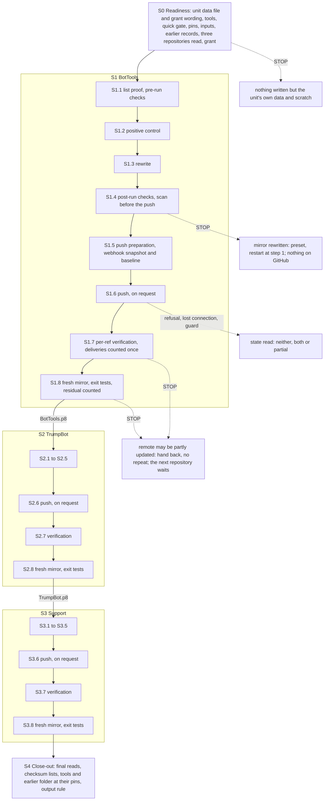

# Phase 0 · 7.2 — Rewriting BotTools, TrumpBot and Support: implementation plan

- **Covers:** [SpartanLaboratories/KotlinBottools#40](https://github.com/SpartanLaboratories/KotlinBottools/issues/40),
  *"Phase 0 · 7.2 — Rewrite BotTools, TrumpBot and Support"*, unit 2 of
  [#27](https://github.com/SpartanLaboratories/KotlinBottools/issues/27) (*"Phase 0 · 7 — Rewrite BotTools and the private
  repositories, and replace the private repository clone"*), a sub-issue of
  [#2](https://github.com/SpartanLaboratories/KotlinBottools/issues/2), the history rewrite, which is a sub-issue of
  [#1](https://github.com/SpartanLaboratories/KotlinBottools/issues/1) (parent chain #40 → #27 → #2 → #1). Its siblings are #39 (the
  workspace tools, landed), #41 (the residual measurement) and #42 (the clone replacement).
- **Architecture:** [`../architecture.md`](../architecture.md), unit `rewrites` (order 2 of §16), which is §8 (the rewrites), with
  §1.1 items 1, 2, 6, 7, 8, 9 and 10, §1.2 criteria 1, 2, 3, 4 and 10, §2 (the current state), §3, §4, §5 (the row "The rewrites") and
  §5.1 (the seams from and to this unit), §6, §11 (order, gates and failure behaviour), §12 (the form of a request and the row of this
  unit), §13.4 (what #28 takes), §14, §16 and §17. Its consequences are in [`../consequences.md`](../consequences.md); the evidence is
  [`../research/README.md`](../research/README.md) and [the push findings](../research/two-branch-lease-push.md). The tools this
  unit runs are the workspace tools unit's: [its plan](../39-workspace-tools/plan.md), [its as-built record](../39-workspace-tools/final-implementation.md)
  and [its consequences](../39-workspace-tools/consequences.md). The earlier unit this one is modelled on is
  [the GKB2 and GKB unit](../../26-gkb2-gkb-rewrite/plan.md), with [its as-built record](../../26-gkb2-gkb-rewrite/final-implementation.md).
- **Branch:** `docs/issue-40-rewrite-bottools-trumpbot-support`. It exists, was cut from `main` at the merge of pull request #44 and is
  pushed. This plan is committed in the same commit as the unit's `consequences.md` and as-built record (the first commit of
  "Version control"), so that `git log --follow` binds the plan to the work it describes. The unit lands through one pull request, which
  closes #40 only.
- **What this plans:** the rewrite of the histories of BotTools, then TrumpBot, then Support, each from its workspace mirror, checked
  unchanged since the preparation unit took it: one `git filter-repo` invocation each, every post-run check, a secret scan before the
  push, one atomic lease push per repository (2, 2 and 1 branches) made on request, verified ref by ref, a fresh mirror and its exit
  tests, BotTools' webhook deliveries and pull-request residual counted, and the close-out. It is a literal procedure the implementer and
  the run carry out in this same run without making a decision.
- **Status:** built; what was built and measured, and every departure from this plan, is in [`final-implementation.md`](final-implementation.md).
- **Target version:** none. Nothing is versioned; no product code, test source, build file, README or CHANGELOG of any repository
  changes. The landing adds documents and regenerated boards only.

This unit writes to GitHub three times: the push of the branches of `SpartanLaboratories/BotTools` (`main`, `Working-Branch`), of
`SpartanLaboratories/TrumpBot` (`main`, `feature/pokercommand`) and of `SpartanLaboratories/Support` (`main`), five branches in all. Each
push is a request, carried out on this machine under a grant that names it. The implementer types the local commands, the reads and the
checks and stores each request's reply; the run sends each request and waits for its reply. The plan never performs a write itself. The
tools print their own stage names (`STAGE S0.tools OK`, `STAGE <repo>.p6 OK`, `STAGE C1.reads OK`, and so on): those are the tools'
names; `S0` to `S4` are this run's stage ids.

---

## Requirements

**Goals**

1. **Three histories are purged and pushed, each whole.** For each repository, one
   `git filter-repo --sensitive-data-removal --invert-paths --paths-from-file <list>` run in its mirror removes the purge list's paths;
   its commits, paths and blobs equal its expectation row (table in Design); every manifest blob is missing from the rewritten mirror;
   every branch changes (every root commit holds a purged path), so every branch is pushed.
2. **One push per repository, conditional and whole.** Every branch of a repository goes in one `git push --porcelain --atomic` with one
   explicit `--force-with-lease=refs/heads/<branch>:<old tip>` and one refspec `refs/heads/<branch>:refs/heads/<branch>` per branch, to the
   repository's URL, after the same line as a dry run: 2, 2 and 1 branches. Never `--mirror`, `--force`, `-f` or a leading `+`.
3. **Order.** BotTools, TrumpBot, Support. A repository starts only when the one before it holds its stage-8 marker.
4. **The outcome of a push is a class read from counted markers, and after any non-zero status a read of every branch names the state**
   (neither, both or partial). Partial and every refusal hand back. A push is never repeated blindly.
5. **Every repository ends clean on a fresh mirror:** no purged path in any commit reachable from a branch or tag, every manifest blob
   missing from them, every count equal to its expectation row, no binary but the Gradle wrapper jar (none of the three has one), and the
   secret scan of branches and tags clean with the scan verified to have happened. A default-rule finding in a kept file, in a public or
   a private repository, is recorded by rule id and count and is a follow-up.
6. **BotTools' push deliveries and pull-request residual are counted and recorded.** Its webhook stays as it is. The residual is the
   manifest blobs still reachable through `refs/pull/2/head` and `refs/pull/3/head` (39 of 39 expected), with the commits on every ref
   (28 expected).
7. **The pull-request refs, the default branch and the visibility of each repository are as recorded** after its push.
8. **Every earlier record equals its recorded checksum** at the start and at the close-out, and the unit's own records carry their
   checksum lists.
9. **Nothing sensitive is printed or written outside the data folder and the workspace:** counts, rule ids, fixed markers and file names
   only, in every console line the steps print, every stored reply and every document. A request file holds, beyond those, only the paths
   its entries must name; the typed hand-off prints the request file's absolute path for the request's envelope, which also names the
   checkout, the mirror and the request file, as the request protocol requires; neither holds an id of a history, a line of a stream or a
   secret.
10. **Version none; documents only.**

**Rules this unit keeps**

- **Every write to GitHub is a request,** carried out under the grant for this unit's job, and read back by the unit before its next step.
- **No stop for a person before a push.** Every stop is a failed check; what each stop leaves is in "Stops and the state each leaves".
- **The tools are fixed.** The workspace tool folder `%USERPROFILE%\BotWS\tools\g27\` (`$TOOLS/g27`) is at its pins; `tools\g26\` is never
  edited, saved or run; `k0-ready.sh` and `save-tools.sh` are never run; the stage runner is never saved again. A defect a step meets stops the
  unit before its write; the correction is a new version of that file, carried whole with its new pin by the plan of the unit that makes it,
  with the covering test kind run again and a dated note in the tools unit's consequences.
- **No commit to BotTools, TrumpBot or Support and no other write to them:** no issue, pull request, comment, label, setting or webhook
  is changed and no ref is deleted.

**Acceptance criteria** (the issue's "Done when", each with what proves it)

| Criterion | Proved by |
|---|---|
| BotTools, TrumpBot and Support each have every branch and tag clean on a fresh mirror, every count equal to its expectation | `Sn.8` per repository: `STAGE <repo>.p8 OK`, the `residual_blobs=… manifest=… missing=… distinct_all=… every_ref_commits=…` line, `RESULT: PASS` of the expectation check on the fresh mirror and `ok    gitleaks: RESULT: CLEAN on branches and tags`; `S4.reads` |
| Each push is classed as pushed and read back at every branch, with the pull-request refs, the default branch and the visibility as recorded | `Sn.6.check` (`CLASS pushed …`, `read back: the state is both, the pull-request refs are unchanged: yes`, one `reading:` line per branch), `Sn.7`, `S4.reads` |
| BotTools' pull-request residual and its webhook deliveries are counted and recorded | `S1.7` (`RECORD webhook deliveries: …`; the webhook read as unchanged) and `S1.8` (`residual_blobs=39 manifest=39 missing=0 distinct_all=184 every_ref_commits=28`) |
| Any default-rule finding is recorded as a follow-up | the `RECORD` lines of `Sn.4` and `Sn.8` with the rule ids and counts, carried to `final-implementation.md` and `consequences.md` |
| The unit's records carry their checksum lists | `S4.record`: `g40.SHA256SUMS` in each `DATA\rewrite\<repo>\` and `SHA256SUMS` in `DATA\run\g40\` |
| No step output or stored reply holds a pre-rewrite commit id, a purged blob id, a path, a name or a secret, no request file holds an id of a history (it names only the paths its entries must), and every earlier record equals its recorded checksum | `S4.outputs`, `S4.reads`, `S0.inputs`, `S0.records` |

---

## Current state

**Baseline.** `main` is at the merge of pull request #44 (the workspace tools unit). The workspace and data folder
(`%USERPROFILE%\BotWS` (`WS`), `%USERPROFILE%\BotLegacyData` (`DATA`)) and GitHub were read on 2026-11-15 with read-only commands; nothing
below was changed.

**The tools.** `WS\tools\g27\` holds the 25 files of the tools unit's plan; all 24 pinned files equal their pins and the pin list's sha256
is `60f5760b246ce9b5f1c692e63d72895774fdc86d32db2fad11ccb581877631bf`. The 22 rows of `tools.sums` (the reused tools, the stage runner and
the scanner binary) equal their pins. `tools\g26\` holds 22 files. The folder is fixed ([tools plan, "Design"](../39-workspace-tools/plan.md#the-folder)).
The code of every step this unit runs is [the tools plan's Appendix A](../39-workspace-tools/plan.md#appendix-a--the-tools): it is the
source of every command and printed line below.

**The records.** `DATA\run\g27\` holds the tools unit's three `records-at-s0.<repo>.sums` (5, 6 and 5 lines) and three empty folders
`requests`, `replies` and `status`. There is no folder for this unit yet. `DATA\rewrite\BotTools` and `DATA\rewrite\Support` each hold the
preparation unit's 5 records, `DATA\rewrite\TrumpBot` its 6. `WS\fresh\` holds no mirror of the three repositories. Each mirror and each
untouched backup of the three equals its recorded `backup.SHA256SUMS`; each server's refs equal the listing recorded at the mirror clone
(merge refs left out).

**GitHub.**

| | BotTools | TrumpBot | Support |
|---|---|---|---|
| Repository id | 540122713 | 540208924 | 540146440 |
| Visibility; archived; default branch | public; no; `main` | private; no; `main` | private; no; `main` |
| Branches (push order) | `main`, `Working-Branch` | `main`, `feature/pokercommand` | `main` |
| Pull-request refs | `refs/pull/2/head`, `refs/pull/3/head` | none | none |
| Webhooks | one; 0 deliveries listed today | none | none |

The token `gh` uses has the `repo` scope. GitHub's push protection for users applies to pushes to public repositories, so it applies to
BotTools' push only ([the GKB2 and GKB unit's research](../../26-gkb2-gkb-rewrite/research/force-push-and-push-protection.md)).

**The request service.** Its grant file for KotlinBottools holds one section, `phase-0-bottools-trumpbot-support-rewrite`, granted
2026-11-15: apart from its `Granted:` line it equals the wording of Design, "The grant", and it has an `Ends:` line and no `Ended:` or
`Revoked:` line. Its settings deny `git push --force`, `git push -f`, `git push --force-with-lease` and `git reset --hard` as text
patterns; a grant section cannot override a deny rule, which is lifted for the job and restored when the section ends. The lift for this
job was made on 2026-11-15 (Design, "The grant", item 2, says where it must hold). Its earlier sections show the form `## <job>`,
`Granted:`, `Permissions:`, `Scope:`, `Ends:`, `Settings:`, and `Ended:` once moved to history. A request names its request file with the
file's sha256; the service compares the hash and runs the file's procedure as one shell, its entries unchanged and in order. A `done` reply
carries `result.printed`, one string per printed line; a `rejected` reply holds string fields and no `printed`; a rerun the service makes
itself after the restart an allow line needs arrives under the same id with `attempt + 1` ([the earlier unit's as-built record, deviations 4, 5 and 10](../../26-gkb2-gkb-rewrite/final-implementation.md#4-deviations-from-the-plan)).

**The expectation rows and the parameter rows** (read from `expected_rows.txt` and `params.txt`; columns `repo T P after paths blobs_kept
blobs_total manifest shared largest largest_nonjar wrapper_jar pinned_kept pinned_manifest`):

| | BotTools | TrumpBot | Support |
|---|---|---|---|
| Commits before (T), pruned (P), after | 16, 1, 15 | 11, 2, 9 | 2, 1, 1 |
| Paths kept; blobs kept; blobs total | 82; 145; 184 | 56; 106; 305 | 29; 29; 7,288 |
| Manifest (purged blobs); pinned variant | 39; 0 | 199; none | 7,259; none |
| Largest blob in bytes; Gradle wrapper jar | 27,168; no | 25,952; no | 14,302; no |
| Purge list lines; bytes | 9; 107 | 23; 241 | 6; 50 |
| Refs in the mirror | 4 (2 heads, 2 pull-request refs) | 2 | 1 |
| N, the branches of the push | 2 | 2 | 1 |
| The expected tally of the dry run and the push | `forced=2 fastforward=0 new=0 deleted=0 uptodate=0 rejected=0 done=1 pull_lines=0 other_refs=0 bad=0` | the same | `forced=1 fastforward=0 new=0 deleted=0 uptodate=0 rejected=0 done=1 pull_lines=0 other_refs=0 bad=0` |
| Positive control on the untouched backup | no probe arguments; `RESULT: CLEAN`, none of the six owned rule ids; five earlier records | nine probe arguments; scan status 1; `CONTROL OK`; 3,518 findings; six earlier records | as BotTools |
| Commits on every ref of the fresh mirror | 28 (15 + 13) | 9 | 1 |
| Pull-request residual (manifest blobs still reachable from every ref) | 39 of 39; 0 reachable from no ref; 184 distinct blobs on every ref | 0; 106 distinct blobs | 0; 29 distinct blobs |
| Push deliveries to the webhook | 2 expected (one per branch), recorded as measured | — | — |

**Where the unit plugs in.** The tools unit's rewrite set ([`s0-ready.sh`, `p1` to `p8`, `preset.sh`, `c1-close.sh`](../39-workspace-tools/plan.md#the-folder))
takes every parameter from `params.txt`, the preparation unit's expectation rows and the running unit's data file (`G27_UNIT`), and names
no repository, issue or branch. This unit supplies the data file, the grant and the order of the calls; it adds no tool.

**Outside facts this unit rests on** (each verified at its source in [the research README](../research/README.md), "Verification results"):

- Several leases in one push are each checked on the client against the server's advertised value before anything is sent; with
  `--atomic` a stale lease on one ref sends nothing; a clean push of N forced refs tallies `forced=N` and `done=1`; a lost connection
  prints no `To` line and `fatal:` lines and leaves every branch at its old tip or every branch at its new one
  ([the push findings, §4](../research/two-branch-lease-push.md#41-what-git-does-with-several-leases-and-with---atomic-documented-source-observed)).
- GitHub advertises the `atomic` capability; that its receive path applies an atomic push all or nothing is not documented
  ([the push findings, §4.3](../research/two-branch-lease-push.md#43-does-github-apply-an-atomic-push-all-or-nothing-documented-capability-one-public-log-not-established)).
- A force push publishes, per rewritten branch, one push event, one force-push entry in the activity feed and, for BotTools, one push
  delivery to its webhook; GitHub lists a webhook's deliveries for three days, the list carries no payload, and the events cover 30 days
  and can lag by up to 6 hours ([the push findings, §4.5](../research/two-branch-lease-push.md#45-what-a-force-push-of-two-branches-publishes-and-how-to-count-it-documented-observed-idiom)).
- A webhook's deliveries are listed by `GET /repos/{owner}/{repo}/hooks/{hook_id}/deliveries`
  ([REST webhooks, "List deliveries for a repository webhook"](https://docs.github.com/en/rest/repos/webhooks?apiVersion=2022-11-28#list-deliveries-for-a-repository-webhook)).

---

## Assumptions

| # | Assumption | If false |
|---|---|---|
| A1 | GitHub's receive path applies an atomic push as one unit. | One branch of two can be updated. The read-back names the state partial, `check` stops, and the unit hands back with a reading per branch; no push follows without a person's decision. BotTools goes first with the first atomic push of two leases. |
| A2 | GitHub refuses an update whose old value moved after the push's own advertisement. | A branch that moves in the seconds between the advertisement and the update could be overwritten. The comparison at the push preparation, the procedure's four guards, the dry run and the lease narrow the window, and `Sn.7` shows each branch's tip afterwards. |
| A3 | The request service's delivered reply holds each printed line as a string entry of `result` (the tools unit's A1). The first push request is the check. | `check` stops plainly ("the reply holds neither a status nor a printed line it can read"), keeps no class, and nothing is repeated; the state is read from GitHub whatever the reply says; the unit hands back. |
| A4 | The grant section, the lift of the deny rule on `git push --force-with-lease` for the job in every settings file the request service loads and, after a refusal by the service's own check, the allow line for that exact command and the service's restart are in place. | `S0.grant` stops with nothing written when the section is missing, lacks an action, the issue, the branch or a target, says no end or has ended. A lifted rule or an allow line that is missing shows only at the first request: the request is refused before anything runs, the state is read (every branch at its old tip), and the request is sent again only under the resend rule. |
| A5 | The credential the request service pushes with may push to the two private repositories. The account `gh` signs in as on this machine holds admin and push permission on all three repositories (read 2026-11-15); the assumption is that the request service pushes through that sign-in. | The push to TrumpBot is refused with every branch at its old tip. A refused credential prints no `To` line and a `fatal:` line, so the class is transport and `check` prints `NEXT`; the cause, the credential, is the owner's to fix before the same request is sent again. BotTools has been pushed by then. |
| A6 | A webhook delivery changes `last_response` and no other field of the hook object (the tools unit's A3). | `Sn.7` of BotTools stops with "differs" after a landed push; it hands back with the readings and cannot repeat or undo the push; the block "Reading the webhook against its snapshot" names the fields that differ, by name only. |
| A7 | GitHub lists BotTools' push deliveries by the time `S1.7` counts them: the request's round trip through the service takes longer than GitHub's dispatch. | The lower count is recorded as measured and is never counted again (the count is written once, and a later run of `p7` keeps it). No decision depends on the number. |
| A8 | The wording of a real refusal or a lost connection matches the classifier's markers (the tools unit's A12). | A reply the markers do not explain is classed `unclassified`: a stop that hands back with the counts. Nothing is repeated. |
| A9 | Each scan ends within the scan wrapper's 30-minute cap (Support's 7,288-blob backup was scanned whole by the preparation unit). | The scan's own gate fails and the step stops before the push (`p2`, `p4`) or after it (`p8`, which hands back); the step runs again after `preset` (before the push) or alone (`p8`). |
| A10 | Nothing but this unit pushes to the three repositories. | The comparison of the server's heads with `ref-map`'s old column fails at `Sn.5`, in the procedure's guards or at the lease: nothing is sent and the repository is handed back for a fresh clone and rewrite. |
| A11 | A default-rule finding in a kept file, if any, is a false positive. | It is recorded by rule id and count and is a follow-up; the unit continues (the files are already served as they are). A finding of a custom rule is a stop. |
| A12 | GitHub's push protection for users does not refuse BotTools' push, the only push it applies to. | The push is refused (`refused-push-protection`), the remote is unchanged, and the unit hands back; the owner decides from the kept error file. The unit never bypasses. |
| A13 | The tools behave on the real repositories as on their stand-ins (the tools unit's A2). | A step meets another answer and stops at its own check before its write. |
| A14 | Nothing but this unit's steps changes the tool folder, the unit's data file or the run log while the unit runs. | `S0.tools` or `S4.tools` stops on a pin that no longer matches; a run log that another run wrote to, or cut, gives `S4.outputs` lines that are not this unit's, or none, which the count on its first line shows; a starting count it cannot read is a stop. |

---

## Non-goals

- **No stage 9.** The residual probes, the feed reads and the report rows are the residual measurement's (#41), which runs promptly after
  this unit because the events of BotTools' push cover 30 days and can lag by up to 6 hours.
- **No clone replacement and no graph build** (#42). TrumpBot's local clone is neither read nor touched.
- **No report row, no report on #2, no cleanup** (#28).
- **No removal of anything GitHub still serves.** BotTools' pull-request refs and old objects stay; no GitHub Support ticket is filed.
- **No change to BotTools' webhook** and no read of a delivery's payload.
- **No commit to BotTools, TrumpBot or Support** (no `.gitignore`, no README pointer, no archive: Phase 17).
- **No path scrub, no rotation of a credential, no tool change.**
- **No version bump, no CHANGELOG entry and no README change** in KotlinBottools.

---

## Design

### Shape of the run

Five stages. `S0` reads and checks; its only writes are the unit's data file and wording, its scratch folder, its record folder with the
three `records-at-s0.<repo>.sums`, and the run log's lines. `S1`, `S2` and `S3` rewrite, push and prove BotTools, TrumpBot and Support in eight
steps each, one per stage of the pipeline; `S2` starts only once BotTools holds its stage-8 marker and `S3` once TrumpBot holds its. `S4`
is the close-out. The landing's document checks follow, outside the table. Every stop leaves the state its row of "Stops and the state each
leaves" names.

| id | name | brief | kind | steps |
|---|---|---|---|---|
| S0 | Readiness | The tools, pins, inputs, repositories, grant and earlier records are as recorded, and the quick gate passes. | check | S0.unit: The unit's data file and grant wording; S0.tools: The tools at their pins; S0.gate: The quick gate; S0.pins: The tool versions; S0.inputs: The rows against the data; S0.records: The earlier records as the tools unit recorded them; S0.repos: The three repositories read; S0.grant: The grant read |
| S1 | BotTools | BotTools' history is rewritten, pushed on request, verified ref by ref and proven clean on a fresh mirror, with its push deliveries and pull-request residual counted. | work | below |
| S2 | TrumpBot | The same for TrumpBot, once BotTools holds its stage-8 marker. | work | below |
| S3 | Support | The same for Support, once TrumpBot holds its stage-8 marker. | work | below |
| S4 | Close-out | The three repositories are read again, the unit's checksum lists are written, the tools and the earlier tool folder are at their pins, and the unit's outputs hold nothing sensitive. | check | S4.reads: Final reads of the three repositories; S4.record: The checksum lists; S4.tools: The tools at their pins; S4.g26: The earlier tool folder at its pins; S4.outputs: The output rule over the unit's outputs |

**Steps of S1**

- `S1.1`: List proof and pre-run checks
- `S1.2`: Positive control on the untouched backup
- `S1.3`: The rewrite
- `S1.4`: Post-run checks and the scan before the push
- `S1.5`: Push preparation
- `S1.6`: The push, on request
  - `S1.6.request`: The request read, rebuilt and checked
  - `S1.6.send`: The request sent
  - `S1.6.reply`: The reply stored
  - `S1.6.check`: The outcome classified and read back
- `S1.7`: Per-ref verification
- `S1.8`: Fresh mirror and exit tests

**Steps of S2**

- `S2.1`: List proof and pre-run checks
- `S2.2`: Positive control on the untouched backup
- `S2.3`: The rewrite
- `S2.4`: Post-run checks and the scan before the push
- `S2.5`: Push preparation
- `S2.6`: The push, on request
  - `S2.6.request`: The request read, rebuilt and checked
  - `S2.6.send`: The request sent
  - `S2.6.reply`: The reply stored
  - `S2.6.check`: The outcome classified and read back
- `S2.7`: Per-ref verification
- `S2.8`: Fresh mirror and exit tests

**Steps of S3**

- `S3.1`: List proof and pre-run checks
- `S3.2`: Positive control on the untouched backup
- `S3.3`: The rewrite
- `S3.4`: Post-run checks and the scan before the push
- `S3.5`: Push preparation
- `S3.6`: The push, on request
  - `S3.6.request`: The request read, rebuilt and checked
  - `S3.6.send`: The request sent
  - `S3.6.reply`: The reply stored
  - `S3.6.check`: The outcome classified and read back
- `S3.7`: Per-ref verification
- `S3.8`: Fresh mirror and exit tests



**Why this order.** Nothing is written to GitHub before step 6 of BotTools, so every step before it re-runs from its start after
`preset`. BotTools goes first with the only push GitHub's push protection for users applies to and the first atomic push of two leases, so
what GitHub's receive path does with either is known before a private repository is pushed. A repository starts only when the one before it
holds its stage-8 marker: the tools enforce it at step 1 from the parameter table's `needs` column (TrumpBot waits for `BotTools.p8`,
Support for `TrumpBot.p8`).

### What the unit writes to GitHub

Exactly three pushes: the branches of `SpartanLaboratories/BotTools`, of `SpartanLaboratories/TrumpBot` and of
`SpartanLaboratories/Support`, each a `push-mirror` request under the job `phase-0-bottools-trumpbot-support-rewrite`, in that order. It
sends no issue, comment, label, setting, visibility or security change and deletes no ref. The unit's landing on KotlinBottools is the
run's ordinary landing and is not made under the job.

### The unit's data file

`WS\tmp\g27\units\g40.txt` is the data file the tools read through `G27_UNIT` ([format](../39-workspace-tools/plan.md#the-running-units-data-file)). `S0.unit`
writes it with exactly these lines:

```text
# unit 2 of the three-repository work: the rewrites; one grant, three push requests
job=phase-0-bottools-trumpbot-support-rewrite
issue=40
home=SpartanLaboratories/KotlinBottools
branch=docs/issue-40-rewrite-bottools-trumpbot-support
actions=push-mirror,force-pushing
targets=SpartanLaboratories/BotTools,SpartanLaboratories/TrumpBot,SpartanLaboratories/Support
runs=g40
from=-
wording=g40-grant.txt
```

So the unit's records are `DATA\run\g40\` (`requests\`, `replies\`, `status\`, the class, key and time files, the webhook files, the three
`records-at-s0.<repo>.sums` and, at the close-out, `SHA256SUMS`), its scratch folder is `WS\tmp\g27\g40\`, each repository's checksum list
is `DATA\rewrite\<repo>\g40.SHA256SUMS`, and the landing's gate corpus is `g40docs`. `from=-`: this unit follows no other unit's records.

### The grant

Asked of the owner at the request service's console before the unit runs, all three:

1. **The grant section**, one section of the request service's temporary-permissions file for SpartanLaboratories/KotlinBottools, with
   the date of the day it is given in the `Granted:` line:

```text
## phase-0-bottools-trumpbot-support-rewrite
Granted: <date>
Permissions: push-mirror, force-pushing (--force-with-lease)
Scope: SpartanLaboratories/KotlinBottools#40, branch docs/issue-40-rewrite-bottools-trumpbot-support; github SpartanLaboratories/KotlinBottools; targets SpartanLaboratories/BotTools, SpartanLaboratories/TrumpBot and SpartanLaboratories/Support only; one push-mirror request each, in that order, from the rewritten workspace mirror %USERPROFILE%\BotWS\mirror\<name>.git to its own repository, updating its named branches alone (BotTools: main and Working-Branch; TrumpBot: main and feature/pokercommand; Support: main) with one git push --porcelain --atomic that carries, for each branch, one --force-with-lease=refs/heads/<branch>:<old tip> and one refspec refs/heads/<branch>:refs/heads/<branch>, to the repository's URL, after the same line run with --dry-run (options before push included); sent again only after a read shows every branch still at its old tip and the pull-request refs unchanged, following a lost connection, a guard's stop or a refusal by the service
Ends: when #40 lands
Settings: the `git push --force-with-lease` deny rule of the request service's settings lifted for this job's three push-mirror requests to the three targets above only; restored when this section moves to history
```

2. **The lift of the deny rule** on `git push --force-with-lease` for the job, in every settings file the request service loads (a deny
   rule listed in any one of them still applies), restored when the section ends (the `Settings:` line).
3. **The allow line and the restart**, should the service's own check refuse a call the section covers: the allow line for that exact
   command, placed after the refusal, and the service's restart, after which the service runs the same request again itself under the same
   id with the next attempt number.

The same text, with `<date>` left in the `Granted:` line, is the wording file `WS\tmp\g27\units\g40-grant.txt` that `S0.grant` compares the
section with (blank lines and the `Granted:` line left out of the comparison). A difference is a `RECORD`, never a stop. Each
`push-mirror` request carries `permissionReason` `phase-0-bottools-trumpbot-support-rewrite`, the section's job name exactly.

### The push

The tools build, class and read back the push; the contract is [the tools plan's "The push"](../39-workspace-tools/plan.md#the-push). What this
unit relies on:

**The request file** (`requests\push-<repo>.json`, built by `p5` and rebuilt by `p6 request`) is a `push-mirror` request with six
standalone shell entries: (1) the mirror is bare and its `origin` is the repository's URL (prints `MIRROR-AND-ORIGIN-OK`); (2) the local
refs equal `ref-map`'s new column (`LOCAL-REFS-ARE-THE-NEW-COLUMN`); (3) the server's heads and tags equal the old column
(`SERVER-HEADS-AND-TAGS-ARE-THE-OLD-COLUMN`); (4) the server's pull-request refs equal their record (`SERVER-PULL-REFS-ARE-THE-RECORD`);
(5) the dry run; (6) the push. Entries 5 and 6 run the same line, `git push --porcelain --atomic` with one lease and one refspec per
branch, the second without `--dry-run`; the push entry requires the dry run's tally to be the expected one. Each old tip is read from
`ref-map` when the entry runs and must be 40 hexadecimal digits, so the file holds no commit id; every network `git` has `gh` as its only
credential helper. The builder asserts exactly one `--atomic`, one lease per refspec naming its own ref, and none of `--force`, `-f`,
`--mirror`, `--all`, `--delete`, `--prune` or a leading `+`. Both streams of each run are kept in the data folder and never printed.

**The reply of a clean push** holds 11 printed lines, in this order: the four guard markers, `dry rc=0`, `dry tally: forced=N …`,
`markers push-dry rr=0 cr=0 st=0 at=0 to=1 gh=0 pp=0 loc=0 inc=0 fa=0`, `push rc=0`, `push tally: forced=N …`, `markers push rr=0 cr=0
st=0 at=0 to=1 gh=0 pp=0 loc=0 inc=0 fa=0`, `SAME-REF-AND-FLAG`. `inc` counts `Scan incomplete` on the push's error stream: a push GitHub
could not fully scan shows `inc=1` or more on the push's markers line and on the `CLASS` line, and `check` then prints `RECORD the push's
scan was incomplete: …`; the class is still `pushed`.

**The envelope the run adds when it sends the file.** One `push-mirror` request by file, with these fields and no `procedure`, `inputs` or
`checks` of its own:

| Field | Value |
|---|---|
| `v` | 1 |
| `id` | `<sender>/40/<key>`, the key the `PROCEED` line names (`push-<repo>`, or `push-<repo>-r<n>` after a `rejected` reply) |
| `attempt` | the `PROCEED` line's number (the number of stored replies plus one) |
| `from` | the sender |
| `repo` | the main checkout of KotlinBottools (absolute path, forward slashes) |
| `github` | `SpartanLaboratories/KotlinBottools` |
| `action` | `push-mirror` |
| `issue` | 40 |
| `target` | `SpartanLaboratories/<repo>` |
| `mirror` | the workspace mirror's absolute path, forward slashes |
| `permissionReason` | `phase-0-bottools-trumpbot-support-rewrite` |
| `requestFile` | the request file's absolute path, forward slashes |
| `requestFileSha256` | the file's sha256, compared by the run with the file before it sends |
| `notes` | "The remaining fields (procedure, inputs, checks) are the request file's contents: compare the file with its sha256, then run its six procedure entries as one shell, unchanged and in order, in a single call, and give every printed line in the reply." |

**The class table and the resend rule.** Markers decide first; a reply that ran no stage is read from its status alone; the state is then
read from GitHub, never from the reply.

| Class | Read from | What follows (by the state read back) |
|---|---|---|
| pushed | push status 0, the expected tally, the same refs and flags in both runs | `check` passes once every branch reads at its new tip and the pull-request refs are unchanged; then step 7 |
| refused by the service | the stored status is `refused` | neither and refs unchanged: nothing was written; fix the cause, then `request` again, which takes a new key; both and refs unchanged: the push landed although its answer was lost, recorded, step 7 decides; anything else hands back |
| stopped by a guard | a reply that ran and holds no push status (a guard of entries 1 to 5), or a dry run and no push status | neither: fix the entry the reply names, `request` again with the same id (attempt + 1); both: recorded, step 7 decides; partial: hand back |
| transport | no `To` line on standard output and `fatal:` on standard error, at any exit status | the state decides, as for a guard's stop |
| a lease was stale | `[rejected]` with `(stale info)` and no `GH013` | nothing was sent; hand back for a fresh clone and rewrite |
| refused by push protection | `[remote rejected]`, `GH013` and `PUSH PROTECTION` | hand back; the owner decides from the kept error file; never bypassed |
| refused by a rule; refused, unattributed | `[remote rejected]` with `GH013` and no `PUSH PROTECTION`; `[remote rejected]` with no `GH013` | hand back |
| unclassified | anything else | hand back |

After any non-zero status, and before any further step, one read of every branch and of the pull-request refs names the **state**:
**neither** (every branch at its old tip), **both** (every branch at its new tip: the push landed although its answer was lost, recorded,
and step 7's two channels decide) or **partial** (anything else; not expected under `--atomic`; hand back with a reading per branch). A
request is sent again only when the class is transport, stopped by a guard or refused by the service, the state is neither **and** the
pull-request refs are unchanged. Every other class hands back, and a branch at its old tip whose last class allows no resend stops
`request` with "a push is never repeated blindly". "Hand back" means: the implementer stops, reports the step id, the class line, the
read-back and one reading per branch (counts and words, never content), types nothing further, and the unit does not land.

**A call the service's own check refuses before anything runs.** Nothing has run: no guard, no dry run, no push, and none of the four
stream files exists. The answer is of the kind that is not stored (it holds no printed line). The state is read with the typed
block of "Reading the state" below (every branch at its old tip, the pull-request refs unchanged). The allow line is placed and the
service restarts; the service then runs the same request again itself, under the same id with the next attempt number. The unit sends
nothing a second time, stores that reply with `reply`, classes it with `check`, and does not run `request` in between. The same typed
read serves when a reply cannot be read.

```mermaid
sequenceDiagram
    participant I as Implementer
    participant T as The tools (p6-push.sh, g27_req.py)
    participant R as The run
    participant S as The request service
    participant G as GitHub
    I->>T: request
    T->>G: reads: every branch, the pull-request refs
    T-->>I: PROCEED, requests/push-REPO.json rebuilt
    I-->>R: the PROCEED line, the request file's path, size and sha256
    R->>R: compares the sha256 with the file
    R->>S: push-mirror by file: requestFile, requestFileSha256, a note (one shell, every printed line)
    opt the service's own check refuses the call
        Note over S: nothing runs; no stream file; the answer is not stored
        S-->>R: an answer with no printed line
        I->>G: read-back (typed read): every branch at its old tip
        Note over S: allow line placed, service restarted: the same request again, same id, attempt + 1
    end
    S->>S: compares the hash with the file
    S->>G: six entries as one shell: four guards, the dry run, the push under N leases
    G-->>S: N forced updates, applied atomically
    S-->>R: reply done with the printed lines
    R-->>I: the reply as delivered, and its kind
    I->>T: reply STATUS (the text, one line to a line)
    I->>T: check
    T->>G: reads: every branch, the pull-request refs
    T-->>I: CLASS pushed, read back, STAGE p6 OK, or NEXT or STOP
```

### Stage 7 and stage 8 for BotTools

`S1.5` takes a snapshot of BotTools' webhook (every field but `last_response` and the secret, the URL only as its sha256) and a baseline
count of the deliveries GitHub lists (all, and of event `push`). `S1.7` counts them once, right after the push, because GitHub lists
deliveries for three days only, prints `RECORD webhook deliveries: listed now <a> (event push: <b>); listed before the push <c> (event
push: <d>); push deliveries since the push: <b − d>` and reads the webhook as "equal" to its snapshot. The count is recorded as measured
and never asserted (2 is expected), and a later run of `p7` keeps it. `S1.8` counts, and records without stopping, the manifest blobs still
reachable from every ref (39 of 39), the commits on every ref (28) and the every-ref scan's findings by rule (none expected: the untouched
backup's every-ref control reads `RESULT: CLEAN`); the branches-and-tags scan is the one that must be clean.

### Records and where they live

`DATA\rewrite\<repo>\` keeps the preparation unit's records, never written. This unit adds new files beside them (named in the steps'
headers): `filter-repo.log`, `commit-map`, `ref-map`, `changed-refs`, `first-changed-commits`, `suboptimal-issues`, `next-steps.txt`,
`purge-list.txt`, `g27-prerun.env`, `entries-before.txt`, `entries-after.txt`, `g27-control-scan.txt`, `g27-control-kept.txt` (and
`g27-control.txt` for TrumpBot), `expect-check.txt`, `gitleaks-prepush.txt`, `default-rule-findings-prepush.txt` (when the scan finds),
`push-expect.txt`, `server-pull-refs.txt`, `push-dry.txt`, `push-dry.err`, `push.txt`, `push.err`, `heads-after-push.txt`,
`expect-check-fresh.txt`, `gitleaks-fresh-branches.txt`, `gitleaks-fresh-all.txt`, `default-rule-findings.txt` (when a default rule finds),
`residual.txt`, `SHA256SUMS`, `SHA256SUMS-fresh` and `g40.SHA256SUMS`. `DATA\run\g40\` holds `requests\push-<repo>.json`,
`replies\push-<repo>-<n>.txt`, `status\<repo>.<stage>`, `push-<repo>.class`, `push-<repo>.key`, `times.txt` (`<repo>.pushed`), for BotTools
`hook-snapshot.BotTools.txt`, `deliveries-baseline.BotTools.txt` and `deliveries-after.BotTools.txt`, the three
`records-at-s0.<repo>.sums`, and at the end `SHA256SUMS`. Scratch is `WS\tmp\g27\g40\`; the fresh mirrors are `WS\fresh\<repo>.git`; the
scan reports and logs are `GR\<repo>-g27-*` (`GR` is the gitleaks reports folder; `g27` in those names is the tools' name). Everything
there holds ids, paths or names and is never committed, printed or quoted.

### Error handling and logging

- **Failure design** is the tools' ([tools plan, "Error handling and logging"](../39-workspace-tools/plan.md#error-handling-and-logging)): a shell step ends through
  `expect` (`STOP  <label>: expected '<x>', got '<y>'`, status 1) or `must` (`STOP  <label>: status <n>`); `note` prints `ok` or `RECORD`
  and never stops; a `WAIT` is status 4 (none of this unit's steps makes an anonymous call, so none is expected); the class of a push is a
  value, unwrapped once by `p6-push.sh check`; the Python tools raise `Stop` once, printed as `STOP  <why>`. This unit adds no function and no
  signature: its own failure design is the implementer's reading of each step's last line and the stop table below.
- **Reading the output.** A step succeeded when its exit status is 0 and its last line, the one before the runner's own end line
  (`== g27/<script> exit=<status>`), is the `STAGE` line it names; the exceptions are `p6-push request` (ends with `PROCEED` or `SKIP`,
  status 0) and `p6-push reply` (ends with its `ok` line). A line that starts `STOP` is a stop: take no further step but the one the stop
  table names, and report the step id, the first `STOP` line and the numbers on it, never content. `RECORD` lines are results, not stops. A
  `NEXT` line is an instruction (status 1). A `WAIT` line (status 4) is a pause.
- **Events logged,** each a console line the runner appends to `DATA\run\as-run.log`: each step's `ok` lines and its `STAGE <repo>.p<n> OK`
  line; each request built, each reply stored (a status and a number of lines), each class and read-back; each `RECORD`, `NEXT` and
  `STOP`. The first word of a line is its status.
- **Recorded, not stopped:** a default-rule finding in a kept file; BotTools' pull-request residual and its all-refs scan; the webhook's
  delivery counts; the incomplete scan of a successful push; the kept findings as recorded at step 2; the activity and event counts and the
  rate limit of `S0.repos`; a wording of the grant that differs from the unit's.

### Stops and the state each leaves

| Where | The stop | State left | Next |
|---|---|---|---|
| `S0.*` | a pin, a record, a version, a repository read, the quick gate or the grant differs from its expectation | nothing written but the unit's data file, wording, scratch and `records-at-s0` files | find out why; fix the cause (or the owner gives the grant); run `S0` again from the step |
| `Sn.1` | the list, the mirror's or backup's checksums, a pre-run check, the order gate, a push already requested | nothing changed (the markers of the repository are cleared) | fix the cause; run `p1` again; after a stored reply `p1` refuses |
| `Sn.2` | the control differs from the preparation unit's record in any line | nothing changed | hand back: a difference means the configuration's change is not inert for the repository |
| `Sn.3`, `Sn.4` | an invocation or post-run count, a surviving manifest blob, a finding of a custom rule before the push | the mirror partly or wholly rewritten; nothing on GitHub | `g preset <repo>`; restart at step 1 once the cause is fixed |
| `Sn.5` | local refs, the server's refs against the clone's, the pull-request refs, the webhook reads | the mirror rewritten, its local pull-request refs deleted; nothing sent | the server moved: hand back for a fresh clone and rewrite; otherwise fix, `preset`, restart at step 1 |
| `Sn.6.request` | the state is partial, unreadable or not neither with no allowed class; the server's pull-request refs differ | nothing sent by this call | read the state; hand back unless the resend rule allows |
| `Sn.6.check` | a class other than pushed, or a read-back that contradicts it | by class and state (table above): neither, with the mirror and the backup standing; both, recorded; partial, handed back | as the table says; the repositories after it wait |
| `Sn.7`, `Sn.8` | a verification after the push | the remote holds the rewrite or may be partly updated | hand back with the counts; no repeat; the repositories after it wait; a custom-rule finding on the fresh mirror hands back |
| `S4.*` | a final read, a record, the output rule or a pin differs | as `Sn.8` left them | report and stop; the unit does not land |
| the landing's checks | a hit | nothing committed | reword the document; run the check again |

---

## Procedure

### Conventions

- **Shell.** Git Bash. Each call starts a fresh shell, so every call begins with this prelude, which names the unit's data file (written by
  `S0.unit`) and defines `g` (run a step script of the folder through the runner); no machine path is typed:

  ```bash
  . "$(cygpath -m "$USERPROFILE")/BotWS/tools/env.sh"
  export G27_UNIT="$WS/tmp/g27/units/g40.txt"
  g() { local s="$1"; shift; bash "$TOOLS/run-stage.sh" "g27/$s" "$@"; }
  ```

  A step is then `g <script> <args>`, for example `g s0-ready tools`. `env.sh` exports `P_HOME`, `WS`, `DATA`, `TOOLS`, `OUT`, `BKROOT`, `GR`,
  `GL`, `CFG`, `SS`, `KBT` and defines `gitnet` (git with `gh` as its only credential helper). Python always runs with `-I`. The runner
  shows a stage name with characters outside `A-Z a-z 0-9 . _ / -` as `<name>`, and an argument that is not a plain word as `<arg>`; the
  script still receives every argument unchanged. `S0.unit`, `S0.records`, `S4.g26` and `S4.outputs`, and the hand-off, reply-storing,
  state-reading and webhook-reading blocks below, are typed blocks (they do not pass through the runner, so their lines are not in the run
  log; the reply-storing block ends with a step through the runner, whose `ok    stored reply …` line is logged).
- **Timeouts.** Calls run in the foreground with a 10-minute timeout, except `p2`, `p4` and `p8` of every repository: their scans run under
  the scan wrapper's own 30-minute cap, so they run in the background and are read from the runner's output and from `as-run.log` when
  they end.
- **A request STEP** (`Sn.6`) is the unit of one write; the order is request, send, reply, check, and `request` again only after `check`:
  1. **`Sn.6.request`:** `g p6-push <repo> request` prints `PROCEED  REQUEST <key> -> requests/push-<repo>.json (attempt <n>; the run's id
     is <sender>/40/<key>)` (status 0), or `SKIP  push-<repo>: every branch already holds its rewritten tip` (status 0), or a `STOP`. The
     implementer then reports to the run the `PROCEED` line, the request file's absolute path, its size and its sha256, and stops (typed
     block below). After a `SKIP` no request is sent: every branch already holds its rewritten tip, so an earlier request was carried out and
     its reply was not stored. The run obtains that reply (from its own conversation, or by a `status` request to the request service naming
     the request's id), the implementer stores it (`reply`) and runs `check`; when no reply can be had, `check` stops plainly ("no reply is
     stored") and the unit hands back with the state read.
  2. **`Sn.6.send`** is the run's. It compares the sha256 with the file and sends the one request of the envelope table in Design.
  3. **`Sn.6.reply`:** the run gives the implementer the reply's full text as delivered and its kind. The implementer saves the text to
     `WS\tmp\g27\g40\reply-<repo>-<n>.txt` and stores it with `g p6-push <repo> reply <status> < "$WS/tmp/g27/g40/reply-<repo>-<n>.txt"`
     (typed block below), with status `done` for a `done` reply, `refused` for a `rejected` one, `stopped` for a `stopped` one and `failed`
     for a reply whose text shows a command of the procedure that failed outside its guards. A `needs-user` reply is not stored: the run
     waits for the reply that follows it. Storing a reply removes the class of the attempt before it.
  4. **`Sn.6.check`:** `g p6-push <repo> check` prints the `CLASS` line, the read-back and `STAGE <repo>.p6 OK`, or a `NEXT` (class transport,
     stopped by a guard or refused by the service with every branch at its old tip and the pull-request refs unchanged: fix the cause, then
     `request` again), or a `STOP`. A `request` run with a reply stored and not yet classed stops: "a push is never repeated blindly".
- **What is never done.** No write to GitHub is typed: only a request writes. No `--force`, `-f`, `--mirror` or `+` refspec is used anywhere.
  No request is sent without the `PROCEED` line that wrote its file in the same step; no file is sent twice after a failure (`request` is
  run again, which reads first); no push is repeated except as the class table allows; `tools\g26\`, `k0-ready.sh` and `save-tools.sh` are
  never run. Nothing in `DATA` or `WS` is opened and quoted: only counts, words and file names are reported.

**The request hand-off (typed, read-only).** After a `PROCEED` line, for the repository named in `R`:

```bash
. "$(cygpath -m "$USERPROFILE")/BotWS/tools/env.sh"
R=BotTools        # the repository of the step: BotTools, TrumpBot or Support
f="$DATA/run/g40/requests/push-$R.json"
[ -f "$f" ] || { echo "STOP  the request file is missing"; exit 1; }
echo "request file: $(cygpath -m "$f")"
echo "size: $(wc -c < "$f" | tr -d ' ') bytes"
echo "sha256: $(sha256sum "$f" | cut -d' ' -f1)"
```

**Storing a reply (typed).** The reply text goes in a quoted heredoc so that nothing in it is expanded; `<n>` is the number of the reply
for this repository (1, 2, …) and `<status>` is `done`, `refused`, `stopped` or `failed`:

```bash
. "$(cygpath -m "$USERPROFILE")/BotWS/tools/env.sh"
export G27_UNIT="$WS/tmp/g27/units/g40.txt"
g() { local s="$1"; shift; bash "$TOOLS/run-stage.sh" "g27/$s" "$@"; }
cat > "$WS/tmp/g27/g40/reply-BotTools-1.txt" <<'REPLY_END'
(the reply text exactly as delivered)
REPLY_END
g p6-push BotTools reply done < "$WS/tmp/g27/g40/reply-BotTools-1.txt"
```

Expected: `ok    stored reply <n> for push-<repo> as <status> (<m> printed lines)`, with `m` = 11 for a clean push. A refused reply stores 0
lines; a reply that is neither a refusal nor the procedure's output stores nothing readable and `check` stops plainly. The count is a
reading: a delivered reply that carries a further list of strings under `result` stores those lines too, and only `check` decides.

**Reading the state (typed; it reads GitHub and writes only the two scratch files `state.vec` and `pulls-now.txt`).** Used after a call
the service's own check refuses, and when a reply cannot be read. It prints the word of `server_state` (`neither`, `both`, `partial` or
`unreadable`), one word per branch in the row's order (`old`, `new` or `other`) and whether the pull-request refs equal the record:

```bash
. "$(cygpath -m "$USERPROFILE")/BotWS/tools/env.sh"
export G27_UNIT="$WS/tmp/g27/units/g40.txt"
for L_ in lib.sh plib.sh klib.sh g27/g27lib.sh; do . "$TOOLS/$L_" 2> /dev/null || { echo "STOP  a library of the tools folder did not load"; exit 1; }; done
row BotTools || exit 1        # the repository of the step
scratch_open
st="$(server_state)"; echo "state: $st"
if [ "$st" != unreadable ]; then n=0; while read -r w; do n=$((n + 1)); echo "branch $n: $w"; done < "$G27S/state.vec"; fi
server_pulls > "$G27S/pulls-now.txt"; prc=$?
if [ "$prc" -eq 0 ] && cmp -s "$G27S/pulls-now.txt" "$RM/server-pull-refs.txt"; then echo "pull-request refs: unchanged"
else echo "pull-request refs: changed or unreadable (read status $prc)"; fi
```

**Reading the webhook against its snapshot (typed; it reads GitHub and writes only the scratch file `hook-now.txt`).** Used only when
`S1.7` stops on `the webhook is as it was before the push`. It prints, for each field of the snapshot, `same` or `differs` and the field's
name, never a value:

```bash
. "$(cygpath -m "$USERPROFILE")/BotWS/tools/env.sh"
export G27_UNIT="$WS/tmp/g27/units/g40.txt"
for L_ in lib.sh plib.sh klib.sh g27/g27lib.sh; do . "$TOOLS/$L_" 2> /dev/null || { echo "STOP  a library of the tools folder did not load"; exit 1; }; done
row BotTools || exit 1
scratch_open
hook_snapshot > "$G27S/hook-now.txt" || { echo "STOP  the webhook cannot be read"; exit 1; }
paste <(tr '\t' '\n' < "$G27D/hook-snapshot.BotTools.txt") <(tr '\t' '\n' < "$G27S/hook-now.txt") \
  | awk -F'\t' 'BEGIN { split("id type name active events content_type insecure_ssl secret_set created_at updated_at url_sha256", f, " ") } { print (($1 == $2) ? "same     " : "differs  ") f[NR] }'
```

### When the steps run again

- **`S0.tools`, `S0.gate`, `S0.pins` and `S0.grant`** may run again at any time.
- **`S0.unit`** may run again: it writes the same two files byte for byte and keeps the line count of its first run in `log-start.txt`
  (the unit's part of the run log is counted from that first line count).
- **`S0.inputs` and `S0.repos`** only for a repository whose rewrite has not started: after `p3` the mirror differs from its recorded
  list, and after its push the server's refs differ from the listing at the clone. `S0.records` may run again.
- **A stop before a push** is followed, once its cause is fixed, by `g preset <repo>` and a restart at step 1. `p1` refuses once a reply of
  the repository was stored, and `preset` refuses then and whenever a branch of the server has left its old tip.
- **After a push** nothing before step 7 runs again for that repository. `p7` may run again and keeps its first delivery count. `p8` takes a
  new fresh mirror every time. `c1-close.sh reads` and `record` may run again.

### S0 — Readiness

Nothing is written to GitHub; everything is a read, a local check or the quick gate. The owner has given the grant (Design, "The grant")
before `S0.grant` runs; the other steps do not wait for it.

**`S0.unit`:** the unit's data file and the grant's wording file, the unit's scratch folder, and the run log's line count before the unit's
steps. A typed block (under 7 KB). The wording file's heredoc is quoted because its text holds an apostrophe, a `%` and backslashes.

```bash
. "$(cygpath -m "$USERPROFILE")/BotWS/tools/env.sh"
U="$WS/tmp/g27/units"; S="$WS/tmp/g27/g40"; mkdir -p "$U" "$S"
printf '%s\n' "# unit 2 of the three-repository work: the rewrites; one grant, three push requests" \
  "job=phase-0-bottools-trumpbot-support-rewrite" "issue=40" "home=SpartanLaboratories/KotlinBottools" \
  "branch=docs/issue-40-rewrite-bottools-trumpbot-support" "actions=push-mirror,force-pushing" \
  "targets=SpartanLaboratories/BotTools,SpartanLaboratories/TrumpBot,SpartanLaboratories/Support" \
  "runs=g40" "from=-" "wording=g40-grant.txt" > "$U/g40.txt"
cat > "$U/g40-grant.txt" <<'GRANT_END'
## phase-0-bottools-trumpbot-support-rewrite
Granted: <date>
Permissions: push-mirror, force-pushing (--force-with-lease)
Scope: SpartanLaboratories/KotlinBottools#40, branch docs/issue-40-rewrite-bottools-trumpbot-support; github SpartanLaboratories/KotlinBottools; targets SpartanLaboratories/BotTools, SpartanLaboratories/TrumpBot and SpartanLaboratories/Support only; one push-mirror request each, in that order, from the rewritten workspace mirror %USERPROFILE%\BotWS\mirror\<name>.git to its own repository, updating its named branches alone (BotTools: main and Working-Branch; TrumpBot: main and feature/pokercommand; Support: main) with one git push --porcelain --atomic that carries, for each branch, one --force-with-lease=refs/heads/<branch>:<old tip> and one refspec refs/heads/<branch>:refs/heads/<branch>, to the repository's URL, after the same line run with --dry-run (options before push included); sent again only after a read shows every branch still at its old tip and the pull-request refs unchanged, following a lost connection, a guard's stop or a refusal by the service
Ends: when #40 lands
Settings: the `git push --force-with-lease` deny rule of the request service's settings lifted for this job's three push-mirror requests to the three targets above only; restored when this section moves to history
GRANT_END
[ -s "$S/log-start.txt" ] || wc -l < "$DATA/run/as-run.log" | tr -d ' \r' > "$S/log-start.txt"
echo "ok    the unit's data file and grant wording are written; the run log held $(tr -d ' \r\n' < "$S/log-start.txt") lines before the unit's steps"
```

Expected: one `ok` line with the line count. The count is read once and kept: `S4.outputs` reads the log from the line after it.

**`S0.tools`:** every reused tool and every file of the folder holds its recorded size and sha256, the scanner binary reports its version,
the folder holds exactly the files its pin list names, every shell script parses and every Python tool compiles. It is the first act of the
unit after the data file (the data file is read by every script's library).

```bash
g s0-ready tools
```

Expected: 96 `ok` lines and `STAGE S0.tools OK` (the lines are those of [the tools plan's `S1.tools`](../39-workspace-tools/plan.md#s1--the-folder-saved), measured at
96 by the tools unit). A different size or hash is a stop: the tool is not the tested one.

**`S0.gate`:** the quick gate under this unit's data file: the deterministic cases of the self-test. It builds and removes its own sandbox
under the unit's scratch folder, and in a scratch folder where the gating kind never ran it stamps an empty run and joins none.

```bash
g gselftest deterministic
```

Expected: 63 `ok` case lines, then `ok    gselftest deterministic: 63 checks passed`, status 0, no `STOP`, no `note` line. About 15 seconds.

**`S0.pins`:** git, Python, gh, git-filter-repo with its module's sha256 and gitleaks are at the versions the preparation unit recorded, and
no gitleaks configuration is set in the environment.

```bash
g s0-ready pins
```

Expected: 7 `ok` lines and `STAGE S0.pins OK`.

**`S0.inputs`:** for each repository: the purge list against its row and its recorded checksum; the mirror's and the backup's files against
`backup.SHA256SUMS`; the earlier records exist (5, 6 and 5) and their checksums are recorded for this unit (`records-at-s0.<repo>.sums` in
`DATA\run\g40\`, written at this first run); the manifest and (BotTools) the pinned manifest; the clone's listing against the row; the control
probes against the preparation unit's script; the every-ref commit count derived from the backup against the row's.

```bash
g s0-ready inputs BotTools TrumpBot Support
```

Expected: 62 `ok` lines and `STAGE S0.inputs OK`, the same sequence [the tools unit measured](../39-workspace-tools/final-implementation.md#33-the-three-repositories-read) (the
data copy once; per repository the list's ten proofs, then ten `ok` lines, eleven for BotTools whose pinned manifest has a line of its own).
The lines that show this unit's records are `ok    BotTools: the checksums of the 5 earlier records are recorded`,
`ok    TrumpBot: the checksums of the 6 earlier records are recorded` and `ok    Support: the checksums of the 5 earlier records are recorded`;
the probes line reads `ok    TrumpBot: the control probes of the table are the preparation unit's` for TrumpBot and
`ok    <repo>: the preparation unit's script assigns no probes to this repository` for the other two; each every-ref line,
`ok    <repo>: the commits a fresh mirror will hold on every ref, derived from the backup, equal the table's`, prints no number (the table's
are 28, 9 and 1). A later run of the step prints `ok    <repo>: the earlier records equal those recorded at the first run of this step` in
place of each line that records the checksums.

**`S0.records`:** the preparation unit's records, as this unit recorded them at `S0.inputs`, equal the tools unit's recording of the same
records: they are unchanged since the tools unit read them. A typed read-only block.

```bash
. "$(cygpath -m "$USERPROFILE")/BotWS/tools/env.sh"
bad=0
for r in BotTools TrumpBot Support; do
  if cmp -s "$DATA/run/g40/records-at-s0.$r.sums" "$DATA/run/g27/records-at-s0.$r.sums"; then
    echo "ok    $r: the earlier records equal those the tools unit recorded"
  else echo "STOP  $r: the earlier records differ from those the tools unit recorded"; bad=1; fi
done
[ "$bad" = 0 ] || exit 1
echo "STAGE S0.records OK"
```

Expected: three `ok` lines and `STAGE S0.records OK`.

**`S0.repos`:** each repository read from GitHub with the values of its row: id, visibility, not archived, not a fork, default branch, no
Pages site, no forks, secret scanning and push protection as the row says, the branches by id and by name, none protected, no tag, release,
key or workflow, the rulesets (BotTools none; the two private repositories refuse the read with HTTP 403 and the upgrade wording, which is
recorded), the webhooks as the row says (BotTools' deliveries listed: a count, never a payload), and the server's refs equal the listing
taken at the clone (merge refs left out).

```bash
g s0-ready repos BotTools TrumpBot Support
```

Expected: 39 `ok` lines (14 for BotTools, 13 for TrumpBot, 12 for Support), 5 `RECORD` lines (one per repository for the activity feed entries, the
events and the rate limit; one more for each private repository: `RECORD <repo>: no ruleset can apply to this private repository: its
rulesets read is refused with HTTP 403 (upgrade to GitHub Pro or make it public)`), then `STAGE S0.repos OK`. The activity and event counts
and the rate limit are readings and are never compared.

**`S0.grant`:** the grant is in the request service's permissions file for the home repository; read only.

```bash
g s0-ready grant
```

Expected: eleven `ok` lines (the permissions file exists; the section exists once; its date line has the form of a date; it names both
actions; the scope names issue 40, the branch and each of the three targets; it says when it ends; it has not ended; it has not been
revoked; the wording file exists) and then either `ok    the section equals the unit's wording apart from the date` or `RECORD the section's wording differs
from the unit's wording; its actions, issue, branch, targets and end are as the unit needs`, then `STAGE S0.grant OK`. With the section in
place (granted 2026-11-15, equal to the wording apart from its date) the second form is not expected: the step prints twelve `ok` lines, the
last `ok    the section equals the unit's wording apart from the date`; the three targets are checked on one line,
`ok    the scope names every target`. A wording `RECORD` is not a stop. A missing section, a missing action, a scope that lacks #40, the
branch or a target, an ended grant or a missing end line is a stop with nothing written: the owner gives the grant and `S0` runs again from
this step.

### Steps 1 to 8 of a repository

The eight steps are the same for the three repositories: `S1.1` to `S1.8` for BotTools, then, when BotTools holds `STAGE BotTools.p8 OK`,
`S2.1` to `S2.8` for TrumpBot, then `S3.1` to `S3.8` for Support once TrumpBot holds `STAGE TrumpBot.p8 OK`. `<repo>` is `BotTools`,
`TrumpBot` or `Support`. A step marks its success in `DATA\run\g40\status\` and requires the marker of the one before it; step 1 of
TrumpBot and Support also requires the previous repository's stage-8 marker (`STOP  the repository this one waits for has not passed stage
8 (its marker is missing)` otherwise). **A stop before `Sn.6` discards the mirror:** `g preset <repo>` copies the untouched backup back
(`cp -a`), checks it against `backup.SHA256SUMS`, removes this unit's outputs of the repository and clears its markers, and the repository
restarts at `Sn.1`; it prints `STAGE <repo>.reset OK`.

**Expected values per repository.**

| | BotTools (`S1`) | TrumpBot (`S2`) | Support (`S3`) |
|---|---|---|---|
| `p1`: `ok    N_BEFORE=… R_BEFORE=…` | `N_BEFORE=16 R_BEFORE=4` | `N_BEFORE=11 R_BEFORE=2` | `N_BEFORE=2 R_BEFORE=1` |
| `p1`: `ok` lines | 27 | 27 | 27 |
| `p2`: the scan's second line | `gitleaks_exit=0 error_lines=0 findings=0` (clean) | `findings=3518`, scan status 1 | as BotTools |
| `p2`: `ok` lines | 8 | 10 | 8 |
| `p3`: the rewrite counts in `filter-repo.log`, confirmed by `ok    rewrite counts C and T` | 16 of 16 | 11 of 11 | 2 of 2 |
| `p4`: commits after = T − P | 15 | 9 | 1 |
| `p4`: `ok    outputs under the data folder: … files in SHA256SUMS` | 13 | 13 | 13 |
| `p5`: `ok` lines; pull-request refs recorded | 22; 2 | 17; 0 | 17; 0 |
| `p6 request`: the first `PROCEED` | `PROCEED  REQUEST push-BotTools -> requests/push-BotTools.json (attempt 1; …)` | `push-TrumpBot` | `push-Support` |
| the reply's printed lines; the expected tally | 11; `forced=2 …` | 11; `forced=2 …` | 11; `forced=1 …` |
| `p6 check`: `porcelain_lines`; `reading:` lines | 2; 2 | 2; 2 | 1; 1 |
| `p7`: `ok` lines | 14 (and one `RECORD webhook deliveries …`) | 10 | 10 |
| `p7`: the closing `ok` line | `the repository holds 2 head(s), all rewritten, and 2 pull-request ref(s), as recorded` | `2 head(s) … and 0 pull-request ref(s)` | `1 head(s) … and 0 pull-request ref(s)` |
| `p8`: the `residual.txt` line | `residual_blobs=39 manifest=39 missing=0 distinct_all=184 every_ref_commits=28` | `residual_blobs=0 manifest=199 missing=199 distinct_all=106 every_ref_commits=9` | `residual_blobs=0 manifest=7259 missing=7259 distinct_all=29 every_ref_commits=1` |
| `p8`: the scans of the fresh mirror | branches and tags `RESULT: CLEAN`; every ref recorded by a `RECORD` line, `RESULT: CLEAN` expected | branches and tags `RESULT: CLEAN`; every ref noted against it, equal | as TrumpBot |
| `expect_check` on the rewritten mirror (after, paths, blobs, bound) | 15, 82, 145, 27,168 | 9, 56, 106, 25,952 | 1, 29, 29, 14,302 |
| `expect_check --scope heads` on the fresh mirror | `--branch-commits 15 --all-commits 28`, same paths, blobs, bound | `9`, `9` | `1`, `1` |

Each `expect` that passes prints one `ok    <label>`; the counts of `ok` lines above are the number of the script's expectations and notes
that pass (with the list's ten proofs and the expectation check's own lines where the script runs them); where a count cannot be derived with
certainty from the code, the lines that decide success are given instead.

**`Sn.1` List proof and pre-run checks** (`g p1-prerun <repo>`): the order gate; no reply of this repository is stored; the list's byte-wise
proofs (no carriage return, pure ASCII, no NUL, a final newline, only the allowed characters, no dangerous form, no blank line, its line
count, byte count and sha256); the mirror and the backup against `backup.SHA256SUMS`; the mirror is bare, has one remote `origin` with the
repository's URL and `remote.origin.mirror=true`, no `filter-repo/` folder, no stash, at most one pack, no case-colliding ref and a parseable
configuration; `N_BEFORE` equals T, the refs equal the table's and the branches are the row's; every list entry counts at least one commit.
Reads only. Expected: 27 `ok` lines, among them `ok    N_BEFORE=<T> R_BEFORE=<refs>` and `ok    every list entry counts at least one
commit`, then `STAGE <repo>.p1 OK`.

**`Sn.2` Positive control on the untouched backup** (`g p2-control <repo>`, in the background): the scan configuration is `main`'s; the scan
over every ref of the backup writes `g27-control-scan.txt`, `g27-control-kept.txt` (and `g27-control.txt` for TrumpBot) as new files; each
equals the preparation unit's record line for line. Expected, for BotTools and Support (no probe arguments): the scan's first three lines and
`scan status=0`; `ok` lines for the configuration, the scan's own gate, the verdict line, the six owned rule ids absent, the clean verdict,
the kept-findings status and the two equalities with the preparation unit's records (the scan summary, the kept-findings file); `RECORD kept
findings as recorded: …`; `STAGE <repo>.p2 OK`. For TrumpBot (nine probe arguments): the scan's first three lines, the second with
`findings=3518`, and `scan status=1`; `ok` lines for the configuration, the gate, the verdict line, the scan status, the control status, the
control verdict `CONTROL OK`, the kept-findings status and the three equalities (the scan summary, the control file, the kept-findings file);
`RECORD kept findings as recorded: …`; `STAGE TrumpBot.p2 OK`. A difference in any line is a stop before anything is rewritten: it means the
configuration's change since the preparation is not inert here; hand back.

**`Sn.3` The rewrite** (`g p3-rewrite <repo>`): exactly `git filter-repo --sensitive-data-removal --invert-paths --paths-from-file <list>`,
with standard input from `/dev/null` and output to `filter-repo.log`; one invocation per mirror (a second run in the same mirror stops).
Its own checks: exit status 0, no error or warning line, the completion line, the next-steps block (whose own push advice is not followed:
this unit pushes by the form of Design, "The push") and the rewrite counts `T T`. Expected: six `ok` lines and `STAGE <repo>.p3 OK`.

**`Sn.4` Post-run checks and the scan before the push** (`g p4-postrun <repo>`, in the background): `commit-map` has T data rows, T changed
rows and P pruned rows; one `first-changed-commits` line; `changed-refs` are every ref of the mirror and `ref-map` has a row for each (4, 2 and
1), none a tag and no head pruned away; `ref-map`'s changed heads are exactly the row's branches; `origin` is retained with the repository's
URL; commits after equal T − P; every list entry counts 0; the refs are unchanged in number; `fsck` is clean; the expectation check passes;
every manifest blob is missing from the mirror and present in the untouched backup, every first-changed and changed commit is missing and
every unchanged commit present. The outputs are copied to the data folder and checksummed. Then the secret scan of branches and tags of the
rewritten mirror. Expected lines that decide success: `ok    commits after = T - P`; the expectation check's lines ending `RESULT: PASS`;
`ok    gitleaks before the push: RESULT: CLEAN` (or, for a default-rule finding in a kept file, the finding lines by rule id and count and `RECORD
default-rule findings in kept files, by rule id and count above: a follow-up; the unit continues`; a finding of one of the five custom
rules is a stop: a purged kind of file survived); `ok    outputs under the data folder: 13 files in SHA256SUMS`; `STAGE <repo>.p4 OK`. A stop
leaves the mirror partly or wholly rewritten with nothing on GitHub: `preset`.

**`Sn.5` Push preparation** (`g p5-prep <repo>`): the mirror's local `refs/pull/*` are deleted (BotTools 2, the others 0); only heads remain
and equal `ref-map`'s new column; `ref-map` holds no tag row and no head pruned away; N, the number of `ref-map`'s changed heads, is the row's
head count and the changed heads are the row's branches; the expected tally is written to `push-expect.txt`; the server's heads and tags equal
`ref-map`'s old column (nothing created, moved or deleted since the clone); the server's pull-request refs are listed into
`server-pull-refs.txt` and equal the clone's listing; for BotTools the webhook's snapshot and its deliveries' baseline are taken; `fsck`; the
request file is built. Expected lines: `ok    expected tally of the dry run and the push: <the row's tally>`; `ok    pull-request refs on the
server: <2|0|0> (recorded)`; for BotTools `ok    webhook: snapshot recorded; deliveries listed before the push: <a>, of event push: <b>` (0 and 0
today; a reading); `ok    request written: requests/push-<repo>.json (key push-<repo>, <N> branches, 6 commands, expected tally …)`; `STAGE
<repo>.p5 OK`. A difference between the server and the clone is a stop with nothing sent: the old column no longer holds, so the repository
is handed back for a fresh clone and rewrite.

**`Sn.6` The push, on request** (the request STEP of Conventions).

- `Sn.6.request`: `g p6-push <repo> request`. Expected for a first send: `ok    every branch is at its old tip and no push was requested: the first
  send`, `ok    the server's pull-request refs can be read`, `ok    the server's pull-request refs are the recorded ones`, `ok    request written:
  requests/push-<repo>.json (key push-<repo>, …)`, then `PROCEED  REQUEST push-<repo> -> requests/push-<repo>.json (attempt 1; the run's id is
  <sender>/40/push-<repo>)`, status 0, no `STAGE` line. Then the typed hand-off block; the implementer reports the `PROCEED` line, the path,
  the size and the sha256 to the run and stops.
- `Sn.6.send`: the run's (Design, "The push"). It sends nothing but this one request, once.
- `Sn.6.reply`: the typed storing block with the reply as delivered. Expected: `ok    stored reply 1 for push-<repo> as done (11 printed lines)`.
  The count is a reading: a delivered reply that carries a further list of strings under `result` stores those lines too, and only `check`
  decides.
- `Sn.6.check`: `g p6-push <repo> check`. Expected for a clean push, in this order: `CLASS pushed status=done push_rc=0 dry_rc=0 tally_ok=1
  same_flags=1 porcelain_lines=<N> rr=0 cr=0 st=0 at=0 to=1 gh=0 pp=0 loc=0 inc=0 fa=0`; `read back: the state is both, the pull-request refs are
  unchanged: yes`; one line `reading: branch <k> is at its new tip` per branch (2, 2 and 1); `ok    every branch holds its rewritten tip`;
  `ok    the pull-request refs are unchanged`; `STAGE <repo>.p6 OK`. A `RECORD the push's scan was incomplete: …` line may stand before the
  `STAGE` line: it records that GitHub scans after the push and is not a refusal. `inc` counts `Scan incomplete` on the push's error stream:
  a push GitHub could not fully scan shows `inc=1` or more on the push's markers line and on the `CLASS` line, and `check` then prints
  `RECORD the push's scan was incomplete: …`; the class is still `pushed`. Every other class stops or hands back as the class table says;
  after a `NEXT` line (status 1) and its cause fixed, `request` is run again.

**`Sn.7` Per-ref verification** (`g p7-verify <repo>`), read by the unit on two channels: `git ls-remote --refs <url>` for heads and tags and
the REST branches listing (by repository id) each equal the local heads (`ref-map`'s new column) and no tag exists; no head of the remote
points at a pre-rewrite commit; the pull-request refs equal those recorded at `Sn.5` (GitHub hides them from a push, so BotTools' keep their
old commits); the default branch and the visibility are as the row records and the repository is not archived (the step's label reads "the
default branch, visibility and archive state are as the row records": the row holds no archive state, and the check is that the repository is
not archived); the webhook count is the row's. For BotTools
the push deliveries are counted once, before any check of what the push did, and the webhook is read against its snapshot. Expected lines:
for BotTools `ok    the webhook's id is readable`, `ok    the webhook's deliveries are listed`, `RECORD webhook deliveries: listed now <a> (event
push: <b>); listed before the push <c> (event push: <d>); push deliveries since the push: <b − d>` (2 expected; recorded as measured), the
channel checks, `ok    the webhook is as it was before the push (its snapshot equals the recorded one)`; for every repository `ok    the repository
holds <N> head(s), all rewritten, and <P> pull-request ref(s), as recorded`, `STAGE <repo>.p7 OK`. A failure here means the remote may be
partly updated: stop, report the readings, no repeat.

**`Sn.8` Fresh mirror and exit tests** (`g p8-exit <repo>`, in the background), on `WS\fresh\<repo>.git`, taken anew every time: the heads
equal `ref-map`'s new column, no tag, the pull-request refs as recorded; the commits on every ref equal the table's (a stop for TrumpBot and
Support, a recorded note for BotTools, which has pull-request refs); `fsck`; the expectation check with `--scope heads`; the manifest blobs
reachable from branches and tags: 0 (a stop otherwise); from every ref: the pull-request residual for BotTools (expected 39, recorded, not a
stop), 0 for the others (a recorded note); the secret scan over branches and tags and over every ref, each through the wrapper with its own gate.
On branches and tags a custom-rule finding is a stop (the remote already holds the rewrite: hand back) and a default-rule finding in a kept file
is recorded by rule id and count (a follow-up); for TrumpBot and Support the every-ref verdict is noted against the branches' verdict (an `ok`
line, or a `RECORD` line if they differ); for BotTools the every-ref scan also reads the old history behind the pull-request refs and is
recorded by rule, never a stop: the untouched backup's every-ref control reads `RESULT: CLEAN` with no finding, so `RESULT: CLEAN` is expected
here too. Expected lines: the
`residual_blobs=… manifest=… missing=… distinct_all=… every_ref_commits=…` line of the table above; the expectation check's `RESULT: PASS`;
`scan[branches] status=0` and `scan[all] status=…` with each scan's first three lines; `ok    gitleaks: RESULT: CLEAN on branches and tags`; for
BotTools `RECORD the all-refs scan also reads the old history behind the pull-request refs: <verdict>; by rule: …`; `STAGE <repo>.p8 OK`. The
stage-8 marker `status\<repo>.p8` is what the next repository waits for.

### S1 — BotTools

Run `Sn.1` to `Sn.8` with `<repo>` = `BotTools`. What differs: the control has no probe arguments; the mirror holds 2 heads and 2 pull-request
refs; the push is the first atomic push of two leases and the only one GitHub's push protection for users applies to (a refusal is class
`refused-push-protection`: hand back); `S1.5` takes the webhook snapshot and baseline; `S1.7` counts the push deliveries once and reads the
webhook as unchanged; `S1.8` counts the pull-request residual and the every-ref commits and records the every-ref scan by rule.

### S2 — TrumpBot

Starts only when `STAGE BotTools.p8 OK` is on the record. Run `Sn.1` to `Sn.8` with `<repo>` = `TrumpBot`. What differs: the control has nine probe
arguments (scan status 1, `CONTROL OK`, 3,518 findings, six earlier records); the repository is private (no webhook, no pull-request ref);
every every-ref count equals its branches-and-tags count; the push goes to a private repository (A5).

### S3 — Support

Starts only when `STAGE TrumpBot.p8 OK` is on the record. Run `Sn.1` to `Sn.8` with `<repo>` = `Support`. What differs: one branch, so one lease and one
refspec in the same `--atomic` form; the manifest holds 7,259 blobs and the backup 7,288, so the scans are the longest of the unit (A9).

### S4 — Close-out

After the three repositories hold their stage-8 markers.

**`S4.reads`:** each repository read once more: every branch at its rewritten tip, the pull-request refs as recorded, the default branch and
the visibility as the row says and the repository not archived (the label words it as the row's archive state, as at `Sn.7`), the webhook count
as the row says (and BotTools' webhook against its snapshot), and the preparation unit's earlier records as at the first `S0.inputs` of this
unit.

```bash
g c1-close reads BotTools TrumpBot Support
```

Expected: 20 `ok` lines (8 for BotTools, 6 for each of the others) and `STAGE C1.reads OK`.

**`S4.record`:** the checksum lists over this unit's records: `g40.SHA256SUMS` in each `DATA\rewrite\<repo>\` (over the rewrite stages' named
records that exist; every mandatory one must) and `SHA256SUMS` in `DATA\run\g40\` (over every other file under it). No report row is written.

```bash
g c1-close record BotTools TrumpBot Support
```

Expected: per repository `ok    <repo>: every record of the rewrite stages exists` and `ok    <repo>: <k> record files checksummed under the rewrite
folder`, where `k` is 28 for BotTools and Support and 29 for TrumpBot (its control file), plus one for each default-rule findings file the repository
holds; then `ok    <m> run records checksummed`, where `m` is 49 when each push needed one attempt and stored one reply (3 `records-at-s0` lists, 3 request
files, 3 replies, 30 markers, 3 class and 3 key files, `times.txt`, and BotTools' three webhook files), one more for each further stored reply; and
`STAGE C1.record OK`.

**`S4.tools`:** the tools at their pins again.

```bash
g s0-ready tools
```

Expected: 96 `ok` lines and `STAGE S0.tools OK`.

**`S4.g26`:** the earlier tool folder equals its own pins, and the reused tools and the runner equal its list (the tools unit's typed
`S0.g26` block, verbatim). It only reads.

```bash
. "$(cygpath -m "$USERPROFILE")/BotWS/tools/env.sh"
n=0; bad=0; while read -r size sum rel; do [ -n "$rel" ] || continue; n=$((n + 1)); [ "$(wc -c < "$TOOLS/g26/$rel" | tr -d ' ') $(sha256sum "$TOOLS/g26/$rel" | cut -d' ' -f1)" = "$size $sum" ] || bad=$((bad + 1)); done < "$TOOLS/g26/g26tools.sums"
[ "$bad" = 0 ] && [ "$n" = 21 ] && [ "$(ls "$TOOLS/g26" | wc -l | tr -d ' ')" = 22 ] || { echo "STOP  the earlier folder differs from g26tools.sums ($bad of $n files, $(ls "$TOOLS/g26" | wc -l | tr -d ' ') files in it)"; exit 1; }
echo "ok    g26: $n of $n pinned files equal their pins, 22 files in the folder"
n=0; bad=0; while read -r size sum rel; do [ -n "$rel" ] || continue; n=$((n + 1)); [ "$(wc -c < "$WS/$rel" | tr -d ' ') $(sha256sum "$WS/$rel" | cut -d' ' -f1)" = "$size $sum" ] || bad=$((bad + 1)); done < "$TOOLS/g26/tools.sums"
[ "$bad" = 0 ] && [ "$n" = 21 ] || { echo "STOP  the reused tools differ from g26/tools.sums ($bad of $n)"; exit 1; }
echo "ok    the $n reused tools and the runner equal g26/tools.sums"
echo "ok    the runner: $(wc -c < "$TOOLS/run-stage.sh" | tr -d ' ') $(sha256sum "$TOOLS/run-stage.sh" | cut -d' ' -f1)"
```

Expected:

```text
ok    g26: 21 of 21 pinned files equal their pins, 22 files in the folder
ok    the 21 reused tools and the runner equal g26/tools.sums
ok    the runner: 1428 9cdb381040caf266bb61576536a9cc45436f031fa797fd9358a041249909c428
```

**`S4.outputs`:** the output rule over the unit's own outputs, the last step, so that the run log it reads holds every line the unit's steps
wrote: from the line count in `log-start.txt`, the unit's part of `as-run.log` holds no drive-letter path and no 40-digit id; every stored reply
holds neither; every request file holds no 40-digit id (a request file names the paths its entries must, by design). A drive-letter path is
matched as the tools' own self-test matches it, a letter and a colon before a slash or a backslash with no letter before them, so a URL is not
one. A typed read-only block that prints counts and fixed words only.

```bash
. "$(cygpath -m "$USERPROFILE")/BotWS/tools/env.sh"
S="$WS/tmp/g27/g40"; R="$DATA/run/g40"; L="$DATA/run/as-run.log"
DRIVE='(^|[^A-Za-z])[A-Za-z]:[/\\]'; ID40='(^|[^0-9a-f])[0-9a-f]{40}([^0-9a-f]|$)'
cnt() { local c; c="$(grep -c -E "$1" "$2" 2> /dev/null)"; echo "${c:-0}"; }
n0="$(tr -d ' \r\n' < "$S/log-start.txt" 2> /dev/null)"
case "$n0" in ''|*[!0-9]*) echo "STOP  the unit's starting line count is not recorded"; exit 1 ;; esac
tail -n +"$((n0 + 1))" "$L" | tr -d '\r' > "$S/unit-log.txt"
echo "ok    the unit's part of the run log: $(wc -l < "$S/unit-log.txt" | tr -d ' ') lines; STOP $(cnt '^STOP' "$S/unit-log.txt"), WAIT $(cnt '^WAIT' "$S/unit-log.txt"), NEXT $(cnt '^NEXT' "$S/unit-log.txt"), RECORD $(cnt '^RECORD' "$S/unit-log.txt")"
d="$(cnt "$DRIVE" "$S/unit-log.txt")"; i="$(cnt "$ID40" "$S/unit-log.txt")"
[ "$d" = 0 ] || { echo "STOP  the unit's part of the run log holds $d lines with a drive-letter path"; exit 1; }
[ "$i" = 0 ] || { echo "STOP  the unit's part of the run log holds $i lines with a 40-digit id"; exit 1; }
echo "ok    the unit's part of the run log holds no drive-letter path and no 40-digit id"
n=0; bad=0
for f in "$R"/replies/*.txt; do [ -e "$f" ] || continue; n=$((n + 1)); bad=$((bad + $(cnt "$DRIVE" "$f") + $(cnt "$ID40" "$f"))); done
[ "$bad" = 0 ] || { echo "STOP  the stored replies hold $bad lines with a drive-letter path or a 40-digit id"; exit 1; }
echo "ok    $n stored replies hold no drive-letter path and no 40-digit id"
n=0; bad=0
for f in "$R"/requests/*.json; do [ -e "$f" ] || continue; n=$((n + 1)); bad=$((bad + $(cnt "$ID40" "$f"))); done
[ "$bad" = 0 ] || { echo "STOP  the request files hold $bad lines with a 40-digit id"; exit 1; }
echo "ok    $n request files hold no 40-digit id"
echo "STAGE S4.outputs OK"
```

Expected: four `ok` lines (the count of `STOP`, `WAIT`, `NEXT` and `RECORD` lines is printed on the first; stops that were fixed and run
again may be among them), the replies' count (3 or more), the request files' count (3), and `STAGE S4.outputs OK`.

### The landing's document checks

Not a stage of the run: they belong to the landing and run while the unit's documents are finished, before the documents are committed,
from the checkout that holds them, under this unit's data file (so the gate's corpus is `g40docs`). The pending set is every file under
`docs/` that `git status` lists as modified or untracked: this plan, `consequences.md`, `final-implementation.md`, the parent consequences'
link line, any dated callout on the parent design, and the regenerated boards.

| id | Command | What it proves |
|---|---|---|
| `D.ids` | `g gdocs ids BotTools TrumpBot Support` | no token in the documents resolves to a commit of an untouched backup or names a purged blob |
| `D.paths` | `g gdocs paths` | no machine-local path |
| `D.gate` | `g gdocs gate` | the privacy gate over the documents through the allow tool (every legacy word masked): zero blocking hits |
| `D.scan` | `g gdocs scan` | a gitleaks directory scan of copies of the documents with the repository's committed configuration reports `RESULT: CLEAN` |

A hit, a resolving token or a path is reworded in the document and the check is run again before anything is committed. Any token-shaped or
key-shaped fixture of a document is built at run time from fragments.

---

## File-by-file changes

No Kotlin, source, test, build or configuration file of any repository changes, and neither does a README or a CHANGELOG. The unit adds files
to the workspace and the data folder and writes to GitHub as Design says; its landing adds documents and regenerated boards.

**In the repository (the landing):**

| Path (under `docs/plans/1-bottools-consolidation/2-phase-0-history-rewrite/27-bottools-trumpbot-support-rewrite/`) | Change |
|---|---|
| `40-rewrites/plan.md` | this plan |
| `40-rewrites/consequences.md` | new: published artifacts (none), blast radius (the three force-pushes, what each publishes, what stays reachable), adoption, the sibling units, the follow-ups (default-rule findings by rule id and count, BotTools' residual, credentials), the known gaps the run leaves, and the outcome of each assumption above |
| `40-rewrites/final-implementation.md` | new, written at the reconciliation: the as-built record, acceptance, the readings (counts only) and every deviation from this plan, each citing the plan section it departs from |
| `consequences.md` (the parent's, §4) | the one link line for this unit |
| `architecture.md` | a dated callout only where the build changes what it describes |
| the generated boards (`plan.json`, `plan.js`, `dashboard.html` of the issue and tracking boards, `docs/plans/board.json`, `board.js`, `index.html`) | regenerated by the board service |

**What is written at the reconciliation.** The as-built record, the link line, the outcome of each assumption and the plan's Status line are
written once the run has ended and its checks have passed. Until then they are not present, and nothing counts them missing.

**In the workspace:** `WS\tmp\g27\units\g40.txt` and `g40-grant.txt`; `WS\tmp\g27\g40\` (the line count, the saved replies, the ref listings and
state files, the quick gate's own folders); the three mirrors rewritten in place (the untouched backups beside them are not written); the three
fresh mirrors `WS\fresh\<repo>.git`; the scan reports and logs under `GR`. `tools\g27\`, `tools\g26\`, the reused tools and the runner are unchanged.

**In the data folder:** the new records of each repository under `DATA\rewrite\<repo>\` and `DATA\run\g40\` as "Records and where they live" lists;
the run log's lines. The preparation unit's records, the tools unit's `DATA\run\g27\` and the manifests are not written.

**On GitHub:** the three pushes: `main` and `Working-Branch` of BotTools, `main` and `feature/pokercommand` of TrumpBot, `main` of Support.
Nothing else, and every checkout is unchanged.

---

## Documentation impact

No Kotlin code changes and no library API moves, so there is no KDoc to write and no generated API reference to regenerate. The change is
documents, boards and workspace files; it sits at these documentation areas:

| Area | What moves |
|---|---|
| Inline documentation (line comments and KDoc) | none: no tool and no source file changes; the tools' own headers stand as pinned |
| The generated API reference | none: no library API changes; no Dokka change |
| The plan documents with READMEs, CHANGELOGs and the project site | this plan (the grant text, the data file, the request's envelope and hand-off, the class table and the resend rule, the stage and step table, the expected lines and the stop table: the contracts units 3 and 4 and #28 integrate with), this unit's `consequences.md` and as-built record, the one link line in the parent consequences and a dated callout on the parent architecture where the build changes what it describes. README and CHANGELOG: unchanged |
| The boards | regenerated by the board service at the landing |

**README.** No change: the landing carries documents and boards only, and no command, endpoint, module, dependency, build or run step of
KotlinBottools changes. **CHANGELOG.** No entry: a documents-only landing adds none and no version moves.

---

## Test plan

No product code changes. The tools were tested by the tools unit by test kind and are fixed at their pins; this unit runs them for real. The
tools have no packages; the package segment names the folder a kind would have. Per the rule of running only the tests that exercise the
change, the component and integration kinds of the self-test are **not** run again (no tool changes, and `S0.tools` proves the folder at the
pins those kinds passed at); the other self-test kinds are not run either, but the quick gate.

| Test kind | Package segment | What proves it here | Limits |
|---|---|---|---|
| The gating tests | `testing.gating` | `S0.tools` and `S4.tools` (96 `ok` lines: every pin, every script parses, every Python tool compiles), `S0.pins` (7), `S0.records` and `S4.g26` (the earlier folder at its pins); the unit's data file loads at the first call (every key and form checked by the library); the landing's four document checks | reach no push; those of `S0` run before anything is rewritten, those of `S4` after the last push, the document checks before anything is committed |
| The component tests | `testing.component` | not run again: the tools unit passed 92 checks of this kind at the pins `S0.tools` proves; no tool changed | — |
| The integration tests | `testing.integration` | not run again (579 checks passed in the tools unit). The unit's own reads of the real interfaces are the integration tests at the boundary: `S0.repos` and `S0.grant` (GitHub and the request service's grant file), `S0.inputs` and `S4.record` (the mirrors, the backups and the records against their checksums, at the boundary of the data folder), `Sn.5` (the server's refs against `ref-map`), `Sn.6.check`, `Sn.7` and `S4.reads` (read-backs of GitHub), and the typed block "Reading the state" whenever a call is refused before anything runs (its words are stated in the as-built record: a typed block leaves no line in the run log) | the reads model nothing: they are the real interfaces; what they cannot reach is below |
| The deterministic tests | `testing.deterministic` | `S0.gate`: `g gselftest deterministic`, 63 case lines and its total line (the quick gate every unit runs before it starts) | pure; no network or clock |
| The end-to-end tests | `testing.e2e` | this unit's real run of the rewrite set over the three repositories, steps 1 to 8 of each with its push; the steps' own `expect`s are its assertions | the real run is the test: it cannot be repeated after a push |
| The nonfunctional tests | `testing.nonfunctional` | `S4.outputs` (the output rule over the unit's own log, stored replies and request files) and the timings of the scans and pushes, read from `as-run.log` and recorded in the as-built record | the scans' times are readings, not bounds |
| The acceptance tests | `testing.uat` | the owner's reading of the as-built record at the landing; nothing is asked of the owner during the run beyond the grant, the lift and the contingent allow line | cannot be automated |

**What cannot be tested automatically:** whether GitHub's receive path applies an atomic push as one unit and checks the update's old value;
GitHub's push protection on a real push (a dry run never shows it); the request service's behaviour for a `push-mirror` request that is a
force-push under a grant that lifts its deny rule, and for its own refusal and rerun; whether the credential the service pushes with may push
to the private repositories; whether GitHub lists BotTools' push deliveries by the time `S1.7` counts them; the wording of a real refusal or a
lost connection; how long GitHub takes to reflect a push in its feeds.

---

## Risks and edge cases

- **A partial atomic push** (one branch of BotTools or TrumpBot updated, not the other): the read-back names the state, `check` stops, the unit
  hands back with a reading per branch and nothing is pushed without a person's decision. BotTools goes first.
- **A branch moves between the clone and the push** (an overwrite of someone's commit): the comparison at `Sn.5`, the procedure's guards, the
  dry run and the lease each refuse; nothing is sent; the repository is handed back for a fresh clone and rewrite.
- **Push protection for users refuses BotTools' push:** BotTools stays on its old history and the two private repositories wait; the class and
  the counts are handed back; the owner decides from the kept error file; the unit never bypasses.
- **The service's own check refuses a covered call:** nothing ran; the state is read; the allow line and the restart are asked for up front; the
  service's rerun runs every guard again and pushes only under the leases. The stored reply then reports attempt 2 where the `PROCEED` line said 1:
  that is the service's own rerun, which Design, "The push", provides for, not a second send.
- **A reply is misread:** the reply is stored in its delivered form and normalised; the classifier stops on what it cannot read; the state is
  read from GitHub whatever the reply says; the tools' cases feed replies in the delivered form.
- **A tool defect found now** stops the unit before its write; the correction is a new version of that file under the rule in Requirements.
- **BotTools' webhook deliveries pass out of GitHub's three days:** counted at `S1.7`, right after the push, inside this unit.
- **Publication of old ids.** Each force push adds a force-push entry to the activity feed whose `before` is a pre-rewrite tip: one more
  published pre-rewrite id for BotTools beside the objects GitHub already serves, and one readable only by those with access for the two
  private repositories. No commit of BotTools' history holds a CI configuration, and the webhook's deliveries go to a CI host.
- **Late events.** Unit 3's feed reads cover 30 days from the push and can lag by up to 6 hours; this unit hands on the time of each push.
- **A long scan or rewrite on Support** interrupts the run: every step is a separate call with its own marker; a repository restarts from a reset
  mirror before its push; after its push `p8` runs alone and takes a new fresh mirror each time.
- **Output.** The output rule is asserted over this unit's part of the log, its stored replies and its request files at `S4.outputs`; a request file
  holds paths by design and no id, stream line or secret.
- **Cross-repository impact.** The branches of BotTools, TrumpBot and Support are rewritten in place; another clone of them forks from the old
  history and shares no commit with the server's afterwards. None has a fork. The one known clone, TrumpBot's, is replaced by #42; Phase 17
  archives the repositories. No other repository changes.
- **Breaking changes and compatibility.** None: no API, protocol or schema of any library changes.

---

## Version control

- **Branch:** `docs/issue-40-rewrite-bottools-trumpbot-support` (exists, cut from `main` at the merge of pull request #44, pushed).
  It is brought up to date with `main` when the landing opens, not before.
- **Commits, in one landing** (documents only; each document passes `D.ids`, `D.paths`, `D.gate` and `D.scan` before it is committed):
  1. `docs(plans): rewrites unit plan, consequences and as-built record (#40)`: this plan, `consequences.md` and `final-implementation.md` (written
     at the reconciliation; the plan is committed with the unit it describes);
  2. `docs(plans): link line for the rewrites unit and dated notes on the parent design (#40)`: the one line in the parent consequences' §4 and any
     dated callout on the parent architecture;
  3. `docs: regenerate the work boards for the rewrites unit`: the boards.
- **One pull request,** closing #40 only; **no closing keyword for #27, #2 or #1**; no version bump; no README or CHANGELOG change. The issue's
  resolution comment links the pull request and reports the classes, the counts and the follow-ups (counts only).
- **Pre-existing working-tree changes.** The working tree holds regenerated boards of the phase, of unit 7's design and of the tools unit, and this
  unit's new board files. They are generated boards and go in commit 3. Nothing unrelated is carried: `gdocs.sh` stops on any pending file outside
  `docs/`.
- **The grant is not a commit.** The grant section is the owner's, at the request service's console; nothing of it is written into this repository
  but this plan's text of it.
- **No trailer unless the repository's rules ask for one,** and no pull-request text names the pipeline.

---

## Interfaces with sibling units

**Takes from `workspace-tools` (#39, landed):**

- **The folder at its pins** (`g27tools.sums`, `tools.sums`; the pin list's sha256 is the one in Current state). The unit's first acts are `S0.unit`
  (the data file every script's library reads) and `S0.tools` (`g s0-ready tools`, 96 `ok` lines), then the quick gate (`g gselftest deterministic`, 63 case
  lines), then `S0.pins`, `S0.inputs`, `S0.repos` and `S0.grant`.
- **The data file's format:** key=value lines; `job`, `issue`, `home`, `branch`, `actions`, `targets`, `runs`, `from` and `wording`; `G27_UNIT` names it in
  every call, with no default.
- **The rewrite set's commands and printed lines:** `s0-ready.sh tools|pins|inputs|repos|grant [REPO...]`; `p1-prerun.sh` to `p8-exit.sh REPO`, each ending
  `STAGE <repo>.p<n> OK` on success; `preset.sh REPO`; `p6-push.sh REPO request|reply STATUS|check` (`PROCEED`, `SKIP`, the `ok    stored reply …` line,
  `CLASS …`, `read back: …`, `reading: …`, `NEXT`, `STOP`); `c1-close.sh reads|record REPO...`. The markers are `DATA\run\g40\status\<repo>.<stage>`.
- **The grant check** (`S0.grant`): the section once, a date, every action, the issue, the branch and every target in its scope, an end line, neither ended
  nor revoked; a differing wording is a `RECORD`.
- **The defect rule:** a tool defect stops the unit before its write; the correction is a new version of that file, carried whole with its new pin by the plan
  of the unit that makes it, with the covering test kind run again and a dated note in the tools unit's consequences.

**Provides to `residual-measurement` (#41):**

- Its data file names `from=g40`. `r0-ready.sh markers` reads `DATA\run\g40\status\<repo>.p8` for each repository; `r0-ready.sh reads` checks
  `DATA\rewrite\<repo>\g40.SHA256SUMS` with `sha256sum -c` and reads every branch of the three at its rewritten tip on GitHub, with the pull-request refs
  as recorded in `server-pull-refs.txt`.
- `p9-residual.sh` reads, through `need_from p8`, `$G27F/times.txt` (`<repo>.pushed`, for the events' window), `deliveries-baseline.BotTools.txt` (and, when
  present, `deliveries-after.BotTools.txt`) in `DATA\run\g40\`, and in `DATA\rewrite\<repo>\` `first-changed-commits`, `ref-map`, `commit-map`,
  `gitleaks-prepush.txt`, `gitleaks-fresh-branches.txt`, `gitleaks-fresh-all.txt` and, for BotTools, `residual.txt`. Its close-out reads `server-pull-refs.txt` and
  `DATA\run\g40\records-at-s0.<repo>.sums`.
- Every branch of the three at its rewritten tip on GitHub. The events of BotTools' push cover 30 days from its push and can lag by up to 6 hours, so unit 3
  follows promptly.

**Provides to `clone-replacement` (#42):**

- `need_from p8` in the clone set reads `DATA\run\g40\status\TrumpBot.p8`, with TrumpBot's `ref-map`, `commit-map` and `first-changed-commits`, its manifest and its untouched
  backup, which this unit never writes. The server's heads equal `ref-map`'s new column.

**Provides to #28:** every record of this unit with its checksum list (`g40.SHA256SUMS` per repository and `SHA256SUMS` in `DATA\run\g40\`) and any default-rule
finding by rule id and count with its repository.

**What this unit never gives a sibling:** a write to the records of unit 3 or 4, a report row, or a request for a push after the three.

---

## Sequencing and follow-ups

**Order.** The owner gives the grant, the lift and the contingent allow line (Design, "The grant"); `S0` (all eight steps for the three repositories, before
any rewrite starts, because `S0.inputs` and `S0.repos` compare the mirrors and the servers with their recorded state); `S1`, then `S2`, then `S3`, each repository
starting only when the previous holds its stage-8 marker; `S4`; the landing's document checks and the documents. The unit starts after the tools unit (#39) has
landed, as it has (pull request #44), and blocks #41 and #42.

**Follow-ups this work leaves,** recorded in `consequences.md`:

- any default-rule finding in a kept file, by rule id and count with its repository: the owner decides between a `targetRules` allowlist for that one rule and path
  and acceptance as recorded;
- the credentials the parent consequences name (rotation, if either could still be live) stay its follow-up;
- BotTools' webhook stays as it is until Phase 17 (#16) decides whether to remove it when the repository is archived;
- BotTools' pull-request residual stays: only a request to GitHub Support, which the phase does not make, or the repository's removal would end it;
- any tool defect a run meets is corrected under the rule in Requirements, with a dated note in the tools unit's consequences.

---

## Considerations

None.
