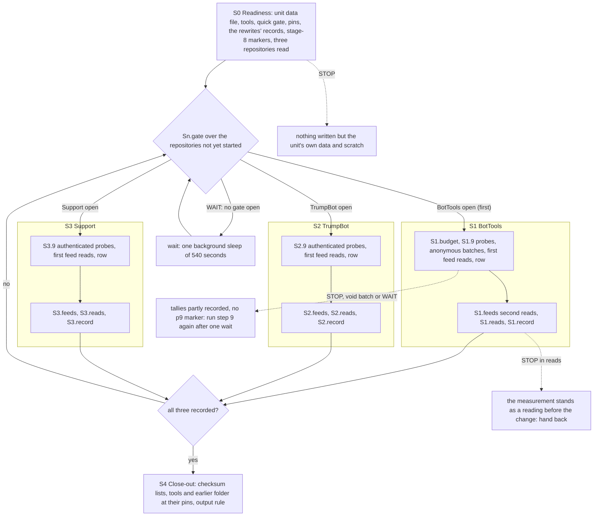

# Phase 0 · 7.3 — Measuring what GitHub still serves of BotTools, TrumpBot and Support: implementation plan

- **Covers:** [SpartanLaboratories/KotlinBottools#41](https://github.com/SpartanLaboratories/KotlinBottools/issues/41),
  *"Phase 0 · 7.3 — Measure what GitHub still serves of BotTools, TrumpBot and Support"*, unit 3 of
  [#27](https://github.com/SpartanLaboratories/KotlinBottools/issues/27) (*"Phase 0 · 7 — Rewrite BotTools and the private
  repositories, and replace the private repository clone"*), a sub-issue of
  [#2](https://github.com/SpartanLaboratories/KotlinBottools/issues/2), the history rewrite, which is a sub-issue of
  [#1](https://github.com/SpartanLaboratories/KotlinBottools/issues/1) (parent chain #41 → #27 → #2 → #1). Its siblings are #39 (the
  workspace tools, landed through pull request #44), #40 (the rewrites, landed through pull request #45) and #42 (the clone replacement,
  open). Its neighbour is [#28](https://github.com/SpartanLaboratories/KotlinBottools/issues/28), the residual report and cleanup, which
  stays blocked by #27.
- **Architecture:** [`../architecture.md`](../architecture.md), unit `residual-measurement` (order 3 of §16), which is §9 (the residual
  measurement), with §1.1 item 3, §1.2 criteria 5, 6 and 10, §2.5 (the verified outside facts), §3 (the rows on the private repositories'
  authenticated routes and on the events' 30 days), §4, §5 and §5.1 (the seams to and from this unit), §11 (order, gates and failure
  behaviour), §12 (the row of this unit: no writes, nothing asked up front), §13.4 (what #28 takes), §14, §16 and §17. System:
  `residual-exposure` ("Residual-exposure measurement"; registry `docs/dashboards/systems.json`). Its consequences are in
  [`../consequences.md`](../consequences.md); the evidence is [`../research/README.md`](../research/README.md) and
  [the push findings](../research/two-branch-lease-push.md). The tools this unit runs are the workspace tools unit's:
  [its plan](../39-workspace-tools/plan.md), [its as-built record](../39-workspace-tools/final-implementation.md) and
  [its consequences](../39-workspace-tools/consequences.md). The records it reads are the rewrites unit's:
  [its plan](../40-rewrites/plan.md), [its as-built record](../40-rewrites/final-implementation.md) and
  [its consequences](../40-rewrites/consequences.md). The earlier measurement this one is modelled on is
  [the GKB2 and GKB unit's](../../26-gkb2-gkb-rewrite/final-implementation.md#35-what-github-still-serves).
- **Branch:** `docs/issue-41-measure-bottools-trumpbot-support-residue`. It exists, was cut from `main` at the merge of pull request #45
  and is pushed. This plan is committed in the same commit as the unit's `consequences.md` and as-built record (the first commit of
  "Version control"), so that `git log --follow` binds the plan to the work it describes. The unit lands through one pull request, which
  closes #41 only.
- **What this plans:** the measurement of what GitHub still serves of the old histories of BotTools, TrumpBot and Support: for each
  repository, once its events list its rewrite's push or 6 hours have passed since the push, the authenticated probes of every old
  branch tip, every first-changed commit, their trees and a sample of purged blobs (for BotTools also the anonymous probes), the feed
  reads made twice at least 6 minutes apart, the report row completed in counts only and checksummed for #28, and the close-out. It is a
  literal procedure the implementer and the run carry out in this same run, settling nothing on the way.
- **Status:** built; what was built and measured, and every departure from this plan, is in [`final-implementation.md`](final-implementation.md).
- **Target version:** none. Nothing is versioned; no product code, test source, build file, README or CHANGELOG of any repository
  changes. The landing adds documents and regenerated boards only.

This unit writes nothing to GitHub and sends no request. It reads GitHub (REST, the web pages, git over HTTPS) and the rewrites' records,
and writes only new records in the workspace and the data folder. The tools print their own stage names (`STAGE R0.markers OK`,
`STAGE BotTools.p9 OK`, `STAGE R1.record OK`, and so on): those are the tools' names; `S0` to `S4` are this run's stage ids. In this plan
`WS` is the workspace folder `%USERPROFILE%\BotWS` and `DATA` the data folder `%USERPROFILE%\BotLegacyData`; inside code they are `$WS`
and `$DATA`, with `$OUT` (`DATA\rewrite`) and `$TOOLS` (`WS\tools`).

---

## Requirements

**Goals**

1. **What GitHub still serves of the old histories is probed and tallied, with controls.** For each of the three repositories, the
   authenticated probes cover every old branch tip, every first-changed commit, their trees and a sample of manifest blobs, and a
   protocol-v2 `want` of each old tip; for BotTools only, the anonymous probes cover the web commit route, the `want` route and a
   bounded REST sample. Every batch is bracketed by controls (a rewritten commit, its tree and one of its blobs, expected served; forty
   `f` digits, expected absent) and is void when its closing controls fail. Every answer that differs from the expectation is recorded
   in a count; a status outside a route's answers or a void batch stops the set, which is run again later with fresh controls.
2. **The feeds are read twice, each read's validity recorded, and only once the repository's gate has opened.** The activity feed and the
   events are read authenticated for all three, and for BotTools also anonymously and as the web page. The second read follows the first
   by at least 6 minutes. A read counts only when it lists a current id of the repository (a rewritten commit id); a read that lists none
   is recorded "not valid", and a read `gh` refuses "not read", never "absent". A repository's first reads are made only once its
   events list the rewrite's push of every branch it pushed (BotTools 2, TrumpBot 2, Support 1) or once 6 hours have passed since its
   push.
3. **Each repository's report row is complete, in counts only, and under a checksum list for #28.** It holds the commits before and
   after, the paths and blobs kept, the manifest's size, the secret-scan results, the probe tallies, the feed reads with their
   validity (both reads), what the probes cannot prove and, for BotTools, what its `refs/pull/2/head` and `refs/pull/3/head` still
   reach and its webhook deliveries. The row is written once.
4. **The rewrites' records equal their checksum lists** at the start and at the close-out, and this unit never writes one of them. This
   unit's own records carry checksum lists: `g41.SHA256SUMS` in each `DATA\rewrite\<repo>\` and `SHA256SUMS` in `DATA\run\g41\`.
5. **Nothing is written to GitHub and nothing GitHub still serves is removed.**
6. **Nothing sensitive is printed or written outside the data folder and the workspace:** counts, statuses, fixed markers and file names
   only, in every console line the steps print, every record the unit writes and every document. No output or record holds a
   pre-rewrite commit id, a purged blob id, a path, a name or a secret (the checks of the output rule are `S4.outputs` and the
   landing's document checks).
7. **Version none; documents only.**

**Rules this unit keeps**

- **Reads only.** No request is made and no grant is needed. The unit's only writes are the files named in "Records and where they
  live" and the landing's documents.
- **The tools are fixed.** The workspace tool folder `WS\tools\g27\` (`$TOOLS/g27`) is at its pins; `tools\g26\` is never edited, saved or
  run; `k0-ready.sh` and `save-tools.sh` are never run; the stage runner is never saved again. A defect a step meets stops the unit; the
  correction is a new version of that file, carried whole with its new pin by the plan of the unit that makes it, with the covering test
  kind run again and a dated note in the tools unit's consequences ([§4](../39-workspace-tools/consequences.md#4-sibling-units-and-neighbouring-issues)).
- **One call of the unit at a time.** The steps share the unit's scratch folder `WS\tmp\g27\g41\` (the feed id files, the probe tallies,
  the budget readings) and the run log, so no two calls of the unit run together. The gate writes nothing and may be run between any
  two steps.
- **A recorded read is never repeated.** A step 9 that passed is never run again: a rerun would replace the recorded first reads, the
  tallies and the row.
- **No commit to BotTools, TrumpBot or Support** and no other write to them.

**Acceptance criteria** (the issue's "Done when", with the close-out criterion of the parent design, each with what proves it)

| Criterion | Proved by |
|---|---|
| The probes of the three repositories are made and tallied, every batch's controls answering as expected | `Sn.9` per repository: the tally lines (`auth-commits`, `auth-trees`, `auth-blobs`, `auth-want`, and for BotTools the seven `anon-*`), no `VOID` or `STOP` line, `STAGE <repo>.p9 OK`, and `answers other than the expected ones: 0` in the row |
| Every feed read is made twice, and each read's validity is recorded | the `feed …` lines of `Sn.9` (first reads) and `Sn.feeds` (second reads), each ending `(not valid: no current id listed)` or not; the `RECORD` lines of both; `<repo>.feeds1` and `<repo>.feeds2` in `times.txt` at least 360 seconds apart |
| Each repository's report row is complete and under a checksum list | `Sn.record`: the row printed whole (BotTools 31 lines, TrumpBot and Support 16), `ok    <repo>: 11 record files checksummed under the rewrite folder`, `STAGE R1.record OK`; `S4.records` |
| BotTools' row states what `refs/pull/2/head` and `refs/pull/3/head` still reach | the row's line `pull-request residual (of 39 manifest blobs): residual_blobs=39 manifest=39 missing=0 distinct_all=184 every_ref_commits=28`, with the refs read as recorded at `S0.reads` and `S1.reads` |
| The rewrites' records equal their checksum lists | `S0.records`, `S0.reads` and `S4.records` |
| No output or record holds a pre-rewrite commit id, a purged blob id, a path, a name or a secret, and every earlier record equals its recorded checksum | `S4.outputs`, `S4.records`, `Sn.reads` (the preparation unit's records), the landing's four document checks |

---

## Current state

**Baseline.** `main` is at the merge of pull request #45 (the rewrites unit). The workspace, the data folder and GitHub were read on
2026-11-15 between 21:03Z and 21:23Z with read-only commands; nothing below was changed.

**The tools.** `WS\tools\g27\` holds the 25 files of the tools unit's plan; the 24 rows of `g27tools.sums` and the 22 rows of `tools.sums`
equal their pins, and the pin list's sha256 is `60f5760b246ce9b5f1c692e63d72895774fdc86d32db2fad11ccb581877631bf`. The residual set is
[`r0-ready.sh`, `p9-residual.sh` and `r1-close.sh`](../39-workspace-tools/plan.md#the-residual-set), with `g27lib.sh` and `ganon.sh`.
The code of every step this unit runs is [the tools plan's Appendix A](../39-workspace-tools/plan.md#appendix-a--the-tools): it is the
source of every command and printed line below.

**The rewrites' records** (`from=g40`).

- `DATA\run\g40\` holds 49 records under `SHA256SUMS`, which verifies whole: the status markers `p1` to `p8`, `c1reads` and `c1record` of
  each repository; `times.txt` with `BotTools.pushed`, `TrumpBot.pushed` and `Support.pushed`; `deliveries-baseline.BotTools.txt`
  (`0 0`) and `deliveries-after.BotTools.txt` (`2 2`); the three `records-at-s0.<repo>.sums`; and the rest of the rewrites' run
  records.
- Each `DATA\rewrite\<repo>\` holds `g40.SHA256SUMS` (28, 29 and 28 files), which verifies, and every record step 9 and its close-out
  read: `first-changed-commits`, `ref-map`, `commit-map`, `gitleaks-prepush.txt`, `gitleaks-fresh-branches.txt` and
  `gitleaks-fresh-all.txt` (each `RESULT: CLEAN`, no rule line), `residual.txt` (BotTools:
  `residual_blobs=39 manifest=39 missing=0 distinct_all=184 every_ref_commits=28`; 28 is 15 rewritten commits and 13 old commits only
  the pull-request refs reach), and `server-pull-refs.txt`. No default-rule findings file exists. The untouched backups, the workspace
  mirrors, the manifests and the fresh mirrors are in place. The path of the rewrite folders holds no pattern character and no space.
- The time the rewrites recorded for each push is the time `check` classed it: 111, 68 and 77 seconds after GitHub's `pushed_at`
  ([the rewrites' as-built record, deviation 3](../40-rewrites/final-implementation.md#4-deviations-from-the-plan)).

**Nothing of this unit exists yet:** no `DATA\run\g41\`, no data file `WS\tmp\g27\units\g41.txt`, no scratch folder, no `probe-ids\`,
`probe-tallies.txt`, `feeds.txt` or `report-row.txt` in any repository's folder. The run log `DATA\run\as-run.log` holds 15,504 lines.

**GitHub.**

| | BotTools | TrumpBot | Support |
|---|---|---|---|
| Repository id; visibility; default branch; archived | 540122713; public; `main`; no | 540208924; private; `main`; no | 540146440; private; `main`; no |
| GitHub's `pushed_at` (2026-11-15) | 19:38:58Z | 19:45:21Z | 19:50:39Z |
| The time the rewrites recorded for the push | 19:40:49Z | 19:46:29Z | 19:51:56Z |
| The 6 hours end (2026-11-16) | 01:40:49Z | 01:46:29Z | 01:51:56Z |
| Every branch at its rewritten tip; pull-request refs as recorded | yes; 2 | yes; 0 | yes; 0 |
| Activity feed | 2 force-push entries, each `before` an old tip and `after` a current tip | 2, the same | 1, the same |
| Events (read 21:17Z) | 1 push event of the rewrite, for 1 of its 2 branches | 3 earlier issue events (2026-10-26), no push event | none |
| The gate at 21:17Z | `WAIT`, 1 of 2 | `WAIT`, 0 of 2 | `WAIT`, 0 of 1 |

A push event's payload carries `before`, `head`, `push_id`, `ref` and `repository_id`, so the tools' events filter (`.payload.before`,
`.payload.head`) reads it.

**The authenticated controls answer on both private repositories:** a REST `HEAD` of the rewritten tip 200 and of forty `f` digits 404;
git over HTTPS with the token as `x-access-token` 200; a protocol-v2 `want` of the rewritten tip answers with a pack, and of forty `f`
digits `not our ref`.

**The sets, derived from the records:**

| | BotTools | TrumpBot | Support |
|---|---|---|---|
| Old tips; first-changed commits; their union; old trees | 2; 1; 3; 3 | 2; 1; 3; 3 | 1; 1; 2; 2 |
| Manifest; sample step; blob sample | 39; 1; 39 | 199; 4; 50 | 7,259; 121; 60 |
| REST samples (commits, trees, blobs) | 3, 3, 3 (9) | 3, 3, 3 (9) | 2, 2, 3 (7) |
| Anonymous REST calls of step 9's sets (12 controls + samples) | 21 | — | — |
| Commits of the untouched backup; current commits | 16; 15 | 11; 9 | 2; 1 |

**The earlier measurement.** The stage 9 of the GKB2 and GKB unit, run minutes after each push, found the events listing nothing on every
read ([its as-built record, §3.5](../../26-gkb2-gkb-rewrite/final-implementation.md#35-what-github-still-serves)); its web activity
page listed the activity's ids. That is why this unit holds each repository's first reads until its events list the push.

**Where the unit plugs in.** The residual set takes every parameter from `params.txt`, the expectation rows and the running unit's data
file (`G27_UNIT`), and names no repository, issue or branch. This unit supplies the data file, the gate and the order of the calls; it
adds no tool.

**Outside facts this unit rests on:**

- The events cover 30 days and can lag by up to 6 hours; a force push publishes, per rewritten branch, one push event and one
  force-push entry in the activity feed
  ([the push findings, §4.5](../research/two-branch-lease-push.md#45-what-a-force-push-of-two-branches-publishes-and-how-to-count-it-documented-observed-idiom)).
- A private repository's objects are readable by anyone signed in with read access and by nobody anonymously: every anonymous request to
  it answers not found ([the parent design, §2.5](../architecture.md#25-verified-outside-world-facts)). That is why TrumpBot and Support
  get no anonymous probe and no anonymous feed read.
- The anonymous REST budget is 60 calls an hour per address, and a reading of `/rate_limit` spends nothing
  ([the publication unit's research, §3.3](../../25-kotlinbottools-publish/research/anonymous-reads-after-publication.md#33-limits-and-rate-limit-hygiene)).

---

## Assumptions

| # | Assumption | If false |
|---|---|---|
| A1 | Nothing pushes to or changes the three repositories while the unit runs. | `S0.reads` or `Sn.reads` stops on a branch away from its rewritten tip or a pull-request ref that differs from its record. A measurement already recorded stands as a reading of the server before the change; the unit hands back. |
| A2 | GitHub lists the rewrite's push of every pushed branch in the events within 6 hours (the documented bound; at 21:17Z, 1 of 2, 0 of 2 and 0 of 1). | The gate opens at the 6 hours, and an events read that still lists no current id is recorded "not valid", never "absent". |
| A3 | The old objects of the private repositories are served to an authenticated reader as BotTools' are (their controls answered as expected). | An id that answers absent is a `RECORD` counted in "answers other than the expected ones"; a status outside a route's answers stops the batch, which is run again later with fresh controls. |
| A4 | Nothing else spends the anonymous REST budget of the machine's address (60 calls an hour) while BotTools' stage runs. | The step prints a `WAIT`, or a `RECORD` that the budget's reading disagrees with the calls. |
| A5 | The anonymous web activity page lists the activity's ids, as it did for GKB2 and GKB. | That read is "not valid", which is a result. |
| A6 | The tools behave on the real repositories as on their stand-ins (the tools unit's A2). | A step stops at its own check; nothing is written to GitHub at any step. |
| A7 | Nothing but this unit's steps changes the tool folder, the unit's data file or the rewrites' records while the unit runs. | `S4.tools` or `S4.records` stops. Another unit's runner steps during a wait add lines to the run log, which `S4.outputs` holds to the same rule. |
| A8 | The events' push payload keeps `before` and `head` (read 2026-11-15). | No events read lists a current id: each is "not valid", and the gate opens only at the 6 hours. |
| A9 | The unit's steps run within the events' 30 days of the earliest push, that is by 2026-12-15. | Step 9 records the window (`RECORD events window: …`) and the events reads are not valid. |

---

## Non-goals

- **No write to GitHub and no removal:** no ref, pull request, object or cached view is removed, and no GitHub Support ticket is filed.
- **No anonymous probe or feed read of TrumpBot or Support.** They are private.
- **No tool change.** `tools\g27` stays at its pins; `tools\g26`, `k0-ready.sh`, `save-tools.sh` and the runner are never edited, saved or
  run.
- **No count of BotTools' webhook deliveries** (the rewrites counted them once) and no read of a delivery's payload.
- **No split of BotTools' pull-request residual by ref.** The row carries the rewrites' record for the two refs together.
- **No report on #2, no re-verification of the data folder and no cleanup** (#28).
- **No clone replacement** (#42).
- **No repeat of a recorded read.**
- **No commit to BotTools, TrumpBot or Support.**
- **No version bump, no CHANGELOG entry and no README change** in KotlinBottools.

---

## Design

### Shape of the run

Five stages. `S0` reads and checks and runs at once, before any gate opens; its only writes are the unit's data file, its scratch
folder and the run log's lines. `S1`, `S2` and `S3` measure BotTools, TrumpBot and Support, each in the steps of its own table; a
repository's stage starts only when its events gate has opened. `S4` is the close-out, after the third repository's record. The landing's
document checks follow, outside the table. Every stop leaves the state its row of "Stops and the state each leaves" names.

| id | name | brief | kind | steps |
|---|---|---|---|---|
| S0 | Readiness | The unit's data file is written, the tools are at their pins, the quick gate passes, the rewrites' records equal their checksum lists, and the three repositories hold their stage-8 markers and their rewritten tips. | check | S0.unit: The unit's data file; S0.tools: The tools at their pins; S0.quick: The quick gate; S0.pins: The tool versions; S0.records: The rewrites' records against their checksum lists; S0.markers: The stage-8 markers; S0.reads: The three repositories read |
| S1 | BotTools | Once BotTools' events list its push or 6 hours have passed, what GitHub still serves of its old history is probed and tallied, authenticated and anonymously, its feeds are read twice, and its report row is completed and checksummed. | work | below |
| S2 | TrumpBot | The same for TrumpBot once its gate opens, authenticated only. | work | below |
| S3 | Support | The same for Support once its gate opens, authenticated only. | work | below |
| S4 | Close-out | The rewrites' records and this unit's equal their checksum lists, the tools and the earlier tool folder are at their pins, and the unit's outputs and records hold nothing sensitive. | check | S4.records: The checksum lists; S4.tools: The tools at their pins; S4.g26: The earlier tool folder at its pins; S4.outputs: The output rule over the unit's outputs |

**Steps of S1**

- `S1.gate`: The events gate
- `S1.budget`: The anonymous budget
- `S1.9`: Step 9: the probes, the first feed reads and the report row
- `S1.feeds`: The second feed reads
- `S1.reads`: The repository read again
- `S1.record`: The report row completed and checksummed

**Steps of S2**

- `S2.gate`: The events gate
- `S2.9`: Step 9: the probes, the first feed reads and the report row
- `S2.feeds`: The second feed reads
- `S2.reads`: The repository read again
- `S2.record`: The report row completed and checksummed

**Steps of S3**

- `S3.gate`: The events gate
- `S3.9`: Step 9: the probes, the first feed reads and the report row
- `S3.feeds`: The second feed reads
- `S3.reads`: The repository read again
- `S3.record`: The report row completed and checksummed



**Why this order.** The events of a push lag by up to 6 hours, and a read made before they list the push finds no current id of it: the
GKB2 and GKB unit's events reads, made minutes after each push, all listed nothing. So the gate holds each repository's step 9, which makes the first feed
reads, until the events list the repository's push or the 6 hours have passed. The three repositories are independent
([parent §9.1](../architecture.md#91-when-it-runs)), so a stage runs for each as its gate opens, in the order BotTools, TrumpBot,
Support when two open at the same check. A repository's stage, once started, runs through to its record before another stage starts:
the steps share one scratch folder, so there is one call of the unit at a time. `S0` needs no gate and runs at once.

**What proceeds while a repository waits.** `S0` runs at once. Every stage whose gate is open runs whole. While every remaining gate
prints `WAIT`, nothing of the unit runs: **a wait is one call of `sleep 540` run in the background** (it ends in 9 minutes, before the
10-minute cut every call is subject to), after which the gate is run again; the wait is re-armed until a gate opens. A `WAIT` from the
anonymous budget is waited out the same way, in calls of at most 9 minutes, until the time it prints, and the step is then run again. A
wait holds no state: an interrupted wait is taken up by running the gate again, and the markers in `DATA\run\g41\status\` show which
stages have passed.

### What the unit writes to GitHub

Nothing. It makes no request, needs no grant and asks nothing of the owner beforehand. Every probe is a read (a `HEAD`; a protocol-v2
`want` of one object, whose answer is read to its first 120 bytes and discarded; a page or a feed). The unit's landing on KotlinBottools
is the run's ordinary landing.

### The unit's data file

`WS\tmp\g27\units\g41.txt` is the data file the tools read through `G27_UNIT`
([format](../39-workspace-tools/plan.md#the-running-units-data-file)). `S0.unit` writes it with exactly these lines:

```text
# unit 3 of the three-repository work: the residual measurement; reads only, no grant, no request
job=none
issue=41
home=SpartanLaboratories/KotlinBottools
branch=docs/issue-41-measure-bottools-trumpbot-support-residue
actions=none
targets=none
runs=g41
from=g40
wording=none.txt
```

The unit has no grant, so `job`, `actions`, `targets` and `wording` hold placeholders that no step of the residual set reads (as the
tools unit's own data file does). `runs=g41` gives the unit's record folder `DATA\run\g41\`, its scratch folder `WS\tmp\g27\g41\`, each
repository's checksum list `DATA\rewrite\<repo>\g41.SHA256SUMS`, and the landing's gate corpus `g41docs`. `from=g40` names the rewrites'
records, which are read only: the stage-8 markers, `times.txt`, the webhook delivery counts and `records-at-s0.<repo>.sums` in
`DATA\run\g40\`, and the checksum lists `g40.SHA256SUMS`.

### The events gate

The gate is a typed read-only block (`Sn.gate`). It reads each named repository's `ref-map`, `commit-map` and the push's recorded time
in `DATA\run\g40\times.txt`, and the repository's events from GitHub; it writes nothing and prints ids, refs and paths never.

- **A repository's pushed branches** are `ref-map`'s changed heads (BotTools 2, TrumpBot 2, Support 1).
- **The gate opens** for a repository when the events list a push event whose `head` is a current commit (`commit-map`'s new column) for
  each of its pushed branches, counted by distinct ref; or when 6 hours have passed since the time the rewrites recorded for its push.
  The 6 hours end at 2026-11-16T01:40:49Z (BotTools), 01:46:29Z (TrumpBot) and 01:51:56Z (Support): at most two minutes after 6 hours
  from GitHub's `pushed_at`, because the recorded time is the time `check` classed the push.
- **A repository still waiting** prints `note` when another repository is open at the same check and `WAIT` when none is (status 4).
  An events read `gh` refuses is a waiting line that names the status, never a count of zero.
- **A record the gate cannot read** (no pushed branch, no recorded time, no rewritten commit) is a `STOP` (status 1).
- **After a stage**, the gate is run with `G` naming the repositories whose stage has not started; once every stage has started it is not
  run again.

**How the tools read a feed's validity — the events inside their lag.** The tools decide a feed read's validity by one rule: a read is
valid when it lists at least one current id of the repository (a rewritten commit id; on the web page, its first 7 digits). A read that
lists none ends `(not valid: no current id listed)`; a read `gh` refuses is recorded `not read (gh status <n>)`, which lists none
either. Nothing is ever recorded as absent. The tools do not compare a read's time with the 6-hour lag: a read made inside it that
already lists a current id is valid by that rule, and one that lists none is not valid. Step 9 records only the 30-day window, from the
push's recorded time, in whole days (`ok    events window: the push is <d> days old, inside the 30 days the events cover`, or a `RECORD`
when the push is older or its time is not recorded). The events gate is what keeps this unit's reads after the lag: it holds each
repository's step 9, which makes the first reads, and the second reads follow the first by at least 6 minutes (`r1-close.sh feeds` waits
until 360 seconds after the first, looking at the clock every 10 seconds). An events read that still lists no current id after the gate
opened on the 6 hours is recorded "not valid", never "absent". No read is made again once recorded.

**When the reads are made:** the first reads in `Sn.9`, once the repository's gate is open; the second reads in `Sn.feeds`.

### Step 9 and its close-out

What the tools do ([the tools plan, "The residual set"](../39-workspace-tools/plan.md#the-residual-set)); this unit adds nothing to it.

- **Readiness (`r0-ready.sh`).** `markers`: the unit follows another unit's records and every named repository holds its stage-8 marker
  there. `reads`: the followed unit's records equal their checksum list (`g40.SHA256SUMS`), every branch of each repository is at its
  rewritten tip, and its pull-request refs are as recorded. `budget`: a token is available from `gh` and the anonymous REST budget covers
  the public repositories named: each one's step 9 (at most 22 calls in the sets) and its two feed reads (at most 6 each), 34 calls plus
  the margin of 8; a short budget is one `WAIT` line and status 4. The reading spends nothing.
- **Step 9 (`p9-residual.sh REPO`).** It needs the repository's stage-8 marker in the rewrites' records, their `first-changed-commits`,
  `ref-map` and `gitleaks-*` records (and, for BotTools, `residual.txt` and the delivery baseline), the untouched backup and the
  manifest.
  - **The probe selection is by the row's visibility.** Every repository gets the four authenticated batches (commits, trees, blobs, the
    protocol-v2 `want` of each old tip) and the authenticated feed reads. A public repository only gets the anonymous budget check
    (`anon_need 28`: at most 22 REST calls in the sets and 6 in the first feed read, plus the margin of 8), the anonymous batches (web,
    `want`, the bounded REST sample) and the anonymous feed reads.
  - **The sets.** The old tips are the old column of `ref-map`'s heads; the first-changed commits are the rewrites' record; the old trees
    are the trees of their union in the untouched backup. The blob sample is every ⌈blobs ÷ bound⌉-th manifest blob, at most 60 of them. The
    anonymous REST sample is at most 4 commits, 3 trees and the first, middle and last blob. The sets are written to `probe-ids\` and
    never printed.
  - **The controls and the void rule.** Every batch is bracketed by controls (a rewritten commit, its tree and a blob of the rewritten
    tip, expected served; forty `f` digits, expected absent), opening and closing, and is void when its closing controls fail. A status
    outside a route's answers ends the set with a `STOP`.
  - **The pace** between probes is 0.4 seconds. Every tally is a line of counts; no id, body or header value is printed.
  - **The budget's reading against the calls.** The reading at the start, less the last remaining count, may not exceed the 28 calls the
    step can make; when it does, a `RECORD` says the reading was higher than the budget really was.
  - **The events window** is recorded from the push's recorded time (above).
  - **The feeds.** `auth_feed first` reads the activity feed and the events authenticated; for a public repository `feed_read first` reads
    the web activity page and the two feeds anonymously (up to 3 pages each). Each read is counted for membership of the old ids and the
    current ids, and the first-read time is stamped `<repo>.feeds1`.
  - **The report row** is written once to `report-row.txt` and printed: counts only (Design, "Records and where they live", and the
    expected rows below).
- **Close-out (`r1-close.sh`).** `feeds` reads each repository's feeds a second time, at least 360 seconds after the first, polling the
  clock every 10 seconds, stamps `<repo>.feeds2` and marks `r1feeds`; a repository whose second read is recorded is passed over, and
  the lines of a read cut short are dropped and the read made whole, so the step is safe to run twice. `reads` reads the repository again:
  every branch at its rewritten tip, the pull-request refs as recorded, the default branch, visibility and archive state, the webhook count and the
  preparation unit's earlier records as the rewrites recorded them. `record` appends the second feed reads to the row **once** (an
  earlier block is replaced), writes `g41.SHA256SUMS` in the repository's folder over the id sets, `probe-tallies.txt`, `feeds.txt` and
  `report-row.txt`, and `SHA256SUMS` over the run folder.

**BotTools' pull-request residual** in its row is the rewrites' record for the two refs together
(`residual_blobs=39 manifest=39 missing=0 distinct_all=184 every_ref_commits=28`; 28 is 15 rewritten commits and 13 old commits only the
pull-request refs reach), with the refs read as recorded at `S0.reads` and `S1.reads`. It is not split by ref.

**Checks this plan adds beside the tools,** as typed read-only blocks: all four of the rewrites' checksum lists at the start
(`S0.records`) and again at the close-out with this unit's own four (`S4.records`), because `r0-ready.sh reads` checks only the
per-repository `g40.SHA256SUMS` and only at the start; and the output rule over the unit's part of the run log and its new records
(`S4.outputs`).

### Records and where they live

`DATA\rewrite\<repo>\` keeps the preparation unit's and the rewrites' records, never written. This unit adds new files beside them:

- `probe-ids\`: the 8 id sets `tips.txt`, `first.txt`, `commits.txt`, `trees.txt`, `blobs.txt`, `api-commits.txt`, `api-trees.txt` and
  `api-blobs.txt`;
- `probe-tallies.txt` (the tally lines), `feeds.txt` (the first and the second feed reads) and `report-row.txt` (the report row);
- `g41.SHA256SUMS` (over the 11 files above).

`DATA\run\g41\` holds `times.txt` (`<repo>.feeds1`, `<repo>.feeds2`), `status\<repo>.p9`, `<repo>.r1feeds`, `<repo>.r1reads` and
`<repo>.r1record`, the empty `requests\` and `replies\` the library makes, and at the end `SHA256SUMS`. Beside them: the data file
`WS\tmp\g27\units\g41.txt`; the scratch folder `WS\tmp\g27\g41\` (the feed id files, the tallies, the budget readings, `log-start.txt`
and `unit-log.txt`); the run log's lines; and the landing gate's `DATA\run\gate\corpus-g41docs.args`. The rewrites' records are read only.
Everything there holds ids, paths or names and is never committed, printed or quoted.

**The report row, counts only.** BotTools' row (25 lines when step 9 writes it, 31 once the second reads are appended) is:

```text
report row, BotTools (counts only)
commits before 16, after 15; paths kept 82; blobs kept 145; manifest 39
gitleaks before the push, branches and tags: RESULT: CLEAN
gitleaks fresh mirror, branches and tags: RESULT: CLEAN; every ref: RESULT: CLEAN
probe, auth-commits: served x3
… (the 11 tally lines, each prefixed "probe, ")
feed, feed activity auth first: old ids 2, current ids 2
… (the 5 first-read lines, each prefixed "feed, ")
pull-request residual (of 39 manifest blobs): residual_blobs=39 manifest=39 missing=0 distinct_all=184 every_ref_commits=28
webhook deliveries (all, event push): before the push 0 0, after 2 2
visibility public: anonymous probes and feed reads made
answers other than the expected ones: 0
what the probes cannot prove: that GitHub has dropped the old objects; that cached views are gone; that no third-party copy exists; that secret scanning examined the old objects
```

TrumpBot's row (13 lines, 16 once appended) is: `report row, TrumpBot (counts only)`,
`commits before 11, after 9; paths kept 56; blobs kept 106; manifest 199`, the two gitleaks lines, 4 probe lines, 2 feed lines,
`visibility private: no anonymous probe or feed read: every anonymous request to a private repository answers not found`,
`answers other than the expected ones: 0` and the "cannot prove" line. Support's row is the same with
`commits before 2, after 1; paths kept 29; blobs kept 29; manifest 7259`.

### Error handling and logging

- **Failure design** is the tools' ([tools plan, "Error handling and logging"](../39-workspace-tools/plan.md#error-handling-and-logging)):
  a shell step ends through `expect` (`STOP  <label>: expected '<x>', got '<y>'`, status 1), `must` (`STOP  <label>: status <n>`) or
  `run_batch` (`STOP  route <r>, set <label>: status <n> (a stop answer or a void tally; the probe set is run again later with fresh
  controls)`); `note` prints `ok` or `RECORD` and counts a miss in the row's "answers other than the expected ones", and never stops; a
  `WAIT` is status 4 and a pause. An expected failure ends the script that met it; an answer that differs from the expectation is a
  result and is recorded. **A failed read is never a zero:** a feed `gh` refuses is `not read (gh status <n>)`, the web page `not read
  (curl status <n>)`; a feed page with a status other than 200, or one the REST budget stopped, adds one line beyond the five and ends
  that feed's pages, and the read stays valid only if an earlier page already listed a current id; the gate's events read that fails is
  a waiting line that names the status. **A rate limit that cannot be read is a wait,** one `WAIT` line that names what is missing, with
  nothing probed.
- **Where a `Result` is unwrapped.** The tools print their outcome as a line and a status; the implementer reads the last line of each
  step and unwraps it once: a `STAGE … OK` line and status 0 is a pass, a line that starts `STOP` is a stop, `WAIT` a pause, `RECORD` a
  result. The typed blocks end through `exit 1` after a `STOP` line, or (the gate) `exit 4` after a `WAIT`.
- **Reading the output.** A step succeeded when its exit status is 0 and its last line, the one before the runner's own end line
  (`== g27/<script> exit=<status>`), is the `STAGE` line it names. A line that starts `STOP` is a stop: take no further step but the one
  the stop table names, and report the step id, the first `STOP` line and the numbers on it, never content. `RECORD` lines are results,
  not stops. The gate's `note` lines are the repositories still waiting while another is open; its `WAIT` lines are a pause.
- **Events logged,** each a console line the runner appends to `DATA\run\as-run.log`: each step's `ok` lines and its `STAGE … OK` line;
  each probe batch's tally; each feed read with its validity; each `RECORD`, `WAIT` and `STOP`. The first word of a line is its status.
  Typed blocks do not pass through the runner, so their lines are not in the run log; the as-built record states their words.
- **Recorded, not stopped:** every probe answer that differs from the expectation; a feed read that is not valid; the events' window; the
  budget's reading against the calls; the second reads' validity.

### Stops and the state each leaves

Nothing here is irreversible: the unit writes nothing to GitHub.

| Where | The stop | State left | Next |
|---|---|---|---|
| `S0.*` | a pin, a record, a version, a marker, a repository read or the quick gate differs from its expectation | nothing written but the unit's data file, scratch and the run log's lines | find out why; fix the cause; run `S0` again from the step |
| `Sn.gate` | `STOP`: a record the gate reads cannot be read | nothing written | fix the cause; run the gate again |
| `Sn.gate` | `WAIT`: no gate is open | nothing written | one wait of 9 minutes, then the gate again |
| `S1.budget`, `S1.9`, `S1.feeds` | `WAIT`: the anonymous budget is short or cannot be read | nothing probed; the step's earlier records, if any, stand | wait until the time the line prints (a call of at most 9 minutes at a time; one 9-minute call when the line gives no time), then run the step again |
| `Sn.9` | a void batch, a status outside a route's answers, or a stop of its own check | `probe-tallies.txt` holds the batches that passed, `feeds.txt` is empty or partly written, no `<repo>.p9` marker; nothing written to GitHub | one wait of 9 minutes, then run `Sn.9` again with fresh controls (it replaces the tallies, the feeds and the row); a second stop on the same step hands back |
| `Sn.feeds` | a stop of its own check | the first reads and the row stand; a second read cut short leaves lines the next run drops | fix the cause and run `Sn.feeds` again |
| `Sn.reads` | a branch away from its rewritten tip, a pull-request ref that differs, a default branch, visibility, archive state, webhook count or earlier record that differs | the measurement stands as a reading of the server before the change; the row is not yet completed | hand back with the counts; no repeat of a recorded read |
| `Sn.record` | a missing record or a failed checksum write | the row's second-read block is written once, replaced on each run; the checksum lists may be partly written | fix the cause and run `Sn.record` again (it is safe to run twice) |
| `S4.*` | a checksum list, a pin or the output rule differs | as the stages left them | report and stop; the unit does not land |
| the landing's checks | a hit | nothing committed | reword the document; run the check again |

"Hand back" means: the implementer stops, reports the step id, the stop line and the readings (counts and words, never content), types
nothing further, and the unit does not land.

---

## Procedure

### Conventions

- **Shell.** Git Bash. Each call starts a fresh shell, so every call begins with this prelude, which names the unit's data file (written
  by `S0.unit`) and defines `g` (run a step script of the folder through the runner); no machine path is typed:

  ```bash
  . "$(cygpath -m "$USERPROFILE")/BotWS/tools/env.sh"
  export G27_UNIT="$WS/tmp/g27/units/g41.txt"
  g() { local s="$1"; shift; bash "$TOOLS/run-stage.sh" "g27/$s" "$@"; }
  ```

  A step is then `g <script> <args>`, for example `g s0-ready tools`. `env.sh` exports `P_HOME`, `WS`, `DATA`, `TOOLS`, `OUT`, `BKROOT`,
  `GR`, `GL`, `CFG`, `SS`, `KBT` and defines `gitnet`. Python always runs with `-I`. The runner shows a stage name with characters
  outside `A-Z a-z 0-9 . _ / -` as `<name>`, and an argument that is not a plain word as `<arg>`; the script still receives every
  argument unchanged. `S0.unit`, `S0.records`, `Sn.gate`, `S4.records`, `S4.g26` and `S4.outputs` are typed blocks: they do not pass
  through the runner, so their lines are not in the run log, and the as-built record states their words.
- **Timeouts and background calls.** A call runs in the foreground with a 10-minute timeout, except `Sn.9` and `Sn.feeds`, which run in
  the background and are read from the runner's output when they end, and the 9-minute waits, which run in the background.
- **The waits.** A wait is `sleep 540` run in the background. After it ends the gate is run again (or the step that printed the `WAIT`).
- **One call of the unit at a time.** No two calls run together; a stage runs whole before another starts.
- **Reading the output.** As in Design, "Error handling and logging".
- **What is never done.** No write to GitHub is typed and no request is sent. No tool is changed;
  `tools\g26\`, `k0-ready.sh` and `save-tools.sh` are never run. A step 9 that printed `STAGE <repo>.p9 OK` is never run again. Nothing
  in `DATA` or `WS` is opened and quoted: only counts, words and file names are reported.

### When the steps run again

- **`S0.unit`** may run again: it writes the same file byte for byte and keeps the line count of its first run in `log-start.txt` (the
  unit's part of the run log is counted from that first line count).
- **`S0.tools`, `S0.quick`, `S0.pins`, `S0.records`, `S0.markers` and `S0.reads`** may run again at any time.
- **`Sn.gate`** may run again at any time; it writes nothing. **`S1.budget`** may run again at any time.
- **`Sn.9`** runs again only after a `STOP` or a `WAIT` in it, never after `STAGE <repo>.p9 OK`. After a rerun that passes, `Sn.feeds`,
  `Sn.reads` and `Sn.record` follow in order.
- **`Sn.feeds`, `Sn.reads` and `Sn.record`** are safe to run twice: a recorded second read is passed over, the second-read block of the row
  is replaced, the checksum lists are rewritten.
- **`S4`** runs after the third repository's record.

### S0 — Readiness

Nothing is written to GitHub; everything is a read, a local check or the quick gate. `S0` runs at once.

**`S0.unit`:** the unit's data file, the scratch folder and the run log's line count before the unit's steps. A typed block.

```bash
. "$(cygpath -m "$USERPROFILE")/BotWS/tools/env.sh"
U="$WS/tmp/g27/units"; S="$WS/tmp/g27/g41"; mkdir -p "$U" "$S"
printf '%s\n' "# unit 3 of the three-repository work: the residual measurement; reads only, no grant, no request" \
  "job=none" "issue=41" "home=SpartanLaboratories/KotlinBottools" "branch=docs/issue-41-measure-bottools-trumpbot-support-residue" \
  "actions=none" "targets=none" "runs=g41" "from=g40" "wording=none.txt" > "$U/g41.txt"
[ -s "$S/log-start.txt" ] || wc -l < "$DATA/run/as-run.log" | tr -d ' \r' > "$S/log-start.txt"
echo "ok    the unit's data file is written; the run log held $(tr -d ' \r\n' < "$S/log-start.txt") lines before the unit's steps"
```

Expected: one `ok` line with the line count (15,504 if nothing has run since it was read). The count is read once and kept:
`S4.outputs` reads the log from the line after it.

**`S0.tools`:** every reused tool and every file of the folder holds its recorded size and sha256, the scanner binary reports its
version, the folder holds exactly the files its pin list names, every shell script parses and every Python tool compiles.

```bash
g s0-ready tools
```

Expected: 96 `ok` lines and `STAGE S0.tools OK`. A different size or hash is a stop: the tool is not the tested one.

**`S0.quick`:** the quick gate under this unit's data file: the deterministic cases of the self-test. It builds and removes its own
sandbox under the unit's scratch folder and, where the gating kind never ran, stamps an empty run and joins none.

```bash
g gselftest deterministic
```

Expected: 63 `ok` case lines, then `ok    gselftest deterministic: 63 checks passed`, status 0, no `STOP`. About 15 seconds.

**`S0.pins`:** git, Python, gh, git-filter-repo with its module's sha256 and gitleaks are at the versions the preparation unit recorded.

```bash
g s0-ready pins
```

Expected: 7 `ok` lines and `STAGE S0.pins OK`.

**`S0.records`:** the rewrites' records equal their checksum lists: the run folder's `SHA256SUMS` and each repository's
`g40.SHA256SUMS`. A typed read-only block.

```bash
. "$(cygpath -m "$USERPROFILE")/BotWS/tools/env.sh"
bad=0
chk() {  # FOLDER LIST LABEL: every file the checksum list names equals it
  [ -f "$1/$2" ] || { echo "STOP  $3: the checksum list is missing"; bad=1; return; }
  if (cd "$1" 2> /dev/null && sha256sum -c --quiet "$2" > /dev/null 2>&1); then echo "ok    $3 equal their checksum list ($(wc -l < "$1/$2" | tr -d ' ') files)"; else echo "STOP  $3 differ from their checksum list"; bad=1; fi
}
chk "$DATA/run/g40" SHA256SUMS "the rewrites' run records"
for r in BotTools TrumpBot Support; do chk "$OUT/$r" g40.SHA256SUMS "$r: the rewrites' records"; done
[ "$bad" = 0 ] || exit 1
echo "STAGE S0.records OK"
```

Expected:

```text
ok    the rewrites' run records equal their checksum list (49 files)
ok    BotTools: the rewrites' records equal their checksum list (28 files)
ok    TrumpBot: the rewrites' records equal their checksum list (29 files)
ok    Support: the rewrites' records equal their checksum list (28 files)
STAGE S0.records OK
```

**`S0.markers`:** this unit follows the rewrites' records, and each repository holds its stage-8 marker there.

```bash
g r0-ready markers BotTools TrumpBot Support
```

Expected:

```text
ok    this unit follows another unit's records (its data file names them in from)
ok    BotTools: stage 8 passed in the records this unit follows
ok    TrumpBot: stage 8 passed in the records this unit follows
ok    Support: stage 8 passed in the records this unit follows
STAGE R0.markers OK
```

**`S0.reads`:** each repository's followed records against their checksum list, every branch at its rewritten tip on GitHub, and the
pull-request refs as recorded.

```bash
g r0-ready reads BotTools TrumpBot Support
```

Expected: 12 `ok` lines, per repository `ok    <repo>: the followed unit's records equal their checksum list`,
`ok    <repo>: every branch is at its rewritten tip`, `ok    <repo>: ls-remote of the pull-request refs: status` and
`ok    <repo>: the pull-request refs are as recorded`; then `STAGE R0.reads OK`.

### Steps of a repository

The steps are the same for the three repositories: `S1.gate` to `S1.record` for BotTools, `S2.gate` to `S2.record` for TrumpBot (with no
`budget` step) and `S3.gate` to `S3.record` for Support, each stage starting when its gate opens. `<repo>` is `BotTools`, `TrumpBot` or
`Support`. A step marks its success in `DATA\run\g41\status\` and requires the marker of the one before it.

**Expected values per repository.**

| | BotTools (`S1`) | TrumpBot (`S2`) | Support (`S3`) |
|---|---|---|---|
| Pushed branches (N) | 2 | 2 | 1 |
| The 6 hours end | 2026-11-16T01:40:49Z | 2026-11-16T01:46:29Z | 2026-11-16T01:51:56Z |
| `budget` | `ok` ×2, `STAGE R0.budget OK` | not run | not run |
| `RECORD the sets: …` | `old tips 2, first-changed 1, old trees 3, manifest sample 39 of 39; REST samples 9` | `old tips 2, first-changed 1, old trees 3, manifest sample 50 of 199; REST samples 9` | `old tips 1, first-changed 1, old trees 2, manifest sample 60 of 7259; REST samples 7` |
| Authenticated tallies (`auth-commits`, `auth-trees`, `auth-blobs`, `auth-want`) | `served x3`, `x3`, `x39`, `x2` | `served x3`, `x3`, `x50`, `x2` | `served x2`, `x2`, `x60`, `x1` |
| Anonymous tallies (`anon-web`, `anon-want-commits`, `anon-want-trees`, `anon-want-blobs`, `anon-rest-commits`, `anon-rest-trees`, `anon-rest-blobs`) | `served x3`, `x3`, `x3`, `x39`, `x3`, `x3`, `x3` | none | none |
| `Sn.9`: `ok` lines; `RECORD` lines | 15; 2 | 7; 1 | 7; 1 |
| First feed lines | 5 | 2 | 2 |
| Authenticated feed lines, first read | `feed activity auth first: old ids 2, current ids 2`; `feed events auth first: old ids 2, current ids 2` | the same | `old ids 1, current ids 1`, each |
| The row, as step 9 writes it; once appended | 25 lines; 31 | 13; 16 | 13; 16 |
| `Sn.feeds`: second-read lines | 5 | 2 | 2 |
| `Sn.reads`: `ok` lines | 6 | 6 | 6 |
| `Sn.record`: record files checksummed | 11 | 11 | 11 |
| `Sn.record`: run records checksummed (`m`) | 5 for the first repository recorded, 9 for the second, 13 for the third | | |

The feed memberships are expected values, recorded as measured: a read that lists no current id shows
`(not valid: no current id listed)`, and the web page's counts are recorded as they are.

**`Sn.gate` — the events gate.** A typed read-only block. `G` names the repositories whose stage has not started, in the order
BotTools, TrumpBot, Support; the first call names all three.

```bash
. "$(cygpath -m "$USERPROFILE")/BotWS/tools/env.sh" 2> /dev/null || { echo "STOP  the workspace's environment did not load"; exit 1; }
G="BotTools TrumpBot Support"        # the repositories whose stage has not started
open=0; bad=0; L=()
for r in $G; do
  rm_="$OUT/$r"
  n="$(awk 'NR > 1 && $3 ~ /^refs\/heads\// && $1 != $2 && $2 !~ /^0+$/' "$rm_/ref-map" 2> /dev/null | wc -l | tr -d ' ')"
  p="$(awk -v k="$r.pushed" '$1 == k {t = $2} END {print t}' "$DATA/run/g40/times.txt" 2> /dev/null)"
  c="$(awk 'NR > 1 && $2 !~ /^0+$/' "$rm_/commit-map" 2> /dev/null | wc -l | tr -d ' ')"
  case "$n:$p:$c" in
    0:*|*::*|*:0|*[!0-9:]*) L+=("stop|gate $r: the rewrites' records do not give the pushed branches, the time of the push and the rewritten commits"); bad=1; continue ;;
  esac
  end6="$(date -u -d "@$((p + 21600))" +%Y-%m-%dT%H:%M:%SZ)"; a=$(( $(date -u +%s) - p ))
  if [ "$a" -ge 21600 ]; then L+=("ok|gate $r: the 6 hours since its push ended at $end6; its step 9 may run"); open=1; continue; fi
  e="$(gh api "repos/SpartanLaboratories/$r/events?per_page=100" --paginate --jq '.[] | select(.type == "PushEvent") | [.payload.ref, .payload.head] | @tsv' 2> /dev/null)"; s=$?
  if [ "$s" -ne 0 ]; then L+=("wait|gate $r: the events could not be read (gh status $s); the 6 hours since its push end at $end6"); continue; fi
  k="$(printf '%s\n' "$e" | tr -d '\r' | awk 'NR == FNR { if (FNR > 1 && $2 !~ /^0+$/) cur[$2] = 1; next } ($2 in cur) { b[$1] = 1 } END { m = 0; for (x in b) m++; print m }' <(tr -d '\r' < "$rm_/commit-map") -)"
  if [ "$k" -ge "$n" ]; then L+=("ok|gate $r: the events list the push of $k of its $n pushed branches; its step 9 may run"); open=1
  else L+=("wait|gate $r: the events list the push of $k of its $n pushed branches; the 6 hours since its push end at $end6"); fi
done
for x in "${L[@]}"; do
  case "${x%%|*}" in ok) w="ok    " ;; stop) w="STOP  " ;; *) if [ "$open" = 1 ]; then w="note  "; else w="WAIT  "; fi ;; esac
  echo "$w${x#*|}"
done
[ "$bad" = 0 ] || exit 1
[ "$open" = 1 ] || exit 4
```

How it reads: a repository's pushed branches are `ref-map`'s changed heads; the events' push events count when their `head` is a current
commit (`commit-map`'s new column), counted by distinct ref. Its lines are:

- `ok    gate <repo>: …; its step 9 may run` for each open repository (status 0);
- for a repository still waiting, `note  gate <repo>: …` when another is open (status 0) or `WAIT  gate <repo>: …` when none is
  (status 4);
- `STOP  gate <repo>: …` when a record cannot be read (status 1).

Its output at 21:17Z on 2026-11-15, as the expected form of a wait (status 4):

```text
WAIT  gate BotTools: the events list the push of 1 of its 2 pushed branches; the 6 hours since its push end at 2026-11-16T01:40:49Z
WAIT  gate TrumpBot: the events list the push of 0 of its 2 pushed branches; the 6 hours since its push end at 2026-11-16T01:46:29Z
WAIT  gate Support: the events list the push of 0 of its 1 pushed branches; the 6 hours since its push end at 2026-11-16T01:51:56Z
```

The open forms are `ok    gate BotTools: the events list the push of 2 of its 2 pushed branches; its step 9 may run` and
`ok    gate Support: the 6 hours since its push ended at 2026-11-16T01:51:56Z; its step 9 may run`. A `WAIT` is followed by one wait (a call
of `sleep 540` in the background) and the gate again. When two gates open at the same check the stage of the first in the order
BotTools, TrumpBot, Support starts; the gate is run again when it has recorded.

**`S1.budget` (BotTools only) — the anonymous budget.**

```bash
g r0-ready budget BotTools
```

Expected: `ok    a token is available from gh`, `ok    anonymous REST budget: <n> calls left, 34 needed` (`n` at least 42) and
`STAGE R0.budget OK`; or one `WAIT` line (status 4):
`WAIT  anonymous REST budget: <n> calls left, 42 needed; the hour resets at <time>; run the step again after it`, or
`WAIT  anonymous REST budget: the rate limit could not be read (<what is missing>); nothing was probed; run the step again later`. The
reading spends nothing. Only BotTools spends the anonymous budget: its step 9's sets make 21 anonymous REST calls and each feed read
about 2 (at most 6).

**`Sn.9` — step 9: the probes, the first feed reads and the report row.** In the background, once the repository's gate is open; read the
runner's output when it ends.

```bash
g p9-residual <repo>
```

Expected lines for BotTools, in order (a tally line ends with two spaces, as `probe_ids` prints it):

```text
ok    anonymous REST budget: <n> calls left, 28 needed
ok    the controls are four full ids
RECORD the sets: old tips 2, first-changed 1, old trees 3, manifest sample 39 of 39; REST samples 9
ok    events window: the push is 0 days old, inside the 30 days the events cover
auth-commits: served x3
ok    authenticated: old tips and first-changed commits served
auth-trees: served x3
ok    authenticated: their trees served
auth-blobs: served x39
ok    authenticated: manifest-sample blobs served
auth-want: served x2
ok    authenticated: protocol-v2 want of each old tip served
anon-web: served x3
ok    anonymous web: old tips and first-changed commits served
anon-want-commits: served x3
ok    anonymous want: commits served
anon-want-trees: served x3
ok    anonymous want: trees served
anon-want-blobs: served x39
ok    anonymous want: manifest-sample blobs served
anon-rest-commits: served x3
ok    anonymous REST: commits served
anon-rest-trees: served x3
ok    anonymous REST: trees served
anon-rest-blobs: served x3
ok    anonymous REST: blobs served
feed activity auth first: old ids 2, current ids 2
feed events auth first: old ids 2, current ids 2
feed web first: old ids <a>, current ids <b>
feed activity first: old ids 2, current ids 2
feed events first: old ids 2, current ids 2
RECORD feed reads that are valid (a current id listed): anonymous <v> of 3
ok    the feeds list at least one pre-rewrite id (the force-push's before)
(the report row, 25 lines)
STAGE BotTools.p9 OK
```

BotTools' step 9 has 15 `ok` lines and 2 `RECORD` lines. About 2 to 4 minutes. The first feed read's time is stamped
`BotTools.feeds1` in `times.txt`.

TrumpBot (`S2.9`): no budget line, no anonymous batch or feed read, no `RECORD feed reads …` line; the line
`RECORD the sets: old tips 2, first-changed 1, old trees 3, manifest sample 50 of 199; REST samples 9`; the tallies `auth-commits: served
x3`, `auth-trees: served x3`, `auth-blobs: served x50`, `auth-want: served x2`; the feed lines `feed activity auth first: old ids 2,
current ids 2` and `feed events auth first: old ids 2, current ids 2`; 7 `ok` lines; the 13-line row; `STAGE TrumpBot.p9 OK`.
Support (`S3.9`): `RECORD the sets: old tips 1, first-changed 1, old trees 2, manifest sample 60 of 7259; REST samples 7`; the tallies
`auth-commits: served x2`, `auth-trees: served x2`, `auth-blobs: served x60`, `auth-want: served x1`; the feed lines with old ids 1 and
current ids 1; 7 `ok` lines; the 13-line row; `STAGE Support.p9 OK`. About 1 to 2 minutes each.

A void batch (`VOID <label>: …`) or a status outside a route's answers ends with `STOP  route …`: the step is run again after one wait of
9 minutes, with fresh controls; a second stop on the same step hands back. A `WAIT` (BotTools' anonymous budget) is before any probe.
Every answer other than the expected one is a `RECORD` line and a count in the row.

**`Sn.feeds` — the second feed reads.** In the background; it waits until 360 seconds after the first read.

```bash
g r1-close feeds <repo>
```

Expected for BotTools: `ok    the first feed read's time was recorded`, `ok    anonymous REST budget: <n> calls left, 6 needed`, the five
`… second: …` lines (`feed activity auth second: …`, `feed events auth second: …`, `feed web second: …`, `feed activity second: …`,
`feed events second: …`), `RECORD BotTools: second feed read, anonymous reads valid: <v> of 3` and `STAGE R1.feeds OK`. For TrumpBot and
Support: `ok    the first feed read's time was recorded`, the two authenticated `… second: …` lines, `RECORD <repo>: second feed read` and
`STAGE R1.feeds OK`. A run again passes over a repository whose second read is recorded
(`ok    <repo>: the second feed read is recorded already: passed over`), and drops the lines of a read cut short and reads it whole. A `WAIT`
(status 4) is the anonymous budget: wait until the time it prints, then run the step again.

**`Sn.reads` — the repository read again.**

```bash
g r1-close reads <repo>
```

Expected: 6 `ok` lines: `<repo>: every branch is at its rewritten tip`; `<repo>: ls-remote of the pull-request refs: status`;
`<repo>: the pull-request refs are as recorded`; `<repo>: default branch, visibility and archive state are as the row says` (the row holds
no archive state: the check is that the repository is not archived, a wording [the tools unit's consequences, §5](../39-workspace-tools/consequences.md#5-known-gaps)
records); `<repo>: the webhook count is the row's`; `<repo>: the preparation unit's earlier records are as at the first S0.inputs`
(compared with the rewrites' `records-at-s0.<repo>.sums`); then `STAGE R1.reads OK`.

**`Sn.record` — the report row completed and checksummed.**

```bash
g r1-close record <repo>
```

Expected: `ok    <repo>: the id sets of the probes exist`, `ok    <repo>: 11 record files checksummed under the rewrite folder` (the 8 id
sets and `probe-tallies.txt`, `feeds.txt` and `report-row.txt`), the row printed whole (BotTools 31 lines: its 25, then
`second feed reads, appended: 5 lines` and the 5 second-read lines prefixed `feed, `; TrumpBot and Support 16: their 13, then
`second feed reads, appended: 2 lines` and 2 lines), `ok    <m> run records checksummed` (`m` is 5 for the first repository recorded, 9 for
the second and 13 for the third: `times.txt` and four markers per repository, `p9`, `r1feeds`, `r1reads` and `r1record`) and
`STAGE R1.record OK`. It writes the second-read block once, replacing an earlier one. The run folder's `SHA256SUMS` is rewritten by each
repository's record; the list that `S4.records` checks is the third's.

After `Sn.record` the gate is run again with `G` naming the repositories still waiting. Once the third repository is recorded, `S4`
follows.

### S1 — BotTools

Starts when BotTools' gate is open. Run `S1.gate`, then `S1.budget`, then `S1.9`, `S1.feeds`, `S1.reads` and `S1.record`. What differs:
BotTools is public, so it alone gets the budget step, the 15-line step 9 with the anonymous batches and the anonymous feed reads, and a
5-line second read; its row carries the pull-request residual and the webhook deliveries the rewrites recorded; and its step 9 is the one that
can print the `RECORD` that the anonymous budget's reading disagrees with the calls.

### S2 — TrumpBot

Starts when TrumpBot's gate is open. Run `S2.gate`, `S2.9`, `S2.feeds`, `S2.reads` and `S2.record`. What differs: the repository is
private, so there is no budget step, no anonymous probe and no anonymous feed read; its authenticated controls were read as answering on
2026-11-15 (A3).

### S3 — Support

Starts when Support's gate is open. Run `S3.gate`, `S3.9`, `S3.feeds`, `S3.reads` and `S3.record`. What differs: one pushed branch, so
the gate counts 1 of 1; a manifest of 7,259 blobs of which 60 are sampled; the same private-repository shape as TrumpBot.

### S4 — Close-out

After the third repository's record.

**`S4.records`:** the checksum lists: the rewrites' four and this unit's four. A typed read-only block.

```bash
. "$(cygpath -m "$USERPROFILE")/BotWS/tools/env.sh"
bad=0
chk() {  # FOLDER LIST LABEL: every file the checksum list names equals it
  [ -f "$1/$2" ] || { echo "STOP  $3: the checksum list is missing"; bad=1; return; }
  if (cd "$1" 2> /dev/null && sha256sum -c --quiet "$2" > /dev/null 2>&1); then echo "ok    $3 equal their checksum list ($(wc -l < "$1/$2" | tr -d ' ') files)"; else echo "STOP  $3 differ from their checksum list"; bad=1; fi
}
chk "$DATA/run/g40" SHA256SUMS "the rewrites' run records"
for r in BotTools TrumpBot Support; do chk "$OUT/$r" g40.SHA256SUMS "$r: the rewrites' records"; done
chk "$DATA/run/g41" SHA256SUMS "this unit's run records"
for r in BotTools TrumpBot Support; do chk "$OUT/$r" g41.SHA256SUMS "$r: this unit's records"; done
[ "$bad" = 0 ] || exit 1
echo "STAGE S4.records OK"
```

Expected: 8 `ok` lines (49, 28, 29 and 28 files, then 13, 11, 11 and 11 files) and `STAGE S4.records OK`.

**`S4.tools`:** the tools at their pins again.

```bash
g s0-ready tools
```

Expected: 96 `ok` lines and `STAGE S0.tools OK`.

**`S4.g26`:** the earlier tool folder equals its own pins, and the reused tools and the runner equal its list (the tools unit's typed
`S0.g26` block, verbatim). It only reads.

```bash
. "$(cygpath -m "$USERPROFILE")/BotWS/tools/env.sh"
n=0; bad=0; while read -r size sum rel; do [ -n "$rel" ] || continue; n=$((n + 1)); [ "$(wc -c < "$TOOLS/g26/$rel" | tr -d ' ') $(sha256sum "$TOOLS/g26/$rel" | cut -d' ' -f1)" = "$size $sum" ] || bad=$((bad + 1)); done < "$TOOLS/g26/g26tools.sums"
[ "$bad" = 0 ] && [ "$n" = 21 ] && [ "$(ls "$TOOLS/g26" | wc -l | tr -d ' ')" = 22 ] || { echo "STOP  the earlier folder differs from g26tools.sums ($bad of $n files, $(ls "$TOOLS/g26" | wc -l | tr -d ' ') files in it)"; exit 1; }
echo "ok    g26: $n of $n pinned files equal their pins, 22 files in the folder"
n=0; bad=0; while read -r size sum rel; do [ -n "$rel" ] || continue; n=$((n + 1)); [ "$(wc -c < "$WS/$rel" | tr -d ' ') $(sha256sum "$WS/$rel" | cut -d' ' -f1)" = "$size $sum" ] || bad=$((bad + 1)); done < "$TOOLS/g26/tools.sums"
[ "$bad" = 0 ] && [ "$n" = 21 ] || { echo "STOP  the reused tools differ from g26/tools.sums ($bad of $n)"; exit 1; }
echo "ok    the $n reused tools and the runner equal g26/tools.sums"
echo "ok    the runner: $(wc -c < "$TOOLS/run-stage.sh" | tr -d ' ') $(sha256sum "$TOOLS/run-stage.sh" | cut -d' ' -f1)"
```

Expected:

```text
ok    g26: 21 of 21 pinned files equal their pins, 22 files in the folder
ok    the 21 reused tools and the runner equal g26/tools.sums
ok    the runner: 1428 9cdb381040caf266bb61576536a9cc45436f031fa797fd9358a041249909c428
```

**`S4.outputs`:** the output rule over the unit's outputs, the last step, so that the run log it reads holds every line the unit's steps
wrote: from the line count in `log-start.txt`, the unit's part of `as-run.log` holds no drive-letter path and no 40-digit id, and each
repository's report row, feed reads and probe tallies hold neither. A drive-letter path is matched as the tools' own self-test matches
it, a letter and a colon before a slash or a backslash with no letter before them, so a URL is not one. A typed block that writes only
`unit-log.txt` in the unit's scratch folder and prints counts and fixed words only.

```bash
. "$(cygpath -m "$USERPROFILE")/BotWS/tools/env.sh"
S="$WS/tmp/g27/g41"; L="$DATA/run/as-run.log"
DRIVE='(^|[^A-Za-z])[A-Za-z]:[/\\]'; ID40='(^|[^0-9a-f])[0-9a-f]{40}([^0-9a-f]|$)'
cnt() { local c; c="$(grep -c -E "$1" "$2" 2> /dev/null)"; echo "${c:-0}"; }
n0="$(tr -d ' \r\n' < "$S/log-start.txt" 2> /dev/null)"
case "$n0" in ''|*[!0-9]*) echo "STOP  the unit's starting line count is not recorded"; exit 1 ;; esac
tail -n +"$((n0 + 1))" "$L" | tr -d '\r' > "$S/unit-log.txt"
echo "ok    the unit's part of the run log: $(wc -l < "$S/unit-log.txt" | tr -d ' ') lines; STOP $(cnt '^STOP' "$S/unit-log.txt"), WAIT $(cnt '^WAIT' "$S/unit-log.txt"), NEXT $(cnt '^NEXT' "$S/unit-log.txt"), RECORD $(cnt '^RECORD' "$S/unit-log.txt")"
d="$(cnt "$DRIVE" "$S/unit-log.txt")"; i="$(cnt "$ID40" "$S/unit-log.txt")"
[ "$d" = 0 ] || { echo "STOP  the unit's part of the run log holds $d lines with a drive-letter path"; exit 1; }
[ "$i" = 0 ] || { echo "STOP  the unit's part of the run log holds $i lines with a 40-digit id"; exit 1; }
echo "ok    the unit's part of the run log holds no drive-letter path and no 40-digit id"
n=0; bad=0
for r in BotTools TrumpBot Support; do for f in report-row.txt feeds.txt probe-tallies.txt; do
  [ -f "$OUT/$r/$f" ] || { echo "STOP  $r: a record the check reads is missing: $f"; exit 1; }
  n=$((n + 1)); bad=$((bad + $(cnt "$DRIVE" "$OUT/$r/$f") + $(cnt "$ID40" "$OUT/$r/$f")))
done; done
[ "$bad" = 0 ] || { echo "STOP  the unit's records hold $bad lines with a drive-letter path or a 40-digit id"; exit 1; }
echo "ok    $n records of the unit (each repository's report row, feed reads and probe tallies) hold no drive-letter path and no 40-digit id"
echo "STAGE S4.outputs OK"
```

Expected, when no step stopped or waited, every answer was the expected one and the budget's reading agreed with the calls:

```text
ok    the unit's part of the run log: <n> lines; STOP 0, WAIT 0, NEXT 0, RECORD 7
ok    the unit's part of the run log holds no drive-letter path and no 40-digit id
ok    9 records of the unit (each repository's report row, feed reads and probe tallies) hold no drive-letter path and no 40-digit id
STAGE S4.outputs OK
```

The seven `RECORD` lines are the three `RECORD the sets`, BotTools' valid anonymous reads and the three second reads; a stop or a `WAIT`
that was then run again adds its line, and a disagreement of the budget's reading adds one `RECORD`. If another unit's steps ran through
the runner while this unit waited, their lines are in the unit's part of the log and are held to the same rule; the as-built record
names them.

### The landing's document checks

Not a stage of the run: they belong to the landing and run while the unit's documents are finished, before the documents are committed,
from the checkout that holds them, under this unit's data file (so the gate's corpus is `g41docs`). The pending set is every file under
`docs/` that `git status` lists as modified or untracked: this plan, `consequences.md`, `final-implementation.md`, the parent
consequences' link line, any dated callout on the parent design, and the regenerated boards (the boards of the phase, of #27, of the
rewrites unit, the repository work board and this unit's new board files, all generated).

| id | Command | What it proves |
|---|---|---|
| `D.ids` | `g gdocs ids BotTools TrumpBot Support` | no token in the documents resolves to a commit of an untouched backup or names a purged blob |
| `D.paths` | `g gdocs paths` | no machine-local path |
| `D.gate` | `g gdocs gate` | the privacy gate over the documents through the allow tool (every legacy word masked): zero blocking hits |
| `D.scan` | `g gdocs scan` | a gitleaks directory scan of copies of the documents with the repository's committed configuration reports `RESULT: CLEAN` |

A hit, a resolving token or a path is reworded in the document and the check is run again before anything is committed.

---

## File-by-file changes

No Kotlin, source, test, build or configuration file of any repository changes, and neither does a README or a CHANGELOG. The unit adds
files to the workspace and the data folder and nothing to GitHub; its landing adds documents and regenerated boards.

**In the repository (the landing):**

| Path (under `docs/plans/1-bottools-consolidation/2-phase-0-history-rewrite/27-bottools-trumpbot-support-rewrite/`) | Change |
|---|---|
| `41-residual-measurement/plan.md` | this plan |
| `41-residual-measurement/consequences.md` | new: published artifacts (none), blast radius (reads only; what the measurement found still served; the three report rows), adoption, the sibling units, the follow-ups, the known gaps the run leaves, and the outcome of each assumption above |
| `41-residual-measurement/final-implementation.md` | new, written at the reconciliation: the as-built record, acceptance, the readings (counts only), the words of the typed blocks and every deviation from this plan, each citing the plan section it departs from |
| `consequences.md` (the parent's, §4) | the one link line for this unit |
| `architecture.md` | a dated callout only where the build changes what it describes |
| the generated boards (`plan.json`, `plan.js`, `dashboard.html` of the issue and tracking boards, `docs/plans/board.json`, `board.js`, `index.html`) | regenerated by the board service |

**What is written at the reconciliation.** The as-built record, the link line, the outcome of each assumption and the plan's Status line
are written once the run has ended and its checks have passed. Until then they are not present, and nothing counts them missing.

**In the workspace:** `WS\tmp\g27\units\g41.txt`; `WS\tmp\g27\g41\` (the line count, the feed id files, the tallies, the budget readings,
`unit-log.txt`, the quick gate's own folders). `tools\g27\`, `tools\g26\`, the reused tools, the runner, the mirrors, the backups and the
fresh mirrors are unchanged.

**In the data folder:** the new records of each repository under `DATA\rewrite\<repo>\` and `DATA\run\g41\` as "Records and where they
live" lists; the run log's lines; `DATA\run\gate\corpus-g41docs.args` from the landing's gate. The preparation unit's records, the
rewrites' records and the tools unit's `DATA\run\g27\` are not written.

**On GitHub:** nothing.

---

## Documentation impact

No Kotlin code changes and no library API moves, so there is no KDoc to write and no generated API reference to regenerate. The change
is documents, boards and workspace files; it sits at these documentation areas:

| Area | What moves |
|---|---|
| Inline documentation (line comments and KDoc) | none: no tool and no source file changes; the tools' own headers stand as pinned |
| The generated API reference | none: no library API changes; no Dokka change |
| The plan documents with READMEs, CHANGELOGs and the project site | this plan (the data file, the gate, the steps and their expected lines, the stop table: the contracts #28 integrates with), this unit's `consequences.md` and as-built record, the one link line in the parent consequences and a dated callout on the parent architecture where the build changes what it describes. README and CHANGELOG: unchanged |
| The boards | regenerated by the board service at the landing |

**README.** No change: the landing carries documents and boards only, and no command, endpoint, module, dependency, build or run step of
KotlinBottools changes. **CHANGELOG.** No entry: a documents-only landing adds none and no version moves.

---

## Test plan

No product code changes. The tools were tested by the tools unit by test kind and are fixed at their pins; this unit runs them for
real. The tools have no packages; the package segment names the folder a kind would have. Per the rule of running only the tests that
exercise the change, the component and integration kinds of the self-test are **not** run again (no tool changes, and `S0.tools` proves
the folder at the pins those kinds passed at); of the self-test only the quick gate runs.

| Test set | Package segment | What proves it here | Limits |
|---|---|---|---|
| The gating tests | `testing.gating` | `S0.tools` and `S4.tools` (96 `ok` lines), `S0.pins` (7), `S0.records` and `S4.records` (the rewrites' records and this unit's against their checksum lists), `S4.g26` (the earlier folder at its pins); the unit's data file loads at the first call (every key and form checked by the library); the landing's four document checks | those of `S0` run before any probe, those of `S4` after the last record, the document checks before anything is committed |
| The component tests | `testing.component` | not run again: the tools unit passed 92 checks of this kind at the pins `S0.tools` proves; no tool changed | — |
| The integration tests | `testing.integration` | not run again (579 checks passed in the tools unit). The unit's own reads of the real interfaces are its boundary checks: `S0.markers` and `S0.reads` (the rewrites' records and GitHub), the gate's events reads, `S1.budget` (the anonymous rate limit), `Sn.reads` (GitHub against the rewrites' records), `Sn.record` (the checksum lists at the boundary of the data folder) | the reads model nothing: they are the real interfaces; what they cannot reach is below |
| The deterministic tests | `testing.deterministic` | `S0.quick`: `g gselftest deterministic`, 63 case lines and its total line | pure; no network or clock |
| The end-to-end tests | `testing.e2e` | this unit's real run of the residual set over the three repositories, `Sn.9` to `Sn.record` of each; the steps' own `expect`s are its assertions | the real run is the test: a recorded read is not repeated |
| The nonfunctional tests | `testing.nonfunctional` | `S4.outputs` (the output rule over the unit's part of the run log and its new records); the pace of 0.4 seconds between probes; the spacing of each repository's second read, read from `times.txt` (below); the budget's reading against the calls; the steps' timings | the timings are readings, not bounds |
| The acceptance tests | `testing.uat` | the owner's reading of the as-built record at the landing; nothing is asked of the owner during the run | cannot be automated |

**A reading beside the procedure.** At the reconciliation the implementer reads the spacing of each repository's two feed reads from
`times.txt` and reports the difference in seconds, numbers only (each at least 360):

```bash
. "$(cygpath -m "$USERPROFILE")/BotWS/tools/env.sh"
for r in BotTools TrumpBot Support; do awk -v r="$r" '$1 == r ".feeds1" {a = $2} $1 == r ".feeds2" {b = $2} END {print r ": the second read was made " b - a " seconds after the first"}' "$DATA/run/g41/times.txt"; done
```

**What cannot be tested automatically:** when GitHub lists a push in its events; whether the web activity page lists the ids; others' use
of the anonymous budget; GitHub's caching, which the probes cannot see through.

---

## Risks and edge cases

- **Events never listed within 6 hours.** The gate opens at the 6 hours and the events reads are recorded "not valid", never "absent".
  Nothing in the plan retries them: a recorded read is not repeated.
- **A short or unreadable anonymous budget.** A `WAIT`, not a stop: the step is run again after the time it prints. Only BotTools spends
  the budget. The reading may disagree with the calls (the GKB2 and GKB unit saw this); that is a `RECORD`.
- **A void batch or a status outside a route's answers** (a secondary rate limit on the web route, for instance). The step stops with
  `STOP  route …`; it is run again after one wait of 9 minutes with fresh controls; a second stop on the same step hands back.
- **A second read cut short.** The next run of `Sn.feeds` drops its lines and reads it whole, once.
- **The run interrupted during hours of waiting.** A wait holds no state. Run the gate again; the markers in `DATA\run\g41\status\` show
  which stages have passed.
- **A step 9 run again after it passed** would replace the recorded first reads, the tallies and the row: it is not done.
- **Two calls at once** would mix the shared scratch files: not done.
- **Another unit's steps during a wait** write lines to the run log; they fall in the unit's part of the log and are held to the same
  rule at `S4.outputs`; the as-built record names them.
- **The residual close-out strips the record folder's path from the id sets' names literally.** The tools unit's cases do not tell the
  literal strip from a pattern match ([its consequences, §5](../39-workspace-tools/consequences.md#5-known-gaps)); the path of the rewrite
  folders holds no pattern character, so the strip is the same either way, and a failure is a stop that names the checksum list.
- **Output.** The output rule is asserted over the unit's part of the log and its new records at `S4.outputs`; every tally is a count.
- **Cross-repository impact:** none. The unit reads GitHub and writes no repository. **Breaking changes and compatibility:** none; no
  API, protocol or schema changes.

---

## Version control

- **Branch:** `docs/issue-41-measure-bottools-trumpbot-support-residue` (exists, cut from `main` at the merge of pull request #45,
  pushed). It is brought up to date with `main` when the landing opens, not before.
- **Commits, in one landing** (documents only; each document passes `D.ids`, `D.paths`, `D.gate` and `D.scan` before it is committed):
  1. `docs(plans): residual measurement unit plan, consequences and as-built record (#41)`: this plan, `consequences.md` and
     `final-implementation.md` (written at the reconciliation; the plan is committed with the unit it describes);
  2. `docs(plans): link line for the residual measurement unit and dated notes on the parent design (#41)`: the one line in the parent
     consequences' §4 and any dated callout on the parent architecture;
  3. `docs: regenerate the work boards for the residual measurement unit (#41)`: the boards.
- **One pull request,** closing #41 only; **no closing keyword for #27, #2 or #1**; no version bump; no README or CHANGELOG change. The
  issue's resolution comment links the pull request and reports the tallies and the feed reads' validity (counts only).
- **Pre-existing working-tree changes.** The working tree holds regenerated boards of the phase, of #27, of the rewrites unit and of the
  repository work board, and this unit's new board files. They are generated boards and go in commit 3. Nothing unrelated is carried:
  `gdocs.sh` stops on any pending file outside `docs/`.
- **No trailer unless the repository's rules ask for one,** and no pull-request text names the pipeline.

---

## Interfaces with sibling units

**Takes from `workspace-tools` (#39, landed):**

- **The folder at its pins** (`g27tools.sums`, `tools.sums`; the pin list's sha256 is the one in Current state). The unit's first acts are
  `S0.unit` (the data file every script's library reads) and `S0.tools` (`g s0-ready tools`, 96 `ok` lines), then the quick gate (63 case
  lines), then `S0.pins`.
- **The data file's format:** key=value lines; `job`, `issue`, `home`, `branch`, `actions`, `targets`, `runs`, `from` and `wording`;
  `G27_UNIT` names it in every call, with no default.
- **The residual set's commands and printed lines:** `r0-ready.sh markers|reads|budget REPO...` (statuses 0, 1, or 4 for a `WAIT` on
  `budget`); `p9-residual.sh REPO` (status 0, 1 or 4; marker `<repo>.p9`; writes `probe-ids\`, `probe-tallies.txt`, `feeds.txt` and
  `report-row.txt`); `r1-close.sh feeds|reads|record REPO...` (markers `r1feeds`, `r1reads`, `r1record`; status 4 for a `WAIT` in
  `feeds`); `s0-ready.sh tools|pins`; `gdocs.sh`; the quick gate.
- **The defect rule:** a tool defect stops the unit; the correction is a new version of that file, carried whole with its new pin by the
  plan of the unit that makes it, with the covering test kind run again and a dated note in the tools unit's consequences.

**Takes from `rewrites` (#40, landed), as built, through `from=g40`:**

- each repository's stage-8 marker (`DATA\run\g40\status\<repo>.p8`);
- each repository's records under `DATA\rewrite\<repo>\` with `g40.SHA256SUMS`: `first-changed-commits`, `ref-map`, `commit-map`, the
  three `gitleaks-*` records, `residual.txt` (BotTools) and `server-pull-refs.txt`;
- `times.txt` (`<repo>.pushed`, the time the push was classed: the 30-day window in whole days and the gate's 6 hours count from it);
- `deliveries-baseline.BotTools.txt` and `deliveries-after.BotTools.txt`;
- `records-at-s0.<repo>.sums`;
- the run folder's `SHA256SUMS`;
- every branch at its rewritten tip on GitHub.

**With `clone-replacement` (#42):** nothing either way. It may run while this unit waits, its records apart, its runner lines in the
shared run log.

**Provides to #28:** the three report rows, the probe tallies, the feed records with their validity, the id sets and the checksum lists
(`g41.SHA256SUMS` per repository, `SHA256SUMS` in `DATA\run\g41\`).

**What this unit never gives a sibling:** a write to another unit's records, or a request.

---

## Sequencing and follow-ups

**Order.** `S0` at once. Then the gates and stages: each repository's stage when its gate opens, whole, one at a time (at 21:17Z
BotTools' events listed the push of 1 of its 2 branches and the others' none; the last gate opens at 2026-11-16T01:51:56Z at the latest).
Then `S4`, the landing's document checks and the documents. The unit starts after #40 landed (pull request #45, merged), and #28 stays
blocked by #27.

**Follow-ups this work leaves:** none of its own. The parent consequences' follow-ups (BotTools' pull-request residual stays, the
credentials, the webhook) stay theirs ([parent consequences, §6](../consequences.md#6-follow-ups)). A tool defect a run meets is
corrected under the defect rule.

---

## Considerations

None.
