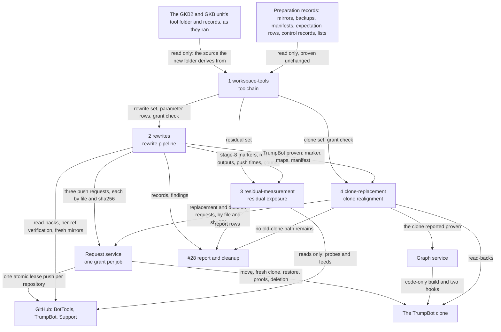
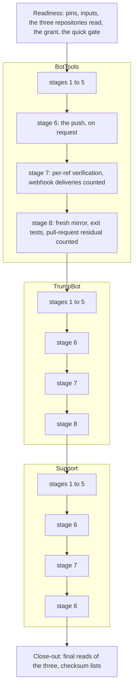
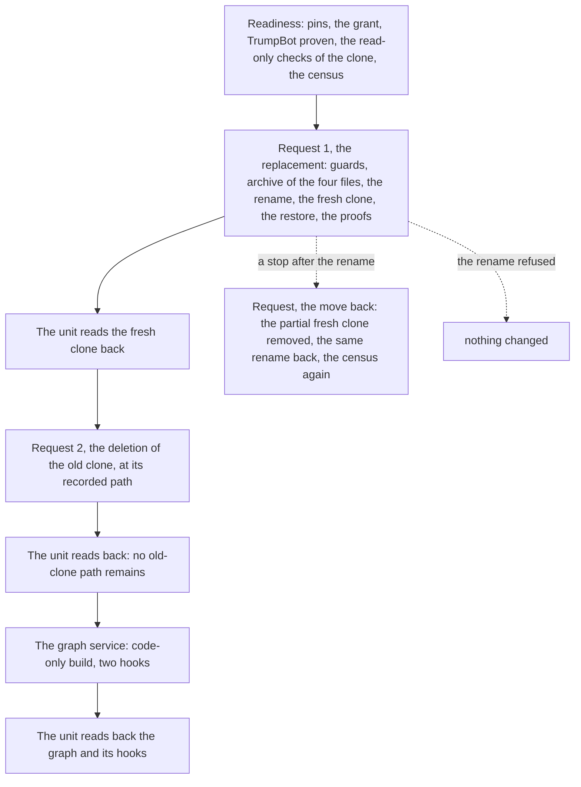
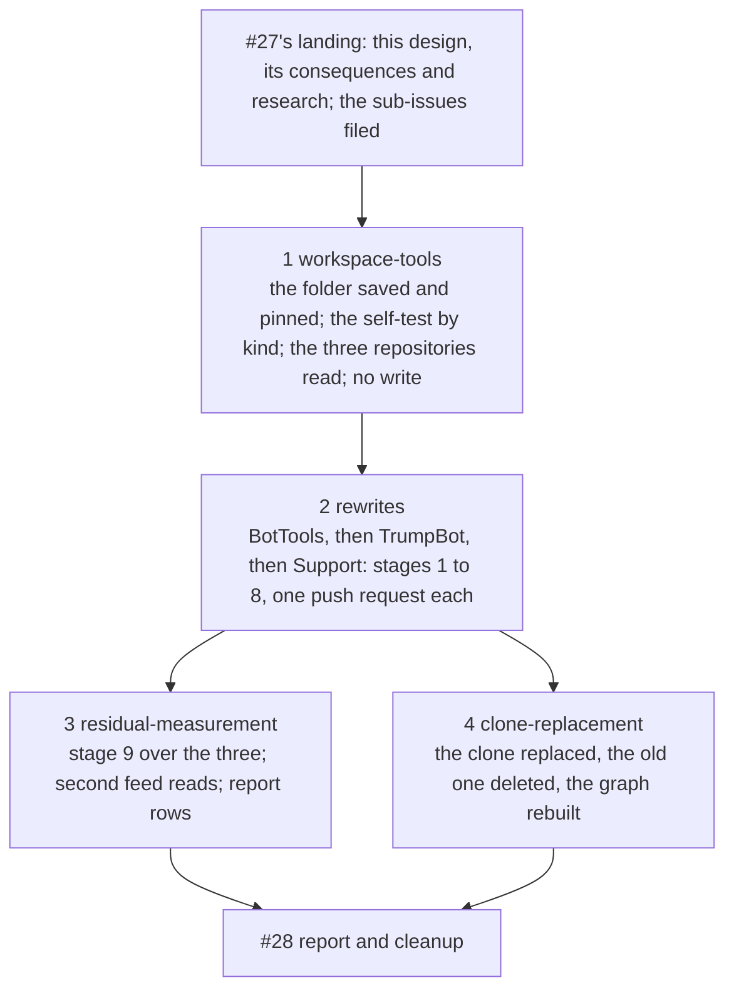

# Phase 0 · 7 — Rewriting BotTools, TrumpBot and Support, and replacing the TrumpBot clone: systems design

## Header / Association

- **Covers:** [SpartanLaboratories/KotlinBottools#27](https://github.com/SpartanLaboratories/KotlinBottools/issues/27),
  *"Phase 0 · 7 — Rewrite BotTools and the private repositories, and replace the private repository clone"*, a
  sub-issue of [#2](https://github.com/SpartanLaboratories/KotlinBottools/issues/2), which is a sub-issue of
  [#1](https://github.com/SpartanLaboratories/KotlinBottools/issues/1).
- **What this document is:** the systems design of unit 7 of the phase, divided into four units. It names the four
  parts of the work, the one system of the phase each part sits in, what each part owns, what it takes in and hands on,
  the gates between the parts, and how the work divides into units. Each unit is a sub-issue of #27, planned and
  carried out by its own run (§16). This document is not a runbook: commands, expected outputs and per-step stop
  lines belong to each unit's plan.
- **Status:** systems design; implementation plans to follow. The units of §16 are filed as sub-issues of #27 once
  this design and its consequences land. Nothing is rewritten, pushed or replaced by this design's landing.
- **Parent design:** [`../architecture.md`](../architecture.md): §1.1 items 1, 7, 8 and 10; §1.2 criteria 1, 6 and 8;
  §2.1 and §2.2; §5; §6.4 (stages 1 to 9, with their dated notes); §6.6; §6.7; §8; §9.5; §11; §12.4; §13; §15,
  unit 7; §16. Where this design departs from the parent's statements, §13.1 lists the dated notes the parent
  documents take.
- **Consequences:** [`consequences.md`](consequences.md) holds the blast radius, adoption, the sibling units, the
  follow-ups and the known gaps.
- **Evidence:** [`research/README.md`](research/README.md), with its verification results and summary, and the three
  findings files it summarises:
  - [`research/two-branch-lease-push.md`](research/two-branch-lease-push.md) (the push findings);
  - [`research/clone-move-aside-on-windows.md`](research/clone-move-aside-on-windows.md) (the clone findings);
  - [`research/tool-changes-for-three-repositories.md`](research/tool-changes-for-three-repositories.md) (the tools
    findings).

  The closest prior art is the GKB2 and GKB unit: [its plan](../26-gkb2-gkb-rewrite/plan.md),
  [its as-built record](../26-gkb2-gkb-rewrite/final-implementation.md) and
  [its consequences](../26-gkb2-gkb-rewrite/consequences.md).
- **Branch:** `chore/issue-27-rewrite-bottools-and-private-repos`, cut from `main` at the merge of the GKB2 and GKB
  unit's pull request. Commits are cited by subject, never by id, as in the parent design.
- **Public material.** This folder is public with KotlinBottools. None of the following appears in it: a secret
  value, a member name, a guild name, a Discord id, a path under `guildData/` or `logs/`, a pre-rewrite commit id, or
  a purged blob id. Machine-local folders are written `%USERPROFILE%\BotWS` (`WS`), `%USERPROFILE%\BotLegacyData`
  (`DATA`) and `%PROJECTS%\TrumpBot`, and volumes are named by role.

---

## 1. Requirements

### 1.1 What the work must achieve

1. **Three histories rewritten, pushed and proven clean.** BotTools, then TrumpBot, then Support, each through the
   pipeline's stages 1 to 8 (parent §6.4), as GKB2 and GKB were. Each push follows only after the previous
   repository has passed its per-ref verification and its exit tests.
2. **One push per repository, conditional and whole.** Every branch of a repository goes in one
   `git push --porcelain --atomic` with an explicit `--force-with-lease=refs/heads/<b>:<old tip>` per branch, to the
   repository's URL, after the same line run as a dry run. Each old tip is read from `ref-map` when the procedure
   runs. Never `--mirror`, `--force`, `-f` or a refspec with a leading `+`. A push is never repeated blindly.
3. **What GitHub still serves is measured, never removed.** The pipeline's stage 9 runs over all three repositories
   once the last push is verified: authenticated probes for all three, anonymous probes and anonymous feed reads for
   BotTools only, and second feed reads at least 6 minutes after the first. BotTools' pull-request residual is
   counted on its fresh mirror.
4. **The local TrumpBot clone is replaced** by a fresh clone at the same path once TrumpBot's push is proven, keeping
   its four `.idea/` files and nothing else that git does not track. The code knowledge graph of the clone is rebuilt
   from the rewritten tree.
5. **The tools are ready before the first push.** The workspace tools are extended for the three repositories in a
   new, self-contained tool folder, and every gap and follow-up the GKB2 and GKB unit recorded for this work is
   closed there, with no write to GitHub.
6. **Every write is requested and read back.** Every write to GitHub, and the clone replacement, is a request to the
   request service, carried out under a grant for the unit's job and verified by the unit, by reading GitHub or the
   checkout, before its next step. Each unit that writes has its own job and its own grant.
7. **BotTools' webhook stays as it is.** The deliveries its push makes are recorded by count.
8. **Nothing sensitive is printed or written** (parent §1.1 item 9), and nothing is committed to any legacy
   repository. No GitHub Support ticket is filed.
9. **The earlier units' records and tools are never overwritten.**
10. **Version: none.** Every landing carries documents only.

### 1.2 Acceptance criteria

Each criterion is proven by one unit of §16.

| # | Criterion | Proven by |
|---|---|---|
| 1 | BotTools, TrumpBot and Support each have every branch and tag clean on a fresh mirror: no purged path in any commit reachable from a branch or tag, every manifest blob missing from them, every count equal to its expectation row, no binary but the Gradle wrapper jar, and the gitleaks branches-and-tags scan clean with the scan verified to have happened | unit 2, `rewrites` |
| 2 | BotTools' pull-request residual is counted on its fresh mirror and recorded: the manifest blobs still reachable through `refs/pull/2/head` and `refs/pull/3/head`, and the commits on every ref | unit 2, `rewrites` |
| 3 | Each push was one request, classed from counted markers and read back at every branch; the pull-request refs, the default branch and the visibility of each repository are as recorded; BotTools' webhook is unchanged and its push deliveries are counted | unit 2, `rewrites` |
| 4 | A gitleaks default-rule finding in a kept file, in a public or a private repository, is recorded by rule id and count and listed as a follow-up | unit 2, `rewrites` |
| 5 | The residual probes of the three repositories are made and tallied: authenticated for all three, anonymous for BotTools, with what BotTools' two pull-request refs still reach stated in its report row; every feed read is made twice, at least 6 minutes apart, and a read outside the events' window is recorded as not valid | unit 3, `residual-measurement` |
| 6 | Each repository's report row is complete and checksummed, ready for #28 | unit 3, `residual-measurement` |
| 7 | The local TrumpBot clone reaches no pre-rewrite commit from any ref, reflog, stash or pseudo-ref, its four `.idea/` files are restored and equal their checksums, and no old-clone path remains | unit 4, `clone-replacement` |
| 8 | The clone's graph is rebuilt from the rewritten tree, and the graph and its two hooks are read back | unit 4, `clone-replacement` |
| 9 | The new tool folder is saved at its pins, its self-test passes by test kind with a total per kind, every recorded gap and follow-up of the GKB2 and GKB unit for this work has its change and its case, and that unit's tool folder equals its own pins before and after | unit 1, `workspace-tools` |
| 10 | No output, document, request or reply stored by any unit holds a pre-rewrite commit id, a purged blob id, a path, a name or a secret, and every earlier record equals its recorded checksum | every unit, at its own close-out |

---

## 2. Current state

These facts were read on 2026-11-13. `main` is at the merge of the GKB2 and GKB unit's pull request. Sources:
[the research README](research/README.md), "The current state the questions start from" and "Verification results";
the three findings files; and read-only reads of GitHub, the workspace and the clone made for this design.

### 2.1 The three repositories

| | BotTools | TrumpBot | Support |
|---|---|---|---|
| Repository id | 540122713 | 540208924 | 540146440 |
| Visibility | public | private | private |
| Branches (default first) | `main`, `Working-Branch` | `main`, `feature/pokercommand` | `main` |
| Pull-request refs | `refs/pull/2/head`, `refs/pull/3/head` | none | none |
| Commits before and after (expectation row) | 16 → 15 | 11 → 9 | 2 → 1 |
| Paths and blobs kept | 82 / 145 | 56 / 106 | 29 / 29 |
| Purged blobs (manifest) | 39 | 199 | 7,259 |
| Purge list lines | 9 | 23 | 6 |
| Positive control on the untouched backup | `RESULT: CLEAN`, the six owned rule ids absent; five earlier records | `CONTROL OK`, nine probe arguments, 3,518 findings; six earlier records | `RESULT: CLEAN`, the six owned rule ids absent; five earlier records |
| Webhooks | one, active, to a CircleCI host, subscribed to push events, with no delivery retained | none | none |

- Each repository advertises exactly the refs recorded when the workspace mirrors were cloned. None has a tag, a
  release, a fork, a wiki repository, a ruleset, branch protection, a workflow or a Pages site.
- **BotTools.** Both pull requests were merged from `Working-Branch`. All 39 purged blobs stay reachable through the
  two pull-request refs, and a fresh mirror holds 28 commits on every ref after the push: the 15 rewritten and the 13
  old ones the pull-request refs keep. No commit of its history holds a CI configuration. Secret scanning and push
  protection are off on it; GitHub's push protection for users applies to pushes to public repositories, so it applies
  to this push and to neither of the other two
  ([the GKB2 and GKB unit's research](../26-gkb2-gkb-rewrite/research/force-push-and-push-protection.md)).
- **Every root commit changes** in all three histories, so every commit is rewritten and every branch of every
  repository changes: 2, 2 and 1 changed heads ([the tools findings, §2 and §12](research/tool-changes-for-three-repositories.md#2-current-state-the-changes-start-from)).
- The expectation rows and the positive controls are the preparation unit's
  ([its as-built record, §3.5 and §3.6](../21-preparation/final-implementation.md#35-manifests-and-expectation-rows)).

### 2.2 The TrumpBot clone and the two volumes

- **The clone,** `%PROJECTS%\TrumpBot`: the local branch `main` only, with the remote-tracking `main` and
  `feature/pokercommand`; one pack, no loose object, no stash; not open in IntelliJ IDEA.
- **What git does not track in it:** 59 files, 4 under `.idea/` (three untracked, one ignored) and 55 under
  `graphify-out/`, a code knowledge graph built from the pre-rewrite working tree. The graph's folder is ignored
  through one entry in the clone's own `.git/info/exclude`, and two git hooks, `post-checkout` and `post-commit`,
  rebuild the graph.
- **Its local configuration** holds 12 keys: the ten a plain clone writes, plus `submodule.active` and
  `lfs.repositoryformatversion`. The first comes only from a recursive clone and the second only from a later Git LFS
  command ([the clone findings, §3.3](research/clone-move-aside-on-windows.md#33-what-a-plain-git-clone-writes-here)).
- **The volumes.** The clone sits in the project-checkouts folder, on the clone's volume. The workspace and the data
  folder sit under the user profile, on the system volume. The two report different device numbers, so a move of the
  clone into the workspace is a copy followed by a deletion, not a rename.
- **Access.** The clone's folder inherits the entries of its volume's root: readable by every local user and
  modifiable by every signed-in account. A rename on the same volume keeps those entries as they are
  ([the clone findings, §3.2](research/clone-move-aside-on-windows.md#32-who-may-read-the-old-clone-afterwards)).

### 2.3 The workspace tools and records

- **`WS/tools/g26/`** holds the GKB2 and GKB unit's 22 tools, each equal to its pin: 18 scripts and 4 data files. Its
  parameter table has rows for GKB2 and GKB only, one branch per row. The corrected stage runner is in place in
  `WS/tools/`.
- **Those tools assume** one branch per repository, a public repository with no webhook, a positive control with
  probe arguments, and stage 9 right after each push. Two of them name GKB2 and GKB outside the parameter table. The
  order gate between repositories tests the other repository's stage 9
  ([the tools findings, §3](research/tool-changes-for-three-repositories.md#3-inventory-what-each-tool-does-what-it-assumes-what-changes)).
- **The gaps and follow-ups that unit recorded for this work** are in
  [its consequences, §5 and §6](../26-gkb2-gkb-rewrite/consequences.md#5-known-gaps): the reply classifier and the
  form of a stored reply, the class table against the classifier, the stops and branches no case reaches, the
  self-test run as one script, the output rule asserted for two outputs only, the budget's reading, the close-out's
  steps not safe to run twice, the test plan's case labels, and the thirteen documentation points.
- **The preparation unit's clone scripts** move the clone into the workspace, archive every file git does not track,
  stop on the clone's two hooks and its exclude entry, and reach the private repository through the system's
  credential helper rather than `gh` ([the tools findings, §9](research/tool-changes-for-three-repositories.md#9-the-clone-scripts-against-the-clone-as-it-is-today)).
- **The workspace** holds the mirror and the untouched backup of each of the three repositories, and no fresh mirror
  of any of them yet. **The data folder** holds, per repository, the preparation unit's five or six records, the
  manifests, and for BotTools the manifest variant pinned to its pull-request refs.

### 2.4 The request service

- **The grant file** for this repository is empty: no job has a section.
- **Its settings deny** `git push --force`, `git push -f`, `git push --force-with-lease` and `git reset --hard`, as
  text patterns. A grant's section cannot override a deny rule: the rule is lifted for the job and restored when the
  section ends.
- **Its own check can refuse a call** that a section covers. An allow line for that exact command is placed only
  after such a refusal, and the call runs again only after the service has restarted; the service then runs the same
  request again itself, under the same id with the next attempt number. The GKB2 push met this once
  ([that unit's as-built record, deviation 4](../26-gkb2-gkb-rewrite/final-implementation.md#4-deviations-from-the-plan)).
- **A request's procedure runs as one shell,** its entries unchanged and in order, so a guard that stops ends the
  procedure before its write. The actions this work uses are `push-mirror` and `replace-clone`.
- **A reply** arrives as one document that holds the procedure's printed lines as list entries on a single line; the
  request protocol names no field for them
  ([the GKB2 and GKB unit's as-built record, deviation 5](../26-gkb2-gkb-rewrite/final-implementation.md#4-deviations-from-the-plan)).
- **The graph service** of the request service builds a repository's graph at the owner's word, given at the request
  service's console, and a new graph gets its hooks in the same job. The request protocol has no action for it.

### 2.5 Verified outside-world facts

- **Several leases in one push** are each checked on the client against the server's advertised value before anything
  is sent. With `--atomic`, a stale lease on one ref sends nothing. On the server, git applies an atomic push as one
  transaction. A clean push of N forced refs tallies `forced=N` and `done=1` with every other count 0, and its dry
  run reads the same; the dry run catches a stale lease and nothing the server decides
  ([the push findings, §4.1 and §4.2](research/two-branch-lease-push.md#41-what-git-does-with-several-leases-and-with---atomic-documented-source-observed)).
- **GitHub advertises `atomic`.** That its receive path applies an atomic push all or nothing is not documented
  ([the push findings, §4.3](research/two-branch-lease-push.md#43-does-github-apply-an-atomic-push-all-or-nothing-documented-capability-one-public-log-not-established)).
- **A lost connection** prints no `To` line and `fatal:` lines on the error stream, and leaves every branch at its
  old tip or every branch at its new one. Only a read of every branch names the state.
- **What a push publishes:** per rewritten branch, one push event, one force-push entry in the activity feed and, for
  BotTools, one push delivery to its webhook. GitHub lists a webhook's deliveries for three days, and the list
  carries no payload. The events cover 30 days and can lag by up to 6 hours
  ([the push findings, §4.5](research/two-branch-lease-push.md#45-what-a-force-push-of-two-branches-publishes-and-how-to-count-it-documented-observed-idiom)).
- **A directory rename on Windows** refuses with no effect while anything inside is open, and cannot cross volumes.
  Across volumes, `mv` copies and then removes, and with one file held open it leaves a full copy at the target and a
  mostly deleted source ([the clone findings, §3.1](research/clone-move-aside-on-windows.md#31-what-a-move-is-on-windows-and-in-git-bash)).
- **A plain `git clone` on this machine** writes exactly ten local configuration keys, no hook beyond the samples, an
  exclude file of comment lines only, one pack and no `FETCH_HEAD`.
- **A private repository's objects** are readable by anyone with read access who is signed in, and by nobody
  anonymously (parent research, the residual-exposure findings §3.1).

---

## 3. Assumptions

| Assumption | If false |
|---|---|
| Nothing is pushed to BotTools, TrumpBot or Support except by unit 2. | The comparison of the server's heads with `ref-map`'s old column fails at the push preparation, in the procedure's guards or at the lease. Nothing is sent, and that repository is handed back for a fresh clone and rewrite. |
| GitHub's receive path applies an atomic push as one unit. | A failure can leave one branch of two updated. The read-back names that state, partial, and hands back with each branch's reading; no push follows without a person's decision. |
| GitHub's receive path refuses an update whose old value changed after the push's own advertisement. | A branch that moves in the seconds between the advertisement and the update would be overwritten. The guards and the dry run narrow the window; the per-ref verification shows the branch's tip afterwards. |
| The request service's delivered reply holds each printed line as a string entry of its result. | The classifier stops plainly on a reply it cannot read. The server's state is read from GitHub either way, so the stop repeats nothing and misreads nothing; the unit hands back. |
| The grant for unit 2's job lifts the deny rule on `git push --force-with-lease`, and a call the service's own check refuses gets its allow line and the restart. | The request is refused before anything runs. The read-back shows every branch at its old tip, and the request is sent again only under the rule of §8.3. |
| The two private repositories answer the authenticated routes as a public repository does. | A batch's controls fail and the batch is void. The answer is seen and recorded, not read as a result. |
| The token that pushes can read BotTools' webhook and the list of its deliveries. | The count cannot be taken. Unit 1's read of the three repositories shows it before any push, and the rewrites do not start. |
| Unit 3 runs within the events' 30 days of BotTools' push, the earliest of the three. | BotTools' events reads list no event of its push and are recorded as not valid, never as absent. The probes and the activity feed are unaffected. |
| TrumpBot's and Support's rewrites and scans fit within one run on this machine (Support's manifest holds 7,259 blobs). | The unit's plan divides the repository's stages across its own stages; nothing in this design changes. |
| A default-rule finding in a kept file of these repositories, if any, is a false positive. | It is recorded by rule id and count and becomes a follow-up; the unit continues (parent §6.4 stage 8). |
| The clone's volume and the workspace's volume stay different, and the project-checkouts folder stays a plain folder. | The same-volume guard stops the move before anything changes. |
| Nothing holds a file, a folder or a working directory inside the clone except, at most, a scanner that releases within seconds. | The rename refuses, the bounded retry ends refused, and the unit stops with nothing changed. |
| A fresh clone from GitHub writes into `.git` what the observed clone of a stand-in repository wrote. | A proof of the fresh clone reads a different key or file and stops, before the old clone is deleted. |
| The account that runs the procedure can delete every file of the old clone. | The deletion leaves a leftover at the recorded path. The unit stops, names the path in its hand-back, and the deletion is requested again. |
| The code-only graph build installs the two hooks and the one exclude entry, and sets neither of the two extra configuration keys. | The read-back of the graph differs from its expectation. It is recorded; the replacement itself stands. |
| The four `.idea/` files are tracked nowhere in the rewritten tree. | The restore refuses to overwrite and stops; the old clone is still whole and is moved back. |

---

## 4. Non-goals

- **No removal of anything GitHub still serves.** BotTools' pull-request refs, its old objects and every cached view
  stay. No GitHub Support ticket is filed, and no pull request or ref is deleted.
- **No change to BotTools' webhook,** and no read of a delivery's payload.
- **No commit to BotTools, TrumpBot or Support:** no `.gitignore`, no README pointer, no archive. Those belong to
  Phase 17.
- **No anonymous probe of TrumpBot or Support.** GitHub answers "not found" to every anonymous request to a private
  repository, whatever it holds, so such a probe measures nothing.
- **No change to the GKB2 and GKB unit's tool folder or records,** and no run of the two workspace scripts that pin
  the earlier scan configuration.
- **No carrying of the old clone's graph output,** its exclude entry, its two hooks or its two extra configuration
  keys into the fresh clone.
- **No narrowing of the old clone's access entries** while it is aside. The rename widens access by nobody, and a
  recursive rewrite of the entries is not proven safe
  ([the clone findings, §3.2](research/clone-move-aside-on-windows.md#32-who-may-read-the-old-clone-afterwards)).
- **No report on #2, no re-verification of the data folder and no deletion of the workspace.** Those are #28's.
- **No path scrub** in these three repositories (parent §4).
- **No rotation of a credential.** It stays the parent consequences' follow-up.
- **No version bump, no changelog entry and no README change** in KotlinBottools: every landing is documents only.

---

## 5. System inventory

The work has four parts. Each sits inside one system of the phase's registry and is one unit of §16. The existing
systems they use follow in the second table.

| Part (unit) | System | Responsibility (one sentence) | Lives in | Owns | Does not own |
|---|---|---|---|---|---|
| **The tools** (1, `workspace-tools`) | Toolchain (parent §6.1) | Deliver, pinned and self-tested, every tool the other three parts run for these three repositories, before anything is written. | `WS/tools/g27/`; its sources and pins in the unit's plan | the new tool folder and its four tool sets; the parameter rows of the three repositories; the grant check; the self-test by test kind; the closing of the GKB2 and GKB unit's recorded gaps | any run of a rewrite, a push, a probe or the replacement; the earlier tool folder; the reused earlier tools, which it reads by pin |
| **The rewrites** (2, `rewrites`) | Rewrite pipeline (parent §6.4) | Turn BotTools, then TrumpBot, then Support into pushed, verified and proven rewritten repositories, or stop a repository before its push. | `WS/mirror`, `WS/fresh`, `DATA/rewrite/<repo>`, the unit's run records in `DATA/run` | stages 1 to 8 per repository; each push request's inputs, expected tally and classification; the per-ref verification; the exit tests; BotTools' pull-request residual count; BotTools' webhook delivery count; its records and their checksum lists | carrying out a push, which is requested; stage 9; the clone; the tools' text |
| **The residual measurement** (3, `residual-measurement`) | Residual-exposure measurement (parent §6.6) | Measure, in counts, what GitHub still serves of the three old histories once the last push is verified, and complete each repository's report row. | `DATA/rewrite/<repo>`, the unit's run records in `DATA/run` | the probe sets and their tallies; the feed reads and their validity; the report rows; its records and their checksum lists | any removal; any write to GitHub; the report on #2 |
| **The clone replacement** (4, `clone-replacement`) | Clone realignment (parent §9.5) | Replace the TrumpBot clone with a proven fresh clone at the same path, delete the old one, and have the graph rebuilt. | `%PROJECTS%\TrumpBot`, `%PROJECTS%\TrumpBot-old` between the move and the deletion, `DATA/run/trumpbot` | the request procedures and their inputs; the census; the archive of the four carried files; the proofs of the fresh clone; the deletion of the old clone; the read-back of the graph | carrying out the procedures, which are requested; the graph build, which is the graph service's; any commit |

| Existing system | What the parts take from it | How |
|---|---|---|
| **Workspace and data folder** (parent §5) | the layout and the sensitivity boundary: nothing under `DATA` or `WS` is committed, printed or quoted | every part writes new files only, beside the earlier ones |
| **Backups and manifests** (parent §6.2; the preparation unit) | per repository: the mirror, the untouched backup, the manifest, the expectation row, the positive-control records, the purge list and the clone listing | read only; each part proves them unchanged against their recorded checksums before it relies on them |
| **The GKB2 and GKB unit's tools and records** | the tools as they ran, as the source the new folder is derived from; the corrected stage runner; the push pattern, the class table and the readiness pattern | read only; the folder and its records stay as they ran (§13.3) |
| **The reused earlier tools** | the environment and library scripts, the expectation check, the scan wrapper with its binary and configuration, the tally script, the lock probe | read at their pins, unchanged |
| **The request service and its grants** | the carrying out of each push and of the clone replacement, under one grant per job | requests by file with the file's sha256 (§12) |
| **The graph service** | the code-only build of the fresh clone's graph, with its hooks | at the owner's word, given at the request service's console (§10.5) |
| **Cleanup** (#28; parent §6.7) | nothing; it takes this work's records (§13.4) | — |
| **The parent design and the registry** | the pipeline, the measurement and the replacement as designed; the systems' units | dated notes (§13.1); the registry's units (§13.2) |

### 5.1 Seams

What crosses each boundary. Every item is a file or a folder at a recorded checksum, a marker, or a count; no part
calls another.

| From | To | What is handed on |
|---|---|---|
| unit 1 | units 2, 3 and 4 | the tool folder at its pins, with the pin table in unit 1's plan; each later unit proves the folder equal to its pins before it runs anything |
| unit 1 | unit 2 | the rewrite set: readiness, stages 1 to 8, the reset after a stop before a push, the push request builder with its classifier, and the close-out; the parameter rows; the grant check |
| unit 1 | unit 3 | the residual set: its readiness, stage 9 with the probe selection by visibility, the feed reads and the record step |
| unit 1 | unit 4 | the clone set: the request builder for the replacement, the move back and the deletion, the read-only checks, the proofs; the grant check |
| unit 2 | unit 3 | per repository: the stage-8 marker; `ref-map`, `commit-map` and `first-changed-commits`; the fresh mirror; the exit-test counts; the time of the push; for BotTools the residual count and the webhook delivery count; all under the unit's checksum lists |
| unit 2 | unit 4 | TrumpBot's stage-8 marker, its `ref-map` and `commit-map`, its manifest and its untouched backup, which the proofs of the fresh clone read |
| unit 2 | #28 | its records with their checksum lists; any default-rule finding, by rule id and count |
| unit 3 | #28 | the three report rows; the probe tallies and feed records; its checksum lists |
| unit 4 | #28 | the record that no old-clone path remains, with the recorded path; the clone's records |
| units 1 to 4 | #28 | the workspace tools to copy at cleanup: both tool folders and the stage runner |

---

## 6. Interactions

- **Dependency direction.** Unit 1 depends on what exists. Units 2, 3 and 4 depend on unit 1's folder. Units 3 and 4
  depend on unit 2's records and on nothing of each other.
- **What crosses a boundary** is shared state on disk at a recorded checksum, never a call. A unit that reads another
  unit's records first compares them with their checksum lists, and reads the server again for anything a marker
  claims about GitHub: a marker starts a unit, and a read of GitHub is what the unit relies on.
- **Requests** are the only calls: from a unit to the request service, and the notice to the graph service.

---

## 7. The tools

Unit 1, `workspace-tools`. It writes nothing to GitHub and changes no repository and no checkout.

### 7.1 The folder

- **A new, self-contained folder,** `WS/tools/g27/`, derived from `WS/tools/g26/`. Nearly every file changes for
  these repositories: a parameter row has columns the tools read by position, the push holds one branch in a dozen
  places, the repositories differ in visibility, webhooks and probes, and the documentation points touch almost
  every file.
- **The earlier folder stays as it ran.** Its pins are the GKB2 and GKB unit's record, and an edit in place would
  make that record false. The new folder is saved by a step that writes only its own folder, from the unit's plan,
  which holds every file's source and pin. The reused earlier tools and the stage runner are read at their existing
  pins and are not saved again.
- **No script of the folder names a repository, an issue or a branch.** Each step takes the repository as its
  argument and reads the rest from data.

### 7.2 The four tool sets

| Set | What it holds | Run by |
|---|---|---|
| **Rewrite set** | the readiness checks; stages 1 to 8 of a repository; the reset after a stop before a push; the push request builder, the reply store and the classifier; the close-out of the rewrites | unit 2 |
| **Residual set** | a readiness check that all three repositories have passed stage 8; stage 9 with the probe selection; the feed reads; the record step that writes the report rows | unit 3 |
| **Clone set** | the read-only checks of the clone; the builder of the three request procedures (the replacement, the move back, the deletion); the proofs of the fresh clone | unit 4 |
| **Self-test** | every case, run by test kind, each kind with its own total: the gating checks, the component tests, the integration tests, the deterministic cases and the non-functional cases. The group of pure functions is the quick gate | unit 1; the quick gate again by each later unit |

All four share one library: the parameter row, the step markers, the ref listings, the route classification, the
probes and the feed counts.

### 7.3 What changes against the earlier tools

- **The push.** One request per repository carrying one atomic lease push of N branches, N taken from `ref-map`'s
  changed heads. The builder assembles one lease and one refspec per branch and asserts exactly one `--atomic`, one
  lease per refspec, and none of the forbidden arguments. The expected tally is derived from N. The classes add the
  atomic sibling wording to the counted markers and a transport class read from a missing `To` line with `fatal:`
  markers. The server's state after any non-zero status is one of three: neither, both or partial (§8.3).
- **The stored reply.** The reply is taken in the form the request service delivers; the printed lines are read from
  the result's string entries and kept one to a line. The classifier stops plainly on a reply it cannot read, and the
  class table and the classifier state one rule.
- **The order gate** between repositories moves from the previous repository's stage 9 to its stage 8, and its
  marker's name is a column of the parameter table.
- **The positive control** for a repository with no probe arguments: the six owned rule ids absent, a clean result,
  and five earlier records where a repository with probes has six.
- **Visibility, default branch and webhook count** are read from the parameter row wherever the earlier tools assume
  a public repository with no webhook: the readiness read of the repository, the per-ref verification, the final
  reads.
- **The probe selection.** A private repository gets the authenticated batches and the authenticated feed reads
  only. The anonymous batches, the anonymous budget and the anonymous feed reads run for a public repository only.
- **BotTools' webhook deliveries:** a baseline count at the push preparation and the count since the push at the
  per-ref verification, from the list of deliveries, which carries no payload.
- **The grant check** reads the job's name, the issue, the branch, the actions and the targets from a data file the
  running unit supplies. The check names none of them.
- **The clone scripts** become request procedures written by a builder, each entry setting what it uses and each
  guard ending the shell: `gh` as the only credential helper, the carried folder and the not-carried folder as
  policy values, the move target as a parameter, the hooks and the exclude entry recorded rather than stops, and
  every error of `mv`, `rm`, `tar` and `git` written to a file and counted.
- **The self-test's stand-in for the request service** runs a procedure as one shell, as the service does.

### 7.4 The recorded gaps

Every gap and follow-up of [the GKB2 and GKB unit's consequences, §5 and §6](../26-gkb2-gkb-rewrite/consequences.md#5-known-gaps)
that names this work is closed in this unit, before the first push. The tools findings map each to its files
([§7](research/tool-changes-for-three-repositories.md#7-gaps-and-follow-ups-mapped-to-files-and-parts)). The order is
by what guards a write:

1. the reply's form and the classifier; the class table against the classifier;
2. the stops of the push preparation, the push step and the reset that no case reaches, beginning with the stop for
   a branch at its old tip whose last class allows no resend;
3. the grant check and the readiness checks of the inputs;
4. the one-shell stand-in;
5. the rest: the void tally on failed closing controls and the other probe and feed cases; the budget's reading; the
   close-out's steps safe to run twice; the output rule asserted over every step's output and the self-test's own;
   the pure transforms; the pace, the spacing of the feed reads and the token never printed; the case labels, each
   naming a behaviour.

The rule for the stops is one case for every expectation and every stop of a step script. The thirteen documentation
points go with the change that saves the tools again: each file is written once, with its header, contracts,
"Writes:" clause, line comments, regions and language hints in place.

### 7.5 What the unit proves, and what follows its landing

- **Readiness reads.** The unit reads the three repositories once (visibility, default branch, branches, webhook
  count, the scanning settings where a repository reports them) and proves the parameter rows against the data: each
  purge list against its recorded checksum, the probe arguments against the preparation unit's script, the every-ref
  commit count against a derivation from the untouched backup.
- **The earlier folder** equals its own pins before the save and after it.
- **After the landing the folder is fixed.** A later unit that meets a defect in a tool stops. The correction is a
  new version of that file, carried whole with its new pin by the plan of the unit that makes it, with the test kind
  that covers it run again, and a dated note in this unit's consequences: the way the GKB2 and GKB unit replaced the
  stage runner.

---

## 8. The rewrites

Unit 2, `rewrites`. One unit for the three repositories, under one job and one grant.

### 8.1 Shape

- **Order.** BotTools, TrumpBot, Support, as the parent design orders them. A repository's stage 1 starts only when
  the previous repository holds its stage-8 marker. BotTools goes first with the only push that GitHub's push
  protection for users applies to and the first atomic push of two leases, so what GitHub's receive path does with
  either is known before a private repository is pushed.
- **Stages 1 to 5** are the parent's: the list proof and the pre-run checks, the positive control on the untouched
  backup, the one invocation, the post-run checks with the scan before the push, and the push preparation. BotTools'
  baseline of webhook deliveries is taken at the push preparation.
- **Stage 7** compares heads and tags on two channels with the rewritten heads, finds no head at a pre-rewrite
  commit, and finds the pull-request refs, the default branch, the visibility and the archive state as recorded. For
  BotTools it counts the push deliveries since the baseline, right after the push, because GitHub lists deliveries
  for three days only, and reads the webhook as unchanged. The count is taken once.
- **Stage 8** runs the exit tests on a fresh mirror. For BotTools it also counts, and records without stopping, the
  manifest blobs reachable from every ref (expected 39 of 39), the commits on every ref (expected 28) and the
  every-ref scan's findings by rule.
- **The close-out** reads the three repositories once more and writes the unit's checksum lists over its own
  records. It writes no report row.

### 8.2 The push

One request per repository. The request names its request file in `DATA` with the file's sha256, and asks that the
procedure's entries be run as one shell and that every printed line be given in the reply. The procedure holds the
guards, the dry run and the push:

- **Guards,** each ending the shell on a difference: the mirror and its `origin`; the local refs equal `ref-map`'s
  new column; the server's heads and tags equal the old column; the server's pull-request refs equal their record.
- **The dry run and the push,** the same line: `git push --porcelain --atomic`, one
  `--force-with-lease=refs/heads/<b>:<old tip>` and one refspec `refs/heads/<b>:refs/heads/<b>` per branch, the
  repository's URL as the destination, `gh` as the only credential helper. Each old tip is read from `ref-map` when
  the entry runs, so the request carries no commit id.
- **N** is the number of `ref-map`'s changed heads: 2 for BotTools, 2 for TrumpBot, 1 for Support, which takes the
  same path with one lease.
- **The expected tally** of both runs: `forced=N fastforward=0 new=0 deleted=0 uptodate=0 rejected=0 done=1
  pull_lines=0 other_refs=0 bad=0`, with exit status 0. The push entry requires the dry run's tally to be the
  expected one.
- **Streams.** Both streams of each run are kept in `DATA` and never printed. The procedure prints counts of fixed
  markers only.

### 8.3 Outcome, read-back and resend

The outcome is a class, read from the exit statuses, the tally and the counted markers, and a state, read from
GitHub.

| Class | Read from | What follows |
|---|---|---|
| pushed | status 0, the clean tally, the same flags in both runs | stage 7 |
| a lease was stale | `[rejected]` with `(stale info)`, the atomic sibling wording on the other ref | nothing was sent; the repository is handed back for a fresh clone and rewrite |
| refused by push protection, by a rule, or unattributed | `[remote rejected]`, with or without GitHub's markers; sibling lines carry the atomic wording | stop and hand back; the owner decides from the kept error file; the unit never bypasses |
| transport | no `To` line, with `fatal:` markers, at any exit status | the state decides |
| stopped by a guard; refused by the service | no push status in the reply; the service's refusal | the state decides |
| unclassified | anything else | stop |

After any non-zero status, and before any further step, one read of every branch and of the pull-request refs names
the **state**:

- **neither:** every branch at its old tip. The mirror and the backup stand.
- **both:** every branch at its new tip. The push landed although its answer was lost; it is recorded, and the two
  channels of stage 7 decide.
- **partial:** anything else. Not expected under `--atomic`; it stays a state because GitHub's side is not
  documented. The unit hands back with each branch's reading, and no push follows without a person's decision.

A request is sent again only when the class is transport, stopped by a guard or refused by the service, the state is
neither and the pull-request refs are unchanged: the same id with the next attempt number, or a new id after a
refusal by the service. Every other class hands back. A rerun the request service makes itself after its restart
(§2.4) runs the guards again and pushes only under the leases.

### 8.4 Records

The unit writes new files only, beside the preparation unit's five or six records of each repository: the rewrite's
outputs, the pre-push scan, the push preparation's records, the kept streams, the listings after the push, the exit
tests' outputs, for BotTools the residual record and the two delivery counts, and the time of each push. Its run
records hold the request files, the stored replies, the classes and the step markers. Each folder gets the unit's
own checksum list at the close-out. A default-rule finding in a kept file is recorded by rule id and file count, with
no path and no value, before the push and on the fresh mirror.

---

## 9. The residual measurement

Unit 3, `residual-measurement`. It reads GitHub and writes nothing to it. It needs no grant.

### 9.1 When it runs

- **Start condition:** all three repositories hold their stage-8 marker, and a read of each shows every branch at
  its rewritten tip.
- **Promptly after the last push.** The events cover 30 days from each push and can lag by up to 6 hours. A feed read
  counts only when it lists a current id of the repository. A read that falls before the lag has passed or outside
  the 30 days is recorded as **not valid**, never as "absent".
- **The three repositories are independent** here: stage 9 runs for each in any order.

### 9.2 What is measured

| | BotTools (public) | TrumpBot (private) | Support (private) |
|---|---|---|---|
| Authenticated probes: every old branch tip, every first-changed commit, their trees, a sample of manifest blobs; a protocol-v2 `want` of each old tip | yes; all 39 blobs | yes; 50 of 199 | yes; 60 of 7,259 |
| Anonymous probes: the web commit route, the `want` route, and a small REST sample within the anonymous budget | yes | no | no |
| Authenticated feed reads: the activity feed and the events, for membership of the pre-rewrite ids, with the force-push entries counted per branch | yes | yes | yes |
| Anonymous feed reads: the activity page, the activity feed and the events | yes | no | no |
| Second feed reads, at least 6 minutes after the first | every read made | every read made | every read made |

- **Sets and controls** are the parent's and the GKB2 and GKB unit's: the blob sample is evenly spaced and bounded
  at 60; a rewritten commit, its tree and one of its blobs, expected served, and an id that exists nowhere, expected
  absent, bracket every batch; a batch whose opening or closing controls fail is void.
- **Expected answers.** Every old object of the three repositories is still served to an authenticated reader with
  access, and BotTools' to anyone. An answer that differs from the expectation is a result and is recorded; a status
  outside a route's answers, a failed control or a void batch stops the set, which is run again later with fresh
  controls.
- **The anonymous REST budget** is read before BotTools' set and compared, at the end of the set, with the calls
  made; a reading that disagrees with the calls is recorded.
- **Every result is a tally.** No id, body or header value is printed.

### 9.3 The report rows

The record step writes each repository's report row, in counts only, from unit 2's recorded counts and this unit's
tallies: the commits before and after; the paths and blobs kept; the manifest's size; the gitleaks results for
branches and for every ref, with any default-rule finding by rule id and count; the probe tallies, authenticated
and, for BotTools, anonymous; the feed and events membership with each read's validity; for BotTools the
pull-request residual and the count of webhook deliveries; and what the probes cannot prove (parent §12.4). The
step writes each row once, however often it runs, and then the unit's checksum lists. Unit 2's records are compared
with their checksum lists at the unit's start and are never written.

---

## 10. The clone replacement

Unit 4, `clone-replacement`. It runs once TrumpBot's push is proven: TrumpBot holds its stage-8 marker, and the
server's heads equal `ref-map`'s new column.

### 10.1 Shape

The replacement and the deletion are two requests, so that the unit's own read of the fresh clone stands between the
last reversible step and the irreversible one. The move back is a third procedure of the same builder, requested
only after a stop that follows the rename.

### 10.2 The move

- **Where.** The old clone is moved aside by one rename on its own volume: `%PROJECTS%\TrumpBot` becomes
  `%PROJECTS%\TrumpBot-old`. A rename refuses with no effect while anything inside is open, which makes it the lock
  probe, and it keeps the tree's access entries as they are. A move into the workspace would cross volumes, and that
  is a copy followed by a deletion: no lock probe, and the irreversible step first.
- **Guards before it:** the target is absent; the clone and the target's parent are on the same volume, compared by
  `stat -c %d`, so that `mv` can never copy; the count of open files is 0; no git process runs; the procedure's shell
  is outside the clone; the old clone's census is recorded.
- **The rename** runs in a bounded retry. Its outcome is read from whether each of the two paths exists, never from
  `mv`'s status: source present and target absent is refused, source absent and target present is moved, and
  anything else is a stop that names the pair. A loop that ends refused is a stop that changed nothing.
- **After a move,** the old clone's census must equal the recorded one.
- **The move back** is the same rename in the other direction, after the partial fresh clone has been removed behind
  its own guard, followed by the census, the 59 files, the two hooks and the 12 keys read again.

### 10.3 What is carried, and what is not

- **Carried:** the four `.idea/` files, archived with a checksum list behind a closed-set guard over the 59 files git
  does not track: 4 under `.idea/`, 55 under `graphify-out/`, 0 anywhere else. A file outside the two folders is a
  stop, because it would be dropped silently. The carried folder and the not-carried folder are policy values.
- **Not carried:** the 55 graph files, the exclude entry, the two hooks and the two extra configuration keys. The
  graph was built from the pre-rewrite tree, so it describes files the rewrite removes. The hooks and the exclude
  entry are recorded by name, size and checksum, never printed, and nothing runs the hooks during the replacement.

### 10.4 The fresh clone, its proofs and the deletion

- **The fresh clone** is made at the same path from TrumpBot's URL, with `gh` as the only credential helper, since
  the repository is private.
- **The restore** refuses to overwrite. The restored set must equal the four-file list byte for byte, with every
  checksum matching.
- **The proofs,** made by the procedure and again by the unit before it requests the deletion:
  - the remote-tracking refs equal `ref-map`'s new column, and `main` equals its remote-tracking branch;
  - one pack, no loose object, a clean `fsck`;
  - every pre-rewrite commit of TrumpBot and every manifest blob is missing from the clone;
  - exactly the ten local configuration keys of a plain clone, no hook beyond the samples, an exclude file of
    comment lines only, no `FETCH_HEAD`;
  - the files git does not track are exactly the four carried.
- **The deletion** is the replacement's last step. It is requested only after the unit's read-back, at the recorded
  path, on the clone's volume, behind guards that the path is the recorded one and that its census is the old
  clone's. Its outcome is the path's absence. The workspace's deletion never reaches this path, so "no old-clone
  path remains" is this unit's own acceptance.

### 10.5 The graph rebuild

- **When.** After the replacement is complete: the fresh clone proven and the old clone deleted. The deletion does
  not wait for the build, because the old clone is no fallback for it, and the pre-rewrite objects stay outside the
  workspace no longer than the replacement needs.
- **Who.** The request service's graph service makes a code-only build of the graph from the rewritten tree and
  installs the two hooks, at the owner's word, given at the request service's console. The unit lists that word
  among what it asks for up front (§12), and tells the request service when the clone is proven.
- **The read-back.** The unit reads the clone again: the graph's folder exists; the hooks beyond the samples are
  exactly `post-checkout` and `post-commit`; the exclude file holds the one entry for the graph's folder; the local
  keys are the ten, with at most `lfs.repositoryformatversion` beside them and never `submodule.active`; the files
  git does not track are the four carried and the graph's. The proofs of §10.4 on refs and objects hold unchanged.

---

## 11. Order, gates and failure behaviour

- Units 3 and 4 both wait for unit 2 and for nothing of each other. Unit 3 is ordered first because its reads have a
  window.
- **#27 closes** when its last unit has landed. **#28** stays blocked by #27.

| Unit | Irreversible so far | What a stop leaves | Never repeated |
|---|---|---|---|
| 1 | nothing on GitHub, in any repository or in any checkout | the new folder absent or partly saved, and saved whole again; the earlier folder and every record as they were; the unit runs again from its first check | — |
| 2, before a repository's push | the pushes of the repositories before it | the repository's mirror rewritten or partly rewritten, reset from the untouched backup; nothing changed on GitHub; the repositories after it wait | the one invocation in a mirror: a second run starts from a reset mirror |
| 2, at a repository's push | the same | by class and state (§8.3): neither, with the mirror and the backup standing; both, recorded, with stage 7 deciding; partial, handed back with each branch's reading | the push: sent again only for the three classes of §8.3 with the state neither; after partial, only by a person's decision |
| 2, after a repository's push | that repository's push | the remote holds the rewrite, or may be partly updated; the tally and the readings are reported; the repositories after it wait; a custom-rule finding on the fresh mirror hands back | the push |
| 3 | nothing: it writes nothing to GitHub | the three repositories as unit 2 left them; a void batch is run again later with fresh controls; a spent anonymous budget is a wait until the printed time; a feed read that is not valid is a result | a recorded read: the steps pass over what is already recorded |
| 4, before the rename | nothing | the clone unchanged; a refused rename changed nothing | — |
| 4, after the rename, before the proofs pass | nothing: the old clone is whole at `%PROJECTS%\TrumpBot-old` | the move back is requested; the clone is then as it was, by its census | the rename when both paths or neither exist: that is a stop, not a retry |
| 4, after the proofs | nothing until the deletion; then the old clone is gone | before the deletion: the fresh clone in place and the old clone aside, its path named in the hand-back. After a deletion that left a leftover: the path named, the deletion requested again | the deletion anywhere but at the recorded path |
| 4, at the graph build | the replacement | a proven fresh clone with no graph or an incomplete one; the build is asked for again; the replacement stands | — |

No unit stops for a person before a push or the replacement. Every stop is a failed check, and each unit's plan
states what state each of its stops leaves.

---

## 12. Version control and requests

**Where writes go.** Each unit does its local work itself: saving the tools, the rewrites in the workspace mirrors,
the scans, the fresh mirrors, the probes and every read of GitHub and of the clone. Every write to GitHub, and every
change to the TrumpBot checkout, is a request to the request service.

**The form of a request.** A request names its request file in `DATA`, with the file's sha256, and asks that the
procedure be run as one shell, its entries unchanged and in order, with every printed line in the reply. The request
service compares the hash with the file and runs the file's procedure. The unit stores the reply, reads GitHub or
the checkout, and only then takes its next step.

**One job per unit that writes.** A grant is one section of the request service's grant file for KotlinBottools,
and the section's scope names the other repositories or the checkout. Everything a unit needs from the owner is
asked once, up front, at the request service's console, before the unit runs.

| Unit | Writes, requested | Request actions | Asked of the owner up front | Landing |
|---|---|---|---|---|
| 1 `workspace-tools` | none | none beyond its landing | nothing | documents only: its plan with every tool's source and pin, its as-built record, its consequences, the dated notes on the GKB2 and GKB unit's consequences, the boards |
| 2 `rewrites` | three pushes: the branches of BotTools, of TrumpBot and of Support | `push-mirror`, one request per repository | the grant section for its job: `push-mirror` and force-pushing with a lease; scope: its sub-issue and branch, the three targets and no other, one request each from the rewritten workspace mirror to its own repository, updating the named branches alone in the form of §8.2, sent again only under §8.3; ends when the sub-issue lands. With it: the lift of the deny rule on `git push --force-with-lease` for the job, restored when the section ends; and the allow line and the restart of the request service that a call refused by the service's own check needs | documents only |
| 3 `residual-measurement` | none | none beyond its landing | nothing | documents only |
| 4 `clone-replacement` | the replacement of the TrumpBot clone; the deletion of the old clone; the move back, only after a stop | `replace-clone` | the grant section for its job: `replace-clone`; scope: its sub-issue and branch, the checkout `%PROJECTS%\TrumpBot`, the folder `%PROJECTS%\TrumpBot-old` and TrumpBot as the clone's source, for the three procedures of §10.1; ends when the sub-issue lands. With it: the allow line and the restart that a refused call needs; and the owner's word for the code-only graph build of the fresh clone, with its hooks, once the unit reports the clone proven. No deny rule is lifted: no procedure of the unit force-pushes or resets | documents only |

- **A refused call.** When the request service's own check refuses a call a section covers, nothing has run. The unit
  reads the state, the allow line is placed, the service restarts and runs the same request again itself. The unit
  sends nothing a second time for it, and classes the outcome from the reply of the rerun and its own read.
- **The landings.** Each unit lands through its own pull request on KotlinBottools, which closes that unit's
  sub-issue only. No pull request uses a closing keyword for #27, #2 or #1. #27 is closed when its last unit has
  landed. A landing is not made under a unit's job.
- **This design's landing** is #27's own pull request: this document, its consequences, the research and the dated
  notes of §13.1. It closes nothing. The sub-issues are filed afterwards, in the order of §16, with their "blocked
  by" relationships.
- **Documents only.** No landing changes code, the README or the changelog, and none moves a version.
- **Before each landing,** the unit's document checks run over the pending documents: no pre-rewrite id, no
  machine-local path, the privacy gate and the secret scan.

---

## 13. Integration with existing systems

### 13.1 Dated notes on the parent documents

The parent documents take these notes with this design's landing. Each note states what changes for BotTools,
TrumpBot and Support; the statements stay as written for the other repositories.

| Document, section | What the note says |
|---|---|
| `../architecture.md` §1.1 item 1 | The three repositories are not pushed with `--force --mirror`. Each is pushed once: every branch in one `git push --porcelain --atomic` with an explicit lease per branch on the tip the clone recorded, to the repository's URL, after a dry run; 2, 2 and 1 branches. |
| `../architecture.md` §2.1 | BotTools has one active webhook, to a CircleCI host, subscribed to push events; it stays as it is, and its push deliveries are recorded by count. The repository ids are 540122713, 540208924 and 540146440. |
| `../architecture.md` §2.2 | The TrumpBot clone holds 59 files git does not track: the four under `.idea/` and 55 under `graphify-out/`, a code knowledge graph, with one entry in its `.git/info/exclude`, two hooks that rebuild the graph and two local configuration keys a plain clone does not write. It sits on another volume than the workspace. |
| `../architecture.md` §5.1 | `run/` also holds the run records of #27's units; `run/tools/` receives both tool folders at cleanup. |
| `../architecture.md` §5.2 | `TrumpBot-old/` is not in the workspace. The old clone is moved aside on its own volume, to `%PROJECTS%\TrumpBot-old`, and deleted there by the clone replacement. `tools/` holds two tool folders, the GKB2 and GKB unit's and the one for these three repositories; the preparation unit's clone scripts are not run. |
| `../architecture.md` §6, the inventory row "TrumpBot clone replacement" | It lives in the clone and in `%PROJECTS%\TrumpBot-old`, not in `WS/TrumpBot-old`. |
| `../architecture.md` §6.1 | The tools for these three repositories are a new, self-contained folder derived from the GKB2 and GKB unit's; the clone scripts are rebuilt as request procedures with a builder. |
| `../architecture.md` §6.4 stage 5 | For BotTools a baseline count of its webhook's deliveries is taken. |
| `../architecture.md` §6.4 stage 6 | The form of the push for these three: the atomic lease push of N branches, the expected tally `forced=N` and `done=1` with every other count 0, the classes with the atomic sibling wording and the transport class, and the read-back that names neither, both or partial after any non-zero status. Partial hands back. |
| `../architecture.md` §6.4 stage 7 | The visibility is as recorded, private for TrumpBot and Support. BotTools' push deliveries are counted right after its push, once, and its webhook is read as unchanged. |
| `../architecture.md` §6.4 stage 8 | A default-rule finding in a kept file of TrumpBot or Support is recorded and becomes a follow-up as one in a public repository does; their kept files stay private. For BotTools the every-ref counts are measured and recorded: 39 of 39 manifest blobs and 28 commits expected. |
| `../architecture.md` §6.4 stage 9 | For these three, stage 9 does not follow each push. It runs once, over all three, after the last push is verified, as its own unit; the gate between repositories is the previous repository's stage 8. |
| `../architecture.md` §6.6 | "Measured after its push" reads, for these three, "measured after the last of the three pushes is verified". TrumpBot and Support get authenticated probes and feed reads only. A feed read outside the events' window is recorded as not valid, never as absent. BotTools' residual of 39 is counted at stage 8. |
| `../architecture.md` §6.7 | The workspace's deletion does not reach the old TrumpBot clone, which the clone replacement deletes itself. The cleanup confirms the recorded path absent, and a leftover is deleted at that path. The tools copy takes both tool folders. |
| `../architecture.md` §8 | The box and the table row of unit 7 are the four units of #27: the tools, the rewrites, the residual measurement, the clone replacement. After a push with a non-zero status the state is read as neither, both or partial. A stop after the clone's move renames it back. |
| `../architecture.md` §9.5 | The replacement is its own unit. Step 1: four of the 59 files git does not track are archived, those under `.idea/`, behind a closed-set guard; the graph's files, the exclude entry, the hooks and the two extra keys are not carried. Step 3: the clone is moved to `%PROJECTS%\TrumpBot-old` by one rename on its own volume, behind a same-volume guard, its outcome read from the two paths. Step 5: the restored set equals the four-file list. Step 7: the deletion is the replacement's last step, requested after the unit's own read-back. A graph build follows: code only, by the graph service at the owner's word, with the two hooks, read back by the unit. |
| `../architecture.md` §11 | The three pushes and the clone replacement are requested by file with the file's sha256, each unit under its own job. #27 is the tracking issue of its units; each unit's landing closes its own sub-issue, and #27 is closed when its last unit lands. |
| `../architecture.md` §12.4 | The rows of these three repositories are completed by the residual measurement. BotTools' row also carries its webhook delivery count; TrumpBot's and Support's carry no anonymous tally. |
| `../architecture.md` §15 | Unit 7 is carried out as the four units of #27 ([§16](#16-decomposition) of this design). |
| `../architecture.md` §16 | Between its move and its deletion the old TrumpBot clone holds every pre-rewrite object of TrumpBot outside the workspace, with the clone's own access entries. |
| `../consequences.md` §2.5 | The TrumpBot clone keeps its four `.idea/` files; its graph is not carried and is rebuilt from the rewritten tree. The old clone is aside on its own volume until the clone replacement deletes it. |
| `../consequences.md` §4 | `bottools-trumpbot-support-rewrite` is carried out as four units, sub-issues of #27, in the order of this design's §16. |
| `../consequences.md` §5 | The two notes that leave BotTools, TrumpBot and Support to unit 7 name the rewrites unit of #27. |
| `../consequences.md` §6 | A default-rule finding recorded in a kept file of TrumpBot or Support is a follow-up as one in a public repository is. |

The GKB2 and GKB unit's consequences take their own dated notes at unit 1's landing, one per gap and follow-up that
unit 1 closes. Those notes are unit 1's to write.

### 13.2 The registry

The board service updates the registry's units; this design writes nothing there. What changes:

| System | Change |
|---|---|
| `toolchain` | gains unit 1, `workspace-tools` |
| `rewrite-pipeline` | its entry for unit 7 becomes unit 2, `rewrites` |
| `residual-exposure` | its entry for unit 7 becomes unit 3, `residual-measurement` |
| `clone-realignment` | its entry for unit 7 becomes unit 4, `clone-replacement`; its placement gains the old clone's folder beside the clone |
| `cleanup` | unchanged: unit 8, #28 |

### 13.3 The GKB2 and GKB unit's tools and records

- `WS/tools/g26/` is not edited, not saved again and not run. Unit 1 compares it with its pins before and after its
  own save.
- The records of GKB2 and GKB in `DATA` are not read by this work beyond their checksum lists, and never written.
- The corrected stage runner is used as it is, at its pin.
- The two workspace scripts that pin the earlier scan configuration are never run.

### 13.4 #28's inputs

#28 stays blocked by #27 and takes:

- the three report rows, with BotTools' pull-request residual and its webhook delivery count;
- the residual records: the probe tallies and the feed reads with their validity;
- every unit's records with their checksum lists, in `DATA/rewrite/<repo>` and `DATA/run`;
- any default-rule finding, by rule id and count, with the repository it lies in;
- the workspace tools to copy: both tool folders and the stage runner;
- the record that no old-clone path remains, with the recorded path, which its cleanup confirms.

---

## 14. Extension and stability

This work ships no library surface, so the stability tiers do not apply. The tools are operational scripts with a
command-line contract, saved to the workspace and copied to the data folder at cleanup; none is an API.

Policy is data, never inline in a command:

- **the parameter table:** per repository its id, its branches in push order, its visibility, its default branch,
  its webhook count, the marker its first stage waits for, its purge list's pin, its heads and pull-request refs,
  the commits on every ref, the expected residual, the bound on the blob sample and the positive control's probe
  arguments. A value that exists in the expectation rows is read from them, so each value has one source;
- **the grant's data:** the job's name, the issue, the branch, the actions and the targets, supplied by the unit
  that runs;
- **the clone's policy values:** the carried folder, the not-carried folder, the move target, and the retry's bound
  and spacing;
- **the measurement's constants:** the spacing of the feed reads, the pace, the anonymous budget's need and margin,
  and the events' window.

The procedure for a fourth repository is a row, and for a second clone a set of policy values.

---

## 15. Alternatives considered

| Alternative | Why it does not fit |
|---|---|
| One unit for all of #27, as the parent design's unit 7 | The work spans four systems with different gates and different writes. The tools must be proven before any push, with no write at all; the residual measurement waits for the last push and has a time window; the clone replacement writes to a checkout, not to GitHub, under another grant. One unit would hold one landing hostage to four kinds of stop. It would win if the tools needed no change, as a third run of an unchanged pipeline. |
| One rewrite unit per repository | The same procedure three times, with three grants, three readiness runs and three landings between the pushes, which pushes the residual measurement further from BotTools' push. The order between repositories is already a gate inside the tools, and each repository already stops on its own gates with its own hand-back state. It would win if a repository needed a procedure of its own, or if the pushes had to lie weeks apart. |
| Stage 9 right after each push, inside the rewrites, as for GKB2 and GKB | It belongs to another system, it holds the next repository's push for probes and feed reads, and the events lag by up to 6 hours, so reads made minutes after a push are mostly not valid: every events read of the GKB2 and GKB unit was. |
| The clone replacement as the last step of the rewrites | A stop in the replacement would hold the rewrites' landing and the residual measurement, although neither depends on the clone. Its write and its grant are of another kind. |
| Each part's tools written by its own unit | The gaps that guard a push must be closed before the first push, the four sets share one library and one self-test, and one pin table can vouch for the folder only if one unit saves it. |
| Extending the earlier tool folder in place, or a thin folder that sources the unchanged files from it | In place, the earlier unit's pins and as-built record stop being true, and its save step removes the folder it writes into. A thin folder saves a few files of 22 and couples the new tools to a folder that must not change ([the tools findings, §10](research/tool-changes-for-three-repositories.md#10-options-for-where-the-changed-tools-live)). |
| One push of both branches without `--atomic` | Every failure that concerns one branch leaves a half-rewritten repository, whose only repair is a second force-push ([the push findings, §6](research/two-branch-lease-push.md#6-options-against-the-requirements)). |
| One push per branch, as two requests or two pushes in one request | It makes the half-rewritten repository an ordinary state between the two pushes, doubles the requests, and keeps the same race window in each push. |
| `--mirror`, `--force` or a `+` refspec | git ignores a lease under each, and `--mirror` would delete a server branch created after the clone. |
| Moving the old clone into the workspace | The workspace is on another volume, so the move is a copy followed by a deletion: no lock probe, a mostly deleted source when a file is held, and the irreversible step first ([the clone findings, §5](research/clone-move-aside-on-windows.md#5-the-options-against-the-requirements)). |
| A restricted folder on the clone's volume for the old clone | A renamed tree keeps its own access entries, and every account may traverse a folder it cannot list, so the folder narrows nothing and adds a folder to remove. |
| Leaving the old clone's deletion to the workspace's deletion | The old clone is outside the workspace, so that deletion never reaches it, and the pre-rewrite objects would outlive this work on the clone's volume. |
| Carrying the old clone's graph into the fresh clone | The graph was built from the pre-rewrite tree and names files the rewrite removes. A code-only build from the rewritten tree costs no model and installs the hooks. |
| The graph build before the old clone's deletion | The build waits on another service's lane. The old clone is no fallback for it, so waiting would only keep the pre-rewrite objects outside the workspace for longer. |
| The replacement and the deletion as one request | The unit's own read of the fresh clone would come after the irreversible step. Two requests put that read between them. |
| Anonymous probes of the private repositories | Every anonymous answer is "not found" whatever the repository holds. |

---

## 16. Decomposition

Each unit is a sub-issue of #27, planned and carried out by its own run in this working tree, and landing through
its own pull request on KotlinBottools. Its plan folder is `<number>-<slug>/` inside this folder. The columns:

- **Writes, requested:** the unit's writes to GitHub or to a checkout;
- **Asked up front:** what the owner is asked for at the request service's console before the unit runs (§12);
- **Checkout:** whether the unit changes a checkout on this machine beyond its own landing.

| Order | Slug | Scope | Blocked by | Writes, requested | Asked up front | Lands on | Checkout |
|---|---|---|---|---|---|---|---|
| 1 | `workspace-tools` | §7: the new tool folder with its four sets, the parameter rows, the grant check and the self-test by test kind; every recorded gap and follow-up of the GKB2 and GKB unit closed; the three repositories read; the earlier folder proven untouched | — | none | nothing | KotlinBottools | no |
| 2 | `rewrites` | §8: stages 1 to 8 for BotTools, then TrumpBot, then Support; one atomic lease push per repository, on request; BotTools' webhook deliveries and pull-request residual counted; the close-out | 1 | three pushes | the grant with its scope; the lift of the deny rule on the lease push; the allow line and the restart for a refused call | KotlinBottools | no |
| 3 | `residual-measurement` | §9: stage 9 over the three repositories; the feed reads, twice; the report rows completed and checksummed | 2 | none | nothing | KotlinBottools | no |
| 4 | `clone-replacement` | §10: the TrumpBot clone replaced by a fresh clone at the same path; the four `.idea/` files carried; the old clone deleted; the graph rebuilt and read back | 2 | the replacement and the deletion of the old clone | the grant with its scope; the allow line and the restart for a refused call; the owner's word for the code-only graph build | KotlinBottools | **yes**: the TrumpBot clone is replaced; this working tree is not touched |

**1, `workspace-tools`.** The unit derives the new tool folder from the earlier one, saves it from its plan and pins
it. It makes the changes the three repositories need, closes every gap the GKB2 and GKB unit recorded for this work,
and runs the self-test by test kind. It reads the three repositories and proves the parameter rows against the data.
It writes nothing to GitHub and changes no repository. Units 2, 3 and 4 each run a set of its folder.

**2, `rewrites`.** The unit runs the pipeline's stages 1 to 8 for BotTools, TrumpBot and Support in that order, each
repository starting only when the one before it has passed its exit tests. Its three writes are one atomic lease
push per repository, each requested by file, classed from counted markers and read back at every branch. It counts
BotTools' webhook deliveries right after its push and BotTools' pull-request residual on its fresh mirror. It leaves
the records the next two units start from.

**3, `residual-measurement`.** Once all three repositories are proven, the unit probes what GitHub still serves of
each old history: authenticated for all three, anonymously for BotTools. It reads the feeds twice, at least 6
minutes apart, records a read outside the window as not valid, and writes the three report rows that #28 compiles.
It writes nothing to GitHub.

**4, `clone-replacement`.** Once TrumpBot is proven, the unit has the local clone replaced: the old clone renamed
aside on its own volume as the lock probe, a fresh clone made at the same path, the four `.idea/` files restored,
and the fresh clone proven to reach no pre-rewrite commit. After its own read-back it has the old clone deleted,
then has the graph rebuilt from the rewritten tree, and reads the graph and its hooks back.

---

## 17. Risks at the systems level

| Risk | Shape | Mitigation |
|---|---|---|
| GitHub applies an atomic push in part | one branch of BotTools or TrumpBot rewritten, the other not | the read-back after any non-zero status names the state; partial hands back and nothing is pushed without a person's decision; BotTools goes first |
| A branch moves between the clone and the push | an overwrite of someone's commit | the comparison at the push preparation, the procedure's guards, the dry run and the lease each refuse; nothing is sent |
| Push protection for users refuses BotTools' push | BotTools stays on its old history; the two private repositories wait | the remote is unchanged; the class and the counts are handed back; the owner decides from the kept error file; the unit never bypasses |
| The request service's own check refuses a covered call | a push or the replacement not carried out | nothing ran; the state is read; the allow line and the restart are asked for up front; the service's rerun runs every guard again |
| A reply is misread | a push repeated, or a landed push taken for a stop | the reply is stored in its delivered form and normalised; the classifier stops on what it cannot read; the server's state is read from GitHub whatever the reply says; cases feed replies in the delivered form |
| A tool defect is found after unit 1 has landed | units 2 to 4 stop | the unit stops before its write; the corrected file is carried whole with a new pin by the correcting unit's plan (§7.5) |
| BotTools' webhook deliveries pass out of GitHub's three days | the count cannot be taken | counted in stage 7, right after the push, inside the same unit |
| The residual measurement runs too early or too late | events reads list nothing | a read counts only when it lists a current id; anything else is not valid; second reads at least 6 minutes later; the unit follows the last push promptly |
| The anonymous REST budget runs short | BotTools' anonymous set cannot complete | the budget is read first; a short budget is a wait, not a stop; only one repository spends it |
| The old clone holds every pre-rewrite object of TrumpBot outside the workspace, with the clone's own access entries | a copy of what the rewrite removes, on the clone's volume, between the move and the deletion | no wider than today's clone; the deletion is requested as soon as the unit has read the fresh clone back and does not wait for the graph build; a stop names the path in its hand-back |
| A process holds something inside the clone | the rename refuses | a refusal changes nothing; a bounded retry outlasts a scanner; the unit stops with the open-file count |
| A cross-volume move by accident | a copy and a partly deleted source | the same-volume guard and the absent-target guard before the rename; the outcome read from the two paths |
| The fresh clone carries more or less than intended | graph files of the old tree in the new clone, or a dropped file | the closed-set guard over the 59 files; the restored set compared with the four-file list; the exact-set proofs of keys, hooks and excludes |
| The graph build does not run, or leaves another footprint than expected | a clone without its graph, or with unexpected hooks | the replacement stands without it; the read-back records what the build left; the build is asked for again |
| A long scan or rewrite on Support | the unit's run is interrupted | every step is a separate call with its own marker; a repository restarts from a reset mirror before its push |
| Cross-repository impact | the branches of BotTools, TrumpBot and Support are rewritten; another clone of them forks from the old history | the repositories are the owner's; the one known clone is replaced by unit 4; Phase 17 archives the repositories |
| Breaking changes, migration | none: no API, protocol or schema changes | — |

---

## 18. Considerations

None.
