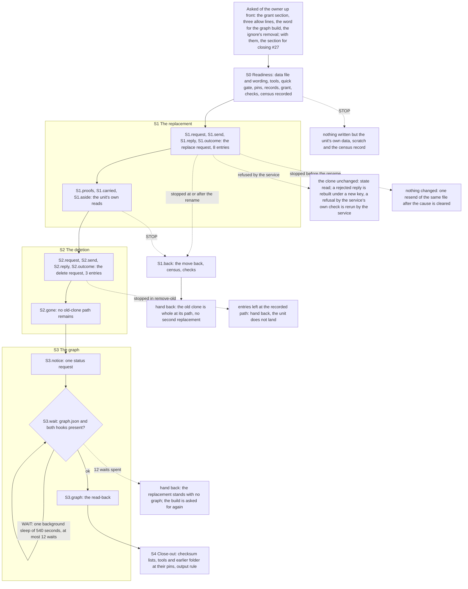

# Phase 0 · 7.4 — Replacing the private repository clone: implementation plan

- **Covers:** [SpartanLaboratories/KotlinBottools#42](https://github.com/SpartanLaboratories/KotlinBottools/issues/42),
  *"Phase 0 · 7.4 — Replace the private repository clone"*, unit 4 of
  [#27](https://github.com/SpartanLaboratories/KotlinBottools/issues/27) (*"Phase 0 · 7 — Rewrite BotTools and the private
  repositories, and replace the private repository clone"*), a sub-issue of
  [#2](https://github.com/SpartanLaboratories/KotlinBottools/issues/2), the history rewrite, which is a sub-issue of
  [#1](https://github.com/SpartanLaboratories/KotlinBottools/issues/1) (parent chain #42 → #27 → #2 → #1). Its siblings are #39 (the
  workspace tools, landed through pull request #44), #40 (the rewrites, landed through pull request #45) and #41 (the residual
  measurement, landed through pull request #46). Its neighbour is [#28](https://github.com/SpartanLaboratories/KotlinBottools/issues/28),
  the residual report and cleanup, which stays blocked by #27; #27 closes when this unit, its last, lands.
- **Architecture:** [`../architecture.md`](../architecture.md), unit `clone-replacement` (order 4 of §16), which is §10 (the clone
  replacement, with the dated note of 2026-11-16 under §10.3), with §1.1 and §1.2, §2.2 (the clone and the two volumes), §2.4 (the request
  service, with its dated note on allow lines), §3 (the rows on the clone), §4, §5 and §5.1 (the seams to and from this unit), §11 (order,
  gates and failure behaviour: the rows of unit 4), §12 (the row of this unit and the dated note of 2026-11-15 on allow lines), §13.4 (what
  #28 takes), §14 (the clone's policy values), §16 and §17 (the clone rows). System: `clone-realignment` ("Clone realignment"; registry
  `docs/dashboards/systems.json`). Its consequences are in [`../consequences.md`](../consequences.md); the evidence is
  [`../research/README.md`](../research/README.md) and
  [the clone findings](../research/clone-move-aside-on-windows.md). The tools this unit runs are the workspace tools unit's:
  [its plan](../39-workspace-tools/plan.md) (the clone set is [its Design, "The clone set"](../39-workspace-tools/plan.md#the-clone-set)),
  [its as-built record](../39-workspace-tools/final-implementation.md) and [its consequences](../39-workspace-tools/consequences.md).
  The records it reads are the rewrites' unit's: [its plan](../40-rewrites/plan.md), [its as-built record](../40-rewrites/final-implementation.md)
  and [its consequences](../40-rewrites/consequences.md). The request pattern it follows is [the rewrites' "The grant" and "The push"](../40-rewrites/plan.md#the-grant).
- **Branch:** `docs/issue-42-replace-…-clone`. It exists, was cut from `main` at the merge of pull request #46 and is pushed. This
  plan is committed in the same commit as the unit's `consequences.md` and as-built record (the first commit of "Version control"), so that
  `git log --follow` binds the plan to the work it describes. The unit lands through one pull request, which closes #42 only.
- **What this plans:** the replacement of the local private repository clone, `%PROJECTS%\…`, by a fresh clone of the rewritten repository at
  the same path: the old clone renamed aside on its own volume, a fresh clone made with `gh` as the only credential helper, the four
  `.idea/` files restored, the fresh clone proven to reach no pre-rewrite commit and read back by the unit, the old clone deleted at its
  recorded path, and the graph rebuilt from the rewritten tree by the graph service and read back. It is a literal procedure the
  implementer and the run carry out in this same run, settling nothing on the way.
- **Status:** built; what was built and measured, and every departure from this plan, is in [`final-implementation.md`](final-implementation.md).
- **Target version:** none. Nothing is versioned; no product code, test source, build file, README or CHANGELOG of any repository
  changes. The landing adds documents and regenerated boards only.

This unit writes nothing to GitHub until its landing; after it, the run asks the request service to close #27 ("After the landing: the
closing of #27"). Its writes are to one checkout, the private repository clone and the folder beside it, and every one is a request
to the request service: the run sends two requests (the replacement and the deletion) and a third, the move back, only after a stop that
follows the rename. The implementer itself changes nothing in the clone: it builds each request, stores each reply, reads the clone and the
data folder, and reports. The tools print their own stage names (`STAGE K1.checks OK`, `STAGE K1.proofs OK`, `STAGE K1.gone OK`, and so on):
those are the tools' names; `S0` to `S4` are this run's stage ids. In this plan `WS` is the workspace folder `%USERPROFILE%\BotWS` and
`DATA` the data folder `%USERPROFILE%\BotLegacyData`; inside code they are `$WS` and `$DATA`, with `$OUT` (`DATA\rewrite`), `$RM`
(`DATA\rewrite\…`), `$TOOLS` (`WS\tools`), `$PROJECTS` (the folder that holds KotlinBottools' main checkout) and `$CLONE`
(`$PROJECTS/…`).

---

## Requirements

**Goals**

1. **The local private repository clone reaches no pre-rewrite commit.** After the replacement, the clone at `%PROJECTS%\…` is a fresh clone
   of the rewritten repository: its remote-tracking refs equal `ref-map`'s new column, its local `main` equals its remote-tracking
   branch, it holds one pack and no loose object, `fsck` is clean, and every pre-rewrite commit of the first private repository and every purged manifest blob
   is missing from its object database, so that no ref, reflog, stash or pseudo-ref of it can reach one. The procedure proves this inside
   the request and the unit proves it again by its own read before it requests the deletion.
2. **The four `.idea/` files are restored and equal their checksums.** They are archived with a checksum list from the old clone before
   it is moved, restored into the fresh clone without overwriting anything, and read again by the unit against the same list.
3. **No old-clone path remains.** The old clone is deleted at its recorded path, `%PROJECTS%\…-old`, only after the unit has read the
   fresh clone back, and the unit reads that the path is absent. The recorded path is kept for #28.
4. **The graph is rebuilt from the rewritten tree, and the graph and its two hooks are read back.** The graph service builds a
   code-only graph of the fresh clone, with the hooks `post-checkout` and `post-commit`, at the owner's word, once the run reports the clone
   replaced and proven and the old clone deleted. The unit reads the clone again; a difference is recorded, never a stop.
5. **Nothing is left open on the way.** The owner is asked once, up front and all together, for the grant section,
   the three allow lines, the word for the graph build and the removal of the board files' ignore; no stop for a person falls between
   the first request and the last. The section for the closing of #27 after the landing is asked in the same sitting.
6. **The earlier records equal their checksum lists** at the start and at the close-out, and this unit never writes one of them. This unit's
   own records carry a checksum list: `SHA256SUMS` in `DATA\run\g42\`.
7. **Nothing sensitive is printed or written outside the data folder and the workspace:** counts, statuses, fixed markers and file names
   only, in every console line the steps print, every record the unit writes and every document. No output or record holds a
   pre-rewrite commit id, a purged blob id, a member or guild name or a secret, and no stored reply or output holds a path; a request file
   holds the paths its entries must name and no id (the checks are `S4.outputs` and the landing's document checks).
8. **Version none; documents only.**

**Rules this unit keeps**

- **Every change to the checkout is a request.** The implementer types no `mv`, `rm`, `tar` or `git clone`, leaves no shell inside the clone
  or the old clone (a typed check enters one only in a subshell that ends in the same command), and never opens one of their files to quote
  it. No procedure holds a push, a reset, a force or a credential setting
  (the request service's settings deny `git push --force`, `git push -f`, `git push --force-with-lease` and `git reset --hard`; none is
  lifted, and none of the three procedures holds one).
- **The tools are fixed.** The workspace tool folder `WS\tools\g27\` (`$TOOLS/g27`) is at its pins; `tools\g26\` is never edited, saved or
  run (g26 is never run); `k0-ready.sh` and `save-tools.sh` are never run; the stage runner is never saved again. Legacy repositories are
  read through `gh api`, never cloned: the fresh clone of the first private repository is this unit's designed write, carried out by the request service. A
  defect a step meets stops the unit; the correction is a new version of that file, carried whole with its new pin by the plan of the unit
  that makes it, with the covering test kind run again and a dated note in the tools unit's consequences
  ([§4](../39-workspace-tools/consequences.md#4-sibling-units-and-neighbouring-issues)).
- **Nothing under the workspace or the data folder is committed, printed or quoted beyond counts, checksums, statuses and names.**
- **One call of the unit at a time.** The steps share the unit's scratch folder `WS\tmp\g27\g42\` and the run log, so no two calls of the
  unit run together.
- **A write that landed is never repeated.** A request is sent again only under the rules of "Outcome, state and resend": after a read
  shows the clone unchanged. The replacement is never requested a second time once the rename has happened.
- **No commit to the first private repository** and no other write to it.

**Acceptance criteria** (the issue's "Done when", each with what proves it)

| Criterion | Proved by |
|---|---|
| The local private repository clone reaches no pre-rewrite commit from any ref, reflog, stash or pseudo-ref | `S1.outcome` (`OUTCOME complete entries=8 of 8 stops=0 status=done`: the replacement's own `proofs`), and the unit's own read `S1.proofs` (18 `ok` lines, among them the seven of `prove_removed` over `old-first.txt`, `old-changed.txt` and `….blobs`, and `STAGE K1.proofs OK`); the same last proof in `S3.graph` |
| The four `.idea/` files are restored and equal their checksums | `S1.carried`: the four files of the fresh clone equal `carried.sha256`, and the same list equals the four files of the old clone aside; `S1.proofs` (the files git does not track are exactly the carried ones) |
| No old-clone path remains | `S2.outcome` (`OUTCOME complete entries=3 of 3 stops=0 status=done`) and `S2.gone` (`ok    no old-clone path remains`, `STAGE K1.gone OK`); `clone-moved.txt` holds the recorded path |
| The graph is rebuilt from the rewritten tree, and the graph and its two hooks are read back | `S3.wait` (`ok    the graph's build has finished: graph.json present, both hooks present`) and `S3.graph`: the lines "the graph's folder exists", "the graph's folder holds files" and "the hooks beyond the samples are exactly the graph's" are `ok`, and `STAGE K1.graph OK` |
| The earlier records equal their checksum lists, and this unit's records are checksummed | `S0.records` and `S4.records` |
| No output or record holds a pre-rewrite commit id, a purged blob id or a secret | `S4.outputs`, the landing's four document checks |

---

## Current state

**Baseline.** `main` is at the merge of pull request #46 (the residual measurement). The workspace, the data folder, GitHub and the clone
were read on 2026-11-16 with read-only commands; nothing below was changed.

**The tools.** `WS\tools\g27\` holds 25 files: the 24 files of `g27tools.sums` and the pin list itself. The 24 rows of `g27tools.sums` and
the 22 rows of `tools.sums` equal their pins, and the pin list's sha256 is
`60f5760b246ce9b5f1c692e63d72895774fdc86d32db2fad11ccb581877631bf`. The tool versions are those the preparation unit recorded: git
2.55.0.windows.5, Python 3.14.7, gh 2.100.0, git-filter-repo `a40bce548d2c` and gitleaks 8.30.1. The clone set is
[`k1-clone.sh`, `g27_clone.py` and the library `g27lib.sh`](../39-workspace-tools/plan.md#appendix-a--the-tools), with `s0-ready.sh` for the
readiness checks and `gselftest.sh` for the quick gate; the files in `WS\tools\g27\` are byte for byte the plan's Appendix A. That appendix
is the source of every command and printed line below.

**The rewrites' records** (`from=g40`).

- `DATA\run\g40\` holds 49 records under `SHA256SUMS`, which verifies whole; it holds the first private repository's stage-8 marker
  `status\….p8` and the checksums of the preparation unit's 6 earlier records of the first private repository in `records-at-s0.….sums` (6 lines, `sha *name`,
  checked from the rewrite folder with `sha256sum -c`).
- `DATA\rewrite\…\` holds `g40.SHA256SUMS` (29 files), which verifies, with `commit-map` (11 rows), `ref-map`,
  `first-changed-commits` (1) and the rewrites' other records; `DATA\manifests\….blobs` holds 199 blobs and `DATA\COPY-VERIFIED` is
  present. The untouched backup `WS\backup\….git` holds 22 files equal to `DATA\rewrite\…\backup.SHA256SUMS` (compared
  as `s0-ready.sh inputs` does: from inside the backup, `find . -type f -print0 | sort -z | xargs -0 sha256sum`, against the list with `cmp`).
- The first private repository's records of the residual measurement (`g41.SHA256SUMS`) verify too; this unit does not read them.

**GitHub.** The first private repository (id 540208924, private, default branch `main`) holds its two heads, `main` and `feature/pokercommand`, equal to
`ref-map`'s new column (read through `gitnet ls-remote --heads`). It has no tag and no pull-request ref.

**The rewritten `main`,** read in the fresh mirror `WS\fresh\….git`: 46 paths, none under `.idea/`, no `.graphifyignore`, nothing
under `graphify-out/`; a `.gitattributes` with no `filter=lfs` line; no `.gitmodules`. So none of the carried files is tracked, the restore
cannot meet a tracked file, and git-lfs is not started at the fresh clone's checkout.

**The clone `%PROJECTS%\…`** (the old clone, to be replaced):

| | Reading |
|---|---|
| Branches and refs | the local branch `main` only; 2 remote-tracking refs; no ref other than heads and remotes |
| Objects | one pack, no loose object; no stash; one worktree |
| Remote | one remote, `origin`, at the repository's URL |
| Tracked files | clean |
| Local configuration | 12 keys: the ten a plain clone writes, plus `lfs.repositoryformatversion` and `submodule.active` |
| Hooks beyond the samples | 2: `post-checkout` and `post-commit` |
| Exclude file | 2 entries: the graph's folder and the board files' ignore |
| Files git does not track | 60: 4 under `.idea/` (3 not ignored, 1 ignored by the standard rules; extensions `.xml` ×3 and `.gitignore`), 55 under `graphify-out/` (the graph built 2026-10-25 from the pre-rewrite tree) and `.graphifyignore` at the root (placed 2026-11-15, byte for byte the graph service's template) |
| In use | the lock probe counts 0 open files; no `git.exe` runs; `%PROJECTS%\…-old` is absent |
| Volumes | the clone and its parent folder report one device number; the workspace another |

The tools plan's A13 recorded one non-comment exclude line; the board files' ignore adds the second, so the first real census differs from
that record by the one entry, which this unit records and never carries. The `.graphifyignore` and its exclude entry belong to the graph's
footprint, as the graph service writes them ([the parent design's dated note under §10.3](../architecture.md#103-what-is-carried-and-what-is-not)).

**What the build and the clone set do with it.** graphify's own detection skips the `.idea` folder and reads neither `.xml` nor `.gitignore`
files, so the graph service's check of untracked files does not stop on the carried files. Its build writes `graphify-out/` (excluded
through `.git/info/exclude`), the board files' ignore with its exclude entry, and the two hooks last. The clone set's census counts every
file git does not track with no `--exclude-standard`, matches the carried and not-carried folders as literal prefixes and stops on any file
outside them: at its pin the census stops on `.graphifyignore`, so the owner deletes it before this unit's readiness (the exclude line
stays and is recorded with the other entry) and the census then proves the removal: 59 files, 0 elsewhere. The graph service runs no graph
job on that checkout until the run reports the replacement complete. After the code-only build the fresh clone holds the ignore and its
exclude entry again, and `k1-clone.sh graph` records exactly one difference. No tool, procedure or grant row changes.

**The request service.** Its temporary-permissions file for KotlinBottools is empty; the rewrites' section moved to history on 2026-11-15
with its allow lines removed and its deny rules restored. Its settings deny `git push --force`, `git push -f`, `git push --force-with-lease`
and `git reset --hard`; none of this unit's procedures holds any of them. Its earlier allow lines were prose rules for its auto-mode check,
placed by the owner in the global settings file. The rewrites' first push call was refused by the service's own check; with the line in
place the service ran the request again itself, under the same id with the next attempt number, with no restart, and the later calls met
their lines already placed ([the rewrites' as-built record, deviations 1 and 2](../40-rewrites/final-implementation.md#4-deviations-from-the-plan)).
The request protocol has no graph action: a graph build comes from the owner's word at the request service's console. A `status` request
reaches the request service and carries a `notes` field.

**Nothing of this unit exists yet:** no `DATA\run\g42\`, no data file `WS\tmp\g27\units\g42.txt`, no scratch folder `WS\tmp\g27\g42\`. The
run log `DATA\run\as-run.log` holds 16,157 lines.

**Outside facts this unit rests on:**

- A directory rename on Windows refuses with no effect while anything inside is open, and cannot cross volumes; across volumes `mv` copies and
  then removes, and with one file held open it leaves a full copy at the target and a mostly deleted source
  ([the clone findings, §3.1](../research/clone-move-aside-on-windows.md#31-what-a-move-is-on-windows-and-in-git-bash)).
- A renamed tree keeps its own access entries, and the clone's folder inherits those of its volume's root, so the old clone aside is no more
  readable than the clone was ([the clone findings, §3.2](../research/clone-move-aside-on-windows.md#32-who-may-read-the-old-clone-afterwards)).
- A plain `git clone` on this machine writes exactly ten local configuration keys, no hook beyond the samples, an exclude file of comment
  lines only, one pack and no `FETCH_HEAD`
  ([the clone findings, §3.3](../research/clone-move-aside-on-windows.md#33-what-a-plain-git-clone-writes-here)).
- A private repository's objects are readable by anyone with read access who is signed in, and by nobody anonymously
  ([the parent design, §2.5](../architecture.md#25-verified-outside-world-facts)): the fresh clone reaches the first private repository through `gh`.

---

## Assumptions

| # | Assumption | If false |
|---|---|---|
| A1 | The owner's removal holds: `.graphifyignore` is absent from the clone's root, and no graph job runs on the checkout before the run reports the replacement complete. | `S0.census` stops on the file outside the two folders (or, inside the procedure, the census entry stops on a changed count): before the rename, nothing changed. The cause is removed and the step runs again. |
| A2 | Nothing holds a file, a folder or a working directory inside the clone but, at most, a scanner that releases within the rename's retry (5 tries, 2 seconds apart). | The rename refuses with no effect, the retry ends refused and the procedure stops with nothing changed; one resend after the cause is cleared, a second stop hands back. |
| A3 | No other process runs `git.exe` when `checks` runs, at `S0.checks` and again as the first entry of the procedure. | `checks` stops before anything changes; one resend after the process ends. |
| A4 | A fresh clone from GitHub writes into `.git` what the stand-in clone of the parent design wrote: ten local keys, one pack, no loose object, no hook beyond the samples, an exclude file of comment lines only, no `FETCH_HEAD`. | The proofs stop after the rename, the old clone is whole at its recorded path, and the move back is requested. |
| A5 | The fresh checkout starts no git-lfs: the rewritten tree holds no `filter=lfs` line. | The extra key `lfs.repositoryformatversion` appears and the proofs' exact-ten-keys expectation stops after the rename: the move back. |
| A6 | The account the request service runs as can delete every file of the old clone. | The deletion leaves entries at the recorded path; the unit stops, names the path and the count, and does not land while a path remains. |
| A7 | The account the request service runs as can read the first private repository through `gh`. | `fresh` stops after the rename (clone status): the move back. |
| A8 | The request service's delivered reply holds each printed line as a string entry of `result` (held at the rewrites). | `reply` stores nothing readable and `outcome` stops plainly; the state read from the two paths and the unit's own reads name how far the procedure got, and the reply is obtained again by a `status` request naming the id. |
| A9 | The clone's volume stays one with its parent folder, and the project-checkouts folder stays a plain folder. | The same-volume guard stops the rename before anything changes. |
| A10 | The first private repository's server heads stay at `ref-map`'s new column until the replacement ends. | `checks` stops at the heads comparison (at `S0.checks`, or as the procedure's first entry); nothing changed. A server that moved after the fresh clone was made stops the proofs and the move back is requested. |
| A11 | The three allow lines are enough for the request service's own check, and the section is accepted as written. | The service refuses a covered call before anything runs (the line is placed, and the service runs the same request again itself) or answers `rejected` (the cause is the owner's, and the request is rebuilt under a new key). Nothing has run in either case. |
| A12 | The graph service's build leaves the graph's folder with files, the two hooks, the graph's exclude entry, the board files' ignore with its entry, no `submodule.active` and no extra local key. | The read-back records each difference as a `RECORD`; the replacement stands, and the build is asked for again once. |
| A13 | The graph service starts its build after the run's notice, with the owner's word given up front, and finishes within 12 waits of 9 minutes. | The unit hands back: the replacement stands with a proven fresh clone and no graph, and the build is asked for again. |
| A14 | The real clone has the shape the clone findings and the tools unit's A5, A6 and A13 describe (apart from the board files' ignore, removed before readiness, and its exclude entry). | A count inside the carried and not-carried folders that differs is a `RECORD` of the census; a file outside them is a stop of the closed-set guard before the rename; `stat`, `tasklist` and the lock probe misreporting only stop. |

---

## Non-goals

- **No write to GitHub but the closing of #27 after the landing.** No commit to the first private repository: no `.gitignore`, no README pointer, no archive
  (Phase 17).
- **No change to the tools.** `tools\g27` stays at its pins; `tools\g26`, `k0-ready.sh`, `save-tools.sh` and the runner are never edited,
  saved or run.
- **No carrying of the old clone's graph,** its exclude entries, its hooks, the board files' ignore or its two extra configuration keys
  (`lfs.repositoryformatversion`, `submodule.active`) into the fresh clone.
- **No narrowing of the old clone's access entries** while it is aside; a rename widens access by nobody, and a recursive rewrite of the
  entries is not proven safe.
- **No deletion beyond the recorded path:** the deletion touches `%PROJECTS%\…-old` only, behind guards that name it.
- **No report on #2 and no cleanup of the workspace or the data folder** (#28). **No second replacement in this run** once the rename has
  happened.
- **No build of the graph by the unit:** the graph is the graph service's, at the owner's word.
- **No version bump, no CHANGELOG entry and no README change** in KotlinBottools.

---

## Design

### Shape of the run

Five stages. `S0` reads and checks and runs at once; its only writes are the unit's data file and wording, its scratch folder, the census
record in `DATA\run\g42\` and the run log's lines. `S1` replaces the clone (the first request) and reads the fresh clone back; `S2` deletes
the old clone (the second request) and reads that no old-clone path remains; `S3` asks the graph service for the build, waits for it and
reads the graph and its hooks back; `S4` is the close-out. The landing's document checks follow, outside the table. Every stop leaves the
state its row of "Stops and the state each leaves" names.

| id | name | brief | kind | steps |
|---|---|---|---|---|
| S0 | Readiness | The unit's data file and grant wording are written, the tools are at their pins, the rewrites' records equal their checksum lists, the grant is in place, and the clone passes its guards with its census recorded. | check | S0.unit: The unit's data file and grant wording; S0.tools: The tools at their pins; S0.quick: The quick gate; S0.pins: The tool versions; S0.records: The rewrites' records, the backup and the manifest; S0.grant: The grant read; S0.checks: The clone's guards; S0.census: The clone's census recorded |
| S1 | The replacement | The old clone is renamed aside, a fresh clone of the rewritten repository is made at its path with the four carried files restored, and the unit's own reads prove the fresh clone and the old clone aside. | work | below |
| S2 | The deletion | The old clone is deleted at its recorded path, and no old-clone path remains. | work | S2.request: The deletion request built and handed off; S2.send: The request sent; S2.reply: The reply stored; S2.outcome: The outcome read; S2.gone: No old-clone path remains |
| S3 | The graph | The graph service builds a code-only graph of the fresh clone with its two hooks, and the unit reads the graph and its hooks back. | work | S3.notice: The graph service told; S3.wait: The build waited for; S3.graph: The graph read back |
| S4 | Close-out | The earlier records and this unit's equal their checksum lists, the tools and the earlier tool folder are at their pins, and the unit's outputs and records hold nothing sensitive. | check | S4.records: The checksum lists; S4.tools: The tools at their pins; S4.g26: The earlier tool folder at its pins; S4.outputs: The output rule over the unit's outputs |

**Steps of S1**

- `S1.request`: The replacement request built and handed off
- `S1.send`: The request sent
- `S1.reply`: The reply stored
- `S1.outcome`: The outcome read
- `S1.proofs`: The fresh clone proven
- `S1.carried`: The four restored files read against their checksums
- `S1.aside`: The old clone read whole at the recorded path
- `S1.back`: The move back, only after a stop that follows the rename
  - `S1.back.request`: The move-back request built and handed off
  - `S1.back.send`: The request sent
  - `S1.back.reply`: The reply stored
  - `S1.back.outcome`: The outcome read
  - `S1.back.census`: The old clone's census read at the clone's path
  - `S1.back.checks`: The clone's guards read again



**Why this order.** The replacement and the deletion are two requests so that the unit's own read of the fresh clone stands between the last
reversible step and the irreversible one ([architecture §10.1](../architecture.md#101-shape)). The old clone is whole at its recorded path
from the rename until the deletion, so every stop before the deletion has the move back. The deletion is requested as soon as the unit has
read the fresh clone back and does not wait for the graph build: the old clone is no fallback for it, and the pre-rewrite objects stay
outside the workspace no longer than the replacement needs. The graph service is told only when the clone is proven and the old clone is
deleted, because it runs no graph job on the checkout before.

**What proceeds while the unit waits.** `S0` runs at once. Between a request and its reply the implementer waits for the run's hand-back;
nothing else of the unit runs. While the graph's build is awaited, **a wait is one call of `sleep 540` run in the background** (it ends in
9 minutes, before the 10-minute cut every call is subject to), after which `S3.wait` is run again. A wait holds no state.

### What the unit writes

Nothing to GitHub until the landing; after it, the closing of #27 ("After the landing: the closing of #27"). To the checkout, through the
request service only: the old clone is renamed to `%PROJECTS%\…-old`, a fresh clone
is made at `%PROJECTS%\…`, four files are restored into it, and the old clone is deleted; after a stop that follows the rename, the
move back removes any partial fresh clone and renames the old clone back. The graph service writes the graph's folder, the board files'
ignore with its exclude entry and the two hooks into the fresh clone. In the workspace and the data folder the unit writes the records
"Records and where they live" lists. The unit's landing on KotlinBottools is the run's ordinary landing and is not made under the job.

### The unit's data file

`WS\tmp\g27\units\g42.txt` is the data file the tools read through `G27_UNIT`
([format](../39-workspace-tools/plan.md#the-running-units-data-file)). `S0.unit` writes it with exactly these lines:

```text
# unit 4 of the three-repository work: the clone replacement; one grant, the replacement and the deletion requested, the move back only after a stop
job=phase-0-…-clone-replacement
issue=42
home=SpartanLaboratories/KotlinBottools
branch=docs/issue-42-replace-…-clone
actions=replace-clone
targets=SpartanLaboratories/…,%PROJECTS%\…,%PROJECTS%\…-old
runs=g42
from=g40
wording=g42-grant.txt
carried_dir=.idea
other_dir=graphify-out
expect_carried=4
expect_other=55
move_to=…-old
rename_tries=5
rename_gap=2
graph_hooks=post-checkout,post-commit
```

- `job` is the grant section's name and the `permissionReason` of every request; `issue` is the number in each request's id; `home` is the
  repository whose permissions file holds the section; `branch` is the branch the section's scope must name; `actions=replace-clone` is the
  action the section's `Permissions:` line must name.
- `targets` are the strings the grant's scope must name. The grant check matches each literally and as a whole word (the character after it
  is not a letter, digit, underscore or hyphen), so `%PROJECTS%\…` is never found inside `%PROJECTS%\…-old`. `%PROJECTS%` is
  written as the scope writes it and is never resolved.
- `runs=g42` gives the unit's record folder `DATA\run\g42\`, its scratch folder `WS\tmp\g27\g42\` and the landing's gate corpus `g42docs`.
  `from=g40` names the rewrites' records, which are read only: the first private repository's stage-8 marker and the records the proofs read. `wording=g42-grant.txt`
  is the file, beside the data file, that holds the section's text with `<date>` for the day.
- The policy values are the clone set's, and nothing else reads them: `carried_dir` (`.idea`) and `other_dir` (`graphify-out`) are plain
  names matched as literal prefixes, never as patterns; `expect_carried` (4) and `expect_other` (55) are today's counts inside them, and a
  different count is a `RECORD`, never a stop; `move_to` (`…-old`) is the folder beside the clone the old clone is renamed to;
  `rename_tries` (5) and `rename_gap` (2 seconds) are the rename's retry bound and spacing; `graph_hooks` is the hooks the build installs,
  read by `graph` only.

### The grant

Asked of the owner at the request service's console before the unit runs, all together:

1. **The grant section,** one section of the request service's temporary-permissions file for SpartanLaboratories/KotlinBottools, with the
   date of the day it is given in the `Granted:` line:

```text
## phase-0-…-clone-replacement
Granted: <date>
Permissions: replace-clone
Scope: SpartanLaboratories/KotlinBottools#42, branch docs/issue-42-replace-…-clone; github SpartanLaboratories/KotlinBottools; target SpartanLaboratories/… as the clone's source only; the checkout %PROJECTS%\… and the folder %PROJECTS%\…-old only (%PROJECTS% is the folder that holds KotlinBottools' main checkout); the three replace-clone procedures the clone set builds, each one request sent by file with its sha256 and run as one shell: the replacement (the guards, the census, the archive of the four .idea/ files, the rename of the checkout to %PROJECTS%\…-old, the census of the old clone, a fresh clone of SpartanLaboratories/… at the checkout's path with gh as the only credential helper, the restore, the proofs), the deletion of the old clone at %PROJECTS%\…-old once the unit has read the fresh clone back, and the move back only after a stop that follows the rename; a procedure sent again only after a read shows the clone unchanged, following a stop before the rename or a refusal by the service; no push, reset, force or credential setting
Ends: when #42 lands
Settings: three `autoMode.allow` lines, one per procedure (the replacement, the deletion, the move back), placed by the owner in the global settings file before the first call; each removed when this section moves to history; no deny rule is lifted
```

   The same text, with `<date>` left in the `Granted:` line, is the wording file `WS\tmp\g27\units\g42-grant.txt` that `S0.grant` compares the
   section with (blank lines and the `Granted:` line left out of the comparison). A difference is a `RECORD`, never a stop. Each request
   carries `permissionReason` `phase-0-…-clone-replacement`, the section's job name exactly.

2. **Three allow lines,** one per procedure, placed by the owner in the global settings file before the first call, the file the running
   request service reads ([the parent design's dated note under §12](../architecture.md#12-version-control-and-requests)). A restart of the
   request service is needed only if a call is refused with its line in place. Each is a prose rule for the service's own check, covering no
   more than the section does: it names the one repository, the one action with the exact command of each procedure entry, the request's id,
   the section's job name, what it does not cover and when it is removed. `%USERPROFILE%` stands for the profile folder in forward-slash form,
   as the request file holds it resolved, and the request file is named with the sha256 its request carries. Its wording:

```text
Allow line 1, the replacement: Temporary, for one job: the action `replace-clone` on the checkout of the GitHub repository SpartanLaboratories/… at %PROJECTS%\…, renaming it to %PROJECTS%\…-old on its own volume, cloning https://github.com/SpartanLaboratories/….git at %PROJECTS%\… with `gh` as the only credential helper and restoring its four `.idea/` files there from the run's archive, by running, as one `bash` call on a script file the request service builds from them, unchanged and in order, the eight procedure entries of the run's request file `%USERPROFILE%/BotLegacyData/run/g42/requests/replace-….json` (sha256: the value the run's request carries in `requestFileSha256`, printed when the file is built), which are exactly: `cd "%USERPROFILE%/BotWS" && export G27_UNIT="%USERPROFILE%/BotWS/tmp/g27/units/g42.txt" && bash "%USERPROFILE%/BotWS/tools/g27/k1-clone.sh" checks … 2> /dev/null || { echo "STOP  step checks of the replace failed"; exit 1; }`; `cd "%USERPROFILE%/BotWS" && export G27_UNIT="%USERPROFILE%/BotWS/tmp/g27/units/g42.txt" && bash "%USERPROFILE%/BotWS/tools/g27/k1-clone.sh" census … clone 2> /dev/null || { echo "STOP  step census of the replace failed"; exit 1; }`; `cd "%USERPROFILE%/BotWS" && export G27_UNIT="%USERPROFILE%/BotWS/tmp/g27/units/g42.txt" && bash "%USERPROFILE%/BotWS/tools/g27/k1-clone.sh" archive … 2> /dev/null || { echo "STOP  step archive of the replace failed"; exit 1; }`; `cd "%USERPROFILE%/BotWS" && export G27_UNIT="%USERPROFILE%/BotWS/tmp/g27/units/g42.txt" && bash "%USERPROFILE%/BotWS/tools/g27/k1-clone.sh" rename … 2> /dev/null || { echo "STOP  step rename of the replace failed"; exit 1; }`; `cd "%USERPROFILE%/BotWS" && export G27_UNIT="%USERPROFILE%/BotWS/tmp/g27/units/g42.txt" && bash "%USERPROFILE%/BotWS/tools/g27/k1-clone.sh" census … aside 2> /dev/null || { echo "STOP  step census of the replace failed"; exit 1; }`; `cd "%USERPROFILE%/BotWS" && export G27_UNIT="%USERPROFILE%/BotWS/tmp/g27/units/g42.txt" && bash "%USERPROFILE%/BotWS/tools/g27/k1-clone.sh" fresh … 2> /dev/null || { echo "STOP  step fresh of the replace failed"; exit 1; }`; `cd "%USERPROFILE%/BotWS" && export G27_UNIT="%USERPROFILE%/BotWS/tmp/g27/units/g42.txt" && bash "%USERPROFILE%/BotWS/tools/g27/k1-clone.sh" restore … 2> /dev/null || { echo "STOP  step restore of the replace failed"; exit 1; }`; `cd "%USERPROFILE%/BotWS" && export G27_UNIT="%USERPROFILE%/BotWS/tmp/g27/units/g42.txt" && bash "%USERPROFILE%/BotWS/tools/g27/k1-clone.sh" proofs … 2> /dev/null || { echo "STOP  step proofs of the replace failed"; exit 1; }` — the procedure of the request SpartanLaboratories-KotlinBottools-42/42/clone-replace-… for KotlinBottools #42, under the owner's temporary grant phase-0-…-clone-replacement given at the request service's console. It covers that request, the request service's own run of it again under the same id after its own check refused the call, and a resend of it only after a read shows the clone unchanged (its `.git` at %PROJECTS%\… with …'s URL as origin, and %PROJECTS%\…-old absent), following a stop before the rename (the same file under the same id) or a refusal by the service (after a `rejected` reply, the file rebuilt with the key clone-replace-…-r<n> and sent as a new id). It does not cover a second run after one has returned a non-zero status in any other case, a run once the rename has happened, the deletion of %PROJECTS%\…-old or of any other folder, any other path, repository or command, or a push, a reset, a force or a credential setting. It is removed when that section moves to history (when #42 lands, or at the owner's word).

Allow line 2, the deletion: Temporary, for one job: the action `replace-clone` deleting the old … clone at its recorded path %PROJECTS%\…-old, and nothing else, only after the unit has read the fresh clone at %PROJECTS%\… back (its proofs, its four restored files and the old clone's census at %PROJECTS%\…-old all passed), by running, as one `bash` call on a script file the request service builds from them, unchanged and in order, the three procedure entries of the run's request file `%USERPROFILE%/BotLegacyData/run/g42/requests/delete-….json` (sha256: the value the run's request carries in `requestFileSha256`, printed when the file is built), which are exactly: `cd "%USERPROFILE%/BotWS" && export G27_UNIT="%USERPROFILE%/BotWS/tmp/g27/units/g42.txt" && bash "%USERPROFILE%/BotWS/tools/g27/k1-clone.sh" delete-guards … 2> /dev/null || { echo "STOP  step delete-guards of the delete failed"; exit 1; }`; `cd "%USERPROFILE%/BotWS" && export G27_UNIT="%USERPROFILE%/BotWS/tmp/g27/units/g42.txt" && bash "%USERPROFILE%/BotWS/tools/g27/k1-clone.sh" remove-old … 2> /dev/null || { echo "STOP  step remove-old of the delete failed"; exit 1; }`; `cd "%USERPROFILE%/BotWS" && export G27_UNIT="%USERPROFILE%/BotWS/tmp/g27/units/g42.txt" && bash "%USERPROFILE%/BotWS/tools/g27/k1-clone.sh" gone … 2> /dev/null || { echo "STOP  step gone of the delete failed"; exit 1; }` — the procedure of the request SpartanLaboratories-KotlinBottools-42/42/clone-delete-… for KotlinBottools #42, under the owner's temporary grant phase-0-…-clone-replacement given at the request service's console. It covers that request, the request service's own run of it again under the same id after its own check refused the call, and a resend of it only after a read shows the old clone unchanged at %PROJECTS%\…-old, following a refusal by the service (after a `rejected` reply, the file rebuilt with the key clone-delete-…-r<n> and sent as a new id). It does not cover a run before the unit has read the fresh clone back, a second run after one has returned a non-zero status in any other case, the deletion of %PROJECTS%\… or of any folder but %PROJECTS%\…-old, any other path, repository or command, or a push, a reset, a force or a credential setting. It is removed when that section moves to history (when #42 lands, or at the owner's word).

Allow line 3, the move back: Temporary, for one job: the action `replace-clone` moving the old … clone back from %PROJECTS%\…-old to %PROJECTS%\… after removing a fresh clone of …, partial or whole, at %PROJECTS%\…, only after a stop that follows the rename (a stop of the replacement procedure after its rename, or of the unit's own read of the fresh clone before the deletion), by running, as one `bash` call on a script file the request service builds from them, unchanged and in order, the four procedure entries of the run's request file `%USERPROFILE%/BotLegacyData/run/g42/requests/moveback-….json` (sha256: the value the run's request carries in `requestFileSha256`, printed when the file is built), which are exactly: `cd "%USERPROFILE%/BotWS" && export G27_UNIT="%USERPROFILE%/BotWS/tmp/g27/units/g42.txt" && bash "%USERPROFILE%/BotWS/tools/g27/k1-clone.sh" moveback-guards … 2> /dev/null || { echo "STOP  step moveback-guards of the moveback failed"; exit 1; }`; `cd "%USERPROFILE%/BotWS" && export G27_UNIT="%USERPROFILE%/BotWS/tmp/g27/units/g42.txt" && bash "%USERPROFILE%/BotWS/tools/g27/k1-clone.sh" remove-partial … 2> /dev/null || { echo "STOP  step remove-partial of the moveback failed"; exit 1; }`; `cd "%USERPROFILE%/BotWS" && export G27_UNIT="%USERPROFILE%/BotWS/tmp/g27/units/g42.txt" && bash "%USERPROFILE%/BotWS/tools/g27/k1-clone.sh" rename-back … 2> /dev/null || { echo "STOP  step rename-back of the moveback failed"; exit 1; }`; `cd "%USERPROFILE%/BotWS" && export G27_UNIT="%USERPROFILE%/BotWS/tmp/g27/units/g42.txt" && bash "%USERPROFILE%/BotWS/tools/g27/k1-clone.sh" census … clone 2> /dev/null || { echo "STOP  step census of the moveback failed"; exit 1; }` — the procedure of the request SpartanLaboratories-KotlinBottools-42/42/clone-moveback-… for KotlinBottools #42, under the owner's temporary grant phase-0-…-clone-replacement given at the request service's console. It covers that request, the request service's own run of it again under the same id after its own check refused the call, and a resend of it only after a read shows the old clone unchanged at %PROJECTS%\…-old, following a refusal by the service (after a `rejected` reply, the file rebuilt with the key clone-moveback-…-r<n> and sent as a new id). It does not cover a run that follows no stop after the rename, a second run after one has returned a non-zero status in any other case, the removal of anything at %PROJECTS%\… but a fresh clone of …, the deletion of %PROJECTS%\…-old, any other path, repository or command, or a push, a reset, a force or a credential setting. It is removed when that section moves to history (when #42 lands, or at the owner's word).
```

3. **The owner's word for the graph build:** a code-only build (no model spent) of the private repository clone's graph with its two hooks, once the
   run's notice says the clone is replaced and proven and the old clone is deleted; until then no graph job on that checkout.
4. **The removal of the board files' ignore:** "Delete `.graphifyignore` at the root of `%PROJECTS%\…` (the graph service's template
   copy; leave its exclude line)". The census proves it.
5. **The section for the closing of #27,** given in the same sitting and used only after the landing. #27 closes when its last unit lands,
   and this is it; this unit's pull request carries no closing keyword for it, and closing an issue is a write the request service makes
   only under a section that names it. The section, with the date of the day it is given in the `Granted:` line:

```text
## phase-0-tracking-27-close
Granted: <date>
Permissions: close-issue
Scope: SpartanLaboratories/KotlinBottools#27 only, closed as completed once SpartanLaboratories/KotlinBottools#42, its last unit, has landed; no other issue
Ends: when #27 is closed
Settings: one `autoMode.allow` line for that one close-issue request, placed by the owner in the global settings file; removed when this section moves to history
```

   Its allow line, placed with the other three:

```text
Allow line 4, the closing of #27: In the repository SpartanLaboratories/KotlinBottools, the request whose id is SpartanLaboratories-KotlinBottools-42/42/close-27, the action `close-issue`, under the job phase-0-tracking-27-close, may close issue #27 as completed once #42 has landed, after its guards that every unit of #27 is closed and #27 is open, by running, as one `bash` call on a script file the request service builds from them, unchanged and in order, the three procedure entries of that request, which are exactly: `n="$(gh api graphql -f query='query{repository(owner:"SpartanLaboratories",name:"KotlinBottools"){issue(number:27){subIssues(first:50){nodes{state}}}}}' --jq '[.data.repository.issue.subIssues.nodes[] | select(.state != "CLOSED")] | length')" && [ "$n" = 0 ] && echo "UNITS-CLOSED" || { echo "STOP  a unit of #27 is still open, or the units cannot be read"; exit 1; }`; `[ "$(gh issue view 27 --repo SpartanLaboratories/KotlinBottools --json state --jq .state)" = OPEN ] && echo "TRACKING-OPEN" || { echo "STOP  #27 is not open, or cannot be read"; exit 1; }`; `gh issue close 27 --repo SpartanLaboratories/KotlinBottools --reason completed > /dev/null 2>&1 && echo "TRACKING-CLOSED" || { echo "STOP  the closing of #27 failed"; exit 1; }`. It covers no other issue or command, and is removed when the section phase-0-tracking-27-close moves to history.
```

   When this section is not given, the owner closes #27 by hand after the landing, and the run sends no such request.

What the unit can read of these: `S0.grant` reads the section (item 1); `S0.census` proves the removal (item 4). The unit cannot read the
allow lines or the word: the first call shows the lines (a call the service's own check refuses is the evidence they are missing), and the
wait at `S3.wait` is the evidence of the word.

### The requests

Each of the three procedures is one `replace-clone` request by file. `g27_clone.py build KIND … [KEY]` writes
`DATA\run\g42\requests\<kind>-….json` and prints one `ok` line; the request holds six fields:

| Field | Value |
|---|---|
| `permissionReason` | the job, `phase-0-…-clone-replacement` |
| `github` | `SpartanLaboratories/KotlinBottools` |
| `action`; `target`; `issue` | `replace-clone`; `SpartanLaboratories/…`; 42 |
| `procedure` | the entries below, each one standalone shell command |
| `inputs` | the key, the kind, the repository, the data file's path and the step names |
| `checks` | four fixed sentences of what the procedure guarantees |

**The key** is `clone-<kind>-…` for a first send, or `clone-<kind>-…-r<n>` after a refusal by the service, where `n` counts
that kind's refusals by the service, 1 for the first. The builder stops on any other key or kind.

**The entries.** Each entry has the same form, with the paths resolved in the file (the workspace, the data file, the tools folder):

```text
cd "$WS" && export G27_UNIT="$WS/tmp/g27/units/g42.txt" && bash "$TOOLS/g27/k1-clone.sh" <step> …[ <location>] 2> /dev/null || { echo "STOP  step <step> of the <kind> failed"; exit 1; }
```

| Kind | Key | Entries (the step, then the marker the entry prints that the outcome counts) |
|---|---|---|
| `replace` (8) | `clone-replace-…` | 1 `checks` (`CLONE-GUARDS-OK`); 2 `census clone` (`STAGE K1.census OK`); 3 `archive` (`CARRIED-ARCHIVED 4`); 4 `rename` (`MOVED-ASIDE`); 5 `census aside` (`STAGE K1.census OK`); 6 `fresh` (`FRESH-CLONE-MADE`); 7 `restore` (`CARRIED-RESTORED 4`); 8 `proofs` (`STAGE K1.proofs OK`) |
| `delete` (3) | `clone-delete-…` | 1 `delete-guards` (`DELETE-GUARDS-OK`); 2 `remove-old` (`OLD-CLONE-REMOVED`); 3 `gone` (`STAGE K1.gone OK`) |
| `moveback` (4), only after a stop that follows the rename | `clone-moveback-…` | 1 `moveback-guards` (`MOVEBACK-GUARDS-OK`); 2 `remove-partial` (`PARTIAL-CLONE-REMOVED`); 3 `rename-back` (`MOVED-BACK`); 4 `census clone` (`STAGE K1.census OK`) |

Each entry changes into the workspace first (the shell must be outside the clone), and a step that stops ends the shell, so no later entry
runs after a failed guard. The destructive commands (`mv`, `git clone`, `tar`, `rm`) live in `k1-clone.sh`, which writes each one's
errors to a file in the scratch folder and only counts them; the fresh clone is made with `gh` as the only credential helper. The builder
asserts that no entry holds a push, a reset, a force or a credential setting, and the request holds paths and no id, no stream line and no
secret. A step that stops prints its own `STOP` line and the entry then prints its own, so a stopped procedure shows two `STOP` lines.

**The envelope the run adds when it sends the file.** One `replace-clone` request by file, with these fields and no `procedure`, `inputs`
or `checks` of its own:

| Field | Value |
|---|---|
| `v` | 1 |
| `id` | `<sender>/42/<key>`, the sender being `SpartanLaboratories-KotlinBottools-42` |
| `attempt` | 1 for the first send of an id; the id's next number for each resend of the same file under the same id, which the run counts from its own sends (the hand-off block prints the kind's stored replies beside it) |
| `from` | the sender |
| `repo` | the main checkout of KotlinBottools (absolute path, forward slashes) |
| `github` | `SpartanLaboratories/KotlinBottools` |
| `action` | `replace-clone` |
| `issue` | 42 |
| `target` | `SpartanLaboratories/…` |
| `permissionReason` | `phase-0-…-clone-replacement` |
| `requestFile` | the request file's absolute path, forward slashes |
| `requestFileSha256` | the file's sha256, compared by the run with the file before it sends |
| `notes` | "The remaining fields (procedure, inputs, checks) are the request file's contents: compare the file with its sha256, then run its N procedure entries as one shell, unchanged and in order, in a single call, and give every printed line in the reply." with N 8, 3 or 4 |

```mermaid
sequenceDiagram
    participant I as Implementer
    participant T as The tools (g27_clone.py, k1-clone.sh)
    participant R as The run
    participant S as The request service
    participant C as The clone and its folder
    I->>T: build KIND …
    T-->>I: ok request written, then the typed hand-off: path, size, sha256, key, stored replies, entries
    I-->>R: the hand-off, then stops
    R->>R: compares the sha256 with the file
    R->>S: replace-clone by file: requestFile, requestFileSha256, a note
    opt the service's own check refuses the call
        Note over S: nothing runs; the answer holds no printed line and is not stored
        I->>C: the state read: the two paths
        Note over S: allow line in place: the same request again, same id, attempt + 1
    end
    S->>S: compares the hash with the file
    S->>C: the entries as one shell, in order
    C-->>S: the printed lines
    S-->>R: reply done, stopped, rejected or failed
    R-->>I: the reply as delivered, and its kind
    I->>T: reply KIND … STATUS, then outcome KIND …
    I->>C: the state read: the two paths
    T-->>I: OUTCOME complete, or stopped after entry k, or refused
```

**What a clean reply holds, derived from the code.** The reply's printed lines are the lines the entries print, standard error being
discarded. Each count below is the step's `ok` lines, its `RECORD` lines, its fixed marker and its `STAGE` line:

| Entry | Lines |
|---|---|
| `replace` 1 `checks` | 21: 17 `ok`, 2 `RECORD`, `CLONE-GUARDS-OK`, `STAGE K1.checks OK` |
| 2 `census clone` | 7: 6 `ok` (the census is compared with the recorded one), `STAGE K1.census OK` |
| 3 `archive` | 9: 7 `ok`, `CARRIED-ARCHIVED 4`, `STAGE K1.archive OK` |
| 4 `rename` | 7: 5 `ok`, `MOVED-ASIDE`, `STAGE K1.rename OK` |
| 5 `census aside` | 7: 6 `ok`, `STAGE K1.census OK` |
| 6 `fresh` | 6: 4 `ok`, `FRESH-CLONE-MADE`, `STAGE K1.fresh OK` |
| 7 `restore` | 8: 6 `ok`, `CARRIED-RESTORED 4`, `STAGE K1.restore OK` |
| 8 `proofs` | 19: 18 `ok`, `STAGE K1.proofs OK` |
| **`replace`** | **84** |
| `delete` 1 `delete-guards` | 8: 6 `ok`, `DELETE-GUARDS-OK`, `STAGE K1.delete-guards OK` |
| 2 `remove-old` | 5: 3 `ok`, `OLD-CLONE-REMOVED`, `STAGE K1.remove-old OK` |
| 3 `gone` | 3: 2 `ok`, `STAGE K1.gone OK` |
| **`delete`** | **16** |
| `moveback` (a partial fresh clone at the clone's path; none) | 26 (23): `moveback-guards` 5 (4), `remove-partial` 6 (4), `rename-back` 8, `census clone` 7 |

The counts are a reading from the code: a delivered reply that carries a further list of strings under `result` stores those lines too,
and only `outcome` decides.

**The hand-off, the reply-storing and the outcome blocks** are typed (the stage runner runs only `bash "$TOOLS/<name>.sh"`, so the Python
builder cannot pass through it); their lines are therefore not in the run log, and the as-built record states their words. Their text is in
"Procedure", "Conventions".

### Outcome, state and resend

Markers decide first (`outcome`); the state is then read from the two paths, never from the reply. **The class table** (replacement):

| Class | Read from | What follows |
|---|---|---|
| complete | `OUTCOME complete entries=8 of 8 stops=0 status=done` | `S1.proofs` |
| refused by the service | a `rejected` reply, stored as `refused` (`OUTCOME refused status=refused`), or the service's own check refused the call and nothing ran (an answer that holds no printed line, which is not stored); state: the clone's `.git` at its path, the old clone's path absent | for a `rejected` reply the cause is the owner's (the section, the scope, a line) and is fixed, the request is rebuilt with the key `clone-replace-…-r<n>` and sent as a new id. For the service's own refusal nothing is stored and the unit sends nothing a second time: the allow line is in place (a restart only if the call was refused with its line in place), the service runs the same request again itself, under the same id with the next attempt, and that reply is stored and read |
| stopped before the rename | `OUTCOME stopped after entry <k> of 8` with no `MOVED-ASIDE`; state: the clone's `.git` at its path, origin `equal`, the old clone's path absent (a refused rename is here) | nothing changed. Once the cause the stop names is cleared (after one 9-minute wait when it is transient: a git process, an open file, a refused rename; the owner's removal again when the board files' ignore is back) and `g k1-clone census …` equals the record again, one resend of the same file with the same id and the next attempt; a second stop on the same procedure hands back |
| stopped at or after the rename | `OUTCOME stopped after entry <k> of 8`; state: the old clone's `.git` present at `%PROJECTS%\…-old` | the old clone is whole at the target: the move back (`S1.back`), then hand back (no second replacement in this run) |
| anything else | no reply obtainable, both paths absent, a path without its `.git`, a clone with another origin, both `.git` present with the replacement not ending | hand back with the state read |

**The deletion** (`delete`):

| Class | Read from | What follows |
|---|---|---|
| complete | `OUTCOME complete entries=3 of 3 stops=0 status=done` | `S2.gone` |
| refused by the service | as above, with the key `clone-delete-…-r<n>` | as above |
| stopped in `delete-guards` | `OUTCOME stopped after entry 0 of 3`; state: the old clone's `.git` present, nothing deleted | hand back with the state read: the section sends the deletion again only after a refusal by the service |
| `remove-old` left entries | `OUTCOME stopped after entry 1 of 3` with `STOP  the old clone's deletion left nothing at the recorded path (entries left): expected '0', got '<n>'` | hand back naming the recorded path `%PROJECTS%\…-old` and the count. The unit does not send the deletion again (its guards need the old clone whole): the leftover is deleted at the recorded path, as [the parent consequences' follow-up](../consequences.md#6-follow-ups) says, and the unit does not land while a path remains |
| anything else | a stop after the entry `remove-old` ran, the path absent but the fresh clone not in place, a reply not obtainable | hand back with the state read |

**The move back** (`moveback`): complete (`OUTCOME complete entries=4 of 4 stops=0 status=done`) is followed by `S1.back.census` and
`S1.back.checks`, then hand back; any other outcome hands back with the state read. The move back is requested once.

**Hand back** means: the implementer stops, reports the step id, the outcome line and the state read (counts and words, never content),
types nothing further, and the unit does not land.

**A call the service's own check refuses before anything runs.** Nothing has run: no entry, no marker, no change. The answer is of the kind
that is not stored (it holds no printed line). The state is read with the typed block "Reading the state". The allow line is in place; the
service runs the same request again itself, under the same id with the next attempt number, and the unit stores that reply with `reply` and
reads it with `outcome`, without running `build` in between. The stored reply then reports attempt 2 where the request was sent as
attempt 1.

### The graph

After `S2.gone`:

1. **`S3.notice`** (the run's): one `status` request to the request service, with id `<sender>/42/graph-notice`, naming no action and writing
   nothing, whose `notes` read: "Notice for the graph service, issue 42: the private repository clone at %PROJECTS%\… is replaced and proven,
   and the old clone is deleted; the owner's word for its code-only graph build with its two hooks was given at your console."
2. **`S3.wait`** (typed, read-only): `ok    the graph's build has finished: graph.json present, both hooks present` when
   `$CLONE/graphify-out/graph.json` exists and both `post-checkout` and `post-commit` exist in `$CLONE/.git/hooks`; else one `WAIT` line
   with `graph <0|1>, hooks <n> of 2` and status 4. The read is made at once after the notice and again after each wait (one background
   `sleep 540`); at most 12 waits. A `WAIT` after the 12th wait hands back: the replacement stands with a proven fresh clone and no graph,
   and the build is asked for again.
3. **`S3.graph`** (`g k1-clone graph …`): the read-back. Expected: 9 `ok` lines, the one expected `RECORD` (the board files' ignore),
   and `STAGE K1.graph OK`. The graph's Done-when holds when the lines "the graph's folder exists", "the graph's folder holds files" and
   "the hooks beyond the samples are exactly the graph's" are `ok`. When one of them is a `RECORD`, the build is asked for again once (a
   second notice, the same wait); a second miss hands back. Any other `RECORD` is recorded and the unit goes on: the replacement stands
   whatever the build left.

### Records and where they live

`DATA\run\g42\` holds the unit's records, and nothing of any other unit's:

- `requests\replace-….json` and `requests\delete-….json` (and `moveback-….json` only after a stop that follows the
  rename), `replies\<kind>-…-<n>.txt` (the printed lines, one to a line, under a `status=` header), and `status\`, which stays empty
  (the clone set writes no step marker);
- `clone-census.txt` (the census of the old clone, written once at `S0.census`), `carried.tar`, `carried.sha256` and `carried.lst` (the four
  `.idea/` files, their checksums and their names) and `clone-moved.txt` (the recorded path the deletion touches, `moved_to=…-old`);
- at the close-out, `SHA256SUMS` over every other file under the folder: 9 files when each request needed one attempt (2 request files, 2
  replies, the census, the archive, its two lists and the moved record).

Beside them: the data file `WS\tmp\g27\units\g42.txt` and the wording `WS\tmp\g27\units\g42-grant.txt`; the scratch folder `WS\tmp\g27\g42\`
(the census work files, the error files of `mv`, `tar`, `rm` and `git`, the listings, the saved replies, `log-start.txt`, `unit-log.txt` and
the quick gate's folders); `WS\tmp\old-first.txt` and `old-changed.txt`, which `prove_removed` writes; the run log's lines; and the landing
gate's `DATA\run\gate\corpus-g42docs.args`. The rewrites' records are read only. Everything there holds ids, paths or names and is never
committed, printed or quoted. #28 takes `clone-moved.txt` (the recorded path), the stored deletion reply and `SHA256SUMS`.

### Error handling and logging

- **Failure design** is the tools' ([tools plan, "Error handling and logging"](../39-workspace-tools/plan.md#error-handling-and-logging)): a
  shell step ends through `expect` (`STOP  <label>: expected '<x>', got '<y>'`, status 1) or `must` (`STOP  <label>: status <n>`); `note`
  prints `ok` or `RECORD` and never stops; a `WAIT` is status 4 and a pause. The Python tool raises `Stop` once, printed as `STOP  <why>`
  with status 1; the outcome of a request is a value (`progress` is pure), unwrapped once by `outcome`. An expected failure ends the script
  that met it; a count that differs inside the carried and not-carried folders, the hooks, the exclude entries and the extra keys of the old
  clone, and every difference of the graph read-back are results and are recorded. A programmer error (a missing library function) is not
  defended against. **A failed read is never a zero:** the state block prints `origin none` for a path with no clone, never `equal`, and
  an unreadable reply stops `outcome` plainly.
- **Where a `Result` is unwrapped.** The tools print their outcome as a line and a status; the implementer reads the last line of each step
  and unwraps it once: a `STAGE … OK` line with status 0 is a pass, a line that starts `STOP` is a stop, `WAIT` a pause, `RECORD` a result.
  The typed blocks end through `exit 1` after a `STOP` line (or, `S3.wait`, `exit 4` after a `WAIT`).
- **Reading the output.** A step succeeded when its exit status is 0 and its last line, the one before the runner's own end line
  (`== g27/<script> exit=<status>`), is the `STAGE` line it names. A line that starts `STOP` is a stop: take no further step but the one the
  stop table names, and report the step id, the first `STOP` line and the numbers on it, never content.
- **Events logged,** each a console line the runner appends to `DATA\run\as-run.log`: each runner step's `ok` lines and its `STAGE … OK`
  line; each `RECORD`, `WAIT` and `STOP`. The first word of a line is its status. Typed blocks do not pass through the runner, so their
  lines (the requests built, the replies stored, the outcomes, the state reads, the waits) are not in the run log; the as-built record
  states their words. The printed lines of each procedure are in the stored replies.
- **Recorded, not stopped:** the clone's extra configuration keys, hooks and exclude entries; a count inside the two folders that differs from
  today's; a wording of the grant that differs from the unit's; the graph read-back's differences.

### Stops and the state each leaves

| Where | The stop | State left | Next |
|---|---|---|---|
| `S0.*` | a pin, a record, a version, the grant, a guard or the census differs from its expectation (the board files' ignore still present is a stop of `S0.census`) | nothing written but the unit's data file, wording, scratch and the run log's lines; the census record is written only by a census that passed | find out why; fix the cause (the owner gives the grant or deletes the file); run `S0` again from the step |
| `S1.request`, `S2.request` | the builder stops (a missing variable, a key or kind outside its forms) | nothing changed | fix the cause; run the step again |
| `S1.send` | refused by the service (a `rejected` reply, or the service's own check) | nothing ran: the clone unchanged | the class table |
| `S1.outcome` | stopped before the rename | nothing changed; archive records may exist and are reused | the class table: one resend |
| `S1.outcome` | stopped at or after the rename | the old clone whole at `%PROJECTS%\…-old`; a fresh clone, partial or whole, may stand at the clone's path | `S1.back`, then hand back |
| `S1.proofs`, `S1.carried`, `S1.aside` | the unit's own read finds the fresh clone or the old clone aside differs from its expectation | the replacement stands and the old clone is whole aside; the deletion is not requested | `S1.back`, then hand back; its guards decide, and a stop of the guards hands back with the state read |
| `S1.back.*` | the move back stops | the state read names it | hand back |
| `S2.outcome` | stopped in `delete-guards` | nothing deleted | hand back with the state read |
| `S2.outcome` | `remove-old` left entries | a leftover at `%PROJECTS%\…-old`; the fresh clone is in place | hand back naming the path and the count; the unit does not land while a path remains |
| `S2.gone` | a path remains or the fresh clone is not in place | as read | hand back with the state read |
| `S3.wait` | 12 waits spent | a proven fresh clone, the old clone deleted, no graph | hand back; the build is asked for again |
| `S3.graph` | a `STOP` of the read-back (the clone cannot be entered) | as read | report and hand back |
| `S4.*` | a checksum list, a pin or the output rule differs | as the stages left them | report and stop; the unit does not land |
| the landing's checks | a hit | nothing committed | reword the document; run the check again |

---

## Procedure

### Conventions

- **Shell.** Git Bash. Each call starts a fresh shell, so every call begins with this prelude, which names the unit's data file (written by
  `S0.unit`) and defines `g` (run a step script of the folder through the runner); no machine path is typed:

  ```bash
  . "$(cygpath -m "$USERPROFILE")/BotWS/tools/env.sh"
  export G27_UNIT="$WS/tmp/g27/units/g42.txt"
  g() { local s="$1"; shift; bash "$TOOLS/run-stage.sh" "g27/$s" "$@"; }
  ```

  A step is then `g <script> <args>`, for example `g s0-ready tools`. `env.sh` exports `P_HOME`, `WS`, `DATA`, `TOOLS`, `OUT`, `BKROOT`,
  `GR`, `GL`, `CFG`, `SS`, `KBT` and `PROJECTS` and defines `gitnet` (git with `gh` as its only credential helper) and `repo_env`. Python
  always runs with `-I`. The runner shows a stage name with characters outside `A-Z a-z 0-9 . _ / -` as `<name>`, and an argument that is
  not a plain word as `<arg>`; the script still receives every argument unchanged. `S0.unit`, `S0.records`, the request, reply, outcome and
  state-reading blocks, `S1.carried`, `S3.wait`, `S4.records`, `S4.g26` and `S4.outputs` are typed blocks (they do not pass through the
  runner, so their lines are not in the run log).
- **The shell stays outside the clone.** The call's working folder is the main checkout of KotlinBottools or the workspace, never the
  clone, the old clone or a folder inside either: the clone's own first guard stops on it, and a working folder inside the clone makes the
  rename refuse. A typed block that needs a file of either enters it only inside a subshell that ends in the same command.
- **Timeouts and background calls.** A call runs in the foreground with a 10-minute timeout, except the 9-minute waits, which run in the
  background (`sleep 540`), and the request calls, which are the run's.
- **A request STEP** is the unit of one write: build and hand off, send, store the reply, read the outcome, read the state, then the unit's
  own reads. The order never changes:
  1. **`<S>.request`:** the typed block "The request hand-off" builds the file for the kind and prints its path, size, sha256, key, the
     kind's stored replies and the entry count. The implementer reports the printed lines to the run and stops.
  2. **`<S>.send`** is the run's. It compares the sha256 with the file and sends the one request of the envelope table in Design.
  3. **`<S>.reply`:** the run gives the implementer the reply's full text as delivered and its kind. The implementer stores it with the typed
     block "Storing a reply", with status `done` for a `done` reply, `refused` for a `rejected` one, `stopped` for a `stopped` one and
     `failed` for a `failed` one. A `needs-user` reply is not stored: the run waits for the reply that follows it.
  4. **`<S>.outcome`:** the typed block "Reading the outcome" prints the `OUTCOME` line. After any outcome but complete, the typed block
     "Reading the state" runs, and the class table decides.
- **What is never done.** No write to GitHub is typed; no `mv`, `rm`, `tar` or `git clone` is typed; no request is sent without the
  hand-off that wrote its file in the same step; no request file is sent twice except as the class table allows; `tools\g26\`,
  `k0-ready.sh` and `save-tools.sh` are never run. Nothing in `DATA` or `WS` is opened and quoted: only counts, words and file names are
  reported.

**The request hand-off (typed).** `K` is the kind (`replace`, `delete` or `moveback`); `KEY` is empty for a first send and
`clone-<kind>-…-r<n>` after a refusal by the service:

```bash
. "$(cygpath -m "$USERPROFILE")/BotWS/tools/env.sh"
export G27_UNIT="$WS/tmp/g27/units/g42.txt"
for L_ in lib.sh plib.sh klib.sh g27/g27lib.sh; do . "$TOOLS/$L_" 2> /dev/null || { echo "STOP  a library of the tools folder did not load"; exit 1; }; done
K=replace; KEY=          # the kind; the key only after a refusal by the service
row … || exit 1; unit_open
python -X utf8 -I -B "$TOOLS/g27/g27_clone.py" build "$K" … ${KEY:+"$KEY"} || exit 1
f="$G27D/requests/$K-….json"
echo "request file: $(cygpath -m "$f")"
echo "size: $(wc -c < "$f" | tr -d ' ') bytes"
echo "sha256: $(sha256sum "$f" | cut -d' ' -f1)"
echo "key: $(sed -n 's/^ *"key": "\(.*\)",$/\1/p' "$f")"
echo "stored replies of this kind: $(ls "$G27D/replies/$K-…-"*.txt 2> /dev/null | wc -l | tr -d ' ')"
echo "entries: $(grep -c 'k1-clone.sh' "$f")"
```

Expected for the replacement (the path, the size and the digest are the file's own):

```text
ok    request written: requests/replace-….json (key clone-replace-…, 8 commands)
request file: <the file's mixed-form path>
size: <n> bytes
sha256: <64 hexadecimal digits>
key: clone-replace-…
stored replies of this kind: 0
entries: 8
```

For `delete`: `ok    request written: requests/delete-….json (key clone-delete-…, 3 commands)` and `entries: 3`; for `moveback`:
`requests/moveback-….json (key clone-moveback-…, 4 commands)` and `entries: 4`.

**Storing a reply (typed).** The reply text goes in a quoted heredoc so that nothing in it is expanded; `N` is the number the stored reply
takes (the kind's stored replies plus one) and `ST` is `done`, `refused`, `stopped` or `failed`:

```bash
. "$(cygpath -m "$USERPROFILE")/BotWS/tools/env.sh"
export G27_UNIT="$WS/tmp/g27/units/g42.txt"
for L_ in lib.sh plib.sh klib.sh g27/g27lib.sh; do . "$TOOLS/$L_" 2> /dev/null || { echo "STOP  a library of the tools folder did not load"; exit 1; }; done
K=replace; N=1; ST=done
row … || exit 1; unit_open
cat > "$G27S/reply-$K-$N.txt" <<'REPLY_END'
(the reply text exactly as delivered)
REPLY_END
python -X utf8 -I -B "$TOOLS/g27/g27_clone.py" reply "$K" … "$ST" < "$G27S/reply-$K-$N.txt"
```

Expected: `ok    stored reply <n> for clone-<kind>-… as <status> (<m> printed lines)`, with `m` = 84 for a clean replacement and 16 for a
clean deletion (the table in Design). A refused reply stores 0 lines. The count is a reading: only `outcome` decides.

**Reading the outcome (typed).**

```bash
. "$(cygpath -m "$USERPROFILE")/BotWS/tools/env.sh"
export G27_UNIT="$WS/tmp/g27/units/g42.txt"
for L_ in lib.sh plib.sh klib.sh g27/g27lib.sh; do . "$TOOLS/$L_" 2> /dev/null || { echo "STOP  a library of the tools folder did not load"; exit 1; }; done
K=replace
row … || exit 1
python -X utf8 -I -B "$TOOLS/g27/g27_clone.py" outcome "$K" …
```

Expected: `OUTCOME complete entries=8 of 8 stops=0 status=done` (exit 0) for the replacement, `OUTCOME complete entries=3 of 3 stops=0 status=done`
for the deletion, `entries=4 of 4` for the move back. Otherwise exit 1 with `OUTCOME stopped after entry <k> of <n> stops=<s> status=<status>`
(a stopped procedure shows two `STOP` lines) or `OUTCOME refused status=refused`.

**Reading the state (typed, read-only).** Used after every outcome but complete, and after a call the service's own check refuses. It
prints words only:

```bash
. "$(cygpath -m "$USERPROFILE")/BotWS/tools/env.sh"
. "$TOOLS/lib.sh" 2> /dev/null || { echo "STOP  a library of the tools folder did not load"; exit 1; }
repo_env …
A="$PROJECTS/…-old"
o=none
if [ -e "$CLONE/.git" ]; then
  o="$(git -C "$CLONE" config --get remote.origin.url 2> /dev/null | tr -d '\r')"
  if [ "$o" = "$URL" ]; then o=equal; else o=differs; fi
fi
echo "state: the clone's path $(yn "$CLONE"), its .git $(yn "$CLONE/.git"), origin $o"
echo "state: the old clone's path $(yn "$A"), its .git $(yn "$A/.git")"
```

How it reads:

| Printed | Meaning |
|---|---|
| clone path 1, `.git` 1, origin `equal`; old path 0 | the clone at its path, the target absent: unchanged (before the rename), or, after `S2`, the replacement ended |
| clone path 0; old path 1, `.git` 1 | moved aside, the clone's path free |
| clone path 1, `.git` 1, origin `equal`; old path 1, `.git` 1 | a fresh clone in place beside the old clone: the replacement ran at least to `fresh` (or is complete) |
| clone path 1, `.git` 0 | a folder that is not a clone at the clone's path (an interrupted clone) |
| old path 1, `.git` 0 | a leftover of the old clone's deletion |
| clone path 0 and old path 0 | neither path: anything else |

### When the steps run again

- **`S0.unit`** may run again: it writes the same two files byte for byte and keeps the line count of its first run in `log-start.txt` (the
  unit's part of the run log is counted from that first line count).
- **`S0.tools`, `S0.quick`, `S0.pins`, `S0.records`, `S0.grant` and `S0.checks`** may run again at any time.
- **`S0.census`** records the census at its first pass; run again it compares with the record. It runs again only while the old clone is at
  the clone's path and unchanged: after the rename the comparison is the procedure's, and `S1.aside` is the unit's own read of the old clone.
- **A request** is built, sent and stored as "Outcome, state and resend" allows: the same file is sent again with the same id only after a
  read shows the clone unchanged, following a stop before the rename; a rebuilt file with the key `-r<n>` only after a refusal by the
  service. A request that completed is never sent again.
- **`S1.proofs`, `S1.carried`, `S2.gone`, `S3.wait`, `S3.graph` and the state read** are read-only and may run again at any time (`S1.aside`
  only while the old clone aside exists, that is before `S2`).
- **`S4.records`** may run again (it rewrites `SHA256SUMS`), as may `S4.tools`, `S4.g26` and `S4.outputs`.

### S0 — Readiness

Nothing is written to GitHub; everything is a read, a local check or the quick gate. The owner has given the four asks of "The grant" before
`S0.grant` runs; the other steps do not wait for them except `S0.census`, which stops on `.graphifyignore`.

**`S0.unit`:** the unit's data file and the grant's wording file, the unit's scratch folder, and the run log's line count before the unit's
steps. A typed block (under 7 KB). The heredocs are quoted because the texts hold `%`, backslashes and an apostrophe.

```bash
. "$(cygpath -m "$USERPROFILE")/BotWS/tools/env.sh"
U="$WS/tmp/g27/units"; S="$WS/tmp/g27/g42"; mkdir -p "$U" "$S"
cat > "$U/g42.txt" <<'UNIT_END'
# unit 4 of the three-repository work: the clone replacement; one grant, the replacement and the deletion requested, the move back only after a stop
job=phase-0-…-clone-replacement
issue=42
home=SpartanLaboratories/KotlinBottools
branch=docs/issue-42-replace-…-clone
actions=replace-clone
targets=SpartanLaboratories/…,%PROJECTS%\…,%PROJECTS%\…-old
runs=g42
from=g40
wording=g42-grant.txt
carried_dir=.idea
other_dir=graphify-out
expect_carried=4
expect_other=55
move_to=…-old
rename_tries=5
rename_gap=2
graph_hooks=post-checkout,post-commit
UNIT_END
cat > "$U/g42-grant.txt" <<'GRANT_END'
## phase-0-…-clone-replacement
Granted: <date>
Permissions: replace-clone
Scope: SpartanLaboratories/KotlinBottools#42, branch docs/issue-42-replace-…-clone; github SpartanLaboratories/KotlinBottools; target SpartanLaboratories/… as the clone's source only; the checkout %PROJECTS%\… and the folder %PROJECTS%\…-old only (%PROJECTS% is the folder that holds KotlinBottools' main checkout); the three replace-clone procedures the clone set builds, each one request sent by file with its sha256 and run as one shell: the replacement (the guards, the census, the archive of the four .idea/ files, the rename of the checkout to %PROJECTS%\…-old, the census of the old clone, a fresh clone of SpartanLaboratories/… at the checkout's path with gh as the only credential helper, the restore, the proofs), the deletion of the old clone at %PROJECTS%\…-old once the unit has read the fresh clone back, and the move back only after a stop that follows the rename; a procedure sent again only after a read shows the clone unchanged, following a stop before the rename or a refusal by the service; no push, reset, force or credential setting
Ends: when #42 lands
Settings: three `autoMode.allow` lines, one per procedure (the replacement, the deletion, the move back), placed by the owner in the global settings file before the first call; each removed when this section moves to history; no deny rule is lifted
GRANT_END
[ -s "$S/log-start.txt" ] || wc -l < "$DATA/run/as-run.log" | tr -d ' \r' > "$S/log-start.txt"
echo "ok    the unit's data file and grant wording are written; the run log held $(tr -d ' \r\n' < "$S/log-start.txt") lines before the unit's steps"
```

Expected: one `ok` line with the line count (16,157 if nothing has run since it was read). The count is read once and kept: `S4.outputs` reads
the log from the line after it.

**`S0.tools`:** every reused tool and every file of the folder holds its recorded size and sha256, the scanner binary reports its version,
the folder holds exactly the files its pin list names, every shell script parses and every Python tool compiles. It is the first act of the
unit after the data file.

```bash
g s0-ready tools
```

Expected: 96 `ok` lines (the scanner's version, 22 reused tools and 24 folder files each in place and at their size and hash, the exact file set,
the parse check and the compile check) and `STAGE S0.tools OK`. A different size or hash is a stop: the tool is not the tested one.

**`S0.quick`:** the quick gate under this unit's data file: the deterministic cases of the self-test. It builds and removes its own sandbox
under the unit's scratch folder and, where the gating kind never ran, stamps an empty run and joins none.

```bash
g gselftest deterministic
```

Expected: 63 `ok` case lines, then `ok    gselftest deterministic: 63 checks passed`, status 0, no `STOP`. About 15 seconds.

**`S0.pins`:** git, Python, gh, git-filter-repo with its module's sha256 and gitleaks are at the versions the preparation unit recorded, and
no gitleaks configuration is set in the environment.

```bash
g s0-ready pins
```

Expected: 7 `ok` lines and `STAGE S0.pins OK`.

**`S0.records`:** the rewrites' records, the preparation unit's records of the first private repository, the untouched backup and the manifest, read only. A typed
block:

```bash
. "$(cygpath -m "$USERPROFILE")/BotWS/tools/env.sh"
repo_env …
bad=0
chk() {  # FOLDER LIST LABEL: every file the checksum list names equals it
  [ -f "$1/$2" ] || { echo "STOP  $3: the checksum list is missing"; bad=1; return; }
  if (cd "$1" 2> /dev/null && sha256sum -c --quiet "$2" > /dev/null 2>&1); then echo "ok    $3 equal their checksum list ($(wc -l < "$1/$2" | tr -d ' ') files)"; else echo "STOP  $3 differ from their checksum list"; bad=1; fi
}
chk "$DATA/run/g40" SHA256SUMS "the rewrites' run records"
chk "$RM" g40.SHA256SUMS "…: the rewrites' records"
P="$DATA/run/g40/records-at-s0.….sums"
if [ -f "$P" ] && (cd "$RM" 2> /dev/null && sha256sum -c --quiet "$P" > /dev/null 2>&1); then echo "ok    …: the preparation unit's $(wc -l < "$P" | tr -d ' ') earlier records equal those recorded at the rewrites' first readiness"
else echo "STOP  …: the preparation unit's earlier records differ from those recorded at the rewrites' first readiness"; bad=1; fi
if (cd "$BK" 2> /dev/null && find . -type f -print0 | sort -z | xargs -0 sha256sum) | cmp -s - "$RM/backup.SHA256SUMS"; then echo "ok    …: the untouched backup's $(wc -l < "$RM/backup.SHA256SUMS" | tr -d ' ') files equal their checksum list"
else echo "STOP  …: the untouched backup differs from its checksum list"; bad=1; fi
m="$( { wc -l < "$MANIFEST"; } 2> /dev/null | tr -d ' ')"
[ "$m" = 199 ] && echo "ok    …: the manifest holds $m blobs" || { echo "STOP  …: the manifest holds '$m' blobs, expected 199"; bad=1; }
c="$(awk 'NR > 1' "$RM/commit-map" 2> /dev/null | wc -l | tr -d ' ')"; f="$(wc -l < "$RM/first-changed-commits" 2> /dev/null | tr -d ' ')"
[ "$c $f" = "11 1" ] && echo "ok    …: commit-map holds $c rows and first-changed-commits $f line" || { echo "STOP  …: commit-map and first-changed-commits hold '$c $f', expected '11 1'"; bad=1; }
[ -e "$DATA/run/g40/status/….p8" ] && echo "ok    …: stage 8 passed in the rewrites' records" || { echo "STOP  …: its stage-8 marker is missing"; bad=1; }
[ "$bad" = 0 ] || exit 1
echo "STAGE S0.records OK"
```

Expected:

```text
ok    the rewrites' run records equal their checksum list (49 files)
ok    …: the rewrites' records equal their checksum list (29 files)
ok    …: the preparation unit's 6 earlier records equal those recorded at the rewrites' first readiness
ok    …: the untouched backup's 22 files equal their checksum list
ok    …: the manifest holds 199 blobs
ok    …: commit-map holds 11 rows and first-changed-commits 1 line
ok    …: stage 8 passed in the rewrites' records
STAGE S0.records OK
```

**`S0.grant`:** the grant is in the request service's permissions file for the home repository; read only.

```bash
g s0-ready grant
```

Expected: 12 `ok` lines (the permissions file exists; the section exists once; its date line has the form of a date; it names the action; the scope
names issue 42 of the home repository, the branch and, on one line, every target; it says when it ends; it has not ended; it has not been
revoked; the wording file exists; and the last `ok    the section equals the unit's wording apart from the date`) and `STAGE S0.grant OK`.
A section whose wording differs from the unit's prints, in place of the last `ok`, `RECORD the section's wording differs from the unit's
wording; its actions, issue, branch, targets and end are as the unit needs`, which is not a stop. A missing section, a missing action, a
scope that lacks #42, the branch or a target, an ended grant or a missing end line is a stop with nothing written: the owner gives the grant
and `S0` runs again from this step.

**`S0.checks`:** the guards before the move, read only (they are also the first entry of the procedure):

```bash
g k1-clone checks …
```

Expected, in this order: `ok    this shell is outside the clone`, `ok    the clone exists`, `ok    data copy verified`,
`ok    rewrite outputs present`, `ok    the old clone's move target is absent`,
`ok    the clone and the move target's parent are on the same volume`, `ok    tracked files unchanged`, `ok    no stash`,
`ok    local branches`, `ok    only heads and remotes`, `ok    one worktree`, `ok    one remote, origin`, `ok    origin URL`,
`ok    no other git.exe running`, `ok    no open handle in the clone`; then the two `RECORD` lines:

```text
RECORD local configuration keys beyond a plain clone's ten: 2 (recorded in the census, never carried)
RECORD hooks beyond the samples: 2; exclude entries: 2 (recorded in the census, never carried, never run)
```

then `ok    ls-remote of the heads: status` and `ok    the server's heads are ref-map's new column`, then `CLONE-GUARDS-OK` and
`STAGE K1.checks OK`: 17 `ok` lines, 2 `RECORD`. The step reads the first private repository's stage-8 marker in the rewrites' records first
(`need_from p8`, which prints nothing when it passes).

**`S0.census`:** the census of the old clone, recorded in `DATA\run\g42\clone-census.txt`: every file git does not track by folder (counted
with no `--exclude-standard`, so the graph's ignored files count), the hooks beyond the samples (name, size, sha256), the exclude file's
non-comment lines (count and sha256) and the local keys (count and sha256). The names stay in the record; the step prints counts only. The
closed-set guard stops on any file outside `.idea/` and `graphify-out/`, so the census proves the owner's removal of `.graphifyignore`.

```bash
g k1-clone census …
```

Expected: 7 `ok` lines and `STAGE K1.census OK`; the last `ok` line is
`ok    census: untracked 59 (carried 4, not carried 55, elsewhere 0), hooks 2, exclude lines 2, config keys 12`. A count inside the two
folders other than 4 and 55 is a `RECORD` in place of the `ok`; a file elsewhere is a stop
(`STOP  no file outside the carried folder and the not-carried folder is untracked (it would be dropped silently): expected '0', got '<n>'`),
with no census recorded.

### S1 — The replacement

Starts when `S0` has passed. Nothing of `S1` runs before the owner's four asks are in place.

**`S1.request`:** the hand-off block with `K=replace` and `KEY=` empty. Expected: the seven lines above. The implementer reports the lines
(the path, the size, the sha256, the key, the stored replies and the entry count) to the run and stops.

**`S1.send`:** the run's. It compares the sha256 with the file and sends the one `replace-clone` request of the envelope table, id
`SpartanLaboratories-KotlinBottools-42/42/clone-replace-…`. It sends nothing else.

**`S1.reply`:** the run gives the implementer the reply as delivered and its kind; the implementer stores it with the reply-storing block
(`K=replace`, `N=1`, `ST=done`). Expected: `ok    stored reply 1 for clone-replace-… as done (84 printed lines)`.

**`S1.outcome`:** the outcome block with `K=replace`. Expected: `OUTCOME complete entries=8 of 8 stops=0 status=done`. Any other outcome
is classed by "Outcome, state and resend", after the state read.

**`S1.proofs`:** the unit's own read of the fresh clone, the procedure's `proofs` run again by the unit, before it requests the deletion:

```bash
g k1-clone proofs …
```

Expected, 18 `ok` lines and `STAGE K1.proofs OK`:

```text
ok    remote-tracking == ref-map's new column
ok    the local default branch is at origin's
ok    packs of the fresh clone
ok    loose objects
ok    fsck status
ok    old-first.txt: every id missing
ok    control, untouched backup: none missing
ok    old-changed.txt: every id missing
ok    control, untouched backup: none missing
ok    ….blobs: every id missing
ok    control, untouched backup: none missing
ok    unchanged commits present
ok    the local keys are exactly the ten a plain clone writes
ok    no hook beyond the samples
ok    the exclude file holds comment lines only
ok    no FETCH_HEAD
ok    the files git does not track are exactly the carried ones
ok    tracked files unchanged
STAGE K1.proofs OK
```

The seven middle lines are `prove_removed`: for each of the pre-rewrite first-changed commits, every changed commit and the manifest's 199
blobs, every id is missing from the fresh clone and none is missing from the untouched backup (the control), and every unchanged commit is
present.

**`S1.carried`:** the four restored files against `carried.sha256`, and the same list against the four files of the old clone aside (so the
list is the old clone's). A typed read-only block; it prints counts and fixed words only:

```bash
. "$(cygpath -m "$USERPROFILE")/BotWS/tools/env.sh"
repo_env …
D="$DATA/run/g42"; A="$PROJECTS/…-old"; bad=0
n="$(grep -c . "$D/carried.lst" 2> /dev/null)"; m="$(grep -c . "$D/carried.sha256" 2> /dev/null)"
if [ "$n $m" = "4 4" ]; then echo "ok    the carried list and its checksum list hold $n files each"; else echo "STOP  the carried list and its checksum list hold '$n $m' files, expected '4 4'"; bad=1; fi
if (cd "$CLONE" 2> /dev/null && sha256sum -c --quiet "$D/carried.sha256" > /dev/null 2>&1); then echo "ok    the $n restored files of the fresh clone equal their recorded checksums"; else echo "STOP  the restored files differ from their recorded checksums"; bad=1; fi
if git -C "$CLONE" --no-optional-locks ls-files -o -z | tr '\0' '\n' | LC_ALL=C sort | cmp -s - "$D/carried.lst"; then echo "ok    the files the fresh clone does not track are exactly the carried list"; else echo "STOP  the files the fresh clone does not track differ from the carried list"; bad=1; fi
if (cd "$A" 2> /dev/null && sha256sum -c --quiet "$D/carried.sha256" > /dev/null 2>&1); then echo "ok    the $n files of the old clone aside equal the same checksums"; else echo "STOP  the files of the old clone aside differ from the recorded checksums"; bad=1; fi
[ "$bad" = 0 ] || exit 1
echo "STAGE S1.carried OK"
```

Expected: 4 `ok` lines (`… hold 4 files each`, `… the 4 restored files of the fresh clone equal their recorded checksums`, `… exactly the carried
list`, `… the 4 files of the old clone aside equal the same checksums`) and `STAGE S1.carried OK`.

**`S1.aside`:** the old clone read whole at the recorded path, its census compared with the record:

```bash
g k1-clone census … aside
```

Expected: 6 `ok` lines and `STAGE K1.census OK`; the last `ok` line is
`ok    census: untracked 59 (carried 4, not carried 55, elsewhere 0), hooks 2, exclude lines 2, config keys 12`, and the line before it
`ok    the census equals the recorded census (differing lines: 0)`. The old clone is whole.

**`S1.back` (contingent).** Only after a stop that follows the rename, as the class table says; never otherwise. It is a request step of
the kind `moveback`:

- `S1.back.request`: the hand-off block with `K=moveback`. Expected: `ok    request written: requests/moveback-….json (key
  clone-moveback-…, 4 commands)` and `entries: 4`. The run sends it under id
  `SpartanLaboratories-KotlinBottools-42/42/clone-moveback-…` (`S1.back.send`).
- `S1.back.reply`: the reply-storing block with `K=moveback`.
- `S1.back.outcome`: the outcome block with `K=moveback`. Expected `OUTCOME complete entries=4 of 4 stops=0 status=done`.
- `S1.back.census`: `g k1-clone census …`. Expected 6 `ok` lines and `STAGE K1.census OK` (the old clone is back and its census
  equals the record).
- `S1.back.checks`: `g k1-clone checks …`. Expected the lines of `S0.checks`.

Then hand back: the clone is as it was, no second replacement is made in this run, and the unit does not land.

### S2 — The deletion

Starts when `S1.outcome`, `S1.proofs`, `S1.carried` and `S1.aside` have all passed, and no later than the end of `S1`: the deletion is
requested at once and does not wait for the graph.

**`S2.request`:** the hand-off block with `K=delete`. Expected: `ok    request written: requests/delete-….json (key
clone-delete-…, 3 commands)`, then the path, size, sha256, `key: clone-delete-…`, `stored replies of this kind: 0`, `entries: 3`.
The implementer reports them and stops.

**`S2.send`:** the run's, id `SpartanLaboratories-KotlinBottools-42/42/clone-delete-…`, the envelope's `notes` reading 3 entries.

**`S2.reply`:** the reply-storing block with `K=delete`, `N=1`, `ST=done`. Expected: `ok    stored reply 1 for clone-delete-… as
done (16 printed lines)`.

**`S2.outcome`:** the outcome block with `K=delete`. Expected: `OUTCOME complete entries=3 of 3 stops=0 status=done`.

**`S2.gone`:** the unit's own read that no old-clone path remains:

```bash
g k1-clone gone …
```

Expected: `ok    no old-clone path remains`, `ok    the fresh clone is in place` and `STAGE K1.gone OK`.

### S3 — The graph

Starts when `S2.gone` has passed.

**`S3.notice`:** the run's. One `status` request, id `SpartanLaboratories-KotlinBottools-42/42/graph-notice`, whose `notes` read: "Notice for
the graph service, issue 42: the private repository clone at %PROJECTS%\… is replaced and proven, and the old clone is deleted; the owner's word
for its code-only graph build with its two hooks was given at your console." The run sends nothing else and the implementer types nothing.

**`S3.wait`:** a typed, read-only block. Between reads one `sleep 540` runs in the background; at most 12 waits after the notice:

```bash
. "$(cygpath -m "$USERPROFILE")/BotWS/tools/env.sh"
repo_env …
g=0; [ -e "$CLONE/graphify-out/graph.json" ] && g=1
h=0; for x in post-checkout post-commit; do [ -f "$CLONE/.git/hooks/$x" ] && h=$((h + 1)); done
if [ "$g" = 1 ] && [ "$h" = 2 ]; then echo "ok    the graph's build has finished: graph.json present, both hooks present"
else echo "WAIT  the graph service's build has not finished: graph $g, hooks $h of 2"; exit 4; fi
```

The hooks are written last, so both present with the graph file means the build has ended. Expected: the `ok` line, or one `WAIT` line (status
4), after which one background `sleep 540` runs and the block is read again. A `WAIT` after the 12th wait hands back.

**`S3.graph`:** the read-back, with every difference a `RECORD`:

```bash
g k1-clone graph …
```

Expected: 9 `ok` lines, one `RECORD` and `STAGE K1.graph OK`. The ten checks, in order: the graph's folder exists; the hooks beyond the samples
are exactly `post-checkout` and `post-commit`; the exclude file holds the one entry for the graph's folder; the local keys beyond the ten
are at most `lfs.repositoryformatversion`; no `submodule.active` key; the carried files are still untracked and equal the carried list; no
untracked file lies outside the carried folder and the graph's folder; the graph's folder holds files; remote-tracking equals `ref-map`'s
new column; the old commits and the manifest blobs are still missing from the clone. The seventh is the expected `RECORD`, because the
graph service places the board files' ignore at the root again:

```text
RECORD no untracked file lies outside the carried folder and the graph's folder: expected '0', got '1'
```

The graph's Done-when holds when "the graph's folder exists", "the graph's folder holds files" and "the hooks beyond the samples are exactly
the graph's" are `ok`. When one of them is a `RECORD`, the build is asked for again once (a second `S3.notice`, the same wait); a second miss
hands back. Any other `RECORD` is recorded in the as-built record and the unit goes on.

### S4 — Close-out

After `S3.graph`.

**`S4.records`:** the rewrites' two lists, the preparation unit's records of the first private repository and the untouched backup still equal their lists; then
this unit's `SHA256SUMS` is written over every other file under `DATA\run\g42\` and verified. A typed block:

```bash
. "$(cygpath -m "$USERPROFILE")/BotWS/tools/env.sh"
export G27_UNIT="$WS/tmp/g27/units/g42.txt"
for L_ in lib.sh plib.sh klib.sh g27/g27lib.sh; do . "$TOOLS/$L_" 2> /dev/null || { echo "STOP  a library of the tools folder did not load"; exit 1; }; done
row … || exit 1; scratch_open
bad=0
chk() {  # FOLDER LIST LABEL: every file the checksum list names equals it
  [ -f "$1/$2" ] || { echo "STOP  $3: the checksum list is missing"; bad=1; return; }
  if (cd "$1" 2> /dev/null && sha256sum -c --quiet "$2" > /dev/null 2>&1); then echo "ok    $3 equal their checksum list ($(wc -l < "$1/$2" | tr -d ' ') files)"; else echo "STOP  $3 differ from their checksum list"; bad=1; fi
}
chk "$DATA/run/g40" SHA256SUMS "the rewrites' run records"
chk "$RM" g40.SHA256SUMS "…: the rewrites' records"
P="$DATA/run/g40/records-at-s0.….sums"
if [ -f "$P" ] && (cd "$RM" 2> /dev/null && sha256sum -c --quiet "$P" > /dev/null 2>&1); then echo "ok    …: the preparation unit's $(wc -l < "$P" | tr -d ' ') earlier records still equal those recorded at the rewrites' first readiness"
else echo "STOP  …: the preparation unit's earlier records differ from those recorded"; bad=1; fi
if (cd "$BK" 2> /dev/null && find . -type f -print0 | sort -z | xargs -0 sha256sum) | cmp -s - "$RM/backup.SHA256SUMS"; then echo "ok    …: the untouched backup's $(wc -l < "$RM/backup.SHA256SUMS" | tr -d ' ') files still equal their checksum list"
else echo "STOP  …: the untouched backup differs from its checksum list"; bad=1; fi
[ "$bad" = 0 ] || exit 1
sums_tree "$G27D" "$G27D/SHA256SUMS"
chk "$G27D" SHA256SUMS "this unit's run records"
[ "$bad" = 0 ] || exit 1
echo "STAGE S4.records OK"
```

Expected: 5 `ok` lines (49, 29, 6, 22 and 9 files: the rewrites' run records, the first private repository's rewrites' records, the preparation unit's records, the
backup, and this unit's records: 2 request files, 2 replies, the census, the archive and its two lists, and the moved record) and
`STAGE S4.records OK`. A move back or a resend adds its files to the last count.

**`S4.tools`:** the tools at their pins again.

```bash
g s0-ready tools
```

Expected: 96 `ok` lines and `STAGE S0.tools OK`.

**`S4.g26`:** the earlier tool folder equals its own pins, and the reused tools and the runner equal its list (the tools unit's typed
`S0.g26` block, verbatim). It only reads.

```bash
. "$(cygpath -m "$USERPROFILE")/BotWS/tools/env.sh"
n=0; bad=0; while read -r size sum rel; do [ -n "$rel" ] || continue; n=$((n + 1)); [ "$(wc -c < "$TOOLS/g26/$rel" | tr -d ' ') $(sha256sum "$TOOLS/g26/$rel" | cut -d' ' -f1)" = "$size $sum" ] || bad=$((bad + 1)); done < "$TOOLS/g26/g26tools.sums"
[ "$bad" = 0 ] && [ "$n" = 21 ] && [ "$(ls "$TOOLS/g26" | wc -l | tr -d ' ')" = 22 ] || { echo "STOP  the earlier folder differs from g26tools.sums ($bad of $n files, $(ls "$TOOLS/g26" | wc -l | tr -d ' ') files in it)"; exit 1; }
echo "ok    g26: $n of $n pinned files equal their pins, 22 files in the folder"
n=0; bad=0; while read -r size sum rel; do [ -n "$rel" ] || continue; n=$((n + 1)); [ "$(wc -c < "$WS/$rel" | tr -d ' ') $(sha256sum "$WS/$rel" | cut -d' ' -f1)" = "$size $sum" ] || bad=$((bad + 1)); done < "$TOOLS/g26/tools.sums"
[ "$bad" = 0 ] && [ "$n" = 21 ] || { echo "STOP  the reused tools differ from g26/tools.sums ($bad of $n)"; exit 1; }
echo "ok    the $n reused tools and the runner equal g26/tools.sums"
echo "ok    the runner: $(wc -c < "$TOOLS/run-stage.sh" | tr -d ' ') $(sha256sum "$TOOLS/run-stage.sh" | cut -d' ' -f1)"
```

Expected:

```text
ok    g26: 21 of 21 pinned files equal their pins, 22 files in the folder
ok    the 21 reused tools and the runner equal g26/tools.sums
ok    the runner: 1428 9cdb381040caf266bb61576536a9cc45436f031fa797fd9358a041249909c428
```

**`S4.outputs`:** the output rule over the unit's outputs, the last step, so that the run log it reads holds every line the unit's steps
wrote: from the line count in `log-start.txt`, the unit's part of `as-run.log` holds no drive-letter path and no 40-digit id; every stored
reply holds neither; every request file holds no 40-digit id (a request file names the paths its entries must, by design). A drive-letter
path is matched as the tools' own self-test matches it, a letter and a colon before a slash or a backslash with no letter before them, so a
URL is not one. A typed block that writes only `unit-log.txt` in the unit's scratch folder and prints counts and fixed words only.

```bash
. "$(cygpath -m "$USERPROFILE")/BotWS/tools/env.sh"
S="$WS/tmp/g27/g42"; R="$DATA/run/g42"; L="$DATA/run/as-run.log"
DRIVE='(^|[^A-Za-z])[A-Za-z]:[/\\]'; ID40='(^|[^0-9a-f])[0-9a-f]{40}([^0-9a-f]|$)'
cnt() { local c; c="$(grep -c -E "$1" "$2" 2> /dev/null)"; echo "${c:-0}"; }
n0="$(tr -d ' \r\n' < "$S/log-start.txt" 2> /dev/null)"
case "$n0" in ''|*[!0-9]*) echo "STOP  the unit's starting line count is not recorded"; exit 1 ;; esac
tail -n +"$((n0 + 1))" "$L" | tr -d '\r' > "$S/unit-log.txt"
echo "ok    the unit's part of the run log: $(wc -l < "$S/unit-log.txt" | tr -d ' ') lines; STOP $(cnt '^STOP' "$S/unit-log.txt"), WAIT $(cnt '^WAIT' "$S/unit-log.txt"), NEXT $(cnt '^NEXT' "$S/unit-log.txt"), RECORD $(cnt '^RECORD' "$S/unit-log.txt")"
d="$(cnt "$DRIVE" "$S/unit-log.txt")"; i="$(cnt "$ID40" "$S/unit-log.txt")"
[ "$d" = 0 ] || { echo "STOP  the unit's part of the run log holds $d lines with a drive-letter path"; exit 1; }
[ "$i" = 0 ] || { echo "STOP  the unit's part of the run log holds $i lines with a 40-digit id"; exit 1; }
echo "ok    the unit's part of the run log holds no drive-letter path and no 40-digit id"
n=0; bad=0
for f in "$R"/replies/*.txt; do [ -e "$f" ] || continue; n=$((n + 1)); bad=$((bad + $(cnt "$DRIVE" "$f") + $(cnt "$ID40" "$f"))); done
[ "$bad" = 0 ] || { echo "STOP  the stored replies hold $bad lines with a drive-letter path or a 40-digit id"; exit 1; }
echo "ok    $n stored replies hold no drive-letter path and no 40-digit id"
n=0; bad=0
for f in "$R"/requests/*.json; do [ -e "$f" ] || continue; n=$((n + 1)); bad=$((bad + $(cnt "$ID40" "$f"))); done
[ "$bad" = 0 ] || { echo "STOP  the request files hold $bad lines with a 40-digit id"; exit 1; }
echo "ok    $n request files hold no 40-digit id"
echo "STAGE S4.outputs OK"
```

Expected, when no step stopped or waited and each request needed one attempt: four `ok` lines and `STAGE S4.outputs OK`:

```text
ok    the unit's part of the run log: <n> lines; STOP 0, WAIT 0, NEXT 0, RECORD 3
ok    the unit's part of the run log holds no drive-letter path and no 40-digit id
ok    2 stored replies hold no drive-letter path and no 40-digit id
ok    2 request files hold no 40-digit id
STAGE S4.outputs OK
```

The three `RECORD` lines are the two of `S0.checks` and the one of `S3.graph`; a stop that was then run again adds its line, and a graph
read-back that differs adds its `RECORD` lines. A graph build asked for again adds the second read-back's. If another unit's steps ran
through the runner meanwhile, their lines are in the unit's part of the log and are held to the same rule; the as-built record names them.

### The landing's document checks

Not a stage of the run: they belong to the landing and run while the unit's documents are finished, before the documents are committed,
from the checkout that holds them, under this unit's data file (so the gate's corpus is `g42docs`). The pending set is every file under
`docs/` that `git status` lists as modified or untracked: this plan, `consequences.md`, `final-implementation.md`, the parent consequences'
link line, the parent design's dated callout, and the regenerated boards (the boards of the phase, of #27, of the residual measurement unit,
the repository work board and this unit's new board files, all generated).

| id | Command | What it proves |
|---|---|---|
| `D.ids` | `g gdocs ids BotTools … …` | no token in the documents resolves to a commit of an untouched backup or names a purged blob |
| `D.paths` | `g gdocs paths` | no machine-local path |
| `D.gate` | `g gdocs gate` | the privacy gate over the documents through the allow tool (every legacy word masked): zero blocking hits |
| `D.scan` | `g gdocs scan` | a gitleaks directory scan of copies of the documents with the repository's committed configuration reports `RESULT: CLEAN` |

A hit, a resolving token or a path is reworded in the document and the check is run again before anything is committed.

### After the landing: the closing of #27

Not a stage of the run and not part of the landing: it follows the merge of this unit's pull request, which closes #42, the last open unit
of #27. The run sends one `close-issue` request under the section `phase-0-tracking-27-close` ("The grant", item 5). When that section was
not given, the owner closes #27 by hand and nothing is sent.

| Field | Value |
|---|---|
| `v`; `id`; `attempt`; `from` | 1; `SpartanLaboratories-KotlinBottools-42/42/close-27`; 1; the sender |
| `repo`; `github` | the main checkout of KotlinBottools; `SpartanLaboratories/KotlinBottools` |
| `action`; `issue`; `number` | `close-issue`; 42; 27 |
| `permissionReason` | `phase-0-tracking-27-close` |
| `inputs` | the issue to close, 27, and its units, 39, 40, 41 and 42 |
| `checks` | every unit of #27 is closed; #27 is open before the closing and closed as completed after it |
| `procedure` | the three entries below, run as one shell, unchanged and in order, with every printed line in the reply |

```bash
n="$(gh api graphql -f query='query{repository(owner:"SpartanLaboratories",name:"KotlinBottools"){issue(number:27){subIssues(first:50){nodes{state}}}}}' --jq '[.data.repository.issue.subIssues.nodes[] | select(.state != "CLOSED")] | length')" && [ "$n" = 0 ] && echo "UNITS-CLOSED" || { echo "STOP  a unit of #27 is still open, or the units cannot be read"; exit 1; }
[ "$(gh issue view 27 --repo SpartanLaboratories/KotlinBottools --json state --jq .state)" = OPEN ] && echo "TRACKING-OPEN" || { echo "STOP  #27 is not open, or cannot be read"; exit 1; }
gh issue close 27 --repo SpartanLaboratories/KotlinBottools --reason completed > /dev/null 2>&1 && echo "TRACKING-CLOSED" || { echo "STOP  the closing of #27 failed"; exit 1; }
```

Expected reply: the three lines `UNITS-CLOSED`, `TRACKING-OPEN` and `TRACKING-CLOSED`. A stop leaves #27 as it was; the cause the line names is
found, and the request is sent again with the same id and the next attempt. The run reads the result back itself:

```bash
gh issue view 27 --repo SpartanLaboratories/KotlinBottools --json state,stateReason --jq '.state + " " + .stateReason'
```

Expected: `CLOSED COMPLETED`. #28, blocked by #27, is then unblocked.

---

## File-by-file changes

No Kotlin, source, test, build or configuration file of any repository changes, and neither does a README or a CHANGELOG. The unit changes one
checkout on this machine (the private repository clone), adds files to the workspace and the data folder, and writes nothing to GitHub until its
landing; its landing adds documents and regenerated boards, and after it #27 is closed.

**In the repository (the landing):**

| Path (under `docs/plans/1-bottools-consolidation/2-phase-0-history-rewrite/27-rewrite-bottools-and-the-private-repositories/`) | Change |
|---|---|
| `42-clone-replacement/plan.md` | this plan |
| `42-clone-replacement/consequences.md` | new: published artifacts (none), blast radius (the clone replaced, the old clone deleted, the graph rebuilt, the grant and the allow lines), adoption, the sibling units, the follow-ups (the three allow lines and the section's move to history, a leftover of the old clone if one remains), the known gaps the run leaves, and the outcome of each assumption above |
| `42-clone-replacement/final-implementation.md` | new, written at the reconciliation: the as-built record, acceptance, the readings (counts only), the words of the typed blocks and every deviation from this plan, each citing the plan section it departs from |
| `consequences.md` (the parent's, §4) | the one link line for this unit |
| `architecture.md` | the dated note of 2026-11-16 under §10.3 (already written), and a further dated callout only where the build changes what the design describes |
| the generated boards (`plan.json`, `plan.js`, `dashboard.html` of the issue and tracking boards, `docs/plans/board.json`, `board.js`, `index.html`) | regenerated by the board service |

**What is written at the reconciliation.** The as-built record, the link line, the outcome of each assumption and the plan's Status line are
written once the run has ended and its checks have passed. Until then they are not present, and nothing counts them missing.

**On this machine, the clone:** `%PROJECTS%\…` is a fresh clone of the rewritten repository with the four `.idea/` files restored and,
after the build, the graph, its two hooks, the board files' ignore with its exclude entry; `%PROJECTS%\…-old` is made and deleted. No
file of any other checkout changes.

**In the workspace:** `WS\tmp\g27\units\g42.txt` and `g42-grant.txt`; `WS\tmp\g27\g42\` (the line count, the census work files, the error
files, the saved replies, `unit-log.txt` and the quick gate's own folders); `WS\tmp\old-first.txt` and `old-changed.txt`. `tools\g27\`,
`tools\g26\`, the reused tools, the runner, the mirrors, the backups, the fresh mirrors and the manifests are unchanged.

**In the data folder:** the new records under `DATA\run\g42\` as "Records and where they live" lists; the run log's lines;
`DATA\run\gate\corpus-g42docs.args` from the landing's gate. The preparation unit's records, the rewrites' records and the tools unit's
`DATA\run\g27\` are not written.

**On GitHub:** after the landing, #27 closed as completed ("After the landing: the closing of #27"); nothing else.

---

## Documentation impact

No Kotlin code changes and no library API moves, so there is no KDoc to write and no generated API reference to regenerate. The change is
documents, boards, workspace files and one checkout; it sits at these documentation areas:

| Area | What moves |
|---|---|
| Inline documentation (line comments and KDoc) | none: no tool and no source file changes; the tools' own headers stand as pinned |
| The generated API reference | none: no library API changes; no Dokka change |
| The plan documents with READMEs, CHANGELOGs and the project site | this plan (the data file, the grant and its three allow lines, the requests' envelope and hand-off, the class table and the resend rule, the stage and step table, the expected lines and the stop table: the contracts #28 integrates with), this unit's `consequences.md` and as-built record, the one link line in the parent consequences and the dated callout on the parent architecture. README and CHANGELOG: unchanged |
| The boards | regenerated by the board service at the landing |

**README.** No change: the landing carries documents and boards only, and no command, endpoint, module, dependency, build or run step of
KotlinBottools changes. **CHANGELOG.** No entry: a documents-only landing adds none and no version moves.

---

## Test plan

No product code changes. The tools were tested by the tools unit by test kind and are fixed at their pins; this unit runs them for real. The
tools have no packages; the package segment names the folder a kind would have. Per the rule of running only the tests that exercise the
change, the component and integration kinds of the self-test are **not** run again (no tool changes, and `S0.tools` proves the folder at
the pins those kinds passed at); of the self-test only the quick gate runs.

| Test set | Package segment | What proves it here | Limits |
|---|---|---|---|
| The gating tests | `testing.gating` | `S0.tools` and `S4.tools` (96 `ok` lines: every pin, every script parses, every Python tool compiles), `S0.pins` (7), `S0.records` and `S4.records` (the rewrites' records, the preparation unit's records, the backup and the manifest against their lists), `S4.g26` (the earlier folder at its pins); the unit's data file loads at the first call (every key and form checked by the library); `S0.grant`'s form checks (12 `ok`); the landing's four document checks | those of `S0` run before any request, those of `S4` after the graph read-back, the document checks before anything is committed |
| The component tests | `testing.component` | not run again: the tools unit passed 92 checks of this kind at the pins `S0.tools` proves; no tool changed | — |
| The integration tests | `testing.integration` | not run again (579 checks passed in the tools unit). The unit's own reads of the real interfaces are its boundary checks: `S0.grant` (the request service's grant file), `S0.checks` (the real clone and GitHub: the heads, the processes, the open files), `S0.census`, `S1.proofs`, `S1.carried`, `S1.aside` (the fresh clone and the old clone aside), `S2.gone`, `S3.wait` and `S3.graph` (the graph service's build), and the state read | the reads model nothing: they are the real interfaces; what they cannot reach is below |
| The deterministic tests | `testing.deterministic` | `S0.quick`: `g gselftest deterministic`, 63 case lines and its total line | pure; no network or clock |
| The end-to-end tests | `testing.e2e` | this unit's real run: the two requests (and the third, only after a stop that follows the rename), the read-backs and the graph's read-back; the steps' own `expect`s are its assertions | the real run is the test: a write cannot be repeated once it has landed |
| The nonfunctional tests | `testing.nonfunctional` | `S4.outputs` (the output rule over the unit's part of the run log, its stored replies and its request files); the rename's tries (the `over <k> try(ies)` of the reply's `mv wrote` line), the number of waits at `S3.wait` and the steps' timings (from the runner's start and end lines in the run log), recorded as readings | the timings are readings, not bounds |
| The acceptance tests | `testing.uat` | the owner's reading of the as-built record at the landing; the asks up front are the only thing asked of the owner during the unit | cannot be automated |

**What cannot be tested automatically:** what GitHub serves the fresh clone; what the request service's own check refuses before anything
runs; the graph service's build and when it starts; a process that holds the clone, which the guards read once and the rename retry meets
for seconds only.

---

## Risks and edge cases

- **A process holds something inside the clone.** The rename refuses with no effect and the retry (5 tries, 2 seconds apart) outlasts a
  scanner; the procedure stops with nothing changed, and the class table allows one resend after one wait. The first guards (open files, a
  running `git.exe`) stop earlier. A rename is never retried after any state but the clean refusal: a second `mv` would move the folder
  inside the target.
- **A cross-volume move by accident.** The same-volume guard and the absent-target guard come before the rename, and the outcome is read from
  the two paths, never from `mv`'s status; a copy and a mostly deleted source cannot arise.
- **The fresh clone carries more or less than intended.** The closed-set guard stops on any untracked file outside the two folders, the
  restore refuses to overwrite and requires the files git does not track to equal the carried list, and the proofs require the exact ten
  keys, no hook, a comment-only exclude file and no `FETCH_HEAD`. A difference after the rename is a stop with the move back; the old clone
  is whole until the deletion.
- **The old clone holds every pre-rewrite object of the first private repository** outside the workspace, with the clone's own access entries, from the rename to
  the deletion: no wider than the clone today. The deletion is requested as soon as the unit has read the fresh clone back and does not wait
  for the graph build.
- **A deletion that leaves entries.** The unit stops and names the recorded path and the count; it does not land while a path remains. The
  leftover is deleted at the recorded path ([the parent consequences' follow-up](../consequences.md#6-follow-ups)); the workspace's deletion
  never reaches that path.
- **The graph build does not run, or leaves another footprint than expected.** The replacement stands without it; the read-back records what
  the build left; the build is asked for again once. Between the unit's deletion and the build the clone is a plain clone with the four carried
  files.
- **The board files' ignore returns after the build,** with its exclude entry: the fresh clone's `git status` stays clean, and the read-back
  records it as one difference.
- **A reply is misread, or lost.** The reply is stored in its delivered form; `outcome` stops plainly on what it cannot read; the state is
  read from the two paths whatever the reply says, and a request is sent again only when that read shows the clone unchanged. A reply that
  cannot be had is asked for by a `status` request naming the request's id.
- **The service's own check refuses a covered call.** Nothing ran; the state is read; the allow line is in place or is placed; the service
  runs the same request again itself. The stored reply then reports attempt 2 where the request was sent as attempt 1: that is the service's own rerun,
  not a second send. The allow lines are placed before the first call, one per procedure.
- **A tool defect found now** stops the unit before its write; the correction is a new version of that file under the rule in Requirements.
- **Output.** The output rule is asserted over the unit's part of the log, its stored replies and its request files at `S4.outputs`; a request
  file holds paths by design and no id, stream line or secret; every printed count is a count.
- **Cross-repository impact:** none. The unit changes one checkout on this machine and no repository. **Breaking changes and
  compatibility:** none; no API, protocol or schema changes. Another clone of the first private repository made before the rewrite forks from the old history
  and shares no commit with the server's; the one known clone is this one.

---

## Version control

- **Branch:** `docs/issue-42-replace-…-clone` (exists, cut from `main` at the merge of pull request #46, pushed). It is brought up to
  date with `main` when the landing opens, not before.
- **Commits, in one landing** (documents only; each document passes `D.ids`, `D.paths`, `D.gate` and `D.scan` before it is committed):
  1. `docs(plans): clone replacement unit plan, consequences and as-built record (#42)`: this plan, `consequences.md` and
     `final-implementation.md` (written at the reconciliation; the plan is committed with the unit it describes);
  2. `docs(plans): link line for the clone replacement unit and the dated note on the parent design (#42)`: the one line in the parent
     consequences' §4 and the parent architecture's dated note of 2026-11-16, already written, with any further dated callout the build calls
     for;
  3. `docs: regenerate the work boards for the clone replacement unit (#42)`: the boards.
- **One pull request,** closing #42 only; **no closing keyword for #27, #2 or #1**; no version bump; no README or CHANGELOG change. The issue's
  resolution comment links the pull request and reports the outcomes and the read-backs in counts only. #27 is closed after the merge by its
  own request ("After the landing: the closing of #27"), or by the owner by hand when its section was not given.
- **Pre-existing working-tree changes.** The working tree holds regenerated boards of the phase, of #27, of the residual measurement unit and
  of the repository work board, this unit's new board files, and the dated note on the parent architecture. The boards are generated and go in
  commit 3; the note goes in commit 2. Nothing unrelated is carried: `gdocs.sh` stops on any pending file outside `docs/`.
- **The grant is not a commit.** The grant section and the three allow lines are the owner's, at the request service's console and in the
  global settings file; nothing of them is written into this repository but this plan's text of them.
- **No trailer unless the repository's rules ask for one,** and no pull-request text names the pipeline.

---

## Interfaces with sibling units

**Takes from `workspace-tools` (#39, landed):**

- **The folder at its pins** (`g27tools.sums`, `tools.sums`; the pin list's sha256 is the one in Current state). The unit's first acts are
  `S0.unit` (the data file every script's library reads) and `S0.tools` (`g s0-ready tools`, 96 `ok` lines), then the quick gate (63 case
  lines), then `S0.pins`.
- **The data file's format** with the clone set's policy values: key=value lines; `job`, `issue`, `home`, `branch`, `actions`, `targets`,
  `runs`, `from` and `wording`, and `carried_dir`, `other_dir`, `expect_carried`, `expect_other`, `move_to`, `rename_tries`, `rename_gap` and
  `graph_hooks`; `G27_UNIT` names it in every call, with no default.
- **The clone set's commands:** `k1-clone.sh checks|census [clone|aside]|archive|rename|fresh|restore|proofs|moveback-guards|remove-partial|rename-back|delete-guards|remove-old|gone|graph …`,
  each printing its fixed marker where it changes something and `STAGE K1.<step> OK` (status 0), or a `STOP` (status 1); `g27_clone.py build
  replace|moveback|delete … [KEY]`, `reply KIND … STATUS` and `outcome KIND …` (`OUTCOME complete entries=<n> of <n>`
  status 0, `OUTCOME stopped after entry <k> of <n> …` or `OUTCOME refused …` status 1).
- **The grant check** (`S0.grant`): the section once, a date, the action, the issue, the branch and every target in its scope as whole words,
  an end line, neither ended nor revoked; a differing wording is a `RECORD`. The check names no job, issue, branch, action or target.
- **The defect rule:** a tool defect stops the unit before its write; the correction is a new version of that file, carried whole with its new
  pin by the plan of the unit that makes it, with the covering test kind run again and a dated note in the tools unit's consequences.

**Takes from `rewrites` (#40, landed), as built, through `from=g40`:**

- `DATA\run\g40\status\….p8`, the first private repository's stage-8 marker;
- the first private repository's `ref-map`, `commit-map` and `first-changed-commits` under `DATA\rewrite\…\`, with `g40.SHA256SUMS`; the manifest
  `DATA\manifests\….blobs` and the untouched backup `WS\backup\….git`, read only; `records-at-s0.….sums` and the run
  folder's `SHA256SUMS`;
- the server's heads at `ref-map`'s new column (read through `gitnet ls-remote`);
- for the requests, the parent design's dated note on allow lines ([§2.4](../architecture.md#24-the-request-service), [§12](../architecture.md#12-version-control-and-requests))
  and the rewrites' as-built deviations 1 and 2: the allow lines placed before the first call, one per procedure, with no restart unless a
  call is refused with its line in place.

**With `residual-measurement` (#41, landed):** nothing either way; the two units are independent. Both units' runner lines share the run log;
this unit's part of the log is counted from its own `log-start.txt`.

**Provides to #28:** the record that no old-clone path remains, with its recorded path (`clone-moved.txt`: `moved_to=…-old`, which
#28's cleanup confirms absent at `%PROJECTS%\…-old`); the stored deletion reply; this unit's records with `DATA\run\g42\SHA256SUMS`;
the clone's census record and the archive of the four carried files.

**Provides to the parent consequences:** the link line for this unit in its §4, and the follow-ups this unit leaves.

**What this unit never gives a sibling:** a write to another unit's records, a request for a push, or a report on #2.

---

## Sequencing and follow-ups

**Order.** The owner gives the four asks (the grant section, the three allow lines, the word for the graph build, the removal of the board
files' ignore), together and before the unit's readiness, with the section for the closing of #27 in the same sitting; `S0` (all eight
steps); `S1`; `S2`; `S3`; `S4`; the landing's document checks and the documents; after the landing, the closing of #27. The unit starts after
#40 landed (pull request #45, merged), independent of #41 (pull request #46, merged). #27 is closed after this unit, its last, has landed:
by its own request under the section `phase-0-tracking-27-close`, or by the owner by hand when that section was not given; #28, blocked by
#27, then starts.

**Follow-ups this work leaves,** recorded in `consequences.md`:

- the three allow lines come out of the global settings file, and the section moves to history in the request service's file, when #42
  lands; the section for the closing of #27 moves to history, and its allow line comes out, once #27 is closed;
- a leftover of the old clone, should the deletion leave one, is deleted at its recorded path and #28's cleanup confirms the path absent
  ([parent consequences, §6](../consequences.md#6-follow-ups));
- a graph build asked for again, if the graph's read-back or the wait left it so;
- any tool defect a run meets is corrected under the rule in Requirements, with a dated note in the tools unit's consequences.

---

## Considerations

None.
