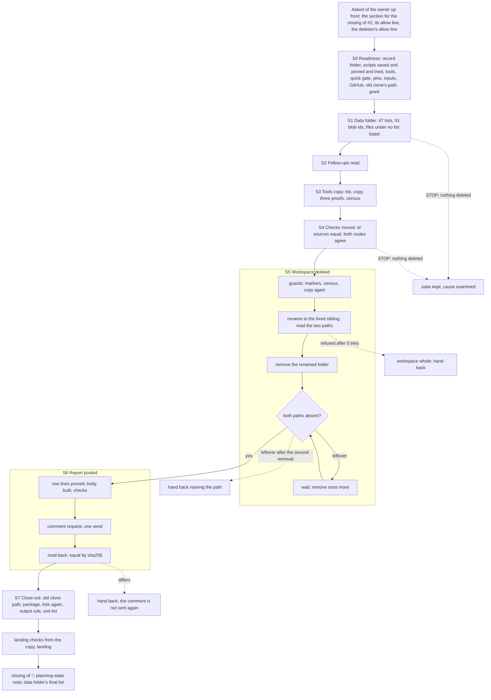

> **Superseded by [`plan-2026-11-17.md`](plan-2026-11-17.md) on 2026-11-16.** This version describes the scripts whose pin list has the sha256 `808c7168c285f4ed88df5434fe4470e67592dc147a38cb5d7c4371ef575f8895`. Its relative links are rewritten to resolve from this folder.

# Phase 0 · 8 — Residual-exposure report and workspace cleanup: implementation plan

- **Covers:** [SpartanLaboratories/KotlinBottools#28](https://github.com/SpartanLaboratories/KotlinBottools/issues/28),
  *"Phase 0 · 8 — Residual-exposure report and workspace cleanup"*, unit 8 of
  [#2](https://github.com/SpartanLaboratories/KotlinBottools/issues/2), the history rewrite, which is a sub-issue of
  [#1](https://github.com/SpartanLaboratories/KotlinBottools/issues/1) (parent chain #28 → #2 → #1). Its siblings are #21 to #26 and #27 (with its
  units #39 to #42), all landed; #28 was blocked by #27 and #25 and is unblocked.
- **Architecture:** [`../architecture.md`](../../architecture.md), unit `residual-report-and-cleanup` (order 8 of §15), which is §6.6 and §6.7
  (the residual measurement and the cleanup, with the dated note of 2026-11-13 under §6.7), with §1.2 (acceptance criteria 1 to 9), §4 (the
  non-goals), §5 (the workspace and records layout, with its dated notes), §8 (the end-to-end order: the row of unit 8), §11 (writes are
  requests; no pull request uses a closing keyword for #2 or #1; "#2 is closed when unit 8 lands, with the residual report posted on it"), §12.4
  (the report) and §16 (the risks). Systems: `residual-exposure` ("Residual-exposure measurement": the report) and `cleanup` ("Cleanup": the
  data folder's re-verification, the tools copy and the workspace's deletion) (registry `docs/dashboards/systems.json`). The phase's consequences
  are in [`../consequences.md`](../../consequences.md) (§4, §5 and §6). The three-repository design that hands this unit its inputs is
  [`../27-rewrite-bottools-and-the-private-repositories/architecture.md`](../../27-rewrite-bottools-and-the-private-repositories/architecture.md) (§9.3 the report rows,
  §10.4 the deletion of the old clone, §12 the requests and their allow lines, §13.4 "#28's inputs"). The tools this unit reuses before the
  deletion are the workspace tools unit's: [its plan](../../27-rewrite-bottools-and-the-private-repositories/39-workspace-tools/plan.md),
  [its as-built record](../../27-rewrite-bottools-and-the-private-repositories/39-workspace-tools/final-implementation.md) and
  [its consequences](../../27-rewrite-bottools-and-the-private-repositories/39-workspace-tools/consequences.md). The structural models are
  [the clone replacement's plan](../../27-rewrite-bottools-and-the-private-repositories/42-clone-replacement/plan.md) (the grant, the allow lines, the
  typed blocks, the stop table, the closing of a tracking issue) and
  [the residual measurement's plan](../../27-rewrite-bottools-and-the-private-repositories/41-residual-measurement/plan.md) (a unit that only reads).
- **Branch:** `docs/issue-28-residual-exposure-report-workspace-cleanup`. It exists, was cut from `main` at the merge of pull request #48 and
  is pushed. This plan is committed in the same commit as the unit's `consequences.md` and as-built record (the first commit of "Version
  control"), so that `git log --follow` binds the plan to the work it describes. The unit lands through one pull request, which closes #28
  only.
- **What this plans:** the last unit of Phase 0. It compiles the residual-exposure report of the six repositories from the units' records and
  posts it on #2 as one comment; re-verifies the data folder against its 47 checksum lists and the three data copies against their blob ids;
  copies the workspace tools into the data folder and moves the landing's document checks onto the copy; deletes the workspace and confirms
  the deletion; confirms the old private repository clone's recorded path absent; records the phase's follow-ups; and, after the landing, closes #2
  under a section of its own. It is a literal procedure the implementer and the run carry out in this same run, settling nothing on the way.
- **Status:** planning. The consequences are written with this plan; the as-built record, the outcome of each assumption and the phase
  documents' notes are written at the reconciliation, once the run has ended.
- **Target version:** none. Nothing is versioned; no source, test, build, configuration, README or CHANGELOG file of any repository changes.
  The landing adds documents and regenerated boards only.

The unit writes to GitHub twice: one comment on #2 (an ordinary request, before the landing) and, after the landing, one `close-issue` request
under a grant section. Its other writes are local: the data folder (its record folder, the tools copy, two lists) and the deletion of the
workspace, which is the run's own command behind guards and needs no request. In this plan `WS` is the workspace folder
`%USERPROFILE%\BotWS` and `DATA` the data folder `%USERPROFILE%\BotLegacyData`; `%PROJECTS%` is the folder that holds KotlinBottools' main
checkout. Inside code they are `$WS`, `$DATA` and `$PROJECTS`, with `$R` (`DATA\run\g28`, the unit's record folder), `$RA`
(`DATA\run\g28-after`, the records written after the unit's last stage), `$TC` (`DATA\run\tools`, the tools copy) and `$WSD`
(`%USERPROFILE%\BotWS-deleting`, the workspace's fixed rename target). The tools print their own stage names (`STAGE S0.tools OK`, `STAGE D.ids OK`
and so on): those are the tools' names; `S0` to `S7` are this run's stage ids.

---

## Requirements

**Goals**

1. **The residual-exposure report is posted on #2 as one comment,** after the cleanup and before the unit's landing, and holds what the parent
   design's §12.4 sets: per repository, the commits before and after, the surviving paths and blobs and the manifest size; the gitleaks
   results for branches and for every ref, with every default-rule finding by rule id and count; the probe tallies (served and not found,
   authenticated and anonymous); the activity-feed and events membership with each read's validity; the pull-request residual of GKB2 and
   BotTools; BotTools' webhook delivery count; and, for KotlinBottools, the fresh repository's not-found tallies, the legacy repository's
   served-while-private tallies and the public window. It states what the exit tests proved and the four things they cannot prove. It carries a
   short acceptance section: each acceptance criterion of the phase design (§1.2, criteria 1 to 9) with its counted outcome and the record
   that proves it, and the departures from #2's body. The text is written in this plan ([Appendix A](#appendix-a--the-report)); the run fills
   only the counts this unit's own steps produce, and reads the comment back and compares it with the body by sha256 (carriage returns
   stripped, trailing newlines trimmed).
2. **The data folder is re-verified before anything is deleted, and a mismatch stops the cleanup.** Each of its 47 checksum lists verifies from
   its base (the swap list by its own rule), the 91 files of the three data copies equal the blob ids their records name, and the files under
   no list are counted by folder and, from this unit on, listed.
3. **The workspace tools are copied to `DATA\run\tools`** (139 files, byte for byte) and verified three ways: a list taken over the source
   before the copy and verified over the copy; the four pin lists (24, 22, 21 and 21 rows) re-checked on the copy; the stage runner's pin.
4. **The landing's document checks run from the copy** once the workspace is gone, and are proved equal to the originals first: each
   repository's commit-map old column equals its untouched backup's commit set, and both routes pass over the same pending documents with the
   same outputs.
5. **The workspace is deleted and its deletion confirmed,** by the unit itself, as local work, behind guards: the recorded path, a folder and
   not a link, on the data folder's volume; this run's markers for the verification, the copy and the moved checks; the census recorded; a
   rename to a fixed sibling name as the lock probe, read from the two paths; the renamed folder removed; both paths confirmed absent. A
   leftover is counted, named and removed once more after a wait; if it still remains the unit stops and hands back with the path named.
6. **The old private repository clone's recorded path, `%PROJECTS%\…-old`, is confirmed absent** at readiness and at close-out; git-filter-repo
   stays installed and is read at close-out.
7. **Every follow-up of the phase is confirmed and recorded** in this unit's `consequences.md` with who carries it out. No issue is filed.
8. **#2 is closed after the landing** by one guarded `close-issue` request, once its eight sub-issues are closed and the report is on it.
9. **Nothing this unit needs after the deletion lives in the workspace:** its scripts and records are saved under `DATA\run\g28\` before the
   deletion and run from there; the earlier records equal their lists at the start and at the close-out; this unit's records carry a list;
   and the data folder, as it is left, has a list over every file of it.
10. **Nothing sensitive is printed, written outside the data folder, committed or posted:** counts, statuses, fixed markers and names only in
    every console line, every document and the comment. No machine-local path, pre-rewrite commit id, purged blob id or member or guild name
    appears in the plan, the comment or any document of the landing.
11. **Version none; documents only.**

**Rules this unit keeps**

- **The tools are fixed.** `WS\tools\g26\` and `WS\tools\g27\` are never edited or saved again; `k0-ready.sh` and `save-tools.sh` are never
  run; the stage runner is never saved again and this unit does not use it (it lives in the workspace). Legacy repositories are read through
  `gh api`, never cloned. A defect found in a pinned tool stops the unit; the correction is a new version of that file under the plan of the
  unit that makes it, with a dated note in the tools unit's consequences.
- **The preparation unit's `verify_data` rewrites `records/<label>.sha256`, so it is never run;** its `recheck_data` is read only and this
  unit's own read replaces both.
- **A list is never rewritten.** The swap list is verified by its rule (below), not repaired. This unit writes new lists only.
- **Nothing under `DATA` or `WS` is committed, printed or quoted beyond counts, checksums, statuses and names.** The two report rows are made
  to be posted and their lines are quoted in [Appendix A](#appendix-a--the-report); no other record's line is.
- **One call of the unit at a time.** The steps share the record folder and the scratch folder, so no two calls of the unit run together.
- **A shell block over about 7.6 KB is cut by Git Bash,** so every script is saved from a block under 7.5 KB, and run from its file.
- **A write that landed is never repeated.** The comment is sent again only under "The report", and the closing only under "After the
  landing: the closing of #2".

**Acceptance criteria** (the issue's "Done when", each with what proves it)

| Criterion | Proved by |
|---|---|
| The report is posted on #2 | `S6.readback`: the newest comment on #2 equals the body (carriage returns stripped, trailing newlines trimmed) by sha256; its URL is recorded in `report/comment-url.txt` |
| The data folder is verified | `S1.lists` (47 lists verify, 0 differences), `S1.copy` (91 of 91 files equal their blob ids), `S1.census` (the counts, and the new list over the files under no list); `S7.lists` again after the deletion |
| The workspace is deleted | `S5.gone` (both paths absent) and `S7.clone` (the same reads again at close-out) |
| Every follow-up is recorded in the consequences | `S2.read` (each follow-up's state, in `out/S2.txt`), then this unit's `consequences.md` |
| #2 closes with this unit | the closing request after the landing, read back `CLOSED COMPLETED` |
| No output or record holds a machine path, a pre-rewrite id or a secret | `S7.outputs`, `S6.checks`, the landing's document checks |

---

## Current state

**Baseline.** `main` is at the merge of pull request #48 (the clone replacement). The workspace, the data folder, GitHub and the request
service's files were read on 2026-11-16 with read-only commands; nothing below was changed. #21 to #27 are closed (#27 at 2026-11-16T20:40:45Z)
and #39 to #42 have landed; #28 is open, unblocked and has no comment; #2 is open with 7 of its 8 sub-issues closed, 2 comments (neither
begins with this report's title) and blocks MagicBot#2, #16 and #3; #47 is open (the clone tools' request builder).

**The workspace** (`%USERPROFILE%\BotWS`): 10,195 files and 5,954 folders below its root (5,955 counting the root), 787 MB, no link, no
hard link, no reparse point; 12 top-level folders, with their file counts: `analysis` 0, `backup` 132, `canary` 89, `fresh` 132, `gitleaks` 62,
`lists` 6, `mirror` 200, `prior` 44, `rehearsal` 186, `scratch` 316, `tmp` 8,889 and `tools` 139. It holds the six untouched backup mirrors
(the only readable local copy of the old objects; GitHub still serves the five force-pushed repositories' old objects by id, and the private
legacy repository holds KotlinBottools'), the rewrite mirrors, the fresh mirrors, scan reports, the canary, the fixtures, `prior\` (the
preparation unit's KotlinBottools mirror and backup) and `scratch\` (the realignment's proof clones), and the earlier units' scratch, among it
the saved request-service replies of #40 and #42 that those units' consequences record as removed with the workspace. It holds nothing
the design keeps but `tools\`. No source, build, CI or configuration file of any repository and no live setting, hook or allow line names it
(70 planning documents name it as history); the global settings file names neither folder.

**`WS\tools`:** 139 files in 10 folders below its root: 71 top-level files and the subfolders `g26` (22 files), `g27` (25), `p25` (10), `rehearsal` (2), `swap`
(2), `gitleaks-8.30.1` (3: the 8.30.1 binary among them), `gitleaks-dl` (2) and `__pycache__` (2); inside the top-level files are the stage
runner `run-stage.sh` (1,428 bytes, sha256 `9cdb381040caf266bb61576536a9cc45436f031fa797fd9358a041249909c428`), `env.sh`, the four tools this
unit's moved checks run (`oldid_refs.py`, `scrub_check.py`, `allow_tool.py` with `privacy_gate.py` and `scrub_expressions.py`, and
`secret_scan.py`) and `gitleaks.toml` (equal to the committed `.gitleaks.toml` but for line endings). The pin lists hold 24 rows
(`g27\g27tools.sums`, whose own sha256 is `60f5760b246ce9b5f1c692e63d72895774fdc86d32db2fad11ccb581877631bf`), 22 (`g27\tools.sums`), 21
(`g26\g26tools.sums`) and 21 (`g26\tools.sums`), each row `<size> <sha256> <path>`; `g27tools.sums` and `g26tools.sums` give paths relative to
their own folder, `tools.sums` relative to `WS` (so a `tools/` prefix). `DATA\run\tools` does not exist.

**The data folder** (`%USERPROFILE%\BotLegacyData`): 964 files in 89 folders below its root (90 counting it), 120 MB. It holds:

- the three data copies (`KotlinBottools-main` 30 files, `GKB2-last-with-data` 30, `…-main` 31) and `COPY-VERIFIED` (present, empty);
- 47 checksum lists, each verified on 2026-11-16 from its base (the table is [Appendix B](#appendix-b--the-scripts-and-their-pins), `lists.tsv`):
  - 3 `records/<label>.sha256` (base `DATA\<label>\`);
  - 27 lists whose base is their own folder: 21 under `rewrite\<repo>\` (`SHA256SUMS`, `SHA256SUMS-fresh`, the KotlinBottools-only
    `SHA256SUMS-final`, and `g26.`, `g40.` and `g41.SHA256SUMS`) and 6 under `run\` (`g26`, `g40`, `g41`, `g42`, `lists`, `publish\record`);
  - 8 `run\<g26|g27|g40>\records-at-s0.<repo>.sums` (base `DATA\rewrite\<repo>\`);
  - `run\swap-SHA256SUMS` (base `DATA\run\swap\`), which verifies by its rule (below);
  - 7 backup lists, `rewrite\<repo>\backup.SHA256SUMS` and `rewrite\KotlinBottools\prior\backup.SHA256SUMS`, 22 lines each, whose subject is the
    mirror in the workspace (`backup\<repo>.git`, `prior\KotlinBottools-backup-unit1.git`), compared from inside the mirror as
    `find . -type f -print0 | sort -z | xargs -0 sha256sum` against the list with `cmp`: all 7 equal;
  - `run\g42\carried.sha256` (4 lines, base the private repository clone at `%PROJECTS%\…`, read only): verifies;
- the 91 files of the three copies, each hashed with `git hash-object --no-filters` (any git dir, for the hash only; the checkout's `.git` works)
  equal to the blob id its `records\<label>.ls-tree.z` record names (NUL-separated `git ls-tree -r -z` records): 91 of 91, 0 mismatches;
- **344 of the 964 files under no list**, counted by folder: `COPY-VERIFIED` 1; `manifests` 22; `records` 6; `rewrite\BotTools` 2, `GKB` 1, `GKB2` 1,
  `KotlinBottools` 5, `KotlinBottools-legacy` 5, `KotlinBottools-next` 5, `…` 2, `…` 2; `run` 3; `run\canary` 4, `g26` 1, `g27` 3,
  `g40` 1, `g41` 1, `g42` 1, `gate` 45, `lists` 1, `publish` 137, `realign` 6, `realign-files` 2, `rehearsal` 80, `scrub` 7 (the lists themselves, the 22
  manifests, the gate's dumps and the probe-code files among them).

**The swap list's rule.** `run\swap\steps.jsonl` is an append-only log. One record (label `g3`, the publication unit's gate dump of 2026-11-12) was
appended after `run\swap-SHA256SUMS` was written on 2026-11-11: the file has 210 lines, the list's recorded sha256 (row `*./steps.jsonl`) equals the
sha256 of the file's first 209 lines, and the list's other 144 names verify. The list verifies when those 144 names match and the first 209
lines hash to the recorded value with exactly 1 line after them. It is never rewritten; any other mismatch, or any further line, stops the
cleanup before the deletion. (The stop guards the data folder's integrity while the copies it was derived from still exist; the swap log is
derived from none of them.)

**The id sources the document checks read.** Each backup's commit set (`git rev-list --all` of `WS\backup\<repo>.git`) equals its commit
map's old column (`DATA\rewrite\<repo>\commit-map`, a header row `old new`, then one row per commit) as a set, with no difference either way:
KotlinBottools 87, GKB2 32, GKB 11, BotTools 16, the first private repository 11, the second 2. The manifests (`DATA\manifests\<repo>.blobs`) hold 346, 81, 58, 39,
199 and 7,259 blobs. `oldid_refs.py` takes a commit map directly (`--ids`, first column) and any file of 40-digit ids; `gdocs.sh` takes the
ids from the backups and sources `$WS/tools/env.sh`, so it cannot run once the workspace is gone.

**The report rows.** `DATA\rewrite\KotlinBottools\report-row.txt` (24 lines, the rewrite and swap unit's) and `DATA\run\publish\record\row.txt`
(24 lines, the publication unit's) hold KotlinBottools' tallies; `DATA\rewrite\<repo>\report-row.txt` for GKB2 (34 lines), GKB (28), BotTools
(31), the first private repository (16) and the second (16) hold the others, each starting `commits before …, after …; paths kept …; blobs kept …; manifest …`.
KotlinBottools' history numbers are in `expect-row.txt`, `expect-check-fresh.txt` and the two `gitleaks-fresh-*.txt` of its rewrite folder and in
[the rewrite and swap unit's as-built record](../../23-kotlinbottools-rewrite-and-swap/final-implementation.md). The rows are counts and statuses
only by design. GKB2's every-ref scan reads `RESULT: FINDINGS` (custom rules on its pull-request residual: `bare-token-file` 1 in 1 file,
`discord-bot-token` 2 in 2, `legacy-bot-data-file` 47 in 31, `legacy-key-file` 1 in 1, `legacy-state-directory` 15 in 7); its residual is 70 of 81 manifest
blobs, 45 commits on every ref; BotTools' is 39 of 39, 28 commits on every ref, with webhook deliveries 0 before and 2 after its push. Every
events read of GKB2, GKB and the private repositories is recorded `(not valid: no current id listed)`; BotTools' events list 1 of its 2 pushed
branches' pushes (1 old id, 1 current id: valid); KotlinBottools' feeds, read after the change to public, list 0 old ids.

**Follow-up facts read on 2026-11-16.**

- `phase0-rehearsal-a-legacy` and `phase0-rehearsal-a`, and `KotlinBottools-legacy`, are private and archived; `KotlinBottools-next` redirects to the
  public repository (id 1453296798); the token's scopes are `gist`, `project`, `read:org`, `repo` and `workflow` (no `delete_repo`).
- No file whose name says "defer" and no line of `steps.jsonl` that says it exists (the object deletion was proved at the rewrite and swap
  unit's run). No `token-rule-gap` record exists. The positive-control kept-findings file of each of GKB2, GKB, BotTools and the private repositories
  holds one line, `total_kept=0`; KotlinBottools' holds the one finding the repository-hygiene unit settled by its scoped allowlist table: rule
  `curl-auth-user`, 2 findings in 1 file (`default-rule-findings.txt`); the other five repositories have no such file.
- The publication unit counted 0 machine-local paths over 3,019 issue, pull-request, comment and revision texts (`row.txt`).
- The branch the phase's planning documents lived on is deleted; its name still appears as 16 links in MagicBot #1 to #8, 1 link in WebTools #55
  and as a plain mention in a comment on #1. MagicBot#2 carries the scan-configuration comment of 2026-11-08.
- The committed CI files `.github/scripts/secret_scan.py`, `.github/scripts/allowlist_controls.py` and `.github/workflows/secret-scan.yml` exist;
  `.gitignore` has no `__pycache__/` pattern. git-filter-repo reports `a40bce548d2c` (2.47.0).
- The project's planning-state note on this machine predates the phase (written 2026-11-08, 3.7 KB).

**The old clone's recorded path.** `DATA\run\g42\clone-moved.txt` holds `moved_to=…-old`; `%PROJECTS%\…-old` is absent.

**The request service.** Its temporary-permissions file for this repository has no open section, and the global settings file holds no allow
line of an earlier unit. A call of a covered request that its own check refuses runs nothing; with the allow line placed the service runs the
same request again itself ([the clone replacement's plan](../../27-rewrite-bottools-and-the-private-repositories/42-clone-replacement/plan.md#the-grant)). This
unit's `comment` request is sent by file with its sha256, the form the units #25 to #27 used for their writes to GitHub.

**Outside facts this unit rests on:**

- A directory rename on Windows refuses with no effect while anything inside is open, and cannot cross volumes
  ([the clone findings, §3.1](../../27-rewrite-bottools-and-the-private-repositories/research/clone-move-aside-on-windows.md#31-what-a-move-is-on-windows-and-in-git-bash)).
  The workspace and the data folder are under one profile folder, so the rename to `%USERPROFILE%\BotWS-deleting` stays on one volume.
- git-filter-repo is installed in the user scheme as a hash-verified package with no state of the phase in it
  ([the parent design, §6.7](../../architecture.md#67-cleanup)).
- The pinned tools take their folders from the environment (`TOOLS`, `DATA`) or from their own location (`oldid_refs.py`, `scrub_check.py`,
  `allow_tool.py`, `secret_scan.py` read no workspace path), so running them from a copy needs no change to them.

---

## Assumptions

| # | Assumption | If false |
|---|---|---|
| A1 | Nothing holds a file or a working folder inside the workspace at `S5` but, at most, a scanner that releases within the rename's retry (5 tries, 3 seconds apart). | The rename refuses with no effect, the retry ends refused, `S5.rename` stops with the workspace whole; the cause is cleared and the step runs again once. |
| A2 | The workspace's top-level folders at `S5` are the 12 recorded, and it holds no link, hard link or reparse point. | The guard stops before anything changes and names the unknown entry's kind; the entry is examined, never deleted blind. |
| A3 | The account can delete every file of the renamed workspace. | A leftover remains at `%USERPROFILE%\BotWS-deleting`: it is counted and named, removed once more after a wait, and if it still remains the unit stops and hands back naming the path. |
| A4 | No pinned tool writes into `WS\tools` between the copy and the deletion beyond a compiled cache. | `S5.guards.copy` compares the copy with the source again: a difference under `__pycache__` is recorded, any other difference stops. |
| A5 | `cp -a` copies the 139 files byte for byte on this volume. | `S3.verify` stops, naming the check that failed; the copy stands unverified and unused (no marker), the source is unchanged, and a new copy needs the failed one removed, which the implementer does only at the owner's word. |
| A6 | The request service accepts a `comment` request by file, naming the target in `issue` (2), the unit in the id, and runs the carried body unchanged. | A `rejected` reply writes nothing; the cause is read, and the request is rebuilt under the key `report-comment-r<n>` and sent as a new id. |
| A7 | GitHub stores the body as sent, apart from carriage returns it may add. | `S6.readback` compares with carriage returns stripped and trailing newlines trimmed; a difference beyond that stops the unit and hands back with the comment left in place (it is then edited by a request under a section the owner gives, never sent twice). |
| A8 | Nothing else is commented on #2 between the post and the read-back. | The read-back finds the comment by its first line, requires exactly one and that it is the newest, and compares its text with the body by sha256; a second comment with the title, or a later comment, stops the unit with the state read. |
| A9 | The two allow lines are placed before the first call that needs them, and the section for the closing is given. | The run's own permission check refuses a covered call before anything runs: the step is run again once the line is placed. With no section for the closing, the owner closes #2 by hand and nothing is sent. |
| A10 | The finding tool the commit scan uses (`~/.claude/tools/finding/scan.js`, with Node) is present and reads a Markdown file as a document. | `S6.checks` stops on exit status 2 with no body posted; the cause is fixed and the step runs again. |
| A11 | The quick gate and the pinned readiness steps write nothing into the data folder (as in the earlier units). | `S1.census` stops on a changed count and names the folder; the file is examined before anything else runs. |
| A12 | The comment is far below GitHub's body limit (the body is about 17 KB, under the 20,000 characters the checks allow). | The post is rejected; the body is shortened by removing an appendix row in the plan's text, never at the run. |
| A13 | `git filter-repo --version` still prints `a40bce548d2c` at close-out. | `S7.package` stops; the package is read again, and nothing is deleted or changed by the unit. |
| A14 | GitHub's answers at `S2` equal those read on 2026-11-16. | A differing follow-up fact is recorded as a `RECORD` line and carried into the consequences as read; only the facts the report states (none of them) would stop a step. |
| A15 | `find -links +1` reports hard links on this volume, and PowerShell is present for the reparse-point count. | The sandbox case that makes a hard link inside a made-up workspace fails at `S0.selftest`, before anything is changed: the guard would be blind to hard links, the unit stops, and the guard is corrected in a new version of `delete-ws.sh` with its pin. |
| A16 | The data folder holds no file this plan does not account for when `S1.census` runs (the 344 under no list included). | `S1.census` stops on the folder whose count differs; the file is examined before anything else runs. |

---

## Non-goals

- **No removal of what GitHub still serves of the old histories.** It stays in place, measured, reported and never claimed removed: BotTools'
  and GKB2's pull-request refs (`refs/pull/2/head` and `refs/pull/3/head`; `refs/pull/6/head`) and every old object served by id in the five
  force-pushed repositories. No GitHub Support ticket is filed, and no repository is deleted: not `KotlinBottools-legacy`, not the two
  rehearsal repositories (their deletion needs the `delete_repo` scope the token lacks, and is the owner's if they are unwanted).
- **No issue is filed.** Every follow-up is recorded in this unit's `consequences.md`, each with who carries it out. #2's body is not
  edited, and #1 needs nothing (its text tracks no per-phase state).
- **No change to any pinned tool, to `WS\tools\g26\` or `g27\`,** and no run of `k0-ready.sh`, `save-tools.sh`, `verify_data` or the stage
  runner. The moved checks are this unit's own scripts; they call the pinned Python tools unchanged.
- **No deletion beyond the two paths** `%USERPROFILE%\BotWS` and its fixed rename target `%USERPROFILE%\BotWS-deleting`. Nothing under
  `%PROJECTS%` is deleted; a leftover at `%PROJECTS%\…-old` is handed back, never removed by this unit.
- **No uninstall of git-filter-repo,** no change to git, Python or gh, and no gitleaks installed outside the tools copy.
- **No edit of a comment, an issue body or a repository setting,** and no request for the older data copies' deletion (they are removed by the
  owner once MagicBot's legacy import report has been checked).
- **No re-run of a pinned tool's own test kinds** beyond the quick gate: the component and integration kinds of the workspace tools' self-test
  are not run again (no tool changes, and `S0.tools` proves the folder at the pins those kinds passed at).
- **No version bump, no CHANGELOG entry and no README change** in any repository.

---

## Design

### Shape of the run

Eight stages, then the landing's document checks and, after the landing, the closing of #2. `S0` reads and checks and runs at once; its only writes
are the unit's record folder, its scripts and data file and the scratch folder of the tools. `S1` re-verifies the data folder and lists the files
under no list; `S2` reads the follow-ups; `S3` copies the tools; `S4` proves the id sources and the moved checks; `S5` deletes the workspace; `S6`
builds, checks, posts and reads back the report; `S7` closes out. Every stop leaves the state its row of "Stops and the state each leaves" names.

| id | name | brief | kind | steps |
|---|---|---|---|---|
| S0 | Readiness | The record folder and the unit's scripts are saved, the tools are at their pins, the inputs, GitHub and the old clone's recorded path are read, and the grant is read. | check | S0.unit: The record folder and the unit's data file; S0.save: The scripts saved and pinned; S0.selftest: The scripts tried in a sandbox; S0.tools: The tools at their pins; S0.quick: The quick gate; S0.pins: The tool versions; S0.inputs: The inputs present; S0.github: GitHub read; S0.clone: The old clone's recorded path; S0.grant: The grant read |
| S1 | Data folder re-verified | Every checksum list of the data folder verifies from its base, the data copies equal their blob ids, and the files under no list are counted and listed. | check | S1.lists: The 47 checksum lists; S1.copy: The data copies against their blob ids; S1.census: The files under no list |
| S2 | Follow-ups read | Each follow-up of the phase is read on GitHub and in the records, and its state is recorded. | check | S2.read: The follow-ups read |
| S3 | Tools copied | The workspace tools are copied byte for byte into the data folder and verified against a list, the four pin lists and the runner's pin. | work | S3.list: The list over the source; S3.copy: The copy; S3.verify: The three proofs; S3.census: The copy's census |
| S4 | Checks moved | The commit sets the checks read from the backups are proved equal to the commit maps, and the document checks run from the copy agree with the originals over the same documents. | check | S4.sources: The id-source proof; S4.routes: Both routes over the same documents |
| S5 | Workspace deleted | The workspace is renamed beside itself, removed and confirmed absent, behind guards. | work | below |
| S6 | Report posted | The report's body is built from the plan's text and the records, checked, posted on #2 by request and read back. | work | S6.sources: The row lines proved; S6.fill: The body built; S6.checks: The body checked; S6.request: The request built and handed off; S6.send: The request sent; S6.reply: The reply stored; S6.readback: The comment read back |
| S7 | Close-out | The old clone's path, the package and every remaining list are read, and the unit's outputs and records hold nothing sensitive and are listed. | check | S7.clone: The old clone's recorded path; S7.package: The package; S7.lists: The lists again; S7.outputs: The output rule; S7.sums: The unit's checksum list |

**Steps of S5**

- `S5.guards`: The deletion's guards
  - `S5.guards.markers`: This run's markers
  - `S5.guards.census`: The workspace's census recorded
  - `S5.guards.copy`: The tools copy read against the source again
- `S5.rename`: The rename and its lock probe
- `S5.remove`: The renamed folder removed
- `S5.leftover`: A leftover removed once more, only when one remains
- `S5.gone`: Both paths confirmed absent



**Why this order.** The deletion is irreversible, so everything it could be blamed for losing is proved first: the data folder (the only home of
the records and the three data copies) verifies against its lists, the tools exist twice, byte for byte, and the checks the landing needs run
from the copy and agree with the originals. The report is built after the deletion, from the plan's text and from records in the data folder
alone, so that what the comment says (that the data copy is verified and the workspace deleted) is true when it is posted and no step
after the deletion reads the workspace. The follow-ups are read before the tools are copied so that anything they find is found while nothing
has changed. The comment is posted before the landing and #2 is closed after it, so the report is on #2 when it closes.

**What proceeds while the unit waits.** Between a request and its reply the implementer waits for the run's hand-back and nothing else of the
unit runs. The only waits inside a step are the rename's retries (3 seconds apart) and the leftover's wait (one background `sleep 60`, then
`S5.leftover`); no step needs a wait of minutes.

### What the unit writes

- **GitHub:** one `comment` on #2 (S6, an ordinary request: no grant) and, after the landing, one `close-issue` of #2 under the section of "The
  grant". Nothing else: no issue is filed or edited, no repository, setting, comment or label changes.
- **The checkout:** the landing's documents only (this plan, `consequences.md`, `final-implementation.md`, the phase documents' dated notes and the
  regenerated boards).
- **The data folder:** `run\g28\` (records, scripts, outputs), `run\tools\` (the copy), `run\g28-after\` (what the landing's checks and the closing
  write), `run\gate\corpus-g28docs.args` and `run\gate\corpus-g28body.args` (the gate's corpus argument files of the pending documents and of the
  report's body, which the pinned gate tool reads by name and rewrites at each run of its corpus), the gate's last-run files `run\gate\gate-last.err`
  and `gate-last.status` (rewritten by every gate run, the earlier units' included: after a passing run they hold the same bytes, an empty error
  file and `exit=0`) and, last, `run\g28-after\final.sha256`.
- **The workspace:** its scratch for the pinned readiness steps (`WS\tmp\g27\g28\`, `WS\tmp\g27\units\g28.txt`), then the workspace itself is deleted.
- **Local notes:** the project's planning-state note, updated at the very end (never committed).

### The unit's data file

`WS\tmp\g27\units\g28.txt` is the data file the pinned readiness steps read through `G27_UNIT`
([format](../../27-rewrite-bottools-and-the-private-repositories/39-workspace-tools/plan.md#the-running-units-data-file)). `S0.unit` writes it with exactly
these lines; the unit needs it only for the quick gate, `s0-ready`, and the originals of the document checks (`gdocs.sh`), all before the deletion:

```text
# unit 8 of the history rewrite: the residual report and the cleanup; reads, one comment, a local deletion and one closing, no grant of its own
job=none
issue=28
home=SpartanLaboratories/KotlinBottools
branch=docs/issue-28-residual-exposure-report-workspace-cleanup
actions=none
targets=none
runs=g28
from=-
wording=none.txt
```

`job`, `actions`, `targets` and `wording` hold placeholders no step reads (as the residual measurement's file does); `from=-` follows no unit
(the library's form for none). `runs=g28` gives the record folder `DATA\run\g28\`, the scratch folder `WS\tmp\g27\g28\` and the gate's corpus
name `g28docs`. The scripts of this unit read no data file: they take their folders from `g28lib.sh`.

### The grant

Asked of the owner at the request service's console before the unit's first call, all together. The report's comment is an ordinary request and
needs nothing; the deletion is the run's own local command and needs only its allow line; the closing of #2 needs a section and its allow line.

1. **The section for the closing of #2,** given in the same sitting and used only after the landing. #2 closes when its last unit lands, and this
   is it; this unit's pull request carries no closing keyword for it, and closing an issue is a write the request service makes only under a
   section that names it. With the date of the day it is given in the `Granted:` line:

```text
## phase-0-tracking-2-close
Granted: <date>
Permissions: close-issue
Scope: SpartanLaboratories/KotlinBottools#2 only, closed as completed once SpartanLaboratories/KotlinBottools#28, its last unit, has landed and the residual report is posted on it; no other issue
Ends: when #2 is closed
Settings: one `autoMode.allow` line for that one close-issue request, placed by the owner in the global settings file; removed when this section moves to history
```

2. **That request's allow line,** placed with the next one before the first call, in the global settings file the running request service reads.
   `%USERPROFILE%` stands for the profile folder in forward-slash form, resolved by the owner when placing it:

```text
Allow line 1, the closing of #2: In the repository SpartanLaboratories/KotlinBottools, the request whose id is SpartanLaboratories-KotlinBottools-28/28/close-2, the action `close-issue`, under the job phase-0-tracking-2-close, may close issue #2 as completed once #28 has landed, after its guards that every one of the eight sub-issues of #2 is closed, that #2 is open and that exactly one comment on #2 begins with the report's title line, by running, as one `bash` call on a script file the request service builds from them, unchanged and in order, the four procedure entries of that request, which are exactly: `r="$(gh api graphql -f query='query{repository(owner:"SpartanLaboratories",name:"KotlinBottools"){issue(number:2){subIssues(first:50){nodes{state}}}}}' --jq '(.data.repository.issue.subIssues.nodes | length | tostring) + " " + ([.data.repository.issue.subIssues.nodes[] | select(.state != "CLOSED")] | length | tostring)')" && [ "$r" = "8 0" ] && echo "UNITS-CLOSED" || { echo "STOP  a sub-issue of #2 is still open, or the eight cannot be read"; exit 1; }`; `[ "$(gh issue view 2 --repo SpartanLaboratories/KotlinBottools --json state --jq .state)" = OPEN ] && echo "TRACKING-OPEN" || { echo "STOP  #2 is not open, or cannot be read"; exit 1; }`; `n="$(gh api repos/SpartanLaboratories/KotlinBottools/issues/2/comments --paginate --jq '[.[] | select((.body | split("\n")[0] | rtrimstr("\r")) == "## Phase 0 residual-exposure report")] | length')" && [ "$n" = 1 ] && echo "REPORT-PRESENT" || { echo "STOP  the report is not on #2 exactly once, or the comments cannot be read"; exit 1; }`; `gh issue close 2 --repo SpartanLaboratories/KotlinBottools --reason completed > /dev/null 2>&1 && echo "TRACKING-CLOSED" || { echo "STOP  the closing of #2 failed"; exit 1; }`. It covers no other issue or command, and is removed when the section phase-0-tracking-2-close moves to history.
```

   When this section is not given, the owner closes #2 by hand after the landing and the run sends no such request.

3. **The allow line for the workspace's deletion.** The deletion is the run's own local command, not a request, so no section covers it; without
   this line the run's own permission check may stop the run at the first deletion command until the owner approves. It is placed with line 1.
   The digest is the one [Appendix B](#appendix-b--the-scripts-and-their-pins) pins for `delete-ws.sh`; the implementer compares it with the
   saved file before the first call:

```text
Allow line 2, the deletion of the workspace: Temporary, for one job: in the sender SpartanLaboratories-KotlinBottools-28, working on KotlinBottools issue #28, the local run of this unit's pinned script `%USERPROFILE%/BotLegacyData/run/g28/bin/delete-ws.sh` (sha256 da9b163e999bc9919e42f8d4c4d7d277f60c7923068b129ce86041b8fac73ce1), as the five commands `bash "%USERPROFILE%/BotLegacyData/run/g28/bin/delete-ws.sh" guards`, `bash "%USERPROFILE%/BotLegacyData/run/g28/bin/delete-ws.sh" rename`, `bash "%USERPROFILE%/BotLegacyData/run/g28/bin/delete-ws.sh" remove`, `bash "%USERPROFILE%/BotLegacyData/run/g28/bin/delete-ws.sh" leftover` and `bash "%USERPROFILE%/BotLegacyData/run/g28/bin/delete-ws.sh" gone`, typed in that order (`guards` again only after a guard's stop whose cause is fixed, `rename` once more only after a refused rename whose cause is cleared, `leftover` only when `remove` printed a leftover; `gone` only reads), and only after this run's markers `S1.ok`, `S3.ok` and `S4.ok` exist in `%USERPROFILE%/BotLegacyData/run/g28/status/` (the script's first guard stops without them). The commands that script runs and that change anything outside this unit's own records are exactly these: `mv "%USERPROFILE%/BotWS" "%USERPROFILE%/BotWS-deleting"` (in `rename`, repeated at most 5 times while the rename is refused) and `rm -rf -- "%USERPROFILE%/BotWS-deleting"` (in `remove`, and once more in `leftover`); every other command in it reads, or writes this unit's own records under `%USERPROFILE%/BotLegacyData/run/g28/` (the workspace's census, the step's output lines and a leftover's names). It may remove the two paths %USERPROFILE%/BotWS and %USERPROFILE%/BotWS-deleting and nothing else. It does not cover any other path or command, an `mv` or `rm` typed by hand, a run before the markers exist, a script file whose sha256 differs from the one named, a push, a reset, a force or a credential setting. It is removed when #28 lands, or at the owner's word.
```

What the unit can read of these: `S0.grant` reads the section of item 1 (when given). It cannot read the allow lines: the first call shows them (a call the
run's own check refuses is the evidence they are missing).

### The report

**Where the text lives.** The report's full text is [Appendix A](#appendix-a--the-report): five parts of Markdown that the run saves as
`report-1.md` to `report-5.md`, with a table of the row lines every count of it draws on (`report-sources-1.tsv` and `report-sources-2.tsv`). The text states every count the
earlier units recorded as a fixed number; the only variables are named placeholders for the counts this unit's own steps produce:

| Placeholder | Written by | Value expected |
|---|---|---|
| `{{LISTS_TOTAL}}` | `S1.lists` | 47 |
| `{{LISTS_VERIFIED}}` | `S1.lists` | 47 (40 again at `S7.lists`, the 7 backup lists' subject being deleted) |
| `{{BLOB_FILES}}`, `{{BLOB_MISMATCH}}` | `S1.copy` | 91, 0 |
| `{{UNLISTED_FILES}}` | `S1.census` | 344 |
| `{{TOOLS_FILES}}`, `{{TOOLS_PIN_ROWS}}` | `S3.verify` | 139, 88 |
| `{{WS_FILES}}`, `{{WS_DIRS}}`, `{{WS_MB}}` | `S5.guards.census` | the census just before the deletion |
| `{{WS_TRIES}}`, `{{WS_LEFTOVER}}` | `S5.rename`, `S5.gone` | the rename's tries (1 to 5), the leftover entries (0) |

Each step that produces one writes `KEY=VALUE` once into `DATA\run\g28\records.env` (a second, different value for a key is a stop); the fill
step reads that file.

**S6.sources: the row lines proved.** `report-sources-1.tsv` and `report-sources-2.tsv` list, per source file of the data folder, the exact lines the report's counts are read
from (the six repositories' rows, KotlinBottools' publication row and KotlinBottools' expectation, expectation-check and scan records). A line is
compared with the file's lines after both are trimmed and runs of spaces collapsed to one. A line absent from its file, or changed, stops the step
before the body is built; so does a source file that is missing or whose line count differs from the one recorded in the table.

**S6.fill: the body built.** `report-fill.py fill` concatenates the five parts, replaces each placeholder with its recorded value, stops on a
placeholder with no value, on a value no placeholder uses, and on any `{{` left in the text, writes the body with LF line endings, one final
newline and no BOM to `DATA\run\g28\report\body.md`, and prints its size, line count and sha256. The first line of the body is the fixed title
line `## Phase 0 residual-exposure report`; the closing guard and the read-back both find the comment by it.

**S6.checks: the body checked,** by five reads, each a stop on a hit: (1) the four document checks over the body alone, from the tools copy
(`docs-check.sh ids|paths|gate|scan --file`): no token resolves to a pre-rewrite commit or a purged blob of the five legacy repositories, no
machine-local path, the privacy gate with every legacy word masked, a gitleaks directory scan with the repository's committed configuration; (2) the
finding tool the commit scan uses, over the body as a document (the internal-names, vocabulary, boards and UI lists): no find; (3) no run of 7 or
more hexadecimal digits that holds a letter (so no abbreviated or whole pre-rewrite id of any of the six repositories, KotlinBottools' included, can
stand in the body), and no drive-letter path; (4) the first line is the title line, the body is under 20,000 characters and holds no carriage return;
(5) the body holds each of the six repositories' names in its first table and states each of the four things the exit tests cannot prove.

**The request.** An ordinary `comment` request sent by file, the form #25 to #27 used for their writes. `report-fill.py request` writes
`DATA\run\g28\requests\comment-report.json` with the fields below and prints its size and sha256, never its path (the run knows it:
`%USERPROFILE%/BotLegacyData/run/g28/requests/comment-report.json`, resolved to forward-slash form); the run compares the sha256 with the file and
sends the envelope.

| Field | Value |
|---|---|
| `v`; `id`; `attempt`; `from` | 1; `SpartanLaboratories-KotlinBottools-28/28/report-comment` (`…-r<n>` after a `rejected` reply); 1; `SpartanLaboratories-KotlinBottools-28` |
| `repo`; `github` | the main checkout of KotlinBottools (absolute path, forward slashes); `SpartanLaboratories/KotlinBottools` |
| `action`; `issue` | `comment`; 2 (the issue the comment is posted on) |
| `requestFile`; `requestFileSha256` | the request file's absolute path, forward slashes; its sha256, compared by the run with the file before it sends |
| `notes` | "The remaining field (body) is the request file's contents: compare the file with its sha256, post its body unchanged as one comment on #2, and reply with the comment's URL." |

The request file holds `body` (the text), `inputs` (the body's sha256, its size and the title line) and `checks` (the comment is posted once and
unchanged; the first line is the title; no other issue is touched). It holds no path and no id.

**Outcome, state and resend.** The outcome is read from GitHub, not from the reply.

| Class | Read from | What follows |
|---|---|---|
| complete | a `done` reply, and `S6.readback`: exactly one comment on #2 begins with the title line and its text equals the body | record the URL; `S7` |
| refused by the service | a `rejected` reply (stored as `refused`), or the service's own check refused the call and nothing ran; state: 0 comments with the title line | for `rejected` the cause is read and the request is rebuilt under `report-comment-r<n>` and sent as a new id; for the service's own check the line is placed and the service runs the same request again itself, under the same id with the next attempt |
| posted, text differs | exactly one comment with the title line whose text differs from the body beyond carriage returns and trailing newlines | hand back with the counts of the difference; the comment is never sent again and is replaced only by an edit the owner grants |
| not posted after a `done` reply | 0 comments with the title line | hand back with the state read |
| anything else | two comments with the title line, a reply that cannot be read, the request id sent twice | hand back with the state read; nothing is sent |

**S6.readback.** `gh api repos/SpartanLaboratories/KotlinBottools/issues/2/comments --paginate` is read; the comment whose first line equals the
title line is found (exactly one), it must be the newest comment on #2, and its body is normalised (carriage returns stripped, trailing newlines trimmed) and compared with the body by
sha256; its `html_url` is written to `report\comment-url.txt` and its id and creation time to `report\comment-read.txt`. The same read is made again by the
closing's third guard, and the unit writes nothing else to #2 before the closing.

### The follow-ups

`S2.read` (`follow-ups.sh`) reads each follow-up of the phase from GitHub or from the data folder's records, prints one `ok` or `RECORD` line
for it, and writes nothing but its console output (kept in `out\S2.txt`). This unit's `consequences.md` is then written from that record. The
follow-ups, their expected state and the one who carries each out:

| Follow-up | Read at `S2` as | Expected | Carried out by |
|---|---|---|---|
| The rehearsal repositories | both repositories private and archived; the token's scopes lack `delete_repo` | 2 of 2; absent | the owner, if they are unwanted: the deletion needs the `delete_repo` scope the token lacks, which this unit neither has nor uses |
| The deferred object deletion | no file or `steps.jsonl` line that says "defer" | none | nobody: the rewrite and swap unit proved the deletion at its run |
| The token rule | no `token-rule-gap` record; each of the five legacy repositories' untouched-backup control-kept file reads `total_kept=0` with no rule line | none; 5 of 5 | nobody: no gap |
| Default-rule findings | KotlinBottools' `default-rule-findings.txt` (rule `curl-auth-user`, 2 findings in 1 file, settled by the repository-hygiene unit's scoped table); none for the other five | 1 file; 0 | nobody: settled and recorded |
| Machine-local paths in issue texts | the publication unit's count over 3,019 texts | 0, 0, 0 | nobody: nothing to edit |
| The credentials | not readable here: the 2023 session cookie and the first private repository's private key, whether either could still be live | open | the owner: rotate them if either could be live |
| The project's planning-state note | read at `A.note` | stale | this run, at its close, with the four facts of the phase consequences §6 (below); a local note, never committed |
| The deleted planning branch's traces outside KotlinBottools' bodies | links in MagicBot #1 to #8, in WebTools #55, and a plain mention in a comment on #1 | 16, 1, 1 | the owner: they need grants this unit does not hold, and no request edits a comment |
| #47 (the clone tools' request builder) | open | open | the owner, as a change to a tool this phase no longer runs: after the cleanup the tool exists only in the copy and no later run of the phase uses it |
| The committed CI files' comment and message-text follow-ups, and the `__pycache__/` ignore pattern | the three files exist; `.gitignore` has no such pattern | present; absent | a later change to those files (held back while the workspace copy of the wrapper had to stay byte-identical; now unblocked): no unit of this phase carries it |
| The retired tools' documentation follow-ups | the copy exists | — | whoever reuses the copy: they apply only to a later reuse |
| Standing: `KotlinBottools-legacy` private and archived; the name `KotlinBottools-next` reserved; BotTools' pull-request residual and webhook (Phase 17, #16) | both repositories as read; `KotlinBottools-next` redirecting to the public repository; the pull-request refs of GKB2 (1) and BotTools (2) | as read | Phase 17 archives the five legacy repositories; the name stays reserved |
| The older data copies | not readable here | open | the owner: deleted once MagicBot's legacy import report has been checked |
| The two allow lines and the section | the settings and the permissions file are not readable by the unit | placed | the owner: the deletion's line is removed when #28 lands, the closing's line and section when #2 is closed |

The four facts of the planning-state note (the phase consequences §6) are: the public repository is a fresh one; the pre-rewrite repository
is `KotlinBottools-legacy`, private and archived; the legacy data is in `%USERPROFILE%\BotLegacyData`; and the deferred step is not due (there was none).

### The data folder's re-verification

`verify-data.sh` reads; the one thing it writes is a list over the files under no list, new in this unit. It never runs `verify_data`.

1. **`lists`** reads `lists.tsv` (47 rows: kind, list, base, expected line count; [Appendix B](#appendix-b--the-scripts-and-their-pins)), and for each:
   the list's line count equals the recorded one; and it verifies from its base: `sha256sum -c --quiet` from the base folder for the 3 data
   copies' lists, the 27 own-folder lists and the 8 `records-at-s0` lists; from the private repository clone for `carried.sha256`; from inside the mirror
   for each of the 7 backup lists (`find . -type f -print0 | sort -z | xargs -0 sha256sum`, compared with `cmp`); and by its rule for the swap
   list (the other 144 names verify; `steps.jsonl` has exactly 210 lines; its first 209 hash to the recorded value). Every failing list prints a
   `STOP` line naming it and the run ends after all 47 are read, so one run shows every mismatch. A list outside the table (the count of files
   named `*SHA256SUMS*`, `*.sha256` or `*.sums` outside `run\g28`, `run\g28-after` and `run\tools` is not 47) is a stop. With `--after` (at
   `S7.lists`) the 7 backup rows are skipped and counted as such.
2. **`copy`** reads the three `records\<label>.ls-tree.z` files (NUL-separated `git ls-tree -r -z` records: `<mode> blob <id>`, a tab, the path) and
   hashes each file of the copy with `git hash-object --no-filters`, the checkout's `.git` serving for the hash only. Per label: records,
   mismatches and files on disk (30, 30 and 31 records; 0; the same files). `COPY-VERIFIED` is present and empty. 91 of 91 files, 0 mismatches.
3. **`census`** (`census.py`) lists every file of the data folder (leaving out this unit's own folders and the tools copy), the files each non-backup,
   non-clone list names, and the files under none; it compares the counts with the table of "Current state" (964 files, 620 listed, 344 under
   none, by folder). A difference is a stop: a file appeared or disappeared since the plan was read, and nothing is deleted until it is
   understood. Then the 344 unlisted files get a list of their own, `DATA\run\g28\uncovered.sha256` (`sha256sum` form, base `DATA`), written once; run
   again, the step verifies it instead. From then on every file of the data folder is under a list, and the data folder's final list covers
   them all at the very end.

`S1` passes when the three steps print `STAGE S1.<step> OK`; the run then writes the marker `status\S1.ok` (the run's id).

### The tools copy

`tools-copy.sh` copies `WS\tools` whole to `DATA\run\tools` and proves it three ways.

1. **`list`:** `sha256sum` over the 139 files of `WS\tools` (base `WS\tools`), written to `DATA\run\g28\tools-before.sha256`, with the folders' names
   (`tools-before.dirs`, so an empty folder is noticed). It prints the file and folder counts (139 files; 11 folders counting the root).
2. **`copy`:** stops when `DATA\run\tools` exists; `cp -a "$WS/tools" "$TC"`; prints one `ok`. It changes nothing in the source.
3. **`verify`:** (a) the list taken before the copy verifies over the copy, and the copy holds exactly the source's names and kinds, so no
   file is missing or extra; (b) the four pin lists re-checked on the copy: `g27\g27tools.sums` (24 rows, relative to `g27`, whose own sha256 is
   `60f5760b246ce9b5f1c692e63d72895774fdc86d32db2fad11ccb581877631bf`), `g27\tools.sums` (22) and `g26\tools.sums` (21) (relative to the copy's root
   once the `tools/` prefix is removed), `g26\g26tools.sums` (21, relative to `g26`): each row's size and sha256 equal the copied file's, 88 rows
   in all; (c) the stage runner `run-stage.sh` is 1,428 bytes, sha256 `9cdb381040caf266bb61576536a9cc45436f031fa797fd9358a041249909c428`, in the copy's root and in `g26`.
4. **`census`:** the copy's census by name and kind, recorded in `DATA\run\g28\tools-copy-census.txt` (one line per entry: `d` or `f`, the size
   and the name), with the counts by top-level folder printed.

`S3` passes when `verify` prints `STAGE S3.verify OK`; the run then writes `status\S3.ok`. The copy is never edited; the pinned tools run from it
unchanged.

### The checks moved off the workspace

The landing's document checks are `gdocs.sh ids|paths|gate|scan` of the pinned tool folder. They source `$WS/tools/env.sh`, resolve tokens
against the untouched backups (`git rev-list --all` of `WS\backup\<repo>.git`) and write their scratch under `WS\tmp`, so they cannot run once the
workspace is gone. `docs-check.sh` is this unit's own script, saved under `DATA\run\g28\bin\`, that runs the same four checks from the tools copy:

| Arm | Check | What it runs |
|---|---|---|
| `ids` | no token in the documents resolves to a pre-rewrite commit or names a purged blob of GKB2, GKB, BotTools or the private repositories | `oldid_refs.py --ids` their five `commit-map` files, then their five `manifests\<repo>.blobs`, each over the pending files. KotlinBottools is left out, as the earlier units' checks named their own repositories only: the generated boards in the pending set carry its accepted pre-rewrite ids in their generated fields, which [the parent design, §1.1 item 9](../../architecture.md#11-what-the-phase-must-achieve) exempts (21 such tokens in 6 pending board files on 2026-11-16). Its ids are checked over the hand-written documents by the landing's `D.kb` and over the report's body by `S6.checks` (3) |
| `paths` | no machine-local path | `scrub_check.py files` with `DATA\run\scrub\replace-text.txt`: the three expressions match nothing |
| `gate` | the privacy gate over the documents, every legacy word masked: 0 blocking hits | `allow_tool.py check`, then `allow_tool.py run g28docs --allow` the confirmed list, the corpus argument file `DATA\run\gate\corpus-g28docs.args` written from the pending files |
| `scan` | a gitleaks directory scan of copies of the documents with the committed `.gitleaks.toml` reports `RESULT: CLEAN` | `secret_scan.py scan --mode dir` with the copy's gitleaks 8.30.1 binary and the checkout's `.gitleaks.toml` |
| `sources` | the commit maps are proved to be the backups' commit sets | per repository, the commit-map's old column as a set equals `git rev-list --all` of the backup (before the deletion only) and its count and the manifest's count equal the recorded ones |

The pending set is the same as the original's: every file under `docs\` that `git status` lists as modified or untracked, and the arm stops when a pending file lies
outside `docs\` or none is pending. `--file PATH` replaces the pending set by one file (the report's body, under the corpus name `g28body`). The pinned
Python tools run unchanged with `TOOLS` set to the copy and `DATA` to the data folder.

**The proof before the deletion (`S4`).** `S4.sources` proves, per repository, that the commit map's old column equals the backup's commit set
(87, 32, 11, 16, 11 and 2, with no difference either way; counts only), and the manifests' sizes (346, 81, 58, 39, 199, 7,259). `S4.routes` runs both
routes over the same pending documents: the original `gdocs.sh ids GKB2 GKB BotTools … …`, `paths`, `gate` and
`scan`, then `docs-check.sh` over the same four arms. Both must pass, and the outputs must agree: the id check's two outputs, the paths output
and the gate's output are byte for byte equal, and the two scans print the same `RESULT:` line. A difference, or one route passing where the other does not, is a
stop (`S4` writes no marker and the deletion does not run). `status\S4.ok` is written when all four agree.

### The workspace's deletion

`delete-ws.sh` is this unit's own script, saved under `DATA\run\g28\bin\` and pinned by size and sha256; the deletion is its four changing
subcommands and the read-only `gone`, typed as the deletion's allow line names them ("The grant", item 3).

- **`guards`** (read only; also the first act of `rename`): (1) the markers `S1.ok`, `S3.ok` and `S4.ok` of this run's id are present; (2) the path
  is the recorded one: `$WS` equals the profile folder's `BotWS`, written in `DATA\run\g28\ws-path.txt` at `S0.unit`; it is a folder and not a link,
  on the same volume (device number) as the data folder and the profile folder, and the shell's working folder is not inside it; (3) the census:
  the files, the folders (counting the root), the megabytes, the links, hard links and reparse points (all three 0), and the top-level folders,
  which must be exactly the 12 recorded (anything else is a stop that names its kind); the census is recorded in
  `DATA\run\g28\ws-census.txt` and its counts written as `WS_FILES`, `WS_DIRS`, `WS_MB`; (4) the tools copy is read against the source again:
  every file of `WS\tools` equals the copy's (a difference under `__pycache__` is a `RECORD`, any other a stop), and the copy verifies against its
  list; (5) `$WSD` is absent (a `$WSD` present with `$WS` absent is the interrupted state `remove` takes up; both present stops).
- **`rename`** (after `guards`): `mv "$WS" "$WSD"`, in a bounded retry (5 tries, 3 seconds apart). A rename refuses with no effect while anything
  inside is open, so it is the lock probe. **The outcome is read from the two paths, never from `mv`'s status:** `$WS` absent and `$WSD` present is renamed (the
  tries are written as `WS_TRIES`); `$WS` present and `$WSD` absent is refused (retry, then a stop with the workspace whole); any other pair is a stop.
- **`remove`:** `$WSD` must be a folder and `$WS` absent; `rm -rf -- "$WSD"`; the paths are then read again. When `$WSD` remains, its entries are
  counted and its top-level names printed and recorded in `DATA\run\g28\ws-leftover.txt`, and the step ends with a `LEFTOVER` line (status 3); when both are absent
  it prints `WS-DELETED`.
- **`leftover`** (only after a `LEFTOVER` line and one wait of 60 seconds): the same removal once more; a leftover again is a stop that names the
  path and the count and hands back.
- **`S5.gone`:** both paths confirmed absent (`WS_LEFTOVER` is written as 0 or the count), and the data folder, the checkout and the profile folder read as before.

What the deletion removes is exactly the workspace: the backup mirrors, the mirrors, the fresh mirrors, the scan reports, the canary, the
fixtures, `prior\`, `scratch\`, the earlier units' scratch (the saved request-service replies of #40 and #42 among it) and the pinned tool
folders, whose copy now stands in the data folder. Nothing of it is needed afterwards: the id sources of the checks are the commit maps and
manifests of the data folder, the report's sources are in the data folder, and the old objects remain in GitHub's own copies (served by id) and
in the private legacy repository. **The deletion needs no stop for a person** (parent design §11): its guards are the unit's own, and a stop
leaves the workspace whole.

### The old clone's recorded path

`DATA\run\g42\clone-moved.txt` holds `moved_to=…-old`, the folder beside the private repository clone the old clone was renamed to and deleted at. The
unit reads the recorded value and confirms `%PROJECTS%\…-old` absent at readiness (`S0.clone`) and again at close-out (`S7.clone`). If the
path is present at either, the unit stops and hands back with the path named: its deletion would be a request under a section the owner gives
then, and the workspace's deletion never reaches it. `git-filter-repo` stays installed: `S7.package` reads that `git filter-repo --version` prints
the recorded prefix and that the module's sha256 equals the recorded one (`DATA\run\tool-versions.txt`).

### Records and where they live

`DATA\run\g28\` (the unit's record folder; nothing of any other unit's) holds:

- `bin\` (the unit's scripts and their pins, saved at `S0.save`), `run-id.txt` (one line, the run's id, written once), `ws-path.txt` and `ws-top.txt` (the
  workspace's recorded path and top-level folders, written once), `records.env` (the
  placeholders' values), `run.log` (one line per call: the time and the step id), `status\<step>.ok` (the markers), `out\<step>.txt` (each step's
  console output, carriage returns stripped);
- `uncovered.sha256` (the 344 files under no list), `tools-before.sha256`, `tools-before.dirs` and `tools-copy-census.txt`;
- `ws-census.txt`, `ws-leftover.txt` and `ws-rm-errors.txt` (the last two only when a removal met something; the second holds names and is never printed) and the deletion's outcome lines in `out\S5.*.txt`;
- `docs-s4\` (the originals' and the moved checks' outputs over the same documents at `S4.routes`);
- `report\` (`body.md`, `docs\` the body's four checks' outputs, `finding.out` and `finding.err`, `comment-url.txt`, `comment-read.txt`), `requests\comment-report.json`, `replies\comment-report-<n>.txt`;
- at close-out, `SHA256SUMS` over every other file under the folder.

`DATA\run\g28-after\` (what the unit writes after its last stage): the landing's document checks' outputs (`docs\`), the closing request and its
reply and read-back (`requests\close-2.json`, `replies\close-2-<n>.txt`, `close-read.txt`), its own `SHA256SUMS` and, last, `final.sha256`, the list over
the whole data folder. `DATA\run\tools\` is the tools copy. Beside them: `DATA\run\gate\corpus-g28docs.args` (the pinned gate tool's corpus argument
file). The earlier units' records are read, never written. Everything there holds ids, paths or names and is never committed, printed or quoted.

### Error handling and logging

- **Failure design.** A script step ends through `expect` (`STOP  <label>: expected '<x>', got '<y>'`, status 1) or an explicit `STOP` line and
  `exit 1`; `ok` and `RECORD` print and never stop; a `LEFTOVER` line is status 3 and a pause. A step that finds several faults (the lists, the
  census) prints each, then ends once. Python raises one `Stop` printed as `STOP  <why>`, status 1. An expected failure ends the script that met
  it; a count that differs where this plan says `RECORD` is a result; a failed read is never a zero (a missing file or a command that failed
  is a stop, never a count of 0). A programmer error (a missing library function) is not defended against.
- **Where a result is unwrapped.** Each typed block runs `run <id> <command>`, whose status is the script's; the implementer reads the last line
  of each step: a `STAGE … OK` line with status 0 is a pass, a `STOP` line a stop, `LEFTOVER` a pause, `RECORD` a result.
- **Events logged,** each a console line kept in `out\<step>.txt`: each step's `ok` lines and its `STAGE` line; each `RECORD`, `LEFTOVER` and
  `STOP`; the run log's one line per call. The report's posting and read-back lines, the closing's lines and the deletion's outcome lines are kept
  in the same files.
- **Recorded, not stopped:** a count the follow-ups read that differs from the one read on 2026-11-16; a difference under `__pycache__` at the
  deletion's tools comparison; the number of rename tries.

### Stops and the state each leaves

| Where | The stop | State left | Next |
|---|---|---|---|
| `S0.*` | a pin, a version, an input, the old clone's path or the data file differs from its expectation | the record folder, scripts and data file only; the workspace and the data folder otherwise unchanged | find out why; fix the cause; run `S0` again from the step |
| `S1.lists`, `S1.copy` | a list does not verify, a line count differs, a blob id differs, or a list is outside the table | nothing changed but the record folder; **the cleanup does not run** | hand back with the list's name and the counts; the data folder is examined, never repaired by the unit |
| `S1.census` | a count by folder differs from the table | nothing changed but the record folder (and `uncovered.sha256`, if the step wrote it before a later check failed) | find out which file appeared or went; run the step again |
| `S2.read` | a read cannot be made (a `gh` failure) | nothing changed | run the step again once; a second failure hands back |
| `S3.list`, `S3.copy` | the source cannot be listed, or `$TC` exists | no copy made, or a copy that has not passed `S3.verify` | find out why; a copy that failed its proofs is removed by the owner's word and made again once |
| `S3.verify` | a file, a name, a pin row or the runner differs | the copy stands unverified; no marker | hand back with the count of differing rows |
| `S4.sources` | a commit set differs from its commit map, or a count differs | nothing changed; no marker | hand back; the deletion does not run |
| `S4.routes` | a route fails, or the two disagree | nothing changed; no marker | hand back; the deletion does not run |
| `S5.guards.*` | a marker is missing, the path or volume is not the recorded one, a link or an unknown top-level entry is found, the copy differs, or `$WSD` exists beside `$WS` | the workspace whole; nothing deleted | fix the cause; run `guards` again |
| `S5.rename` | refused after 5 tries | the workspace whole, no `$WSD` | clear the cause (the stop names the count of tries); run `rename` once more; a second refusal hands back |
| `S5.remove`, `S5.leftover` | entries remain at `$WSD` after the second removal | a partly deleted workspace at `%USERPROFILE%\BotWS-deleting`; `$WS` absent | hand back naming the path and the count; the unit does not post the report and does not land while a path remains |
| `S6.sources`, `S6.fill`, `S6.checks` | a row line is absent or changed; a placeholder has no value; a check hits | nothing posted | reword the part in the plan's text only if the text is at fault; otherwise fix the record; run the step again |
| `S6.send`, `S6.readback` | the class table of "The report" | as its row names | as its row names |
| `S7.*` | the old clone's path is present, the package differs, a list or the output rule fails | as the stages left them | report and stop; the unit does not land |
| the landing's checks | a hit | nothing committed | reword the document; run the check again |
| the closing | a guard prints `STOP` | #2 as it was | find the cause the line names; send again with the same id and the next attempt |

---

## Procedure

### Conventions

- **Shell.** Git Bash. Each call starts a fresh shell, so every call from `S1` on begins with this prelude. The working folder is the main checkout of
  KotlinBottools (the branch's checkout), never the workspace and never a folder inside it; no machine path is typed:

  ```bash
  P="$(cygpath -m "$USERPROFILE")"; R="$P/BotLegacyData/run/g28"; RA="$P/BotLegacyData/run/g28-after"; B="$R/bin"
  run() { local id="$1"; shift; mkdir -p "$R/out"; printf '%s %s\n' "$(date -u +%Y-%m-%dT%H:%M:%SZ)" "$id" >> "$R/run.log"; "$@" 2>&1 | tr -d '\r' | tee "$R/out/$id.txt"; return "${PIPESTATUS[0]}"; }
  ```

  A step is then `run <step-id> bash "$B/<script>.sh" <arguments>`, for example `run S1.lists bash "$B/verify-data.sh" lists`. `run` keeps the step's console
  output in `out\<step-id>.txt` and appends the time and the step id to `run.log`. After `S7.sums` no
  step uses `run`: the landing's checks write to `DATA\run\g28-after\` through `G28_OUT`, and the closing and the final list are typed. The pinned readiness steps of `S0` and the original route of `S4.routes`
  also source `$P/BotWS/tools/env.sh` and export `G27_UNIT="$WS/tmp/g27/units/g28.txt"`; **`S5` types its five commands without `run`,
  the path written out** (the same text as the allow line), because the script keeps its own output (`out\S5.<command>.txt`). No script of this
  unit sources `env.sh`, uses the stage runner, or reads a file of the workspace but `S3`, `S4.routes` and `S5`.
- **A step succeeded** when its exit status is 0 and its last line is the `STAGE … OK` line it names. A line that starts `STOP` is a stop: take no
  further step but the one the stop table names, and report the step id, the first `STOP` line and the numbers on it, never content. A `RECORD`
  line is a result. `LEFTOVER` is a pause.
- **Timeouts.** Every call runs in the foreground; none needs more than a few minutes (the slowest are `S1.census`, `S3.copy` and `S5.remove`,
  each well under the 10-minute cut). The one wait is `sleep 60` before `S5.leftover`.
- **What is never done.** No pinned tool is saved or edited; `k0-ready.sh`, `save-tools.sh`, `verify_data` and the stage runner are never run; no
  `mv`, `rm` or `cp` is typed by hand (the scripts carry them); the shell never enters the workspace or the old clone; nothing in `DATA` or `WS` is
  opened and quoted: only counts, words and file names are reported; the report's request is sent once.
- **Saved scripts.** Each script of [Appendix B](#appendix-b--the-scripts-and-their-pins) is saved from a quoted heredoc
  (`cat > "$B/<name>" <<'G28_END'` … `G28_END`), one block per file, each under 7.5 KB, and pinned by size and sha256 (`pins.txt`).

### When the steps run again

- `S0.unit`, `S0.save` and `S0.selftest` may run again: they write the same bytes and keep the run id, the recorded path and the first line count of
  the run log. The other `S0` steps, `S1.lists`, `S1.copy`, `S2.read`, `S3.verify`, `S4.*`, `S5.guards`, `S6.sources`, `S6.fill`, `S6.checks` and `S7.*` are
  reads and may run again at any time before the step that changes what they read.
- `S1.census` writes `uncovered.sha256` at its first pass and verifies it on every later one. `S3.list` and `S3.copy` run once each (`S3.copy`
  stops when the copy exists). `S5.rename` runs again only after a refusal, with the cause cleared. `S6.send` is the run's, once.
- A marker (`status\S1.ok`, `S3.ok`, `S4.ok`) is written by `close.sh mark` only when the last line of each of its steps' outputs is a `STAGE … OK` line.
  A step that changes what a marker vouches for is followed by its steps again and the marker again.

### S0 — Readiness

Nothing is written to GitHub; every step but `S0.unit` and `S0.save` is a read, a local check or the quick gate. The owner has given the asks of "The
grant" before the first call that needs them.

**`S0.unit`:** the record folder with its sub-folders, the run id (written once), the recorded path of the workspace (written once), the
recorded top-level names of the workspace, and the data file. A typed block (under 7 KB; the heredoc is quoted):

```bash
P="$(cygpath -m "$USERPROFILE")"; R="$P/BotLegacyData/run/g28"; W="$P/BotWS"
mkdir -p "$R/bin" "$R/out" "$R/status" "$R/requests" "$R/replies" "$R/report" "$W/tmp/g27/units" "$W/tmp/g27/g28"
[ -s "$R/run-id.txt" ] || date -u +%Y-%m-%dT%H:%M:%SZ > "$R/run-id.txt"
[ -s "$R/ws-path.txt" ] || printf '%s\n' "$W" > "$R/ws-path.txt"
[ -s "$R/ws-top.txt" ] || (cd "$W" && ls -A | sort | tr '\n' ' ' | sed 's/ $//') > "$R/ws-top.txt"
cat > "$W/tmp/g27/units/g28.txt" <<'UNIT_END'
# unit 8 of the history rewrite: the residual report and the cleanup; reads, one comment, a local deletion and one closing, no grant of its own
job=none
issue=28
home=SpartanLaboratories/KotlinBottools
branch=docs/issue-28-residual-exposure-report-workspace-cleanup
actions=none
targets=none
runs=g28
from=-
wording=none.txt
UNIT_END
echo "ok    the record folder and the unit's data file are written; run id $(cat "$R/run-id.txt"); $(tr ' ' '\n' < "$R/ws-top.txt" | grep -c .) top-level folders recorded"
```

Expected: one `ok` line: `… 12 top-level folders recorded`. The run id is read once and kept: every marker holds it.

**`S0.save`:** the unit's scripts saved from [Appendix B](#appendix-b--the-scripts-and-their-pins), `pins.txt` first, then each file, then the pin check. The check
block:

```bash
P="$(cygpath -m "$USERPROFILE")"; B="$P/BotLegacyData/run/g28/bin"
( cd "$B" && n=0; bad=0
  while read -r size sum name; do n=$((n + 1))
    [ -f "$name" ] && [ "$(wc -c < "$name" | tr -d ' ') $(sha256sum "$name" | cut -d' ' -f1)" = "$size $sum" ] || { echo "STOP  $name differs from its pin"; bad=$((bad + 1)); }
  done < pins.txt
  extra="$(ls | grep -v -x -F -f <(cut -d' ' -f3 pins.txt; echo pins.txt) | wc -l | tr -d ' ')"
  [ "$bad" = 0 ] && [ "$extra" = 0 ] || { echo "STOP  $bad of $n files differ from their pins, $extra files are not pinned"; exit 1; }
  echo "ok    $n scripts and data files equal their pins; the folder holds no other file"; echo "STAGE S0.save OK" )
```

Expected: `ok    <n> scripts and data files equal their pins …` (26, the rows of Appendix B's table) and `STAGE S0.save OK`. A different size or hash is a stop: the file is
not the one the plan pins. `delete-ws.sh`'s pin is also the digest the deletion's allow line names.

**`S0.selftest`:** the unit's scripts tried in a made-up sandbox in the system temp folder (outside both folders), as "Test plan" lists, by four scripts (each builds its own sandbox and removes it):

```bash
for n in 1 2 3 4; do run S0.selftest-$n bash "$B/selftest-$n.sh" || break; done
```

Expected: each ends `STAGE SELFTEST OK`, with every case line `ok` and the line before it `ok    selftest: <n> cases passed` (17, 24, 22 and 14 cases). No file of `DATA` or `WS` changes (the
sandbox builds its own; the real tools copy or the workspace tools serve only as the source of the pinned Python tools it copies).

**`S0.tools`:** every reused tool and every file of the folder holds its recorded size and sha256, the scanner binary reports its version, the folder holds exactly the files
its pin list names, every shell script parses and every Python tool compiles.

```bash
. "$P/BotWS/tools/env.sh"; export G27_UNIT="$WS/tmp/g27/units/g28.txt"
run S0.tools bash "$TOOLS/g27/s0-ready.sh" tools
```

Expected: 96 `ok` lines and `STAGE S0.tools OK`. A different size or hash is a stop: the tool is not the tested one.

**`S0.quick`:** the quick gate under this unit's data file, the deterministic cases of the workspace tools' self-test (the one test kind run):

```bash
. "$P/BotWS/tools/env.sh"; export G27_UNIT="$WS/tmp/g27/units/g28.txt"
run S0.quick bash "$TOOLS/g27/gselftest.sh" deterministic
```

Expected: 63 `ok` case lines, then `ok    gselftest deterministic: 63 checks passed`, status 0, no `STOP`. About 15 seconds.

**`S0.pins`:** git, Python, gh, git-filter-repo with its module's sha256 and gitleaks are at the versions the preparation unit recorded.

```bash
. "$P/BotWS/tools/env.sh"; export G27_UNIT="$WS/tmp/g27/units/g28.txt"
run S0.pins bash "$TOOLS/g27/s0-ready.sh" pins
```

Expected: 7 `ok` lines and `STAGE S0.pins OK`.

**`S0.inputs`:** the inputs this unit reads.

```bash
run S0.inputs bash "$B/ready.sh" inputs
```

Expected: 8 `ok` lines (the branch; every pending path under `docs/`; the 139 tool files and the free place of the copy; the 12 top-level folders; the seven row
files' line counts 24, 24, 34, 28, 31, 16 and 16; the six commit maps and manifests; `COPY-VERIFIED`, the scrub expressions and the confirmed allow-list; Node and the finding tool) and `STAGE S0.inputs OK`.

**`S0.github`:** GitHub read: #28 and #2 as expected, no comment on #2 with the report's title line, the fresh repository public, and the rate limit.

```bash
run S0.github bash "$B/ready.sh" github
```

Expected: 5 `ok` lines and `STAGE S0.github OK`.

**`S0.clone`:** the old clone's recorded path, read:

```bash
run S0.clone bash "$B/ready.sh" clone S0.clone
```

Expected: 3 `ok` lines (the recorded folder name `…-old`; its path absent; the fresh clone's `.git` present) and `STAGE S0.clone OK`. A present path is a stop that names it.

**`S0.grant`:** the section of "The grant", item 1, read in the request service's permissions file (read only):

```bash
run S0.grant bash "$B/ready.sh" grant
```

Expected: 3 `ok` lines and `STAGE S0.grant OK`; or, when the section is not given, one `RECORD the section phase-0-tracking-2-close is not given: the owner closes #2 by hand`, which is not a stop. The allow lines cannot be read: the first call
that needs one shows whether it is placed.

### S1 — The data folder re-verified

Starts when `S0` has passed.

```bash
run S1.lists  bash "$B/verify-data.sh" lists
run S1.copy   bash "$B/verify-data.sh" copy
run S1.census bash "$B/verify-data.sh" census
run S1.mark   bash "$B/close.sh" mark S1 S1.lists S1.copy S1.census
```

Expected:

```text
ok    the table holds 47 lists
ok    no list lies outside the table
ok    47 of 47 lists equal their line counts and verify from their bases (0 backup lists skipped: their subject is deleted)
STAGE S1.lists OK
ok    COPY-VERIFIED is present and empty
ok    KotlinBottools-main: every file equals its recorded blob id, and no other file is there
ok    GKB2-last-with-data: every file equals its recorded blob id, and no other file is there
ok    …-main: every file equals its recorded blob id, and no other file is there
ok    the three copies hold 91 files
STAGE S1.copy OK
ok    the census equals the table: 964 files, 620 under a list, 344 under none
ok    the list over the 344 files under no list holds 344 lines and verifies
STAGE S1.census OK
ok    marker S1 written (3 steps)
STAGE S1.mark OK
```

A `STOP` here ends the cleanup: the lists that failed are each named, and the unit does not go on to `S3`. The swap list is the one expected to need its rule; any other
failing list, or a further line in `steps.jsonl`, stops the unit with the data folder as found.

### S2 — The follow-ups read

```bash
run S2.read bash "$B/follow-ups.sh"
```

Expected: 35 `ok` lines (the rehearsal repositories and the legacy repository private and archived, the token's scopes, the redirect of the reserved name, no
deferred step, no token-rule gap, the five control files and the absence of five findings files, KotlinBottools' one settled finding, the 3,019-text path count, the 16, 1 and 1
planning-branch traces, the scan-configuration comment on MagicBot#2, #47 open, #2's sub-issues, the three CI files, the missing ignore pattern, the five
pull-request-ref counts) and `STAGE S2.read OK`. A line that reads differently is a `RECORD` with the value read, which is not a stop; `out\S2.txt` is the record this unit's `consequences.md` is written from.

### S3 — The tools copied

Starts when `S1` has passed (`status\S1.ok`).

```bash
. "$P/BotWS/tools/env.sh" > /dev/null   # only to be sure the source exists; no tool runs between the list and the verification
run S3.list   bash "$B/tools-copy.sh" list
run S3.copy   bash "$B/tools-copy.sh" copy
run S3.verify bash "$B/tools-copy.sh" verify
run S3.census bash "$B/tools-copy.sh" census
run S3.mark   bash "$B/close.sh" mark S3 S3.list S3.copy S3.verify S3.census
```

Expected: `ok    the source holds 139 files and 11 folders (the root counted)` and `STAGE S3.list OK`; `ok    the copy's place is free`, `ok    the tools folder is copied`
and `STAGE S3.copy OK`; 9 `ok` lines (the list over the copy, the names and kinds, the four pin lists with 24, 22, 21 and 21 rows, the pin list's own sha256, the runner's pin twice) and
`STAGE S3.verify OK`; 10 `ok` lines of the census (the totals, the eight subfolders, the root's 71 files) and `STAGE S3.census OK`; the marker. No Python tool runs
between `S3.list` and `S3.verify`.

### S4 — The checks moved

Starts when `S3` has passed.

```bash
run S4.sources bash "$B/docs-check.sh" sources --with-backups
run S4.routes  bash "$B/routes.sh"
run S4.mark    bash "$B/close.sh" mark S4 S4.sources S4.routes
```

Expected: 12 `ok` lines for `S4.sources` (per repository, the commit map's 87, 32, 11, 16, 11 and 2 old ids and the manifest's 346, 81, 58, 39, 199 and 7,259 blobs; the commit map's old column equal to the backup's
commit set with 0 differing lines) and `STAGE D.sources OK`; for `S4.routes` 13 `ok` lines (the original route's four arms pass, the moved route's four arms pass, and the pending list and the id, path and
gate outputs equal byte for byte) and `STAGE S4.routes OK`. **A difference between the routes, or a route that fails over documents the other passes, is a stop: the deletion does not run.** The pending
documents at this step are the regenerated boards, this plan and any documents already written; none holds a pre-rewrite id.

### S5 — The workspace deleted

Starts when `S1`, `S3` and `S4` have written their markers and the owner has placed allow line 2. The commands are typed with the path written out
(the same text as the allow line) and without `run`; each keeps its output in `out\S5.<command>.txt`.

```bash
bash "%USERPROFILE%/BotLegacyData/run/g28/bin/delete-ws.sh" guards
bash "%USERPROFILE%/BotLegacyData/run/g28/bin/delete-ws.sh" rename
bash "%USERPROFILE%/BotLegacyData/run/g28/bin/delete-ws.sh" remove
bash "%USERPROFILE%/BotLegacyData/run/g28/bin/delete-ws.sh" leftover     # only after a LEFTOVER line and one background `sleep 60`
```

Expected, in order (the implementer resolves `%USERPROFILE%` to the profile folder in forward-slash form, as the allow line is resolved):

- `guards`: 12 `ok` lines (the three markers are this run's; the path is the recorded one; a folder and not a link; one volume with the data folder and the profile folder; no link of any kind;
  the 12 top-level folders; the census `<n> files, <n> folders (the root counted), <n> MB, no link of any kind`; every file of the source but its compiled caches equals the copy's; the copy holds no other file; the caches are the same files (or one `RECORD`);
  the copy verifies against its list; the state `1 0`) and `STAGE S5.guards OK`;
- `rename`: the same 12 lines, then `ok    renamed on the volume after <t> of 5 tries`, `MOVED-ASIDE` and `STAGE S5.rename OK` (`t` is 1 when nothing holds the workspace);
- `remove`: `ok    the rename target is a folder and the workspace is absent`, `WS-DELETED` and `STAGE S5.remove OK`; when entries remain: one `LEFTOVER <n> entries remain …` line with their first-level names and status 3, then the wait and `leftover`;
- `leftover`: `WS-DELETED` and `STAGE S5.leftover OK`, or a `STOP` that names the path and the count.

Then `S5.gone`:

```bash
bash "%USERPROFILE%/BotLegacyData/run/g28/bin/delete-ws.sh" gone       # typed as the four above: the script keeps its own output
```

Expected: `ok    both paths are absent: the workspace and its rename target`, `ok    the data folder and the checkout are as before` and `STAGE S5.gone OK`. (This call runs the script's read-only subcommand,
which the deletion's allow line names with the four others; it runs after the deletion and reads no workspace file.)

### S6 — The report posted

Starts when `S5.gone` has passed. Nothing of the workspace is read.

**`S6.sources`, `S6.fill`, `S6.checks`:**

```bash
run S6.sources bash "$B/report.sh" sources
run S6.fill    bash "$B/report.sh" fill
run S6.checks  bash "$B/report.sh" checks
```

Expected: 14 `ok` lines for `S6.sources` (one per source file: the row lines present and the file's line count as recorded) and `STAGE S6.sources OK`; for `S6.fill` `ok    body built: <n> bytes, <m> lines, sha256 <digest>`, `ok    12 placeholders filled, none left, no value unused`, `STAGE S6.fill OK`; for `S6.checks`
the lines of `docs-check.sh all --file` (the four `STAGE D.<arm> OK` lines), `ok    the finding tool finds nothing in the body`, the regex checks and `STAGE S6.checks OK`. A hit is reworded in the plan's text only when the text is at fault; the run does not edit text
the plan pins.

**`S6.request`:**

```bash
run S6.request bash "$B/report.sh" request
```

Expected: `ok    request written: requests/comment-report.json (key report-comment)`, then the request file's size and sha256 and the body's size and sha256 (no path is printed: the
output rule of `S7.outputs` holds for this step's output too). The implementer reports the printed lines to the run and stops.

**`S6.send`:** the run's. It compares the sha256 with the file and sends the one `comment` request of the envelope table in Design, id `SpartanLaboratories-KotlinBottools-28/28/report-comment`. It sends nothing else.

**`S6.reply`:** the run gives the implementer the reply as delivered and its kind; the implementer stores it with:

```bash
P="$(cygpath -m "$USERPROFILE")"; R="$P/BotLegacyData/run/g28"
N=1; ST=done                   # done, refused (a rejected reply), stopped or failed; the number is the stored replies plus one
{ echo "status=$ST"; tr -d '\r' <<'REPLY_END'
(the reply text exactly as delivered)
REPLY_END
} > "$R/replies/comment-report-$N.txt"
echo "ok    stored reply $N for report-comment as $ST ($(( $(wc -l < "$R/replies/comment-report-$N.txt") - 1 )) lines)"
```

**`S6.readback`:**

```bash
run S6.readback bash "$B/report.sh" readback
```

Expected: `ok    exactly one comment on #2 begins with the title line, and it is the newest`, `ok    its text equals the body (carriage returns stripped, trailing newlines trimmed), by sha256: <digest>`, `ok    its address is recorded` and `STAGE S6.readback OK`. Any other outcome is
classed by "The report", "Outcome, state and resend".

### S7 — Close-out

After `S6.readback`.

```bash
run S7.clone   bash "$B/ready.sh" clone S7.clone
run S7.package bash "$B/ready.sh" package
run S7.lists   bash "$B/verify-data.sh" lists --after
run S7.outputs bash "$B/close.sh" outputs
bash "$B/close.sh" sums            # typed without run: the list it writes would otherwise name the output file being written
```

Expected: `S7.clone` 3 `ok` lines and `STAGE S7.clone OK`; `S7.package` 2 `ok` lines (the version prefix and the module's sha256) and `STAGE S7.package OK`; `S7.lists` 4 `ok` lines (the table, none outside it, `40 of 47 lists …
(7 backup lists skipped: their subject is deleted)` and the list over the files under no list verifies) and `STAGE S1.lists OK`; `S7.outputs` 5 `ok` lines and `STAGE S7.outputs OK`; `S7.sums` 2 `ok` lines (the
list is written and the folder's records equal it) and `STAGE S7.sums OK`. The unit's `SHA256SUMS` covers every other file of `DATA\run\g28\` as it stands; after it only `DATA\run\g28-after\` is written.

### The landing's document checks

Not a stage of the run: they belong to the landing and run while the unit's documents are finished, before the documents are committed, **from the tools copy**, from the checkout that
holds them. The pending set is every file under `docs\` that `git status` lists as modified or untracked: this plan, `consequences.md`, `final-implementation.md`, the phase documents' dated notes and the
regenerated boards (the boards of the phase, of #27, of the clone replacement, the repository work board and this unit's, all generated). The outputs go to `DATA\run\g28-after\docs\`.

| id | Command | What it proves |
|---|---|---|
| `D.ids` | `G28_OUT="$RA/docs" bash "$B/docs-check.sh" ids` | no token in the documents resolves to a pre-rewrite commit of GKB2, GKB, BotTools or the private repositories or names one of their purged blobs |
| `D.kb` | the typed block below | no token in the hand-written documents (the pending `.md` files: this plan, `consequences.md`, `final-implementation.md` and the phase documents with their dated notes) resolves to a pre-rewrite commit of KotlinBottools; the generated boards, which carry its accepted ids, are not read |
| `D.paths` | `G28_OUT="$RA/docs" bash "$B/docs-check.sh" paths` | no machine-local path |
| `D.gate` | `G28_OUT="$RA/docs" bash "$B/docs-check.sh" gate` | the privacy gate over the documents through the allow tool (every legacy word masked): zero blocking hits |
| `D.scan` | `G28_OUT="$RA/docs" bash "$B/docs-check.sh" scan` | a gitleaks directory scan of copies of the documents with the repository's committed configuration reports `RESULT: CLEAN` |

(`RA` is `$P/BotLegacyData/run/g28-after`, set by the prelude; the folder is made by the first of them.) `D.kb`, from the checkout, after `D.ids`:

```bash
mkdir -p "$RA/docs"; FK=(); while IFS= read -r p; do FK+=(--file "$p"); done < <(git status --porcelain --untracked-files=all -- docs | awk '{ print substr($0, 4) }' | grep '\.md$')
python -I -B "$P/BotLegacyData/run/tools/oldid_refs.py" --ids "$P/BotLegacyData/rewrite/KotlinBottools/commit-map" "${FK[@]}" > "$RA/docs/d-ids-kb.txt"; echo "status $? documents $(( ${#FK[@]} / 2 ))"; tail -n 1 "$RA/docs/d-ids-kb.txt"
```

Expected: `status 0 documents <n>` (`n` at least 5) and `TOTAL: 0 resolving token(s) in 0 file/issue location(s); 87 commit ids loaded`. A hit, a resolving token or a path is reworded in the document and the check is run again before anything is committed.

### After the landing: the closing of #2

Not a stage of the run and not part of the landing: it follows the merge of this unit's pull request, which closes #28, the last open unit of #2. The run sends one `close-issue` request under the section `phase-0-tracking-2-close`
("The grant", item 1). When that section was not given, the owner closes #2 by hand and nothing is sent.

| Field | Value |
|---|---|
| `v`; `id`; `attempt`; `from` | 1; `SpartanLaboratories-KotlinBottools-28/28/close-2`; 1; the sender |
| `repo`; `github` | the main checkout of KotlinBottools; `SpartanLaboratories/KotlinBottools` |
| `action`; `issue`; `number` | `close-issue`; 28; 2 |
| `permissionReason` | `phase-0-tracking-2-close` |
| `inputs` | the issue to close, 2, and its eight sub-issues, 21 to 28; the report's title line |
| `checks` | every sub-issue of #2 is closed; #2 is open before the closing and closed as completed after it; exactly one comment on #2 begins with the report's title line |
| `procedure` | the four entries of allow line 1, run as one shell, unchanged and in order, with every printed line in the reply |

Expected reply: the four lines `UNITS-CLOSED`, `TRACKING-OPEN`, `REPORT-PRESENT` and `TRACKING-CLOSED`. A stop leaves #2 as it was; the cause the line names is found, and the request is sent again with the same id and the next attempt. The run reads
the result back itself:

```bash
gh issue view 2 --repo SpartanLaboratories/KotlinBottools --json state,stateReason --jq '.state + " " + .stateReason'
```

Expected: `CLOSED COMPLETED`. #3, #16 and MagicBot#2, blocked by #2, are then unblocked. The implementer then stores the reply in `DATA\run\g28-after\replies\close-2-<n>.txt` and the read-back in `close-read.txt` (a typed block like `S6.reply`).

Last, in this order: **`A.note`**, the project's planning-state note updated on this machine with the four facts of "The follow-ups" (a local note, never committed); **`A.final`**, the unit's last write to the data folder:

```bash
bash "$B/close.sh" final       # typed without run: after S7.sums no step writes to the unit's record folder
```

Expected: `ok    this unit's after-landing records (<n> files) are listed and verify`, `ok    the data folder's final list holds <n> files and verifies from the data folder` and `STAGE A.final OK`; the count and the sha256 of `g28-after\final.sha256` are given
in the run's own report (counts and a digest only). The landing, and with it the issue's resolution comment and the as-built record, precede them, so no
committed document records them. After it nothing writes to the data folder.

---

## File-by-file changes

No Kotlin, source, test, build or configuration file of any repository changes, and neither does a README or a CHANGELOG. The unit changes the data folder and
the workspace on this machine, writes one comment and one closing to GitHub, and its landing adds documents and regenerated boards.

**In the repository (the landing).** Paths are under `docs/plans/1-bottools-consolidation/2-phase-0-history-rewrite/`:

| Path | Change |
|---|---|
| `28-residual-report-and-cleanup/plan.md` | this plan, with the report's text (Appendix A) and the scripts and their pins (Appendix B) |
| `28-residual-report-and-cleanup/consequences.md` | new: published artifacts (none), blast radius (the data folder's additions, the workspace's deletion, the report, the closing of #2), adoption, the sibling units, the follow-ups of "The follow-ups" each with who carries it out, the known gaps the run leaves, and the outcome of each assumption above |
| `28-residual-report-and-cleanup/final-implementation.md` | new, written at the reconciliation: the as-built record, acceptance, the counts of every step, the report's table as posted (the committed home of the posted table, counts only) and every deviation from this plan, each citing the plan section it departs from |
| `consequences.md` (the phase's) | §4 gains the line recording that unit 7, `bottools-…-rewrite` (#27), has landed as its four units, linking to its consequences, and this unit's own line; §5 and §6 take dated notes giving each known gap's and follow-up's final state, each linking to this unit's consequences and restating nothing |
| `architecture.md` (the phase's) | dated callouts only where the build changes what it describes: §6.7's cleanup (the document checks after the deletion run from the copy, and the data folder's lists are completed by a list over the files under no list) and §11's closing of #2 (by its own request under a section); nothing else changes |
| the generated boards (`plan.json`, `plan.js`, `dashboard.html` of the issue and tracking boards, `docs/plans/board.json`, `board.js`, `index.html`) | regenerated by the board service |

**What is written at the reconciliation.** The consequences are written with this plan. The as-built record, the consequences' known gaps and the outcome of each
assumption, the phase notes and the plan's Status line are written once the run has ended and its checks have passed. Until then they are not present, and nothing
counts them missing.

**On this machine:**

- `%USERPROFILE%\BotLegacyData\run\g28\` (new): the scripts (`bin\`), the markers, the step outputs, the lists and records of "Records and where they live", at close-out `SHA256SUMS`;
- `%USERPROFILE%\BotLegacyData\run\tools\` (new): the 139-file tools copy; `%USERPROFILE%\BotLegacyData\run\g28-after\` (new): the landing's check outputs, the closing's records, `SHA256SUMS` and `final.sha256`;
- `%USERPROFILE%\BotLegacyData\run\gate\corpus-g28docs.args` and `corpus-g28body.args` (new, the pinned gate tool's argument files), and the gate's
  last-run files `gate-last.err` and `gate-last.status`, rewritten by every gate run;
- `%USERPROFILE%\BotWS` (deleted, with `WS\tmp\g27\units\g28.txt` and `WS\tmp\g27\g28\` in it) and `%USERPROFILE%\BotWS-deleting` (made and deleted);
- the project's planning-state note (updated, local).

**On GitHub:** one comment on #2 (before the landing) and, after the landing, #2 closed as completed ("After the landing: the closing of #2"); nothing else.

---

## Documentation impact

No Kotlin code changes and no library API moves, so there is no KDoc to write and no generated API reference to regenerate. The change is documents, boards, scripts of the data folder, a local deletion
and two GitHub writes; it sits at these documentation areas:

| Area | What moves |
|---|---|
| Inline documentation (line comments and KDoc) | the unit's scripts carry a header comment stating usage, what they write, their failure design and that they print counts and fixed markers only; no source file changes, and the tools' own headers stand as pinned |
| The generated API reference | none: no library API changes; no Dokka change |
| The plan documents with READMEs, CHANGELOGs and the project site | this plan (the grant, the report's text, the deletion's guards and commands, the class tables, the stop table: the contracts the report, the closing and the later reuse of the tools copy depend on), this unit's `consequences.md` and as-built record, the dated notes in the phase's `consequences.md` and `architecture.md`. README and CHANGELOG: unchanged |
| The boards | regenerated by the board service at the landing |
| The posted report | the report on #2 is the phase's published statement of residual exposure; its table is committed in the as-built record |

**README.** No change: the landing carries documents and boards only, and no command, endpoint, module, dependency, build or run step of KotlinBottools changes. **CHANGELOG.** No entry: a
documents-only landing adds none and no version moves.

---

## Test plan

No product code changes. The pinned tools were tested by the tools unit by test kind and are fixed at their pins; this unit runs them for real. The unit's own scripts are new and are tried in a made-up sandbox in the
system temp folder (outside both folders, with a made-up profile, workspace, data folder and checkout, and a made-up legacy copy as the workspace tools unit's self-test builds), by `selftest-1.sh` to `selftest-4.sh` at `S0.selftest`.
The tools have no packages; the package segment names the folder a set would have. Per the rule of running only the tests that exercise the change, the component and integration kinds of the workspace tools'
self-test are **not** run again; of it only the quick gate runs.

| Test set | Package segment | What proves it here | Limits |
|---|---|---|---|
| The gating tests | `testing.gating` | `S0.save` (every script at its pin), `S0.tools` (96 `ok` lines: every reused tool at its pin), `S3.verify` (the copy at the four pin lists' 88 rows and the runner's pin), `S0.pins`, `S0.inputs`, `S0.github`, `S0.clone`, `S0.grant`; the landing's five document checks (`D.ids`, `D.kb`, `D.paths`, `D.gate`, `D.scan`) before anything is committed; the sandbox cases that need no pinned tool and no network: the checksum lists, the data copy, the census, the tools copy, the id-source proof and each guard and stop of the deletion script (`selftest-1.sh` and `selftest-2.sh`, 41 cases) | those of `S0` run before any change; the sandbox cannot model a process holding the real workspace, and models it with a made-up folder and a held-open file |
| The component tests | `testing.component` | the sandbox cases of the report's scripts with the GitHub read replaced by a made-up comments document, and of the markers, the output rule and the lists of the close-out (`selftest-3.sh`, 22 cases): the row-line proof, the fill, the request, the read-back, `mark`, `outputs`, `sums` and `final` | no network: the real reads are `S2` and `S6.readback` |
| The integration tests | `testing.integration` | the arms of the moved document checks against the real pinned Python tools copied into the sandbox, over a made-up checkout, made-up commit maps and manifests, a made-up scrub expression file, a made-up legacy copy with a confirmed allow-list and the committed scan configuration (`selftest-4.sh`, 14 cases); and, for real, `S0.grant` (the permissions file), `S0.github`, `S2.read`, `S6.readback` and the closing's read-back (the real GitHub), and `S5.rename`'s lock probe (the real filesystem) | the reads model nothing: they are the real interfaces; what they cannot reach is below |
| The deterministic tests | `testing.deterministic` | `S0.quick`: `gselftest.sh deterministic`, 63 case lines and its total line; the pure parts of `census.py` and `report-fill.py` (the folder grouping, the whitespace collapse, the comment-body normalisation) inside the sandbox cases | pure; no network or clock |
| The end-to-end tests | `testing.e2e` | this unit's real run: `S1` to `S7` over the real data folder and workspace, the comment, its read-back, the closing and its read-back; the steps' own `expect`s are its assertions | the real run is the test: the deletion and the comment cannot be repeated once they have landed |
| The nonfunctional tests | `testing.nonfunctional` | `S7.outputs` (the output rule over the step outputs, the body, the stored replies and the request file: no drive-letter path, no 40-digit id), the report's checks (no 7-digit hexadecimal run with a letter, the finding tool's lists), the rename's tries (`WS_TRIES`) and the steps' timings (`run.log`), recorded as readings | the timings are readings, not bounds |
| The acceptance tests | `testing.uat` | the owner's reading of the posted comment, the as-built record and #2's closing; the asks up front are the only thing asked of the owner during the unit | cannot be automated |

**The sandbox cases** (each case is one `t` line of the four scripts; each script's last lines print the count):

| Script | Cases | What each locks down |
|---|---|---|
| `selftest-1.sh` | 17 | `lists`: a clean table passes with the swap rule; a changed file stops and names each list over it; a changed line count stops; a list outside the table stops; a second line after the 209 of the swap rule stops; an altered earlier line stops; a changed backup mirror stops and is skipped under `--after`; a changed carried file stops. `copy`: a clean copy passes; a changed byte, an extra file and a missing `COPY-VERIFIED` each stop. `census`: it equals the table and writes the list; a rerun verifies the list; an extra unlisted file stops; a changed unlisted file stops at the rerun |
| `selftest-2.sh` | 24 | the tools copy: list, copy, verify and census pass; a copy over an existing place, a changed file, a missing file and a pin row no file satisfies each stop. `sources`: it passes; a commit map holding an id the backup lacks stops; a manifest of another size stops. The deletion: the guards pass; a missing marker, a marker of another run, another path, an unknown top-level folder, a hard link, a changed copy file and both paths present each stop; a changed cache alone is a `RECORD`; a rename refused by a held-open file stops with the workspace whole; rename, remove and gone delete and confirm; the interrupted state is taken up by `remove`; a held-open file leaves a `LEFTOVER` and `leftover` removes it once released |
| `selftest-3.sh` | 22 | the row-line proof (it passes, a changed line stops, another line count stops); the fill (it builds, an unfilled placeholder stops, an unused value stops); the request; the read-back (equal, CRLF copy, one character apart, two comments, none, a later comment); `mark` (a step without its `STAGE` line stops, a marker holds the run id); `outputs` (clean, a drive-letter path stops, a 40-digit id stops); `sums`; `final` (listed and verified, a late file is not on it, a changed file is detected) |
| `selftest-4.sh` | 14 | `paths`, `ids` (a commit id and a blob id), `gate` (a legacy name, a non-confirmed allow-list) and `scan` each pass over a clean document and stop over a made-up hit; a pending file outside `docs/` stops; the four arms pass together and in the single-file mode; no pending document stops |

**What cannot be tested automatically:** what GitHub serves and stores (the comment, the closing, the follow-ups' reads); what the request service's own check refuses before anything runs; whether a real
process holds the real workspace (the lock probe reads it once, for real); the owner's rotation of the credentials and deletion of the rehearsal repositories.

---

## Risks and edge cases

- **The deletion is irreversible.** Everything it could lose is proved first and again just before: the lists and the copies (`S1`), the tools copy and the moved checks (`S3`, `S4`), and the copy against the source again at the guards. What
  exists only in the workspace and is lost by design: the backup mirrors (the only readable local copy of the old objects; GitHub's copies and the private legacy repository remain), the mirrors, the fresh mirrors, the scan reports, the canary,
  the fixtures and the earlier units' scratch. The parent design lists this loss; the unit's consequences repeats it so that it is the owner's knowledge, not a surprise.
- **A process holds something inside the workspace.** The rename refuses with no effect and the retry (5 tries, 3 seconds apart) outlasts a scanner; the step stops with the workspace whole. The rename is never retried after any state but the clean refusal
  (a second `mv` onto an existing target would move the folder inside it): the outcome is read from the two paths each time.
- **A cross-volume move by accident.** The same-volume guard (device numbers of the workspace, the data folder and the profile folder) and the absent-target guard come before the rename; the workspace and the data folder are under one profile folder.
- **A leftover.** A read-only or locked file leaves entries; the leftover is counted and named (its first-level names), removed once more after a wait, and if it remains the unit hands back naming `%USERPROFILE%\BotWS-deleting`
  and the count; it does not post the report or land while a path remains. The leftover is then deleted at that path by the owner or by a request under a section the owner gives.
- **The id sources change.** The moved checks read the commit maps and manifests, not the backups. The unit proves the equality before the deletion, so a defect in either source is found while both exist. The manifests are under no
  list until `S1.census` lists them; from then on their hashes are recorded.
- **The swap list.** Its rule is exact (209 + 1): a second appended line, or a change to an earlier line, stops the unit, and the list is never rewritten.
- **The gate's last-run files.** `run\gate\gate-last.err` and `gate-last.status` are among the files under no list, so `uncovered.sha256` names them, and
  every gate run rewrites them (`S4.routes`, `S6.checks`, the landing's checks). A passing run writes the same bytes (an empty error file and `exit=0`), so
  `S7.lists` verifies the list once the last gate run before it has passed; a gate hit leaves them changed until the next passing run, and `S7` runs only after
  `S6.checks` has passed. The corpus argument files this unit adds (`corpus-g28docs.args`, `corpus-g28body.args`) are written after `S1.census` and are on no
  list until the data folder's final list.
- **The comment cannot be edited by the unit.** A mistake in a posted comment is replaced by an edit the owner grants, never by a second post; the body is therefore checked five ways before it is sent and the plan's text is the single source.
- **The closing races the landing.** The closing's first guard needs all eight sub-issues closed; #28 closes with the pull request's merge, so the closing is sent after it, never before. A second comment on #2 with the title line stops the closing's third guard.
- **The report states what the as-built records state.** If a count in the plan's text is later found wrong, the comment is not edited by the unit; a correction is the owner's and is recorded in the consequences.
- **Output.** The output rule is asserted over the step outputs, the body, the replies and the request file at `S7.outputs`; every printed count is a count; nothing from `DATA` or `WS` beyond counts, checksums, statuses and names is printed or quoted.
- **Cross-repository impact:** none to any repository's content. #2's closing releases the "blocked by" of #3 (Phase 1), #16 (Phase 17) and MagicBot#2 (Phase 13): they may start; nothing is written to them. **Breaking changes and compatibility:** none; no API, protocol or schema changes.

---

## Version control

- **Branch:** `docs/issue-28-residual-exposure-report-workspace-cleanup` (exists, cut from `main` at the merge of pull request #48, pushed). It is brought up to date with `main` when the landing opens, not before.
- **Commits, in one landing** (documents only; each document passes `D.ids`, `D.kb`, `D.paths`, `D.gate` and `D.scan` from the tools copy before it is committed):
  1. `docs(plans): residual report and cleanup unit plan, consequences and as-built record (#28)`: this plan, `consequences.md` and `final-implementation.md` (written at the reconciliation; the plan is committed with the unit it describes);
  2. `docs(plans): record the history rewrite's last two units in the phase documents (#28)`: the phase `consequences.md`'s §4 line for #27 and for this unit and its dated notes in §5 and §6, and the dated callouts of the phase `architecture.md`;
  3. `docs: regenerate the work boards for the residual report and cleanup unit (#28)`: the boards.
- **One pull request,** closing #28 only; **no closing keyword for #2 or #1**; no version bump; no README or CHANGELOG change. The issue's resolution comment links the pull request and reports the outcomes in counts only (the report's URL, the lists, the copy and
  the deletion). #2 is closed after the merge by its own request, or by the owner by hand when its section was not given; that closing, the planning-state note and the data
  folder's final list follow the landing and are given in the run's own report.
- **Pre-existing working-tree changes.** The working tree holds regenerated boards of the phase, of #27, of the clone replacement and of the repository work board, and this unit's new board files. The boards are generated and go in commit 3; nothing unrelated is carried: the
  moved checks stop on any pending file outside `docs/`.
- **The grant is not a commit.** The section and the two allow lines are the owner's, at the request service's console and in the global settings file; nothing of them is written into this repository but this plan's text of them.
- **No trailer unless the repository's rules ask for one,** and no pull-request text names the pipeline.

---

## Interfaces with sibling units

**Takes from `preparation` (#21):** the three data copies and their lists (`records\<label>.sha256`, `records\<label>.ls-tree.z`, `COPY-VERIFIED`), the untouched backups with their lists, the manifests and expectation rows, the positive-control records
(`gitleaks-kept.txt`), the pinned tool versions (`run\tool-versions.txt`), and its `verify_data` (never run: it rewrites its list) and `recheck_data` (replaced by this unit's read).

**Takes from `transfer-rehearsal` (#22):** the two rehearsal repositories as a follow-up and KotlinBottools' public window for the report.

**Takes from `kotlinbottools-rewrite-and-swap` (#23):** KotlinBottools' row (`report-row.txt`, 24 lines) with the public window, its history numbers (`expect-row.txt`, `expect-check-fresh.txt`, the scan records), the scrub's before and after counts
(`run\scrub\`), the swap log and its list (`run\swap\steps.jsonl`, `run\swap-SHA256SUMS`), the reserved name `KotlinBottools-next`, and the as-built record that carries the objects' proof (nothing deferred).

**Takes from `repository-hygiene` (#24):** the committed configuration the moved scan uses (`.gitleaks.toml`, with the one scoped allowlist table that settled KotlinBottools' one default-rule finding), the CI files whose follow-ups are now unblocked, and the workspace
configuration equal to `main`'s, copied with the tools.

**Takes from `kotlinbottools-publish` (#25):** KotlinBottools' publication row (`run\publish\record\row.txt`, 24 lines) with the anonymous tallies, the feeds, the alert reads and the path count, its checksum list, and its tools (`p25\`), copied with the workspace tools.

**Takes from `gkb2-gkb-rewrite` (#26):** GKB2's and GKB's rows (34 and 28 lines) with GKB2's pull-request residual, the records with their lists, and the tool folder `g26\` and the corrected stage runner, copied with the workspace tools (never run).

**Takes from `bottools-…-rewrite` (#27), as its four units built it ([its design, §13.4](../../27-rewrite-bottools-and-the-private-repositories/architecture.md#134-28s-inputs)):**

- from the tools (#39): the folder `g27\` at its pins (`g27tools.sums`, `tools.sums`), the readiness steps `s0-ready.sh tools|pins`, the quick gate `gselftest.sh deterministic`, and `gdocs.sh` as the originals of the document checks;
- from the rewrites (#40): BotTools' and the private repositories' rows (31, 16 and 16 lines, completed by #41), the records with their lists (`g40.SHA256SUMS`, `run\g40\`, `records-at-s0.<repo>.sums`), the webhook counts, and the note that no default-rule finding arose;
- from the residual measurement (#41): the rows' probe tallies and feed reads with each read's validity, BotTools' pull-request residual and its webhook delivery count, and `g41.SHA256SUMS`;
- from the clone replacement (#42): `clone-moved.txt` (`moved_to=…-old`), the stored deletion reply, `run\g42\SHA256SUMS`, the carried files' list (`carried.sha256`) and #47, the clone tools' request builder (open).

**Provides to the phase:** the posted residual-exposure report on #2 with its acceptance section; the data folder verified and completed (a list over every file, the tools copy that the deferred step, were there one, would use, and the moved document checks); the workspace deleted and confirmed; the
old clone's recorded path confirmed absent; every follow-up recorded with who carries it out; and #2 closed, which unblocks #3 (Phase 1), #16 (Phase 17) and MagicBot#2 (Phase 13).

**What this unit never gives a sibling:** a write to another unit's records, a request for a push, an edit of #2's body, or a filed issue.

---

## Sequencing and follow-ups

**Order.** The owner gives the asks of "The grant" (the section for the closing of #2, its allow line and the deletion's allow line) together and before the first call that needs them; `S0` (all its steps); `S1`; `S2`; `S3`; `S4`; `S5`; `S6`; `S7`; the documents; the landing's
document checks from the copy; the landing; the closing of #2; the planning-state note; `A.final`. The unit starts after #27 (closed) and #25 (landed). #2 is closed after this unit, its last, has landed: by its own request under the section, or by the owner by hand when
that section was not given.

**Follow-ups this work leaves,** recorded in `consequences.md` with who carries each out (the full table is "The follow-ups"):

- the deletion's allow line comes out of the global settings file when #28 lands, and the closing's line comes out and its section moves to history once #2 is closed;
- the rehearsal repositories (the owner, if unwanted), the credentials' rotation (the owner), the planning branch's traces in MagicBot and WebTools (the owner, needing grants), #47 (the owner), the CI files' text follow-ups and the `__pycache__/` ignore (a later change), the older data copies' deletion
  (the owner, once MagicBot's legacy import report has been checked), and the standing items (`KotlinBottools-legacy` private and archived, the name `KotlinBottools-next` reserved, BotTools' pull-request residual and webhook with Phase 17);
- a leftover at `%USERPROFILE%\BotWS-deleting` or at `%PROJECTS%\…-old`, should one be handed back, is deleted at its path and confirmed absent;
- any tool defect a run meets is corrected under the rule in Requirements, with a dated note in the tools unit's consequences.

---

## Considerations

None. The grant's three asks are the owner's up front and have no option to choose between; the plan's own choices (the fixed names, the guards, the report's text) are settled by the design.

---

## Appendix A — The report

The report's text, whole. The run saves it as five files (`report-1.md` to `report-5.md`, concatenated in order, each block's lines LF-ended with the last line's newline kept), proves the lines of `report-sources-1.tsv` and `report-sources-2.tsv` against their source files, fills the twelve
`{{NAME}}` placeholders from `records.env` and posts the result. Every other figure is fixed text taken from the six report rows, KotlinBottools' other records and the earlier units' as-built records; the
links are reference links defined at the end of part 5. The body's first line is the fixed title line.

#### `report-1.md`

```markdown
## Phase 0 residual-exposure report

This is the residual-exposure report of Phase 0, the history rewrite of the six bot repositories (KotlinBottools, GKB2, GKB, BotTools and the private repositories). It is posted when the phase's last unit, #28, has finished the cleanup. It holds counts, statuses and times only, and every time is UTC. Each figure comes from the units' records; the units' as-built records, linked in section 9, hold the same counts.

### 1. What the rewrite left

| Repository | Commits before | Commits after | Paths kept | Blobs kept | Manifest (purged blobs) |
|---|---:|---:|---:|---:|---:|
| KotlinBottools | 87 | 85 | 158 | 433 (436 before the path scrub) | 346 |
| GKB2 | 32 | 30 | 82 | 211 | 81 |
| GKB | 11 | 9 | 60 | 113 | 58 |
| BotTools | 16 | 15 | 82 | 145 | 39 |
| The first private repository | 11 | 9 | 56 | 106 | 199 |
| The second private repository | 2 | 1 | 29 | 29 | 7,259 |

KotlinBottools' rewritten history went to a fresh repository and was not force-pushed; the other five were force-pushed in place. On every fresh mirror the expectation check passes, no manifest blob is reachable from a branch or a tag, and no binary other than the Gradle wrapper jar survives.

### 2. Secret scans (gitleaks 8.30.1, the repository's rules)

| Repository | Before the push, branches and tags | Fresh mirror, branches and tags | Fresh mirror, every ref | Default-rule findings in kept files |
|---|---|---|---|---|
| KotlinBottools | not run: its push went to an empty fresh repository, whose fresh mirror was scanned | 84 commits scanned, 2 findings, `RESULT: FINDINGS` | the same: 84 commits, 2 findings | 1 rule, `curl-auth-user`: 2 findings in 1 file |
| GKB2 | `RESULT: CLEAN` (30 commits, 0 findings) | `RESULT: CLEAN` (30 commits, 0) | `RESULT: FINDINGS`: 45 commits, 66 findings, all in the old history that only its pull-request ref reaches (section 5) | none |
| GKB | `RESULT: CLEAN` (9 commits, 0) | `RESULT: CLEAN` (9 commits, 0) | `RESULT: CLEAN` (9 commits, 0) | none |
| BotTools | `RESULT: CLEAN` | `RESULT: CLEAN` | `RESULT: CLEAN` | none |
| The first private repository | `RESULT: CLEAN` | `RESULT: CLEAN` | `RESULT: CLEAN` | none |
| The second private repository | `RESULT: CLEAN` | `RESULT: CLEAN` | `RESULT: CLEAN` | none |

KotlinBottools' one finding is a command line in one kept research document that the default `curl-auth-user` rule matches. The repository-hygiene unit settled it with one scoped allowlist table in the committed `.gitleaks.toml` (one rule, one document, one exact text, with controls that show it exempts nothing else); the publication unit's scans afterwards read 107 commits of 107 with 0 findings, and the tree scan 0. GKB2's every-ref findings, by rule id (findings in files): `bare-token-file` 1 (1), `discord-bot-token` 2 (2), `legacy-bot-data-file` 47 (31), `legacy-key-file` 1 (1) and `legacy-state-directory` 15 (7); its branches and tags hold none.
```

#### `report-2.md`

```markdown
### 3. What GitHub still serves of the old histories

The probes ask GitHub for the old branch tips, the first changed commits, their trees and an evenly spaced sample of at most 60 purged blobs, on the authenticated routes and, for the public repositories, the anonymous ones, each batch between a positive and a negative control. In every row the answers other than the expected ones are 0.

**The five force-pushed repositories.** Every old id probed was served, so the not-found count is 0 in every cell.

| Repository | Authenticated served: commits, trees, blobs, protocol `want` | Anonymous served: web pages; `want` of commits, trees, blobs; REST commits, trees, blobs |
|---|---|---|
| GKB2 | 2, 2, 41, 1 | 2; 2, 2, 41; 2, 2, 3 |
| GKB | 2, 2, 58, 1 | 2; 2, 2, 58; 2, 2, 3 |
| BotTools | 3, 3, 39, 2 | 3; 3, 3, 39; 3, 3, 3 |
| The first private repository | 3, 3, 50, 2 | not probed: every anonymous request to a private repository answers not found |
| The second private repository | 2, 2, 60, 1 | not probed: the same |

**KotlinBottools.**

| Repository and route | Probed | Answers |
|---|---|---|
| The fresh repository, authenticated | 2 old tips, 1 first-changed commit, 58 sampled blobs, the protocol `want` of an old tip | not found: 2 (HTTP 422), 1 (422), 58 (404); the `want` is not answered |
| The legacy repository, authenticated, while private | the same | served: 2 (200), 1 (200), 58 (200); the `want` is served |
| The legacy repository, anonymously, while private | 2 old tips, 1 first-changed commit | not found: 2 (404), 1 (404) |
| The fresh repository, anonymously, after it was made public | web: 87 commits; `want`: 87 commits, 3 trees, 58 blobs; REST: 3 commits, 3 trees, 6 blobs; a second web pass: 14 | absent in every case: 87; 87, 3, 58; 3, 3, 6; 14 |

### 4. The activity feeds and the events

Each feed was read at least twice, the second read after the first, and the second read equals the first. "Old ids" are pre-rewrite ids that a feed names (as the `before` of a force-push, for the five); "current ids" are ids of the rewritten history. A read is **valid** only when it lists a current id: the events can lag by up to 6 hours, so a read with no current id cannot show absence.

| Repository | Activity feed: old ids, current ids | Events: old ids, current ids | Validity |
|---|---|---|---|
| KotlinBottools (fresh) | 0, 2 (before the change to public: 3 distinct ids, 0 in the old set) | 0, 1 | every read valid, 0 old ids |
| GKB2 | 18, 1 | 0, 0 | activity valid; events not valid: no current id listed |
| GKB | 9, 1 | 0, 0 | activity valid; events not valid: no current id listed |
| BotTools | 2, 2 | 1, 1 | all valid, anonymous reads included; the events list 1 of its 2 pushed branches' pushes |
| The first private repository | 2, 2 | 0, 0 | activity valid; events not valid: no current id listed |
| The second private repository | 1, 1 | 0, 0 | activity valid; events not valid: no current id listed |

### 5. The pull-request residual

GitHub keeps the objects of a repository's pull-request refs fetchable after a force-push. Two of the five repositories hold such refs; the other four advertise none, and KotlinBottools' fresh repository never received one.

| Repository | Pull-request refs | Manifest blobs reachable only through them | Distinct blobs on every ref | Commits on every ref |
|---|---|---|---|---|
| GKB2 | `refs/pull/6/head` | 70 of 81 (11 missing) | 281 | 45 |
| BotTools | `refs/pull/2/head`, `refs/pull/3/head` | 39 of 39 (0 missing) | 184 | 28 |

The residual cannot be zero: only a GitHub Support ticket, which the phase does not file, or the repository's removal would end it. BotTools' webhook deliveries of event push: 0 before its push and 2 after it.
```

#### `report-3.md`

```markdown
### 6. KotlinBottools: the public window

- The pre-rewrite repository was public from 2026-11-08 until 2026-11-11T06:11:18Z, when the swap made it private. Its old objects and the purge-listed files were anonymously readable in that window, and no measurement can exclude a copy taken in it.
- The fresh repository became public at 2026-11-12T23:17:54Z. Secret scanning and push protection read back enabled at 2026-11-12T23:19:08Z (74 seconds later). Two alert reads, at 2026-11-12T23:19:09Z and 2026-11-12T23:28:12Z, found 0 alerts; an empty list is not a finished scan.
- The path scrub's expression counts, in (commit, file) pairs before and after: the three expressions matched 501, 25 and 209 pairs in the 87 pre-rewrite commits, and 0, 0 and 0 in the 85 rewritten commits, on the rewritten mirror and again on a fresh mirror of the fresh repository, with 0 message lines throughout. Over the 3,019 issue, pull-request, comment and revision texts of the public repository, each expression matched 0.

### 7. What the exit tests proved, and what they cannot prove

**Proved.**

- On the fresh mirror of every repository, the refs are the rewritten ones, the expectation check passes, no manifest blob is reachable from any branch or tag, and the scans of branches and tags are as section 2 states.
- Against the fresh KotlinBottools repository no old tip, first-changed commit or sampled purged blob is found, authenticated before the change to public and anonymously after it, and its activity feed and events name no old id.
- The five force-pushed repositories still serve every old object probed, on every route probed; their residual is measured, not removed.
- The pull-request residual of GKB2 (70 of 81) and BotTools (39 of 39) is counted and reported.

**Cannot be proved.**

- that GitHub has dropped the old objects;
- that cached views are gone;
- that no third-party copy exists;
- that secret scanning examined the old objects.

### 8. The cleanup of this machine (#28)

- **The data folder.** {{LISTS_VERIFIED}} of {{LISTS_TOTAL}} checksum lists verified from their bases before anything was deleted (the list of the swap log by its rule: one record was appended after it was written, and the log's first 209 of 210 lines hash to the recorded value); the {{BLOB_FILES}} files of the three data copies equal the blob ids their records name ({{BLOB_MISMATCH}} mismatches); the {{UNLISTED_FILES}} files that were under no list now are.
- **The tools.** The {{TOOLS_FILES}} files of the workspace tools were copied byte for byte into the data folder and verified against a list taken before the copy and {{TOOLS_PIN_ROWS}} rows of the pin lists; the document checks run from the copy.
- **The workspace.** {{WS_FILES}} files in {{WS_DIRS}} folders ({{WS_MB}} MB, no link of any kind) were renamed beside themselves, after {{WS_TRIES}} of 5 tries, and removed; both paths are confirmed absent, with {{WS_LEFTOVER}} entries left over. The old private repository clone's recorded path is confirmed absent, and git-filter-repo stays installed.
```

#### `report-4.md`

```markdown
### 9. Acceptance

Each acceptance criterion of the phase design, with its counted outcome and the record that proves it.

| # | Criterion | Counted outcome | Record |
|---|---|---|---|
| 1 | Every branch and tag of the six repositories is clean on a fresh mirror | All six expectation checks pass on their fresh mirrors, and 0 manifest blobs are reachable from a branch or tag in any. The scans of branches and tags are clean for GKB2, GKB, BotTools and the private repositories; KotlinBottools' one default-rule finding (`curl-auth-user`, 2 in 1 file) is settled by the scoped allowlist table and its scans afterwards read 0 findings. The pull-request refs of GKB2 (70 of 81) and BotTools (39 of 39) are counted and reported. | [#23][r23-33], [#24][r24-2], [#25][r25-33], [#26][r26-34], [#40][r40-34], [#41][r41-33] |
| 2 | KotlinBottools is public as a fresh repository with secret scanning and push protection enabled; old ids answer not found; its feed holds no old id | Public at 2026-11-12T23:17:54Z, scanning read back enabled 74 seconds later; 2 tips, 1 first-changed commit and 58 blobs not found authenticated; anonymously, every old id probed absent: 87 commits on the web route, 87 commits, 3 trees and 58 blobs on the `want` route, and 3 commits, 3 trees and 6 blobs on the REST routes; 0 old ids in every feed read; 0 alerts. | [#23][r23-310], [#25][r25-34], [#25][r25-35] |
| 3 | Every number of the pre-rewrite repository is reproduced | The numbers 1 to 31 (28 transferred issues, closed placeholders at 20, 30 and 31), each issue equal to its text before the walk, and all 91 relationships present. | [#23][r23-36] |
| 4 | `KotlinBottools-legacy` exists, private and archived | Private and archived, its refs equal to the listing taken at the mirror clone, no issue left in it. | [#23][r23-39], [#23][r23-311] |
| 5 | The repository-hygiene change is merged and the secret-scan workflow has run green on `main` | Merged; the latest push run on `main` passed at its head and its logs read the fixed shapes. | [#24][r24-2], [#25][r25-2] |
| 6 | This clone and the private repository clone reach no pre-rewrite commit, and `origin` is the fresh repository by id | Both clones proved: 0 pre-rewrite commits reachable from any ref, reflog, stash or pseudo-ref; the old objects deleted from this clone with nothing deferred; the private repository clone replaced and its old clone deleted. | [#23][r23-34], [#42][r42-2] |
| 7 | The data copy is verified against its blob ids and the workspace is deleted | The 3 copies' {{BLOB_FILES}} files equal their blob ids ({{BLOB_MISMATCH}} mismatches) and {{LISTS_VERIFIED}} of {{LISTS_TOTAL}} lists verify (section 8); the workspace is deleted and its deletion confirmed. | this unit, #28 (and [#21][r21-34] for the copy's first verification) |
| 8 | The residual exposure is stated per repository in counts | Sections 1 to 5 of this report, and each rewrite unit's as-built record. | [#26][r26-35], [#40][r40-2], [#41][r41-2] |
| 9 | No machine-local path remains in KotlinBottools | The scrub's three expressions match 0 pairs on every ref of the rewritten mirror and of a fresh mirror of the fresh repository, against 501, 25 and 209 before; 0 over 3,019 public texts. | [#23][r23-31], [#25][r25-33] |

```

#### `report-5.md`

```markdown
### 10. Departures from #2's body

#2's body stays unchanged. The phase departed from it in these places:

- **No GitHub Support ticket.** The pull-request residual is counted, not cleared, and KotlinBottools' old objects left public reach through the fresh-repository swap instead.
- **The planning pull request landed before the rewrite (#20),** instead of being opened after it.
- **This clone was realigned in place and the private repository clone replaced,** instead of every clone being deleted and cloned again.
- **The legacy data is kept in an ordinary local folder.**
- **Unit 7 was carried out as four units** (#39 to #42).

[r21-34]: https://github.com/SpartanLaboratories/KotlinBottools/blob/main/docs/plans/1-bottools-consolidation/2-phase-0-history-rewrite/21-preparation/final-implementation.md#34-the-legacy-data-copy
[r23-31]: https://github.com/SpartanLaboratories/KotlinBottools/blob/main/docs/plans/1-bottools-consolidation/2-phase-0-history-rewrite/23-kotlinbottools-rewrite-and-swap/final-implementation.md#31-the-rewrite
[r23-33]: https://github.com/SpartanLaboratories/KotlinBottools/blob/main/docs/plans/1-bottools-consolidation/2-phase-0-history-rewrite/23-kotlinbottools-rewrite-and-swap/final-implementation.md#33-the-exit-tests
[r23-34]: https://github.com/SpartanLaboratories/KotlinBottools/blob/main/docs/plans/1-bottools-consolidation/2-phase-0-history-rewrite/23-kotlinbottools-rewrite-and-swap/final-implementation.md#34-the-realignment
[r23-36]: https://github.com/SpartanLaboratories/KotlinBottools/blob/main/docs/plans/1-bottools-consolidation/2-phase-0-history-rewrite/23-kotlinbottools-rewrite-and-swap/final-implementation.md#36-the-walk-and-the-links
[r23-39]: https://github.com/SpartanLaboratories/KotlinBottools/blob/main/docs/plans/1-bottools-consolidation/2-phase-0-history-rewrite/23-kotlinbottools-rewrite-and-swap/final-implementation.md#39-the-swap
[r23-310]: https://github.com/SpartanLaboratories/KotlinBottools/blob/main/docs/plans/1-bottools-consolidation/2-phase-0-history-rewrite/23-kotlinbottools-rewrite-and-swap/final-implementation.md#310-residual-exposure
[r23-311]: https://github.com/SpartanLaboratories/KotlinBottools/blob/main/docs/plans/1-bottools-consolidation/2-phase-0-history-rewrite/23-kotlinbottools-rewrite-and-swap/final-implementation.md#311-the-result-and-the-close-out
[r24-2]: https://github.com/SpartanLaboratories/KotlinBottools/blob/main/docs/plans/1-bottools-consolidation/2-phase-0-history-rewrite/24-repository-hygiene/final-implementation.md#2-acceptance
[r25-2]: https://github.com/SpartanLaboratories/KotlinBottools/blob/main/docs/plans/1-bottools-consolidation/2-phase-0-history-rewrite/25-kotlinbottools-publish/final-implementation.md#2-acceptance
[r25-33]: https://github.com/SpartanLaboratories/KotlinBottools/blob/main/docs/plans/1-bottools-consolidation/2-phase-0-history-rewrite/25-kotlinbottools-publish/final-implementation.md#33-the-corpus-gate-3-the-id-check-and-the-runs
[r25-34]: https://github.com/SpartanLaboratories/KotlinBottools/blob/main/docs/plans/1-bottools-consolidation/2-phase-0-history-rewrite/25-kotlinbottools-publish/final-implementation.md#34-the-change-and-the-scanning-settings
[r25-35]: https://github.com/SpartanLaboratories/KotlinBottools/blob/main/docs/plans/1-bottools-consolidation/2-phase-0-history-rewrite/25-kotlinbottools-publish/final-implementation.md#35-the-anonymous-measurements
[r26-34]: https://github.com/SpartanLaboratories/KotlinBottools/blob/main/docs/plans/1-bottools-consolidation/2-phase-0-history-rewrite/26-gkb2-gkb-rewrite/final-implementation.md#34-the-exit-tests
[r26-35]: https://github.com/SpartanLaboratories/KotlinBottools/blob/main/docs/plans/1-bottools-consolidation/2-phase-0-history-rewrite/26-gkb2-gkb-rewrite/final-implementation.md#35-what-github-still-serves
[r40-2]: https://github.com/SpartanLaboratories/KotlinBottools/blob/main/docs/plans/1-bottools-consolidation/2-phase-0-history-rewrite/27-rewrite-bottools-and-the-private-repositories/40-rewrites/final-implementation.md#2-acceptance
[r40-34]: https://github.com/SpartanLaboratories/KotlinBottools/blob/main/docs/plans/1-bottools-consolidation/2-phase-0-history-rewrite/27-rewrite-bottools-and-the-private-repositories/40-rewrites/final-implementation.md#34-per-ref-verification-and-the-exit-tests-steps-7-and-8
[r41-2]: https://github.com/SpartanLaboratories/KotlinBottools/blob/main/docs/plans/1-bottools-consolidation/2-phase-0-history-rewrite/27-rewrite-bottools-and-the-private-repositories/41-residual-measurement/final-implementation.md#2-acceptance
[r41-33]: https://github.com/SpartanLaboratories/KotlinBottools/blob/main/docs/plans/1-bottools-consolidation/2-phase-0-history-rewrite/27-rewrite-bottools-and-the-private-repositories/41-residual-measurement/final-implementation.md#33-bottools-s1
[r42-2]: https://github.com/SpartanLaboratories/KotlinBottools/blob/main/docs/plans/1-bottools-consolidation/2-phase-0-history-rewrite/27-rewrite-bottools-and-the-private-repositories/42-clone-replacement/final-implementation.md#2-acceptance
```

#### `report-sources-1.tsv`

The lines the report's counts are read from, per source file (`@count <key> <lines>` is the file's expected line count; every other row is `<key>|<line>`, the line in its trimmed form with runs of spaces collapsed; the table is saved as two files, which the script reads in order). The key maps to its file in `report-fill.py`: `kb` is
`rewrite\KotlinBottools\report-row.txt`; `kbpub` is `run\publish\record\row.txt`; `kbexp`, `kbfresh`, `kbglb` and `kbgla` are KotlinBottools' `expect-row.txt`, `expect-check-fresh.txt`, `gitleaks-fresh-branches.txt` and `gitleaks-fresh-all.txt`; `scrb`, `scra` and `scrf` are
`run\scrub\before-KotlinBottools.txt`, `after-KotlinBottools.txt` and `after-fresh-KotlinBottools.txt`; `gkb2`, `gkb`, `bt`, `tb` and `sp` are each repository's `report-row.txt`.

```text
@count kb 24
@count kbpub 24
@count kbexp 1
@count kbfresh 9
@count kbglb 4
@count kbgla 4
@count scrb 4
@count scra 4
@count scrf 4
@count gkb2 34
@count gkb 28
@count bt 31
@count tb 16
@count sp 16
kb|fresh-tips: 422 x2
kb|fresh-first: 422 x1
kb|fresh-blobs: 404 x58
kb|ok fresh, authenticated: protocol-v2 want of an old tip served
kb|fresh activity feed: 3 distinct ids, before_in_old=0
kb|legacy-tips: 200 x2
kb|legacy-first: 200 x1
kb|legacy-blobs: 200 x58
kb|ok legacy, authenticated: protocol-v2 want of an old tip served
kb|legacy-anon-tips: 404 x2
kb|legacy-anon-first: 404 x1
kb|public window: from 2026-11-08 (the repository became public) to 2026-11-11T06:11:18Z (the legacy repository was made private); no measurement can exclude a copy taken in it
kb|answers other than the expected ones: 0
kbpub|made public (read-back) at 2026-11-12T23:17:54Z; scanning enabled (read-back) at 2026-11-12T23:19:08Z; gap between the read-backs 74 s; readiness gate open at 2026-11-12T23:20:01Z
kbpub|web-commits: absent x87
kbpub|want-commits: absent x87
kbpub|want-trees: absent x3
kbpub|want-blobs: absent x58
kbpub|api-commits: absent x3
kbpub|api-trees: absent x3
kbpub|api-blobs: absent x6
kbpub|web-second-pass: absent x14
kbpub|feed web first: old ids 0, current ids 2
kbpub|feed activity first: old ids 0, current ids 2
kbpub|feed events first: old ids 0, current ids 1
kbpub|feed web second: old ids 0, current ids 2
kbpub|feed activity second: old ids 0, current ids 2
kbpub|feed events second: old ids 0, current ids 1
kbpub|alerts first at 2026-11-12T23:19:09Z: 0 alert(s); no alert yet (an empty list is not a finished scan)
kbpub|alerts second at 2026-11-12T23:28:12Z: 0 alert(s); no alert yet (an empty list is not a finished scan)
kbpub|machine-local path count: ok the scrub's expressions over the public texts: 3019 texts, expression 1: 0, expression 2: 0, expression 3: 0 (a match is a follow-up, never a stop)
kbexp|commits_all=87 commits_branches=87 paths_kept=158 blobs_kept=436 blobs_total=782 manifest=346 shared=1 largest_kept=545506 largest_kept_nonjar=545506 wrapper_jar=yes
kbfresh|commits on branches and tags got=85 want == 85 PASS
kbfresh|distinct paths over the scope's trees got=158 want == 158 PASS
kbfresh|distinct blobs over the scope's trees got=433 want == 433 PASS
kbfresh|binary files other than the wrapper jar got=0 want == 0 PASS
kbfresh|RESULT: PASS
kbglb|commits_scanned=84 expected_commits=84
kbglb|rule curl-auth-user findings=2 files=1
kbglb|RESULT: FINDINGS
kbgla|commits_scanned=84 expected_commits=84
kbgla|rule curl-auth-user findings=2 files=1
kbgla|RESULT: FINDINGS
scrb|expr=1 pairs=501 matches=1101 message_lines=0
scrb|expr=2 pairs=25 matches=50 message_lines=0
scrb|expr=3 pairs=209 matches=368 message_lines=0
scrb|commits=87
scra|expr=1 pairs=0 matches=0 message_lines=0
scra|expr=2 pairs=0 matches=0 message_lines=0
scra|expr=3 pairs=0 matches=0 message_lines=0
scra|commits=85
scrf|expr=1 pairs=0 matches=0 message_lines=0
scrf|expr=2 pairs=0 matches=0 message_lines=0
scrf|expr=3 pairs=0 matches=0 message_lines=0
scrf|commits=85
```

#### `report-sources-2.tsv`

The rows of the five legacy repositories (the rest of the table; its `@count` rows are in the first part).

```text
gkb2|commits before 32, after 30; paths kept 82; blobs kept 211; manifest 81
gkb2|gitleaks before the push, branches and tags: RESULT: CLEAN
gkb2|gitleaks fresh mirror, branches and tags: RESULT: CLEAN; every ref: RESULT: FINDINGS
gkb2|gitleaks every ref, rule bare-token-file findings=1 files=1
gkb2|gitleaks every ref, rule discord-bot-token findings=2 files=2
gkb2|gitleaks every ref, rule legacy-bot-data-file findings=47 files=31
gkb2|gitleaks every ref, rule legacy-key-file findings=1 files=1
gkb2|gitleaks every ref, rule legacy-state-directory findings=15 files=7
gkb2|probe, auth-commits: served x2
gkb2|probe, auth-trees: served x2
gkb2|probe, auth-blobs: served x41
gkb2|probe, auth-want: served x1
gkb2|probe, anon-web: served x2
gkb2|probe, anon-want-commits: served x2
gkb2|probe, anon-want-trees: served x2
gkb2|probe, anon-want-blobs: served x41
gkb2|probe, anon-rest-commits: served x2
gkb2|probe, anon-rest-trees: served x2
gkb2|probe, anon-rest-blobs: served x3
gkb2|feed, feed activity auth first: old ids 18, current ids 1
gkb2|feed, feed events auth first: old ids 0, current ids 0 (not valid: no current id listed)
gkb2|feed, feed activity auth second: old ids 18, current ids 1
gkb2|feed, feed events auth second: old ids 0, current ids 0 (not valid: no current id listed)
gkb2|pull-request residual (of 81 manifest blobs): residual_blobs=70 manifest=81 missing=11 distinct_all=281 every_ref_commits=45
gkb2|answers other than the expected ones: 0
gkb2|what the probes cannot prove: that GitHub has dropped the old objects; that cached views are gone; that no third-party copy exists; that secret scanning examined the old objects
gkb|commits before 11, after 9; paths kept 60; blobs kept 113; manifest 58
gkb|gitleaks before the push, branches and tags: RESULT: CLEAN
gkb|gitleaks fresh mirror, branches and tags: RESULT: CLEAN; every ref: RESULT: CLEAN
gkb|probe, auth-commits: served x2
gkb|probe, auth-trees: served x2
gkb|probe, auth-blobs: served x58
gkb|probe, auth-want: served x1
gkb|probe, anon-web: served x2
gkb|probe, anon-want-commits: served x2
gkb|probe, anon-want-trees: served x2
gkb|probe, anon-want-blobs: served x58
gkb|probe, anon-rest-commits: served x2
gkb|probe, anon-rest-trees: served x2
gkb|probe, anon-rest-blobs: served x3
gkb|feed, feed activity auth first: old ids 9, current ids 1
gkb|feed, feed events auth first: old ids 0, current ids 0 (not valid: no current id listed)
gkb|feed, feed activity auth second: old ids 9, current ids 1
gkb|feed, feed events auth second: old ids 0, current ids 0 (not valid: no current id listed)
gkb|answers other than the expected ones: 0
bt|commits before 16, after 15; paths kept 82; blobs kept 145; manifest 39
bt|gitleaks before the push, branches and tags: RESULT: CLEAN
bt|gitleaks fresh mirror, branches and tags: RESULT: CLEAN; every ref: RESULT: CLEAN
bt|probe, auth-commits: served x3
bt|probe, auth-trees: served x3
bt|probe, auth-blobs: served x39
bt|probe, auth-want: served x2
bt|probe, anon-web: served x3
bt|probe, anon-want-commits: served x3
bt|probe, anon-want-trees: served x3
bt|probe, anon-want-blobs: served x39
bt|probe, anon-rest-commits: served x3
bt|probe, anon-rest-trees: served x3
bt|probe, anon-rest-blobs: served x3
bt|feed, feed activity auth first: old ids 2, current ids 2
bt|feed, feed events auth first: old ids 1, current ids 1
bt|feed, feed web first: old ids 2, current ids 2
bt|feed, feed activity first: old ids 2, current ids 2
bt|feed, feed events first: old ids 1, current ids 1
bt|feed, feed activity auth second: old ids 2, current ids 2
bt|feed, feed events auth second: old ids 1, current ids 1
bt|pull-request residual (of 39 manifest blobs): residual_blobs=39 manifest=39 missing=0 distinct_all=184 every_ref_commits=28
bt|webhook deliveries (all, event push): before the push 0 0, after 2 2
bt|answers other than the expected ones: 0
tb|commits before 11, after 9; paths kept 56; blobs kept 106; manifest 199
tb|gitleaks before the push, branches and tags: RESULT: CLEAN
tb|gitleaks fresh mirror, branches and tags: RESULT: CLEAN; every ref: RESULT: CLEAN
tb|probe, auth-commits: served x3
tb|probe, auth-trees: served x3
tb|probe, auth-blobs: served x50
tb|probe, auth-want: served x2
tb|feed, feed activity auth first: old ids 2, current ids 2
tb|feed, feed events auth first: old ids 0, current ids 0 (not valid: no current id listed)
tb|visibility private: no anonymous probe or feed read: every anonymous request to a private repository answers not found
tb|answers other than the expected ones: 0
sp|commits before 2, after 1; paths kept 29; blobs kept 29; manifest 7259
sp|gitleaks before the push, branches and tags: RESULT: CLEAN
sp|gitleaks fresh mirror, branches and tags: RESULT: CLEAN; every ref: RESULT: CLEAN
sp|probe, auth-commits: served x2
sp|probe, auth-trees: served x2
sp|probe, auth-blobs: served x60
sp|probe, auth-want: served x1
sp|feed, feed activity auth first: old ids 1, current ids 1
sp|feed, feed events auth first: old ids 0, current ids 0 (not valid: no current id listed)
sp|visibility private: no anonymous probe or feed read: every anonymous request to a private repository answers not found
sp|answers other than the expected ones: 0
```

---

## Appendix B — The scripts and their pins

Every script and data file of the unit, whole, as the run saves it under `DATA\run\g28\bin\` at `S0.save`. Each block is saved as written: its lines LF-ended, the last line's newline kept, by a quoted heredoc. The pin of each file (its size in bytes and
its sha256) is in the table below. The implementer recomputes both when saving, and any difference from the table is a stop. `pins.txt` (rows `<size> <sha256> <name>`) is the table's own text, saved first.

#### `pins.txt`

```text
2850 cde5776530fad574832fc0b17f468bfc5838d554016b53eb61ba2203cd9e7329 report-1.md
3676 5ce4865ae83c2ae8290bd7c805f87b0cebd7580a5e4dc2cb1773b5fe2a5b3e2c report-2.md
3047 8293171cccc5597b0ca5cb05a4658e7964114c553520d0abace262d636e8ba67 report-3.md
3234 c45022037047d000006ca4443469234e50ecea612e54f54d9bf556feb5813505 report-4.md
4997 d12c5461e131be09e407d0d073102b4a6c7095fa750b828cbdd1be9c1ce771f4 report-5.md
3093 6e0aca14e9814c7b63bafbcff0ebcc0cc6eb390a27c30d9f170ce2bb07d5e11f report-sources-1.tsv
5216 3a286e5c0cc2d570f7b01175a69402f70080ddcd137e810f696bce9b4d3ebf94 report-sources-2.tsv
1032 bd63f1a84ec2b410df6c3bc75bd42899fd3610f1f88f00206692ecb7fbab5458 expected.txt
2503 75e7fb9ee6486f80150297a791c3c901bef73c8c276bccb020ed1f358c9cb326 lists.tsv
2094 ff69a6f0c6ccbc892efe14f78c987641965b84fddc216a04508245c917c4b906 g28lib.sh
2555 50d87632ab2e0ab55a5c18d3a8c42078a67fa964a54e55d42fc467b7251da0a9 census.py
4722 57ad402e34afdcf57839667aedafd20ee017f9531f8ddbc11633a3e39fcdafb1 verify-data.sh
3900 4a870349133520852ca0b19f866ff2903ef48b9d2999ad5fded565cbb8021d33 follow-ups.sh
3661 28df7e299bec929d1e3df412ae8ed8171fa2a51b2c2f98a44b687f777bbe4119 tools-copy.sh
5477 ab33b493560c1c34cb0b32b2e3f93fee278ec05fc2e83e2a2d757a4acbfaa99a docs-check.sh
1275 bb6f23f1585c8e421457a90629bf237eb5219f66f11d8eee97a4bad1d487cc0c routes.sh
6004 da9b163e999bc9919e42f8d4c4d7d277f60c7923068b129ce86041b8fac73ce1 delete-ws.sh
5152 f5a3eae539d8d852a3001b459cc9003ceb4472176a5b8515886f1a0d681c7456 ready.sh
7393 d1ea1fee2805b6164124d9be32dd53266f689b00f4097ff86e2eaa9f1293d2ba report-fill.py
2391 cadfd6c264c207ce2234bf2428e81d7471920ec30a6dc937787ec1af6e187ea3 report.sh
3205 a14fd407874a735f72846af3540263a3865d8aa791cb9c36679330ec429f0a4b close.sh
1931 43313fa664a208ae9ac7bb6ebe706202d3df63fe0a2411b0a07ea3884781bf5e selftest-lib.sh
4940 488c32236aa79762a28ce1d3fbc86785fd7e7871ce2f18118bb0cb8cd1f1739f selftest-1.sh
6572 5df7dff7687d8e1a45bf969578a18c6acaa2a91a624e583e8968cdadc07964d7 selftest-2.sh
5412 e392651f2686fae4044f1105eebc6a2914c4bb60a69f36e113bd8770a3d0a1a5 selftest-3.sh
3783 646bb6a0dbc39d2e0a8fb56efff0ab4bcc015b4a1ea8fbac28361196aa561747 selftest-4.sh
```

`pins.txt` is 2160 bytes, sha256 `808c7168c285f4ed88df5434fe4470e67592dc147a38cb5d7c4371ef575f8895`. It names 26 files; `S0.save` stops unless the folder holds exactly these files and `pins.txt`.

#### `expected.txt`

```text
lists 47
swap 209 210
census 964 620 344
unlisted COPY-VERIFIED 1
unlisted manifests 22
unlisted records 6
unlisted rewrite/BotTools 2
unlisted rewrite/GKB 1
unlisted rewrite/GKB2 1
unlisted rewrite/KotlinBottools 5
unlisted rewrite/KotlinBottools-legacy 5
unlisted rewrite/KotlinBottools-next 5
unlisted rewrite/… 2
unlisted rewrite/… 2
unlisted run 3
unlisted run/canary 4
unlisted run/g26 1
unlisted run/g27 3
unlisted run/g40 1
unlisted run/g41 1
unlisted run/g42 1
unlisted run/gate 45
unlisted run/lists 1
unlisted run/publish 137
unlisted run/realign 6
unlisted run/realign-files 2
unlisted run/rehearsal 80
unlisted run/scrub 7
source KotlinBottools 87 346
source GKB2 32 81
source GKB 11 58
source BotTools 16 39
source … 11 199
source … 2 7259
tools-files 139
tools-dirs 11
rows-g27-own 24
rows-g27-tools 22
rows-g26-own 21
rows-g26-tools 21
pin-g27-own 60f5760b246ce9b5f1c692e63d72895774fdc86d32db2fad11ccb581877631bf
runner 1428 9cdb381040caf266bb61576536a9cc45436f031fa797fd9358a041249909c428
```

#### `lists.tsv`

```text
rec records/KotlinBottools-main.sha256 KotlinBottools-main 30
rec records/GKB2-last-with-data.sha256 GKB2-last-with-data 30
rec records/…-main.sha256 …-main 31
own rewrite/BotTools/SHA256SUMS rewrite/BotTools 13
own rewrite/BotTools/SHA256SUMS-fresh rewrite/BotTools 5
own rewrite/BotTools/g40.SHA256SUMS rewrite/BotTools 28
own rewrite/BotTools/g41.SHA256SUMS rewrite/BotTools 11
own rewrite/GKB/SHA256SUMS rewrite/GKB 13
own rewrite/GKB/SHA256SUMS-fresh rewrite/GKB 5
own rewrite/GKB/g26.SHA256SUMS rewrite/GKB 40
own rewrite/GKB2/SHA256SUMS rewrite/GKB2 13
own rewrite/GKB2/SHA256SUMS-fresh rewrite/GKB2 5
own rewrite/GKB2/g26.SHA256SUMS rewrite/GKB2 40
own rewrite/KotlinBottools/SHA256SUMS rewrite/KotlinBottools 15
own rewrite/KotlinBottools/SHA256SUMS-final rewrite/KotlinBottools 37
own rewrite/KotlinBottools/SHA256SUMS-fresh rewrite/KotlinBottools 5
own rewrite/…/SHA256SUMS rewrite/… 13
own rewrite/…/SHA256SUMS-fresh rewrite/… 5
own rewrite/…/g40.SHA256SUMS rewrite/… 28
own rewrite/…/g41.SHA256SUMS rewrite/… 11
own rewrite/…/SHA256SUMS rewrite/… 13
own rewrite/…/SHA256SUMS-fresh rewrite/… 5
own rewrite/…/g40.SHA256SUMS rewrite/… 29
own rewrite/…/g41.SHA256SUMS rewrite/… 11
own run/g26/SHA256SUMS run/g26 33
own run/g40/SHA256SUMS run/g40 49
own run/g41/SHA256SUMS run/g41 13
own run/g42/SHA256SUMS run/g42 9
own run/lists/SHA256SUMS run/lists 6
own run/publish/record/SHA256SUMS run/publish/record 11
s0 run/g26/records-at-s0.GKB.sums rewrite/GKB 6
s0 run/g26/records-at-s0.GKB2.sums rewrite/GKB2 6
s0 run/g27/records-at-s0.BotTools.sums rewrite/BotTools 5
s0 run/g27/records-at-s0.….sums rewrite/… 5
s0 run/g27/records-at-s0.….sums rewrite/… 6
s0 run/g40/records-at-s0.BotTools.sums rewrite/BotTools 5
s0 run/g40/records-at-s0.….sums rewrite/… 5
s0 run/g40/records-at-s0.….sums rewrite/… 6
swap run/swap-SHA256SUMS run/swap 145
bk rewrite/BotTools/backup.SHA256SUMS backup/BotTools.git 22
bk rewrite/GKB/backup.SHA256SUMS backup/GKB.git 22
bk rewrite/GKB2/backup.SHA256SUMS backup/GKB2.git 22
bk rewrite/KotlinBottools/backup.SHA256SUMS backup/KotlinBottools.git 22
bk rewrite/…/backup.SHA256SUMS backup/….git 22
bk rewrite/…/backup.SHA256SUMS backup/….git 22
bk rewrite/KotlinBottools/prior/backup.SHA256SUMS prior/KotlinBottools-backup-unit1.git 22
car run/g42/carried.sha256 … 4
```

#### `g28lib.sh`

```bash
# g28lib.sh -- sourced by every script of this folder: the names and small helpers. It prints nothing and creates nothing.
# Environment: the run sets none. The self-test sets G28_SANDBOX=1 with G28_HOME (a made-up profile folder) and G28_PROJECTS; either one without the first, or the real profile as G28_HOME, is a stop.
if [ -n "${G28_HOME:-}${G28_PROJECTS:-}" ] && [ "${G28_SANDBOX:-}" != 1 ]; then echo "STOP  an override is set outside the self-test"; exit 1; fi
REAL="$(cygpath -m "$USERPROFILE")"; H="${G28_HOME:-$REAL}"
if [ -n "${G28_HOME:-}" ] && [ "$H" = "$REAL" ]; then echo "STOP  the self-test's folder is the real profile"; exit 1; fi
WS="$H/BotWS"; WSD="$H/BotWS-deleting"; DATA="$H/BotLegacyData"; R="$DATA/run/g28"; RA="$DATA/run/g28-after"; TC="$DATA/run/tools"
G28B="$(cd "$(dirname "${BASH_SOURCE[0]}")" && pwd)"
TOP="$(git rev-parse --show-toplevel 2> /dev/null | tr -d '\r')"; PROJECTS="${G28_PROJECTS:-$(dirname "$TOP")}"
REPOS="KotlinBottools GKB2 GKB BotTools … …"
ok()     { echo "ok    $*"; }
rec()    { echo "RECORD $*"; }
stop()   { echo "STOP  $*"; exit 1; }
expect() { if [ "$2" = "$3" ]; then ok "$1"; else stop "$1: expected '$2', got '$3'"; fi; }
yn()     { [ -e "$1" ] && echo 1 || echo 0; }
sha()    { sha256sum "$1" | cut -d' ' -f1; }
sz()     { wc -c < "$1" | tr -d ' '; }
lines()  { { wc -l < "$1"; } 2> /dev/null | tr -d ' '; }
cnt()    { grep -c -E "$1" "$2" 2> /dev/null || true; }
ex()     { awk -v k="$1" '$1 == k { sub(/^[^ ]+ /, ""); print }' "$G28B/expected.txt"; }
mark()   { cp "$R/run-id.txt" "$R/status/$1.ok"; }
marked() { [ -s "$R/run-id.txt" ] && [ -s "$R/status/$1.ok" ] && cmp -s "$R/run-id.txt" "$R/status/$1.ok"; }
keep()   { local have; have="$(sed -n "s/^$1=//p" "$R/records.env" 2> /dev/null)"
  if [ -z "$have" ]; then printf '%s=%s\n' "$1" "$2" >> "$R/records.env"; elif [ "$have" != "$2" ]; then stop "record $1 holds '$have', this read gives '$2'"; fi; }
put()    { { grep -v "^$1=" "$R/records.env" 2> /dev/null; printf '%s=%s\n' "$1" "$2"; } > "$R/records.env.new" && mv "$R/records.env.new" "$R/records.env"; }
```

#### `census.py`

```python
"""census.py DATA LISTS [--write FILE]: how many files the data folder holds, how many its checksum lists name and how many they leave under none, with the unlisted ones counted by folder.
With --write it also writes a sha256 list of the unlisted files (base DATA). It leaves out run/g28, run/g28-after and run/tools, and the subjects of the backup and clone lists.
Prints counts only. Failure: one STOP line and status 1."""
import hashlib, os, re, sys

SKIP = {"run/g28", "run/g28-after", "run/tools"}


def folder_key(rel):
    parts = rel.split("/")
    return "/".join(parts[:2]) if parts[0] in ("run", "rewrite", "manifests") and len(parts) > 2 else parts[0]


def main(argv):
    if len(argv) < 2:
        sys.exit("STOP  usage: census.py DATA LISTS [--write FILE]")
    root = os.path.abspath(argv[0])
    write = argv[argv.index("--write") + 1] if "--write" in argv else None
    covered = set()
    for line in open(argv[1], encoding="utf-8"):
        w = line.split()
        if len(w) != 4 or w[0] in ("bk", "car"):
            continue
        base = os.path.join(root, w[2])
        try:
            rows = open(os.path.join(root, w[1]), encoding="utf-8", errors="replace").read().splitlines()
        except OSError:
            sys.exit("STOP  a list of the table cannot be read")
        for row in rows:
            m = re.match(r"^[0-9a-f]{64} [ *](?:\./)?(.*)$", row)
            if m:
                covered.add(os.path.normpath(os.path.join(base, m.group(1))))
    files = []
    for d, ds, fs in os.walk(root):
        r = os.path.relpath(d, root).replace(os.sep, "/")
        ds[:] = [x for x in ds if (x if r == "." else r + "/" + x) not in SKIP]
        files += [os.path.normpath(os.path.join(d, f)) for f in fs]
    unlisted = sorted(f for f in files if f not in covered)
    print("files=%d covered=%d unlisted=%d" % (len(files), len(files) - len(unlisted), len(unlisted)))
    count = {}
    for f in unlisted:
        k = folder_key(os.path.relpath(f, root).replace(os.sep, "/"))
        count[k] = count.get(k, 0) + 1
    for k in sorted(count):
        print("unlisted %s %d" % (k, count[k]))
    if write:
        with open(write, "w", encoding="utf-8", newline="\n") as out:
            for f in unlisted:
                h = hashlib.sha256()
                with open(f, "rb") as fh:
                    for chunk in iter(lambda: fh.read(1 << 20), b""):
                        h.update(chunk)
                out.write("%s *%s\n" % (h.hexdigest(), os.path.relpath(f, root).replace(os.sep, "/")))


main(sys.argv[1:])
```

#### `verify-data.sh`

```bash
#!/usr/bin/env bash
# verify-data.sh lists [--after] | copy | census -- the data folder re-verified against its checksum lists. It reads, and writes one new list (uncovered.sha256, over the files under no list). It never runs verify_data.
# Failure: a STOP line and status 1 (every failing list is named first). Prints counts and fixed markers only.
. "$(dirname "${BASH_SOURCE[0]}")/g28lib.sh" || exit 1
SUB="${1:-}"; [ $# -gt 0 ] && shift
swap_ok() {  # LIST FOLDER: the other names verify, the log has the recorded total of lines and its recorded prefix hashes to the list's value
  local f="$1" p="$2" pre tot want
  read -r pre tot <<< "$(ex swap)"
  want="$(sed -n 's/^\([0-9a-f]\{64\}\) \*\.\/steps\.jsonl$/\1/p' "$f")"; [ -n "$want" ] || return 1
  grep -v ' \*\./steps\.jsonl$' "$f" | (cd "$p" 2> /dev/null && sha256sum -c --quiet > /dev/null 2>&1) || return 1
  [ "$(lines "$p/steps.jsonl")" = "$tot" ] && [ "$(head -n "$pre" "$p/steps.jsonl" | sha256sum | cut -d' ' -f1)" = "$want" ]
}
case "$SUB" in
lists)
  after=0; [ "${1:-}" = --after ] && after=1
  n=0; bad=0; skipped=0
  while read -r kind list base want; do
    case "$kind" in ''|'#'*) continue ;; esac
    n=$((n + 1)); f="$DATA/$list"
    if [ "$kind" = bk ] && [ "$after" = 1 ]; then skipped=$((skipped + 1)); continue; fi
    got="$(lines "$f")"
    if [ "$got" != "$want" ]; then echo "STOP  $list: it holds '$got' lines, expected $want"; bad=$((bad + 1)); continue; fi
    case "$kind" in
      rec|own|s0) (cd "$DATA/$base" 2> /dev/null && sha256sum -c --quiet "$f" > /dev/null 2>&1) ;;
      car)        (cd "$PROJECTS/$base" 2> /dev/null && sha256sum -c --quiet "$f" > /dev/null 2>&1) ;;
      bk)         (cd "$WS/$base" 2> /dev/null && find . -type f -print0 | sort -z | xargs -0 sha256sum) | cmp -s - "$f" ;;
      swap)       swap_ok "$f" "$DATA/$base" ;;
      *)          false ;;
    esac || { echo "STOP  $list: it does not verify from its base"; bad=$((bad + 1)); }
  done < "$G28B/lists.tsv"
  [ "$bad" = 0 ] || { echo "STOP  $bad of $n lists differ"; exit 1; }
  expect "the table holds $(ex lists) lists" "$(ex lists)" "$n"
  found="$(find "$DATA" -type f \( -name '*SHA256SUMS*' -o -name '*.sha256' -o -name '*.sums' \) ! -path "$DATA/run/g28/*" ! -path "$DATA/run/g28-after/*" ! -path "$DATA/run/tools/*" | wc -l | tr -d ' ')"
  expect "no list lies outside the table" "$(ex lists)" "$found"
  ok "$((n - skipped)) of $n lists equal their line counts and verify from their bases ($skipped backup lists skipped: their subject is deleted)"
  if [ -e "$R/uncovered.sha256" ]; then
    (cd "$DATA" && sha256sum -c --quiet "$R/uncovered.sha256" > /dev/null 2>&1); expect "the list over the files under no list ($(lines "$R/uncovered.sha256")) verifies" 0 "$?"
  fi
  if [ "$after" = 0 ]; then keep LISTS_TOTAL "$n"; keep LISTS_VERIFIED "$((n - skipped))"; fi
  echo "STAGE S1.lists OK" ;;
copy)
  gd="$(git rev-parse --absolute-git-dir 2> /dev/null | tr -d '\r')"; [ -n "$gd" ] || stop "this is not a checkout"
  expect "COPY-VERIFIED is present and empty" "1 0" "$(yn "$DATA/COPY-VERIFIED") $(sz "$DATA/COPY-VERIFIED" 2> /dev/null)"
  tot=0; badt=0
  for lab in KotlinBottools-main GKB2-last-with-data …-main; do
    n=0; bad=0
    while IFS= read -r -d '' rec; do
      meta=${rec%%$'\t'*}; path=${rec#*$'\t'}; oid=${meta##* }
      [ "$(git --git-dir "$gd" hash-object --no-filters -- "$DATA/$lab/$path" 2> /dev/null | tr -d '\r')" = "$oid" ] || bad=$((bad + 1))
      n=$((n + 1))
    done < "$DATA/records/$lab.ls-tree.z"
    expect "$lab: every file equals its recorded blob id, and no other file is there" "$n 0 $n" "$n $bad $(find "$DATA/$lab" -type f | wc -l | tr -d ' ')"
    tot=$((tot + n)); badt=$((badt + bad))
  done
  ok "the three copies hold $tot files"
  keep BLOB_FILES "$tot"; keep BLOB_MISMATCH "$badt"
  echo "STAGE S1.copy OK" ;;
census)
  got="$(python -I -B "$G28B/census.py" "$DATA" "$G28B/lists.tsv")" || stop "the census could not run"
  set -- $(ex census)
  want="$(printf 'files=%s covered=%s unlisted=%s\n' "$1" "$2" "$3"; ex unlisted | sed 's/^/unlisted /')"
  expect "the census equals the table: $1 files, $2 under a list, $3 under none" "$want" "$got"
  [ -e "$R/uncovered.sha256" ] || python -I -B "$G28B/census.py" "$DATA" "$G28B/lists.tsv" --write "$R/uncovered.sha256" > /dev/null || stop "the list over the unlisted files could not be written"
  (cd "$DATA" && sha256sum -c --quiet "$R/uncovered.sha256" > /dev/null 2>&1); v=$?
  expect "the list over the $3 files under no list holds that many lines and verifies" "$3 0" "$(lines "$R/uncovered.sha256") $v"
  keep UNLISTED_FILES "$3"
  echo "STAGE S1.census OK" ;;
*) stop "usage: verify-data.sh lists [--after]|copy|census" ;;
esac
```

#### `follow-ups.sh`

```bash
#!/usr/bin/env bash
# follow-ups.sh -- the phase's follow-ups read on GitHub and in the data folder's records. Read only. One ok or RECORD line each: a follow-up's state is recorded as read, never a stop. Counts, statuses and names only.
. "$(dirname "${BASH_SOURCE[0]}")/g28lib.sh" || exit 1
O=SpartanLaboratories; K=$O/KotlinBottools; BR=blob/docs/issue-1-bottools-consolidation
gq()   { gh api "$@" 2> /dev/null | tr -d '\r'; }
want() { if [ "$2" = "$3" ]; then ok "$1: $3"; else rec "$1: expected '$2', read '$3'"; fi; }
for r in phase0-rehearsal-a-legacy phase0-rehearsal-a KotlinBottools-legacy; do want "$r is private and archived" "true true" "$(gq repos/$O/$r --jq '"\(.private) \(.archived)"')"; done
want "the token's scopes hold no delete_repo (lines naming it)" 0 "$(gh auth status 2>&1 | grep -c delete_repo)"
want "KotlinBottools-next redirects to the public repository (its id)" 1453296798 "$(gq repos/$O/KotlinBottools-next --jq .id)"
want "no deferred object deletion is recorded (files, log lines)" "0 0" "$(find "$DATA" -iname '*defer*' | wc -l | tr -d ' ') $(grep -c -i defer "$DATA/run/swap/steps.jsonl" || true)"
want "no token-rule gap is recorded" 0 "$(find "$DATA/rewrite" -iname 'token-rule-gap*' | wc -l | tr -d ' ')"
for r in GKB2 GKB BotTools … …; do
  want "$r: the control's total_kept=0 lines and rule lines" "1 0" "$(cnt '^total_kept=0$' "$DATA/rewrite/$r/gitleaks-kept.txt") $(cnt '^rule' "$DATA/rewrite/$r/gitleaks-kept.txt")"
  want "$r: its default-rule findings file exists" 0 "$(yn "$DATA/rewrite/$r/default-rule-findings.txt")"
done
f="$DATA/rewrite/KotlinBottools/default-rule-findings.txt"
want "KotlinBottools: its one default-rule finding is the settled one (rule line, total line)" "1 1" "$(cnt '^rule=curl-auth-user kept_findings=2 kept_files=1$' "$f") $(cnt '^total_kept=2$' "$f")"
want "the machine-local path count over the 3,019 public texts" 1 "$(cnt '3019 texts, expression 1: 0, expression 2: 0, expression 3: 0' "$DATA/run/publish/record/row.txt")"
n=0; for i in 1 2 3 4 5 6 7 8; do c="$(gq repos/$O/MagicBot/issues/$i --jq .body | grep -o "$BR" | wc -l | tr -d ' ')"; n=$((n + c)); done
want "links to the deleted planning branch in MagicBot #1 to #8" 16 "$n"
want "links to it in WebTools #55" 1 "$(gq repos/$O/WebTools/issues/55 --jq .body | grep -o "$BR" | wc -l | tr -d ' ')"
want "plain mentions of it in the comments on #1" 1 "$(gq repos/$K/issues/1/comments --paginate --jq '.[].body' | grep -c 'issue-1-bottools-consolidation')"
want "MagicBot#2 comments of 2026-11-08 (the scan-configuration comment)" 1 "$(gq repos/$O/MagicBot/issues/2/comments --jq '[.[] | select(.created_at | startswith("2026-11-08"))] | length')"
want "#47 (the clone tools' request builder) is" OPEN "$(gq repos/$K/issues/47 --jq '.state | ascii_upcase')"
want "#2: its sub-issues and how many are open (this unit's is the one)" "8 1" "$(gh api graphql -f query='query{repository(owner:"SpartanLaboratories",name:"KotlinBottools"){issue(number:2){subIssues(first:50){nodes{state}}}}}' --jq '(.data.repository.issue.subIssues.nodes | length | tostring) + " " + ([.data.repository.issue.subIssues.nodes[] | select(.state != "CLOSED")] | length | tostring)' 2> /dev/null | tr -d '\r')"
for f in .github/scripts/secret_scan.py .github/scripts/allowlist_controls.py .github/workflows/secret-scan.yml; do want "$f is tracked in the checkout" 1 "$(git ls-files --error-unmatch "$f" > /dev/null 2>&1 && echo 1 || echo 0)"; done
want "the ignore file's lines naming __pycache__" 0 "$(cnt '__pycache__' .gitignore)"
gl() { git -c credential.helper= -c 'credential.helper=!gh auth git-credential' ls-remote "https://github.com/$O/$1.git" 'refs/pull/*/head' 2> /dev/null | wc -l | tr -d ' '; }
for p in "GKB2 1" "BotTools 2" "GKB 0" "… 0" "… 0"; do set -- $p; want "$1: pull-request refs advertised" "$2" "$(gl "$1")"; done
echo "STAGE S2.read OK"
```

#### `tools-copy.sh`

```bash
#!/usr/bin/env bash
# tools-copy.sh list | copy | verify | census -- the workspace tools copied to the data folder and proved three ways (a list taken before the copy, the four pin lists, the runner's pin). Writes the copy, the list and the census record. Counts and fixed markers only.
. "$(dirname "${BASH_SOURCE[0]}")/g28lib.sh" || exit 1
SUB="${1:-}"; SRC="$WS/tools"
pins() {  # LABEL LIST DIR STRIP ROWS: each row's size and sha256 equal the copied file's; its path is DIR plus the row's path less the prefix STRIP, in the copy
  local label="$1" list="$2" dir="$3" strip="$4" rows="$5" n=0 bad=0 size sum rel f
  while read -r size sum rel; do
    [ -n "$rel" ] || continue
    n=$((n + 1)); f="$TC/$dir${rel#"$strip"}"
    if [ -f "$f" ] && [ "$(sz "$f") $(sha "$f")" = "$size $sum" ]; then :; else bad=$((bad + 1)); fi
  done < "$list"
  expect "$label: $rows rows, each equal to the copied file's size and sha256" "$rows 0" "$n $bad"
}
case "$SUB" in
list)
  [ -d "$SRC" ] || stop "the workspace's tools folder is absent"
  (cd "$SRC" && find . -type f -print0 | sort -z | xargs -0 sha256sum) > "$R/tools-before.sha256" || stop "the list could not be taken"
  (cd "$SRC" && find . -type d | sort) > "$R/tools-before.dirs" || stop "the folder list could not be taken"
  expect "the source holds $(ex tools-files) files and $(ex tools-dirs) folders (the root counted)" "$(ex tools-files) $(ex tools-dirs)" "$(lines "$R/tools-before.sha256") $(lines "$R/tools-before.dirs")"
  echo "STAGE S3.list OK" ;;
copy)
  expect "the copy's place is free" 0 "$(yn "$TC")"
  [ -s "$R/tools-before.sha256" ] || stop "the list over the source is missing"
  cp -a "$SRC" "$TC" || stop "the copy failed"
  ok "the tools folder is copied"
  echo "STAGE S3.copy OK" ;;
verify)
  (cd "$TC" && sha256sum -c --quiet "$R/tools-before.sha256" > /dev/null 2>&1); expect "every file of the copy equals the list taken before the copy" 0 "$?"
  expect "the copy holds the same files and folders as the source (files, differing names)" "$(ex tools-files) 0" "$(find "$TC" -type f | wc -l | tr -d ' ') $(diff <(cd "$TC" && find . | sort) <(cd "$SRC" && find . | sort) | wc -l | tr -d ' ')"
  pins "g27/g27tools.sums" "$TC/g27/g27tools.sums" g27/ "" "$(ex rows-g27-own)"
  pins "g27/tools.sums" "$TC/g27/tools.sums" "" tools/ "$(ex rows-g27-tools)"
  pins "g26/g26tools.sums" "$TC/g26/g26tools.sums" g26/ "" "$(ex rows-g26-own)"
  pins "g26/tools.sums" "$TC/g26/tools.sums" "" tools/ "$(ex rows-g26-tools)"
  expect "g27tools.sums is the pinned file (its sha256)" "$(ex pin-g27-own)" "$(sha "$TC/g27/g27tools.sums")"
  read -r rs rh <<< "$(ex runner)"
  for f in run-stage.sh g26/run-stage.sh; do expect "the stage runner holds its pin in the copy ($f)" "$rs $rh" "$(sz "$TC/$f") $(sha "$TC/$f")"; done
  keep TOOLS_FILES "$(ex tools-files)"; keep TOOLS_PIN_ROWS "$(( $(ex rows-g27-own) + $(ex rows-g27-tools) + $(ex rows-g26-own) + $(ex rows-g26-tools) ))"
  echo "STAGE S3.verify OK" ;;
census)
  (cd "$TC" && find . -mindepth 1 | sort | while IFS= read -r p; do if [ -d "$p" ]; then echo "d - ${p#./}"; else echo "f $(sz "$p") ${p#./}"; fi; done) > "$R/tools-copy-census.txt"
  ok "the copy's census: $(grep -c '^f ' "$R/tools-copy-census.txt") files in $(grep -c '^d ' "$R/tools-copy-census.txt") folders below the root, recorded by name and kind"
  for d in g26 g27 p25 rehearsal swap gitleaks-8.30.1 gitleaks-dl __pycache__; do ok "$d: $(grep -c "^f [0-9]* $d/" "$R/tools-copy-census.txt") files"; done
  ok "the root: $(grep -c '^f [0-9]* [^/]*$' "$R/tools-copy-census.txt") files"
  echo "STAGE S3.census OK" ;;
*) stop "usage: tools-copy.sh list|copy|verify|census" ;;
esac
```

#### `docs-check.sh`

```bash
#!/usr/bin/env bash
# docs-check.sh ARM [--with-backups] [--file PATH] -- the landing's document checks run from the tools copy: sources | ids | paths | gate | scan | all (the four checks).
# They are gdocs.sh's, with the commit maps and the manifests of the data folder as the id sources; `sources` proves those sources against the backups (--with-backups, before the deletion). --file PATH checks one file instead of the pending documents.
# The output folder is $G28_OUT (default $R/docs). Failure: a STOP line and status 1. Counts and fixed markers only.
. "$(dirname "${BASH_SOURCE[0]}")/g28lib.sh" || exit 1
ARM="${1:-}"; [ $# -gt 0 ] && shift; WB=0; ONE=""
while [ $# -gt 0 ]; do case "$1" in --with-backups) WB=1 ;; --file) shift; ONE="${1:-}" ;; *) stop "usage: docs-check.sh sources|ids|paths|gate|scan|all [--with-backups] [--file PATH]" ;; esac; shift; done
OUTD="${G28_OUT:-$R/docs}"; mkdir -p "$OUTD"
export DATA; export TOOLS="$TC"; GL="$TC/gitleaks-8.30.1/gitleaks.exe"; SS="$TC/secret_scan.py"; SCRUB="$DATA/run/scrub/replace-text.txt"; G="$DATA/run/gate"
# the ids arm's repositories: KotlinBottools is left out, as the earlier units' checks named their own repositories only, because the generated
# boards carry its accepted pre-rewrite ids in their generated fields, which the parent design exempts
IDREPOS="GKB2 GKB BotTools … …"
pending() {  # [--sources] PATHSPEC...: the pending paths, one to a line, sorted (gdocs.sh's own reading of `git status -z`)
  local src=0; [ "$1" = --sources ] && { src=1; shift; }
  git status --porcelain -z --untracked-files=all "$@" | awk -v src="$src" 'BEGIN { RS = "\0" } skip { skip = 0; if (src) print $0; next } { print substr($0, 4); if (substr($0, 1, 2) ~ /[RC]/) skip = 1 }' | LC_ALL=C sort
}
files() {  # the documents to check: F (paths) and FA (the tools' --file arguments), and the gate's corpus name
  if [ -n "$ONE" ]; then [ -f "$ONE" ] || stop "the file is absent"; F=("$ONE"); FA=(--file "$ONE"); CORPUS=g28body; return; fi
  { [ -n "$TOP" ] && cd "$TOP"; } || stop "this is not a checkout"
  pending -- docs > "$OUTD/pending.txt"; pending --sources > "$OUTD/pending-all.txt"
  expect "no pending file lies outside docs/" 0 "$(grep -c -v '^docs/' "$OUTD/pending-all.txt")"
  expect "there is at least one pending document" 1 "$([ -s "$OUTD/pending.txt" ] && echo 1 || echo 0)"
  F=(); FA=(); while IFS= read -r p; do F+=("$TOP/$p"); FA+=(--file "$TOP/$p"); done < "$OUTD/pending.txt"; CORPUS=g28docs
}
src_arm() {
  local r want_n want_m
  while read -r r want_n want_m; do
    awk 'NR > 1 && $1 ~ /^[0-9a-f]{40}$/ { print $1 }' "$DATA/rewrite/$r/commit-map" | tr -d '\r' | sort -u > "$OUTD/map-$r.txt"
    expect "$r: the commit map's old column holds $want_n ids and the manifest $want_m blobs" "$want_n $want_m" "$(lines "$OUTD/map-$r.txt") $(lines "$DATA/manifests/$r.blobs")"
    if [ "$WB" = 1 ]; then
      git --git-dir "$WS/backup/$r.git" rev-list --all | tr -d '\r' | sort -u > "$OUTD/bk-$r.txt"
      expect "$r: the commit map's old column equals the backup's commit set (differing lines)" 0 "$(diff "$OUTD/map-$r.txt" "$OUTD/bk-$r.txt" | wc -l | tr -d ' ')"
    fi
  done < <(ex source)
  echo "STAGE D.sources OK"
}
ids_arm() {
  local MAPS=() BL=() r
  for r in $IDREPOS; do MAPS+=("$DATA/rewrite/$r/commit-map"); BL+=("$DATA/manifests/$r.blobs"); done
  python -I -B "$TC/oldid_refs.py" --ids "${MAPS[@]}" "${FA[@]}" > "$OUTD/d-ids-commits.txt"; expect "D.ids: no token resolves to a pre-rewrite commit" 0 "$?"
  python -I -B "$TC/oldid_refs.py" --ids "${BL[@]}" "${FA[@]}" > "$OUTD/d-ids-blobs.txt"; expect "D.ids: no token names a purged blob" 0 "$?"
  echo "STAGE D.ids OK"
}
paths_arm() {
  local rc
  python -I -B "$TC/scrub_check.py" files "$SCRUB" "${F[@]}" > "$OUTD/d-paths.txt"; rc=$?
  expect "D.paths: the expression file's three expressions match no document" "3 0" "$(grep -c -E '^expr=[123] files_with_match=0 matches=0$' "$OUTD/d-paths.txt") $rc"
  echo "STAGE D.paths OK"
}
gate_arm() {
  local f
  mkdir -p "$G"; : > "$G/corpus-$CORPUS.args"; for f in "${F[@]}"; do printf '%s\n' --file "$f" >> "$G/corpus-$CORPUS.args"; done
  python -X utf8 -I -B "$TC/allow_tool.py" check | tail -n 1; expect "the allow-list is the confirmed one" 0 "${PIPESTATUS[0]}"
  python -X utf8 -I -B "$TC/allow_tool.py" run "$CORPUS" --allow "$G/allow.txt" > "$OUTD/d-gate.txt"
  expect "D.gate: the verdict over the documents" "GATE: 0 blocking hit(s)" "$(grep '^GATE:' "$OUTD/d-gate.txt" | tr -d '\r')"
  echo "STAGE D.gate OK"
}
scan_arm() {
  local D="$OUTD/docs-scan" out rc p
  rm -rf "${D:?}"; mkdir -p "$D"
  if [ -n "$ONE" ]; then mkdir -p "$D/docs"; cp "$ONE" "$D/docs/body.md"
  else while IFS= read -r p; do mkdir -p "$D/$(dirname "$p")"; cp "$TOP/$p" "$D/$p"; done < "$OUTD/pending.txt"; fi
  out="$( cd "$D" && python -I -B "$SS" scan --gitleaks "$GL" --mode dir --repo . --config "$TOP/.gitleaks.toml" --refs all --report "$OUTD/docs.json" --log "$OUTD/docs.log" 2> "$OUTD/docs.err" )"; rc=$?
  expect "D.scan: nothing on standard error" 0 "$(wc -c < "$OUTD/docs.err" | tr -d ' ')"
  expect "D.scan: exit 0 and RESULT: CLEAN" "0 RESULT: CLEAN" "$rc $(echo "$out" | grep '^RESULT:' | tr -d '\r')"
  echo "STAGE D.scan OK"
}
case "$ARM" in
  sources) src_arm ;;
  ids|paths|gate|scan) files; "${ARM}_arm" ;;
  all) files; ids_arm; paths_arm; gate_arm; scan_arm ;;
  *) stop "usage: docs-check.sh sources|ids|paths|gate|scan|all [--with-backups] [--file PATH]" ;;
esac
```

#### `routes.sh`

```bash
#!/usr/bin/env bash
# routes.sh -- both routes of the landing's document checks over the same pending documents, before the workspace is deleted: the originals (gdocs.sh of the workspace's tool folder) and docs-check.sh from the tools copy. Both must pass and their outputs must agree. Counts and fixed markers only.
. "$(dirname "${BASH_SOURCE[0]}")/g28lib.sh" || exit 1
O="$R/docs-s4"; mkdir -p "$O/orig" "$O/moved"; S="$WS/tmp/g27/g28"; export G27_UNIT="$WS/tmp/g27/units/g28.txt"
for a in "ids GKB2 GKB BotTools … …" paths gate scan; do
  set -- $a; bash "$WS/tools/g27/gdocs.sh" $a > "$O/orig/$1.txt" 2>&1; rc=$?
  expect "the original route: $1 passes" "0 STAGE D.$1 OK" "$rc $(tail -n 1 "$O/orig/$1.txt" | tr -d '\r')"
done
for a in ids paths gate scan; do
  G28_OUT="$O/moved" bash "$G28B/docs-check.sh" "$a" > "$O/moved/$a.txt" 2>&1; rc=$?
  expect "the moved route: $a passes" "0 STAGE D.$a OK" "$rc $(tail -n 1 "$O/moved/$a.txt" | tr -d '\r')"
done
cmp -s "$S/pending.txt" "$O/moved/pending.txt"; expect "the two routes read the same pending documents" 0 "$?"
for f in d-ids-commits d-ids-blobs d-paths d-gate; do cmp -s "$S/$f.txt" "$O/moved/$f.txt"; expect "the two routes' $f outputs are equal byte for byte" 0 "$?"; done
echo "STAGE S4.routes OK"
```

#### `delete-ws.sh`

```bash
#!/usr/bin/env bash
# delete-ws.sh guards | rename | remove | leftover | gone -- the workspace's deletion, behind guards. Each subcommand keeps its output in out/S5.<name>.txt.
# The only commands here that change anything outside this unit's records are `mv "$WS" "$WSD"` (rename) and `rm -rf -- "$WSD"` (remove and leftover);
# every other command reads, or writes this unit's records under $R (the census, the step's output, a leftover's names, the removal's error lines).
# Failure: a STOP line and status 1; a leftover is a LEFTOVER line and status 3. Counts and fixed markers only.
. "$(dirname "${BASH_SOURCE[0]}")/g28lib.sh" || exit 1
SUB="${1:-}"; TRIES=5; GAP=3; [ "${G28_SANDBOX:-}" = 1 ] && GAP="${G28_GAP:-3}"
vol() { stat -c %d "$1" 2> /dev/null; }
reparse() { powershell.exe -NoProfile -Command "@(Get-ChildItem -LiteralPath '$(cygpath -w "$1")' -Force -Recurse -Attributes ReparsePoint -ErrorAction SilentlyContinue).Count" 2> /dev/null | tr -d '\r '; }
guards() {
  marked S1 && marked S3 && marked S4 || stop "a marker of S1, S3 or S4 is missing or is not this run's"
  ok "the markers of S1, S3 and S4 are this run's"
  expect "the path is the recorded one" "$(tr -d '\r\n' < "$R/ws-path.txt")" "$WS"
  if [ ! -e "$WS" ] && [ -d "$WSD" ]; then ok "interrupted state: only the rename target stands; remove takes it up"; echo "STAGE S5.guards OK"; return 0; fi
  expect "the workspace is a folder and not a link" "1 0" "$([ -d "$WS" ] && echo 1 || echo 0) $([ -L "$WS" ] && echo 1 || echo 0)"
  expect "the workspace, the data folder and the profile folder are on one volume" 1 "$([ -n "$(vol "$WS")" ] && [ "$(vol "$WS")" = "$(vol "$DATA")" ] && [ "$(vol "$WS")" = "$(vol "$H")" ] && echo 1 || echo 0)"
  case "$(pwd -P)/" in "$(cygpath -u "$WS")"/*) stop "the shell is inside the workspace" ;; esac
  expect "no entry of the workspace is a link, a hard link or a reparse point" "0 0 0" "$(find "$WS" -type l | wc -l | tr -d ' ') $(find "$WS" -type f -links +1 | wc -l | tr -d ' ') $(reparse "$WS")"
  expect "the top-level folders are the recorded ones" "$(tr -d '\r\n' < "$R/ws-top.txt")" "$(cd "$WS" && ls -A | sort | tr '\n' ' ' | sed 's/ $//')"
  files="$(find "$WS" -type f | wc -l | tr -d ' ')"; dirs="$(find "$WS" -type d | wc -l | tr -d ' ')"; mb="$(du -sm "$WS" | cut -f1)"
  printf 'files=%s\ndirs=%s\nmb=%s\n' "$files" "$dirs" "$mb" > "$R/ws-census.txt"; put WS_FILES "$files"; put WS_DIRS "$dirs"; put WS_MB "$mb"
  ok "the census: $files files, $dirs folders (the root counted), $mb MB, no link of any kind"
  srcl="$(cd "$WS/tools" && find . -type f ! -path '*/__pycache__/*' -print0 | sort -z | xargs -0 sha256sum)"
  printf '%s\n' "$srcl" | (cd "$TC" 2> /dev/null && sha256sum -c --quiet > /dev/null 2>&1); expect "every file of the source but its compiled caches equals the copy's" 0 "$?"
  expect "the copy holds no other file but compiled caches" "$(printf '%s\n' "$srcl" | wc -l | tr -d ' ')" "$(cd "$TC" && find . -type f ! -path '*/__pycache__/*' | wc -l | tr -d ' ')"
  if [ "$(cd "$WS/tools" && find . -type f -path '*/__pycache__/*' | sort | tr '\n' ' ')" = "$(cd "$TC" && find . -type f -path '*/__pycache__/*' | sort | tr '\n' ' ')" ]; then ok "the compiled caches are the same files"; else rec "the compiled caches differ between the source and the copy"; fi
  (cd "$TC" && sha256sum -c --quiet "$R/tools-before.sha256" > /dev/null 2>&1); expect "the copy verifies against the list taken before it" 0 "$?"
  expect "the workspace stands and its rename target is absent" "1 0" "$(yn "$WS") $(yn "$WSD")"
  echo "STAGE S5.guards OK"
}
rename() {
  local t=0 w
  [ -e "$WS" ] || { ok "the workspace is already renamed"; echo "STAGE S5.rename OK"; return 0; }
  while [ "$t" -lt "$TRIES" ]; do
    t=$((t + 1)); mv "$WS" "$WSD" 2> /dev/null
    w="$(yn "$WS") $(yn "$WSD")"
    [ "$w" = "0 1" ] && break
    [ "$w" = "1 0" ] || stop "after the rename the two paths are '$w' (workspace, target)"
    [ "$t" -ge "$TRIES" ] || sleep "$GAP"
  done
  [ "$w" = "0 1" ] || stop "the rename was refused $TRIES times: the workspace is whole and something inside it is open"
  put WS_TRIES "$t"; ok "renamed on the volume after $t of $TRIES tries"; echo "MOVED-ASIDE"; echo "STAGE S5.rename OK"
}
settle() {  # STEP: read the two paths after a removal
  local w n
  w="$(yn "$WS") $(yn "$WSD")"
  if [ "$w" = "0 0" ]; then put WS_LEFTOVER 0; echo "WS-DELETED"; echo "STAGE S5.$1 OK"; return 0; fi
  [ "$w" = "0 1" ] || stop "after the removal the two paths are '$w' (workspace, target)"
  n="$(find "$WSD" 2> /dev/null | wc -l | tr -d ' ')"; find "$WSD" -mindepth 1 -maxdepth 1 2> /dev/null | sed 's#.*/##' | sort > "$R/ws-leftover.txt"; put WS_LEFTOVER "$n"
  [ "$1" != leftover ] || stop "entries remain at the rename target after the second removal: $n; first-level names: $(tr '\n' ' ' < "$R/ws-leftover.txt")"
  echo "LEFTOVER $n entries remain at the rename target; first-level names: $(tr '\n' ' ' < "$R/ws-leftover.txt")"; return 3
}
remove() {
  expect "the rename target is a folder and the workspace is absent" "1 0" "$([ -d "$WSD" ] && echo 1 || echo 0) $(yn "$WS")"
  rm -rf -- "$WSD" 2> "$R/ws-rm-errors.txt"
  settle remove
}
leftover() {
  expect "a leftover was recorded, the rename target is a folder and the workspace is absent" "1 1 0" "$(yn "$R/ws-leftover.txt") $([ -d "$WSD" ] && echo 1 || echo 0) $(yn "$WS")"
  rm -rf -- "$WSD" 2>> "$R/ws-rm-errors.txt"
  settle leftover
}
gone() {
  expect "both paths are absent: the workspace and its rename target" "0 0" "$(yn "$WS") $(yn "$WSD")"
  expect "the data folder and the checkout are as before" "1 1" "$(yn "$DATA/COPY-VERIFIED") $(yn "$TOP/.git")"
  echo "STAGE S5.gone OK"
}
mkdir -p "$R/out"
main() {
  case "$SUB" in
    guards) guards ;;
    rename) guards && rename ;;
    remove) remove ;;
    leftover) leftover ;;
    gone) gone ;;
    *) stop "usage: delete-ws.sh guards|rename|remove|leftover|gone" ;;
  esac
}
main 2>&1 | tr -d '\r' | tee "$R/out/S5.$SUB.txt"; exit "${PIPESTATUS[0]}"
```

#### `ready.sh`

```bash
#!/usr/bin/env bash
# ready.sh inputs | github | grant | clone [STEP] | package -- the readiness reads and the close-out reads that need no list. Read only. Counts and fixed markers only.
. "$(dirname "${BASH_SOURCE[0]}")/g28lib.sh" || exit 1
SUB="${1:-}"; K=SpartanLaboratories/KotlinBottools
case "$SUB" in
inputs)
  expect "the checkout is on the unit's branch" docs/issue-28-residual-exposure-report-workspace-cleanup "$(git rev-parse --abbrev-ref HEAD 2> /dev/null | tr -d '\r')"
  expect "every pending path lies under docs/" 0 "$(git status --porcelain --untracked-files=all | awk '{ print substr($0, 4) }' | grep -c -v '^docs/')"
  expect "the workspace's tools folder holds 139 files and the copy's place is free" "139 0" "$(find "$WS/tools" -type f | wc -l | tr -d ' ') $(yn "$TC")"
  expect "the workspace's top-level folders are the 12 recorded" "$(tr -d '\r\n' < "$R/ws-top.txt")" "$(cd "$WS" && ls -A | sort | tr '\n' ' ' | sed 's/ $//')"
  got=""; for f in rewrite/KotlinBottools/report-row.txt run/publish/record/row.txt rewrite/GKB2/report-row.txt rewrite/GKB/report-row.txt rewrite/BotTools/report-row.txt rewrite/…/report-row.txt rewrite/…/report-row.txt; do got="$got$(lines "$DATA/$f") "; done
  expect "the seven report rows hold 24, 24, 34, 28, 31, 16 and 16 lines" "24 24 34 28 31 16 16 " "$got"
  expect "the six commit maps and the six manifests are present" 12 "$(for r in $REPOS; do yn "$DATA/rewrite/$r/commit-map"; yn "$DATA/manifests/$r.blobs"; done | awk '{ s += $1 } END { print s }')"
  expect "COPY-VERIFIED, the scrub expressions and the confirmed allow-list are present" "1 1 1 1" "$(yn "$DATA/COPY-VERIFIED") $(yn "$DATA/run/scrub/replace-text.txt") $(yn "$DATA/run/gate/allow.txt") $(yn "$DATA/run/gate/allow.record")"
  expect "Node and the finding tool are present" "1 1" "$(command -v node > /dev/null && echo 1 || echo 0) $(yn "$(cygpath -u "$USERPROFILE")/.claude/tools/finding/scan.js")"
  echo "STAGE S0.inputs OK" ;;
github)
  expect "#28 is open" OPEN "$(gh issue view 28 --repo $K --json state --jq .state 2> /dev/null | tr -d '\r')"
  expect "#2 is open and has 8 sub-issues, 1 of them open" "OPEN 8 1" "$(gh api graphql -f query='query{repository(owner:"SpartanLaboratories",name:"KotlinBottools"){issue(number:2){state subIssues(first:50){nodes{state}}}}}' --jq '.data.repository.issue | .state + " " + (.subIssues.nodes | length | tostring) + " " + ([.subIssues.nodes[] | select(.state != "CLOSED")] | length | tostring)' 2> /dev/null | tr -d '\r')"
  expect "no comment on #2 begins with the report's title line" 0 "$(gh api repos/$K/issues/2/comments --paginate --jq '[.[] | select((.body | split("\n")[0] | rtrimstr("\r")) == "## Phase 0 residual-exposure report")] | length' 2> /dev/null | tr -d '\r')"
  expect "the fresh repository holds the name KotlinBottools (its id and visibility)" "1453296798 public" "$(gh api repos/$K --jq '"\(.id) \(.visibility)"' 2> /dev/null | tr -d '\r')"
  expect "the core rate limit has 500 calls or more left" 1 "$([ "$(gh api rate_limit --jq .resources.core.remaining 2> /dev/null | tr -d '\r')" -ge 500 ] 2> /dev/null && echo 1 || echo 0)"
  echo "STAGE S0.github OK" ;;
grant)
  f="$(ls "$(cygpath -u "$USERPROFILE")"/.claude/*/temp-permissions/SpartanLaboratories-KotlinBottools.md 2> /dev/null | head -n 1)"
  [ -f "$f" ] || stop "the request service's permissions file for this repository is absent"
  n="$(grep -c '^## phase-0-tracking-2-close' "$f")"
  if [ "$n" = 0 ]; then rec "the section phase-0-tracking-2-close is not given: the owner closes #2 by hand"
  else
    sec="$(awk '/^## /{ p = ($0 ~ /^## phase-0-tracking-2-close/) } p' "$f" | tr -d '\r')"
    expect "the section exists once" 1 "$n"
    expect "it names the action close-issue and #2 only" "1 1" "$(echo "$sec" | grep -c '^Permissions: close-issue$') $(echo "$sec" | grep -c '^Scope: SpartanLaboratories/KotlinBottools#2 only')"
    expect "it has a date and an end line" "1 1" "$(echo "$sec" | grep -c -E '^Granted: [0-9]{4}-[0-9]{2}-[0-9]{2}$') $(echo "$sec" | grep -c '^Ends: when #2 is closed$')"
  fi
  echo "STAGE S0.grant OK" ;;
clone)
  moved="$(sed -n 's/^moved_to=//p' "$DATA/run/g42/clone-moved.txt" | tr -d '\r')"
  expect "the recorded folder name is the clone replacement's" …-old "$moved"
  expect "the old clone's recorded path is absent" 0 "$(yn "$PROJECTS/$moved")"
  expect "the fresh clone stands at its path (its .git)" 1 "$(yn "$PROJECTS/…/.git")"
  echo "STAGE ${2:-S0.clone} OK" ;;
package)
  V="$DATA/run/tool-versions.txt"
  expect "git-filter-repo prints the recorded version prefix" "$(sed -n 's/^git-filter-repo version prefix: //p' "$V" | tr -d '\r')" "$(git filter-repo --version 2> /dev/null | tr -d '\r')"
  FRM="$(python -c 'import importlib.util as u; print(u.find_spec("git_filter_repo").origin)' 2> /dev/null | tr -d '\r')"
  expect "its module's sha256 is the recorded one" "$(sed -n 's/^git-filter-repo module sha256: //p' "$V" | tr -d '\r')" "$(sha256sum "$(cygpath -u "$FRM")" 2> /dev/null | cut -d' ' -f1)"
  echo "STAGE S7.package OK" ;;
*) stop "usage: ready.sh inputs|github|grant|clone [STEP]|package" ;;
esac
```

#### `report-fill.py`

```python
"""report-fill.py sources | fill | request | readback --data DATA --bin BIN: the report's body from the plan's text and the records; counts and fixed words only.
sources: each line report-sources-1.tsv and -2.tsv name is in its source file (trimmed, spaces collapsed) and each file has its line count. fill: report-1.md to report-5.md joined, the
placeholders filled from records.env, written to report/body.md. request: the comment request file. readback: stdin holds the comments of #2 as JSON; exactly one begins with the title line and equals the body.
Failure: a STOP line, status 1."""
import hashlib, json, os, re, sys

TITLE = "## Phase 0 residual-exposure report"
SRC = {
    "kb": "rewrite/KotlinBottools/report-row.txt", "kbpub": "run/publish/record/row.txt", "kbexp": "rewrite/KotlinBottools/expect-row.txt",
    "kbfresh": "rewrite/KotlinBottools/expect-check-fresh.txt", "kbglb": "rewrite/KotlinBottools/gitleaks-fresh-branches.txt",
    "kbgla": "rewrite/KotlinBottools/gitleaks-fresh-all.txt", "scrb": "run/scrub/before-KotlinBottools.txt", "scra": "run/scrub/after-KotlinBottools.txt",
    "scrf": "run/scrub/after-fresh-KotlinBottools.txt", "gkb2": "rewrite/GKB2/report-row.txt", "gkb": "rewrite/GKB/report-row.txt",
    "bt": "rewrite/BotTools/report-row.txt", "tb": "rewrite/…/report-row.txt", "sp": "rewrite/…/report-row.txt",
}


def stop(why):
    print("STOP  " + why)
    sys.exit(1)


def norm(s):
    return re.sub(r" +", " ", s.replace("\t", " ")).strip()


def body_norm(s):
    return s.replace("\r", "").rstrip("\n")


def digest(s):
    return hashlib.sha256(s.encode("utf-8")).hexdigest()


def read(path):
    try:
        with open(path, encoding="utf-8", newline="") as f:
            return f.read()
    except OSError:
        stop("a file cannot be read: " + os.path.basename(path))


def cmd_sources(data, binf):
    counts, want = {}, {}
    rows = []
    for part in ("report-sources-1.tsv", "report-sources-2.tsv"):
        rows += read(os.path.join(binf, part)).replace("\r", "").split("\n")
    for row in rows:
        if not row or row.startswith("#"):
            continue
        if row.startswith("@count "):
            _, k, n = row.split()
            counts[k] = int(n)
        else:
            k, txt = row.split("|", 1)
            want.setdefault(k, []).append(norm(txt))
    if sorted(counts) != sorted(SRC) or sorted(want) != sorted(SRC):
        stop("the table's keys are not the source files' keys")
    for k in SRC:
        text = read(os.path.join(data, SRC[k]))
        have = [norm(l) for l in text.replace("\r", "").split("\n")]
        n = len(text.replace("\r", "").splitlines())
        if n != counts[k]:
            stop("%s: the source file holds %d lines, expected %d" % (k, n, counts[k]))
        absent = [t for t in want[k] if t not in have]
        if absent:
            stop("%s: %d of %d lines are absent or changed in the source file" % (k, len(absent), len(want[k])))
        print("ok    %s: %d lines present in the source file of %d lines" % (k, len(want[k]), n))
    print("STAGE S6.sources OK")


def cmd_fill(data, binf):
    env = {}
    for l in read(os.path.join(data, "run/g28/records.env")).replace("\r", "").split("\n"):
        if "=" in l:
            k, v = l.split("=", 1)
            env[k] = v
    text = "".join(read(os.path.join(binf, "report-%d.md" % i)) for i in range(1, 6))
    used = set(re.findall(r"\{\{([A-Z0-9_]+)\}\}", text))
    if used - set(env):
        stop("a placeholder has no value: " + " ".join(sorted(used - set(env))))
    if set(env) - used:
        stop("a recorded value has no placeholder: " + " ".join(sorted(set(env) - used)))
    body = re.sub(r"\{\{([A-Z0-9_]+)\}\}", lambda m: env[m.group(1)], text).replace("\r\n", "\n").replace("\r", "\n").rstrip("\n") + "\n"
    if "{{" in body or "}}" in body:
        stop("braces are left in the body")
    os.makedirs(os.path.join(data, "run/g28/report"), exist_ok=True)
    with open(os.path.join(data, "run/g28/report/body.md"), "w", encoding="utf-8", newline="\n") as f:
        f.write(body)
    print("ok    body built: %d bytes, %d lines, sha256 %s" % (len(body.encode("utf-8")), body.count("\n"), digest(body)))
    print("ok    %d placeholders filled, none left, no value unused" % len(used))
    print("STAGE S6.fill OK")


def cmd_request(data, binf):
    body = read(os.path.join(data, "run/g28/report/body.md"))
    if body.split("\n")[0] != TITLE or "\r" in body:
        stop("the body does not begin with the title line, or holds a carriage return")
    req = {"body": body,
           "inputs": {"issue": 2, "title": TITLE, "bodySha256": digest(body), "bytes": len(body.encode("utf-8"))},
           "checks": ["posted once on issue 2, text unchanged", "first line is the title line", "nothing else is touched"]}
    path = os.path.join(data, "run/g28/requests/comment-report.json")
    os.makedirs(os.path.dirname(path), exist_ok=True)
    with open(path, "w", encoding="utf-8", newline="\n") as f:
        json.dump(req, f, ensure_ascii=False, indent=2)
        f.write("\n")
    raw = open(path, "rb").read()
    print("ok    request written: requests/comment-report.json (key report-comment)")
    print("size: %d bytes" % len(raw))
    print("sha256: " + hashlib.sha256(raw).hexdigest())
    print("body: %d bytes, sha256 %s" % (len(body.encode("utf-8")), digest(body)))


def cmd_readback(data, binf):
    raw, dec, i, comments = sys.stdin.read(), json.JSONDecoder(), 0, []
    while True:
        while i < len(raw) and raw[i].isspace():
            i += 1
        if i >= len(raw):
            break
        doc, i = dec.raw_decode(raw, i)
        comments += doc if isinstance(doc, list) else [doc]
    body = read(os.path.join(data, "run/g28/report/body.md"))
    mine = [c for c in comments if (c.get("body") or "").replace("\r", "").split("\n")[0] == TITLE]
    if len(mine) != 1:
        stop("%d comments on #2 begin with the title line, expected 1" % len(mine))
    if comments[-1] is not mine[0]:
        stop("a later comment exists on #2: the report's is not the newest")
    if digest(body_norm(mine[0]["body"])) != digest(body_norm(body)):
        stop("the comment differs from the body: %d against %d characters" % (len(body_norm(mine[0]["body"])), len(body_norm(body))))
    print("ok    exactly one comment on #2 begins with the title line, and it is the newest")
    print("ok    its text equals the body (carriage returns stripped, trailing newlines trimmed), by sha256: " + digest(body_norm(body)))
    with open(os.path.join(data, "run/g28/report/comment-url.txt"), "w", encoding="utf-8", newline="\n") as f:
        f.write(str(mine[0].get("html_url", "")) + "\n")
    with open(os.path.join(data, "run/g28/report/comment-read.txt"), "w", encoding="utf-8", newline="\n") as f:
        f.write("id=%s\ncreated=%s\nsha256=%s\n" % (mine[0].get("id"), mine[0].get("created_at"), digest(body_norm(body))))
    print("ok    its address is recorded")
    print("STAGE S6.readback OK")


def main(argv):
    if len(argv) < 5 or argv[0] not in ("sources", "fill", "request", "readback") or argv[1] != "--data" or argv[3] != "--bin":
        stop("usage: report-fill.py sources|fill|request|readback --data DATA --bin BIN")
    {"sources": cmd_sources, "fill": cmd_fill, "request": cmd_request, "readback": cmd_readback}[argv[0]](argv[2], argv[4])


main(sys.argv[1:])
```

#### `report.sh`

```bash
#!/usr/bin/env bash
# report.sh sources | fill | checks | request | readback -- the report's steps: report-fill.py for the body and the request, the read-back from GitHub, and the five checks over the body. Counts and fixed markers only.
. "$(dirname "${BASH_SOURCE[0]}")/g28lib.sh" || exit 1
SUB="${1:-}"; BODY="$R/report/body.md"; mkdir -p "$R/report" "$R/requests"
py() { python -X utf8 -I -B "$G28B/report-fill.py" "$1" --data "$DATA" --bin "$G28B"; }
case "$SUB" in
sources|fill|request) py "$SUB" ;;
readback)
  gh api repos/SpartanLaboratories/KotlinBottools/issues/2/comments --paginate --jq '[.[] | {id, html_url, created_at, body}]' 2> /dev/null | py readback ;;
checks)
  [ -s "$BODY" ] || stop "the body is not built"
  G28_OUT="$R/report/docs" bash "$G28B/docs-check.sh" all --file "$BODY" || exit 1
  FIND="$(cygpath -m "$USERPROFILE")/.claude/tools/finding/scan.js"
  node "$FIND" --root "$R/report" --repo SpartanLaboratories/KotlinBottools --list internal-names --list vocabulary --list boards --list ui body.md > "$R/report/finding.out" 2> "$R/report/finding.err"; rc=$?
  expect "the finding tool finds nothing in the body (exit status; find lines $(lines "$R/report/finding.out"))" 0 "$rc"
  hexn="$(grep -o -E '[0-9A-Za-z]+' "$BODY" | grep -E '^[0-9a-f]{7,}$' | grep -c '[a-f]' || true)"
  drive="$(cnt '(^|[^A-Za-z])[A-Za-z]:[/\\]' "$BODY")"
  expect "the body holds no run of 7 or more hexadecimal digits with a letter, and no drive-letter path" "0 0" "$hexn $drive"
  expect "the first line is the title line, and the body holds no carriage return and is under 20000 characters" "1 0 1" "$([ "$(head -n 1 "$BODY")" = "## Phase 0 residual-exposure report" ] && echo 1 || echo 0) $(cnt $'\r' "$BODY") $([ "$(wc -c < "$BODY" | tr -d ' ')" -lt 20000 ] && echo 1 || echo 0)"
  names=0; for r in $REPOS; do grep -q "| $r " "$BODY" && names=$((names + 1)); done
  said=0; for s in "that GitHub has dropped the old objects" "that cached views are gone" "that no third-party copy exists" "that secret scanning examined the old objects"; do grep -q -F -- "- $s;" "$BODY" || grep -q -F -- "- $s." "$BODY" && said=$((said + 1)); done
  expect "the body names the six repositories in its first table and states the four things the exit tests cannot prove" "6 4" "$names $said"
  echo "STAGE S6.checks OK" ;;
*) stop "usage: report.sh sources|fill|checks|request|readback" ;;
esac
```

#### `close.sh`

```bash
#!/usr/bin/env bash
# close.sh mark ID STEP... | outputs | sums | final -- the markers, the output rule, the unit's checksum list and the data folder's final list. Counts and fixed markers only.
# `mark` writes status/ID.ok (the run's id) when the last line of each named step's output is a STAGE ... OK line. `sums` lists $R as it stands. `final` lists $RA and then the whole data folder.
. "$(dirname "${BASH_SOURCE[0]}")/g28lib.sh" || exit 1
SUB="${1:-}"; [ $# -gt 0 ] && shift
DRIVE='(^|[^A-Za-z])[A-Za-z]:[/\\]'; ID40='(^|[^0-9a-f])[0-9a-f]{40}([^0-9a-f]|$)'
listing() {  # FOLDER OUTFILE [EXCLUDED-NAME]: a sha256 list of every file under FOLDER but the named one, written through a temporary file outside the data folder
  local t; t="$(mktemp)"
  (cd "$1" && find . -type f ! -name "${3:-.none.}" ! -path "${4:-./.none./*}" -print0 | sort -z | xargs -0 sha256sum) > "$t" && mv "$t" "$2" || stop "a list could not be written"
}
case "$SUB" in
mark)
  id="$1"; shift; n=0
  for s in "$@"; do
    n=$((n + 1)); last="$(tail -n 1 "$R/out/$s.txt" 2> /dev/null | tr -d '\r')"
    case "$last" in "STAGE "*" OK") ;; *) stop "the last line of $s is not a STAGE line" ;; esac
  done
  mark "$id"; ok "marker $id written ($n steps)"; echo "STAGE $id.mark OK" ;;
outputs)
  hits() { local c=0 n=0 f; for f in "$@"; do [ -f "$f" ] || continue; n=$((n + 1)); c=$((c + $(cnt "$DRIVE" "$f") + $(cnt "$ID40" "$f"))); done; echo "$n $c"; }
  read -r n c <<< "$(hits "$R"/out/*.txt)"; expect "the $n step outputs hold no drive-letter path and no 40-digit id" 0 "$c"
  read -r n c <<< "$(hits "$R/report/body.md" "$R"/replies/*.txt)"; expect "the body and the $((n - 1)) stored replies hold neither" 0 "$c"
  read -r n c <<< "$(hits "$R/requests/comment-report.json")"; expect "the request file holds neither" 0 "$c"
  read -r n c <<< "$(hits "$R/records.env" "$R/run.log" "$R/ws-census.txt")"; expect "the records and the run log hold neither" 0 "$c"
  ok "the step outputs: STOP lines $(cat "$R"/out/*.txt | grep -c '^STOP' || true), RECORD lines $(cat "$R"/out/*.txt | grep -c '^RECORD' || true)"
  echo "STAGE S7.outputs OK" ;;
sums)
  listing "$R" "$R/SHA256SUMS.pending" SHA256SUMS; mv "$R/SHA256SUMS.pending" "$R/SHA256SUMS"
  (cd "$R" && sha256sum -c --quiet SHA256SUMS > /dev/null 2>&1); expect "this unit's records equal their list ($(lines "$R/SHA256SUMS") files)" 0 "$?"
  echo "STAGE S7.sums OK" ;;
final)
  mkdir -p "$RA"; rm -f "$RA/SHA256SUMS" "$RA/final.sha256"
  listing "$RA" "$RA/SHA256SUMS.pending" SHA256SUMS; mv "$RA/SHA256SUMS.pending" "$RA/SHA256SUMS"
  (cd "$RA" && sha256sum -c --quiet SHA256SUMS > /dev/null 2>&1); expect "this unit's after-landing records ($(lines "$RA/SHA256SUMS") files) are listed and verify" 0 "$?"
  listing "$DATA" "$RA/final.sha256.pending" .none. ./run/g28-after/final.sha256.pending; mv "$RA/final.sha256.pending" "$RA/final.sha256"
  (cd "$DATA" && sha256sum -c --quiet "$RA/final.sha256" > /dev/null 2>&1); expect "the data folder's final list holds $(lines "$RA/final.sha256") files and verifies from the data folder (sha256 $(sha "$RA/final.sha256"))" 0 "$?"
  echo "STAGE A.final OK" ;;
*) stop "usage: close.sh mark ID STEP...|outputs|sums|final" ;;
esac
```

#### `selftest-lib.sh`

```bash
# selftest-lib.sh -- sourced by selftest-1.sh to selftest-4.sh: the made-up sandbox and the case harness. It builds a made-up profile folder, workspace, data folder and checkout in the system temp folder and never touches the real ones.
SRC_B="$(cd "$(dirname "${BASH_SOURCE[0]}")" && pwd)"
SB="$(mktemp -d "${TMPDIR:-/tmp}/g28st.XXXXXX")" || { echo "STOP  the sandbox cannot be made"; exit 1; }
trap 'case "$SB" in */g28st.*) rm -rf "$SB" ;; esac' EXIT
SBM="$(cygpath -m "$SB")"; export G28_SANDBOX=1 G28_HOME="$SBM/home" G28_PROJECTS="$SBM/projects"
H="$G28_HOME"; WS="$H/BotWS"; WSD="$H/BotWS-deleting"; DATA="$H/BotLegacyData"; R="$DATA/run/g28"; B="$R/bin"; TC="$DATA/run/tools"; CK="$G28_PROJECTS/KotlinBottools"; TB="$G28_PROJECTS/…"
PASS=0; FAIL=0
t() { if [ "$2" = "$3" ]; then PASS=$((PASS + 1)); echo "ok    $1"; else FAIL=$((FAIL + 1)); echo "FAIL  $1: expected '$2', got '$3'"; fi; }
S() { ( cd "$CK" && bash "$B/$1" "${@:2}" 2>&1 | tr -d '\r' ); }
L() { tail -n 1; }
yn() { [ -e "$1" ] && echo 1 || echo 0; }
G() { grep -c -- "$1" || true; }
sum_dir() { (cd "$1" && find . -type f -print0 | sort -z | xargs -0 sha256sum); }
fin() { echo "ok    selftest: $PASS cases passed"; if [ "$FAIL" = 0 ]; then echo "STAGE SELFTEST OK"; else echo "STOP  $FAIL cases failed"; exit 1; fi; }
mksb() {  # a fresh sandbox: the unit's scripts and data files, a run id, a checkout, a workspace folder and a project folder
  rm -rf "$SB/home" "$SB/projects"; mkdir -p "$B" "$R/status" "$R/out" "$R/report" "$R/requests" "$R/replies" "$DATA/run/g42" "$DATA/run/swap" "$DATA/records" "$DATA/rewrite" "$WS/tools" "$WS/tmp" "$CK" "$TB"
  cp "$SRC_B"/*.sh "$SRC_B"/*.py "$SRC_B"/*.tsv "$SRC_B"/*.txt "$SRC_B"/*.md "$B/" 2> /dev/null
  git init -q "$CK" 2> /dev/null; git -C "$CK" config user.email a@x.invalid; git -C "$CK" config user.name a; git -C "$CK" config core.autocrlf false
  date -u +%Y-%m-%dT%H:%M:%SZ > "$R/run-id.txt"
}
```

#### `selftest-1.sh`

```bash
#!/usr/bin/env bash
# selftest-1.sh -- the checksum lists, the data copy and the census, tried in a made-up sandbox. One line per case; the last line is STAGE SELFTEST OK or a STOP line.
. "$(dirname "${BASH_SOURCE[0]}")/selftest-lib.sh"
mksb; mkdir -p "$DATA/KotlinBottools-main" "$DATA/rewrite/X" "$WS/backup/X.git" "$DATA/run/g40"
mklists() {  # one made-up list of each kind, each over made-up files
  echo one > "$DATA/KotlinBottools-main/f1.txt"; echo two > "$DATA/rewrite/X/a.txt"; echo bk > "$WS/backup/X.git/HEAD"; echo car > "$TB/c.txt"; printf '1\n2\n3\n4\n' > "$DATA/run/swap/steps.jsonl"; echo o > "$DATA/run/swap/o.txt"
  sum_dir "$DATA/KotlinBottools-main" > "$DATA/records/KotlinBottools-main.sha256"
  (cd "$DATA/rewrite/X" && sha256sum ./a.txt) > "$DATA/rewrite/X/SHA256SUMS"; (cd "$DATA/rewrite/X" && sha256sum ./a.txt) > "$DATA/run/g40/records-at-s0.X.sums"
  { head -n 3 "$DATA/run/swap/steps.jsonl" | sha256sum | sed 's/ .*$/ *.\/steps.jsonl/'; (cd "$DATA/run/swap" && sha256sum ./o.txt); } > "$DATA/run/swap-SHA256SUMS"
  sum_dir "$WS/backup/X.git" > "$DATA/rewrite/X/backup.SHA256SUMS"; (cd "$TB" && sha256sum ./c.txt) > "$DATA/run/g42/carried.sha256"
}
printf '%s\n' "rec records/KotlinBottools-main.sha256 KotlinBottools-main 1" "own rewrite/X/SHA256SUMS rewrite/X 1" "s0 run/g40/records-at-s0.X.sums rewrite/X 1" "swap run/swap-SHA256SUMS run/swap 2" "bk rewrite/X/backup.SHA256SUMS backup/X.git 1" "car run/g42/carried.sha256 … 1" > "$B/lists.tsv"
printf 'lists 6\nswap 3 4\n' > "$B/expected.txt"
mklists; t "lists: a clean table passes, the swap rule included" "STAGE S1.lists OK" "$(S verify-data.sh lists | L)"
echo x >> "$DATA/rewrite/X/a.txt"; t "lists: a changed file stops and each list over it is named" 2 "$(S verify-data.sh lists | G 'does not verify from its base')"; mklists
echo "$(printf '0%.0s' $(seq 64))  ./a.txt" >> "$DATA/rewrite/X/SHA256SUMS"; t "lists: a changed line count stops" 1 "$(S verify-data.sh lists | G "holds '2' lines, expected 1")"; mklists
touch "$DATA/run/extra.sums"; t "lists: a list outside the table stops" 1 "$(S verify-data.sh lists | G 'STOP  no list lies outside the table')"; rm -f "$DATA/run/extra.sums"
echo 5 >> "$DATA/run/swap/steps.jsonl"; t "lists: a second line after the 209 of the swap rule stops" 1 "$(S verify-data.sh lists | G 'run/swap-SHA256SUMS: it does not verify')"; mklists
printf 'X\n2\n3\n4\n' > "$DATA/run/swap/steps.jsonl"; t "lists: an altered earlier line of the swap log stops" 1 "$(S verify-data.sh lists | G 'run/swap-SHA256SUMS: it does not verify')"; mklists
echo x >> "$WS/backup/X.git/HEAD"; t "lists: a changed backup mirror stops" 1 "$(S verify-data.sh lists | G 'backup.SHA256SUMS: it does not verify')"
t "lists: the backup rows are skipped after the workspace's deletion" "STAGE S1.lists OK" "$(S verify-data.sh lists --after | L)"; mklists
echo x >> "$TB/c.txt"; t "lists: a changed carried file stops" 1 "$(S verify-data.sh lists | G 'carried.sha256: it does not verify')"; mklists
git init -q "$SB/src" 2> /dev/null; echo A > "$SB/src/a.txt"; echo B > "$SB/src/b.txt"; git -C "$SB/src" add -A 2> /dev/null; git -C "$SB/src" -c user.name=a -c user.email=a@x.invalid commit -q -m m
mkcopy() { for l in KotlinBottools-main GKB2-last-with-data …-main; do mkdir -p "$DATA/$l"; cp "$SB/src/a.txt" "$SB/src/b.txt" "$DATA/$l/"; git -C "$SB/src" ls-tree -r -z HEAD > "$DATA/records/$l.ls-tree.z"; done; : > "$DATA/COPY-VERIFIED"; rm -f "$DATA/KotlinBottools-main/f1.txt"; }
mkcopy; t "copy: a clean copy passes" "STAGE S1.copy OK" "$(S verify-data.sh copy | L)"
echo x >> "$DATA/GKB2-last-with-data/a.txt"; t "copy: a changed byte stops" 1 "$(S verify-data.sh copy | G 'GKB2-last-with-data: every file equals')"; mkcopy
touch "$DATA/…-main/extra"; t "copy: an extra file stops" 1 "$(S verify-data.sh copy | G '…-main: every file equals')"; rm -f "$DATA/…-main/extra"
rm -f "$DATA/COPY-VERIFIED"; t "copy: a missing COPY-VERIFIED stops" 1 "$(S verify-data.sh copy | G 'COPY-VERIFIED is present and empty')"; : > "$DATA/COPY-VERIFIED"
mklists; got="$(python -I -B "$B/census.py" "$DATA" "$B/lists.tsv")"
{ echo "lists 6"; echo "swap 3 4"; echo "$got" | head -n 1 | sed 's/files=\([0-9]*\) covered=\([0-9]*\) unlisted=\([0-9]*\)/census \1 \2 \3/'; echo "$got" | tail -n +2; } > "$B/expected.txt"
t "census: the census equals the table and the list over the files under no list is written" "STAGE S1.census OK 1" "$(S verify-data.sh census | L) $(yn "$R/uncovered.sha256")"
t "census: a rerun verifies the list it wrote" "STAGE S1.census OK" "$(S verify-data.sh census | L)"
echo z > "$DATA/zz.txt"; t "census: an extra unlisted file stops" 1 "$(S verify-data.sh census | G 'STOP  the census equals the table')"; rm -f "$DATA/zz.txt"
echo y >> "$DATA/records/GKB2-last-with-data.ls-tree.z"; t "census: a changed unlisted file stops at the rerun" 1 "$(S verify-data.sh census | G 'verifies: expected')"
fin
```

#### `selftest-2.sh`

```bash
#!/usr/bin/env bash
# selftest-2.sh -- the tools copy, the id-source proof and the workspace's deletion, tried in a made-up sandbox. One line per case; the last line is STAGE SELFTEST OK or a STOP line.
. "$(dirname "${BASH_SOURCE[0]}")/selftest-lib.sh"
mktools() {  # a made-up tools folder with the four pin lists and a runner, and the expectations that match it
  rm -rf "$WS/tools" "$TC"; mkdir -p "$WS/tools/g26" "$WS/tools/g27" "$WS/tools/__pycache__"; echo run > "$WS/tools/run-stage.sh"; cp "$WS/tools/run-stage.sh" "$WS/tools/g26/"; echo a > "$WS/tools/g27/a.sh"
  r="$(sz "$WS/tools/run-stage.sh") $(sha "$WS/tools/run-stage.sh")"
  echo "$r run-stage.sh" > "$WS/tools/g26/g26tools.sums"; echo "$r tools/run-stage.sh" > "$WS/tools/g26/tools.sums"; echo "$r tools/run-stage.sh" > "$WS/tools/g27/tools.sums"; echo "$(sz "$WS/tools/g27/a.sh") $(sha "$WS/tools/g27/a.sh") a.sh" > "$WS/tools/g27/g27tools.sums"
  printf 'tools-files 7\ntools-dirs 4\nrows-g27-own 1\nrows-g27-tools 1\nrows-g26-own 1\nrows-g26-tools 1\npin-g27-own %s\nrunner %s\nlists 1\nsource Y 1 2\n' "$(sha "$WS/tools/g27/g27tools.sums")" "$r" > "$B/expected.txt"
}
mksb; mktools
tc() { for s in list copy verify census; do S tools-copy.sh $s | L; done | paste -sd' '; }
t "tools copy: list, copy, verify and census pass" "STAGE S3.list OK STAGE S3.copy OK STAGE S3.verify OK STAGE S3.census OK" "$(tc)"
t "tools copy: a copy over an existing place stops" 1 "$(S tools-copy.sh copy | G "STOP  the copy's place is free")"
echo x >> "$TC/g27/a.sh"; t "tools copy: a changed file of the copy stops" 1 "$(S tools-copy.sh verify | G 'STOP  every file of the copy equals the list')"
mktools; S tools-copy.sh list > /dev/null; S tools-copy.sh copy > /dev/null; rm -f "$TC/g27/a.sh"; t "tools copy: a missing file stops" 1 "$(S tools-copy.sh verify | G 'STOP  every file of the copy equals the list')"
mktools; echo "0 0 run-stage.sh" > "$WS/tools/g26/g26tools.sums"; for s in list copy; do S tools-copy.sh $s > /dev/null; done; t "tools copy: a pin row that no file satisfies stops although the copy equals its list" 1 "$(S tools-copy.sh verify | G 'STOP  g26/g26tools.sums')"
rm -rf "$WS/backup"; git init -q "$SB/y" 2> /dev/null; echo 1 > "$SB/y/f"; git -C "$SB/y" add -A 2> /dev/null; git -C "$SB/y" -c user.name=a -c user.email=a@x.invalid commit -q -m m; mkdir -p "$WS/backup" "$DATA/rewrite/Y" "$DATA/manifests"
git clone -q --mirror "$SB/y" "$WS/backup/Y.git" 2> /dev/null; id="$(git -C "$SB/y" rev-parse HEAD)"; printf 'old new\n%s %s\n' "$id" "$id" > "$DATA/rewrite/Y/commit-map"; printf 'a\nb\n' > "$DATA/manifests/Y.blobs"
t "sources: the commit map equals the backup's commit set and the manifest has its size" "STAGE D.sources OK" "$(S docs-check.sh sources --with-backups | L)"
printf 'old new\n%s %s\n' "$(printf '2%.0s' $(seq 40))" "$id" > "$DATA/rewrite/Y/commit-map"; t "sources: a commit map that holds an id the backup lacks stops (same count)" 1 "$(S docs-check.sh sources --with-backups | G 'equals the backup')"
printf 'old new\n%s %s\n' "$id" "$id" > "$DATA/rewrite/Y/commit-map"; echo c >> "$DATA/manifests/Y.blobs"; t "sources: a manifest of another size stops" 1 "$(S docs-check.sh sources --with-backups | G 'STOP  Y: the commit map')"
# the deletion
mkws() {  # a made-up workspace with the 12 recorded folders, its tools folder and the copy, the recorded path and names, and this run's three markers
  rm -rf "$WS" "$WSD" "$TC"; mkdir -p "$WS" "$R/status"; for d in analysis backup canary fresh gitleaks lists mirror prior rehearsal scratch tmp; do mkdir -p "$WS/$d"; echo "$d" > "$WS/$d/f.txt"; done
  mkdir -p "$WS/tools/g27"; echo a > "$WS/tools/g27/a.sh"; echo r > "$WS/tools/run-stage.sh"; cp -a "$WS/tools" "$TC"; sum_dir "$WS/tools" > "$R/tools-before.sha256"; : > "$DATA/COPY-VERIFIED"
  printf '%s\n' "$WS" > "$R/ws-path.txt"; printf 'analysis backup canary fresh gitleaks lists mirror prior rehearsal scratch tmp tools' > "$R/ws-top.txt"; for m in S1 S3 S4; do cp "$R/run-id.txt" "$R/status/$m.ok"; done
}
export G28_GAP=1; D() { S delete-ws.sh "$@"; }
mkws; t "deletion: the guards pass on a made-up workspace" "STAGE S5.guards OK" "$(D guards | L)"
rm -f "$R/status/S4.ok"; t "deletion: a missing marker stops" 1 "$(D guards | G 'STOP  a marker')"; mkws; echo other > "$R/status/S3.ok"; t "deletion: a marker of another run stops" 1 "$(D guards | G 'STOP  a marker')"
mkws; echo "$WS-x" > "$R/ws-path.txt"; t "deletion: a path other than the recorded one stops" 1 "$(D guards | G 'STOP  the path is the recorded one')"
mkws; mkdir "$WS/unknown"; t "deletion: an unknown top-level folder stops" 1 "$(D guards | G 'STOP  the top-level folders')"
mkws; ln "$WS/backup/f.txt" "$WS/backup/g.txt" 2> /dev/null; t "deletion: a hard link inside the workspace stops" 1 "$(D guards | G 'STOP  no entry of the workspace is a link')"
mkws; echo x >> "$TC/g27/a.sh"; t "deletion: a changed file of the copy stops" 1 "$(D guards | G 'STOP  every file of the source')"
mkws; mkdir -p "$WS/tools/__pycache__"; echo c > "$WS/tools/__pycache__/x.pyc"; t "deletion: a compiled cache that differs is a RECORD, not a stop" "1 STAGE S5.guards OK" "$(D guards | G '^RECORD the compiled caches') $(D guards | L)"
mkws; mkdir "$WSD"; t "deletion: both paths present stops" 1 "$(D guards | G 'STOP  the workspace stands and its rename target is absent')"; rm -rf "$WSD"
mkws; ( python -I -c "import time; f = open(r'$WS/scratch/f.txt', 'rb'); time.sleep(40)" & echo $! > "$SB/pid" ); sleep 2
t "deletion: a rename refused by a file held open stops with the workspace whole" "1 1" "$(D rename | G 'STOP  the rename was refused') $(yn "$WS/backup/f.txt")"
kill "$(cat "$SB/pid")" 2> /dev/null; sleep 1; t "deletion: the rename goes through once nothing holds the workspace" "STAGE S5.rename OK" "$(D rename | L)"
t "deletion: remove deletes the renamed folder" "WS-DELETED STAGE S5.remove OK" "$(D remove | tail -n 2 | paste -sd' ')"; t "deletion: gone confirms both paths absent" "STAGE S5.gone OK" "$(D gone | L)"
mkws; mv "$WS" "$WSD"; t "deletion: the interrupted state is taken up by remove" "STAGE S5.guards OK STAGE S5.remove OK" "$(D guards | L) $(D remove | L)"
mkws; D rename > /dev/null; ( python -I -c "import time; f = open(r'$WSD/scratch/f.txt', 'rb'); time.sleep(40)" & echo $! > "$SB/pid" ); sleep 2
t "deletion: a file held open leaves a LEFTOVER line" 1 "$(D remove | G '^LEFTOVER')"; kill "$(cat "$SB/pid")" 2> /dev/null; sleep 1
t "deletion: leftover removes it once the file is released" "WS-DELETED STAGE S5.leftover OK" "$(D leftover | tail -n 2 | paste -sd' ')"
fin
```

#### `selftest-3.sh`

```bash
#!/usr/bin/env bash
# selftest-3.sh -- the report's scripts, the markers, the output rule and the lists of the close-out, tried in a made-up sandbox. One line per case; the last line is STAGE SELFTEST OK or a STOP line.
. "$(dirname "${BASH_SOURCE[0]}")/selftest-lib.sh"
mksb
mksrc() {  # the fourteen source files, each with two made-up lines, and the table that names one line of each
  : > "$B/report-sources-1.tsv"; rm -f "$B/report-sources-2.tsv"
  for kv in kb:rewrite/KotlinBottools/report-row.txt kbpub:run/publish/record/row.txt kbexp:rewrite/KotlinBottools/expect-row.txt kbfresh:rewrite/KotlinBottools/expect-check-fresh.txt kbglb:rewrite/KotlinBottools/gitleaks-fresh-branches.txt kbgla:rewrite/KotlinBottools/gitleaks-fresh-all.txt scrb:run/scrub/before-KotlinBottools.txt scra:run/scrub/after-KotlinBottools.txt scrf:run/scrub/after-fresh-KotlinBottools.txt gkb2:rewrite/GKB2/report-row.txt gkb:rewrite/GKB/report-row.txt bt:rewrite/BotTools/report-row.txt tb:rewrite/…/report-row.txt sp:rewrite/…/report-row.txt; do
    k="${kv%%:*}"; f="$DATA/${kv#*:}"; mkdir -p "$(dirname "$f")"; printf 'alpha  one\nbeta two\n' > "$f"; printf '@count %s 2\n%s|alpha one\n' "$k" "$k" >> "$B/report-sources-1.tsv"; : >> "$B/report-sources-2.tsv"
  done
}
mksrc; t "sources: every named line is present (spaces collapsed) and every file has its line count" "STAGE S6.sources OK" "$(S report.sh sources | L)"
printf 'alpha X\nbeta two\n' > "$DATA/rewrite/GKB/report-row.txt"; t "sources: a changed line stops" 1 "$(S report.sh sources | G 'STOP  gkb: 1 of 1 lines are absent or changed')"; mksrc
echo more >> "$DATA/rewrite/KotlinBottools/report-row.txt"; t "sources: a source file with another line count stops" 1 "$(S report.sh sources | G 'STOP  kb: the source file holds 3 lines, expected 2')"; mksrc
printf '## Phase 0 residual-exposure report\n\nn={{A}}\n' > "$B/report-1.md"; printf 'm={{B}}\n' > "$B/report-2.md"; printf 'x\n' > "$B/report-3.md"; printf 'z\n' > "$B/report-4.md"; printf 'y\r\n' > "$B/report-5.md"; printf 'A=1\nB=2\n' > "$R/records.env"
t "fill: the body is built with LF endings, the title first and a single final newline" "STAGE S6.fill OK 1 0" "$(S report.sh fill | L) $(head -n 1 "$R/report/body.md" | grep -c '^## Phase 0 residual-exposure report$') $(grep -c $'\r' "$R/report/body.md")"
printf 'm={{B}} {{C}}\n' > "$B/report-2.md"; t "fill: a placeholder with no value stops" 1 "$(S report.sh fill | G 'STOP  a placeholder has no value: C')"; printf 'm={{B}}\n' > "$B/report-2.md"
echo D=4 >> "$R/records.env"; t "fill: a recorded value with no placeholder stops" 1 "$(S report.sh fill | G 'STOP  a recorded value has no placeholder: D')"; printf 'A=1\nB=2\n' > "$R/records.env"; S report.sh fill > /dev/null
t "request: the comment request file is written" "ok    request written: requests/comment-report.json (key report-comment)" "$(S report.sh request | head -n 1)"
rb() { python -X utf8 -I -B "$B/report-fill.py" readback --data "$DATA" --bin "$B" 2>&1 | tr -d '\r'; }
mkjson() { python -I -c "
import json, sys
b = open(sys.argv[1], encoding='utf-8', newline='').read(); m = sys.argv[2]; c = [{'id': 1, 'html_url': 'u', 'created_at': 't', 'body': b}]
if m == 'crlf': c[0]['body'] = b.replace(chr(10), chr(13) + chr(10))
if m == 'diff': c[0]['body'] = b.replace('n=1', 'n=9')
if m == 'two': c.append(dict(c[0], id=2))
if m == 'none': c = []
if m == 'later': c.append({'id': 3, 'html_url': 'v', 'created_at': 't2', 'body': 'another comment'})
print(json.dumps(c))" "$R/report/body.md" "$1"; }
t "readback: one comment equal to the body passes" "STAGE S6.readback OK" "$(mkjson same | rb | L)"
t "readback: a copy with CRLF line endings passes" "STAGE S6.readback OK" "$(mkjson crlf | rb | L)"
t "readback: a comment one character apart stops" 1 "$(mkjson diff | rb | G 'STOP  the comment differs from the body')"
t "readback: two comments with the title line stop" 1 "$(mkjson two | rb | G 'STOP  2 comments')"
t "readback: no comment with the title line stops" 1 "$(mkjson none | rb | G 'STOP  0 comments')"
t "readback: a later comment stops" 1 "$(mkjson later | rb | G 'STOP  a later comment exists')"
echo x > "$R/out/A.txt"; t "mark: a step that did not end with its STAGE line stops" 1 "$(S close.sh mark S1 A | G 'STOP  the last line of A')"
echo "STAGE A OK" > "$R/out/A.txt"; t "mark: the marker holds this run's id" "STAGE S1.mark OK 0" "$(S close.sh mark S1 A | L) $(cmp "$R/run-id.txt" "$R/status/S1.ok" > /dev/null 2>&1; echo $?)"
t "outputs: clean outputs pass" "STAGE S7.outputs OK" "$(S close.sh outputs | L)"
echo "see C:/some/path" > "$R/out/B.txt"; t "outputs: a drive-letter path stops" 1 "$(S close.sh outputs | G 'STOP  the [0-9]* step outputs')"
echo "$(printf '1%.0s' $(seq 40))" > "$R/out/B.txt"; t "outputs: a 40-digit id stops" 1 "$(S close.sh outputs | G 'STOP  the [0-9]* step outputs')"; rm -f "$R/out/B.txt"
t "sums: the unit's records equal their list" "STAGE S7.sums OK" "$(S close.sh sums | L)"
t "final: the after-landing records and the data folder are listed and verify" "STAGE A.final OK" "$(S close.sh final | L)"
echo late > "$DATA/late.txt"; t "final: a file written after the list is not on it" 0 "$(grep -c 'late.txt' "$RA/final.sha256")"
echo changed >> "$R/status/S1.ok"; t "final: a file changed after the list is detected" 1 "$( (cd "$DATA" && sha256sum -c --quiet "$RA/final.sha256" > /dev/null 2>&1; echo $?) )"
fin
```

#### `selftest-4.sh`

```bash
#!/usr/bin/env bash
# selftest-4.sh -- the moved document checks, run with the pinned Python tools over a made-up checkout, made-up id sources, a made-up scrub expression file and a made-up legacy copy. One line per case; the last line is STAGE SELFTEST OK or a STOP line.
. "$(dirname "${BASH_SOURCE[0]}")/selftest-lib.sh"
REAL="$(cygpath -m "$USERPROFILE")"; SRC_T="$REAL/BotLegacyData/run/tools"; [ -d "$SRC_T" ] || SRC_T="$REAL/BotWS/tools"
mksb; mkdir -p "$TC" "$DATA/run/scrub" "$DATA/run/gate" "$DATA/manifests" "$DATA/legacy-copy/guildData/Alphaguildone" "$CK/docs/plans"
for f in oldid_refs.py scrub_check.py scrub_expressions.py allow_tool.py privacy_gate.py secret_scan.py gitleaks.toml; do cp "$SRC_T/$f" "$TC/"; done; cp -r "$SRC_T/gitleaks-8.30.1" "$TC/"
cp "$TC/gitleaks.toml" "$CK/.gitleaks.toml"; git -C "$CK" add .gitleaks.toml 2> /dev/null; git -C "$CK" commit -q -m cfg
python -I "$TC/scrub_expressions.py" "Z:/fixture/projects" "$DATA/run/scrub/replace-text.txt" > /dev/null
ID="$(printf '1%.0s' $(seq 40))"; BL="$(printf '2%.0s' $(seq 40))"
for r in KotlinBottools GKB2 GKB BotTools … …; do mkdir -p "$DATA/rewrite/$r"; printf 'old new\n%s %s\n' "$ID" "$ID" > "$DATA/rewrite/$r/commit-map"; printf '%s\n' "$BL" > "$DATA/manifests/$r.blobs"; done
printf '<r><m><tName>%s</tName></m></r>' "Zorbulaxian" > "$DATA/legacy-copy/guildData/Alphaguildone/MemberData1.xml"
printf 'a document with nothing to find\n' > "$CK/docs/plans/a.md"; printf '%s\n' --file "$CK/docs/plans/a.md" > "$DATA/run/gate/corpus-fixdocs.args"
export DATA TOOLS="$TC"; python -X utf8 -I "$TC/allow_tool.py" propose fixdocs > /dev/null; python -X utf8 -I "$TC/allow_tool.py" write > /dev/null
C() { S docs-check.sh "$@"; }
t "paths: a clean document passes" "STAGE D.paths OK" "$(C paths | L)"
echo "a line naming Z:/fixture/projects/x" > "$CK/docs/plans/b.md"; t "paths: a document with a machine-local path stops" 1 "$(C paths | G 'STOP  D.paths')"; rm -f "$CK/docs/plans/b.md"
t "ids: a clean document passes" "STAGE D.ids OK" "$(C ids | L)"
echo "a line naming $ID" > "$CK/docs/plans/b.md"; t "ids: a document naming a pre-rewrite commit stops" 1 "$(C ids | G 'STOP  D.ids: no token resolves to a pre-rewrite commit')"
echo "a line naming $BL" > "$CK/docs/plans/b.md"; t "ids: a document naming a purged blob stops" 1 "$(C ids | G 'STOP  D.ids: no token names a purged blob')"; rm -f "$CK/docs/plans/b.md"
t "gate: a clean document passes" "STAGE D.gate OK" "$(C gate | L)"
printf 'a line about %s the member\n' "Zorbulaxian" > "$CK/docs/plans/b.md"; t "gate: a document with a name of the legacy data stops" 1 "$(C gate | G 'STOP  D.gate: the verdict over the documents')"; rm -f "$CK/docs/plans/b.md"
cp "$DATA/run/gate/allow.txt" "$SB/allow.keep"; echo extra >> "$DATA/run/gate/allow.txt"; t "gate: an allow-list that is not the confirmed one stops" 1 "$(C gate | G 'STOP  the allow-list is the confirmed one')"; cp "$SB/allow.keep" "$DATA/run/gate/allow.txt"
t "scan: a clean document passes" "STAGE D.scan OK" "$(C scan | L)"
printf 'run: %s -u %s:%s https://example.invalid/api\n' "cu""rl" "alice" "Tr0ub4dor3x" > "$CK/docs/plans/b.md"; t "scan: a document with a secret-shaped line stops" 1 "$(C scan | G 'STOP  D.scan: exit 0 and RESULT: CLEAN')"; rm -f "$CK/docs/plans/b.md"
touch "$CK/stray.txt"; t "a pending file outside docs/ stops" 1 "$(C paths | G 'STOP  no pending file lies outside docs/')"; rm -f "$CK/stray.txt"
t "all four arms pass over the pending documents" 4 "$(C all | G '^STAGE D\.')"
t "the single-file mode checks one file through the four arms" 4 "$(S docs-check.sh all --file "$CK/docs/plans/a.md" | G '^STAGE D\.')"
rm -f "$CK/docs/plans/a.md"; t "no pending document stops" 1 "$(C paths | G 'STOP  there is at least one pending document')"
fin
```

