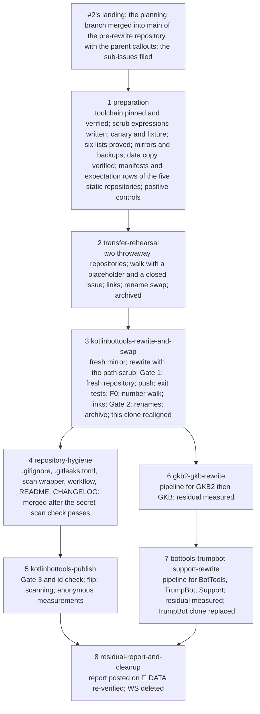

# Phase 0 — History rewrite: systems design

## Header / Association

- **Covers:** [SpartanLaboratories/KotlinBottools#2](https://github.com/SpartanLaboratories/KotlinBottools/issues/2),
  *"Phase 0 — History rewrite: purge secrets and data from the six bot repositories"*, a
  sub-issue of [#1](https://github.com/SpartanLaboratories/KotlinBottools/issues/1).
- **What this document is:** the systems design of an operational phase. It names:
  - the systems the phase consists of: the workspace, the toolchain, the backups and manifests,
    the data copy, the per-repository rewrite pipeline, the KotlinBottools repository swap, the
    two clone procedures, the in-repo artefacts, the residual-exposure measurement and the
    cleanup;
  - what each system owns, the gates between them and the order they run in;
  - how the phase divides into units.

  Each unit is a sub-issue of #2, planned and carried out by its own run (§15). This document is
  not a runbook. Commands, expected outputs and per-step stop lines belong to each unit's plan,
  and the tested procedures those plans draw on are in the findings files beside the research
  README.
- **Status:** systems design; the units of §15 are filed as sub-issues of #2 once this design
  and its consequences land.
- **Parent design:**
  - [`../architecture.md`](../architecture.md) §1.3, §1.4 criterion 6, §11, §14 unit 0, §15,
    §16;
  - [`../roadmap.md`](../roadmap.md): the header and § "Phase 0 — History rewrite";
  - [`../consequences.md`](../consequences.md): §2.1, §2.4, §3.1;
  - the parent purge research
    [`../research/bot-repository-history-purge.md`](../research/bot-repository-history-purge.md):
    §6.2 (the path lists) and §6.6 (the `.gitignore`).

  Where this design departs from the parent's statements, §12.1 says so and names the dated
  callouts the parent documents carry.
- **Consequences:** [`consequences.md`](consequences.md) holds the blast radius, adoption, the
  sibling units, the follow-ups and the known gaps.
- **Evidence:** [`research/README.md`](research/README.md) Part 3 (§3.2–§3.10). All 122 of its
  load-bearing claims were verified at source (Part 2). Part 3 summarises five findings files,
  cited below by file and section:
  - [`research/git-filter-repo-on-windows.md`](research/git-filter-repo-on-windows.md)
    (findings 1);
  - [`research/gitleaks-local-and-ci.md`](research/gitleaks-local-and-ci.md) (findings 2);
  - [`research/github-residual-exposure-and-visibility.md`](research/github-residual-exposure-and-visibility.md)
    (findings 3);
  - [`research/clone-realignment-and-data-extraction.md`](research/clone-realignment-and-data-extraction.md)
    (findings 4);
  - [`research/purge-blast-radius.md`](research/purge-blast-radius.md) (findings 5).
- **Branch:** `docs/issue-1-bottools-consolidation`, the planning branch of #1. Commits are cited
  by subject, never by id, for two reasons: every id of the six repositories changes in this
  phase, and a pre-rewrite id is a lookup key for the old objects on GitHub.
- **Public material.** This folder becomes public with KotlinBottools. None of the following
  appears in it: a secret value, a member name, a guild name, a Discord id, a path under
  `guildData/` or `logs/`, a pre-rewrite commit id, or a purged blob id.

  > **Dated note, 2026-11-08.** The commit ids in the generated boards' generated fields (the note at §1.1 item 9 lists them) are outside this statement. The fields are generated and no unit's procedure writes them, and under the swap (§7) the pre-rewrite objects live only in the private legacy repository, so the ids resolve to nothing in the public repository, as with the older documents' ids (§4). The id-reference check of `kotlinbottools-publish` (§6.5) must account for every such field; its count cannot reach 0 otherwise.

  > **Dated note, 2026-11-11.** Measured at unit 3's run: the committed boards of this folder hold 30 occurrences of 3 distinct pre-rewrite commit ids in those generated fields, across 15 files. They are the 3 merge commits whose 26 occurrences sit in the moved resolution comments of #2, #21 and #22 (§1.1, item 9), and the exception above covers them.

---

## 1. Requirements

### 1.1 What the phase must achieve

1. **Six histories purged.** KotlinBottools, GKB2, GKB, BotTools, TrumpBot and Support are each
   rewritten by `git filter-repo --sensitive-data-removal --invert-paths --paths-from-file` in a
   mirror clone, using the root-anchored literal path list of the parent research §6.2, and then
   pushed with `git push --force --mirror`. The order is:
   1. KotlinBottools;
   2. GKB2 and GKB;
   3. BotTools, TrumpBot and Support.

   > **Dated note, 2026-11-13.** GKB2 and GKB were not pushed with `--mirror`: the one branch of each, `master`, went by a refspec push with an explicit lease on the tip the clone recorded, run first as a dry run ([unit 6's plan, The push](26-gkb2-gkb-rewrite/plan.md#the-push); §6.4, stage 6, and the note there).

   > **Dated note, 2026-11-13.** BotTools, TrumpBot and Support are not pushed with `--force --mirror` either. Each is pushed once: every branch in one `git push --porcelain --atomic` with an explicit lease per branch on the tip the clone recorded, to the repository's URL, after the same line run as a dry run; 2, 2 and 1 branches ([unit 7's design, §8.2](27-bottools-trumpbot-support-rewrite/architecture.md#82-the-push)).

2. **KotlinBottools made public through a fresh repository.** No GitHub Support ticket is filed,
   and GitHub keeps serving every pre-rewrite object of a repository by id (findings 3 §3.1,
   §3.3). The rewritten history therefore reaches the public through a new repository whose
   object store starts empty:
   - the pre-rewrite repository is renamed `KotlinBottools-legacy`, made private and archived
     (§7.5);
   - the new repository takes the name `KotlinBottools`, becomes public, and gets GitHub secret
     scanning and push protection;
   - every number the pre-rewrite repository has used is reproduced in the new one. Its issues
     move with their comments, labels, milestone and links, and each of its pull requests is
     reproduced by a placeholder issue at the same number;
   - no repository is deleted.

   > **Dated note, 2026-11-09.** The pre-rewrite repository has been public since 2026-11-08 and stays public until the swap (§2.1). Its purge-listed files and old objects are readable by anyone until then. The swap makes it private as it becomes `KotlinBottools-legacy` (§7.5), and the residual report states the window (§12.4). The rewritten history still reaches the public only through the new repository.

3. **Machine-local paths replaced in KotlinBottools.** KotlinBottools' rewrite also replaces two
   kinds of machine-local path with neutral forms. It does so in every file of every commit, the
   current tree included, and in every commit message:
   - the folder that holds the project checkouts on this machine, in any slash form, with doubled
     backslashes and in any case, and its dash-mangled form, becomes `%PROJECTS%`;
   - a Windows user-profile folder, meaning the system drive's `Users` folder followed by an
     account name, becomes `%USERPROFILE%`. It is matched in any slash form, in Git Bash's form,
     with doubled backslashes and in any case.

   The pre-rewrite repository keeps the original text, private. The other five repositories are
   not scrubbed.
4. **KotlinBottools' repository hygiene lands on `main`** through its unit's pull request, cut
   from the rewritten `main`:
   - a root-anchored `.gitignore`;
   - a `.gitleaks.toml`;
   - the gitleaks CI workflow with its scan wrapper;
   - a proportional README update;
   - a new `CHANGELOG.md` with that change's entry.
5. **The planning documents land on `main` before the rewrite**, through #2's own pull request on
   the pre-rewrite repository (§11). The rewritten `main` carries them to the public repository.
6. **The legacy data is preserved** before any rewrite. `BotData.xml` and `guildData/` are
   copied byte-exactly into an ordinary local folder outside every repository, from:
   - KotlinBottools `main`;
   - GKB2 at the parent of the commit that deletes `guildData/` ("No DB updates", 2023-10-29);
   - TrumpBot `main`.

   The per-repository manifests of purged blob ids and the rewrite's records sit beside them.
7. **Both local clones end on the rewritten histories:** this working directory in place, the
   TrumpBot clone by replacement.
8. **The residual exposure is measured and reported**, not assumed away: what GitHub still
   serves of the old histories, and what GKB2's and BotTools' pull-request refs keep reachable.
9. **Nothing sensitive is printed or written** by any step. None of the following appears in any
   output, document, commit message, pull-request text or issue comment: a secret value, a member
   name, a guild name, a Discord id, a path under `guildData/` or `logs/`, a pre-rewrite commit
   id, or a purged blob id.

   > **Dated note, 2026-11-08.** The commit ids in the generated boards' generated fields (the `baseline.sha` and `wip.landing.merge` (with the merge id also in a generated timeline label) of an issue or tracking board's `plan.json`, `plan.js` and `dashboard.html`, and the `asIs`, `lastAmended`, `written` and `tree` shas of the state boards and the repository work board) are outside this requirement. The fields are generated and no unit's procedure writes them, and under the swap (§7) the pre-rewrite objects live only in the private legacy repository, so the ids resolve to nothing in the public repository, as with the older documents' ids (§4). The id-reference check of `kotlinbottools-publish` (§6.5) must account for every such field; its count cannot reach 0 otherwise.

   > **Dated note, 2026-11-11.** The resolution comments on #2, #21 and #22 hold 26 occurrences of 3 distinct pre-rewrite merge-commit ids, inside permalinks. They moved with the issues to the fresh repository and stay, accepted as the boards' ids are; they are the same 3 commits the boards' generated fields name, and the publication unit's id-reference check accounts for exactly them ([unit 3's as-built record, §3.5](23-kotlinbottools-rewrite-and-swap/final-implementation.md#35-census-and-baseline)).

   > **Dated note, 2026-11-13.** The publication unit's id-reference check accounts for 13 distinct pre-rewrite ids in the boards over their history, 10 of them in the current files, in their generated fields and in two texts of the rewrite and swap unit's board (a stage report and an as-built statement), and for the 3 accepted ids of the resolution comments, which its prefix rule counts as 35 tokens. All are accepted with the exceptions above: none resolves in the public repository ([the unit's as-built record, §3.3](25-kotlinbottools-publish/final-implementation.md#33-the-corpus-gate-3-the-id-check-and-the-runs)).

10. **Every unit runs from this machine and asks no one for approval** before a push, a force-push
    or the visibility change. A failing verification stops the unit before anything
    irreversible.
    - A unit does its local work itself.
    - Every write to GitHub, or to a repository's checkout on this machine, is sent as a request
      that carries the unit plan's procedure, inputs and expected results, and the unit verifies
      it afterwards (§11).

### 1.2 Acceptance criteria (the issue's "Done when")

1. **Every branch and tag of every one of the six repositories is clean on a fresh mirror:**
   - no purged path in any commit tree reachable from a branch or tag;
   - every manifest blob missing;
   - the surviving commit, path and blob counts equal the expectation;
   - no binary but the Gradle wrapper jar;
   - the gitleaks branches-and-tags scan clean, with the scan verified to have happened. A
     default-rule finding in a kept file is recorded and handled as §6.4 stage 8 states.

   For KotlinBottools, GKB, TrumpBot and Support, which advertise no pull-request ref, the same
   holds for every advertised ref. For GKB2 (`refs/pull/6/head`) and BotTools (`refs/pull/2/head`,
   `refs/pull/3/head`), the purged blobs still reachable through those refs are counted and
   reported. The count cannot be zero.
2. **KotlinBottools is public, as a fresh repository, with secret scanning and push protection
   enabled.**
   - An authenticated probe of every pre-rewrite tip, every first-changed commit and a sample of
     purged blobs against it answers "not found".
   - Its activity feed holds no pre-rewrite id.
3. **Every number of the pre-rewrite repository is reproduced in the public repository.**
   - Each issue is on its own number, in its state, with its body, comments, labels and
     milestone.

     > **Dated note, 2026-11-09.** "With its body" means the text apart from the references a transfer rewrites, which the walk maps back before comparing (§7.4).
   - Each pull request is reproduced by a closed placeholder issue at its number.
   - Every sub-issue and "blocked by" relationship recorded before the first transfer is
     present.
4. **`KotlinBottools-legacy` exists**, private and archived. Its refs are exactly as they were at
   the mirror clone, and no issue is left in it.
5. **The repository-hygiene change is merged into `main`,** and the secret-scan workflow has run
   green on `main` of the public repository.
6. **This clone and the TrumpBot clone** reach no pre-rewrite commit from any ref, reflog, stash
   or pseudo-ref, and `origin` of this clone is the fresh repository by id. The deletion of the
   old objects from this clone is either proven, or recorded as deferred with its exact commands
   (§9).
7. **The data copy is verified** against its blob ids, and the workspace is deleted.
8. **The residual exposure is stated per repository in counts,** in the units' as-built records
   and in the report posted on #2.
9. **No machine-local path remains in KotlinBottools.** A count over every file of every commit,
   and every commit message, on every ref of a fresh mirror of the public repository finds zero
   matches for both kinds of path and for the dash-mangled form (§1.1 item 3). The same count on
   the pre-rewrite backup is above zero for both kinds, so the check is not blind.

---

## 2. Current state

These facts were read on 2026-10-20 and 2026-10-21. Sources: research README §1.1 and Part 2;
findings 3 §3.2, §3.8, §3.10; findings 4 §3.6, §6.3, §6.5; findings 5 §3.A, §3.D.

### 2.1 The six repositories

| Repository | Visibility | Branches | Pull-request refs | Commits (branches) | Surviving paths / blobs after the rewrite | Purged blobs |
|---|---|---|---|---|---|---|
| KotlinBottools | public since 2026-11-08 (private before that), id 562658298 | `main`, `docs/issue-1-bottools-consolidation` | none; no pull request has ever existed | 20 on `main`; the planning branch grows with every planning commit | derived at rewrite time (rule: commits after = T − 2) | 346 at the research baseline |
| GKB2 | public | `master` | `refs/pull/6/head` | 32 → 30 | 82 / 211 | 81 (70 stay reachable through the pull-request ref) |
| GKB | public | `master` | none | 11 → 9 | 60 / 113 | 58 |
| BotTools | public | `main`, `Working-Branch` | `refs/pull/2/head`, `refs/pull/3/head` | 16 → 15 | 82 / 145 | 39 (all 39 stay reachable through the pull-request refs) |
| TrumpBot | private | `main`, `feature/pokercommand` | none | 11 → 9 | 56 / 106 | 199 |
| Support | private | `main` | none | 2 → 1 | 29 / 29 | 7,259 |

> **Dated note, 2026-11-09.** KotlinBottools has been public since 2026-11-08: its activity feed's `PublicEvent` falls between feed events of 01:46Z and 21:53Z that day. Anonymous requests to the repository, its files, its archive and its activity page answer 200, and its `main` still tracks the files the rewrite purges, so those files and the pre-rewrite objects stay anonymously readable until the swap (§7.5). Secret scanning and push protection are off on it. The walk's source is therefore a public repository and its target a private one (§7.2). The public window goes into the residual report (§12.4).

- No repository has a fork, a tag, branch protection or a ruleset.
- Secret scanning is off on the three public repositories.
- The rewrite prunes ten commits in all, three of them merges that become degenerate. Every ref
  survives (findings 5 §3.A).

> **Dated note, 2026-11-13.** BotTools has one active webhook, to a CircleCI host, subscribed to push events. It stays as it is, and the push deliveries its rewrite makes are recorded by count. The repository ids are 540122713 (BotTools), 540208924 (TrumpBot) and 540146440 (Support) ([unit 7's design, §2.1](27-bottools-trumpbot-support-rewrite/architecture.md#21-the-three-repositories)).

**KotlinBottools' GitHub state.**

- **Settings:** default branch `main`; issues and projects on; wiki and discussions off; merge
  commits, squash merges and rebase merges allowed; auto-merge off; Actions enabled for all
  actions; no description, homepage or topics.
- **Access:** one direct collaborator, the organisation administrator; no team.
- **Labels and milestone:** twelve labels, the nine defaults plus `type: bug`, `type: feature`
  and `type: tracking`; one milestone, `1.0.0`, open, with no due date.
- **Issues #1 to #19,** all open:
  - #1 carries `type: tracking`; #3 to #15 and #17 to #19 carry `type: feature`; #2 and #16 carry
    no label;
  - #3 to #16 sit on the `1.0.0` milestone;
  - #1 has two comments.
- **Relationships:**
  - sub-issues: #2 to #19 under #1;
  - "blocked by", 36 inside the repository;
  - "blocked by", 19 with MagicBot: 15 where a MagicBot issue is blocked by #2, #6 to #11 or
    #16, and 4 where #16 is blocked by MagicBot #2 to #5;
  - "blocked by", 2 with WebTools #55, which blocks #9 and #16.
- **Activity:** the activity feed holds 42 entries, each with pre-rewrite ids. No project item,
  webhook, deploy key, secret or Actions run exists.
- **Machine-local paths** (counted 2026-11-07, all refs):
  - 157 (commit, file) pairs name a user-profile folder, 476 name the project-checkouts folder,
    and 25 carry its dash-mangled form. Nearly all are in the planning documents.
  - On `main`, two files hold such a path: `build.gradle.kts` (a local Maven repository) and
    `src/main/kotlin/bottools/dataprocessing/GuildDataParser.kt` (a commented-out line).
  - No commit message and no author or committer field holds one.

### 2.2 The two clones on this machine

- **This working directory,** the main working copy of KotlinBottools:
  - the planning branch is checked out;
  - both local branches equal their remote-tracking counterparts, there is no stash, and `origin`
    is the only remote;
  - its untracked or ignored files are `.gradle/`, `.idea/`, `build/` and `.kotlin/`;
  - the purge list removes 41 tracked files from the working tree: the token file, the two data
    files, 29 under `guildData/`, 2 under `services/` and 7 under `res/`;
  - no `.github/` directory exists on either branch;
  - the project is open in IntelliJ IDEA, and sessions working on the repository run inside that
    IDE, so the project stays open while the phase's units run.
- **The local TrumpBot clone**, beside it: `main` only; one pack, no loose objects; four untracked
  files, all under `.idea/`. It is not open in IntelliJ.

> **Dated note, 2026-11-13.** The TrumpBot clone now holds 59 files git does not track: the four under `.idea/` and 55 under `graphify-out/`, a code knowledge graph built from the pre-rewrite tree and ignored through one entry in the clone's own `.git/info/exclude`, with two git hooks that rebuild it and two local configuration keys a plain clone does not write. It sits on another volume than the workspace ([unit 7's design, §2.2](27-bottools-trumpbot-support-rewrite/architecture.md#22-the-trumpbot-clone-and-the-two-volumes)).

### 2.3 Tools on the machine

- **git** 2.55.0.windows.5, with `core.autocrlf=true` system-wide. Git for Windows' unlink-retry
  prompt is controlled by `GIT_ASK_YESNO` (findings 4 §3.6).
- **Python** 3.14.7, with pip 26.2.1 in the user scheme, whose scripts directory is on Git Bash's
  `PATH`.
- **GNU tar** 1.35. There is no `jq`.
- **gh** 2.100.0, signed in as the organisation administrator.
- **Neither `git filter-repo` nor `gitleaks` is installed.**

### 2.4 Verified outside-world facts

- **git-filter-repo 2.47.0** (findings 1 §3.4, §3.6):
  - the PyPI wheel is hash-pinned, and `--version` prints the script's blob-id prefix;
  - it reads a path list as raw bytes and matches root-anchored literals;
  - in a mirror clone it keeps `origin` and skips its fetch;
  - it writes `commit-map`, `ref-map`, `changed-refs` and `first-changed-commits`;
  - it exits 0 even when nothing matched;
  - its `--replace-text` and `--replace-message` read one expression per line: `literal:` (the
    default), `regex:` or `glob:`, with `==>` and the replacement. A `regex:` expression is
    compiled with Python's `re` over bytes. Replacement applies to every blob with no NUL byte in
    its first 8 KB, so binary blobs are untouched (source at v2.47.0);
  - its one Python 3.14 defect is in turning a `glob:` expression into a regex. The fix, "fix
    --replace-text for python3.14" (2025-07-26), is on its unreleased `main` and changes only that
    translation, so `literal:` and `regex:` expressions behave the same on Python 3.14.7 (findings
    1 §3.5; the fix's diff).
- **gitleaks v8.30.1** (findings 2 §3.2–§3.5):
  - it exits 0 with "no leaks found" when its internal `git log` fails;
  - its defaults skip merge-only content and pure renames;
  - path rules fire per hunk;
  - `--redact` does not hide a path.
- **GitHub** (findings 3 §3.1–§3.5, §3.8):
  - it serves unreferenced objects by id on every route, with no documented expiry;
  - it hides `refs/pull/*` from `receive-pack`;
  - it publishes a repository's activity when the repository becomes public;
  - it enables no scanning setting on its own for an organisation-owned repository, and the
    setting exists only once the repository is public.
- **Issue transfers and renames** (findings 5 §3.D; GitHub, "Renaming a repository"):
  - an issue transfer keeps comments, assignees, matching labels and milestones, and redirects
    the old URL;
  - nothing is documented about numbers, or about sub-issue and "blocked by" links;
  - GraphQL has `transferIssue`, `addSubIssue` and `addBlockedBy`;
  - renaming a repository redirects its old name, and a repository created or renamed under that
    old name takes the name, so the redirect stops working.

  > **Dated note, 2026-11-09.** Beyond what the documentation says, a transfer also rewrites issue references, in the moved issue and in the texts that cite it. The rehearsal measured it (§7.4).
- **git on this machine** (findings 4 §3.1, §3.3, §3.5, §3.6):
  - `git gc --prune=now` keeps everything reachable from refs, `HEAD`, the index, reflogs and
    rebase files;
  - `ORIG_HEAD` and `FETCH_HEAD` are not roots;
  - on Windows, a locked file makes `git reset --hard` and `git gc` exit 0 while leaving the file
    or the old pack behind;
  - `git archive` converts line endings, and `git cat-file blob` does not.

---

## 3. Assumptions

| Assumption | If false |
|---|---|
| Nothing is pushed to any of the six repositories except by the phase's own units and the landings §11 names. | The pre-push check that the server's heads equal `ref-map`'s old column fails, and that repository's rewrite stops. Its mirror is re-cloned and the rewrite repeated. |
| The five static repositories' histories are what the research read on 2026-10-21, so the expectation table of findings 5 §3.A holds. | The expectations re-derived from the backup mirrors (§6.2) differ from the table, and the unit stops for that repository. |
| The ten pruned commits and the per-repository counts hold on the real histories as they held on the content-free stand-ins. | A post-run count differs, and that repository stops before its push. |
| Issues transferred into an empty private repository of the same organisation, in numeric order, land on their source numbers. This holds for closed issues too, and a placeholder issue created at a pull request's number keeps the sequence aligned. Dropped links can be re-created by `addSubIssue` and `addBlockedBy`. | The rehearsal (§7.2) shows it before KotlinBottools is touched. Its unit stops and hands back. |
| Renaming the new repository to `KotlinBottools` immediately after the old one is renamed away succeeds and takes over the name. | The rehearsal's rename step shows it. The swap stops before any rename of KotlinBottools. |
| The mirror push leaves the new repository's default branch to be set. | The swap sets it explicitly and verifies it either way. |
| Before unit 2 runs, a request exists for each write the units need beyond commits and landings: a mirror push or force-push from a workspace mirror; a repository's creation, settings, rename and archiving; its visibility and security settings; issue transfers and placeholder issues; sub-issue and "blocked by" relationships; issue-body edits; the realignment of a checkout, and its replacement by a fresh clone. Each request carries the unit plan's procedure and checks and is carried out with the organisation administrator's permissions. Units 2 to 8 depend on these requests; unit 1 does not. | Unit 2 and every later unit wait until they exist. A unit that meets a missing request stops before the write and hands back. The phase's local work is unaffected. |
| filter-repo 2.47.0 under Python 3.14.7 applies `regex:` expressions correctly, since its Python 3.14 defect is confined to `glob:` expressions (§2.4). | The fixture rehearsal shows it before real data. The unit then runs the same hash-pinned 2.47.0 under Python 3.13. |
| The scrub's `regex:` expressions replace every form of both paths, and nothing else, on the real history as they do on the fixture. | The fidelity check or the zero-match count of §6.4 stage 4 fails, and KotlinBottools stops before its push. The expressions are corrected and the rewrite repeated in a fresh mirror. |
| Every git network read of the units authenticates without an interactive prompt. Each read uses `gh auth git-credential` as its only credential helper, and the signed-in token's scopes cover reading all six repositories. | The toolchain unit's non-interactive `git ls-remote` against each repository fails, and it stops before anything is cloned. |
| IntelliJ IDEA's background git activity holds no file in `.git` for more than a moment and never writes refs. | A retried block still fails. The realignment stops short of the object deletion, and the deferred step (§9.4) covers it. Push safety does not depend on the object deletion. |
| The user-scheme pip install of git-filter-repo lands on Git Bash's `PATH`, as observed. | `command -v git-filter-repo` fails. The single-file fallback of findings 1 §3.3 becomes the plan's alternative. |
| The secret-scan workflow runs on GitHub's Ubuntu runner as its steps ran on the fixtures (findings 2 §6.9). | Its first run, on the hygiene pull request, is red, and that change does not merge. |
| The privacy gate's name lists cover the names that matter. They are built from the member files' name elements and the folder names; names shorter than five characters are counted, not reviewed (findings 5 §3.B). | A name stored in another form passes the gate unseen. The gate stays the best available check, and the residue is recorded in the consequences. |
| The bot tokens in the old histories are dead, and the session cookie and TrumpBot's private key are treated as dead. | Rotating them is a follow-up (consequences §6). No unit depends on their liveness. |
| Each scan and rewrite fits within a unit's run on this machine, TrumpBot's and Support's included (findings 2 Known gaps). | The unit's plan splits the repository's steps across its stages; nothing in the design changes. |
| Default-rule findings in the legacy repositories' kept Kotlin and Java sources are false positives, if any occur. | Such a finding is recorded and becomes a follow-up (§6.4 stage 8), and KotlinBottools stops before its visibility change. |

---

## 4. Non-goals

- **No GitHub Support ticket for any repository.** The pull-request refs of GKB2 and BotTools,
  and every cached view, stay. The residual is measured instead.
- **No deletion of any repository:** not the pre-rewrite KotlinBottools, and not the two
  rehearsal repositories. They remain private and archived.
- **No copy of anything the rewrite removes** other than `BotData.xml` and `guildData/` from the
  three sources. The following exist nowhere once the workspace is deleted:
  - `key.txt` and `WebParseKeys.xml`;
  - the `services/` polling state and `res/`;
  - TrumpBot's data files, binaries and `key.pem`;
  - Support's vendored libraries and natives.
- **No change to the maintainer's e-mail address** in commit headers, which is already public in
  three repositories' commits: no `--mailmap`.
- **No path scrub in GKB2, GKB, BotTools, TrumpBot or Support.** Only KotlinBottools becomes newly
  public. New documents name the profile directory `%USERPROFILE%`.
- **No replacement of the pre-rewrite ids cited in older documents.** The public repository is
  fresh, so they resolve only in the private legacy repository (research README §3.7).
- **No new `.gitignore`, and no README pointer commit, for the five legacy repositories.** The
  pointer commits belong to Phase 17.
- **No change to MagicBot's `.gitleaks.toml`.** Its gaps are recorded on MagicBot#2 (§12.2).
- **No secret scan inside a shared `ci.yml`.** Phase 1 adds that file separately.
- **No scan of the legacy repositories' kept sources beyond what gitleaks' rules report.** A
  default-rule finding in a kept path never changes a purge list.
- **No clearing of IntelliJ's Local History,** which git never reaches.
- **No planning pull request after the rewrite.** The planning documents land before it (§11).

---

## 5. Workspace and records layout

There are two folders, both under the user profile, outside every repository, outside the folder
that holds the project checkouts, and outside OneDrive.

- **Why the profile:** folders at a drive's root grant `Authenticated Users` the right to modify.
  The backup mirrors hold exactly what the rewrite removes, so the workspace needs the data
  folder's protection for as long as it exists (findings 4 §6.1).
- **Lifetime:** both folders persist across the units' runs. The last unit deletes the
  workspace.
- **Path form:** paths are written for native programs in mixed form, a drive letter followed by
  forward slashes.

### 5.1 `%USERPROFILE%\BotLegacyData` — the data folder (`DATA`; outlives the phase)

```
BotLegacyData/
  KotlinBottools-main/      BotData.xml, guildData/...     the copied files, same relative paths
  GKB2-last-with-data/      BotData.xml, guildData/...
  TrumpBot-main/            BotData.xml, guildData/...
  records/                  <label>.ls-tree.z, <label>.sha256   the copy's verification records
  manifests/                <repo>.blobs, .counts, .kept; GKB2 and BotTools also a refs/pull-pinned variant
  rewrite/<repo>/           filter-repo.log, commit-map, ref-map, changed-refs, first-changed-commits,
                            suboptimal-issues, next-steps.txt, purge-list.txt, SHA256SUMS; the push
                            dry-run and push tallies; the per-ref listings; the probe inputs and
                            status tallies; the gitleaks count files; the expectation-check output
  run/                      tool-versions.txt; lists/ (the six lists and their SHA256SUMS);
                            rehearsal/ and swap/ (repository ids, settings dumps, the link table,
                            the number walk and its per-number results); realign/ and trumpbot/
                            (block outputs); gate/ (allow-list, issue and pull-request dumps, gate
                            outputs); scrub/ (the path-scrub expression file and its
                            before/after counts); tools/ (a copy of the workspace tools, taken at
                            cleanup); as-run.log
  COPY-VERIFIED             empty marker, written only after the three copies verified
```

Everything under `rewrite/`, `manifests/`, `run/gate/` and `run/scrub/` holds one of three
things:

- pre-rewrite commit ids and purged blob ids, which are lookup keys for the old objects;
- paths and names, which are personal data;
- the machine-local path the scrub replaces, which its expression file must name. Nothing under `DATA` is ever committed, printed or quoted. The as-built
records and the report on #2 carry counts only.

> **Dated note, 2026-11-13.** `run/` also holds the run records of unit 7's four units, and at cleanup `run/tools/` receives both workspace tool folders: the GKB2 and GKB unit's, and the one for BotTools, TrumpBot and Support ([unit 7's design, §13.4](27-bottools-trumpbot-support-rewrite/architecture.md#134-28s-inputs)).

### 5.2 `%USERPROFILE%\BotWS` — the workspace (`WS`; deleted by the last unit)

```
BotWS/
  tools/            gitleaks-8.30.1/ and its download; gitleaks.toml and secret_scan.py (byte-identical
                    to the committed copies); blob_manifest.py, expect_check.py, privacy_gate.py,
                    oldid_refs.py, probe.sh, porcelain_tally.awk, count-entries.awk, lib.sh,
                    datacopy.sh, copy-data.sh, manifests.sh, realign-*.sh, trumpbot-*.sh,
                    predict_removed.py, untracked_collisions.py, lockprobe.py, env.sh,
                    filter-repo-requirements.txt
  lists/            <repo>-purge.txt
  backup/<repo>.git     the untouched pre-rewrite mirrors (BK): the only readable copy of the old objects
  mirror/<repo>.git     the mirrors the rewrite runs in, one invocation each
  fresh/<repo>.git      fresh mirrors taken from GitHub after each push (EX): the exit tests' subject
  canary/           the synthetic gitleaks canary
  rehearsal/        the filter-repo fixture
  analysis/         filter-repo --analyze reports (every path ever present; counted, never listed)
  gitleaks/         JSON reports and logs (paths, commit ids, identities; never printed, never copied out)
  tmp/              block scratch files
  TrumpBot-old/     the old TrumpBot clone, between its move and its deletion
```

The tools are saved from the findings files, which hold them in full and record their sizes and
sha256 values (findings 2 §6.1, findings 4 §6.8, findings 5 §6.1, §6.3, §6.4). Only the three
files that CI needs are also committed (§10). Deleting `WS` at the end removes every copy of the
old objects, every scan report and every fixture.

> **Dated note, 2026-11-12.** Once the repository-hygiene unit's change has merged, `WS/tools/gitleaks.toml` holds the bytes of the committed `.gitleaks.toml`. That file is the research configuration plus one scoped allowlist table (§10), with two sentences in its header comment: 3824 bytes, sha256 `c046de1754bd4bb3d92a62cd1651f3ea8bb2383ace96472595ee3ea49887568f`. `secret_scan.py` stays byte-identical to the research text ([the unit's plan](24-repository-hygiene/plan.md)).

> **Dated note, 2026-11-13.** `TrumpBot-old/` is not in the workspace. The TrumpBot clone and the workspace are on different volumes, so a move into the workspace would be a copy followed by a deletion, not a rename. The old clone is moved aside by a rename on its own volume, to `%PROJECTS%\TrumpBot-old`, and deleted there by the clone replacement; the workspace's deletion never reaches it. `tools/` holds two tool folders, the GKB2 and GKB unit's and the one for BotTools, TrumpBot and Support, and the preparation unit's clone scripts are not run ([unit 7's design, §7.1 and §10.2](27-bottools-trumpbot-support-rewrite/architecture.md#102-the-move)).

---

## 6. System inventory

| System | Responsibility (one sentence) | Lives in | Owns | Does not own |
|---|---|---|---|---|
| **Workspace and records** (§5) | Give every other system a place to read from and write to, with the sensitivity boundary drawn once. | `DATA`, `WS` | the layout, the ACL checks, what outlives the phase | any content decision |
| **Toolchain** (§6.1) | Install, verify and pin every tool, and prove each check is not blind before it is trusted. | `WS/tools`, the user-scheme pip install | filter-repo, gitleaks and its wrapper, the classifier, the expectation check, the privacy gate, the id-reference check, the probe helpers, the clone scripts; the canary; the fixture rehearsal | the three committed CI files (§10) |
| **Backups and manifests** (§6.2) | Take one untouched mirror per repository and derive from it everything the rewrite is judged against. | `WS/backup`, `DATA/manifests` | the backup mirrors, the manifests, the expectation rows, the positive-control scans | the rewrite |
| **Legacy data copy** (§6.3) | Preserve `BotData.xml` and `guildData/` byte-exactly from three revisions before anything is rewritten. | `DATA` | the copy, its records, `COPY-VERIFIED` | the manifests |
| **Rewrite pipeline** (§6.4) | Turn one backup-mirrored repository into a pushed, proven, rewritten repository, or stop before its push. | `WS/mirror`, `WS/fresh`, `DATA/rewrite` | list proof, pre-run checks, the invocation, post-run checks, the push's inputs and expected tally, per-ref verification, exit tests, residual probes | the push itself, which is requested (§11); the KotlinBottools push target (the swap's) |
| **Repository swap** (§7) | Make the rewritten KotlinBottools public as a fresh repository without losing a number or a link. | GitHub; `DATA/run/swap`, `DATA/run/rehearsal` | the rehearsal's fixture and pass condition; the fresh repository's settings tuple; the link table; the number walk; link reconciliation; the rename and archive order; the visibility and scanning settings and their verification | carrying out the writes, which are requested (§11) |
| **This clone's realignment** (§9) | Bring this working directory onto the rewritten history in place so that no push from it can carry old history. | this working directory, `DATA/run/realign` | the procedure, the push-safety proof, the deferred step | carrying out the procedure, which is requested (§11); any commit |
| **TrumpBot clone replacement** (§9.5) | Replace the TrumpBot clone with a fresh one at the same path, keeping its untracked files. | the local TrumpBot clone, `WS/TrumpBot-old` | the procedure and its proofs | carrying it out, which is requested (§11) |
| **Repository hygiene artefacts** (§10) | Author the in-repo files and the README and changelog edits that land on `main` through their unit's pull request. | the unit's branch | `.gitignore`, `.gitleaks.toml`, `.github/scripts/secret_scan.py`, `.github/workflows/secret-scan.yml`, the README edit, `CHANGELOG.md`, their pre-commit scans | the landing, which is requested |
| **Privacy gate and id-reference check** (§6.5) | Prove, by count, that nothing that becomes public with KotlinBottools names a guild, a member or a legacy id, and that nothing new cites a pre-rewrite id. | `WS/tools`, `DATA/run/gate` | the name lists (in memory, from `DATA`), the allow-list, the three gate runs, the id check | the data copy |
| **Residual-exposure measurement** (§6.6) | Measure what GitHub still serves of each old history and report it in counts. | `DATA/rewrite/<repo>` | the status-only probes, the fresh-mirror reachability counts, the report table | any removal |
| **Cleanup** (§6.7) | Leave the machine with the data folder and records, the two realigned clones, and nothing else of the phase. | `WS`, `DATA` | the data re-verification, the tools copy, the workspace deletion | the deferred gc step (§9.4) |

> **Dated note, 2026-11-13.** The TrumpBot clone replacement lives in the local TrumpBot clone and in `%PROJECTS%\TrumpBot-old`, beside it on its own volume, not in `WS/TrumpBot-old` (§5.2 and its note) ([unit 7's design, §5](27-bottools-trumpbot-support-rewrite/architecture.md#5-system-inventory)).

### 6.1 Toolchain

- **git** stays at 2.55.0.windows.5. The toolchain unit records `git --version` and stops if it
  differs: git 2.56 exists, and the procedures were verified against 2.55. Python 3.14.7, pip
  26.2.1 and gh 2.100.0 are recorded too; a different Python minor or gh major stops.
- **git-filter-repo 2.47.0** comes from PyPI into the user scheme, hash-pinned
  (`--require-hashes --only-binary=:all: --no-deps`) (findings 1 §6.1, §6.2).
  - It is verified by two independent values, the `--version` blob-id prefix and the module's
    sha256, both equal to the upstream tag's script.
  - A throwaway fixture run confirms, on this stack and before real data, the tool, the list
    parsing and the success checks, including the negative control of a UTF-16 list.
- **gitleaks v8.30.1** comes from the release zip (findings 2 §6.2, §6.4, §6.5).
  - It is verified by four equal sha256 values: the checksums file, a pinned constant, the
    release asset digest and the winget manifest. The release has no signature or attestation.
  - Every scan runs through **`secret_scan.py`**. The wrapper requires the scanned-commit count
    to equal an independent `git log --numstat` count, zero `ERR`/`FTL` lines, a parseable report
    and a consistent exit status. It prints counts and rule ids only.
  - The **canary** must produce its exact per-rule file counts before any real scan counts. It
    holds fake secrets generated at run time, a pull-request ref, a merge-only secret and a pure
    rename.
- **The configuration** is MagicBot's three rules unchanged, plus `legacy-key-file` and the
  root-anchored `legacy-state-directory`, with no allowlist (findings 2 §6.3).
- **The path-scrub expression file,** `DATA/run/scrub/replace-text.txt`, is written once and kept
  outside every repository. It holds `regex:` lines only, each case-insensitive:
  - one line for the project-checkouts folder, in every slash form and with doubled backslashes,
    replaced by `%PROJECTS%`;
  - one line for its dash-mangled form, replaced by `%PROJECTS%`;
  - one line for a user-profile folder, replaced by `%USERPROFILE%`. Its account segment matches
    any account name, so the file names no account.

  It has no `glob:` line, because 2.47.0's Python 3.14 defect lies in turning `glob:` expressions
  into regexes. filter-repo therefore stays at the verified 2.47.0 on Python 3.14.7. Neither its
  unreleased `main` nor a second interpreter is needed. Python 3.13 is the fallback if the fixture
  rehearsal fails on 3.14.
- **The fixture rehearsal** covers the scrub too. In fixture text files and a fixture commit
  message, every path form must be replaced, and nothing else may change; a fixture binary must be
  untouched. The before and after counts must come out exactly as predicted.
- **Path lists** are written with Git Bash `printf '%s\n'` from the parent research §6.2 and
  proved byte-wise (findings 1 §6.3): the byte count and sha256 recorded in the plan; no carriage
  return; pure ASCII; no blank line; only the allowed characters; as many lines as entries.
  - The six lists are the parent research's, unchanged.
  - BotTools `Working-Branch` and TrumpBot `feature/pokercommand` add no entry (research README
    §1.2).
- **The scripts:** the classifier `blob_manifest.py`, `expect_check.py`, `privacy_gate.py`,
  `oldid_refs.py`, `probe.sh`, `porcelain_tally.awk`, `count-entries.awk` and the clone scripts.
  They are saved from the findings files and checked against their recorded sizes and hashes
  (findings 4 §6.8, findings 5 §6.1, §6.3, §6.4, findings 3 §6.1, findings 1 §6.4).
- **Authentication.** Every git network read of the units uses `gh auth git-credential` as its
  only credential helper (`-c credential.helper= -c credential.helper='!gh auth git-credential'`),
  so no Git Credential Manager window can open in a run that cannot answer one. The toolchain
  unit proves it with a non-interactive `git ls-remote` against each of the six repositories.
- **Windows settings** (findings 4 §3.6, §5):
  - `GIT_ASK_YESNO=false` in every shell that runs a block;
  - native programs receive mixed-form paths;
  - `tar` runs with `--force-local`;
  - `gc.auto=0` and `maintenance.auto=false` are passed on every fetch, reset and gc.

> **Dated note, 2026-11-13.** The tools that run BotTools', TrumpBot's and Support's rewrites, their residual measurement and the TrumpBot clone's replacement are a new, self-contained folder derived from the GKB2 and GKB unit's, saved and pinned by unit 7's tools unit; the clone scripts are rebuilt there as request procedures with a builder ([unit 7's design, §7](27-bottools-trumpbot-support-rewrite/architecture.md#7-the-tools)).

### 6.2 Backups and manifests

Each repository gets one `git clone --mirror`, copied at once (`cp -a`) to
`WS/backup/<repo>.git` before any other git command runs in it. The clone itself becomes the
mirror the rewrite later runs in (findings 1 §6.4).

- **When:** the five static repositories are mirrored in the toolchain unit, at the start of the
  phase. KotlinBottools is mirrored again at the start of its rewrite, because every landing
  before then adds commits to it (§11). The toolchain unit's KotlinBottools mirror serves the
  data copy only.
- **Clone-to-push safety:** the `ls-remote` listing of each repository at clone time is
  recorded. Every later push first checks the server's heads against `ref-map`'s old column,
  which makes the gap between clone and push safe however long it is (findings 3 §6.2 P0).

From the backup mirror and the list, each repository gets:

- **the manifest** of purged blob ids: the blobs that occur under a purged path in some commit
  tree and under no kept path in any (findings 4 §6.2, §6.6).
  - It uses filter-repo's own matching rule over `git ls-tree -r -z` of every distinct tree of
    every ref.
  - GKB2 and BotTools also get the `refs/pull/`-pinned variant, which predicts a fresh GitHub
    mirror.
- **the expectation row** (findings 5 §3.A, §6.1):
  - the commits after the rewrite, `T − P`, with `P` from the pruned-commit table;
  - the distinct surviving paths and `blobs_kept`;
  - the bound on the largest surviving blob;
  - whether the wrapper jar survives.

  For the five static repositories the re-derived row must equal the research table. For
  KotlinBottools it is derived by rule.
- **the positive-control scan** of the untouched backup, with the real configuration
  (findings 2 §6.7):
  - for KotlinBottools, GKB2, GKB and TrumpBot, every path rule's distinct-file count equals
    git's own count, and each named probe is non-zero;
  - for BotTools and Support, the six owned rule ids are absent.

  This is the first real test of MagicBot's token regex against the real token files. A path
  probe that fires while the token probe does not is recorded in the as-built record, by rule id
  and count, as a gap in the token rule's coverage, and the unit continues: the purge's proofs
  rest on the path rules and the manifests, not on the token rule, and the rule is not edited
  mid-run. The regex change for both repositories is then a follow-up (consequences §6).

The backup has three further roles: it is the control of every "all missing" proof (findings 4
§6.3 `prove_removed`), the source of the data copy, and the source of the residual probes' id
lists. It is deleted with the workspace.

### 6.3 Legacy data copy

Before any rewrite, the data is copied from the backup mirrors:

| Source | Revision | Files |
|---|---|---|
| KotlinBottools | `refs/heads/main` | 29 + 1 |
| GKB2 | the parent of the commit that deletes `guildData/` | 29 + 1 |
| TrumpBot | `refs/heads/main` | 30 + 1 |

- **GKB2's revision** is found by rule, not cited by id: `git rev-list -1 master -- guildData`
  gives the deleting commit, which has one parent, 29 files at the parent and none at itself. It
  is named by subject.
- **How each file is written:** from `git cat-file blob`, record by record from
  `git ls-tree -r -z`, then verified by `git hash-object --no-filters`. `git archive` is not used,
  because it converts line endings under `core.autocrlf=true` (findings 4 §3.5, §6.1).
- **`COPY-VERIFIED`** is the precondition of every later step that deletes or rewrites anything.
  The copy is re-verified against its checksum lists immediately before the workspace is deleted.

### 6.4 The rewrite pipeline (per repository)

The same pipeline serves all six repositories. KotlinBottools differs in three ways: its push
target (§7), the path scrub that runs in the same invocation, and the privacy gate that runs
before its push. Each stage is a gate. A failure
stops the repository before its push and discards its mirror; the backup stays.

1. **List proof** (§6.1) and **pre-run checks** in the mirror (findings 1 §6.4):
   - the mirror is bare, with one remote `origin` and `remote.origin.mirror=true`, no
     `filter-repo/` directory, no stash, at most one pack, no case-colliding refs and a parseable
     `git config --list`;
   - `N_BEFORE` and `R_BEFORE` are recorded;
   - every list entry counts at least one commit, by
     `git rev-list --all --full-history --count -- ':(top,literal)<entry>'`;
   - the optional `--analyze` runs under `timeout`, its reports counted and never listed. It
     cross-checks that the number of history paths no entry covers equals the expected
     surviving-path count (findings 5 §3.A);
   - **for KotlinBottools, the scrub's before-counts** are recorded:
     - for each expression, the (commit, file) pairs and commit-message lines it matches across
       all refs, both path kinds above zero;
     - the commits the replacement would make empty, found by applying the expressions to each
       commit's changed blobs and counted into the expected pruned count.
2. **Positive control** on the backup (§6.2). A repository whose control fails is never declared
   clean.
3. **The invocation**, exactly
   `git filter-repo --sensitive-data-removal --invert-paths --paths-from-file <list>`, with stdin
   from `/dev/null` and output to a log (findings 1 §6.5).
   - For KotlinBottools only, the same run adds
     `--replace-text <expression file> --replace-message <expression file>`, so the purge and the
     scrub produce one rewritten history.
   - No `--force`, `--partial`, `--refs`, `--no-fetch` or `--mailmap`.
   - One invocation per mirror.
4. **Post-run checks** (findings 1 §6.6, findings 4 §6.6, findings 5 §6.1):
   - exit status 0, and no `fatal`, `error`, `Traceback` or warning line;
   - `You rewrote C (of T)`, with `C = T = N_BEFORE`;
   - in `commit-map`, rows `= T`, changed rows `= C`, and pruned rows `= P` from the
     expectation; one `first-changed-commits` line;
   - `origin` present with the recorded URL;
   - commits after `= T − P`; every entry counts 0; the number of refs unchanged;
   - `fsck` clean, and the largest blob within its bound;
   - `expect_check.py` PASS on the mirror;
   - every manifest blob missing, and `blobs_kept` surviving blobs;
   - **for KotlinBottools, the scrub's checks:**
     - a zero count for every expression over every file of every commit and every commit message
       on every ref;
     - fidelity: every text blob the scrub changed equals its pre-rewrite blob with the
       expressions applied, and every binary blob is unchanged;
     - the number of surviving blobs the scrub changed equals the number the before-counts
       predicted.

   The outputs are copied to `DATA/rewrite/<repo>/` with a `SHA256SUMS` (findings 1 §6.7).

   > **Dated note, 2026-11-13.** For GKB2 and GKB the post-run checks end with a gitleaks scan of the rewritten mirror's branches and tags, before the push: a custom-rule finding stops the repository there, and a default-rule finding in a kept file is recorded as stage 8 records one. Both scans read `RESULT: CLEAN` ([unit 6's as-built record, §3.2](26-gkb2-gkb-rewrite/final-implementation.md#32-the-rewrites)).
5. **Push preparation** (findings 3 §6.2 P0–P2):
   - the local `refs/pull/*` are deleted. GitHub never advertises them to a push, so every
     remaining `!` is a real failure;
   - `ref-map` gives the expected counts of forced, deleted and up-to-date refs;
   - the server's branch and tag tips must equal `ref-map`'s old column, which shows nothing was
     pushed since the clone;
   - the pull-request refs on the server are listed and recorded.

   > **Dated note, 2026-11-13.** For BotTools the push preparation also takes a baseline count of its webhook's deliveries ([unit 7's design, §8.1](27-bottools-trumpbot-support-rewrite/architecture.md#81-shape)).
6. **The push**, requested (§11) with the mirror path, the target and the expected tally
   (findings 3 §6.2 P3–P4).
   - It is a dry run, then the push, both `--porcelain --force --mirror` and both tallied.
   - The push's flags must equal the dry run's, with exit status 0, zero rejected lines and
     `Done` present.

   > **Dated note, 2026-11-11.** KotlinBottools' push went to an empty fresh repository, where every ref is new, so its dry run
   > and push were `--porcelain --mirror` without `--force`, with the expected tally `new=2` and nothing forced, deleted or
   > rejected ([unit 3's as-built record, §3.2](23-kotlinbottools-rewrite-and-swap/final-implementation.md#32-the-fresh-repository-and-the-push)).

   > **Dated note, 2026-11-13.** GKB2's and GKB's dry run and push were `git push --porcelain --force-with-lease=refs/heads/master:<old tip> <url> refs/heads/master:refs/heads/master`: the one branch, with an explicit lease on the tip the clone recorded, not `--force --mirror`. Under `--mirror`, `--force` or a refspec with a leading `+`, git ignores a lease, and `--mirror` would delete a server branch created after the clone ([unit 6's research summary, §1](26-gkb2-gkb-rewrite/research/README.md#1-the-force-push)). The expected tally was `forced=1` and `done=1`, with every other count 0, and each push was classed `pushed`, with every refusal marker counted at 0, and read back at its new tip ([unit 6's as-built record, §3.3](26-gkb2-gkb-rewrite/final-implementation.md#33-the-pushes)).

   > **Dated note, 2026-11-13.** BotTools, TrumpBot and Support are each pushed in one request: every branch in one `git push --porcelain --atomic` with an explicit lease per branch, after the same line run as a dry run, with the expected tally `forced=N` and `done=1` and every other count 0, N being 2, 2 and 1. The classes add the atomic sibling wording to the counted markers and a transport class read from a missing `To` line with `fatal:` markers. After any non-zero status a read of every branch names the state, neither, both or partial, and partial hands back ([unit 7's design, §8.2 and §8.3](27-bottools-trumpbot-support-rewrite/architecture.md#83-outcome-read-back-and-resend)).
7. **Per-ref verification** on two channels, read by the unit (findings 3 §6.2 P5):
   - `git ls-remote --refs` and the REST `branches` listing both equal the local refs;
   - no remote ref points at an old tip;
   - the pull-request refs are unchanged, and the default branch is unchanged.

   A failure here means the remote may be partly updated. The unit stops and reports the tally;
   it never repeats the push blindly.

   > **Dated note, 2026-11-13.** For GKB2 and GKB the equality is over heads and tags: `git ls-remote --refs` over `refs/heads/*` and `refs/tags/*`, and the REST `branches` listing, which carries heads only, each equal the rewritten heads, with no tag; no head points at a pre-rewrite commit; and the pull-request refs equal their record from stage 5, since a push cannot change them and GKB2's `refs/pull/6/head` keeps its pre-rewrite commit. Both repositories passed ([unit 6's as-built record, §3.3](26-gkb2-gkb-rewrite/final-implementation.md#33-the-pushes)).

   > **Dated note, 2026-11-13.** For BotTools, TrumpBot and Support the visibility is read as recorded, private for TrumpBot and Support. BotTools' push deliveries are counted right after its push, once, since GitHub lists a webhook's deliveries for three days only, and its webhook is read as unchanged ([unit 7's design, §8.1](27-bottools-trumpbot-support-rewrite/architecture.md#81-shape)).
8. **Fresh mirror and exit tests** on `WS/fresh/<repo>.git` (findings 2 §6.8, findings 3 §6.3,
   findings 5 §6.1):
   - `expect_check.py` with `--scope heads`, plus `--all-commits` where pull-request refs exist;
   - the gitleaks branches-and-tags scan reports `RESULT: CLEAN`;
   - the all-refs scan equals it where no pull-request ref exists, and is measured and recorded
     where one does;
   - the manifest is compared with the objects reachable from branches and tags (0) and from all
     refs (0, or the measured residual);
   - for KotlinBottools, the scrub's zero count is repeated over every ref of the fresh mirror.

   **A gitleaks default-rule finding in a kept file** of a legacy repository is recorded in the
   as-built record by rule id and file count, with no path and no value. The unit continues, and
   the finding becomes a follow-up in its consequences. Such a finding lies outside every purged
   path, so the rewrite cannot remove it, and the kept files of the three public repositories are
   already public as they are. In KotlinBottools, a default-rule finding in a kept file stops the
   work before the visibility change, because there the file would become newly public.

   > **Dated note, 2026-11-13.** A default-rule finding in a kept file of TrumpBot or Support is recorded and becomes a follow-up as one in a public repository does; their kept files stay private. For BotTools the every-ref counts are measured and recorded: 39 of 39 manifest blobs and 28 commits are expected ([unit 7's design, §8.1](27-bottools-trumpbot-support-rewrite/architecture.md#81-shape)).
9. **Residual probes** (§6.6).

   > **Dated note, 2026-11-13.** For BotTools, TrumpBot and Support, stage 9 does not follow each push. It runs once, over all three, after the last push is verified, as unit 7's residual measurement; the gate between those repositories is the previous repository's stage 8 ([unit 7's design, §9](27-bottools-trumpbot-support-rewrite/architecture.md#9-the-residual-measurement)).

### 6.5 Privacy gate and id-reference check

The gate works as follows (findings 5 §3.B, §6.3):

- **Lists:** it builds them in memory from `DATA`. At the research baseline they hold 6 guild
  folders, 240 member names and 25 id-shaped numbers.
- **Scan:** it scans a corpus for whole-word hits, masks every match, and prints counts and masked
  locations only.
- **Suppression:** a reviewed allow-list is the only suppression. It holds three ordinary words
  (a repository name, a common noun and the template guild folder) and the Steam64 offset.
- **Result:** it exits non-zero on any other hit.

It runs three times:

| Run | Corpus | Before |
|---|---|---|
| Gate 1 | the rewritten KotlinBottools mirror (every text blob of every branch, every commit message and identity); the commit messages and identities of the other five backup mirrors; the pre-rewrite repository's issues, pull-request texts and comments | KotlinBottools' push |
| Gate 2 | the fresh repository's issues, placeholders and comments, dumped after the number walk | the renames |
| Gate 3 | a fresh mirror of the fresh repository (every branch, now with the hygiene merge); its issues, placeholders, pull-request texts and comments; every file the phase's landings put on it, the boards included | the visibility change |

The id-reference check (`oldid_refs.py`, findings 5 §6.4) runs with Gate 3. Its scope is what this
phase adds: the issue folder's documents, the landings' commit messages, the pull-request texts,
the placeholders and the report draft. It must report 0 resolving tokens. The older documents'
dated citations are outside its scope by design (§4).

Gate 3 also counts the scrub's expressions over the public repository's issue texts, placeholder
bodies, pull-request texts and comments. These are not files or commits, so a hit is not a stop:
it is recorded by count and becomes a follow-up, an issue edit made on request.

> **Dated note, 2026-11-13.** Gate 3's corpus also held the earlier revisions of the edited issue texts, the earlier titles and the logs of every Actions run, and the id-reference check read every version, in the history, of this folder's files and of the repository work board ([the publication unit's plan, R4 and R5](25-kotlinbottools-publish/plan.md#requirements)). Gate 3 counted 0 matches of the scrub's expressions.

### 6.6 Residual-exposure measurement

Each repository is measured after its push, with inputs from `DATA/rewrite/<repo>/` and the
backup (findings 3 §6.3). Every result is a tally; no id or body is printed.

- **Probes:**
  - status-only `HEAD` probes, authenticated, of every old branch tip, every first-changed
    commit, their trees and an evenly spaced sample of at most 60 manifest blobs, with a positive
    and a negative control;
  - a protocol-v2 `want` of each old tip;
  - for the public repositories, the same anonymously, plus whether the activity feed's and
    events' `before`/`after` ids belong to the old-id set;
  - on the fresh mirror, the count of manifest blobs reachable from branches and tags (0) and
    from all refs.
- **Expected results:**
  - every old object of GKB2, GKB, BotTools, TrumpBot and Support is still served
    (200 / `SERVED`);
  - the pull-request residual is 70 of 81 for GKB2, and 39 of 39 for BotTools.
- **KotlinBottools:**
  - against the **fresh** repository, every old id is expected to answer 404 / `NOT-SERVED`:
    authenticated before the visibility change and anonymously after it. The activity feed's
    `before_in_old` is expected to be 0;
  - against `KotlinBottools-legacy`, authenticated only, every old id is expected to answer 200,
    as it is private.

  > **Dated note, 2026-11-09.** The pre-rewrite repository is public until the swap (§2.1), so until then its old ids answer anonymously as well. Once it is renamed and made private at the swap (§7.5), the authenticated expectation above holds and the anonymous answer becomes 404. The report (§12.4) states the window during which the old objects were anonymously readable, and that no measurement can exclude a copy taken during it.

The report table (§12.4) goes into the units' as-built records and into the report on #2.

> **Dated note, 2026-11-13.** For BotTools, TrumpBot and Support, "measured after its push" reads "measured after the last of the three pushes is verified". TrumpBot and Support get authenticated probes and feed reads only. A feed read outside the events' 30 days is recorded as not valid, never as absent. BotTools' residual of 39 is counted on its fresh mirror at stage 8 ([unit 7's design, §9](27-bottools-trumpbot-support-rewrite/architecture.md#9-the-residual-measurement)).

### 6.7 Cleanup

Cleanup runs in this order:

1. `DATA` is re-verified against its checksum lists.
2. `WS/tools` is copied to `DATA/run/tools`. The copy holds no secrets, and the deferred step
   needs it.
3. `WS` is deleted entirely: the backups, mirrors, fresh mirrors, reports, canary, fixture,
   analysis, lists, `tmp` and `TrumpBot-old`.
4. Its deletion is confirmed.

git-filter-repo stays installed in the user scheme, as a hash-verified package with no state of
the phase in it. Nothing of the phase remains on the machine but `DATA`, the two realigned clones
and the installed package.

> **Dated note, 2026-11-13.** The workspace's deletion does not reach the old TrumpBot clone, which lies beside the clone on its own volume and which the clone replacement deletes itself. The cleanup confirms the recorded path absent, and a leftover is deleted at that path. The tools copy takes both tool folders ([unit 7's design, §10.4 and §13.4](27-bottools-trumpbot-support-rewrite/architecture.md#104-the-fresh-clone-its-proofs-and-the-deletion)).

---

## 7. The KotlinBottools repository swap

### 7.1 Shape

- **The new repository.** KotlinBottools' rewritten mirror is pushed to a new private repository
  under a temporary name, `KotlinBottools-next`. The push goes from a second remote (`fresh`)
  added to the mirror. The mirror's `origin` stays the old repository, so the "nothing pushed
  since the clone" check still reads it.
- **The old repository** never receives a push. Its refs stay exactly as they are, including the
  `refs/pull/*` of the pull requests merged before the swap.
- **Numbering.** Nothing numbered is created in the new repository except the walk of §7.4 until
  the walk ends, because issues and pull requests share one number sequence.
- **Who does what.** Every step below that writes to GitHub, or to this clone, is requested
  (§11). The unit verifies each one by reading GitHub before it takes the next.

```mermaid
stateDiagram-v2
    [*] --> Rehearsed: rehearsal unit landed with its pass condition met
    Rehearsed --> Rewritten: fresh mirror of KotlinBottools taken; rewrite and post-run checks; Gate 1
    Rewritten --> FreshCreated: KotlinBottools-next created (private); settings applied; id recorded
    FreshCreated --> FreshPushed: mirror push from the rewritten mirror; per-ref verification
    FreshPushed --> FreshProven: fresh mirror; exit tests; F0 probe (old ids not found)
    FreshProven --> MetadataReady: milestone 1.0.0 and the three custom labels created; link table and number list read from the old repository
    MetadataReady --> Walking: numbers 1 … N in order
    Walking --> Walking: issue n transferred, or pull request n reproduced by a placeholder, and found on number n with its state, body, labels, milestone, comment count
    Walking --> Handback: an item lands on another number or loses anything
    Walking --> LinksReconciled: all N reproduced; every recorded relationship present, kept or re-created
    LinksReconciled --> Handback: a link cannot be re-created
    LinksReconciled --> Gated: Gate 2 over the reproduced issues, placeholders and comments
    Gated --> Renamed: old → KotlinBottools-legacy (id 562658298 verified at the new name); archived; new → KotlinBottools (id verified ≠ 562658298; heads == ref-map new column)
    Renamed --> Realigned: this clone realigned; push-safety proof
    Realigned --> [*]: the unit's own landing, the first on the fresh repository
```

### 7.2 The rehearsal

Two throwaway repositories, `phase0-rehearsal-a` (the source, public) and `phase0-rehearsal-b`
(the target, private and empty), prove the transfer mechanics on the shapes the real walk meets.

- **The fixture in A:**
  - a tracking issue with the `type: tracking` label, and sub-issues under it: one with
    `type: feature` and the `1.0.0` milestone (no due date), one with neither, and one closed. The
    sub-issues nest at least two levels deep, in a mixed shape with some branches deeper than
    others;
  - comments on the tracking issue;
  - "blocked by" links among them in both directions;
  - one merged pull request that takes a number between issues;
  - a further issue that stays in A, linked both ways to the sub-issues. After the transfer those
    links are cross-repository, which is the real shape of the MagicBot and WebTools links.

  The milestone and labels exist in B before the walk. The default labels exist in both from
  creation.
- **The walk:** A's numbers are walked in order. Each issue is transferred, and the pull request
  is reproduced by a closed placeholder at its number. Each item is checked to land on its own
  number with its body, state, comments, labels and milestone intact.
  - The sub-issue and "blocked by" links are read back after each step, and every dropped link is
    re-created with `addSubIssue` and `addBlockedBy`, the cross-repository ones included.
  - The final link set must equal the fixture's.
  - If a closed issue cannot be transferred as closed, it is reopened, transferred and closed
    again, and the route is recorded for the real walk.
  - If a parent cannot be transferred with its sub-issue links in place, it is retried after the
    links are removed and recorded, and the links are re-created afterwards. Both paths are
    acceptable, because the real walk re-creates dropped links anyway.
- **The rename swap,** rehearsed on the same pair:
  - A is renamed to `phase0-rehearsal-a-legacy`, made private and archived, each step read back;
  - B is renamed to `phase0-rehearsal-a`;
  - the ids are read back at each name, and the old URL of a transferred issue must redirect to
    its new home.
- **The pass condition:**
  - every item is on its number;
  - every link is present at the end, kept or re-created;
  - the renames resolve by id.

  Anything else stops the rehearsal unit, which hands back with the per-step results, and the
  swap does not start.

> **Dated note, 2026-11-09.** The rehearsal's source repository is public and its target private because the real walk's source is (§2.1). The walk and the link checks read the hierarchy flat, issue by issue, so they work at any depth. A failed step stops the walk there; the link re-creation on what moved and the rename swap still run on what exists; both repositories are archived at the end; and every shape's result goes into the hand-back.

> **Dated note, 2026-11-09.** "Intact" cannot mean byte-identical: a transfer rewrites references in the moved text. The item check compares bodies and comments with those references mapped back, against the text read before the walk began (§7.4).

Both repositories remain, private and archived, and are listed as a follow-up for the
organisation administrator: deleting them needs the `delete_repo` scope, which the phase neither
has nor needs.

### 7.3 The fresh repository

- **Creation:** it is created private, with no README.
- **Settings:** it is set to the old repository's tuple (§2.1) and verified:
  - default branch `main`, set explicitly after the push;
  - issues and projects on, wiki and discussions off;
  - merge, squash and rebase merges allowed; auto-merge off; delete-branch-on-merge off;
  - Actions enabled for all actions;
  - no description, homepage or topics;
  - the organisation administrator the only direct collaborator, and no team.
- **Its id** is recorded. It is the key of every later check that `origin` is the fresh
  repository.
- **The mirror push** must tally `new = number of heads`, with nothing forced, deleted or
  rejected. The per-ref verification is the pipeline's.
- **The F0 probe** (findings 3 §6.5) proves that no pre-rewrite id resolves in it.

### 7.4 The number walk and the links

**Before the walk:**

- the `1.0.0` milestone (title, description, no due date) and the three custom labels (name,
  colour, description) are created in the fresh repository;
- the old repository's number list is read: every number from 1 to N, the highest in use, with
  whether it is an issue or a pull request;
- its link table is dumped by GraphQL. For each issue it records:
  - its parent and sub-issues, `blockedBy` and `blocking`, each with the other side's repository
    and number;
  - its labels, milestone, state, body hash and comment count.

**The walk** goes through 1, 2, … N in order, one step at a time:

- an issue, open or closed, is transferred (the rehearsal's route for a closed issue applies);
- a pull request is reproduced by a placeholder issue. The placeholder is created at that number
  and closed, and its body points to the pull request in the legacy repository;
- after each step, the new item's number is parsed and the checks of §7.1 run.

Today the numbers are issues #1 to #19. By the swap they also include:

- #2's own pull request;
- #2's sub-issues;
- the landings of the units that run before the swap.

**Reconciliation** follows the walk:

- for every row of the link table, the relationship on the new issue is read, and created if
  missing;
- the cross-repository links are created from the side that is blocked. Where a transfer dropped
  one, a MagicBot or WebTools issue's `blockedBy` gains the new KotlinBottools issue. That writes a
  relationship, not a numbered item, in those repositories;
- the totals must equal the table's.

Every mutation is checked before it is made, so a re-run after an interruption is idempotent.

> **Dated note, 2026-11-09.** The rehearsal's transfers measured what the documentation omits: a transfer rewrites issue references in the texts that cite a moved issue, in both repositories. In a moved issue's own body and comments, a bare reference to an issue still in the source becomes the source repository's full name, and a reference to an issue that has already moved names the target's full name. In the source, an issue citing a moved issue is rewritten when that issue moves: the reference to it becomes the target's full name and the text's other bare references the source's full name, its comments with it. An issue already in the target is rewritten too when an issue it cites moves later. A 2021 report that a reference naming the target is made bare when its holder moves into the target did not hold ([LLVM mailing list](https://lists.llvm.org/pipermail/cfe-dev/2021-December/069518.html)).
>
> For the real walk the source is `KotlinBottools` and the target `KotlinBottools-next`, the target's temporary name. When the walk ends, the moved issues' texts name `SpartanLaboratories/KotlinBottools-next#N` for the issues they cite that moved, permanently, and `SpartanLaboratories/KotlinBottools#N` for the pull-request numbers that stay behind as placeholders; the source's not-yet-moved issues carry the target's name meanwhile. After the swap `SpartanLaboratories/KotlinBottools` names the fresh repository, so the references naming the source resolve to the fresh repository's same number, the same item or a pull request's placeholder. The rehearsal's swap measured both kinds ([its as-built record, §3.8](22-transfer-rehearsal/final-implementation.md#38-what-references-reach-after-the-renames)). Once its target had taken the source's name, every reference naming the target's temporary name still reached its item, through the redirect the rename leaves on that name. A reference naming the source reached the renamed target's same number: the placeholder, for the pull request's number, and nothing, for the one issue the rehearsal left in the source (the real walk leaves none). A public precedent shows the same resolution over a longer time: an older `nodejs/node` issue citing `joyent/node#8555`, a repository renamed since, renders as a link to the renamed repository under its current name (read 2026-11-09), while the rehearsal's rendered links, minutes after its rename, still carried the temporary name and the id of the item they name. The redirect lasts while no repository takes the temporary name; a repository created under it, or renamed onto it as the rehearsal's target was onto the source's, takes the name over ([research](22-transfer-rehearsal/research/rename-visibility-archive-sequence.md#7-load-bearing-claims), claims 1 and 3). So the references naming `KotlinBottools-next` resolve after the swap, and the options for the rewrite-and-swap unit (§15 unit 3) are: to leave them on that redirect and keep the name free; to rewrite the affected bodies and comments after the walk (the requests this design lists in §3 include an issue-body edit but no comment edit, so rewriting comments would first need a new request); or to rename the repositories before the walk, so that the transfers write the final name. Which applies is that unit's plan to decide.
>
> The checks must account for this. The body hash of each issue is taken before the first transfer, as the link table above already does, and the moved issue's body is compared with it after mapping every reference that names the source or the target repository, in any form, back to bare `#N` (a comment's text, where compared, the same way); the source's current text is never the reference, since earlier transfers change it. Any other difference in the text stays a difference. The gates' name and path scans read these texts, and the rewritten references add only repository names. Whether text in another repository that cites a moved issue is rewritten is not measured (the rehearsal has only its two repositories); such a citation resolves by name and number either way (§12.2).

> **Dated note, 2026-11-11.** The real walk moved 28 issues and created the placeholders at 20, 30 and 31; every link was
> kept by the transfers and none was written again. The moved texts keep the references the transfers wrote, naming
> `KotlinBottools-next`, which stays reserved. The transfers also rewrote the references in MagicBot's and WebTools' issue
> texts to that name, so the reserved name carries those as well ([unit 3's as-built record, §3.6 and §3.8](23-kotlinbottools-rewrite-and-swap/final-implementation.md#36-the-walk-and-the-links)).

### 7.5 Renames, archive, visibility, scanning

**The renames:**

1. The old repository is renamed `KotlinBottools-legacy`, its id is verified at the new name, it
   is made private and read back, and it is archived. `archived` true makes it read-only; its pull
   requests, milestone and labels stay, and no issue remains in it.
2. The new repository is renamed `KotlinBottools`. Its id at that name must be the recorded fresh
   id and not 562658298, and `git ls-remote` of
   `https://github.com/SpartanLaboratories/KotlinBottools.git` must list heads equal to
   `ref-map`'s new column.

> **Dated note, 2026-11-09.** The old repository is public until this point (§2.1), so step 1 makes it private, read back, between its rename and its archiving. The rehearsal (§7.2) proves that order on the same shape. The step applies wherever this design lists the renames (§7.1, §8, §15 unit 3); it is a repository-visibility request (§11).

GitHub documents that a repository created or renamed under a renamed repository's old name takes
the name, and the old redirect stops working. The clone's `origin` URL therefore needs no change
and resolves to the fresh repository from this point on. The id check guards the window during
which the name resolves to the legacy repository.

**The visibility change** is its own unit (§15), and runs after the hygiene change has landed:

1. The pre-flip gate: the repository is private, has no fork and still reproduces every number;
   the administrator role is confirmed; the rate limit has headroom; Gate 3 passes.
2. `gh repo edit --visibility public --accept-visibility-change-consequences`.
3. A separate `PATCH` of `security_and_analysis`, in the same minute, enabling `secret_scanning`
   and `secret_scanning_push_protection`. It is verified by `GET`, and by the alerts endpoint
   answering 200 (findings 3 §6.5). Generic patterns and validity checks stay off, as they need a
   paid plan.
4. The anonymous measurements (§6.6) and the access check.

> **Dated note, 2026-11-13.** Step 3 ran as the next request after the visibility read-back, not in the same minute: the two read-backs are 74 s apart. The change followed the pre-flip gate of step 1 by 58 minutes, and the gate was not run again: the visibility request waited with the service that carries out the writes, and its own guards, the repository's id at its name and its private state, ran immediately before it. The access check of step 4 is read only: what an anonymous reader reaches, and a read-back of who can do what ([the unit's as-built record, §3.4 and §4.3](25-kotlinbottools-publish/final-implementation.md#34-the-change-and-the-scanning-settings); [its plan, R11](25-kotlinbottools-publish/plan.md#requirements)).

### 7.6 Stop-and-hand-back points of the swap

| Where | State left | What the hand-back carries |
|---|---|---|
| Rehearsal fails | KotlinBottools untouched; two rehearsal repositories, archived | the per-step results; which shape failed (number, placeholder, closed issue, link kind, rename) |
| A landing reached the old repository after the mirror clone | nothing created yet | the head mismatch; the unit restarts with a fresh mirror |
| Fresh repository created but the push or the exit tests fail | `KotlinBottools-next` exists, private, empty or holding a rewritten history; old repository untouched | the tally or the failing check; a re-run pushes again to the same repository (a mirror push to the same ids is idempotent) or uses another temporary name |
| Item *k* of the walk lands on the wrong number or loses something | items 1 to *k*−1 on their numbers in the fresh repository; item *k* on a wrong number; the rest in the old repository; nothing public; no rename done | the mapping so far. The options are left to the organisation administrator: continue with renumbered citations, or move the issues back, which cannot restore their numbers |
| A link cannot be re-created | every number reproduced; the link table marks the missing rows | the missing rows, by number and kind |
| A rename fails | the walk complete; names unchanged or half-swapped (one rename done); nothing public | the id-by-name readings; a re-run continues from the first rename that did not take |
| The visibility change fails | everything else complete; the repository private | the HTTP status; a 403 or 422 is an organisation restriction, not retried another way |
| The scanning `PATCH` fails after the flip | public and unscanned | reported at once; the `PATCH` is re-run first |

> **Dated note, 2026-11-13.** After the change to public, a pre-rewrite id served or listed anonymously makes the repository private again at once, with its forks recorded first; a secret-scanning alert is reported by type and count and changes nothing. Neither happened ([the publication unit's plan, the stops](25-kotlinbottools-publish/plan.md#stops-and-the-state-each-leaves)).

---

## 8. End-to-end order, gates and failure behaviour



- **Phase 1** may start once unit 3 has landed. At that point the fresh repository holds the
  rewritten `main`, and this working tree is realigned.
- **MagicBot's Phase 13** may start once unit 5 has landed.
- **#2 closes** when unit 8 lands.

**What a gate failure does, by unit:**

| Unit | Irreversible so far | On failure |
|---|---|---|
| 1 | nothing on GitHub; nothing in either clone | stop; the workspace keeps the backups; the unit is re-run from its first gate after the cause is fixed |
| 2 | two rehearsal repositories exist (archived either way) | stop and hand back; KotlinBottools untouched; unit 3 does not start |
| 3 | see §7.6 | per §7.6; nothing public at any point. In the realignment: a stop before the fetch leaves the clone unchanged; after it, the block is re-run once after the cause is gone; a failed object-deletion proof is recorded and deferred, not a stop (§9.4). **No push leaves this clone until the push-safety proof passes**, and the unit's landing is that first push |
| 4 | none beyond its landing | a red secret-scan check stops the landing before the merge and hands back; the pull request stays open |
| 5 | the visibility change; the scanning settings | a failed Gate 3, or a default-rule finding in a kept KotlinBottools file, leaves the repository private; a failed flip is reported, not retried another way; a failed `PATCH` after the flip is re-run at once |
| 6–7 | each repository's force-push, once made | before its push: stop, discard its mirror, nothing changed on GitHub. After its push with a failed per-ref verification: stop, report the tally, no blind repeat; the remaining repositories wait. A default-rule finding in a kept file is recorded and becomes a follow-up (§6.4 stage 8). KotlinBottools' state stands, and Phase 1 is unblocked regardless. TrumpBot's clone: a stop after its move puts it back; its deletion is the last step |
| 8 | the workspace deleted | the data re-verification runs before the deletion, and stops it on a mismatch |

No unit stops for a person before a push, a force-push or the visibility change. Every stop is a
failed verification, and each unit's plan states what state each stop leaves.

> **Dated note, 2026-11-13.** Unit 7's box and table row are carried out as four units of #27: the tools, the rewrites, the residual measurement and the clone replacement, the last two each after the rewrites. After a push with a non-zero status the state is read as neither, both or partial, and partial hands back; a stop after the TrumpBot clone's move renames it back ([unit 7's design, §11](27-bottools-trumpbot-support-rewrite/architecture.md#11-order-gates-and-failure-behaviour)).

---

## 9. This clone's realignment

### 9.1 Choice: in place

The clone is realigned in place, by git-filter-repo's documented procedure for other copies,
hardened (findings 4 §6.3).

- **Why not a dead clone.** The alternative clones the fresh repository to a sibling path and
  leaves this directory as a dead clone. This working directory, the open IntelliJ project and
  the project's working notes on this machine, which are keyed by this path, would all keep
  pointing at a clone that still holds the old objects until it is deleted. Sessions and the IDE
  would have to open the new path, and the dead clone would still have to be made unable to push
  old history.
- **What in place achieves.** The push-safety property is achieved deterministically, by
  reference state alone. The object deletion is the only part the IDE can defer.
- **What is not scripted.** Replacing `.git` with a fresh clone's (findings 4 §3.10).

### 9.2 Procedure and the push-safety proof

The realignment is the last step of unit 3 before its own landing. It is carried out on request
(§11), with the procedure below from the unit's plan, and the unit verifies its outcome.

**Preconditions:**

- `COPY-VERIFIED` exists;
- the swap is complete, and `origin` resolves to the fresh repository by id;
- `DATA/rewrite/KotlinBottools/` is present;
- tracked files are unchanged;
- this checkout is the clone's only worktree, and its local branches are `main` and the unit's
  own topic branch, which has no commits of its own yet. The topic branch is set up in this
  checkout, not in an extra worktree.

Then, in one short step:

1. **Preflight:**
   - refs exist only under `refs/heads` and `refs/remotes`; there is one remote, with the
     recorded URL;
   - there are no alternates, `.keep` pack, gc or pack configuration, submodule, extra worktree,
     operation in progress, or `index.lock`;
   - every local branch is mapped through `commit-map`. A pruned tip walks first parents, and a
     tip not in `commit-map` (a branch with commits of its own) stops the realignment;
   - the predicted counts of tracked files the reset changes are computed: the files it removes,
     41 at the research baseline; and the files whose content the scrub changed, among them
     `build.gradle.kts`, `GuildDataParser.kt` and the planning documents that name a
     machine-local path.

   The lock probe and the running-`git.exe` check are recorded, not stops, because the IDE may
   hold a pack or run git at any moment.
2. **Fetch:**
   - the fresh repository's id is read and compared: not 562658298, and equal to the recorded
     fresh id;
   - its heads must equal `ref-map`'s new column **before** `git fetch --prune`, because pruning
     against an empty or half-filled remote deletes every remote-tracking ref and exits 0;
   - `fetch --prune --no-tags`, then `remote set-head --auto`;
   - the remote-tracking refs must equal `ref-map`;
   - each local branch's target is its same-name counterpart, whose mapped tip must be at or
     behind it; failing that, the mapped tip itself on the rewritten history; failing that, stop.
3. **Move:**
   - the untracked-collision count must be 0;
   - `git reset --hard` of the checked-out branch, with its stderr counted and never printed, then
     `update-ref` for the other branch;
   - then verify these:
     - exactly the predicted tracked files left the working tree, and none remains on disk;
     - exactly the predicted tracked files changed content;
     - the untracked and ignored set is unchanged;
     - every branch is at its target.
4. **Purge:**
   - `ORIG_HEAD` and `FETCH_HEAD` are deleted;
   - `git reflog expire --expire=now --all`, then `git gc --prune=now`;
   - `count-objects` must show one pack, no garbage and no loose objects, and `fsck` must pass;
   - every first-changed commit, every changed or pruned commit and every manifest blob must be
     missing, with the backup as the control, where none is missing;
   - no old id may appear as text anywhere in `.git` outside `objects/`.

**The push-safety proof** must pass before any push leaves this clone. It is the precondition of
the unit's own landing, and it is independent of step 4's outcome:

- `git rev-list --all`, over every ref with `HEAD` included, contains no changed or pruned
  pre-rewrite commit;
- no reflog entry names one;
- there is no stash;
- no `ORIG_HEAD`, `FETCH_HEAD` or other text in `.git` outside `objects/` names one;
- `origin` is the fresh repository by id.

A push sends only objects reachable from the refs it updates, and every commit those refs reach
has a rewritten tree. So no push can carry old history, whether or not the old objects have yet
been deleted (research README §3.5).

> **Dated note, 2026-11-11.** Unit 3 ran this procedure on this checkout. The topic branch carried the unit's commits made
> before the mirror clone through the rewrite; the move was split around the reset line, run in the request service's own
> form; the untracked and ignored files were compared by name outside the folders an open IDE, the Kotlin daemon and Gradle
> write to, and counted inside them; the object deletion was proven, so there is no deferred step; and the push-safety proof
> passed ([unit 3's as-built record, §3.4](23-kotlinbottools-rewrite-and-swap/final-implementation.md#34-the-realignment)).

### 9.3 IntelliJ IDEA while the project stays open

The IDE's git integration runs short git commands in the background (status and index refresh,
log and branch reads). It also reads files under `.git` directly (refs, `packed-refs`, the index,
the reflogs) and watches the working tree. Nothing in it is disabled. It can interfere in three
ways, and the procedure meets each:

| Interference | Effect | What the procedure does |
|---|---|---|
| A transient `index.lock` held by an IDE git command during the reset or an `update-ref` | the command fails with "unable to create index.lock" or a rename error | the move block is re-run once after the error; `index.lock` is never deleted by hand. A lock that persists past a re-run means a real process holds it, and the realignment stops |
| An IDE process holding a pack or object file open during `git gc` | `gc` exits 0 and leaves the old `.pack` behind (`garbage` above 0, or two packs); or a tracked file the reset deletes stays on disk, with a counted warning | detected by `count-objects`, the pack-directory count and the `cat-file` proofs, not by exit status; recorded in the as-built record. **The unit continues:** the gc and the proofs become the deferred step (§9.4) |
| The IDE reacting to the ref change: its VCS log and branch view refresh, its file watcher sees 41 deletions, and Local History keeps copies of the deleted files outside git | none on git; the Local History copies are outside every repository, and no git operation reaches them | steps 2–4 run as one short step, so the window is small; `git status --porcelain --untracked-files=no` is verified empty afterwards; `gc.auto` and `maintenance.auto` are off on every command, so the IDE's git and the procedure's never race a background gc |

An IDE background fetch, if one runs, does no harm:

- after the swap, it updates the remote-tracking refs to the same rewritten ids, since the remote
  is the fresh repository, and rewrites `FETCH_HEAD`, which step 4 deletes;
- before the swap, an IDE fetch of the old repository changes nothing the preflight does not
  already expect.

### 9.4 The deferred step

If step 4's proofs do not pass (garbage, a second pack, or an object the proof finds), the
as-built record states it, with the `count-objects` lines. The plan gives the organisation
administrator the exact commands to run once IntelliJ is closed:

1. `git reflog expire --expire=now --all`
2. `git -c gc.auto=0 gc --prune=now`
3. `git count-objects -v`, which must show one pack and `garbage: 0`.
4. The `cat-file --batch-check` tally over the first-changed, changed and manifest id files in
   `DATA/rewrite/KotlinBottools/` and `DATA/manifests/`, which must report all missing.

The backup control is not available then, because the workspace is gone; the control ran during
the unit, and the id files are the same. Until that step is done, the clone holds unreachable old
objects that no push can carry.

### 9.5 The TrumpBot clone

The TrumpBot clone is replaced once TrumpBot's push is proven, as the last step of unit 7. It is
carried out on request (§11), with the procedure from the unit's plan (findings 4 §6.5):

1. Its four untracked files are archived with a checksum list.
2. The server's heads must equal `ref-map`.
3. The clone is moved to `WS/TrumpBot-old`. This same-volume rename fails without effect while
   any process holds a file inside, so it doubles as the lock probe.
4. A fresh clone is made at the same path.
5. The untracked files are restored without overwriting.
6. These are checked: the untracked set, the remote-tracking refs, `main`, the pack count,
   `fsck`, and the "all missing" proofs.
7. The old clone is deleted, last.

The clone is not open in IntelliJ.

> **Dated note, 2026-11-13.** The replacement is unit 7's clone replacement, a unit of its own after the rewrites. Step 1: of the 59 files git does not track, the four under `.idea/` are archived, behind a closed-set guard; the graph's files, the exclude entry, the two hooks and the two extra configuration keys are not carried. Step 3: the clone is moved to `%PROJECTS%\TrumpBot-old` by one rename on its own volume, behind a same-volume guard, its outcome read from the two paths. Step 5: the restored set equals the four-file list. Step 7: the deletion is the replacement's last step, requested after the unit's own read of the fresh clone. A code-only graph build follows, made by the graph service at the owner's word, with its two hooks, and read back ([unit 7's design, §10](27-bottools-trumpbot-support-rewrite/architecture.md#10-the-clone-replacement)).

---

## 10. Repository hygiene artefacts

The unit authors these four files and two edits on its own branch, cut from the rewritten `main`
of the fresh repository:

| File | Content | Source |
|---|---|---|
| `.gitignore` | the root-anchored list of the parent research §6.6: credentials; runtime state and data, with `/guildData/`, `/services/`, `/res/` and `/logs/` anchored because they collide with source packages; build output; IDE and editor files; downloaded binaries. It keeps the existing `bin/` block with its `!**/src/main/**/bin/` and `!**/src/test/**/bin/` exceptions, and the IDE and editor lines the planning branch added (`.nbproject/`, `*.swp`, `*.swo`, `*~`). LF line endings | parent research §6.6; this clone's two `.gitignore` versions |
| `.gitleaks.toml` | MagicBot's three rules plus `legacy-key-file` and `legacy-state-directory`, no allowlist | findings 2 §6.3 |
| `.github/scripts/secret_scan.py` | the scan wrapper | findings 2 §6.4 |
| `.github/workflows/secret-scan.yml` | the `Secret scan` workflow on `ubuntu-latest`, with `contents: read`; `actions/checkout` v7.0.1 pinned to its commit; the Linux x64 gitleaks tarball pinned by sha256; the canary, then the history scan, then the tree scan; triggered by pushes and pull requests to `main` and by dispatch. Its names share nothing with Phase 1's `ci.yml` | findings 2 §6.9 |
| `README.md` | only what becomes false: the project-structure entries for `key.txt`, `BotData.xml` and `WebParseKeys.xml` marked local and untracked, and `guildData/` marked as created at run time; one short list of the files a clone must supply, beside the `key.txt` instruction, which stays; one sentence naming the secret-scan workflow and `.gitleaks.toml` | findings 5 §3.E, §6.6 |
| `CHANGELOG.md` | created in the Keep a Changelog layout, with this change's entry under `[Unreleased]`: the secret-scan workflow and configuration, and the root-anchored `.gitignore`. The repository's first changelog; Phase 1 extends it | the organisation's changelog rule |

**Before the landing:**

- `secret_scan.py --mode dir` from the repository root, with the Windows binary, must print
  `RESULT: CLEAN`. A first commit that trips a rule keeps the job red until history is rewritten
  again;
- the three CI files must equal the workspace copies byte for byte;
- no file may spell out both PEM markers;
- the privacy gate over the branch must report 0.

The change merges only once the secret-scan workflow has passed on its pull request. That run is
the workflow's first on GitHub. The planning branch has already landed (§11), so no other branch
holds a different `.gitignore`.

> **Dated note, 2026-11-12.** The research configuration reports one default rule, `curl-auth-user`, on this repository's own history and tree. It finds 2 findings in the history of `main` (the commit that added the document and the merge that carried it) and 1 in the tree. All three are in one kept research document, where a command example passes the GitHub CLI's token through a shell command substitution, not a literal credential ([unit 3's as-built record, §3.3](23-kotlinbottools-rewrite-and-swap/final-implementation.md#33-the-exit-tests); [the unit's research](24-repository-hygiene/research/README.md#2-the-scoped-allowlist-table)).
>
> The committed `.gitleaks.toml` is therefore the research configuration plus one `[[allowlists]]` table. The table names that rule, that document's path and that exact text, and all three must match (`condition = "AND"`); its reason is in `description`. There is still no global allowlist. The file's header comment describes the one table, names the allowlist controls that test it (described below), and says that a `dir` scan applies the table only when run from the repository root.
>
> A fifth file joins the four of the table: `.github/scripts/allowlist_controls.py`, the table's own test. Gitleaks ignores a misspelled key without an error, so only a scan of fixtures shows that the table exempts its one match and nothing else. The controls build throwaway repositories at run time and scan each one through the wrapper with the configuration, in git and in dir mode:
> - the document unchanged at its path is clean;
> - each of these is reported: a literal credential beside the document, the document at another path, the exempted text with one more character inside its quotes or with a colon and a word joined outside them, and another rule's finding at the path.
>
> The workflow gains one step after the canary that runs the controls on every push and pull request, so it no longer equals the research text. The change set is therefore seven files: these five, the README with its correction, and the new changelog.
>
> Before the landing, `secret_scan.py` equals the research text byte for byte, and `.gitleaks.toml`, `secret-scan.yml` and `allowlist_controls.py` equal the bytes the unit's plan records. The workspace copy of the configuration takes its bytes once the change has merged (§5.2) ([the unit's plan](24-repository-hygiene/plan.md)).

---

## 11. Version control

**Where writes go.** A unit's run does its local work itself:

- installs;
- the data copy;
- the mirror clones and backups in the workspace;
- the rewrites;
- the exit tests, scans and probes, and every read of GitHub.

Every write to shared repository state is sent as a request that carries the unit plan's
procedure, its inputs (paths, ids, expected tallies) and its checks, and is carried out with the
organisation administrator's GitHub permissions. The unit then verifies each write by reading
GitHub or the checkout before it takes its next step. These writes are:

- pushes, force-pushes and mirror pushes from the workspace mirrors;
- a repository's creation, settings, renaming and archiving, and its visibility and security
  settings;
- issue transfers, placeholder issues, sub-issue and "blocked by" relationships, labels,
  milestones, comments and issue edits;
- the realignment of this clone, the replacement of the TrumpBot clone, and any branch or
  worktree of either;
- each unit's landing: its commits, its branch, its pull request and the merge.

> **Dated note, 2026-11-13.** Unit 6's two force-push requests carried the procedure, its inputs and its checks by reference: each named its request file in `DATA`, with the file's sha256 and a note asking that the procedure's entries be run as one shell and every printed line be given in the reply. The request service compared the hash with the file and ran the file's procedure ([unit 6's as-built record, deviations 9 and 10](26-gkb2-gkb-rewrite/final-implementation.md#4-deviations-from-the-plan)).

> **Dated note, 2026-11-13.** BotTools', TrumpBot's and Support's pushes and the TrumpBot clone's replacement are requested by file with the file's sha256, each unit under its own job. #27 is the tracking issue of its units: each unit's landing closes its own sub-issue, and #27 is closed when its last unit lands ([unit 7's design, §12](27-bottools-trumpbot-support-rewrite/architecture.md#12-version-control-and-requests)).

**The planning documents land first.** #2's own landing is a pull request from the planning
branch into `main` of the pre-rewrite repository.

- **What it carries:** #1's planning documents; this folder's research, design and consequences;
  and the parent documents' dated callouts (§12.1).
- **What it references:** #2 and #1, closing neither.
- **What it is:** the parent roadmap's planning pull request, opened before the rewrite rather
  than after it.
- **Its `refs/pull/<n>/*`** pin pre-rewrite history in the pre-rewrite repository only. That
  repository is public until the swap, so until then the pinned objects are public, as all its
  objects are. It then becomes `KotlinBottools-legacy`, private and archived, and the pinned
  objects leave public reach.

  > **Dated note, 2026-11-09.** The statement that the pinned objects never become public no longer holds: the repository has been public since 2026-11-08 (§2.1), and the pull-request refs of the landings before the swap are public until the swap.
- **The fresh repository** never receives a `refs/pull/*`. The pipeline deletes the mirror's
  copies before the push, and GitHub hides them from pushes anyway.
- **Its merge** deletes the planning branch, so the 56 issue links that name that branch are
  pointed at `main` (consequences §6).
- **Afterwards,** the sub-issues are filed, one per unit, in the landing order of §15, with their
  "blocked by" relationships.

**Numbers.** In the pre-rewrite repository:

- #2's pull request takes the next number: #20, if nothing else is numbered first;
- the sub-issues take the numbers after it;
- each unit that lands before the swap takes one more.

The swap reproduces every one of them (§7.4). After it, `KotlinBottools#n` names the same issue,
or the placeholder of the same pull request, and the sub-issues' plan folders, which are named by
number, stay right.

**Nothing lands on KotlinBottools while unit 3 runs.** Its mirror clone is taken at its start.

- A landing between that clone and the push would be missing from the rewritten history.
- An item numbered after the walk read its number list would be missing from the fresh
  repository.

The unit checks both: the pre-rewrite repository's heads must still equal the mirror's old tips
before the push, and its highest number must still be N before the renames.

**Each unit lands through its own pull request.** Units 1 and 2 land on the pre-rewrite
repository. Unit 3's landing is the first on the fresh repository. Its precondition is the
push-safety proof, and its topic branch, set up before the swap with no commits of its own, is
carried onto the rewritten history by the realignment (§9.2).

- A unit's landing closes that unit's sub-issue only. No pull request uses a closing keyword for
  #2 or #1.
- #2 is closed when unit 8 lands, with the residual report posted on it.

> **Dated note, 2026-11-11.** For unit 3 the topic branch carried the commits made before the mirror clone (its research and
> plan) through the rewrite, and its later commits are made on the realigned topic branch, which tracks the fresh repository
> ([unit 3's as-built record, §1](23-kotlinbottools-rewrite-and-swap/final-implementation.md#1-what-was-built)).

---

## 12. Integration with existing systems

### 12.1 The parent design and its callouts

This phase realises the parent's unit 0 (§14) and §11, with the departures below. Each is
recorded as a dated callout in the parent documents, which lands with #2's own landing:

| Departure | Callout in |
|---|---|
| No GitHub Support ticket. | `architecture.md` §1.3, §11 steps 2 and 4, §14 unit 0, §15 (two rows), §16 "GitHub Support"; `roadmap.md` header and Phase 0; `consequences.md` §2.1, §3.1 item 4 |
| The legacy data in an ordinary local folder, rather than an access-restricted location. | `architecture.md` §11 step 1, §15; `roadmap.md` Phase 0; `consequences.md` §2.4, §3.1 item 4 |
| The exit criterion as §1.2 criterion 1 states it, branches and tags clean with the pull-request residual counted, rather than "no pull-request ref reaches a purged blob". | `architecture.md` §1.4 criterion 6, §11; `roadmap.md` Phase 0 "Done when" |
| KotlinBottools made public as a fresh repository, every number reproduced, and the pre-rewrite repository made private and archived as `KotlinBottools-legacy` at the swap. | `architecture.md` §1.3, §11, §14 unit 0, §15 |
| The planning pull request landing before the rewrite rather than after it. | `architecture.md` §1.3, §11 step 2; `roadmap.md` header and Phase 0 |
| Phase 0 carried out as sub-issues of #2, Phase 1 unblocked once the rewrite-and-swap unit lands. | `roadmap.md` Phase 0 "Unblocks" |
| The pruned-commit count of ten rather than six. | parent research §3.3, §6.3 |
| Machine-local paths replaced with neutral forms in every file and commit of KotlinBottools. | `architecture.md` §1.3, §11; `roadmap.md` header and Phase 0 |

The parent research's statement that filter-repo removes `origin` (§6.3 step 7) does not hold
under `--sensitive-data-removal`. The pipeline adds no remote named `origin` (research README
§3.7).

Issues #1 (its Phase 0 line) and #2 (its body, including the plan-folder line, which must read
`2-phase-0-history-rewrite`) get matching edits with #2's landing. The plan-folder lines of #3 to
#19 are corrected as each phase lands, not here.

### 12.2 Other repositories

- **MagicBot.**
  - Its 19 "blocked by" links to KotlinBottools issues survive by number, and are re-created
    where the walk drops them (§7.4).
  - Its 49 citations of KotlinBottools issues (47 as `KotlinBottools#N`, 2 as issue URLs) keep
    resolving, because the name and the numbers survive.
  - Its 15 links to the planning branch are pointed at `main` (consequences §6).
  - Its `.gitleaks.toml` has two gaps (findings 2 §3.8, findings 5 §3.G): a global allowlist that
    exempts `README.md`, `.gitleaks.toml` and `docs/*.md` from every rule, and no rule for
    `keys.txt`, `key.pem`, `logs/` or `services/`. They are recorded as a comment on MagicBot#2,
    since Phase 13 owns that file, with #2's landing. No issue is filed.
  - Phase 13 waits on unit 5.
- **WebTools.** #55's two links (blocking #9 and #16) and the six citations in #55 and #58 survive
  the same way. #55's one link to the planning branch is pointed at `main`.
- **`SpartanLaboratories/.github`.** Its five citations of `KotlinBottools#1` keep resolving.

> **Dated note, 2026-11-09.** The references a transfer writes into the moved issues' own text name the target by its temporary name, `KotlinBottools-next`, and the source for the pull-request numbers that stay behind as placeholders; §7.4 says what each resolves to after the swap and what is left to decide.

### 12.3 Phase 1's starting point

Phase 1 starts from the rewritten `main` on the fresh repository, which holds the planning
documents, with this working tree realigned. That is unit 3's landing.

Phase 1's `ci.yml` is a second workflow file, with its own name, job id and concurrency group
(findings 2 §6.9). The `CHANGELOG.md` that unit 4 creates is the one Phase 1 extends.

### 12.4 The report

Each rewrite unit's as-built record carries its repositories' rows. Unit 8 compiles them into one
table and posts it on #2.

For each repository, the table carries:

- the commits before and after;
- the surviving paths and blobs, and the manifest size;
- the gitleaks results, for branches and for all refs, with any default-rule findings by rule id
  and count;
- the probe tallies, served and not found, authenticated and anonymous;
- the activity-feed membership;
- for GKB2 and BotTools, the pull-request residual: the blobs reachable only through the
  pull-request refs;
- for KotlinBottools, the fresh repository's "not found" tallies and the legacy repository's
  "served, private" tallies, and the public window: the period during which the pre-rewrite
  repository was public (§2.1) and its old objects anonymously readable.

It states what the exit tests proved, and what they cannot prove (findings 3 §6.4):

- that GitHub has dropped the old objects;
- that cached views are gone;
- that no third-party copy exists;
- that secret scanning examined the old objects.

> **Dated note, 2026-11-13.** The rows of BotTools, TrumpBot and Support are completed by unit 7's residual measurement. BotTools' row also carries its webhook delivery count; TrumpBot's and Support's carry no anonymous tally ([unit 7's design, §9.3](27-bottools-trumpbot-support-rewrite/architecture.md#93-the-report-rows)).

---

## 13. Extension and stability

This phase ships no library surface, so the stability tiers do not apply to it. The committed CI
artefacts are repository infrastructure, with these contracts:

- **`.gitleaks.toml`** is the rule set MagicBot's configuration is meant to agree with. A change
  to its rules changes what both repositories guard; aligning MagicBot belongs to Phase 13.
- **`secret_scan.py`** is a tool with a command-line contract, used by the workflow and by the
  phase; it is not an API.
  - Commands: `scan`, `control`, `canary-make`, `canary-check`.
  - Exit status: 0 clean, 1 findings, 2 gate failed.
- **The workflow's version and checksum constants** are changed together, with the canary re-run
  locally and the hash confirmed on a second channel (findings 2 §6.9).

Policy is parameterised: the purge lists, the expectation rows, the blob-size bounds, the probe
sample size and the allow-list are each a file or a constant in the plan, never inline in a
command.

---

## 14. Alternatives considered

| Alternative | Why it does not fit |
|---|---|
| Make KotlinBottools public in place after the force-push | publishes every pre-rewrite object (member and guild names in tree listings and data files, a session cookie) to anyone with one old id, which the activity feed and a four-digit prefix supply (findings 3 §6.6) |
| A new public repository under another name, KotlinBottools kept private | breaks the name and every `KotlinBottools#N` citation and URL in MagicBot, WebTools, the `.github` mirror and the documents |
| Delete and recreate under the same name | needs the `delete_repo` scope, and keeps nothing the rename does not keep; the rename keeps the old repository as the private resolver of the dated citations |
| Transfer only issues #1 to #19 and renumber everything after them | changes the numbers of #2's sub-issues and with them their plan-folder names and every citation of them; the placeholders keep every number at the cost of one closed issue per pull request |
| The planning pull request after the rewrite, from the rewritten branch | the pre-rewrite repository is made private as `KotlinBottools-legacy` at the swap, so its pull-request refs stop being public then; landing the planning documents first lets every unit plan inside the folder on `main` |
| Keep the planning branch after its merge, so that the 56 links naming it keep resolving | the links would show a frozen copy of the documents while `main` moves on; pointing them at `main` keeps them current before and after the swap |
| Twelve units: the toolchain, the backups and the data copy apart; the KotlinBottools rewrite, the rehearsal, the swap and the realignment apart; the TrumpBot clone and the report apart | every landing adds commits to KotlinBottools, so a landing between its mirror clone and its push would be lost from the rewritten history, and the swap unit's own landing cannot precede the realignment; the KotlinBottools rewrite, swap and realignment are therefore one unit. Grouping the preparation and keeping the TrumpBot clone with TrumpBot's rewrite also means fewer pull-request numbers to reproduce |
| Rehearse with three repositories (a stand-alone "foreign" one) | the fourth issue that stays in the source repository gives the cross-repository shape after the transfer, and the real walk reads and re-creates every link regardless |
| Realign this clone by cloning the fresh repository to a sibling path | §9.1 |
| Replace this clone's `.git` with a fresh clone's | the tracked files the rewrite removes would stay behind as untracked files, and it renames `.git` while the IDE holds it (findings 4 §3.10) |
| One unit per legacy repository (five) | the same procedure five times; two units grouped as the parent orders them keep a hand-back per repository (each repository stops on its own gate) with less duplication |
| Rewrite the pre-rewrite ids out of the older documents, or map the maintainer's address with `--mailmap` | the ids resolve only in the private legacy repository, and the address is already public in three repositories (research README §3.7, §3.8) |
| Run the scrub with filter-repo's unreleased `main`, or under Python 3.13 | `main` brings every unreleased change since 2.47.0 into the rewrite of all six repositories, and a second interpreter adds an install to verify. Neither is needed, since the Python 3.14 defect is confined to `glob:` expressions and the scrub uses `regex:` only. Python 3.13 stays the fallback the fixture rehearsal can call for |
| Express the scrub as `glob:` lines, or name this machine's account in the expression file | `glob:` lines hit the Python 3.14 defect; an account-specific line would put the account name into a file that must stay unshared. A generic account segment matches every user-profile path |
| Scrub the other five repositories as well | GKB2, GKB and BotTools are public already, and TrumpBot and Support stay private; only KotlinBottools becomes newly public |
| Rely on gitleaks' exit status, or on `git reset`/`git gc` exit status on Windows | each is 0 on failure in the cases the phase meets (findings 2 §3.3, findings 4 §3.6); counts and proofs decide |
| The gitleaks GitHub Action; a job inside a shared `ci.yml`; a global allowlist; `-v` | the action needs an organisation licence; a shared file collides with Phase 1's; a path allowlist disables every rule for the paths it names; `-v` prints paths and identities (findings 2 §6) |
| The workspace at a drive's root, for short paths | folders at a drive's root grant `Authenticated Users` modify, and the backups hold what the rewrite removes |

> **Dated note, 2026-11-09.** The first row's exposure has happened by another route: the pre-rewrite repository has been public since 2026-11-08 (§2.1). The swap remains the only route that takes the old objects out of public reach without a Support ticket: a force-push in place would leave them served by id with no documented expiry (§2.4), whereas the old repository goes private at the swap (§7.5).

---

## 15. Decomposition

Each unit is a sub-issue of #2, planned and carried out by its own run in this working tree, and
landing through its own pull request. Each unit's GitHub writes are requested (§11). The columns:

- **Writes, requested:** the unit's GitHub writes;
- **Lands on:** the repository its pull request goes to;
- **Tree:** whether the unit changes this working directory beyond its own landing.

| Order | Slug | Scope | Blocked by | Writes, requested | Lands on | Tree |
|---|---|---|---|---|---|---|
| 1 | `preparation` | git pinned and recorded; `DATA` and `WS` created with ACL checks; filter-repo and gitleaks installed and verified; the path-scrub expression file written; the canary and the filter-repo fixture rehearsal, the scrub's cases included; every tool file saved and hash-checked; the six lists written and proved; non-interactive authentication proved against the six repositories; mirrors and untouched backups of the six with `ls-remote` recorded; the three data copies verified and `COPY-VERIFIED`; the manifests and expectation rows of the five static repositories; their positive-control scans | — | none | pre-rewrite repository | no |
| 2 | `transfer-rehearsal` | §7.2: the two throwaway repositories, the fixture with a pull request and a closed issue, the walk, the link checks and re-creations, the rename swap, both archived; the pass condition | 1 | two new repositories (private, archived) with their fixture | pre-rewrite repository | no |
| 3 | `kotlinbottools-rewrite-and-swap` | at its start, with nothing landing meanwhile: KotlinBottools' fresh mirror and backup, its manifest, expectation and positive control; the scrub's before-counts; the pipeline's stages 1–5, with the path scrub in the same rewrite and its fidelity and zero-match checks; Gate 1. Then §7.3–§7.5 up to the archive: the fresh repository and its settings; the mirror push and per-ref verification; the fresh mirror and exit tests; F0; milestone and labels; the link table and number list; the walk; link reconciliation; Gate 2; the renames; id verification. Then §9.2: this clone's realignment, the push-safety proof, and the deferred step recorded if the gc is blocked | 2 | the fresh repository (becomes `KotlinBottools`); the mirror push; transferred issues and placeholders; relationships, including on MagicBot and WebTools issues where dropped; the old repository renamed `KotlinBottools-legacy` and archived; the realignment | fresh repository (its first landing) | **yes**: 41 tracked files leave; refs moved; reflogs expired; objects repacked, or deferred |
| 4 | `repository-hygiene` | §10: the four files, the README edit and the new `CHANGELOG.md`; the pre-landing scans and byte checks; merged once the secret-scan check passes | 3 | none beyond its landing | fresh repository | no |
| 5 | `kotlinbottools-publish` | Gate 3 and the id-reference check over the closed corpus; the pre-flip gate; the visibility change; the scanning `PATCH` and its verification; the anonymous measurements; the access check; the secret-scan run on `main` confirmed green | 4 | KotlinBottools' visibility and security settings | fresh repository | no |
| 6 | `gkb2-gkb-rewrite` | the full pipeline (§6.4 stages 1–9) for GKB2, then GKB, from their mirrors (checked unchanged); the pull-request residual of GKB2 measured | 3 | GKB2 and GKB force-pushed | fresh repository | no |
| 7 | `bottools-trumpbot-support-rewrite` | the same for BotTools, TrumpBot and Support; the pull-request residual of BotTools measured; then §9.5, the TrumpBot clone replaced | 6 | three force-pushes; the TrumpBot clone's replacement | fresh repository | no (the TrumpBot clone is replaced) |
| 8 | `residual-report-and-cleanup` | the report table compiled from the units' records and posted on #2; the follow-ups confirmed (the rehearsal repositories; the deferred gc step if any; any token-rule gap; any default-rule findings); `DATA` re-verified; tools copied to `DATA/run/tools`; `WS` deleted | 5, 7 | the report comment on #2 | fresh repository | no |

Units 6 and 7 each instantiate the pipeline per repository from a parameter table, holding the
list, the expectation row, the control probes and the pull-request refs. They run repository by
repository, with a hand-back state for each.

> **Dated note, 2026-11-11.** Unit 4 settles, with the scoped table of §10, the default-rule finding that unit 3 recorded in a kept file of KotlinBottools ([unit 3's consequences, §5](23-kotlinbottools-rewrite-and-swap/consequences.md#5-known-gaps)). Unit 5's visibility change no longer waits on that finding. Its other gates are unchanged. Unit 4's scope gains the allowlist controls of §10 and the workflow's step that runs them, so its landing carries seven files.

> **Dated note, 2026-11-13.** Unit 5's scope included the edits of the bodies of #1 to #19 that point their links at `main` and correct #1's clause on the planning branch and #2's plan-folder line. The required status check on `main` is Phase 1's (#3) ([the unit's consequences, §6](25-kotlinbottools-publish/consequences.md#6-follow-ups)).

> **Dated note, 2026-11-13.** Unit 6's scope included the corrected stage runner, which replaced the preparation unit's before its rewrites, so that a run's start line in the run log shows its arguments only when they are plain words ([unit 6's consequences, §3](26-gkb2-gkb-rewrite/consequences.md#3-adoption)).

> **Dated note, 2026-11-13.** Unit 7 is carried out as four units, sub-issues of #27, in this order: the tools, the rewrites, then the residual measurement and the clone replacement, each of those two blocked by the rewrites alone ([unit 7's design, §16](27-bottools-trumpbot-support-rewrite/architecture.md#16-decomposition)).

---

## 16. Risks at the systems level

| Risk | Shape | Mitigation |
|---|---|---|
| Issue transfer drops numbers or links, or cannot carry a closed issue | the public repository's citations, plan-folder names and issue hierarchy | the rehearsal (§7.2) before anything touches KotlinBottools; per-step checks; placeholders for pull requests; link reconciliation; the hand-back states of §7.6 |
| A landing or a new numbered item reaches KotlinBottools while unit 3 runs | a commit missing from the rewritten history, or a number missing from the fresh repository | heads checked against the mirror before the push; the highest number checked against N before the renames; nothing lands on KotlinBottools while unit 3 runs (§11) |
| The rename window: between the two renames, `KotlinBottools` resolves by redirect to the legacy repository | a fetch or push aimed at the wrong repository | every check that a repository is the fresh one compares ids (562658298 is the legacy one); the realignment's check that heads equal `ref-map` before any fetch; no push to the old name happens anywhere in the phase |
| A push from this clone before it is realigned | old history reaching the fresh repository | unit 3's landing is the first push from this clone, and the push-safety proof is its precondition |
| A requested write is carried out other than the plan specifies | a wrong push, transfer or setting | every request carries the procedure and the expected result; the unit verifies each write by reading GitHub before its next step, and stops on any difference |
| A request a unit needs does not exist yet | units 2 to 8 cannot make their GitHub writes | stated as an assumption (§3); the units wait, and their local work is unaffected |
| The path scrub replaces text it should not, or misses a form of a path | changed source or documents in the public history, or a machine-local path that stays | the fixture rehearsal of every form; the fidelity check (each changed blob equals its original with the expressions applied); the zero-match count over every ref, before the push and again on the fresh mirror; the legacy repository keeps the original text |
| The secret-scan workflow's first run on GitHub fails for a reason unrelated to secrets (YAML, runner Python, tarball) | unit 4 cannot merge | the check gates the merge; a red run hands back with the job log (counts only, by construction) |
| gitleaks reports a default-rule finding in a kept source file of a legacy repository | that repository's "clean" criterion | recorded and made a follow-up (§6.4 stage 8); nothing is pre-allowed and the rule set is not edited mid-run; in KotlinBottools it stops the visibility change |
| A real token's shape lies outside MagicBot's regex | the token rule's sensitivity | the control's named probes show it before the rewrite; the path rules still flag the files; the gap is a follow-up |
| `fast-import` rejects a kept path on Windows | the rewrite of that repository | no kept path of the six has such a name (findings 5 §3.A); a rejection would be loud (status 1) and stop the repository |
| Git Credential Manager prompts in a non-interactive run | a hung step | `gh auth git-credential` as the only helper; proved in unit 1 |
| IntelliJ holds a pack or the index at the wrong moment | the realignment's reset or gc | §9.3; push safety never depends on the gc |
| Rate limits during probes and the walk | a 403 or 429 read as an answer | probes stop on anything but 200, 404 or 422; rate-limit headroom checked before each probe set and before the walk |
| The workspace holds the old objects for as long as the units take | a copy of what the rewrite removes, on this machine, for days | under the user profile with its ACL; deleted by unit 8; its contents never printed |
| The three public repositories' old history was public before, and stays reachable through ids and (GKB2, BotTools) pull-request refs | not new exposure | measured and reported, never claimed removed |
| Cross-repository impact | MagicBot's and WebTools' issue relationships to KotlinBottools issues are written where the walk drops them; 16 of their issue links are repointed at `main`; MagicBot#2 gets a comment | §12.2 |
| Migration | none for consumers | Phase 1 starts from rewritten `main` on the fresh repository (§12.3) |

> **Dated note, 2026-11-11.** One suppression exists, the table of §10. It is scoped to one default rule, one KotlinBottools document and one exact text. It is inert in the five legacy repositories, which hold no such path, so their exit tests are unchanged. Any other default-rule finding is still recorded and handled as the row on default-rule findings above states.

> **Dated note, 2026-11-13.** Between its move and its deletion, the old TrumpBot clone holds every pre-rewrite object of TrumpBot outside the workspace, beside the clone on its own volume, with the clone's own access entries; its deletion is requested as soon as the fresh clone has been read back ([unit 7's design, §17](27-bottools-trumpbot-support-rewrite/architecture.md#17-risks-at-the-systems-level)).

---

## 17. Considerations

None.
