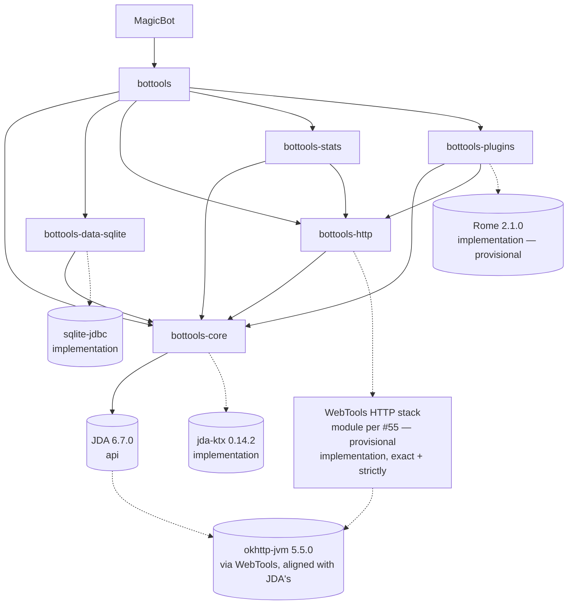
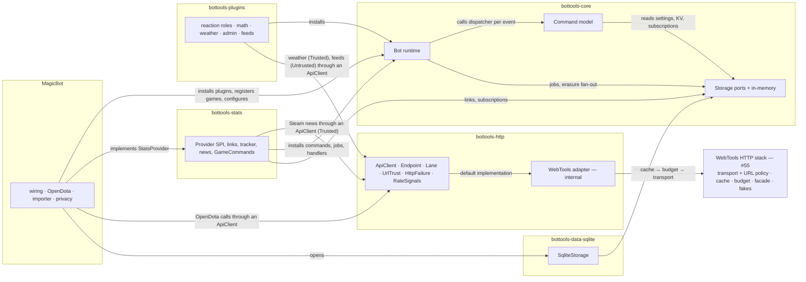
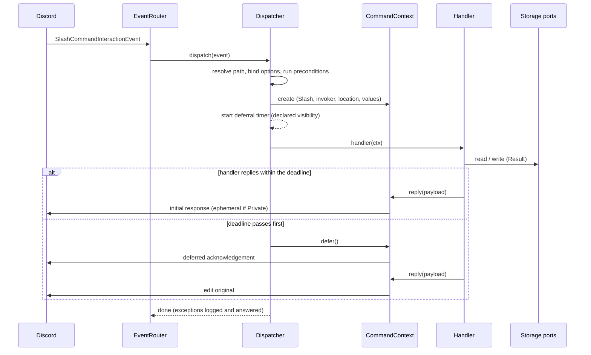

# BotTools consolidation and MagicBot — systems design

## Header / Association

- **Covers:** [SpartanLaboratories/KotlinBottools#1](https://github.com/SpartanLaboratories/KotlinBottools/issues/1),
  *"BotTools consolidation & MagicBot (tracking)"*: one modern Discord-bot library published to
  Maven Central as `io.github.spartanlaboratories:bottools-*`, and MagicBot, a public game-stats
  bot in its own repository, `SpartanLaboratories/MagicBot` (to be created).
- **What this document is:** the systems design. It names the systems that will exist, what each
  owns, how they fit together and how they attach to what is already here. It is not an
  implementation plan: file lists, signatures, per-function error handling and the test matrix
  belong to the plans written from it.
- **Branch:** `docs/issue-1-bottools-consolidation`, off `main` @ `b2f2078`; the branch tip at
  the time of writing is `aae4a7e`. Both hashes predate the history rewrite (§11), after which
  commits are found by subject.
- **Baselines:** `KotlinBottools` `main` @ `b2f2078` (one Gradle module, `7.5-SNAPSHOT`, Kotlin
  2.1.10, JDA 5.6.1, Gradle 8.10) and `GKB2` `master` @ `9422f85` (Kotlin 1.7.20 multiplatform
  with Compose desktop, JDA 5.0.0-beta.2, Spring XML wiring, Gradle 7.5.1).
- **Status:** systems design. [`roadmap.md`](roadmap.md) turns §14 into phases, sub-issues and
  target versions, and [`impact.md`](impact.md) holds the adoption, blast radius and follow-ups;
  each unit's implementation plan is written in its own issue's folder.
- **Evidence:** [`research/README.md`](research/README.md) Part 3 is the summary this design is
  built from; each `research/<topic>.md` file holds the detail. Citations below name the file
  and section. Code is cited by symbol, never by line.
- **Contract consumed:** [SpartanLaboratories/WebTools#55](https://github.com/SpartanLaboratories/WebTools/issues/55),
  the HTTP stack the library requires of WebTools, consumed behind a library-owned call surface
  (§7.4) so that no WebTools type reaches a consumer of the library. Its open questions are
  WebTools' to decide; every design point here that depends on one is marked *provisional* and
  listed in §16. The three conditions on the WebTools release are recorded on the issue
  ([comment](https://github.com/SpartanLaboratories/WebTools/issues/55#issuecomment-6301722252));
  WebTools' repository practices are [WebTools#58](https://github.com/SpartanLaboratories/WebTools/issues/58).
- **Consumer's track:** MagicBot's units are planned and tracked in `SpartanLaboratories/MagicBot`
  under a tracking issue of its own (§14).
- **Precedents followed:** `WebTools/docs/plans/14-reliable-ordered-channel/architecture.md`
  (an architecture document) and `MyGameTools/docs/framework-vision-and-roadmap.md` §2
  (module layout and cross-cutting principles).
- **Rules applied:** the organisation's `CLAUDE.md` ("Library Design — Open-Ended by Default",
  the Audience-Reach documentation model, the 5-level testing hierarchy) and
  `SpartanLaboratories/.github` `CONTRIBUTING.md` (trunk-based, a PR per change,
  Conventional Commits; "Versioning": `Major.Feature.MinorChange`, optionally a trailing letter
  for a bug fix, and its section "Lettered versions in dependency graphs", which has a library
  pin a lettered version with Gradle's `strictly`).

---

## 1. Requirements

### 1.1 The library

- **One home.** `KotlinBottools` becomes the single Discord-bot library. `GKB2` is a source to
  port from, then archived with `GKB`, `BotTools`, `TrumpBot` and `Support`.
- **Six artifacts** under `io.github.spartanlaboratories`, sharing one version: `bottools-core`,
  `bottools-data-sqlite`, `bottools-http`, `bottools-stats`, `bottools-plugins` and the
  `bottools` umbrella. The first published version is `1.0.0`; every build before it is
  `1.0.0-SNAPSHOT`; later additions ship as `1.N.0`. The `7.x` line ends with no further release.
- **Kept surface, rebuilt:** the hierarchical command tree, the alias DSL
  (`get and "city" becomes "getcity"`), property-backed get/set commands, inline handlers and
  the `Option` helpers — on immutable definitions with a per-invocation context, so one
  definition serves concurrent invocations.
- **Replaced:** HTML scraping by typed providers over documented JSON APIs; the XML storage
  layer by storage ports in `bottools-core` with a SQLite implementation keyed by Discord
  snowflakes; Spring wiring and the classpath-scanning `Responder` by a plugin API and a typed
  event registry; the Compose manager by nothing.
- **Invocation:** slash commands first; typed messages reach the same handlers; context-menu
  commands are supported. Three typed modes: @-mention (always on), the bare prefix in DMs
  (always on), and the bare prefix in servers (a configuration switch needing the privileged
  `MESSAGE_CONTENT` intent); the prefix is `!` by default and overridable per guild.
- **Private replies in typed form** go to the invoker by DM with a short public note; when DMs
  are closed, the public reply holds nothing personal and points to the slash command. One
  handler serves both forms.
- **Data:** account links are global per Discord user; tracking subscriptions are per guild.
- **Plugins at 1.0.0:** reaction roles (with the default role on join and the server welcome
  message), math, weather (current conditions plus a forecast from a free, keyless API), admin
  (typed get/set over every registered guild setting, administrator-only) and feeds (RSS/Atom,
  administrator-subscribed). Feeds brings the feed parser (Rome behind a `FeedParser` port;
  *provisional: whether RSS/Atom parsing moves to WebTools is one of #55's open questions, so
  where the parser lives is not yet fixed*), fetches through an `Untrusted` `ApiClient` — WebTools'
  outbound-URL policy behind it is the guard against server-side request forgery —
  feed-subscription storage and admin commands, and
  its content safeguards: administrator-only subscription, posts that name their source and
  carry no media, removal by any administrator, the report route, and a `FeedUrlPolicy` with an
  operator deny and allow list that MagicBot configures. Game news is separate from feeds:
  Dota 2 patch notes come from Steam's JSON news API through a news source in `bottools-stats`,
  with no feed parser.
- **HTTP from WebTools, behind a library-owned surface.** HTTP and scraping are WebTools'
  domain. The library owns the call surface that providers and plugins program against — the
  endpoint descriptors, the lanes, the decode functions, the typed failures, the
  `Trusted`/`Untrusted` choice and the `RateSignals` reader — and adapts it, inside
  `bottools-http`, onto WebTools' stack: the transport with its outbound-URL policy, the response
  cache, the call budget and the call facade, which WebTools owns and releases under #55. The
  library owns no transport, cache or budget implementation. WebTools is an `implementation`
  dependency of `bottools-http` and of no other module, so no WebTools type — port, facade,
  request, response or failure — is on a consumer's compile classpath, and MagicBot codes
  against `bottools` alone, in main and test code. The game-provider framework stays in the
  library: the provider SPI and capabilities, `AccountRef`, the link service, `GameRegistration`,
  `GameCommands`, `MatchTracker`, `GameNewsSource` and `NewsJob`. Nothing from skrapeit, jsoup or
  unirest reaches the library's consumers; that exclusion is a constraint #55 places on WebTools.
  `bottools` `1.0.0` depends on a WebTools release that carries the stack; during development the
  library consumes WebTools through a Gradle composite build.
- **Platform:** JDK 21 toolchain; Kotlin 2.2.x; Kotlin consumers on the JVM only; Apache-2.0.
  Coroutines bridged to JDA through `jda-ktx`, internal to `bottools-core`.
- **Conventions:** `Result` for expected failures and lookups that can miss; the slf4j API only
  in library code; KDoc on every public declaration; the three stability tiers; the five-level
  test hierarchy in `com.spartanlabs.testing.<level>.bottools.*`; Discord and game APIs simulated
  at Levels 2 and 3, live checks opt-in and never in CI; Keep a Changelog; the README current;
  Maven Central through `com.vanniktech.maven.publish`; Dokka on GitHub Pages once the repository
  is public.
- **Versioning.** The organisation's rule: `Major.Feature.MinorChange`, optionally a trailing
  letter for a bug fix; a `fix:` or `perf:` bumps MinorChange or adds a trailing letter (`1.9.0`
  → `1.9.1` or `1.9.0a`). Gradle orders `1.0.0a` below `1.0.0`, so the library's Gradle Module
  Metadata declares `strictly` for the versions the library controls — the umbrella on each
  module it re-exports, and `bottools-http` on WebTools — as the organisation's guide
  ("Lettered versions in dependency graphs") requires of a library that pins a lettered version.
  A lettered fix the library pins is then not out-ranked by a plain version elsewhere in a
  consumer's graph; a conflict fails the build instead of downgrading. The cost is Gradle's
  stated one: a consumer whose graph asks for a newer version of a strictly pinned module gets a
  resolution failure and must declare `strictly` itself until the library bumps its pin. A Maven
  POM carries no `strictly`; the library's consumers are Kotlin consumers on Gradle on the JVM,
  which read the module metadata. On versioning, the repository's own `CONTRIBUTING.md` says only
  that it follows the organisation standard, where its version lives and which artifacts share
  it; the guidance on lettered versions and `strictly` lives in the organisation's guide and is
  not repeated in the repository's.

### 1.2 MagicBot

- A public bot anyone can invite, running as a new Discord application, installing every plugin
  the library ships.
- **Games, in order, one per release:** Dota 2 through OpenDota (link an account, profile, last
  match, automatic match posts to subscribed guild channels, patch notes; `setid`, `getid`,
  `lastgame`, `showstats` kept as typed aliases); then Marvel Rivals (Experimental, on demand:
  profile with rank, match history, match detail, no automatic posts; *provisional: the
  community API's pricing and terms are unread, §16*); then Path of Exile 2 (economy data only,
  from poe.ninja); then No More Room in Hell (profile, playtime, achievements through an
  operator Steam key, on commands only). Each later phase opens by reading its sources again.
- **Public-bot obligations:** privacy-policy and terms pages, served from GitHub Pages of the
  MagicBot repository and rendered from its `docs/`, which makes that repository public; a
  delete-my-data command; a report route — a link to the MagicBot repository's GitHub issues
  and a contact e-mail address, both published in the privacy policy and the help; server
  automation that stays off until an administrator configures it; safeguards on the feeds
  plugin; nothing but a game account id or a place name sent to third parties; the typed form
  by @-mention in servers and by prefix in DMs; sharding-ready configuration; a tracker call
  budget that scales with the audience; the identity check of the application owner before
  MagicBot passes 100 servers. The privacy commands (`privacy policy`, `privacy report`,
  `privacy delete-my-data`) are a core built-in enabled by `privacy { }` configuration, so any
  bot on the library can meet Discord's obligations; `privacy report` replies with both routes
  and the bot stores no report.
- **Intents:** `GUILD_MEMBERS` held (default role and welcome message on join);
  `MESSAGE_CONTENT` not held.
- **Backups** are short-lived: the retention window within which deleted data leaves backups is
  14 days, stated in the privacy policy and enforced by the bot itself (`BackupJob` deletes
  older backups); no erasure log is kept.
- **Consumption:** a Gradle composite build when checked out beside the library, `-SNAPSHOT`
  builds from `main` otherwise. The snapshot path works only once the WebTools release that the
  snapshot's POM names resolves from Maven Central; until then MagicBot builds through the
  composite beside the library (§7.7). MagicBot's code, main and test, uses library-owned types
  only: no WebTools type appears in it, and its build names no WebTools coordinate.
- **Version line:** MagicBot's first release is `1.0.0`, on the published `bottools` `1.0.0`;
  each later game is a MagicBot feature release (`1.N.0`); nothing is released before `1.0.0`.
- **Legacy import:** a one-off `--import-legacy` step imports the old `guildData/*.xml` links
  and settings, resolving names to ids through the running bot, reading the KotlinBottools and
  GKB2 copies merged with the newer value winning; TrumpBot's older layout is not imported. For
  each linked member still in a guild, the old Dota 2 matches channel becomes a `MatchFeed`
  subscription in that channel, and GKB2's patch-notes channel becomes a `GameNews`
  subscription. The import writes data owned by the reaction-roles plugin, the stats framework
  and the Dota 2 registration, so it lands after them.

### 1.3 History and repositories

- Before anything else, secrets, data, IDE and build files leave the tree and history of
  `KotlinBottools`, `GKB2`, `GKB`, `BotTools`, `TrumpBot` and `Support`, by `git filter-repo`
  with root-anchored path lists from mirror clones, followed by a force-push. KotlinBottools'
  rewrite is the first act and rewrites the planning branch too; the planning pull request is
  opened afterwards, from the rewritten branch. KotlinBottools turns public at the end of its
  rewrite, once its exit tests pass again following any GitHub Support ticket; everything that
  needs a public repository — its Pages workflow on GitHub Free, and MagicBot's CI checking it
  out without a credential — depends on that step, not on the other five purges.
- After the `1.0.0` release the five source repositories are archived with README pointers to
  `bottools`. Their open issues are closed first, each pointing to what replaces it — GKB2 #2 to
  #5, BotTools #1 (event-data accessors, replaced by the typed event registry) and TrumpBot #1
  (Dota 2's automatic reports, replaced by the match tracker) — because an archived repository's
  issues and code are read-only.

### 1.4 Acceptance criteria

1. `./gradlew build` passes on the six modules: compile with `explicitApi()`, Dokka with no
   undocumented public declaration, the ABI check (whose dump of `bottools-http` names no
   WebTools package), detekt, and Levels 2 to 4 of the tests.
2. One command definition answers a slash invocation, a typed invocation (mention, DM prefix
   and, when configured, the server prefix) and, where declared, a context-menu invocation,
   through one handler; concurrent invocations of one definition do not interfere.
3. A private reply to a typed command arrives by DM with a public note; with DMs closed the
   public reply names the slash command and nothing personal.
4. MagicBot, built through the composite and through the snapshot path, links a Dota 2 account,
   shows a profile and last match, posts a new match to a subscribed channel from the tracker,
   posts a patch note, and deletes a user's data on request with a count. The snapshot half is
   checked in unit 17 (§14), after the WebTools release resolves from Maven Central and before
   `bottools` `1.0.0` is published; before that release the snapshot path cannot resolve.
5. The legacy import resolves every resolvable guild and member from the merged copies and
   reports every entry it could not resolve, without importing the seeded defaults.
6. Every repository in §1.3 passes the rewrite's exit criterion (§11).
7. The published lane passes: with the composite switched off, on the JDK 21 toolchain, the
   library resolves the released WebTools from Maven Central and Levels 1 to 3 pass; the
   classpath-alignment and release-metadata checks pass; no `-SNAPSHOT` appears in a release's
   POM or module metadata, and the module metadata carries `strictly` on the umbrella's module
   edges and on `bottools-http`'s WebTools edge.

---

## 2. Current state

### 2.1 What exists today, by symbol

Source: [`research/codebase-inventory-and-fate.md`](research/codebase-inventory-and-fate.md) §3, §5.

| Area | KotlinBottools (`src/main/kotlin/bottools/`) | GKB2 (`src/jvmMain/kotlin/com/spartanlabs/bottools/`) |
|---|---|---|
| Command model | `Command`, `SubCommand`, `OrganizationCommand` (+ `orgData`), `PropertyCommand`, `TargetablePropertyCommand`, `MethodCommand`, `Option`, `MessageInteractionCommand`, `HelpCommand`, `ChannelReservingCommand`, `GameStatsCommand` | the same family plus `CommandFactory` (Spring prototype lookup), `DataAccessCommand` and `admin`; the alias DSL `OrganizationCommand.and`/`becomes`; `brief`/`details` as data |
| Runtime | `Bot` (reads `key.txt`, all intents, `MemberCachePolicy.ALL`, `Console`, `CentralProcess`), `BotListener`, `Responder.java` (classpath scan of JDA event classes), `EventAction`, `ResponderInfixExtensions`, `Parser` (global triggers; lowercases; drops `@`/`#` tokens), `plugins/Plugins` | `Bot` (companion `init` coupled to Compose state), `BotListener`, `Responder.java`, `Parser` (typed path dead: `addTrigger` never called), `manager/Manager.kt`, `ViewModel.kt`, `MyLogger.kt`, `internals.xml`, `plugins.xml` |
| Storage | `BaseXMLReader`, `XMLReader`, `KotGDP`, `D`/`B`, `GuildDataParser` (whole file commented out), `Date`, `DateTimeParser`, `SourceKeyParser` | the same plus `Database.kt` (`Database`, `MemberAccessPoint`, `DatabaseAccessPoint`, the only storage port with `Result` returns) |
| Online and services | `botactions/online/Connector`, `OnlineAction`, `STest`, `OnlineCommand` (page cutting, cookie capture), `services/CheckValueService`, `ServiceCommand`, `UserBasedService`, `UserGameService`, `RssService`, `ServicePacketReader` | the same family; `Connector` delegated to WebTools |
| Plugins | `plugins/reactionroles/AddReactionRole`, `CreateMainWelcomeMessage`, `ReactionRoleActions`; `ReactionRoles.xml` | reaction roles (welcome-message record broken), `plugins/math/MathCommand`, `plugins/weather/WeatherCommand` + `Util.kt` (zip-code lookup only), `plugins/poker/*` (table and seat skeleton) |
| Dota 2 | `src/test/kotlin/DotaCommand.kt` (scrape-based; `showStats` is a stub) | `src/jvmTest/.../DotaCommand.kt`, `PalOfExile.kt` (screenshots of poe.ninja) |
| Build | one module, `jvmToolchain(23)`, `application`, `jcenter()`, a `D:/…` local repository, `spring-context`, `skrapeit`, `jsoup`, `unirest`, `rome` 1.18.0, unused `api` dependencies | Kotlin multiplatform + Compose 1.2.2, `LATEST` dynamic versions, project name `Test`, `pom.xml` stub, `.idea/` tracked |

What matters for the design:

- **The surface is worth keeping; the code is not.** Every defect that decides a verdict comes
  from state held on singletons: invocation fields on `Command`, `Parser.triggers`, the shared
  `doc`/`currentNode` of `BaseXMLReader`, the `Bot` companion, `DataAccessCommand.path`.
- **The better copy differs per part.** GKB2 for the command model (alias DSL, `brief`/`details`
  as data, the `else` in `Command.invoke(CommandContainer)`, a `Result`-returning port);
  KotlinBottools for what runs (the typed path, `GameStatsCommand.targetMember`, the
  welcome-message record, slf4j).
- **Live is less than it looks.** Context menus have plumbing and no command; GKB2's typed
  path, `HelpCommand` and `admin` are dead; `GuildDataParser` is commented out; spam control is
  never enabled; Dota 2 lives in test scope with `showstats` a stub.

### 2.2 Verified outside-world facts the design rests on

All in [`research/README.md`](research/README.md) Part 2 (411 claims opened at source on
2026-10-20; 408 hold, 2 unclear, 1 fails in part — `okhttp-bom` 5.5.0 does list `okhttp-jvm`,
which leaves the classpath check standing and makes a platform import one way to align
OkHttp). The ones that shape systems:

| Fact | Where |
|---|---|
| JDA 6.7.0 is the maintained line; jda-ktx 0.14.2 links against it, carries metadata 2.3.0 and needs coroutines 1.10.2; JDA brings `okhttp-jvm` 5.5.0 and `slf4j-api` 2.0.19 | README §3.3; `jda-and-coroutine-bridge.md` §3 F3, F5, F6 |
| A bare prefix in servers needs `MESSAGE_CONTENT`; mention, DM, reply and context-menu content arrives without it | README §3.2; `discord-platform-rules.md` §3.4 |
| Interactions: acknowledge within 3 s; token lasts 15 min; ephemerality fixed at first acknowledgement; components keep arriving after a restart | README §3.2; `discord-platform-rules.md` §3.2 |
| Registration limits JDA does not check (name pattern, 8,000-character total, 100/15/15 counts, 25 per level, depth three) | README §3.2; `discord-platform-rules.md` §3.1 |
| Sharding mandatory at 2,500 guilds; `ReadyEvent` per shard; DMs on shard 0; 1,000 Identify calls a day | README §3.2; `discord-platform-rules.md` §3.8 |
| Privileged intents are a Portal toggle below 10,000 users; App Verification is a separate gate at 100 servers (Stripe identity check of the Developer Team owner) | README §3.2, §3.15; `discord-platform-rules.md` §3.4, §3.5 |
| Discord's Developer Terms and Policy (effective 2024-07-08): deletion on request, privacy policy, report route, permission before acting on a server's behalf, operator responsibility for posted content | README §3.15; `discord-platform-rules.md` §3.6 |
| OpenDota: 60/min and 3,000/day keyless per IP, 3,000/min keyed at $0.01 per 100 calls; a refused request still spends quota (P1); no `Retry-After`; no written terms | README §2.1, §3.9; `dota2-data-sources.md` §3.1, §3.2 |
| Steam `GetNewsForApp` is keyless JSON; the Steam Web API terms bind every keyed call (retrieval only as the user requests; privacy policy; country of storage) | README §3.9; `dota2-data-sources.md` §3.5, §3.6 |
| Open-Meteo: keyless, non-commercial free tier, CC BY 4.0; geocoding resolves US and French postal codes and not UK ones | README §3.10; `game-and-weather-data-sources.md` §3.1, §3.2 |
| SQLite (its own documentation): WAL needs a local disk; one writer; `PRAGMA user_version`; `VACUUM INTO` yields a consistent copy without deleted content; the WAL-reset bug of 3.7.0–3.51.2 is fixed in 3.51.3, and sqlite-jdbc 3.53.4.0 bundles SQLite 3.53.4 | README §3.7; `sqlite-persistence-stack.md` §3 F2, F4, F5 |
| Kord Extensions acknowledges every interaction immediately after its checks pass, with the visibility its command class declares | README §3.4; `command-framework-prior-art.md` §3 F6 |
| KGP 2.2.x is documented on Gradle 7.6.3 to 8.14 only; vanniktech 0.36.0/0.37.0 need Gradle 9.0.0; MyGameTools builds on KGP 2.2.0 + Gradle 9.7.1 | README §2.1 P2, §3.12; GeneralTools `kmp-build-and-kotlin-compat.md` §3 F11 |
| WebTools builds on Kotlin 2.2.0 and Gradle 9.7.1, sets `io.github.spartanlaboratories` and its version at the root, publishes `webtools-udp`, `webtools-scraping` and `webtools-browser`, and every published artifact is Java 23 bytecode (WebTools#47); it has no CI, changelog, contributing guide or tags (WebTools#58 is filed for them) | README §3.16; `webtools-consumption.md` §3 F1, F6; [WebTools#58](https://github.com/SpartanLaboratories/WebTools/issues/58) |
| A Kotlin signature that includes an opt-in-requiring type must itself require the opt-in, so a WebTools Experimental type in a bottools public signature would make that declaration Experimental and put WebTools on consumers' compile classpath; used only inside `internal` code the opt-in stays local and WebTools can stay `implementation` | `webtools-consumption.md` §3 F9 (stability tiers) |
| A published `bottools:1.0.0-SNAPSHOT` POM names the WebTools version it was built against; WebTools publishes no snapshots, so a lone MagicBot checkout cannot resolve the library until that WebTools version is on Central | `webtools-consumption.md` §3 F3 |
| `${{ github.token }}` is scoped to the current repository; checking out another repository that is private needs a PAT | actions/checkout `README.md`, "Checkout multiple repos (private)" |
| The organisation's versioning guide: `Major.Feature.MinorChange`, optionally a trailing letter for a bug fix; a library pins a lettered version with `strictly`; a consumer requesting one does the same; strict pins are kept current | `SpartanLaboratories/.github` `CONTRIBUTING.md`, "Versioning" and "Lettered versions in dependency graphs" |
| Gradle 9.7.1 nests included builds with one substitution registry; substitution matches `group:name` and ignores the requested version; `-D` reaches included builds, `-P` does not; `1.0.0a` sorts below `1.0.0` | README §3.16; `webtools-consumption.md` §3 F2, F5 |
| Central rejects a release whose POM depends on a `-SNAPSHOT` (public reports, not Sonatype's documentation); snapshots are cleaned up after about 90 days; the snapshot repository answers anonymous reads | README §3.11, §3.16; `unreleased-build-consumption.md` §3 F4, F5; `webtools-consumption.md` §3 F5 |
| Secrets in the six histories are confined to whole files (`key.txt`, `keys.txt`, `key.pem`, `BotData.xml`); PR refs survive a force-push (GKB2 #6, BotTools #2 and #3) | README §3.14; `bot-repository-history-purge.md` §3.2, §3.4, §3.5 |

---

## 3. Assumptions

Each is relied on and not yet confirmed; the consequence names what changes if it is false.

| Assumption | If false |
|---|---|
| jda-ktx 0.14.2 behaves on JDA 6.7.0 (the linkage check proves symbols, not behaviour) | The bridge file (§7.2) is replaced by an in-house `await` and `CoroutineEventManager`; one internal file changes, no public surface |
| KGP 2.2.x builds and publishes on Gradle 9.7.1 for this build as it does for MyGameTools | The build moves to the GeneralTools 3.0.0 shape: KGP 2.4.x with `languageVersion = apiVersion = 2.2`, stdlib pinned at 2.2.x, a compile check from a Kotlin 2.2.0 consumer (§15) |
| `bot.ready` can be defined as "every shard has reported ready", counted against `getShardsTotal()` | The registrar, jobs and import hang off the first shard's ready plus a settle delay; the lifecycle stays internal, so nothing public changes |
| Automatic deferral at about 2 s leaves enough margin under Discord's 3 s limit | The default moves earlier; it is a parameter |
| "Enable SNAPSHOTs" is switched on for the `io.github.spartanlaboratories` namespace before the first snapshot publish, and snapshots are republished at least every 90 days | JitPack (a `jitpack.yml` with JDK 21) serves the no-sibling path once the WebTools release is on Central (JitPack builds the library without a WebTools sibling, so it too resolves WebTools from Central); the composite path is unaffected |
| WebTools delivers #55 and releases it with a JVM target of 21 or lower, Kotlin metadata readable by a 2.2.x compiler and no `-SNAPSHOT` in its POM ([#55 comment](https://github.com/SpartanLaboratories/WebTools/issues/55#issuecomment-6301722252)) | The library's `1.0.0` waits for that release; nothing in the library's shape changes. If WebTools declines #55, the draft stack returns to the library as `internal` classes of `bottools-http` behind the same call surface (§13); no provider or plugin changes |
| WebTools' stack accepts the library's injected time source for its cache ticker and budget clock (#55 requirement 7), through the adapter | The adapter bridges the clock types; nothing outside `bottools-http` changes |
| Central's rejection of a `-SNAPSHOT` dependency in a release holds as the public reports describe | If false, nothing changes: the release-metadata guard stays as hygiene |
| `VACUUM INTO` runs on the writer lane without disturbing it; whether it may run on a read-only connection is not established | Only the lane the backup runs on changes |
| `retrieveMembersByPrefix` resolves the legacy member names without `GUILD_MEMBERS` | The import runs with the intent MagicBot already holds; no design change |
| The host chosen later offers a local disk, encryption at rest and a written service-provider agreement | The deployment, not the library, changes; the privacy policy's country and transfer clauses wait for it |

---

## 4. Non-goals

- **No UI, no Compose, no management seam** at `1.0.0`. Lifecycle status and events stay
  internal or Experimental. A desktop manager on SpartanUI and SpartanGraphics is an
  unscheduled last phase and is not designed here.
- **No hosting, container or deploy pipeline** for MagicBot. Deployment is a known gap (§16);
  encryption at rest is a requirement on whatever host is chosen.
- **No Level 5 (UAT) design.** It is deferred to a separate, later plan.
- **No HTML scraping**, anywhere, for any source.
- **No transport, cache or budget implementation of the library's own.** Those, their
  outbound-URL policy, the facade over them and their test fakes are WebTools' (#55); the library
  owns only the call surface its providers and plugins program against (§7.4) and the adapter
  that puts WebTools' stack behind it, and decides nothing about WebTools' module, tiers, OkHttp
  policy or reach.
- **No WebTools type on a consumer's compile classpath.** Nothing of WebTools is re-exported,
  and the library offers no way to hand it a WebTools transport, cache or budget; the seam the
  library offers is `ApiClient` itself, which a consumer may implement (§12).
- **No user-installable commands** at `1.0.0` (an additive later option).
- **No multi-process deployment** beyond pinning bot-level jobs to one process; storage is
  SQLite on one host.
- **Post-roadmap potential features, not designed:** activity points and promotion ranks;
  playlists and channel duplication; channel-reserving conversations; spam control; the stdin
  console; the daily-update hook (one line each in
  [`research/codebase-inventory-and-fate.md`](research/codebase-inventory-and-fate.md) §3.3).
- **Poker** is its own phase after `1.0.0` (§14); its systems are named, not designed.

---

## 5. Module layout

### 5.1 Artifacts and ownership

```
bottools-core          Command model (tree, DSL, validator, typed parser, aliases, prefix
                       policy, context, dispatcher, preconditions, messages, help,
                       components); bot runtime (event registry + router, plugin host,
                       gateway resolution, shard manager, jobs, configuration + Secret,
                       lifecycle, registrar, channel messenger, built-in help and privacy
                       commands); storage ports + in-memory implementation; settings;
                       ids; the failure hierarchy; the stability markers; the jda-ktx
                       bridge (internal).
bottools-data-sqlite   SqliteStorage implementing every core port on sqlite-jdbc; migrations
                       keyed by user_version; backup and the optional BackupJob; atomic
                       erasure.
bottools-http          Outbound HTTP: the library-owned call surface that providers and
                       plugins program against (ApiClient and its factory, Endpoint
                       descriptors, lanes, decode functions, HttpFailure, the
                       Trusted/Untrusted choice, the RateSignals reader) and the internal
                       adapter that puts WebTools' stack behind it. The only module with
                       WebTools on its classpath (implementation). It owns no transport,
                       cache or budget implementation.
bottools-stats         The StatsProvider SPI and capabilities; account identity and the
                       link service; the match tracker; game news sources (Steam) and the
                       news job; the GameCommands factory. Every call goes through an
                       ApiClient from bottools-http.
bottools-plugins       Reaction roles (with join features), math, weather (Open-Meteo +
                       Zippopotam geocoders over an ApiClient), admin, feeds (the poll job
                       over an Untrusted ApiClient, subscription commands, and Rome behind
                       FeedParser — provisional, see #55's feed-parsing question).
bottools               Umbrella — re-exports the five modules, each pinned strictly.
WebTools (consumed)    The HTTP stack under #55: transport, outbound-URL policy, response
                       cache, call budget, call facade, failure model, test fakes. Module
                       placement, fakes' location, OkHttp policy, reach, tiers and
                       versioning are WebTools' decisions (provisional here); each
                       reaches bottools-http's build or adapter only, never a consumer.
MagicBot (own repo)    The application: configuration and wiring, OpenDotaProvider (over an
                       ApiClient) and the Dota 2 presentation, Dota 2 commands and aliases,
                       the news filter, the legacy importer, the privacy-policy and terms
                       pages served from its GitHub Pages, CI that consumes the library by
                       composite build (and, after the WebTools release, by snapshot).
                       Public from creation. No WebTools type, main or test.
```

Package roots: `com.spartanlabs.bottools.{command,runtime,event,plugin,job,config,storage,
setting,id,failure,annotation}` in core; `com.spartanlabs.bottools.sqlite`;
`com.spartanlabs.bottools.http` (the adapter in `com.spartanlabs.bottools.http.internal`);
`com.spartanlabs.bottools.stats.{provider,link,tracker,news,commands}`;
`com.spartanlabs.bottools.plugins.{reactionroles,math,weather,admin,feeds}`;
`com.spartanlabs.magicbot.{dota,importer,privacy}`. Tests sit in
`com.spartanlabs.testing.<level>.bottools.*` (and `...magicbot.*`), one folder per level.

### 5.2 Dependency direction



Solid edges are `api`, dotted edges `implementation`.

- `bottools-core` depends on no other module. `bottools-data-sqlite` depends on core only.
  `bottools-http` depends on core (`api`: its failures extend `BotToolsException`, and its
  factory takes the library's clock and markers) and on WebTools' stack (`implementation`).
  `bottools-stats` and `bottools-plugins` depend on core and on `bottools-http`, both `api`,
  because their default implementations — `SteamNewsSource`, `OpenMeteoGeocoder`,
  `ZippopotamGeocoder`, `OpenMeteoWeatherProvider`, `FeedPollJob` — and MagicBot's
  `OpenDotaProvider` take an `ApiClient` as a constructor argument. Nothing in the plugins needs
  the provider framework, and the call surface they share with `bottools-stats` lives below both,
  so `bottools-plugins` does not depend on `bottools-stats`. No cycles. MagicBot depends on the
  umbrella alone; WebTools reaches its runtime classpath transitively and its compile classpath
  never, and it needs no WebTools line of its own.
- **Where the call surface lives, and why.** `bottools-http` is a module of its own rather than
  a part of `bottools-core` or `bottools-stats`:
  - in core, every bot — one that only runs reaction roles and math — would carry WebTools,
    Caffeine and the stack on its runtime classpath, and the runtime's boundary that it owns no
    HTTP (§7.2) would be crossed by the module that holds the runtime;
  - in stats, `bottools-plugins` would have to depend on `bottools-stats` to reach HTTP, so the
    dependency graph would say "plugins need game statistics", which is false; a plugin author
    wanting HTTP would depend on a coordinate about games; and the provider framework's API
    changes would couple to every plugin release;
  - as its own module, the surface sits below the two feature modules that share it, it is the
    only module with WebTools on a compile classpath — so a WebTools type cannot appear in a
    signature of `bottools-stats` or `bottools-plugins` even by mistake, and the ABI dump of one
    module is all the `no WebTools type` rule has to inspect — the fallback if WebTools declines
    #55 (§13) is confined to one module's internals, and the library-owned fakes (§7.4, §17 C1)
    have a natural home. The costs are one more published artifact (six, not five), one more
    umbrella edge and one more module in the release and documentation gates; all six share one
    version, so the release path does not change. A bot that installs any plugin still carries
    the stack, because the five plugins are one artifact; a per-plugin split is not a goal.
- The coordinate `bottools-http` depends on is the module WebTools chooses (*provisional*:
  #55's module-placement question); it reaches `bottools-http`'s build only. The pin is exact and
  `strictly`, never a range; so is the umbrella's pin on each of the five modules (§1.1,
  Versioning).
- Module directories equal artifact ids, and the published-library convention plugin sets
  `group` and `version`, so Gradle's composite substitution matches
  (`research/unreleased-build-consumption.md` §3 F3). WebTools already matches `group:name`,
  so the library's `settings.gradle.kts` includes `../WebTools` when it exists, with a system
  property (`-Dbottools.webtools.composite=false`, or its environment equivalent) switching it
  off for the published lane; Gradle copies `-D` into included builds and `-P` not, and a
  nested include through MagicBot resolves to the same build
  (`research/webtools-consumption.md` §2, §6).

### 5.3 What each module exposes, and at which tier

| Module | Stable Core | `@SupportedExtension` | Experimental (`@ExperimentalBotToolsApi`) | Internal |
|---|---|---|---|---|
| core | `commandTree` DSL and `CommandNode`, `Option<T>` factories, `CommandContext` (to call), `Invocation`, `InvocationLocation`, `ArgumentError`, `Denial`, ids, `BotToolsException`, `Bot`/`BotBuilder`, `BotConfig`, `Plugin`, `EventRegistry` handler registration, `JobSpec`/`Schedule`, `Setting<T>`, storage ports (to call), `InMemoryStorage`, `HelpRenderer` | `PrefixPolicy`, `Precondition`, `CommandMessages`, `ComponentRoute`, `ChannelMessenger`, port implementation (via `@SubclassOptInRequired`) | `CommandContext.native` (the JDA accessor), `Gateway` port, lifecycle `StateFlow` and named events | the jda-ktx bridge, `EventRouter`, `Dispatcher`, `Registrar`, `GatewayResolver` |
| data-sqlite | `SqliteStorage.open`, `SqliteConfig`, `Durability`, `backup`, `BackupJob` | — | — | connections, `Sql`, migrations |
| http | `ApiClient` (to call), `ApiClientFactory` with its supplied default, `ApiClientSpec`, `HttpConfig`, `Endpoint<T>`, `Lane` with `Interactive` and `Tracker`, `UrlTrust` (`Trusted`/`Untrusted`), `HttpFailure` kinds, the request and response views a decode function and a reader see | `RateSignalsReader`/`RateSignals`, implementing `ApiClient` (via `@SubclassOptInRequired`) | — | the WebTools adapter (`internal`), the clock bridge |
| stats | `StatsProvider`, the capabilities Dota 2 uses (`ProfileCapability`, `MatchHistoryCapability`, `MatchDetailCapability`, `VanityResolutionCapability`), `AccountRef`/`AccountKind`, `AccountLinkService`, `GameRegistration`, `GameCommands`, `MatchTracker` configuration, `ProviderFailure` kinds | `GameNewsSource`, `PollingPolicy`, `GamePresentation` | `ParseRequestCapability` (only OpenDota offers it); `LadderCapability`, `EconomyCapability`, `AchievementsCapability` and the `UserOAuth` auth scheme, until the game that first uses each has shipped against it | serialization types, wire classes |
| plugins | the five `Plugin` values and their settings keys | `Geocoder`, `WeatherProvider`, `FeedUrlPolicy`, `ExpressionEvaluator`, `FeedParser` (*provisional*: it moves to WebTools if #55 takes feed parsing) | — | wire types, Rome |
| umbrella | re-exports the five | | | |

WebTools' ports — transport, outbound-URL policy, cache, budget, facade, failures — are not
surface of the library at any tier: they are reached only by the adapter inside `bottools-http`.
The tiers WebTools assigns them (*provisional*: #55's stability-tier question) therefore reach
the adapter alone; an Experimental WebTools port needs an `@OptIn` inside the adapter and changes
no bottools declaration.

### 5.4 Third-party libraries

| Library | Version | Module | Scope | Why this version |
|---|---|---|---|---|
| `net.dv8tion:JDA` | 6.7.0, exact | core | `api` | the maintained line; carries channel obfuscation (2026-11-16); event and payload types reach consumers (README §3.3) |
| `club.minnced:jda-ktx` | 0.14.2 | core | `implementation` | metadata 2.3.0, the newest a 2.2.x compiler reads; 0.15.0 needs Kotlin 2.4 (README §3.3) |
| `org.jetbrains.kotlinx:kotlinx-coroutines-core` | 1.10.2 | core | `api` | jda-ktx 0.14.2's version; `CoroutineScope` is public API |
| `org.slf4j:slf4j-api` | 2.0.19 | core | `api` | JDA's own version; the only logging API in library code |
| `org.xerial:sqlite-jdbc` | 3.53.4.0 (floor 3.51.3.0) | data-sqlite | `implementation` | one jar, Apache-2.0; bundles SQLite 3.53.4, above the WAL-reset fix; `sqlite_version()` checked at open (README §3.7) |
| `io.github.spartanlaboratories:webtools-<module>` (*provisional*: the module is #55's placement question) | the release WebTools cuts for #55, pinned exactly and `strictly`, never a range; substituted by the composite during development (substitution ignores the requested version) | http only | `implementation` | the HTTP stack (README §3.8, §3.16), reached only by the adapter. It brings `okhttp-jvm` 5.5.0 (JDA's version; how WebTools pins it is #55's OkHttp-policy question, *provisional*), Caffeine 3.3.1, coroutines 1.10.2 and `slf4j-api` 2.0.13 (resolves up to JDA's 2.0.19) onto the runtime classpath. Its release must target Java 21 or lower, carry metadata readable by 2.2.x and no `-SNAPSHOT` ([#55 comment](https://github.com/SpartanLaboratories/WebTools/issues/55#issuecomment-6301722252)) |
| WebTools' test fakes (*provisional*: a test-fixtures variant of the module, or a testing module — #55's fakes question) | the same release | http tests only | `testImplementation` | the adapter's Level 2 tests drive WebTools' fake transport; no other module's tests see a WebTools type |
| `org.jetbrains.kotlinx:kotlinx-serialization-json` + compiler plugin | 1.9.0 / at the Kotlin version | stats, plugins, MagicBot | `implementation` | built for Kotlin 2.2; 1.12.0 needs a 2.4 compiler; decoding stays with each caller of an `ApiClient`; no serialization type in a public signature |
| `com.rometools:rome` | 2.1.0 | plugins (*provisional*: moves with feed parsing if WebTools takes it) | `implementation` | behind `FeedParser`; `rssreader` 3.12.0 is the named replacement (README §3.8) |
| `ch.qos.logback:logback-classic` | current 1.5.x | tests, MagicBot | `testRuntimeOnly` / `runtimeOnly` | never in library code |
| `com.squareup.okhttp3:mockwebserver3` | 5.5.0 | http, stats, plugins tests | `testImplementation` | Level 3: the default `ApiClient` (the adapter over WebTools' real transport) against a local server, for the adapter and for the library's own endpoints |
| `org.jetbrains.kotlinx:kotlinx-coroutines-test` | 1.10.2 | tests | `testImplementation` | virtual time for jobs, budget signals and deferral |
| JUnit Jupiter | the organisation's pin (`junit-bom` 5.11.4 in MyGameTools) | tests | `testImplementation` | |
| Build: KGP 2.2.x, Dokka 2.2.0, `com.vanniktech.maven.publish` 0.37.0, binary-compatibility-validator 0.18.2, foojay resolver 1.0.0, Gradle 9.7.1, detekt (with `SuspendFunSwallowedCancellation` on), gitleaks binary; the `verifyClasspathAlignment` and `verifyReleasableMetadata` tasks in `build-logic` | | build-logic, CI | | README §3.5, §3.12, §3.14, §3.16 |

The library's `build-logic` declares the pins of `okhttp-jvm`, `kotlinx-coroutines-core`,
Caffeine and okio once as constraints and asserts them per resolved runtime classpath in
`verifyClasspathAlignment` (also: no legacy `okhttp` below 5, composite substitution exactly
when intended, no `-SNAPSHOT` outside a snapshot build). `failOnVersionConflict()` is not used:
the graph already holds the benign `slf4j-api` 2.0.13/2.0.19 difference. Importing
`okhttp-bom` as a platform is an alternative way to align the OkHttp modules.

**Pins the library controls are exact and `strictly`.** The umbrella's edge to each of the five
modules and `bottools-http`'s edge to WebTools are published into the Gradle Module Metadata as
strict versions (a published dependency constraint beside the project dependency is one way to
carry it for the umbrella). The reason is the versioning rule (§1.1): a bug fix may be a lettered
version, which Gradle orders below the plain one, and only a strict pin keeps such a fix from
being out-ranked in a consumer's graph. `verifyReleasableMetadata` asserts that both sets of
edges carry `strictly`. Every third-party pin stays a plain `require`.

Excluded on purpose from the library: Exposed, SQLDelight, jOOQ, Flyway, Liquibase, HikariCP,
Ktor, Jackson, Hoplite, Lightbend Config, Quartz, krontab, cron-utils, `kotlin-reflect`, Spring,
Compose, GeneralTools, commons-math3, guava. Each has its reason in the findings' §6
recommendations; the shared one is that none may reach a consumer's classpath or compile against
a newer Kotlin than the 2.2.x pin. skrapeit, jsoup and unirest are excluded from the library's
consumers by #55 as a constraint on WebTools: the module that carries the stack carries none of
them.

---

## 6. System inventory

| System | One-sentence responsibility | Module |
|---|---|---|
| Command model | Turn an immutable command definition into a slash registration, a typed parser and generated help, and run one handler per invocation through one context | core |
| Bot runtime | Own start-up and shutdown, the coroutine scope, the gateway, event routing, plugin installation, jobs and configuration | core |
| Storage | Define the snowflake-keyed ports every stored thing goes through, ship an in-memory implementation, and (in data-sqlite) the durable one with migrations, backups and atomic erasure | core, data-sqlite |
| Outbound HTTP | Own the call surface every provider and plugin programs against — `ApiClient`, endpoint descriptors, lanes, decode functions, typed failures, the `Trusted`/`Untrusted` choice, the `RateSignals` reader — and adapt it, internally, onto WebTools' stack | http |
| Stats framework | Give every game provider a capability-based SPI, account links, a match tracker and a news feed over an `ApiClient`, and build the standard game commands from a provider's capabilities | stats |
| WebTools HTTP stack (consumed) | The suspend transport with its outbound-URL policy, the response cache, the call budget with lanes, the call facade, the typed failure model and the test fakes, owned and released by WebTools under #55; reached by the adapter in `bottools-http` and by nothing else | WebTools (module *provisional*) |
| Plugins | Deliver the five `1.0.0` features as plugins over the runtime's contracts | plugins |
| MagicBot | Assemble a public bot from the library: Dota 2 over OpenDota, the legacy importer, and the public-bot obligations | MagicBot |
| History rewrite | Remove secrets, data, IDE and build files from six repositories' trees and histories before anything is published or archived | outside the code |
| Build and CI skeleton | The multi-module build, convention plugins, test-level tasks, documentation, ABI, classpath-alignment, release-metadata and secret-scanning gates, the WebTools composite with its published lane, and the release path | build-logic, `.github` |



MagicBot's edges end at the library. WebTools has one incoming edge, from the adapter.

---

## 7. Systems

### 7.1 Command model

**Owns.** The definition language and the immutable tree; the platform validator; the alias
table; the typed parser and prefix policy; the per-invocation context with its reply surface and
acknowledgement state; the dispatcher (path resolution, binding, preconditions, handler, error
presentation, automatic deferral); help; the component route registry.

**Must not own.** Anything that connects: it never touches JDA's gateway, registers commands or
holds a `JDA`. It does not store anything; it reads settings through ports the runtime hands to
the context.

**Main types (illustrative).**

- `CommandNode` — sealed: `Group`, `Leaf`, `UserMenu`, `MessageMenu`. A `Leaf` holds `brief`,
  `details`, an ordered `List<Option<*>>`, `visibility` (`Public` | `Private`), the
  acknowledgement mode — one sealed value: `Automatic(deadline)` (the dispatcher defers with
  the declared visibility if the handler has not answered by the deadline, about 2 s),
  `Manual` (the handler acknowledges), or `Immediate` (acknowledged with the declared
  visibility once preconditions pass and before binding, with no timer and no race, at the
  price that every reply follows the loading state and an argument error is shown with the
  declared visibility) — `preconditions`, and `handler: suspend CommandContext.() -> Unit`. A
  `Group` has no handler; its bare typed name renders help. Depth is command → group →
  subcommand. The bot-wide default mode is a `BotBuilder` parameter; `Automatic` is the default.
- `commandTree { }` / `CommandTreeBuilder` — the `@BotToolsDsl` builder; `build()` runs the
  validator and returns `Result<CommandTree>`. Plugins contribute through
  `CommandTreeBuilder` extension functions. `property<T>(setting)` adds the `get<name>` /
  `set<name>` pair over a `Setting<T>` (the rebuilt `PropertyCommand`); `leaf(name) { }` with an
  inline handler is the rebuilt `MethodCommand`.
- `Option<T>` — a typed key created by named factories (`stringOption`, `integerOption`,
  `userOption`, `roleOption`, `channelOption`, `attachmentOption`, …, with `choices`, `greedy`
  for one trailing string, and defaults such as `orInvoker()`). Read as `ctx[option]`; a
  required option is bound before the handler runs; an optional one without a default is read
  through `ctx.optional(option): Result<T>`.
- `AliasTable` — immutable `Map<List<String>, CommandPath>`; the DSL
  `(dota and "setid") becomes (dota / "link" / "set")` adds one entry. Aliases are typed-only
  unless marked for slash, in which case they count against the validator. Resolution is longest
  match; a canonical path wins over an alias of the same tokens; both rules get their own tests.
- `RegistrationValidator` and `SlashProjection` — pure functions from the tree to a validated
  JDA registration payload (`CommandData`), checking what JDA does not: the name pattern and case,
  description lengths, 25 per level with required first, 25 choices and no autocomplete on a
  choice option, depth, 100/15/15 counts per scope, the 8,000-character total, uniqueness.
- `TypedParser` — pure `(tree, aliases, text, resolver) -> Result<ParsedInvocation>`:
  quote-aware tokens (smart quotes included), never lowercased, `@`/`#` tokens kept; positional
  binding in declaration order, `name=value` and `--name value` for any option, mentions and
  snowflakes for entity options, attachments for attachment options; choices validated;
  autocomplete has no typed form. The `EntityResolver` is a port so tests supply fakes.
- `PrefixPolicy` — `suspend (IncomingMessage) -> Result<TypedTrigger>` with three built-in modes:
  `Mention` (always; accepts `@Bot cmd` and `@Bot !cmd`), `DirectMessagePrefix` (always),
  `GuildPrefix` (opt-in; per-guild prefix from the `prefix` setting, `!` by default; needs
  `MESSAGE_CONTENT`; start-up warns and falls back to mention mode when the intent is missing).
- `CommandContext` — created per event, never shared. Carries `invocation` (sealed: `Slash`,
  `Typed(trigger)`, `UserMenu`, `MessageMenu`), `invoker: UserId`, `location` (sealed
  `Guild(guildId, channelId)` | `DirectMessage(channelId)`), `target` (menus), the resolved path
  and the alias used, bound values, `locale`, the settings and KV ports for the invoking plugin,
  and the reply surface `reply`, `defer`, `edit`, `followUp`. `GuildCommandContext` (from
  `guildLeaf { }`) has a non-null guild. An atomic `AcknowledgementState`
  (`Unacknowledged` → `Deferred` | `Responded`) stops the handler and the deadline timer both
  acknowledging. `native` exposes the JDA event (Experimental).
- `Visibility` handling — for an interaction, `Private` is ephemeral and is fixed at the first
  acknowledgement; for a typed invocation, `Private` goes by DM through the `ChannelMessenger`
  with a short public note, and on `CANNOT_SEND_TO_USER` (50007, or 50278 with no shared
  server) the public reply holds the `CommandMessages.privateReplyUnavailable(slashPath)` text
  and nothing from the handler's payload. `defer` on a typed invocation shows typing.
- `Precondition` — open interface `suspend (CommandContext) -> Result<Unit>` whose failure is a
  `Denial` (open). Built-ins: `GuildOnly`, `UserPermissions` (also sets
  `default_member_permissions`; enforcement never relies on it), `BotPermissions`, `Owner`,
  `Cooldown`, `GuildEnabled` (reads `plugin.<id>.enabled`).
- `Dispatcher` — internal. One path for every invocation kind: resolve → bind → preconditions →
  start the deferral timer (automatic mode) → handler → present errors. Catches `Exception`,
  logs through slf4j, answers with the generic message, rethrows `CancellationException`. An
  unknown command gets suggestions in mention mode and silence under a shared bare prefix.
- `CommandMessages` — one replaceable interface with an English default rendering `Denial`,
  `ArgumentError`, unknown command, component expired, private-reply-unavailable.
- `HelpRenderer` — pure `(tree, path, ctx) -> HelpPage`: brief and details, the usage line
  (`<required> [optional] a|b|c`), aliases under their canonical path, and only nodes whose
  preconditions the invoker passes. Serves `/help [path]` and typed help.
- `ComponentRoute` registry — `custom_id = route + escaped key`, a codec enforcing 100
  characters; handlers registered at start-up by plugins; state that does not fit goes to the
  KV port under a short id; an unknown route answers "expired". `ComponentContext` shares the
  reply surface.

**Interactions.** The runtime's router hands every interaction and message event to the
dispatcher; the registrar takes the `SlashProjection`; plugins contribute tree fragments,
aliases and component routes at install; the context reaches storage through the ports the
runtime injects and reaches Discord through the `ChannelMessenger` for DMs and follow-ups
after the token expires.

**Failure model.** Definition errors fail `build()` with every violation listed and therefore
fail start-up. `ArgumentError` (sealed: missing, unparseable, out of range, not in choices, too
many, unclosed quote, unknown subcommand with candidates) and `Denial` are data rendered by
`CommandMessages`. Handler exceptions never escape the dispatcher. A reply after the interaction
token has expired falls back to a channel message. The deferral timer is a Level 2 test on a
controllable clock before anything relies on it.

### 7.2 Bot runtime

**Owns.** `BotConfig` and `Secret`; the plugin host; the frozen event registry and the single
router; gateway resolution (intents, cache flags, member policy, chunking) and the
`DefaultShardManagerBuilder`; the lifecycle and its order; the registrar; jobs; the channel
messenger; the built-in `help` and `privacy` commands; the jda-ktx bridge.

**Must not own.** Plugin behaviour, storage implementation, HTTP, or any UI. It does not retry
login in-process and does not implement resharding.

**Main types (illustrative).**

- `Bot` / `BotBuilder` — `bot { config(...); storage(...); install(plugin); game(...);
  privacy { policyUrl; termsUrl; reportRoute }; coroutineContext(...) }` returning
  `Result<Bot>`; `start(): Result<Unit>`, `stop()` (idempotent), `close()`.
- `BotConfig` — flat and typed: token (`…_TOKEN_FILE` or `…_TOKEN`, held in a masking
  `Secret`, never in the properties file or `toString`), sharding total and range, allowed
  privileged intents, typed-mode switches, registration scope (a development guild or global),
  shutdown timeouts, ready timeout, `jobs.enabled`, erase-on-guild-leave. `BotConfig.load(env,
  file)` returns `Result` listing every problem; builder construction in code is the other route.
- `Plugin` — `id`, `dependsOn`, `install(PluginBuilder)`, `onReady(PluginRuntime)`, `onStop()`,
  `eraseUser(UserId): Result<ErasureReport>` (default: the plugin's KV rows), `eraseGuild`.
  `PluginBuilder` records commands, aliases, typed handlers, jobs, settings, component routes
  and `requires { intent(); cacheFlag(); memberCache(); chunking() }` with `Required` or
  `Optional(feature)`; nothing connects during install. `PluginRuntime` gives the installed
  plugin its KV store, the settings port, the messenger, the scope and the clock.
- `EventRegistry` (immutable snapshot frozen at login) and `EventRouter` (the only JDA
  listener; intake flag; the per-guild plugin gate; `supervisorScope` fan-out; per-handler
  timeout; optional keyed serial lane). Handler registration is `on<E : GenericEvent>(options)
  { }` — the JDA event types are the documented JDA-visible seam.
- `GatewayResolver` — `GatewayIntent.fromEvents` over the registered handler types ∪
  `fromCacheFlags` ∪ declared; privileged intents need an allowance in configuration (an
  optional feature without one is switched off with a named log event, a required one fails
  start-up); `MemberCachePolicy` and `ChunkingFilter` set explicitly after `create(...)`
  (`NONE` by default, never `ALL`).
- `Gateway` port (Experimental) with the `ShardManagerGateway` implementation: always
  `DefaultShardManagerBuilder`, `shardsTotal = -1` unless overridden, `setEnableShutdownHook(false)`,
  `setEventManagerProvider { CoroutineEventManager(handlerScope, INFINITE) }`. A fake gateway
  backs Level 4b tests.
- `Lifecycle` — internal `StateFlow` and the closed list of named log events
  (`config.loaded` … `bot.stopped`, `bot.failed`); `bot.ready` fires once every shard has
  reported ready.
- `Registrar` — bot-level, once all shards are ready; hashes the payload and skips the PUT when
  unchanged; development-guild or global scope.
- `JobSpec` (`JobId`, `Schedule` sealed `Every(interval, jitter)` | `DailyAt(time, zone)`,
  `timeout`, backoff, `suspend JobContext.() -> JobOutcome` with `RetryAfter(duration)`) and
  `JobRunner`: sequential loops under their own supervisor, fixed delay from completion, startup
  jitter, full-jitter exponential backoff, an overdue job runs once at start and missed ticks are
  never replayed; `JobState` persisted through the `JobStateStore` port. Jobs run at bot level,
  never per shard, and only when `jobs.enabled`.
- `ChannelMessenger` — `send(channelId, payload, nonce): Result<MessageId>`,
  `sendDirect(userId, payload): Result<MessageId>`, resolving through the shard manager and
  mapping JDA errors to typed failures (`MissingAccess`, `UnknownChannel`,
  `MissingPermissions`, `CannotSendToUser`). It is what jobs, DM replies and plugins post
  through.
- Built-in commands: `help`; and, when `privacy { policyUrl; termsUrl; issuesUrl;
  contactEmail }` is configured, `privacy policy` (both page links), `privacy report` (replies
  with the issues link and the contact address; nothing is stored) and
  `privacy delete-my-data` (runs the eraser and replies with the counts). The obligation is
  Discord's on every public bot, so the built-in lives in core; a bot that does not configure it
  gets none of the three commands.
- The bridge: one internal file using `RestAction.await`, `Task.await`,
  `PaginationAction.asFlow` and `CoroutineEventManager`; no jda-ktx type in any public
  signature, inline body, supertype or default argument.

**Start order.** Configuration → storage opened and migrated → plugins installed (failures
collected, start-up fails) → gateway resolution and a validated registration payload → scopes
→ shard manager → all shards ready → registration (skipped when unchanged) → plugin ready hooks
→ jobs. A failure before login returns `Result.failure`, closes in reverse what was opened and
connects nothing.

**Stop order.** Close intake → stop jobs → drain in-flight handlers within the grace period →
plugin stop hooks in reverse, each bounded → cancel scopes → `ShardManager.shutdown()` and
`awaitShutdown` per shard → close storage. Timeouts (10 s grace, 5 s cancel, 10 s JDA) are
parameters whose defaults are proposals until measured.

**Interactions.** Everything else attaches here: the dispatcher is called per event; plugins
and the stats framework install through `PluginBuilder`; storage is opened and closed by the
lifecycle; the erasure command fans out through the plugin host to every plugin's hook and the
store's atomic `eraseUser`; `GuildLeaveEvent` runs `eraseGuild` when configured.

**Failure model.** Configuration and installation problems are returned as one `Result.failure`
listing every problem. A missing privileged intent is a named log event or a start-up failure,
never a 4014 close. Handler failures are isolated per handler by the supervisor; job iterations
catch `Exception`, record the failure in `JobState` and back off, logging `job.degraded` once.
Login failure is classified and returned; restart policy belongs to the host.

### 7.3 Storage

**Owns (core).** The ports and their shape: `AccountLinkStore` (global per user),
`SubscriptionStore` (per guild channel, with a `SubscriptionKind` namespace — `MatchFeed(game,
userId)`, `GameNews(game)`, `Feed(url)` — each row carrying its own cursor and health),
`GuildSettingStore` (encoded text under `Setting<T>` keys), `JobStateStore`, `PluginKvStore`
(owner columns `guildId` and `userId`, 0 when absent; paged scan per plugin and per guild),
`UserDataEraser` (`eraseUser`, `eraseGuild` as single atomic operations returning per-table
counts), and `InMemoryStorage`, the pure-Kotlin reference implementation used by tests and by a
bot that needs no durability.

**Owns (data-sqlite).** `SqliteStorage.open(path, config): Result<SqliteStorage>` (open, set
pragmas, check `sqlite_version()` against the 3.51.3 floor, check the `application_id`,
migrate); one writer on `Dispatchers.IO.limitedParallelism(1)` with
`transaction_mode=IMMEDIATE`, a small pool of read-only connections opened after the writer has
created the WAL files; WAL (result checked), `busy_timeout`, `foreign_keys=ON`,
`secure_delete=ON`, `synchronous` from a `Durability` policy; `STRICT` tables with composite
natural keys (`account_link`, `subscription` keyed by guild, channel, kind and target,
`guild_setting`, `job_state`, `plugin_kv`), epoch-millisecond timestamps, an indexed `user_id`
on every table that can hold user data; hand-written, forward-only migrations keyed by
`PRAGMA user_version`, each in one `BEGIN IMMEDIATE` that also sets the version, refusing a
newer file, taking a `VACUUM INTO` copy of a non-empty file before migrating it, and switching
`foreign_keys` off outside the transaction for a migration that rebuilds a table. Backups are
`VACUUM INTO` copies: `backup(directory): Result<Path>` writes a new timestamped file named
with the source `user_version`, on the writer lane; `pruneBackups(directory, retention)`
deletes files older than the retention window by last-modified time, is called from `open` for
the configured directory, and is what the optional `BackupJob(interval, retention)` runs. The
retention default is 14 days, the window MagicBot's privacy policy states. `eraseUser` and
`eraseGuild` run in one write transaction followed by `PRAGMA wal_checkpoint(TRUNCATE)`.

**Must not own.** Any JDA, `java.sql` or serialization type in a port; any transaction that
spans a suspension point; any schema a plugin adds (plugins use their KV scope; a plugin-owned
table is a later seam).

**Interactions.** Every port method is a complete unit of work and one transaction;
read-modify-write is a named atomic operation or an `update(key, transform)` with a pure
transform run inside the write section. The runtime opens and closes storage; the command
model, plugins, the stats framework and the importer call the ports; implementing a port needs
the `@SubclassOptInRequired` opt-in because methods will be added in feature releases.

**Failure model.** A miss is `Result.failure(NotFound)`; the kinds are `NotFound`, `Conflict`,
`Busy`, `SchemaTooNew`, `Corrupt`, `Unexpected`, all under `StorageException : BotToolsException`.
A released migration never changes (a checksum test guards it). The file needs a local disk.
Erasure is a property of the schema, so no table can be forgotten; a `VACUUM INTO` copy holds
none of the deleted content, so a backup taken before an erasure holds the user for at most the
14-day retention, and no erasure log exists. That `secure_delete` with a `TRUNCATE` checkpoint
removes an erased user's bytes from the WAL file is an inference, not a documented guarantee
(§16).

### 7.4 Outbound HTTP (`bottools-http`)

**Owns.** The call surface that every provider and plugin programs against, and the adapter that
puts WebTools' stack behind it. The surface is the library's: its types, names, failure kinds
and stability tiers are bottools', and they do not move when WebTools' do.

**Must not own.** Any transport, outbound-URL guard, cache or budget implementation: those are
WebTools' (#55), and the library adds nothing to them and substitutes nothing in them. It must
not let a WebTools type into a public signature, an inline body, a supertype or a default
argument — WebTools is `implementation` here and absent from every other module's compile
classpath. It owns no game or feed knowledge: the budget windows, lanes' shares, TTLs and hosts
are the caller's `ApiClientSpec`, with no provider-specific defaults.

**Main types (illustrative).**

- `ApiClient` — the surface: `call(endpoint, request, decode): Result<T>` for an `Endpoint<T>`
  against the client's base host, and a raw form for administrator-supplied URLs under
  `Untrusted` that returns the capped body bytes, the status and the headers (so a conditional
  GET sees a 304). One `ApiClient` per upstream host or policy: OpenDota, Steam news,
  Open-Meteo and Zippopotam each get a `Trusted` client; the feeds plugin gets one `Untrusted`
  client with no cache. Implementing it needs the `@SubclassOptInRequired` opt-in; the supplied
  implementation is the adapter.
- `ApiClientFactory` — `create(spec): ApiClient`, obtained from the supplied default (the
  WebTools adapter) with a `HttpConfig` (the `User-Agent`, the injected clock, the scope). A
  bot that makes no HTTP calls never constructs one and never loads the module's adapter
  classes; a bot that does constructs one and hands clients to its providers and plugins as
  constructor arguments.
- `ApiClientSpec` — base URL, `UrlTrust`, the budget's windows (per minute, per day) set below
  the provider's published limits, the lanes' reserved shares, the per-call wait cap, the
  default TTL and cache size, the `RateSignalsReader`, the credential header. Every number is a
  parameter; nothing is hard-coded.
- `Endpoint<T>` — id, name, TTL, cost, `Lane`; the decode function `(ResponseBody) -> Result<T>`
  travels with the call, so the serialization types stay the caller's and never appear here.
- `Lane` — a value over text with `Interactive` and `Tracker` supplied; the reserved share per
  lane is in the spec. (Whether a third, consumer-defined lane reaches WebTools' budget as a
  distinct lane is *provisional* on #55's budget shape and reaches the adapter only.)
- `UrlTrust` — `Trusted` for fixed provider hosts, `Untrusted` for administrator-supplied URLs
  (`http`/`https` only, a DNS resolver rejecting loopback, link-local and private ranges so
  redirects are covered, capped redirects and body, short timeouts). A closed pair: the two
  policies are WebTools' and the library offers no third.
- `RateSignalsReader` / `RateSignals` — a per-provider reader of the response headers
  (OpenDota's `X-Rate-Limit-Remaining-*`; Path of Exile's `X-Rate-Limit-*`) returning the
  remaining count and the retry delay the budget lowers itself by; supplied by the provider,
  called by the adapter after each response.
- `HttpFailure : BotToolsException` — sealed: `RateLimited(retryAfter)`, `BudgetExhausted(wait)`,
  `UpstreamError(status)`, `Decode`, `BodyTooLarge`, `UrlRefused`, `NotModified` (the raw form's
  304), and `Transport(cause)` for anything else WebTools reports. The adapter maps every
  WebTools failure onto one of these; jobs and providers see no other kind.
- The adapter (`internal`): builds WebTools' transport with the chosen outbound-URL policy, the
  cache and the budget from the spec, layers them through WebTools' facade (cache → budget →
  transport), bridges the library's injected clock into WebTools' time source, translates
  `Endpoint`, `Lane`, `UrlTrust` and `RateSignals` into WebTools' terms and WebTools' failures
  into `HttpFailure`. It is the only code in the library that names a WebTools type; an
  Experimental WebTools port is opted into here and nowhere else.
- Test support, library-owned: `FakeApiClient` — scripted responses per endpoint (status,
  headers, body from recorded fixtures), recorded calls, a controllable clock — in an
  unpublished test-fixtures source set of `bottools-http`, consumed in-build by the tests of
  `bottools-stats` and `bottools-plugins`; publication is switched off until §17 C1. The
  adapter's own Level 2 tests are the only tests that use WebTools' fakes (its fake transport,
  from a test-fixtures variant or a testing module — *provisional*: #55's fakes question),
  declared as `testImplementation` of `bottools-http` alone. Level 3 runs the default
  `ApiClient` against `mockwebserver3`, which exercises WebTools' real transport, URL guard,
  429 handling and size caps through the library's surface.

**What WebTools provides behind the adapter** (the requirements #55 states): a suspend
transport port with a body cap, a call timeout, a descriptive `User-Agent` and credentials in
headers only, defaulting to OkHttp at JDA's version; the two outbound-URL policies; a response
cache with a Caffeine default (TTL per endpoint, size bound, failures not cached, confirmed
misses cached briefly, coalesced loads awaited with `asDeferred().await()`, a `maxAge` override,
no tenant in the key); a call budget (`acquire(cost, lane, maxWait)` and `Permit.complete`,
windows below published limits, lanes with a reserved interactive share, a pause on 429 until
`Retry-After` or the window boundary, a server-reported remaining count that only lowers the
balance, a hard daily stop for keyed providers, a utilisation reading, never a retry loop); the
facade; a typed failure model; and test support (a fake transport, one injected time source for
cache, budget and `delay`, the real transport against `mockwebserver3`, an env-gated fixture
recorder).

*Provisional*, by #55's open questions, and where each reaches: the module coordinate
`bottools-http` depends on (module placement — its build only); where the adapter's tests take
WebTools' fakes (fakes — its test source set only); whether `verifyClasspathAlignment` requires
OkHttp at JDA's version or at the same major (OkHttp policy — `build-logic` only); whether
`FeedParser`'s default implementation becomes an adapter here (feed parsing — §7.6); the version
pinned and whether the stack arrives in a WebTools `1.N.0` or `2.0.0` (versioning — the pin
only); the tiers the stack's ports carry (stability — an `@OptIn` in the adapter only). Reach
changes nothing in the library today. None reaches a consumer.

**Interactions.** `bottools-stats` and `bottools-plugins` depend on it (`api`) and take an
`ApiClient` in their default implementations' constructors; MagicBot's `OpenDotaProvider` does
the same. The factory takes the runtime's injected clock and scope so that one fake drives the
cache ticker, the budget clock, the jobs and `delay` in tests. Nothing here touches JDA,
storage or the runtime.

**Failure model.** Every call returns `Result<T>` with an `HttpFailure`; no WebTools exception
crosses the surface. `RateLimited` carries the delay a job turns into `RetryAfter`;
`BudgetExhausted` carries the wait; `UrlRefused` is the `Untrusted` policy's verdict and is never
retried. If WebTools declines #55, the draft stack returns as `internal` classes of this module
behind the same surface (§13), and no provider, plugin or consumer changes.

### 7.5 Stats framework

**Consumes.** `ApiClient` from `bottools-http` (§7.4); no WebTools type. Per provider the
framework or the provider supplies the `ApiClientSpec` (budget windows from the published
limits, lanes' shares), the `Endpoint<T>` descriptors, the `UrlTrust` (always `Trusted` for a
game API), the `RateSignalsReader`, and the decode functions over the provider's own `internal`
wire types.

**Owns.** The game-agnostic provider model.

- `StatsProvider` SPI: `id`, `game: GameId`, `capabilities`, `accountKinds`, `auth`
  (`None`, `OperatorKey`, `OperatorSteamKey`, `UserOAuth`); a provider that cannot authenticate at
  start-up is not registered. Capability interfaces: `ProfileCapability`,
  `MatchHistoryCapability` (newest first, with a cursor), `MatchDetailCapability`,
  `LadderCapability`, `EconomyCapability`, `AchievementsCapability`,
  `VanityResolutionCapability` (optional; present only with a Steam key),
  `ParseRequestCapability` (Experimental). A capability is account-scoped or global; a call may
  carry a season or league.
- `AccountRef` — open: `kind: AccountKind` (a value class over text) and `value`, stored as
  text; each provider supplies an `AccountRefParser` that validates user input for its kinds.
  The library ships `SteamId64` (with the 32-bit account-id conversion) because two games use
  it.
- `AccountLinkService` over `AccountLinkStore`: link (verified through the provider's profile
  call: 404 → "not seen", empty history → "expose public match data"), unlink, lookup; links are
  global per user.
- `GameRegistration` — a provider plus its `GamePresentation` (renders profile, last match,
  match post and news item to message payloads, so the layout is the game's) and its
  `PollingPolicy`; `GameCommands` builds the canonical group from the capabilities actually
  present: `<game> link set|get|remove`, `profile [user]`, `lastmatch [user]`, `track on
  <channel>|off`, `news on <channel>|off`, `economy …`, `ladder …`, `achievements [user]`,
  `parse <match>` (interactive lane only). The application adds aliases.
- `MatchTracker` — one job per game: one `recentMatches` call per distinct linked account due
  under the `PollingPolicy` (default: activity tiers — hot every 5 min, recent every 30 min,
  dormant every 3 h, floor 2 min, jitter; intervals stretch with budget utilisation rather than
  dropping accounts), one `matchDetail` per new match shared by every follower, fan-out through
  the `ChannelMessenger` with a deterministic nonce, the per-subscription cursor written after
  each successful post, subscription health updated on `MissingAccess`/`UnknownChannel`/
  `MissingPermissions` and the subscription disabled after repeated failures. Parse requests are
  never automatic.
- `GameNewsSource` port with `SteamNewsSource(appId, filter)` over `GetNewsForApp`
  (`feeds=steam_community_announcements`, hourly), items keyed by `gid`; `NewsJob` posts new
  items to `GameNews` subscriptions with the game's presentation (title, link, a short excerpt
  converted from BBCode). No feed parser is involved.

**Must not own.** Any HTTP client, cache or budget implementation (WebTools', behind
`bottools-http`); any game's wire format or presentation (the provider's); any Discord event
handling beyond what `GameCommands` and the jobs install; or the policy numbers (budget sizes,
intervals, TTLs are constructor parameters with today's figures as defaults).

**Interactions.** Installs into the runtime as a plugin-shaped contribution per registered game
(commands, the tracker and news jobs, the `Steam` key setting); reads and writes links and
subscriptions through the core ports; posts through the messenger; every provider call goes
through an `ApiClient`. The weather and feeds plugins take their own `ApiClient`s from
`bottools-http` and do not go through `bottools-stats`.

**Failure model.** `ProviderFailure : BotToolsException` kinds: `AccountNotFound`,
`PrivateProfile` (an outcome for the user to fix), `MatchNotFound`, `Unsupported(capability)`;
and `HttpFailure` (§7.4) carried through unchanged — `RateLimited(retryAfter)`,
`BudgetExhausted(wait)`, `UpstreamError(status)`, `Decode`, `BodyTooLarge`, `UrlRefused` — so a
job sees one hierarchy under `BotToolsException`. A 429 reaches the job as `RetryAfter`. Lookups
that can miss never return null.

### 7.6 Plugins

Each is a `Plugin` value installed in code; each declares its needs; each stores through its KV
scope and the settings port; each erases through the default hook unless it keeps data elsewhere.
Behaviour carries over from the two codebases, code does not (§10).

| Plugin | Commands (canonical) | Events and jobs | Settings and storage | Declared needs |
|---|---|---|---|---|
| **Reaction roles** | `reactionroles welcome create <channel>`, `role add <emoji> <role>`, `role remove <emoji>`, `defaultrole set/get` (property pair), `welcomemessage set/get` (property pair); all administrator-only | reaction add and remove on recorded welcome messages only (grant and revoke); member join → default role and welcome message only when both are configured | `defaultRole` (`Setting<RoleId>`) and `welcomeMessage` (`Setting<String>`) with no default, so an unset one reads as a "not configured" failure and nothing is seeded; welcome-message records and emoji→role maps in guild-scoped KV | `GUILD_MESSAGE_REACTIONS` required; `join` is an `Optional` feature needing `GUILD_MEMBERS` |
| **Math** | `math <expression>` (greedy) | — | — | — |
| **Weather** | `weather <place> [country]`; aliases `getcity`, `getzip` | — (calls Open-Meteo and Zippopotam through two `Trusted` `ApiClient`s taken as constructor arguments, geocodes cached for days and forecasts for 10–15 min) | `units` per guild (and per user through KV) | — |
| **Admin** | `admin list`, `admin get <setting>`, `admin set <setting> <value>`, `admin plugin enable/disable <id>`; administrator-only | — | reads the settings registry the plugins contributed; writes through `GuildSettingStore` with each `Setting<T>`'s codec | — |
| **Feeds** | `feeds subscribe <channel> <url>` (refused when `FeedUrlPolicy` denies the host), `feeds unsubscribe <id>`, `feeds list`; administrator-only | `FeedPollJob`: per `Feed` subscription a conditional GET (`ETag`, `Last-Modified`) through an `Untrusted` `ApiClient` with no cache, taken as a constructor argument; parse through `FeedParser`; post new items (title, link, excerpt, source host; no media) with health updates | `Feed` subscriptions in `SubscriptionStore` (guild-owned; cursor holds the last item ids and validators) | — |

Main types beyond the commands: `ExpressionEvaluator` (a precedence-correct parser; `^`
right-associative; trig in radians with degree variants; no stdout), `Geocoder` and
`WeatherProvider` ports with `OpenMeteoGeocoder`, `ZippopotamGeocoder` (tried only after
Open-Meteo finds nothing; needs a country) and `OpenMeteoWeatherProvider`, a sealed
`WeatherCode` with `Unknown(code)`, a disambiguation step for an ambiguous name or bare postal
code; `FeedParser` with `RomeFeedParser` (DOCTYPEs disallowed; *provisional*: if WebTools takes
feed parsing under #55, the `FeedParser` port stays library-owned so no WebTools type reaches a
consumer, Rome leaves the library, and the port and its default implementation — an adapter over
WebTools' parser — move to `bottools-http`, the one module that may name a WebTools type);
`FeedUrlPolicy` (an operator deny and allow list, empty by default; MagicBot configures one).

The feeds plugin's safeguards, as a public bot's operator is solely responsible for what it
posts: only server administrators subscribe; every post names its source host and carries no
media; any administrator can remove a subscription; the report route covers feed content; and
the operator's `FeedUrlPolicy` applies at subscription time and at every poll.

**Failure model.** Weather: `NoMatch`, `Ambiguous(candidates)`, `RateLimited`,
`UpstreamError`. Feeds: a subscription whose fetch keeps failing (network, parse, or a channel
the bot cannot post to) is paused with its health recorded and listed as such; an administrator
can remove it. Math: `ParseError(position)`; evaluation is bounded (depth and length caps).
Reaction roles: a role the bot cannot assign (hierarchy, missing permission) is reported in the
confirmation and logged, never thrown on the event path.

### 7.7 MagicBot

**Owns.** The assembly of a public bot and what only a public bot needs. It codes against
`bottools` alone: no WebTools type appears in its main or test code, and its build names no
WebTools coordinate and includes no WebTools build.

- `MagicBot` entry point: loads `BotConfig` from `MAGICBOT_*` environment variables (token by
  `_FILE` or value, database and backup paths, OpenDota key, Steam key, sharding, tracker calls
  per day, allowed privileged intents = `GUILD_MEMBERS`, the feed host deny and allow lists),
  opens `SqliteStorage`, installs the five plugins with its `FeedUrlPolicy`, registers Dota 2,
  configures `privacy { }` with the policy and terms URLs on its GitHub Pages, its GitHub
  issues link and its contact e-mail address, installs `BackupJob` at the 14-day retention,
  starts; binds logback at the application level. CLI modes: run; `--import-legacy <dir>`;
  `--backup`.
- `OpenDotaProvider` (`ProfileCapability`, `MatchHistoryCapability` with `significant=0` for
  the last match, `MatchDetailCapability`, `ParseRequestCapability`, `VanityResolutionCapability`
  only with a Steam key), taking a `Trusted` `ApiClient` as a constructor argument — created
  from an `ApiClientSpec` with OpenDota's windows (60 a minute, the configured calls a day) —
  with its own `Endpoint<T>` descriptors, `RateSignalsReader` and decode functions over
  `internal` wire types; reads `/metadata` once at start-up; `Authorization: Bearer` for a key;
  `DotaConstants` (heroes, items, image paths from `odota/dotaconstants`, refreshed daily,
  `Hero #N` fallback); `DotaPresentation` (K/D/A, farm, damage, talents and items; "lane
  unavailable" on an unparsed match; "Data: OpenDota" with the match link; the item line composed
  in memory per invocation).
- `DotaNewsFilter` for `SteamNewsSource(570)`: tag `patchnotes` or a title matching "Gameplay
  Patch" / "Update"; the post carries the title, the `dota2.com/patches/<version>` link from the
  post's `[url]`, and a short excerpt.
- Aliases: `setid → dota link set`, `getid → dota link get`, `lastgame → dota lastmatch`,
  `showstats → dota profile`, at top level and under `dota`, typed-only.
- `LegacyImporter`: reads the KotlinBottools and GKB2 `guildData` copies from a directory
  outside the repository, merges them with the newer copy's value overriding where present and
  the older filling gaps, resolves guilds by name among the bot's guilds and members by
  `retrieveMembersByPrefix` plus an exact match, and writes idempotent upserts through the
  owners' ports:
  - account links, as `SteamId64` refs for Dota 2, through `AccountLinkService`;
  - the reaction-roles plugin's welcome-message records and default role (a role id resolved by
    name);
  - GKB2's Dota 2 patch-notes channel, as a `GameNews` subscription;
  - the Dota 2 matches channel (`Games/<game>/matcheschannel`), as a `MatchFeed` subscription in
    that channel for each linked member still in the guild, so the posts continue for the
    members who linked their accounts to have them, and each can `track off` with one command.

  It skips the seeded defaults (`defaultRole` "online", `welcomeMessage` "hello"), writes an
  import report listing every unresolved entry, runs after `bot.ready` and never guesses.
  Because it writes data that the reaction-roles plugin, the stats framework and the Dota 2
  registration own, it lands after them (§14).
- Public-bot obligations: `docs/privacy-policy.md` and `docs/terms.md`, rendered to GitHub
  Pages of the MagicBot repository (naming OpenDota, Valve and Steam, Open-Meteo and GeoNames,
  the feed hosts administrators subscribe to; the retention window for live data and the 14-day
  window for backups; where Steam data is stored; the report route; non-affiliation with
  Valve); the `privacy` built-in configured with both page URLs, the GitHub issues link and the
  contact e-mail address; a `GuildCountWatch` that logs and, when configured, messages an
  operator channel at a threshold (default 90 guilds) so the owner's identity check precedes
  100 servers; sharding configured through `BotConfig`; the tracker budget set in calls per
  day.
- Repository shape: public from creation (its Pages serve the policy and terms; the legacy data
  copies never enter it, and the importer reads them from outside); one Gradle module;
  `settings.gradle.kts` including `../KotlinBottools` when present
  (`-Pbottools.composite=false` and `-Pbottools.dir` override) and never `../WebTools`, because
  the nested composite through the library includes it; the Central snapshot repository limited
  to the library's group; `bottools.ref` pinning the library commit for CI, which then reads the
  library's `webtools.ref` for the WebTools checkout, so the chain has one pin per link; a
  scheduled drift build against both `main` branches; a Pages workflow for `docs/`;
  `.gitleaks.toml` and secret scanning from the first commit; no registry credential anywhere.
  Its CI checks KotlinBottools out with the default token, which is scoped to MagicBot's own
  repository, so it needs KotlinBottools to be public — the end of the history rewrite (§11).
- Two consumption paths, one of them gated: beside the library, the composite substitutes the
  library and, through it, WebTools from the sibling checkouts. Without a sibling, MagicBot
  resolves `bottools:1.0.0-SNAPSHOT` from the Central snapshot repository — but that POM names
  the WebTools version the library was built against, WebTools publishes no snapshots, and so
  until that WebTools release resolves from Maven Central the snapshot path cannot resolve at
  all. Until then MagicBot builds through the composite only, in CI and locally; the snapshot
  path becomes usable after the WebTools release and is checked in unit 17 (§14).
- Tests: MagicBot's tests use fakes of the library's surface — its own fake of `ApiClient` until
  the library publishes `FakeApiClient` (§17 C1), since unpublished fixtures exist on no
  repository path (the snapshot, and after `1.0.0` the release) and MagicBot's build has to work
  on every path — and never WebTools' fakes.

**Interactions.** MagicBot is a consumer of every public surface above and implements
`StatsProvider`. It never reaches into internals; what it cannot do through the public API is a
library gap to file.

**Track and version line.** MagicBot's units (§14) are planned and tracked in
`SpartanLaboratories/MagicBot` under a tracking issue of its own, with their plan folders in its
`docs/plans/`. Its first release is `1.0.0`, on the published `bottools` `1.0.0`; each later game
is a feature release (`1.N.0`); nothing is released before `1.0.0`.

**Failure model.** Start-up failures print the listed problems and exit non-zero; the host's
restart policy applies. The importer's failures are per entry in the report, never aborts. The
budget absorbs the keyless/keyed choice: a key is configuration, not code.

---

## 8. End-to-end flows

### 8.1 A slash invocation



### 8.2 A typed invocation with a private reply by DM

```mermaid
sequenceDiagram
    participant D as Discord
    participant R as EventRouter
    participant P as PrefixPolicy
    participant X as Dispatcher
    participant C as CommandContext
    participant H as Handler
    participant M as ChannelMessenger
    D->>R: MessageReceivedEvent ("@MagicBot setid 123")
    R->>P: trigger?(message)
    P-->>R: TypedTrigger(Mention, "setid 123")
    R->>X: dispatch(trigger)
    X->>X: alias [setid] -> [dota, link, set]; parse; bind; preconditions
    X->>C: create (Typed, invoker, Guild location)
    X->>H: handler(ctx)
    H->>C: reply(payload) — the leaf is declared Private
    C->>M: sendDirect(invoker, payload)
    alt DM delivered
        M-->>C: Result.success(messageId)
        C->>D: public note "Sent you a DM."
    else DMs closed (50007 / 50278)
        M-->>C: Result.failure(CannotSendToUser)
        C->>D: public reply: nothing personal, "use /dota link set"
    end
```

### 8.3 A tracker tick that posts a match

```mermaid
sequenceDiagram
    participant J as JobRunner
    participant T as MatchTracker
    participant S as SubscriptionStore / AccountLinkStore
    participant O as OpenDotaProvider
    participant A as ApiClient (bottools-http)
    participant W as WebTools stack (cache → budget → transport)
    participant M as ChannelMessenger
    J->>T: run (Every, jittered)
    T->>S: due MatchFeed subscriptions, paged; distinct linked accounts
    loop per distinct account due under PollingPolicy
        T->>O: recentMatches(account, maxAge)
        O->>A: call(Endpoint recentMatches, lane Tracker, decode)
        A->>W: adapter: facade call under the Trusted policy
        W->>W: cache miss → acquire(1, Tracker, maxWait) → GET → complete(signals from RateSignalsReader)
        W-->>A: WebTools result
        A-->>O: Result<List<MatchRef>> (HttpFailure on failure)
        O-->>T: newest matches
        alt a match newer than a follower's cursor
            T->>O: matchDetail(matchId) (one call, shared by every follower)
            O->>A: call(Endpoint matchDetail, lane Tracker, decode)
            A-->>O: Result<MatchDetail>
            T->>M: send(channelId, presentation.post(match), nonce)
            M-->>T: Result (MessageId | MissingAccess | UnknownChannel)
            T->>S: recordPoll: cursor on success; health on failure
        end
    end
    T-->>J: JobOutcome (Ok | RetryAfter on RateLimited)
```

### 8.4 A feed poll that posts new items

```mermaid
sequenceDiagram
    participant J as JobRunner
    participant F as FeedPollJob
    participant S as SubscriptionStore
    participant U as FeedUrlPolicy
    participant A as Untrusted ApiClient (bottools-http, no cache)
    participant W as WebTools stack (Untrusted policy → transport)
    participant P as FeedParser (provisional location)
    participant M as ChannelMessenger
    J->>F: run
    F->>S: Feed subscriptions due, paged
    loop per subscription
        F->>U: allowed?(url)
        alt denied by the operator's list
            F->>S: health: refused; pause
        else allowed
            F->>A: raw(url, If-None-Match / If-Modified-Since)
            A->>W: adapter: GET under the Untrusted policy
            alt 304
                W-->>A: not modified
                A-->>F: HttpFailure.NotModified
            else 200
                W-->>A: body (size-capped; loopback, link-local and private addresses refused at DNS)
                A-->>F: bytes, status, headers
                F->>P: parse(bytes)
                P-->>F: Result<Feed>
                F->>M: send(channelId, item post: title, link, excerpt, source host) per new item
                F->>S: recordPoll: cursor (seen ids, validators); health
            else failure (UrlRefused, BodyTooLarge, UpstreamError, parse)
                F->>S: recordPoll: health += 1; pause after the threshold
            end
        end
    end
```

### 8.5 Delete-my-data

```mermaid
sequenceDiagram
    participant U as User
    participant X as Dispatcher
    participant C as privacy delete-my-data
    participant PH as PluginHost
    participant E as UserDataEraser (store)
    participant PL as Each Plugin.eraseUser
    U->>X: /privacy delete-my-data
    X->>C: handler(ctx)
    C->>PH: eraseUser(invoker)
    PH->>E: eraseUser(userId) — one atomic operation over every table
    E-->>PH: ErasureReport(counts per table)
    PH->>PL: eraseUser(userId) — plugins keeping data elsewhere
    PL-->>PH: ErasureReport
    PH-->>C: merged report
    C->>U: ephemeral / DM reply with the counts; no log kept
```

---

## 9. Cross-cutting principles

- **Result and the failure hierarchy.** Expected failures and lookups that can miss return
  `kotlin.Result<T>`; no public read returns `T?`. Failures are stackless subclasses of one open
  `BotToolsException`: `StorageException`, `ProviderFailure`, `HttpFailure` (sealed),
  `ConfigFailure`, `InstallFailure` (aggregating), `Denial` (open, for preconditions),
  `ArgumentError` (sealed), `MessengerFailure`. Sealed sets cover only closed protocols (node
  kinds, invocation kinds, location, acknowledgement state, `ArgumentError` kinds, `HttpFailure`
  kinds, `UrlTrust`). No library code wraps a suspend call in
  `runCatching`; an internal `suspendCatching` rethrows `CancellationException`; detekt's
  `SuspendFunSwallowedCancellation` is on. `foldFailure` narrows to the base and rethrows others.
- **Where JDA appears.** JDA-free: the context (bar `native`), ids, tree, alias table,
  `ArgumentError`, help, prefix policy, every port, all of data-sqlite, the provider SPI and
  domain types. JDA-visible, documented as "follows JDA, exact version pinned": the event
  registry's event types; entity-valued options and reply payloads (`MessageEmbed`,
  `MessageCreateData`, `FileUpload`, `Permission`); `CommandContext.native` (Experimental). A JDA
  major is a bottools major; a JDA minor that breaks a JDA-visible signature ships as a feature
  release with the pin recorded. A stricter ids-only line is the fallback if the reaction-roles
  plugin shows the lighter line leaking.
- **Coroutine ownership.** The runtime owns one `CoroutineScope(SupervisorJob(parent) +
  dispatcher + name + handler)` from an injected context (MagicBot supplies a parent; tests a
  `TestDispatcher`), shared with the event manager, cancelled on close. Handlers run on
  `Dispatchers.Default`; blocking work sits behind main-safe ports on an injected
  `Dispatchers.IO.limitedParallelism(n)`. No `GlobalScope`; no `complete()` or JDBC call on a
  gateway or handler thread. Clocks are `java.time` (`InstantSource`), injected; the
  `ApiClientFactory` takes the same injected clock, and the adapter hands it to WebTools' cache
  ticker and budget clock (#55 requirement 7), so in tests one fake drives those, the jobs and
  `delay`, and no test outside `bottools-http` names WebTools' time source.
- **Logging events.** Library code logs through slf4j's fluent API with key-values and a closed
  list of event names (`config.loaded`, `plugin.installed`, `intents.resolved`, `shard.ready`,
  `bot.ready`, `commands.registered`, `job.degraded`, `job.recovered`, `bot.stopped`, …).
  Values that identify a person are ids, never names; a secret is never logged; the first
  failure of a job logs at WARN, repeats at DEBUG. The backend is the application's.
- **Configuration and secrets.** `BotConfig` from environment variables and an optional
  properties file; the token by `_FILE` or value in a masking `Secret`; plugin and provider
  needs are constructor arguments; guild settings are stored data edited through the admin
  plugin. No configuration library in `bottools-core`. Keys travel in headers, never URLs;
  recorded fixtures are stripped of keys.
- **Testing by level** (packages `com.spartanlabs.testing.<level>.bottools.*`; tasks
  `componentTest`, `integrationTest`, `deterministicTest`, `e2eTest`, `nonfunctionalTest`, as in
  MyGameTools' `build-logic`):
  - Level 1 — local gating, process-only.
  - Level 2 — `FakeCommandContext` recording acknowledgements and replies; the parser, alias
    resolution, validator, help and `ExpressionEvaluator` as pure functions; the library's
    `FakeApiClient` (scripted responses per endpoint from recorded fixtures, on the fake clock)
    for every provider, news source and plugin in `bottools-stats` and `bottools-plugins`, and
    MagicBot's own fake of `ApiClient` for its provider until `FakeApiClient` is published
    (§17 C1); the adapter in `bottools-http` against WebTools' fake transport, the one place a
    WebTools fake is used (*provisional*: a test-fixtures variant or a testing module, as #55
    decides where the fakes ship); `InMemoryStorage` behind the port contract suite;
    hand-written fakes for `suspend … Result` ports; the deferral timer, the providers' budget
    handling and the jobs on virtual time.
  - Level 3 — the port contract suite against `SqliteStorage` on temporary files, migration
    fixtures per released schema version, a drift test, a concurrency test, an erasure test, a
    backup-and-prune test and a `sqlite_version()` floor test; the default `ApiClient` — the
    adapter over WebTools' real transport — against `mockwebserver3`, for the adapter itself and
    for the library's own endpoints (Steam news, Open-Meteo, Zippopotam, feeds), including the
    `Untrusted` policy's refusals, 429 handling and size caps, all driven through the library's
    surface; the composite build, the nested include and the convention plugins through Gradle
    TestKit; the published lane — composite off, JDK 21, the released WebTools from Maven
    Central — with `verifyClasspathAlignment` and `verifyReleasableMetadata`, which gates
    `1.0.0`.
  - Level 4a — deterministic: registration projection snapshot against JDA's JSON, alias and
    path resolution tables, budget arithmetic, BBCode conversion, `custom_id` codec.
  - Level 4b — the runtime started against the fake `Gateway`: start → command → reply → job
    tick → stop; the importer over fixture XML; MagicBot's assembly.
  - Level 4c — concurrency of one definition under many invocations, storage under parallel
    writers, budget fairness between lanes, shutdown within its timeouts.
  - Live checks against Discord or a game API run only with an environment variable set and
    never in CI. Level 5 (UAT) is deferred to a separate, later plan.
- **Stability tiers and ABI checks.** `@SupportedExtension` and `@ExperimentalBotToolsApi`
  (`@RequiresOptIn(level = ERROR)`, `BINARY`) in `bottools-core`, modelled on MyGameTools'
  `SupportedExtension` and `ExperimentalGameToolsApi`; `explicitApi()`; Dokka with
  `reportUndocumented` and `failOnWarning`; binary-compatibility-validator 0.18.2 in `check`
  with the Experimental marker in `nonPublicMarkers`, and a check that the ABI dump of
  `bottools-http` names no WebTools package (the structural guarantee is that no other module
  has WebTools on its compile classpath); `verifyClasspathAlignment` in `check` and
  `verifyReleasableMetadata` before any publish — the latter also asserting that the published
  module metadata carries `strictly` on the umbrella's five module edges and on `bottools-http`'s
  WebTools edge, and no `-SNAPSHOT`; `@SubclassOptInRequired` on interfaces the library will
  extend (`CommandContext`, the ports, `ApiClient`), so "stable to call" and "stable to
  implement" differ; no `data class` in API that must evolve; no Kotlin context parameters. An
  incompatible change limited to Experimental surface is a feature release; graduation is
  recorded in the changelog. Versions follow the organisation's rule (§1.1): a bug fix is a
  MinorChange or a lettered version, and the strict pins keep a lettered fix effective in a
  consumer's graph.
- **Documentation rings.** KDoc on every public declaration (component ring); the registration
  payload, the `custom_id` scheme, the storage schema and the provider wire contracts are
  boundary-ring documents in `docs/`; this document and the sequence diagrams are the outer
  layer; `//region` and inline comments for the algorithms (parser, budget, migrations).

---

## 10. Integration with existing systems and adoption

The verdict for every part of both codebases, agreeing with
[`research/codebase-inventory-and-fate.md`](research/codebase-inventory-and-fate.md) §5.
**Carry** means the behaviour is reproduced on the new systems (the code is not); **rebuild**
means the surface is kept and rewritten; **replace** means a new system takes the role;
**delete** means nothing carries; **later** means a post-roadmap potential feature.

### 10.1 Command model

| Existing part | Verdict | New home |
|---|---|---|
| `Command` (KB, G2) | rebuild — tree, `brief`/`details` as data (G2), reply helpers become the context's reply surface; the singleton fields, `complete()` and the missing `else` are not carried | §7.1 `CommandNode`, `CommandContext` |
| `SubCommand` | rebuild — nesting as validated depth; the `by parent::…` delegation and `getParent` are not carried | §7.1 `Group`/`Leaf`, `RegistrationValidator` |
| `OrganizationCommand` + `orgData`; G2 `and`/`becomes` | rebuild — the G2 DSL spelling onto `AliasTable`; multi-token and top-level aliases; typed-only by default | §7.1 `AliasTable` |
| `PropertyCommand`, `TargetablePropertyCommand` | rebuild — typed `get<name>`/`set<name>` over `Setting<T>` with an optional target user; no reflection, no string-only values | §7.1 `property<T>()` |
| `MethodCommand` | rebuild — `leaf { handler { } }` | §7.1 |
| `Option`, G2 `Command.Option`, `my` | rebuild — typed `Option<T>` factories covering Discord's types | §7.1 |
| `MessageInteractionCommand` | rebuild — `UserMenu` and `MessageMenu` nodes with a `target` on the context | §7.1 |
| `HelpCommand` | replace — generated from the tree | §7.1 `HelpRenderer`, built-in `help` |
| `CommandFactory` (G2) | replace — the plugin host and dispatcher | §7.2 |
| `DataAccessCommand`, `admin` (G2) | replace — typed get/set over registered settings, administrator-only | §7.6 admin plugin |
| `ChannelReservingCommand`, `SingleChannelListener` | later — channel-reserving conversations | — |
| `GameStatsCommand` | replace — `GameCommands` from capabilities; `targetMember` resolution (KB) carried as `orInvoker()`; old names as aliases | §7.5, §7.7 |

### 10.2 Runtime, events and wiring

| Existing part | Verdict | New home |
|---|---|---|
| `Bot` (KB), `Bot` (G2) | replace — `Bot`/`BotBuilder`, `BotConfig`, derived intents, explicit member policy, `Result` start-up | §7.2 |
| `BotListener` | replace — the typed registry and router; the join behaviour moves to the reaction-roles plugin as an optional feature | §7.2, §7.6 |
| `Responder.java`, `EventAction`, `ResponderInfixExtensions` | replace — `EventRegistry` (typed, frozen) | §7.2 |
| `Parser` + `CommandContainer` | replace — `TypedParser` and `PrefixPolicy` (no lowercasing, `@`/`#` kept, no global triggers) | §7.1 |
| `plugins/Plugins` (KB `Plugin` fun interface; G2 name registry) | replace — the `Plugin` contract installed in code with declared needs | §7.2 |
| Spring wiring (`internals.xml`, `plugins.xml`, test `commands.xml`, `spring-context`) | delete | — |
| `Console` (KB) | later — stdin console | — |
| `Bot.CentralProcess` + `applyDailyUpdate` | later — daily-update hook (`Schedule.DailyAt` exists for a consumer that wants one) | — |
| `GuildManager` (KB) | later — points and promotion ranks; the doge embed is deleted | — |
| `manager/Manager.kt`, `ViewModel.kt`, `MyLogger.kt` (G2) | delete — no UI; slf4j only | — |
| `botactions/BotAction.kt` (`say`, `tts`, `sendFileInChannel`, reactions; G2 channel/category/thread creation) | carry the sending into the context's reply surface and the `ChannelMessenger`; channel-creation helpers return only if poker needs them | §7.1, §7.2 |

### 10.3 Storage and data files

| Existing part | Verdict | New home |
|---|---|---|
| `BaseXMLReader`, `XMLReader` | replace — SQLite | §7.3 |
| `KotGDP`, `D`, `B`, `DataAccessPoint` | replace — the `/` path style is not carried; names as keys are not carried | §7.3 ports |
| `Database.kt` (G2 `Database`, `MemberAccessPoint`, `DatabaseAccessPoint`) | replace — the `Result`-returning port idea becomes the snowflake-keyed ports | §7.3 |
| `GuildDataParser` (KB, commented out) | delete — its schema informs the importer only | §7.7 importer |
| `Date`, `DateTimeParser` | delete | — |
| `SourceKeyParser`, `WebParseKeys.xml` | replace — typed JSON providers; the file leaves the tree and history | §7.5, §11 |
| `key.txt`, `BotData.xml`, `guildData/`, `services/**.xml` | leave the tree and history; `guildData/` is copied out for the importer | §11, §7.7 |

### 10.4 Online access and services

| Existing part | Verdict | New home |
|---|---|---|
| `OnlineCommand` (page cutting, cookies, anti-bot headers) | replace — providers over JSON through an `ApiClient` | §7.4, §7.5 |
| `botactions/online/Connector`, `OnlineAction`, `STest` | delete — WebTools' transport under #55, behind `bottools-http`'s adapter, takes the role; GKB2's `Connector` already delegated to WebTools' `webtools-scraping` `Connector`, which #55 supersedes on WebTools' side | §7.4 |
| `CheckValueService`, `ServiceCommand`, `UserBasedService`, `UserGameService`, `ServicePacketReader` | replace — `MatchTracker` and `NewsJob` on `JobRunner`; per-account polling, not per-member-per-guild | §7.2, §7.5 |
| `RssService` (no caller) | delete — the feeds plugin is new, carrying nothing from it | §7.6 |
| `services/game services/dota2/*.xml` | delete | — |

### 10.5 Plugins

| Existing part | Verdict | New home |
|---|---|---|
| `reactionroles` (`AddReactionRole`, `CreateMainWelcomeMessage`, `ReactionRoleActions`, `ReactionRoles.xml`) | carry — KB's message record + G2's welcome-message guard, plus permission checks, revoke on reaction remove, and the join features as an optional feature; defaults in storage, no source-tree path | §7.6 |
| `MathCommand` (G2) | carry — rewritten against its specification with correct precedence; no stdout | §7.6 |
| `WeatherCommand`, `Util.kt`, `res/zip codes.txt` (G2) | replace — geocoder ports over Open-Meteo and Zippopotam; the file is deleted | §7.6 |
| `poker/*` (G2) | later phase after `1.0.0` — the table, seat and button flow is the reusable idea; the `ActionRow`/`Button` code does not compile on JDA 6 | §14 |
| `Plugins.SpamControl`, `isSpam` | later — spam control | — |

### 10.6 Tests, resources, build files, README

| Existing part | Verdict | New home |
|---|---|---|
| KB `src/test/kotlin/TestBot.kt`, `DotaCommand.kt` | delete as tests — MagicBot's Dota 2 is written new against OpenDota | §7.7 |
| G2 `jvmTest/.../Test.kt` (prints the token file), `TestBot.kt`, `DotaCommand.kt`, `PalOfExile.kt`, `commands.xml`, `PoE*.xml`, `screenshot.png` | delete — no assertions exist; nothing is carried | — |
| `ReactionRoles.xml` (both) | replace — plugin defaults in storage | §7.6 |
| `logback.xml` (both) | moves to test scope and MagicBot; never in library code | §9 |
| `res/*.png` (KB generated images) | delete; leaves history | §11 |
| KB `build.gradle.kts`, `settings.gradle.kts`, `gradle.properties` | replace — the convention-plugin multi-module build (§14, unit `build-skeleton`) | build-logic |
| KB Gradle wrapper (`gradlew`, `gradlew.bat`, `gradle/wrapper/*`) | keep — upgraded to Gradle 9.7.1 by `build-skeleton`; the wrapper jar is the one binary the purge keeps | build |
| KB `src/main/kotlin/Main.kt` (one infix `Boolean.and`) | delete | — |
| KB `.gitignore` | rewrite — root-anchored, covering secrets, data, build output and IDE files, after the purge | §11 |
| G2 build files, `pom.xml`, `.idea/*` | delete; `.idea/` leaves history | §11 |
| `.gitattributes` (KB) | keep | build |
| `README.md` (KB) | rewrite for `1.0.0`: Apache-2.0, the six artifacts, the plugin API, the MagicBot pointer; `key.txt` instructions removed | docs |
| G2 (no README) | archive pointer only | §11 |

### 10.7 Other repositories touched

- **MyGameTools** — not changed; its `build-logic`, workflows, markers and `CONTRIBUTING.md`
  are copied as the pattern. One deliberate difference: the published-library convention plugin
  here sets `group` and `version` so the composite substitutes (MyGameTools' sets coordinates
  only; `research/unreleased-build-consumption.md` §3 F3 names the gap, which is MyGameTools'
  to fix when it gains a composite consumer).
- **WebTools** — consumed, for the HTTP stack under #55, through `bottools-http` alone. How they
  meet: `bottools-http` declares the stack's module (*provisional* coordinate) as
  `implementation`, pinned exactly and `strictly` at the version WebTools will release, and
  adapts it behind the library's call surface (§7.4); no other module, and no consumer, has a
  WebTools type on its compile classpath. During development the library's `settings.gradle.kts`
  includes `../WebTools` and Gradle substitutes by `group:name`, which WebTools already matches
  (group and version set at its root); `webtools.ref` pins the commit the library's CI checks
  out, and MagicBot's CI reads that file from the checked-out library; a scheduled drift build
  tracks WebTools' `master`. What the library requires of WebTools' release
  ([#55 comment](https://github.com/SpartanLaboratories/WebTools/issues/55#issuecomment-6301722252)):
  a JVM target of 21 or lower (every artifact published today is Java 23 bytecode, WebTools#47),
  Kotlin metadata readable by a 2.2.x compiler, no `-SNAPSHOT` in its POM, and Gradle Module
  Metadata; and a release cut by the organisation's steps — changelog entry, `v`-prefixed
  annotated tag, GitHub Release — so the pinned version traces to a commit. WebTools has no CI,
  changelog, contributing guide or tags today; [WebTools#58](https://github.com/SpartanLaboratories/WebTools/issues/58)
  is filed for them, and until it lands the library's CI is the first to build WebTools' code.
  Release order: WebTools first; once it resolves from Maven Central, the library's published lane
  runs; then `bottools` releases. `webtools-scraping`'s `Connector` is not consumed.
- **GeneralTools** — not consumed. KB's `GeneralTools:1.2.0c` `api` dependency has no importer
  and is dropped.
- **`SpartanLaboratories/.github`** — `CONTRIBUTING.md`, `CODE_OF_CONDUCT.md` and `SECURITY.md`
  apply as the baseline, including the versioning rule and its "Lettered versions in dependency
  graphs" guidance (§1.1); KotlinBottools and MagicBot each add a repository `CONTRIBUTING.md`
  for their commit scopes, module layout, build and test commands and publishing. On versioning
  it says that the repository follows the organisation standard and states where the version
  lives and which artifacts share it (the six, for the library), and nothing of its own on
  lettered versions or `strictly`.
- **GKB2, GKB, BotTools, TrumpBot, Support** — purged, then archived with README pointers after
  `1.0.0` (§11), once their open issues are closed: GKB2 #2 to #5 as obsolete
  (`codebase-inventory-and-fate.md` §7), BotTools #1 and TrumpBot #1 as replaced (§1.3).

---

## 11. The history rewrite as a system boundary

Source: [`research/bot-repository-history-purge.md`](research/bot-repository-history-purge.md)
§2, §6; README §3.14.

**What it removes**, per repository, by root-anchored literal path lists with
`git filter-repo --sensitive-data-removal --invert-paths --paths-from-file <list>` in a mirror
clone, followed by `git push --force --mirror`: KotlinBottools (`key.txt`, `BotData.xml`,
`WebParseKeys.xml`, `guildData/`, `src/test/guildData/`, `services/`, `res/`, `.gradle/`,
`.idea/`, `build/`, `.project`); GKB2 (`key.txt`, `keys.txt`, `BotData.xml`, `WebParseKeys.xml`,
`guildData/`, `logs/`, `res/`, `services/`, `.idea/`, `src/jvmTest/resources/screenshot.png`);
GKB, BotTools, TrumpBot and Support as listed in §6.2 of the findings. Kept:
`gradle/wrapper/gradle-wrapper.jar`, `src/main/resources/ReactionRoles.xml`. BFG and
`--replace-text` are not used: the secrets are whole files, and unanchored name matching would
delete the `services` source packages.

**Order relative to everything else.**

1. Copy the legacy data out of every repository (KotlinBottools `main`, GKB2 at `af44c24^`,
   TrumpBot `main`) to an access-restricted location, and record a manifest of blob ids to purge.
2. KotlinBottools first: it blocks all later work and goes public at the end of this step, once
   its exit tests pass again following any Support ticket. The planning branch is in the same
   mirror and is rewritten with `main`; no pull request exists before this, and the planning
   pull request is opened afterwards from the rewritten branch, so no `refs/pull/*` pins the old
   history. The build skeleton (§14 unit 1) depends on this step alone.
3. GKB2 and GKB (public, with personal data), then BotTools, TrumpBot and Support. These five
   finish inside the same unit, in parallel with the later units; only the archiving after
   `1.0.0` waits for them.
4. Per repository: rewrite and push; a GitHub Support ticket where the exposure argument applies
   (GKB2, GKB, KotlinBottools); the exit tests; for the archived ones, their open issues closed
   and the README pointer commit; then archive (after `1.0.0`) or make public (KotlinBottools,
   after the exit tests pass again following any Support ticket).
5. Afterwards in KotlinBottools: the root-anchored `.gitignore` (§6.6 of the findings), the
   gitleaks CI job with a custom rule for bare token files and `--redact`, GitHub secret scanning
   and push protection once public. MagicBot gets the same configuration at creation.

**Exit criterion**, per repository, on a fresh `git clone --mirror` with `refs/pull/*` fetched:
no purged path anywhere in `git log --all --name-only`; every manifest blob id missing from
`git cat-file --batch-check`; no binary except the Gradle wrapper jar; `gitleaks git` with the
repository's configuration finds nothing; no pull-request ref reaches a purged blob.

**Consequences the design carries.** Every commit hash in the five bot repositories changes
(each root commit holds a purged path), so documents cite symbols and subjects; existing clones
are deleted and re-cloned, never pulled; the older legacy copies are deleted once the import
report has been checked.

---

## 12. Extension and stability

| Surface | Open or closed, and why | Mechanism | Parameterised policy | Tier |
|---|---|---|---|---|
| `CommandNode` kinds, `Invocation`, `InvocationLocation`, `AcknowledgementState`, `ArgumentError` kinds | closed — each is a protocol the dispatcher exhausts | sealed | — | Stable Core |
| `commandTree` DSL, `Option<T>` factories, `CommandContext` (to call) | the library's reason to exist | interface + builder | deferral deadline, default acknowledgement mode (`Automatic`, `Manual`, `Immediate`), visibility default | Stable Core; implementing `CommandContext` needs the opt-in |
| `Precondition`, `Denial` | open — plugins add their own | interface; open class | cooldown sizes | `@SupportedExtension` |
| `PrefixPolicy` | open — a bot may derive triggers differently | interface + three defaults | prefix, modes | `@SupportedExtension` |
| `CommandMessages` | open — localisation and tone are the consumer's | interface + English default | — | `@SupportedExtension` |
| `ComponentRoute` | open — plugins register routes | registry | — | `@SupportedExtension` |
| `Plugin`, `PluginBuilder`, `EventRegistry`, `JobSpec`, `Schedule` | the consumer's main entry | interface + data | timeouts, backoff | Stable Core |
| `BotConfig`, `Secret` | | class + loader | all | Stable Core |
| Storage ports | to call: stable; to implement: opt-in, because methods are added in feature releases | interfaces + `InMemoryStorage` | — | Stable Core (`@SubclassOptInRequired` for implementers) |
| `SqliteStorage`, `SqliteConfig`, `Durability`, `BackupJob` | | class | readers, timeouts, durability, backup directory, retention (default 14 days) | Stable Core |
| `ChannelMessenger` | open — a consumer may route posts (webhooks, queues) | interface + default | — | `@SupportedExtension` |
| `Gateway`, lifecycle state and events | unproven, and not a management seam | interface, flow | — | Experimental, undocumented as a seam |
| `CommandContext.native` | JDA minors can break it | accessor | — | Experimental |
| `ApiClient` | the surface every provider and plugin calls; to implement: opt-in, because methods are added in feature releases, and a consumer's fake or alternative stack implements it | interface + the adapter as the supplied default | — | Stable Core (`@SubclassOptInRequired` for implementers) |
| `ApiClientFactory`, `ApiClientSpec`, `HttpConfig` | the entry point; every policy number is a spec parameter | interface + supplied default; class | windows, lanes' shares, wait cap, TTLs, cache size, `User-Agent`, clock | Stable Core |
| `Endpoint<T>`, `Lane` | the call's vocabulary; `Lane` is a value with two supplied constants so a consumer may name another (reaching WebTools' budget as a distinct lane is *provisional*, adapter-only) | class; value type | TTL, cost per endpoint; share per lane | Stable Core |
| `UrlTrust` | closed — the two policies are the ones WebTools' guard implements; the library offers no third | sealed pair | — | Stable Core |
| `HttpFailure` kinds | closed — the set the adapter exhausts when mapping WebTools' failures, with `Transport(cause)` as the catch-all | sealed | — | Stable Core |
| `RateSignalsReader` / `RateSignals` | open — each provider reads its own rate headers | interface + per-provider values | — | `@SupportedExtension` |
| WebTools' transport, outbound-URL policy, cache, budget and facade ports | not surface of the library at any tier: reached only by the adapter inside `bottools-http`; the tiers WebTools assigns (*provisional*: #55's stability-tier question) decide only whether the adapter carries an `@OptIn` | WebTools' | WebTools' | none in the library |
| `StatsProvider`, the capabilities Dota 2 uses (`ProfileCapability`, `MatchHistoryCapability`, `MatchDetailCapability`, `VanityResolutionCapability`), `AccountRef`/`AccountKind`, `AccountRefParser` | open — a game is a consumer's; `AccountRef` is open rather than sealed so `bottools-stats` never learns a game's identity scheme | interfaces, open class | — | Stable Core (MagicBot's Dota 2 provider proves them before `1.0.0`) |
| `LadderCapability`, `EconomyCapability`, `AchievementsCapability`, the `UserOAuth` auth scheme | open, but no `1.0.0` provider implements them; their shape is proven only when Path of Exile 2, No More Room in Hell or a later game ships against them | interfaces | — | Experimental; each graduates, recorded in the changelog, once its first game has shipped |
| `ParseRequestCapability` | one provider offers it | interface | — | Experimental |
| `GameNewsSource`, `PollingPolicy`, `GamePresentation` | open — per game | interface + defaults | intervals, tiers, selection filter | `@SupportedExtension` |
| `Geocoder`, `WeatherProvider`, `FeedUrlPolicy`, `ExpressionEvaluator` | open — swappable sources and rules | interface + default | base URLs, keys, units, deny and allow lists | `@SupportedExtension` |
| `FeedParser` | open — Rome is replaceable by `rssreader` | interface + Rome default | — | `@SupportedExtension` in `bottools-plugins`; *provisional*: if #55 moves feed parsing to WebTools, the port stays library-owned at the same tier, moves to `bottools-http`, and its default becomes an adapter over WebTools' parser |
| The five plugin values | | values with constructor parameters | each plugin's settings | Stable Core |
| Marvel Rivals provider; poker | unproven by any consumer | — | — | Experimental until proven (binding) |

Retroactive openings of anything shipped closed are weighed per surface and batched into the
next major, never done mid-phase.

---

## 13. Alternatives considered

| Rejected | Why it does not fit | What would have to be true for it to win |
|---|---|---|
| Two handlers per command (slash and typed), as Sapphire, BotCommands and Chewtils | every plugin command is written twice and the two pipelines drift (`command-framework-prior-art.md` §5) | a typed grammar genuinely unmappable to the slash schema |
| Typed form as the slash subset (discord.py's hybrid rule) | MagicBot's mention mode is a real path and keeps greedy strings and named arguments | the typed form being a fallback nobody uses |
| Annotations or a class per command | reflection on consumers' API, binding by name at start-up; the class-per-command shape is today's shared-state defect (`idiomatic-kotlin-api-shape.md` §3 F1) | — |
| A full wrapper over JDA | a second API to maintain for every JDA feature; the lighter line is JDA-visible in three documented places | the reaction-roles plugin showing the lighter line leaking everywhere |
| `SharedFlow` per event type | a slow collector suspends the emitter, drop policies lose events, a throwing collector stops listening silently | — |
| `ServiceLoader` plugin discovery | the umbrella puts every plugin on the classpath, so discovery would widen intents by adding a dependency; fat jars need merged service files | third-party drop-in plugins (an opt-in `discoverPlugins()` is additive) |
| Quartz, krontab, cron-utils for jobs | thread-based with its own JDBC schema and misfire replay; the others only compute times | a cron-expression requirement from a consumer |
| Exposed, SQLDelight, jOOQ, Flyway, Liquibase | six tables and a few dozen statements; Exposed 1.3+ raises the Kotlin and coroutines floor on every consumer; Liquibase 5 is FSL-licensed | the schema outgrowing hand-written SQL (SQLDelight next) |
| Owning the HTTP stack in the library (the design #55 carries as its draft) | HTTP and scraping are WebTools' domain, and a bot that also used `webtools-scraping` would carry two transports, two request-forgery guards and two budgets on one classpath; GKB2's `Connector` already delegated to WebTools; one stack owned where OkHttp-adjacent code already lives is one place to pin OkHttp against JDA's version | WebTools declining #55, or its release missing the JVM 21, metadata 2.2.x or no-snapshot conditions — then the draft returns to the library as `internal` classes of `bottools-http` behind the same `ApiClient` surface, and no provider, plugin or consumer changes |
| Exposing WebTools' types to providers and plugins (WebTools as an `api` dependency; providers and plugins taking WebTools' ports as constructor arguments) | a WebTools type in a bottools signature makes WebTools' choices the library's: an Experimental WebTools port would make the bottools declaration Experimental (Kotlin propagates the opt-in), a WebTools major would be a bottools major, and WebTools' tiers would be the tiers consumers see; every consumer would pin two coordinates and write tests against WebTools' fakes; and the fallback if WebTools declines #55 would be a breaking change to every provider instead of an internal swap. A surface the library owns costs one adapter | WebTools' stack becoming the organisation's single HTTP API that consumers already depend on directly, with a semver history of its own to rely on |
| The call surface in `bottools-core` | every bot would carry WebTools, Caffeine and the stack on its runtime classpath, including one that makes no HTTP call; the runtime must not own HTTP (§7.2) | a core that is already HTTP-bound for its own needs — it is not |
| The call surface in `bottools-stats` | `bottools-plugins` would depend on `bottools-stats` for HTTP, so the graph would say "plugins need game statistics"; a plugin author wanting HTTP would depend on a coordinate about games; the provider framework's API changes would couple to every plugin release; a WebTools type could reach a stats signature by mistake, since WebTools would sit on its compile classpath | one artifact fewer mattering more than the false dependency — it does not, since all six share one version and one release path |
| A WebTools `-SNAPSHOT` from Central as the development route | WebTools publishes none, Central cleans snapshots up after about 90 days, and the string would have to be edited at release; the composite ignores the requested version, so the release version can be declared from the first commit | — |
| Version ranges or a shorthand floor for the WebTools pin | unreproducible POMs; Gradle may raise a floor through conflict resolution | — |
| A plain `require` on the pins the library controls (the umbrella's modules, WebTools) | a lettered bug fix, which the versioning rule allows, sorts below its plain version in Gradle and would be silently dropped by conflict resolution in any consumer graph that also asks for the plain one; `strictly` is what the organisation's guide prescribes for a library pinning a lettered version, at the stated cost that a consumer asking for a newer version must declare `strictly` itself | bug fixes never taking a letter — the rule allows it, so the pins cannot assume it |
| `failOnVersionConflict()` for classpath alignment | fails on the benign `slf4j-api` 2.0.13/2.0.19 difference and cannot see the `okhttp`/`okhttp-jvm` split; a targeted check asserts the versions that matter | — |
| Ktor client | 19 artifacts and a runtime floor of coroutines 1.11.0 / stdlib 2.3.21 over the OkHttp JDA already brings (an argument the library makes to WebTools in #55; the choice is WebTools') | the toolchain moving to Kotlin 2.4 and a multiplatform need |
| Jackson | JDA's copy is runtime-only; `jackson-module-kotlin` needs `kotlin-reflect` | — |
| Hoplite / Lightbend Config in core | `kotlin-reflect` and an old coroutines on every consumer; home-directory sources change a public bot's behaviour | an application may still use either to feed `BotConfig` |
| A sealed `AccountRef` | the library would have to know every game's identity scheme; MagicBot's later games live outside it | identity kinds being a storage protocol the library must exhaust (they are text, so it is not) |
| A dedicated `tracking_subscription` table plus ad-hoc feed storage | three features (match feeds, game news, RSS feeds) share one shape: a guild channel follows a source with a cursor and health; one `SubscriptionStore` with a kind namespace serves all three and is erased in one place | a subscription kind needing columns the generic row cannot hold |
| Message-content approval as MagicBot's typed form | works only below 10,000 users without review; Discord's guide classes text commands as the request to replace with slash commands | — |
| CI publishing of snapshots | needs a Portal token in CI with no scope narrower than the account | a scoped token appearing (then it is a workflow change only) |
| GitHub Packages, Gradle source dependencies | a token even for public reads; source dependencies assume `master` and lack a current user-guide chapter | — |
| BFG for the purge | matches names anywhere, deleting the `services` source packages; protects the current commit | — |

---

## 14. Decomposition

Each unit is one system or one coherent cluster that can be planned and implemented on its own.
The roadmap turns this list into phases, sub-issues and target versions; the landing order below
is a dependency order, not a schedule.

| Order | Slug | Scope | Depends on |
|---|---|---|---|
| 0 | `history-rewrite` | Copy the legacy data out; purge and force-push the six repositories in the order of §11; exit tests; `.gitignore`, gitleaks CI and secret scanning for KotlinBottools; the planning pull request opened from the rewritten branch; **KotlinBottools made public** once its exit tests pass again after any Support ticket. KotlinBottools' step comes first and is the only part later units wait for; the other five purges finish inside this unit, in parallel with later units, and only the archiving in unit 17 waits for them | — |
| 1 | `build-skeleton` | The multi-module build with `build-logic` (`bottools.kotlin-library`, `bottools.published-library` setting group and version), JDK 21, KGP 2.2.x on Gradle 9.7.1, Dokka, BCV, detekt, per-level test tasks, `ci.yml`/`pages.yml`/`release.yml` (Pages needs the public repository on GitHub Free), `CONTRIBUTING.md` (commit scopes, module layout, build and test commands, publishing; on versioning, that it follows the organisation standard, where the version lives and the six artifacts that share it), `CHANGELOG.md`, `LICENSE`, the README stub, the `bottools` umbrella with its jar guards and its `strictly` pins on the five modules in the published metadata, `verifyReleasableMetadata` asserting them, the stability markers; the walking skeleton's compile-level checks (jda-ktx 0.14.2 on JDA 6.7.0, serialization 1.9.0, BCV on Gradle 9.7.1, a publish to Maven Local) | `history-rewrite` (KotlinBottools' step only) |
| 2 | `core-foundation` | Ids, `BotToolsException` and the failure kinds, `Result` helpers and `suspendCatching`, `Setting<T>` and codecs, the storage ports and `InMemoryStorage` with the port contract suite, `BotConfig` and `Secret`, the logging-event list | `build-skeleton` |
| 3 | `command-model` | §7.1 in full: tree and DSL, validator and slash projection, alias table, typed parser and prefix policy, context and acknowledgement, dispatcher and automatic deferral, preconditions, `CommandMessages`, help, components, `FakeCommandContext` | `core-foundation` |
| 4 | `storage-sqlite` | §7.3's data-sqlite half: `SqliteStorage`, connections, schema, migrations, erasure, backup, `BackupJob`, the Level 3 suites | `core-foundation` (parallel with 3) |
| 5 | `bot-runtime` | §7.2 in full: plugin host, event registry and router, gateway resolution, shard manager, lifecycle, registrar, jobs, messenger, the bridge, built-in `help` and `privacy`, the fake `Gateway`; the walking skeleton's runtime checks (one `CoroutineEventManager` per shard, all-shards-ready, the stop sequence, deferral on a controllable clock) | `command-model`, `core-foundation` |
| — | *WebTools#55* (external, WebTools' work) | WebTools delivers the HTTP stack and releases it with a JVM target of 21 or lower, metadata readable by 2.2.x and no `-SNAPSHOT`. The library's `1.0.0` depends on that release; the roadmap records the dependency | — |
| 6a | `http-call-surface` | The `bottools-http` module's public half (§7.4): `ApiClient`, `ApiClientFactory`, `ApiClientSpec`, `HttpConfig`, `Endpoint<T>`, `Lane`, `UrlTrust`, `RateSignalsReader`/`RateSignals`, `HttpFailure`, the request and response views; `FakeApiClient` in the module's unpublished test-fixtures source set, consumed in-build by the sibling modules' tests; the module's Dokka, ABI dump and the check that the dump names no WebTools package. Builds with no WebTools checkout, so units 7, 11 and 12 can proceed against `FakeApiClient`, and unit 14 against MagicBot's own fake of `ApiClient`, at Level 2 before the adapter exists | `core-foundation` |
| 6b | `webtools-adapter` | The module's internal half and the build that consumes WebTools: the adapter onto WebTools' facade, transport, cache and budget with the clock bridge and the failure mapping; the nested composite include in `settings.gradle.kts` with its `-D` switches, `webtools.ref`, the exact `strictly` pin in the version catalog and its assertion in `verifyReleasableMetadata`, the `build-logic` constraints and `verifyClasspathAlignment`, the composite and published CI lanes and the drift build; the adapter's Level 2 tests on WebTools' fakes (*provisional*: fixtures variant or testing module) and Level 3 against `mockwebserver3`; the walking skeleton's checks of nested substitution, the configuration cache and OkHttp alignment with JDA's. Until WebTools' stack exists in a sibling checkout, the adapter cannot build | `http-call-surface`; WebTools#55 (external) |
| 7 | `stats-provider-framework` | §7.5's model: provider SPI and capabilities, `AccountRef`, link service, `GameRegistration`, `GameCommands`, `MatchTracker` with `PollingPolicy`, `GameNewsSource` with `SteamNewsSource`, `NewsJob`; Level 2 on `FakeApiClient`, Level 3 once `webtools-adapter` exists | `http-call-surface`, `bot-runtime` (Level 3: `webtools-adapter`) |
| 8 | `plugin-reaction-roles` | The plugin with its join features as an optional privileged feature | `bot-runtime` |
| 9 | `plugin-math` | `ExpressionEvaluator` and the command | `bot-runtime` |
| 10 | `plugin-admin` | Typed get/set over the settings registry; plugin enable/disable | `bot-runtime` |
| 11 | `plugin-weather` | Geocoder and weather ports, Open-Meteo and Zippopotam implementations over `Trusted` `ApiClient`s, the command and aliases | `http-call-surface`, `bot-runtime` (Level 3: `webtools-adapter`) |
| 12 | `plugin-feeds` | `FeedParser` with Rome (*provisional* location), `FeedUrlPolicy`, subscription commands, `FeedPollJob` over an `Untrusted` `ApiClient`, the content safeguards | `http-call-surface`, `bot-runtime` (Level 3: `webtools-adapter`) |
| 13 | `magicbot-skeleton` (MagicBot's track) | The public MagicBot repository: module, composite wiring (snapshot wiring declared but usable only after the WebTools release), `bottools.ref` CI reading the library's `webtools.ref` and checking KotlinBottools out without a credential, the drift job, the Pages workflow for `docs/`, `.gitleaks.toml` and secret scanning, configuration, logback, the assembly installing every plugin with its `FeedUrlPolicy` and creating its `ApiClient`s, the privacy-policy and terms pages' skeleton; no WebTools coordinate or include anywhere | `history-rewrite` (KotlinBottools public), `bot-runtime`, `storage-sqlite`, `http-call-surface`, the plugins (installed as they land) |
| 14 | `magicbot-dota2` (MagicBot's track) | `OpenDotaProvider` over a `Trusted` `ApiClient`, `DotaConstants`, `DotaPresentation`, `DotaNewsFilter`, the aliases, the `ApiClientSpec` with the budget configuration; MagicBot's own `ApiClient` fake for its tests | `stats-provider-framework`, `magicbot-skeleton` (Level 3 and the running bot: `webtools-adapter`) |
| 15 | `magicbot-legacy-import` (MagicBot's track) | `LegacyImporter` and its report (links, reaction-roles records and default role, `GameNews` and `MatchFeed` subscriptions); `--import-legacy` | `magicbot-skeleton`, `storage-sqlite`, `plugin-reaction-roles`, `stats-provider-framework`, `magicbot-dota2` (it writes their data) |
| 16 | `magicbot-public-obligations` (MagicBot's track) | The policy and terms pages complete and served from Pages, the `privacy` built-in configured with both URLs, the GitHub issues link and the contact address, `GuildCountWatch`, sharding and `jobs.enabled` configuration, `BackupJob` at the 14-day retention | `magicbot-skeleton`, `bot-runtime` |
| 17 | `release-1.0.0-and-archive` | WebTools' release carrying #55 — tagged and with a changelog entry (WebTools#58) — resolves from Maven Central; the published lane passes on JDK 21, `verifyReleasableMetadata` confirming the `strictly` pins and no `-SNAPSHOT`; MagicBot's snapshot path is checked (the second half of acceptance criterion 4) against a `1.0.0-SNAPSHOT` built on the released WebTools, before `1.0.0` is published; CHANGELOG and README final, Dokka on Pages, `1.0.0` published by hand; the five predecessors' open issues closed (GKB2 #2–#5, BotTools #1, TrumpBot #1), then GKB2/GKB/BotTools/TrumpBot/Support archived with pointers. **Complete when MagicBot `1.0.0` runs on the published `bottools` `1.0.0`** — that release is MagicBot's track's work, not the library's, and follows this unit's publish | all of the above, MagicBot's units 13 to 16 included; `history-rewrite` (all six repositories); the WebTools release (external) |
| 18 | `test-fixtures-artifact` (deferred, §17 C1; after 1.0.0) | Publication switched on for `bottools-http`'s test fixtures (`FakeApiClient`) and `bottools-core`'s (`FakeCommandContext`, the fake `Gateway`) and `bottools-stats`' provider test helpers, Experimental; plus a scripted-transport `ApiClientFactory` that runs the real adapter over WebTools' fake transport for consumers who need the cache and budget behaviour under scripted HTTP — which depends on where WebTools ships its fakes. Until then every fake stays unpublished in test sources and MagicBot writes its own | `release-1.0.0-and-archive`; WebTools#55 landed |
| 19 | `poker` (post-1.0.0, a `1.N.0`) | Playable Texas hold 'em as a plugin, Experimental until one full game has been played; G2's table, seat and button flow as the idea; MagicBot installs the plugin, as it installs every plugin the library ships (a MagicBot feature release) | `release-1.0.0-and-archive`, `command-model` components |
| 20 | `magicbot-marvel-rivals` (MagicBot's track; post-1.0.0; provisional) | Opens by reading the community API's pricing and terms; then the Experimental on-demand provider over a `Trusted` `ApiClient`; MagicBot `1.N.0` | `release-1.0.0-and-archive`, `stats-provider-framework` |
| 21 | `magicbot-poe2` (MagicBot's track; post-1.0.0) | Economy-only provider over poe.ninja behind an `EconomySource` seam; MagicBot `1.N.0` | `magicbot-marvel-rivals` (release order) |
| 22 | `magicbot-nmrih` (MagicBot's track; post-1.0.0) | Steam-keyed profile, playtime and achievements, commands only; MagicBot `1.N.0` | `magicbot-poe2` (release order) |

**MagicBot's track.** Units 13 to 16 and 20 to 22 are planned and tracked in
`SpartanLaboratories/MagicBot`, under a MagicBot tracking issue of its own, with their plan
folders in MagicBot's `docs/plans/`; the library's units cross-reference them the way they
cross-reference WebTools#55. Their content above is the library's statement of what the consumer
needs.

`bottools` `1.0.0` depends on a WebTools release that carries #55; during development the
library consumes WebTools through the nested composite, so unit 6b and the Level 3 tests of
units 7, 11, 12 and 14 proceed against a sibling checkout before that release exists, and units
6a, 7, 11 and 12 proceed at Level 2 on `FakeApiClient` (unit 14 on MagicBot's own fake) with no
WebTools checkout at all. The
release order is WebTools first, then (after its artifacts resolve from `repo1.maven.org`) the
library's published lane, then `bottools`. Snapshots: once "Enable SNAPSHOTs" is switched on, a
`1.0.0-SNAPSHOT` is published by hand from a clean `main` at the end of each unit that changes
the library, and at least every 90 days; units that change only MagicBot publish nothing. A
published snapshot names the WebTools version it was built against, which WebTools has not
released and does not publish as a snapshot, so MagicBot's no-sibling path cannot resolve the
library until the WebTools release is on Maven Central; until then MagicBot builds through the
composite beside the library, locally and in CI, and never includes `../WebTools` itself.

---

## 15. Risks at the systems level

| Risk | Shape | Mitigation in the design |
|---|---|---|
| **KGP 2.2.x on Gradle 9** is an undocumented pairing (documented only to 8.14; vanniktech needs 9.0.0) | the whole build | MyGameTools already builds and publishes on it; `build-skeleton` proves compile, Dokka, BCV and a Maven Local publish first; the documented fallback is the GeneralTools 3.0.0 shape (KGP 2.4.x at language level 2.2 with the stdlib pinned and a 2.2.0-consumer compile check), which moves the compiler off the organisation's pin |
| **jda-ktx 0.14.2 on JDA 6.7.0** is proven by linkage only | the bridge | one internal file; the walking skeleton's first runtime check; an in-house `await` and event manager is a single-file replacement |
| **The automatic deferral timer** has no precedent in a surveyed framework | every slash command | an atomic acknowledgement state; a Level 2 test on a controllable clock before anything relies on it; the deadline is a parameter; `Immediate` (Kord Extensions' precedent) is the timer-free mode a leaf or the bot default can choose if the timer proves unreliable |
| **JDA ships breaking changes in minors** | JDA-visible seams | exact pin, one reviewed bump; a JDA minor that breaks a JDA-visible signature is a feature release with the pin recorded; `native` is Experimental |
| **OpenDota's limits and terms**: 3,000/day keyless, a refused request still spends quota, no `Retry-After`, no written terms on caching or commercial use | the tracker's reach | budget in calls per day with intervals that stretch; a 429 pauses the provider until the window boundary; a key is configuration with a hard daily stop; posts credit OpenDota; a question to its support address if the policy needs its position |
| **The Marvel Rivals community API** is unofficial, its pricing and terms unread *(provisional)* | that phase | Experimental, on demand, isolated behind the SPI; the phase opens by reading the sources |
| **The feeds plugin's exposure**: a public bot fetching administrator-supplied URLs and posting what they return, for which the operator is solely responsible under Discord's Terms | MagicBot | administrator-only subscription; the `Untrusted` `ApiClient`, with WebTools' outbound-URL policy behind it (DNS guard and caps); posts name the source and carry no media; any administrator can remove a subscription; MagicBot's `FeedUrlPolicy` deny and allow lists; the report route covers content |
| **GitHub Support's handling of pull-request refs and cached views** cannot be known in advance | the purge of GKB2 and BotTools; KotlinBottools' visibility change | no PR is opened on KotlinBottools before its rewrite; the ticket is argued on personal data, not dead tokens; deleting and recreating a repository is the fallback for a public one |
| **The cross-repository dependency on WebTools**: when #55 is delivered is WebTools' timing; every WebTools artifact published today is Java 23 bytecode (#47), so `1.0.0` needs a WebTools release with a JVM target of 21 or lower, metadata readable by 2.2.x and no `-SNAPSHOT` ([#55 comment](https://github.com/SpartanLaboratories/WebTools/issues/55#issuecomment-6301722252)); OkHttp must stay aligned with JDA's pin, which JDA moved four times between 6.0 and 6.6; WebTools has no CI, changelog, contributing guide or tags (WebTools#58), so the library's CI is the first to build it | `bottools-http`'s adapter and the `1.0.0` date; nothing above the call surface | WebTools is confined to one module's `implementation` dependency and `internal` adapter, so its timing, tiers, majors and open questions reach no provider, plugin or consumer; the call surface and `FakeApiClient` (unit 6a) let every other library unit proceed at Level 2 with no WebTools checkout, and the nested composite lets the adapter and Level 3 proceed against a sibling, so only the release waits; the exact `strictly` pin, `verifyClasspathAlignment` and `verifyReleasableMetadata`; the published lane gates `1.0.0`; `webtools.ref` and the drift build; the fallback is the draft stack returning as internals of `bottools-http` behind the same surface (§13), a change no consumer sees |
| **Lettered bug-fix versions sort below the plain release in Gradle** (`1.0.0a` < `1.0.0`), and the versioning rule allows them | the umbrella's edges to the five modules; `bottools-http`'s edge to WebTools | both sets of edges are published with `strictly` (§1.1, §5.4), asserted by `verifyReleasableMetadata`, so a lettered fix the library pins is never out-ranked and a conflict fails loudly; the cost is Gradle's stated one — a consumer's graph asking for a newer version of a strictly pinned module fails to resolve until the library bumps its pin, and the consumer meanwhile declares `strictly` itself — and it is carried by the organisation's guide ("Lettered versions in dependency graphs"), not by a note of this repository's own; a Maven consumer would not see the pin, and the library has none |
| **SQLite's WAL-reset bug** (3.7.0–3.51.2, fixed in 3.51.3 per SQLite's documentation) | data integrity | sqlite-jdbc 3.53.4.0 bundles 3.53.4; `open` checks `sqlite_version()`; one writer |
| **Identify budget** (1,000 a day) and an unused token revoked after 30 days | availability | no in-process login retry; the development application is exercised |
| **Open-Meteo's non-commercial tier** | the weather plugin | base URL and key configurable; attribution in every embed |
| **Rome has had no functional change since 2023** | the feeds plugin | behind `FeedParser`; `rssreader` 3.12.0 is the named replacement (*provisional* owner: WebTools if #55 takes feed parsing) |
| **Central Portal snapshots are cleaned up after about 90 days**, "Enable SNAPSHOTs" is not yet switched on, and a snapshot names a WebTools version that is unreleased until WebTools ships #55 | MagicBot's no-sibling path, which cannot resolve at all before the WebTools release | before the WebTools release MagicBot builds through the composite beside the library, locally and in CI, and the snapshot path is not relied on; after it, a `1.0.0-SNAPSHOT` is published by hand at the end of each unit that changes the library and at least every 90 days, the snapshot half of acceptance criterion 4 is checked in unit 17, the composite stays the primary path, and JitPack is in reserve |
| **The old data copies hold personal data** | the import | copies are access-restricted, read once, and deleted after the report is checked |
| **Cross-repository coupling**: MagicBot pins the library by commit and the library pins WebTools by commit; the Gradle wrappers of the chain must stay within one minor; MagicBot's CI checks KotlinBottools out with a token scoped to MagicBot alone | the three CIs | `bottools.ref`, `webtools.ref` and the scheduled drift builds; KotlinBottools is public from the end of its rewrite (§11), before MagicBot's CI first checks it out (unit 13), so no PAT is needed anywhere |
| **Concurrency and performance**: one definition under many invocations; a per-event coroutine loses JDA's per-shard ordering | runtime | immutable definitions, per-event contexts, idempotent handlers against stored state, a keyed serial lane where order matters; Level 4c tests |

Every requirement in §1 is met by this design; none had to be set aside.

---

## 16. Known gaps

### Unfinished — needs a planner re-pass

1. **The Marvel Rivals community API's pricing and terms** (research Question 9,
   [`research/game-and-weather-data-sources.md`](research/game-and-weather-data-sources.md)).
   - **Unreachable hosts:** `marvelrivalsapi.com`, which answers 502 on every path including its
     pricing, terms and privacy pages; `tracker.gg`, which answers 403 with a challenge page.
   - **Not established:** the size of the free tier and the numeric rate limit; any terms of
     service, attribution, caching or redistribution clause; what the "Free" and "Premium" tags
     on its endpoints gate; live response shapes (the documentation's examples are all there is).
   - **Provisional until then:** the Marvel Rivals provider's call budget, and the clauses its
     phase adds to MagicBot's privacy policy and terms. Every dependent point is marked
     *provisional* where it appears (§1.2, §14 unit 20, §15). The Marvel Rivals phase opens by
     reading them.

### Provisional points that depend on WebTools#55's open questions

WebTools decides each of these; the library resolves none of them. Each point is marked
*provisional* where it appears. Because WebTools is reached only through the adapter inside
`bottools-http`, no answer changes a type a consumer sees; the right-hand column says how far
each reaches.

| #55 open question | What is provisional here | Reaches |
|---|---|---|
| Module placement | The coordinate `bottools-http` depends on (§5.2, §5.4, §10.7) | `bottools-http`'s build only |
| Where the test fakes ship | Where the adapter's Level 2 tests take WebTools' fake transport — a test-fixtures variant or a testing module (§7.4, §9); and, under §17 C1, how the published scripted-transport factory would depend on them (§14 unit 18) | the adapter's test source set now; the C1 artifact's dependencies later. `FakeApiClient` and every other module's tests are unaffected |
| OkHttp version policy relative to JDA's pin | The rule `verifyClasspathAlignment` applies: the same version as JDA's, or the same major (§5.4, §7.4) | `build-logic` only |
| Whether RSS/Atom parsing moves | Whether Rome stays in `bottools-plugins` or leaves the library, and whether `FeedParser`'s port and its default implementation (then an adapter over WebTools' parser) move to `bottools-http` (§1.1, §5.1, §5.3, §7.4, §7.6, §8.4, §12, §14 unit 12) | the port's module and its default implementation; the port stays library-owned and consumers see no WebTools type either way |
| Versioning (`1.N.0` or `2.0.0`) | The WebTools version `bottools-http` pins (§5.4); a lettered WebTools fix is carried by the strict pin (§1.1) | the pin only |
| Stability tiers | Whether the adapter carries an `@OptIn` for an Experimental WebTools port (§5.3, §12) | the adapter only; no bottools tier changes |
| Reach (JVM-only or common-code-ready ports) | Nothing in the library's build today | — |

### Other gaps

- **Nothing has been built or run.** The walking skeleton settles: the compile-level checks of
  §14 unit 1; one `CoroutineEventManager` per shard feeding one router, including a restarted
  shard; the all-shards-ready rule; the stop sequence; automatic deferral on a controllable
  clock; composite substitution, including through the nested include, same-named
  `build-logic` builds and the configuration cache; the published lane and the
  classpath-alignment and release-metadata checks; whether `VACUUM INTO` can run on a read-only
  connection.
- **Discord.** App Verification's checklist sits behind a sign-in; what an unverified
  application can do at 100 servers is not stated; two readings Discord's texts do not settle
  (whether a typed game id or place name counts as API Data — treated as covered; whether a DM
  answering the user's own command is the permission the Policy asks for — treated as
  permitted).
- **OpenDota.** No written terms on caching or commercial use; a daily 429 in production and the
  end-to-end freshness of `recentMatches` for one tracked account are unobserved.
- **Valve and Steam.** The image CDN publishes no terms for third-party use; whether a bot
  without its own web domain can register a Steam key is not established; `ResolveVanityURL`'s
  response codes come from a third-party client; the patch-post selection rule is validated on
  seven patches (March to September 2026).
- **Path of Exile 2 and No More Room in Hell.** poe.ninja publishes no numeric limit; GGG's
  per-policy limits need an approved application; whether NMRIH defines Steam stats beyond
  achievements needs a key.
- **Weather.** Open-Meteo's postal coverage is sampled, not mapped; Zippopotam.us publishes no
  terms.
- **Central Portal snapshots.** "Enable SNAPSHOTs" on the namespace is a maintainer action not
  yet taken; Sonatype does not say whether the 90-day cleanup counts from a component's first
  or latest upload, nor whether snapshot uploads count towards its monthly publishing limits;
  the Portal's token dialog sits behind a sign-in and the documentation shows no scope option.
  Independently of all of that, a published snapshot cannot serve MagicBot's no-sibling path
  until the WebTools release it names is on Maven Central (§7.7, §14); until then MagicBot
  builds through the composite only.
- **SQLite.** That `secure_delete` together with a `TRUNCATE` checkpoint removes an erased
  user's bytes from the WAL file is an inference, not a documented guarantee; whether
  `VACUUM INTO` may run on a read-only connection is not established; no benchmark has been run.
- **WebTools.** Its open questions on #55 are its own to decide (the table above); its next
  release must target Java 21 or lower (WebTools#47); its foojay resolver is at 0.8.0 while
  Gradle 9 calls for 1.0.0; it has no CI, changelog, contributing guide or tags — WebTools#58 is
  filed for all five, and its own open questions (retroactive tags, tag naming with two version
  lines, the release workflow's scope) are WebTools' to settle; Central's rejection of a
  `-SNAPSHOT` dependency in a release rests on public reports, not on Sonatype's documentation.
- **Kotlin 2.4 at language version 2.2:** whether such a compiler reads metadata 2.4.0 is not
  established; nothing depends on it while the pin stays at 2.2.x.
- **User-installed commands:** whether one receives `member` in a guild without the bot is not
  established; it matters only once user installation is added.
- **Hosting is not decided**, and with it: where MagicBot runs; encryption at rest; the written
  service-provider agreement; the country the privacy policy names and whether Discord's
  transfer clauses apply; the backup schedule beyond `BackupJob`'s own interval; a local disk for
  the database.
- **GitHub Support.** The outcome of a request to clear GKB2's and BotTools' pull-request refs
  and cached views cannot be known in advance.
- **Level 5 (UAT)** is deferred to a separate, later plan.

---

## 17. Considerations

Each is a call the maintainer makes; the design does not resolve them. Unresolved
Considerations block execution of the units they touch.

**C1 — A published test-fixtures artifact for plugin and provider authors** (unit
`test-fixtures-artifact`, §14 unit 18) — **deferred, after 1.0.0, behind #55**. The fakes a
consumer needs to test a plugin or provider without Discord or the network are all
library-owned: `FakeCommandContext`, `InMemoryStorage` (already public), the fake `Gateway`,
the provider test helpers and `FakeApiClient` (§7.4). They live in unpublished
test-fixtures source sets, consumed in-build by the sibling modules' tests; unpublished, they
exist on no repository path — the snapshot, or the release after `1.0.0` — and MagicBot's build
has to work on every path, so MagicBot writes its own fake of `ApiClient` until this lands. Publishing them is one switch per module. What
still depends on #55 is the second thing a consumer wants: a scripted-transport
`ApiClientFactory` that runs the library's real adapter — and so WebTools' real cache and
budget — over WebTools' fake transport, for a provider's 429, budget and cache behaviour under
scripted HTTP; its implementation depends on WebTools' fakes, whose coordinates are #55's
fakes question, while its surface stays library-owned (no WebTools type is exposed). MagicBot
`1.0.0` is also the consumer that proves the fixtures' shape before they graduate.
- Options, when the time comes: (a) publish the test fixtures of `bottools-http`,
  `bottools-core` and `bottools-stats` through Gradle's `java-test-fixtures`, with the module,
  marked Experimental, with the scripted-transport factory depending on WebTools' fakes
  (`implementation`, never in a signature); (b) publish only the pure fakes (`FakeApiClient`,
  `FakeCommandContext`, the fake `Gateway`), which need nothing from WebTools, and leave the
  scripted-transport factory out; (c) keep every fake unpublished, so MagicBot and third parties
  write their own.
- Recommendation: (a), once #55 has landed; (b) is the fallback if WebTools' fakes ship in a
  shape the fixtures cannot depend on without exposing them.
