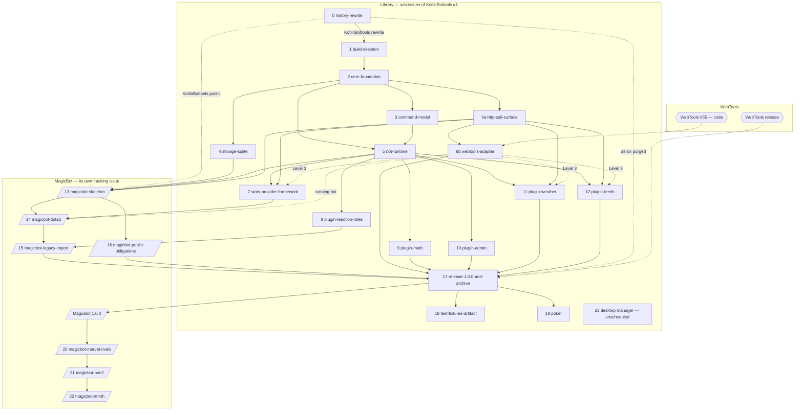

# BotTools consolidation and MagicBot — roadmap

## Header / Association

- **Covers:** [SpartanLaboratories/KotlinBottools#1](https://github.com/SpartanLaboratories/KotlinBottools/issues/1),
  *"BotTools consolidation & MagicBot (tracking)"*:
  - the Discord-bot library published as `io.github.spartanlaboratories:bottools-*`;
  - its first consumer, MagicBot, in `SpartanLaboratories/MagicBot` (to be created).
- **What this document is:** the target state and the phased roadmap.
  - **One phase per unit** of [`architecture.md`](architecture.md) §14. Each phase states:
    - the title of its issue, and where that issue is filed;
    - what the phase waits for;
    - the version it targets.
  - **Where the rest lives.** `architecture.md` designs the systems. Each phase gets its own
    implementation plan, in its issue's folder, before it is built.
- **Branch:** `docs/issue-1-bottools-consolidation`, off `main` @ `b2f2078`. Phase 0 rewrites
  both, so from then on commits are found by subject.
- **Related:**
  - [`impact.md`](impact.md): adoption, blast radius and follow-ups;
  - [`research/README.md`](research/README.md) Part 3: the evidence.
- **Other tracks this roadmap depends on:**
  - [SpartanLaboratories/WebTools#55](https://github.com/SpartanLaboratories/WebTools/issues/55):
    the HTTP stack that the library's `bottools-http` adapts. It is WebTools' work.
  - MagicBot's tracking issue in `SpartanLaboratories/MagicBot`: the consumer's phases.
- **Rules applied:** the organisation's
  [`CONTRIBUTING.md`](https://github.com/SpartanLaboratories/.github/blob/main/CONTRIBUTING.md).
  - **Workflow:** trunk-based, a pull request per change, Conventional Commits, merge commits.
  - **Versioning:** `Major.Feature.MinorChange`. A fix takes "MinorChange, or a trailing letter".
    The guide's "Lettered versions in dependency graphs" section covers lettered versions and
    `strictly` pins.
  - **Releasing:** releases are tagged. Publishing to a registry is done by hand.

---

## 1. Target state

### 1.1 At `1.0.0`, the end of Phase 17

- **The library.**
  - The six artifacts of architecture §5.1 are on Maven Central at `1.0.0`, built from
    KotlinBottools' `main`:
    - `bottools-core`;
    - `bottools-data-sqlite`;
    - `bottools-http`;
    - `bottools-stats`;
    - `bottools-plugins`;
    - the `bottools` umbrella.
  - CI is green on all three lanes: the composite lane, the published lane and the drift build.
  - Dokka is on GitHub Pages.
  - KotlinBottools is public, with gitleaks in CI and GitHub secret scanning turned on.
- **WebTools.**
  - `bottools-http` adapts WebTools' HTTP stack from a tagged WebTools release on Maven Central.
  - WebTools is an `implementation` dependency of that one module, pinned exactly with
    `strictly`.
  - No WebTools type reaches a consumer: consumers code against `bottools` only.
- **MagicBot `1.0.0`** runs on the published `bottools` `1.0.0`:
  - **Dota 2:** it links accounts, shows profiles and last matches, and posts new matches and
    patch notes to subscribed channels;
  - **Legacy data:** it holds the imported links and settings;
  - **Public-bot obligations:**
    - the `privacy` commands;
    - the policy and terms on its GitHub Pages;
    - the guild-count watch;
    - backups kept for 14 days.
- **The predecessors.**
  - GKB2, GKB, BotTools, TrumpBot and Support are archived with README pointers. Their open
    issues are closed first.
  - No secret file remains in the history of any of the six repositories.

These are issue #1's "Done when".

### 1.2 After `1.0.0`

- **Library feature releases** (`1.N.0`):
  - published test fixtures for plugin and provider authors;
  - the poker plugin, which is Experimental;
  - each Experimental capability graduating once a game has shipped against it.
- **MagicBot feature releases** (`1.N.0`), one game each, in this order:
  1. Marvel Rivals;
  2. Path of Exile 2;
  3. No More Room in Hell.
- **Last, and unscheduled:** a desktop manager on SpartanUI and SpartanGraphics.

---

## 2. How the roadmap is organised

- **One phase per unit of architecture §14,** numbered as the units are.
  - The numbers give a dependency order, not a calendar. Any phase whose dependencies have
    landed can start, so several run side by side (§3).
  - The HTTP work is two units, `6a` and `6b`: the call surface first, then the WebTools
    adapter. Most library work therefore proceeds without a WebTools checkout.
- **Three tracks.**
  - **The library: 18 phases** (0–5, 6a, 6b, 7–12, 17, 18, 19 and 23).
    - Each is a sub-issue of KotlinBottools#1.
    - Each is planned in `docs/plans/1-bottools-consolidation/<number>-<slug>/`.
  - **MagicBot: 7 phases** (13–16 and 20–22).
    - Each is an issue in `SpartanLaboratories/MagicBot`, under MagicBot's own tracking issue.
    - Each is planned in MagicBot's `docs/plans/`, inside that tracking issue's folder.
    - Each names the library phases and capabilities it needs.
    - #1 links the tracking issue, and the library phases that wait for MagicBot reference its
      issues.
  - **WebTools#55:** WebTools' own work. Phase 6b needs its code, and Phase 17 needs its release
    (§6).
- **Filing.**
  - **What is created together, once this roadmap is approved:**
    - the library's sub-issues;
    - the MagicBot repository;
    - MagicBot's tracking issue and its seven issues.
  - **What each issue's body contains:**
    - links to its section here and in `architecture.md`;
    - its dependencies, giving those in another repository by full reference (for example
      `SpartanLaboratories/WebTools#55`);
    - its "Done when".
- **Versions.**
  - **The library.**
    - **Before `1.0.0`:** nothing is released. Every build before it is `1.0.0-SNAPSHOT`.
    - **Snapshots,** once "Enable SNAPSHOTs" is turned on for the `io.github.spartanlaboratories`
      namespace:
      - a snapshot is published by hand from a clean `main` at the end of each phase that changes
        the library;
      - it is also published at least every 90 days, because Central cleans snapshots up after
        about that long.
    - **`1.0.0`:** released by Phase 17.
    - **Later:** each later library phase ships as a feature release, `1.N.0`, numbered when it
      ships.
  - **MagicBot.**
    - Nothing is released before MagicBot `1.0.0`, which follows the library's `1.0.0` in
      Phase 17.
    - Each later game is a MagicBot feature release.
  - **Fixes** follow the organisation's rule: the third number or a trailing letter.
    - Gradle orders `1.0.0a` below `1.0.0`.
    - So the library's module metadata pins the versions the library controls with `strictly`:
      the umbrella's edges to its five modules, and `bottools-http`'s edge to WebTools
      (architecture §1.1 and §5.4).
- **The snapshot path, before the WebTools release.**
  - A published `bottools` snapshot names the WebTools version it was built against. WebTools
    publishes no snapshots.
  - So until that version resolves from Central, MagicBot builds only through the composite
    beside the library, as its CI does. A lone MagicBot checkout cannot build until then
    ([`research/webtools-consumption.md`](research/webtools-consumption.md) §3 F3).
  - This is why the snapshot half of acceptance criterion 4 is checked in Phase 17.
  - MagicBot's own build never includes `../WebTools`.

---

## 3. Dependencies at a glance

**What runs side by side:**
- Phases 3, 4 and 6a, once Phase 2 has landed.
- Phase 6b, once Phase 6a has landed and WebTools' code exists in a sibling checkout.
- Phases 8 to 10, once Phase 5 has landed.
- Phases 7, 11 and 12, once Phases 5 and 6a have landed. They work at Level 2 on `FakeApiClient`,
  and their Level 3 tests wait for Phase 6b.
- MagicBot's Phase 13, once Phases 4, 5 and 6a have landed and KotlinBottools is public. It
  installs the plugins as they land.
- Phases 18 and 19, after Phase 17, independently of MagicBot's later games.

---

## 4. The library's phases (sub-issues of KotlinBottools#1)

| # | Sub-issue title | Depends on | Version |
|---|---|---|---|
| 0 | Phase 0 — History rewrite: purge secrets and data from the six bot repositories | — | — |
| 1 | Phase 1 — Build skeleton: multi-module build, conventions, CI and repository scaffolding | 0 (KotlinBottools' rewrite) | `1.0.0-SNAPSHOT` |
| 2 | Phase 2 — Core foundation: ids, failures, settings, storage ports and configuration | 1 | `1.0.0-SNAPSHOT` |
| 3 | Phase 3 — Command model: definitions, validation, typed invocation, dispatch and help | 2 | `1.0.0-SNAPSHOT` |
| 4 | Phase 4 — SQLite storage: migrations, erasure and backups | 2 | `1.0.0-SNAPSHOT` |
| 5 | Phase 5 — Bot runtime: plugins, events, gateway, jobs, registration and built-in commands | 2, 3 | `1.0.0-SNAPSHOT` |
| 6a | Phase 6a — HTTP call surface: the bottools-http API, endpoint vocabulary, failures and test fake | 2 | `1.0.0-SNAPSHOT` |
| 6b | Phase 6b — WebTools adapter: the internal adapter, composite build, strict pin, alignment checks and CI lanes | 6a; WebTools#55's code | `1.0.0-SNAPSHOT` |
| 7 | Phase 7 — Stats provider framework: provider SPI, account links, match tracker and game news | 5, 6a (Level 3: 6b) | `1.0.0-SNAPSHOT` |
| 8 | Phase 8 — Reaction-roles plugin, with the default role and welcome message on join | 5 | `1.0.0-SNAPSHOT` |
| 9 | Phase 9 — Math plugin | 5 | `1.0.0-SNAPSHOT` |
| 10 | Phase 10 — Admin plugin: typed get and set over guild settings | 5 | `1.0.0-SNAPSHOT` |
| 11 | Phase 11 — Weather plugin: conditions and forecast from Open-Meteo | 5, 6a (Level 3: 6b) | `1.0.0-SNAPSHOT` |
| 12 | Phase 12 — Feeds plugin: RSS and Atom subscriptions with content safeguards | 5, 6a (Level 3: 6b) | `1.0.0-SNAPSHOT` |
| 17 | Phase 17 — Release 1.0.0 to Maven Central and archive the predecessor repositories | 0–12; MagicBot 13–16; the WebTools release | `1.0.0` |
| 18 | Phase 18 — Published test fixtures for plugin and provider authors (Experimental) | 17; architecture §17 C1 decided | `1.N.0` |
| 19 | Phase 19 — Poker plugin: playable Texas hold 'em (Experimental) | 17 | `1.N.0` |
| 23 | Phase 23 — Desktop manager on SpartanUI and SpartanGraphics (unscheduled) | SpartanUI and SpartanGraphics usable | — |

### Phase 0 — History rewrite

- **Scope** (architecture §11, §14 unit 0):
  - **Copy the legacy data out.** The data of KotlinBottools, GKB2 and TrumpBot goes to an
    access-restricted location, with a manifest of the blob ids to purge.
  - **Rewrite the six repositories, in this order:**
    1. KotlinBottools;
    2. GKB2 and GKB;
    3. BotTools, TrumpBot and Support.

    Each uses `git filter-repo` with a root-anchored path list, run in a mirror clone, and then a
    force-push.
  - **Ask GitHub Support:**
    - for GKB2, GKB and KotlinBottools, where the exposure argument applies;
    - to clear the pull-request refs a force-push cannot reach: GKB2 #6, and BotTools #2 and
      #3.
  - **Run the exit tests** on each repository.
  - **In KotlinBottools:**
    - add the root-anchored `.gitignore`;
    - add the gitleaks CI job;
    - make it public once its exit tests pass again after any Support ticket, with GitHub secret
      scanning and push protection;
    - open the planning pull request from the rewritten planning branch.
  - **Re-clone.** Every existing clone of the five bot repositories is deleted and cloned again,
    never pulled.
- **Depends on:** nothing.
- **Unblocks:**
  - Phase 1, as soon as KotlinBottools' own rewrite has passed its exit tests. The other five
    purges finish inside this phase while later phases go ahead.
  - MagicBot's Phase 13, once KotlinBottools is public.
- **Version:** none.
- **Done when:**
  - every repository passes the exit criterion of architecture §11, on a fresh mirror with
    pull-request refs fetched (acceptance criterion 6);
  - KotlinBottools is public, with secret scanning on;
  - the planning pull request is open.

### Phase 1 — Build skeleton

- **Scope** (architecture §5, §9, §10.6, §14 unit 1):
  - **The multi-module build,** in place of the single-module one:
    - `build-logic` with `bottools.kotlin-library` and `bottools.published-library`, which sets
      `group` and `version`;
    - a JDK 21 toolchain;
    - KGP 2.2.x on the Gradle 9.7.1 wrapper;
    - Dokka, the binary-compatibility validator and detekt;
    - one test task per level.
  - **Workflows:** `ci.yml`, `pages.yml` and `release.yml`.
  - **Repository files:**
    - `CONTRIBUTING.md`, covering commit scopes, module layout, build and test commands, and
      publishing. On versioning it says only that the repository follows the organisation
      standard, where the version lives, and which six artifacts share it;
    - `CHANGELOG.md`;
    - `LICENSE` (Apache-2.0);
    - the README stub.
  - **The `bottools` umbrella:**
    - its jar guards;
    - its `strictly` pins on the five modules;
    - `verifyReleasableMetadata`, which asserts those pins.
  - **The stability markers.**
  - **The walking skeleton's compile-level checks:**
    - jda-ktx 0.14.2 against JDA 6.7.0;
    - kotlinx-serialization 1.9.0;
    - the validator on Gradle 9.7.1;
    - a publish to Maven Local.
- **Depends on:** Phase 0, KotlinBottools' rewrite only.
- **Version:** `1.0.0-SNAPSHOT`.
- **Done when:**
  - `./gradlew build` passes on CI from a clean clone, covering:
    - compiling with `explicitApi()`;
    - Dokka, with no undocumented public declaration;
    - the ABI check;
    - detekt;
    - the test tasks;
  - the compile-level checks pass;
  - the build publishes to Maven Local.

  `pages.yml` deploys Dokka once KotlinBottools is public.

### Phase 2 — Core foundation

- **Scope** (architecture §7.3, the core half, §9 and §14 unit 2):
  - ids;
  - `BotToolsException` and the failure kinds;
  - the `Result` helpers and `suspendCatching`;
  - `Setting<T>` and its codecs;
  - the storage ports, plus `InMemoryStorage` with the port contract suite;
  - `BotConfig` and `Secret`;
  - the closed list of logging events.
- **Depends on:** Phase 1.
- **Version:** `1.0.0-SNAPSHOT`.
- **Done when:**
  - the port contract suite passes against `InMemoryStorage` (Level 2);
  - `BotConfig.load` returns every configuration problem in one `Result` (Level 2).

### Phase 3 — Command model

- **Scope** (architecture §7.1, §14 unit 3):
  - the tree and its DSL;
  - the validator and the slash projection;
  - the alias table;
  - the typed parser and the prefix policy;
  - the context, with its three acknowledgement modes: `Automatic`, `Manual` and `Immediate`;
  - the dispatcher and automatic deferral;
  - preconditions, `CommandMessages`, help and components;
  - `FakeCommandContext`.
- **Depends on:** Phase 2.
- **Version:** `1.0.0-SNAPSHOT`.
- **Done when:**
  - **Level 2:**
    - the parser, alias resolution, the validator and help pass as pure functions;
    - the deferral timer passes on a controllable clock.
  - **Level 4a:**
    - the registration projection passes as a snapshot against JDA's JSON;
    - the alias and path tables pass;
    - the `custom_id` codec passes.
  - **Level 4c:** concurrent invocations of one definition do not interfere.

### Phase 4 — SQLite storage

- **Scope** (architecture §7.3, the `bottools-data-sqlite` half, §14 unit 4):
  - `SqliteStorage` and its connections;
  - the schema, with migrations keyed by `user_version`;
  - atomic erasure;
  - `VACUUM INTO` backups;
  - `BackupJob`, with a 14-day retention by default.
- **Depends on:** Phase 2, alongside Phase 3.
- **Version:** `1.0.0-SNAPSHOT`.
- **Done when:**
  - **Level 3,** on temporary files:
    - the port contract suite;
    - the migration fixtures;
    - the drift, concurrency, erasure, backup-and-prune and `sqlite_version()` floor tests.
  - **Level 4c:** storage under parallel writers.

### Phase 5 — Bot runtime

- **Scope** (architecture §7.2, §14 unit 5):
  - the plugin host;
  - the event registry and router;
  - gateway resolution and the shard manager;
  - the lifecycle;
  - the registrar;
  - jobs and the channel messenger;
  - the jda-ktx bridge;
  - the built-in `help` and `privacy` commands;
  - the fake `Gateway`.
- **Depends on:** Phases 2 and 3.
- **Version:** `1.0.0-SNAPSHOT`.
- **Done when:**
  - against the fake `Gateway`, the runtime starts, answers a command, ticks a job and stops
    within its timeouts (Level 4b);
  - one definition answers a slash, a typed and a context-menu invocation through one handler
    (acceptance criterion 2);
  - a private reply to a typed command arrives by DM with a public note (acceptance
    criterion 3);
  - the walking skeleton's runtime checks pass:
    - one `CoroutineEventManager` per shard, including a restarted shard;
    - the all-shards-ready rule;
    - the stop sequence.

### Phase 6a — HTTP call surface

- **Scope** (architecture §5.2, §7.4, §12, §14 unit 6a). The public half of `bottools-http`:
  - `ApiClient` and `ApiClientFactory`;
  - `ApiClientSpec` and `HttpConfig`;
  - `Endpoint<T>`, `Lane` and `UrlTrust`;
  - `RateSignalsReader` and `RateSignals`;
  - `HttpFailure`;
  - the request and response views;
  - `FakeApiClient`, in the module's test-fixtures source set. That source set is unpublished and
    is consumed by the sibling modules' tests inside the build;
  - the module's Dokka and ABI dump, and the check that the dump names no WebTools package.
- **Depends on:** Phase 2. It needs no WebTools checkout.
- **Version:** `1.0.0-SNAPSHOT`.
- **Done when:**
  - the module builds and documents every public declaration;
  - its ABI dump names no WebTools package;
  - the stats and plugins modules' tests can drive `FakeApiClient`.

### WebTools#55 — WebTools' work, not a phase of this roadmap

WebTools delivers the stack that #55 describes:
- Phase 6b builds against its code in a sibling checkout.
- Phase 17 needs its release (§6).

### Phase 6b — WebTools adapter

- **Scope** (architecture §5.2, §5.4, §7.4, §9, §10.7, §14 unit 6b):
  - **The adapter,** which is internal. It puts WebTools' facade, transport, cache and budget
    behind the call surface, with:
    - the bridge from the library's clock;
    - the mapping of WebTools' failures to `HttpFailure`.
  - **The build that consumes WebTools:**
    - the nested composite include, with its `-D` switches;
    - `webtools.ref`;
    - the exact `strictly` pin, and its assertion in `verifyReleasableMetadata`;
    - the `build-logic` constraints, and `verifyClasspathAlignment`.
  - **CI:** the composite lane, the published lane and the drift build.
  - **Tests:**
    - the adapter's Level 2 tests, on WebTools' fakes;
    - Level 3 against `mockwebserver3`.
  - **The walking skeleton's checks:**
    - nested substitution;
    - the configuration cache;
    - OkHttp aligned with JDA's version.
- **Depends on:** Phase 6a, and WebTools#55's code in a sibling checkout.
- **Version:** `1.0.0-SNAPSHOT`.
- **Provisional:** several points follow #55's open questions (architecture §16). Each reaches
  only this module's build or adapter. The phase's plan opens by reading WebTools' answers.
- **Done when:**
  - the composite substitutes WebTools, through the nested include and with the configuration
    cache on;
  - `verifyClasspathAlignment` passes;
  - the adapter passes against `mockwebserver3`, covering:
    - the `Untrusted` policy's refusals;
    - 429 handling;
    - size caps;
  - the published lane is wired. It passes once WebTools has released, in Phase 17.

### Phase 7 — Stats provider framework

- **Scope** (architecture §7.5, §14 unit 7):
  - the provider SPI and its capabilities;
  - `AccountRef`;
  - the link service;
  - `GameRegistration` and `GameCommands`;
  - `MatchTracker`, with its `PollingPolicy`;
  - `GameNewsSource`, with `SteamNewsSource`;
  - `NewsJob`.

  Every call goes through an `ApiClient`.
- **Depends on:** Phases 5 and 6a. Its Level 3 tests wait for Phase 6b.
- **Version:** `1.0.0-SNAPSHOT`.
- **Done when:**
  - the tracker, the jobs and the budget handling pass on `FakeApiClient` and virtual time
    (Level 2);
  - Steam news passes against `mockwebserver3` (Level 3);
  - the budget arithmetic and the BBCode conversion pass (Level 4a).

The capabilities Dota 2 uses become Stable Core once MagicBot's Phase 14 has proven them.

### Phase 8 — Reaction-roles plugin

- **Scope** (architecture §7.6, §14 unit 8):
  - the plugin;
  - its join features (the default role and the welcome message), as an optional feature that
    needs `GUILD_MEMBERS`.
- **Depends on:** Phase 5.
- **Version:** `1.0.0-SNAPSHOT`.
- **Done when** (Levels 2 and 4b):
  - roles are granted and revoked on recorded welcome messages only;
  - nothing acts on join until both settings are configured;
  - a role the bot cannot assign is reported, never thrown.

### Phase 9 — Math plugin

- **Scope** (architecture §7.6, §14 unit 9): `ExpressionEvaluator` and the `math` command.
- **Depends on:** Phase 5.
- **Version:** `1.0.0-SNAPSHOT`.
- **Done when:**
  - these pass as tables (Level 4a):
    - precedence;
    - right-associative `^`;
    - radians, with degree variants;
    - the depth and length caps;
  - a parse error names its position.

### Phase 10 — Admin plugin

- **Scope** (architecture §7.6, §14 unit 10):
  - typed get and set over the settings registry the plugins contribute;
  - enabling and disabling plugins per guild;
  - available to administrators only.
- **Depends on:** Phase 5.
- **Version:** `1.0.0-SNAPSHOT`.
- **Done when** (Levels 2 and 4b):
  - every registered setting reads and writes through its codec;
  - a non-administrator is denied.

### Phase 11 — Weather plugin

- **Scope** (architecture §7.6, §14 unit 11):
  - the `Geocoder` and `WeatherProvider` ports;
  - the Open-Meteo and Zippopotam implementations, each over a `Trusted` `ApiClient`;
  - the `weather` command and its aliases;
  - attribution in every reply.
- **Depends on:** Phases 5 and 6a. Its Level 3 tests wait for Phase 6b.
- **Version:** `1.0.0-SNAPSHOT`.
- **Done when:**
  - both sources pass against `mockwebserver3` (Level 3);
  - an ambiguous name or a bare postal code asks the user to choose;
  - an unknown weather code is kept, not dropped.

### Phase 12 — Feeds plugin

- **Scope** (architecture §7.6, §8.4, §14 unit 12):
  - `FeedParser`, with Rome behind it. Where it lives is *provisional* (#55).
  - `FeedUrlPolicy`.
  - The subscription commands.
  - `FeedPollJob`, over an `Untrusted` `ApiClient`.
  - The content safeguards:
    - only administrators subscribe;
    - every post names its source host and carries no media;
    - any administrator can remove a subscription;
    - the report route covers feed content.
- **Depends on:** Phases 5 and 6a. Its Level 3 tests wait for Phase 6b.
- **Version:** `1.0.0-SNAPSHOT`.
- **Done when:**
  - these pass against `mockwebserver3` (Level 3):
    - the `Untrusted` policy's refusals;
    - the size caps;
    - conditional GETs;
  - a failing subscription is paused, with its health recorded.

### Phase 17 — Release 1.0.0 and archive the predecessors

- **Scope** (architecture §10.7, §11, §14 unit 17), in this order:
  1. **The WebTools release.** WebTools releases #55's stack:
     - tagged, with a changelog entry (WebTools#58);
     - meeting the three conditions recorded on #55:
       - a JVM target of 21 or lower (WebTools#47);
       - Kotlin metadata readable by 2.2.x;
       - no `-SNAPSHOT`.

     The release must then resolve from Maven Central, which takes 10 to 30 minutes after
     publishing.
  2. **The published lane passes** (acceptance criterion 7):
     - the composite is off;
     - JDK 21;
     - Levels 1 to 3;
     - `verifyClasspathAlignment` passes;
     - `verifyReleasableMetadata` confirms the `strictly` pins and no `-SNAPSHOT`.
  3. **The snapshot half of acceptance criterion 4,** in MagicBot's track. MagicBot is built with
     the composite off, against a `1.0.0-SNAPSHOT` built on the released WebTools.
  4. **Release documents:**
     - `CHANGELOG.md` gains its `[1.0.0]` section;
     - the README is rewritten for `1.0.0` (architecture §10.6);
     - Dokka is on Pages.
  5. **`bottools` `1.0.0`** is published by hand and tagged `v1.0.0`.
  6. **MagicBot `1.0.0`** runs on the published coordinates. This happens in MagicBot's track
     (§5).
  7. **Archiving the predecessors:**
     - their open issues are closed first, each pointing to what replaces it: GKB2 #2 to #5,
       BotTools #1 and TrumpBot #1;
     - a README pointer to `bottools` is committed in each;
     - then GKB2, GKB, BotTools, TrumpBot and Support are archived.

     The order matters: an archived repository's issues and code are read-only.
- **Depends on:**
  - Phases 0 to 12 (6a and 6b included);
  - MagicBot's Phases 13 to 16;
  - the WebTools release.
- **Version:** `1.0.0`.
- **Done when:** issue #1's "Done when" holds (§1.1). The last part of that is MagicBot `1.0.0`
  running on the published `1.0.0`.

### Phase 18 — Published test fixtures

- **Scope** (architecture §14 unit 18, §17 C1):
  - **Publish the test fixtures, Experimental:**
    - `FakeApiClient`, from `bottools-http`;
    - `FakeCommandContext` and the fake `Gateway`, from `bottools-core`;
    - the provider test helpers, from `bottools-stats`.
  - **A scripted-transport `ApiClientFactory`.** It runs the real adapter over WebTools' fake
    transport. Under C1 option (a) it ships; under (b) it is left out.
  - **The first consumer is MagicBot,** which proves the seam.
- **Depends on:**
  - Phase 17;
  - architecture §17 C1, which is deferred until after `1.0.0`. It blocks this phase until it is
    decided.
- **Version:** `1.N.0`.

### Phase 19 — Poker plugin

- **Scope** (architecture §10.5, §14 unit 19):
  - playable Texas hold 'em as a plugin;
  - Experimental until one full game has been played;
  - GKB2's table, seat and button flow is the idea carried over.

  MagicBot installs the plugin in its next feature release, because it installs every plugin the
  library ships.
- **Depends on:** Phase 17, and the component routes of Phase 3.
- **Version:** `1.N.0`.

### Phase 23 — Desktop manager

- **Scope:**
  - a desktop manager on SpartanUI and SpartanGraphics;
  - not designed (architecture §4);
  - no management seam is promised before it.
- **Depends on:** SpartanUI and SpartanGraphics holding something usable. Today both hold
  documents only.
- **Version:** none; it is unscheduled.

---

## 5. MagicBot's track (issues in `SpartanLaboratories/MagicBot`)

- **Tracking issue:** *"MagicBot: a public game-stats bot on bottools (tracking)"*.
  - It references KotlinBottools#1.
  - It holds the seven issues below.
  - Their plan folders sit inside its folder in MagicBot's `docs/plans/`.
- **What MagicBot codes against:** `bottools` only, in main and test code.
  - No WebTools type appears in MagicBot.
  - Its build names no WebTools coordinate and includes no WebTools build.
  - Its tests use its own fake of `ApiClient` until Phase 18 publishes `FakeApiClient`.

| # | Issue title | Needs from the library | MagicBot version |
|---|---|---|---|
| 13 | Phase 13 — MagicBot skeleton: repository, composite wiring, CI and assembly | Phases 4, 5 and 6a; KotlinBottools public (Phase 0); plugins 8–12 as they land | unreleased |
| 14 | Phase 14 — MagicBot Dota 2: OpenDota provider, presentation, patch notes and aliases | Phase 7; Phase 6b for Level 3 and a running bot | unreleased |
| 15 | Phase 15 — MagicBot legacy import: links, reaction roles and subscriptions from the old guild data | Phases 4, 7 and 8 | unreleased |
| 16 | Phase 16 — MagicBot public-bot obligations: policy and terms, privacy commands, guild-count watch and backups | Phases 4 and 5 | unreleased |
| — | MagicBot `1.0.0` (a release, not a phase) | Phase 17's `1.0.0` | `1.0.0` |
| 20 | Phase 20 — MagicBot Marvel Rivals: on-demand profile and matches (Experimental) | Phase 7 | `1.N.0` |
| 21 | Phase 21 — MagicBot Path of Exile 2: economy data from poe.ninja | Phase 7's `EconomyCapability` | `1.N.0` |
| 22 | Phase 22 — MagicBot No More Room in Hell: Steam profile, playtime and achievements | Phase 7's `AchievementsCapability` | `1.N.0` |

### Phase 13 — MagicBot skeleton

- **Scope** (architecture §7.7, §14 unit 13):
  - **The repository:**
    - one Gradle module;
    - the composite wiring, which includes `../KotlinBottools` when it is present and can be
      overridden;
    - the snapshot wiring, declared in this phase but usable only after the WebTools release;
    - no WebTools coordinate or include.
  - **CI:**
    - `bottools.ref` pins the library;
    - CI reads the library's `webtools.ref`;
    - CI checks KotlinBottools out with no credential;
    - the drift build;
    - the Pages workflow for `docs/`;
    - `.gitleaks.toml` and secret scanning;
    - no registry credential.
  - **The application:**
    - configuration from `MAGICBOT_*` variables;
    - logback;
    - the assembly, which creates its `ApiClient`s and installs every plugin with MagicBot's
      `FeedUrlPolicy`;
    - the skeleton of the privacy-policy and terms pages.
  - **Discord:** the new MagicBot application.
- **Needs:**
  - library Phases 4, 5 and 6a;
  - KotlinBottools public.
- **Done when:**
  - MagicBot builds and starts through the composite;
  - its CI passes at the pinned commits.

### Phase 14 — MagicBot Dota 2

- **Scope** (architecture §7.7, §14 unit 14):
  - `OpenDotaProvider`, over a `Trusted` `ApiClient`, with its `ApiClientSpec` and the tracker's
    budget in calls per day;
  - `DotaConstants` and `DotaPresentation`;
  - `DotaNewsFilter`;
  - the `setid`, `getid`, `lastgame` and `showstats` aliases;
  - MagicBot's own fake of `ApiClient`, for its tests.
- **Needs:**
  - library Phase 7;
  - library Phase 6b, for Level 3 and for a running bot;
  - MagicBot's Phase 13.
- **Done when:** through the composite, MagicBot does all of the following (the composite half
  of acceptance criterion 4):
  - links a Dota 2 account;
  - shows a profile and the last match;
  - posts a new match from the tracker;
  - posts a patch note.

### Phase 15 — MagicBot legacy import

- **Scope** (architecture §7.7, §14 unit 15):
  - `LegacyImporter` and `--import-legacy`, which write:
    - account links;
    - the reaction-roles records and the default role;
    - the `GameNews` and `MatchFeed` subscriptions;
  - the import report;
  - MagicBot's application invited to the legacy servers before the import runs.
- **Needs:**
  - library Phases 4, 7 and 8;
  - MagicBot's Phases 13 and 14.
- **Done when:**
  - every resolvable guild and member in the merged copies is imported;
  - the report lists every entry that could not be resolved;
  - no seeded default is imported (acceptance criterion 5);
  - the older data copies are deleted once the report has been checked.

### Phase 16 — MagicBot public-bot obligations

- **Scope** (architecture §1.2, §7.7, §14 unit 16):
  - the policy and terms pages, complete and served from Pages;
  - `privacy { }`, configured with both URLs, the GitHub issues link and the contact e-mail
    address;
  - `GuildCountWatch`, at 90 guilds by default;
  - the sharding and `jobs.enabled` configuration;
  - `BackupJob`, at the 14-day retention.
- **Needs:**
  - library Phases 4 and 5;
  - MagicBot's Phase 13.
- **Done when:**
  - `privacy delete-my-data` deletes a user's data and replies with the counts (acceptance
    criterion 4);
  - the policy states the 14-day backup window, and backups older than that are deleted.

### MagicBot `1.0.0`

- **When:** once `bottools` `1.0.0` resolves from Central in Phase 17.
- **Steps:**
  - MagicBot's declaration moves to `bottools:1.0.0`, with no other change (architecture §7.7);
  - its CI passes on the published coordinates;
  - it is tagged `v1.0.0`, by the organisation's releasing steps.
- **What it completes:** Phase 17's condition that MagicBot runs on the published `1.0.0`.

### Phases 20 to 22 — the later games

Each phase opens by reading its sources again.

- **Phase 20 — Marvel Rivals.**
  - An Experimental, on-demand provider over a `Trusted` `ApiClient`.
  - It shows a profile with rank, match history and match detail.
  - It makes no automatic posts.
  - *Provisional:* the community API's pricing and terms are unread (architecture §16).
- **Phase 21 — Path of Exile 2.**
  - Economy data only, from poe.ninja.
  - Once it has shipped, `EconomyCapability` graduates in the library's next feature release.
- **Phase 22 — No More Room in Hell.**
  - A profile, playtime and achievements, through an operator Steam key, on commands only.
  - Once it has shipped, `AchievementsCapability` graduates in the same way.

They run in release order, 20, 21 and then 22, each after MagicBot `1.0.0`. Each is the next
MagicBot feature release.

---

## 6. WebTools

- **What the library takes from WebTools.**
  - [WebTools#55](https://github.com/SpartanLaboratories/WebTools/issues/55) is the HTTP stack
    behind `bottools-http`: the transport with its outbound-URL policy, the response cache, the
    call budget, the call facade, the failure model and the test fakes.
  - Its open questions are WebTools' to decide. Each reaches only `bottools-http`'s build or
    adapter (architecture §16).
- **What the release must meet,** as recorded on #55
  ([comment](https://github.com/SpartanLaboratories/WebTools/issues/55#issuecomment-6301722252)):
  - a Java target of 21 or lower, since every artifact published today is Java 23 bytecode
    ([WebTools#47](https://github.com/SpartanLaboratories/WebTools/issues/47));
  - Kotlin metadata readable by 2.2.x;
  - no `-SNAPSHOT` dependencies.
- **A tagged release with a changelog entry.** Phase 17's gate expects one.
  [WebTools#58](https://github.com/SpartanLaboratories/WebTools/issues/58) brings WebTools':
  - CI;
  - `CONTRIBUTING.md` and `CHANGELOG.md`;
  - release tags;
  - the foojay resolver for Gradle 9.
- **Release order:**
  1. WebTools releases.
  2. Once that release resolves from Maven Central, the library's published lane runs.
  3. Then `bottools` releases.
- **During development:**
  - the library builds WebTools from a sibling checkout at `webtools.ref`. Its CI is the first CI
    to build WebTools' code;
  - MagicBot reaches WebTools only as part of the library's runtime.

---

## 7. Post-roadmap potential features

Legacy features that do not carry over. They are listed so that they are not lost; none is
designed:
- activity points and promotion ranks;
- playlists and channel duplication;
- channel-reserving conversations;
- spam control;
- the stdin console;
- the daily-update hook.

Later options the architecture names but does not schedule:
- user-installable commands (§4);
- opt-in plugin discovery (§13);
- plugin-owned tables (§7.3).

---

## 8. Known gaps

- **Hosting is not decided, and is not a deliverable here.**
  - MagicBot's code can be complete before MagicBot runs publicly.
  - The privacy policy's clauses on country and data transfer wait for the host.
- **Marvel Rivals.** Phase 20 rests on a community API whose pricing and terms have not been read
  (architecture §16).
- **WebTools#55's open questions** decide the provisional points of Phases 6b and 12
  (architecture §16).
- **Snapshots.**
  - "Enable SNAPSHOTs" is not yet turned on for the namespace.
  - MagicBot's snapshot path does not work until the WebTools release (§2).
- **MagicBot's report route** needs a contact e-mail address, which is not yet chosen. Phase 16
  publishes it.
- **Discord's App Verification.**
  - Its checklist sits behind a sign-in.
  - The owner's identity check must come before MagicBot passes 100 servers. `GuildCountWatch`
    warns at 90.

---

## 9. Considerations

One is open: architecture §17 C1, the published test-fixtures artifact. It is deferred until after
`1.0.0` and blocks only Phase 18.
