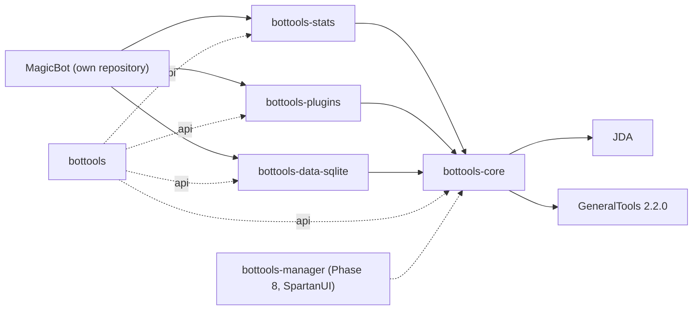
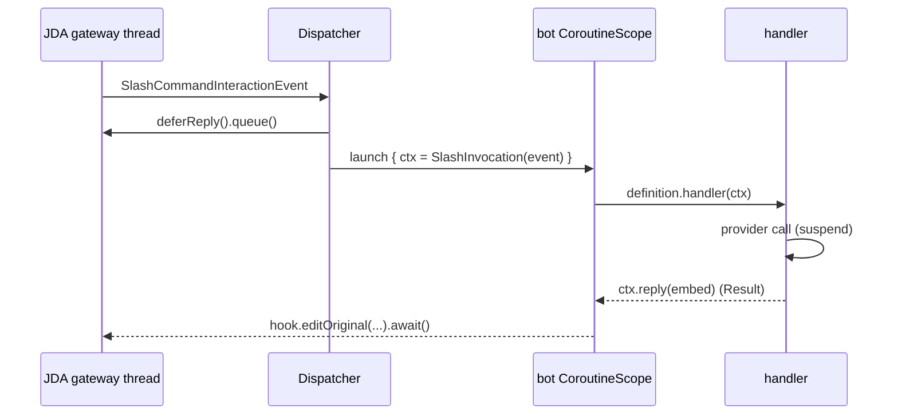

> **Superseded by [`roadmap.md`](../roadmap.md)** (2026-10-20), which holds the phases, with the
> design in [`architecture.md`](../architecture.md). This draft is kept for the record only and
> is not a source for either.

# BotTools — Target State & Phased Roadmap (draft)

> **Draft.** Written before the planning pipeline ran, as input to it. The research in
> `research/` re-verified its facts and settles the design; where the two differ, the research
> wins. It is superseded by `roadmap.md` once that is written, and then moves to `superseded/`.

## Header / Association

- **Covers:** the consolidation of `SpartanLaboratories/KotlinBottools` and
  `SpartanLaboratories/GKB2` into **one modern Discord-bot library**, living in
  `KotlinBottools`, plus a first consumer application, **MagicBot**, that delivers game
  statistics. Scoped on 2026-10-20 from a full read of both repositories.
- **Status:** direction document only. No source, test, or build file has been modified.
  Each phase below is to get its own tracking issue and a `docs/plans/<n>-<slug>/` folder
  (architecture + implementation plans) before implementation, in the style of
  `MyGameTools/docs/plans/90-phase-0-foundations/plan.md`.
- **Current baseline:**
  - `KotlinBottools` `main` @ `b2f2078` — version `7.5-SNAPSHOT`, single Gradle module,
    Kotlin 2.1.10, JDA 5.6.1, Gradle 8.10, `jvmToolchain(23)`, `maven-publish` applied but
    never published. Last functional change 2025-09-24.
  - `GKB2` `master` @ `9422f85` — version `1.0-SNAPSHOT`, Kotlin Multiplatform + Compose
    desktop, Kotlin 1.7.20, JDA 5.0.0-beta.2, Gradle 7.5.1, Spring XML bean wiring. Last
    change 2024-07-06.
  - Neither builds outside its author's machine: both resolve `GeneralTools` / `WebTools`
    from local-path Maven repositories (`%PROJECTS%`,
    `%USERPROFILE%/Documents/Programming/libraries`) at `LATEST` / `1.2.0c`, and
    `KotlinBottools`' `Main.kt` references `DotaCommand`, which lives in the **test** source
    set. The published successors are `io.github.spartanlaboratories:GeneralTools:2.2.0`
    and `io.github.spartanlaboratories:webtools-{udp,scraping,browser}`.
- **Open GitHub issues at writing time:** `KotlinBottools` none. `GKB2` #2–#5 (Spring
  framework follow-ups) are superseded by this roadmap — Spring is removed in Phase 1 — and
  are closed when `GKB2` is archived (Phase 6).
- **Related:** the organisation working agreement
  (`SpartanLaboratories/.github/CONTRIBUTING.md`); `WebTools` for the multi-artifact layout
  this repo adopts; `MyGameTools` for the `build-logic` convention plugins, CI layout and
  Dokka branding.

---

## 1. Scope

| # | Topic | Requirement |
|---|---|---|
| 1 | **Home** | `KotlinBottools` is the single library. `GKB2` is a source of features to port and is archived once the port is complete. |
| 2 | **What survives** | The command *structure* — the hierarchical command tree, the alias DSL (`get and "city" becomes "getcity"`), property-backed get/set commands, `MethodCommand`-style inline handlers and the `Option` helpers — is the part worth keeping. Its **surface** is preserved; its implementation is rebuilt (§2.3). |
| 3 | **Invocation paths** | Slash commands are primary. **Typed prefix messages are a supported fallback** that reaches the same definitions and handlers. Context-menu (user / message) commands stay supported. |
| 4 | **No scraping** | HTML scraping and its cursor/marker machinery (`OnlineCommand`, `Connector`, `SourceKeyParser`, `WebParseKeys.xml`, cookie capture) are removed. Game data comes from documented JSON APIs through typed providers (§2.6). |
| 5 | **MagicBot** | A consumer application focused on game statistics; "Magic" is a name only. It lives in its own repository, `SpartanLaboratories/MagicBot`, from the start and consumes this library as a dependency. Dota 2 is the first game, because it is the only one with a working command today; Marvel Rivals, Path of Exile 2 and No More Room in Hell follow in Phase 7. MagicBot installs every plugin the library ships. |
| 6 | **UI** | No Compose dependency anywhere. A desktop manager is the **last** phase and is built on SpartanUI / SpartanGraphics once they exist. Until then the library exposes a UI-agnostic management seam (§2.7). |
| 7 | **Conventions** | The organisation working agreement applies in full: trunk-based, PR per change, merge commits, Conventional Commits, `Major.Feature.MinorChange`, 5-level test hierarchy, `Result` for expected failures, slf4j-only in library code, KDoc on every public declaration, open-ended library design with the three stability tiers, Maven Central under `io.github.spartanlaboratories`. |
| 8 | **Secrets & data** | No token, guild data or per-user data in git. The token comes from the environment or a config file outside the repo; persistent data lives in a database file outside the repo. |

### 1.1 Acceptance criteria for the whole initiative

- `./gradlew build` is green from a clean clone on CI, with no local-path repositories.
- One command definition serves any number of concurrent invocations without shared mutable
  state (today every `Command` instance holds the *current user's* guild, member, channel,
  args and embed builder as fields — the root cause of most of the defects in §4).
- A slash command and its typed-message fallback run the same handler.
- MagicBot can link a Dota 2 account, show a profile and the last match, and post new
  matches to a configured channel automatically, using OpenDota rather than Dotabuff HTML.
- `bottools-*` artifacts are published to Maven Central at `1.0.0`; `GKB2` is archived.

---

## 2. Target architecture

### 2.1 Module layout

```
bottools-core          Command model + DSL, per-invocation CommandContext (slash + prefix +
                       context-menu), Dispatcher, generated help, typed EventRegistry over
                       JDA, Plugin API, Scheduler (named jobs), BotConfig, storage *ports*
                       with in-memory implementations, BotManager seam.
                       Depends on: JDA, jda-ktx (internal), kotlinx-coroutines, GeneralTools,
                       slf4j-api.
bottools-data-sqlite   SQLite implementation of the storage ports (Exposed + sqlite-jdbc),
                       schema versioning, and the one-off importer for the legacy
                       guildData/*.xml files.
bottools-stats         Game-stats framework: StatsProvider SPI and typed models, HTTP client
                       (Ktor + kotlinx-serialization), response cache + per-provider call
                       budget, MatchTracker job, embed renderers, and the generic stats plugin
                       (/link, /profile, /last, /track). Providers live as packages:
                       stats.dota2 (OpenDota) first; stats.marvelrivals, stats.poe2 and
                       stats.nmrih in Phase 7.
bottools-plugins       Optional plugins, each a Plugin: reactionroles, math, weather, feeds
                       (RSS → channel), poker (Experimental), admin (data get/set).
bottools               Umbrella: no source, `api` re-export of every published module.
build-logic            Convention plugins `bottools.kotlin-library` /
                       `bottools.published-library`, as in MyGameTools.
```



Dependency direction is strictly downward: nothing in `bottools-core` knows about stats,
plugins, SQLite or any UI. `WebTools` is **not** a dependency — the scraping module is the
thing being removed, and there is no transport need (§8).

MagicBot is a separate repository (`SpartanLaboratories/MagicBot`) with the same scaffolding
and conventions. It depends on the `bottools-*` coordinates and, while those are unreleased,
reaches this repository through a Gradle composite build (`includeBuild("../KotlinBottools")`
when the two checkouts sit side by side) or through `-SNAPSHOT` builds published from `main`
to the Central Portal's snapshot repository — the staging analogue the organisation guide
names for downstream projects; whether the vanniktech plugin publishes snapshots there is
verified at Phase 0. Nothing in this repository depends on MagicBot, and it never appears in
this build.

### 2.2 Cross-cutting principles

- **Definitions are immutable; invocations carry state.** A command tree is built once at
  startup. Every event produces a `CommandContext` that is handed to the handler and
  discarded. No command object ever stores a guild, member, channel, argument array or
  embed builder.
- **Coroutines, never blocking the gateway.** Handlers are `suspend` functions on a
  bot-owned `CoroutineScope`. JDA `RestAction`s are awaited through `jda-ktx` (an
  `implementation` dependency of `bottools-core`, never on a consumer's compile classpath),
  not `.complete()`d, on event threads. A slash invocation is acknowledged (deferred) within
  Discord's 3-second window before any provider call.
- **`Result` for expected failures.** Lookups that can miss return `Result<T>` with
  stackless, typed miss exceptions (`UnknownCommandException`, `NoLinkedAccountException`,
  `ProviderUnavailableException`, …). Programmer errors throw.
- **Policy is parameterised.** The prefix trigger, gateway intents, cache TTLs, call
  budgets, tracker cadence, embed footer/colour and help formatting are constructor or
  config parameters with today's behaviour as default — never constants in the mechanism.
- **Stability tiers** (per the global library-design rule):
  - *Stable Core* — command DSL and `CommandDefinition`, `CommandContext`, `Plugin` /
    `BotScope`, `EventRegistry`, the storage ports, `BotConfig`.
  - *`@SupportedExtension`* — `StatsProvider`, `MatchRenderer`, storage implementations,
    `PrefixTokenizer` grammar, `Scheduler` job policies. The shipped implementations
    (OpenDota, SQLite, the default renderer) are written to be read as the worked examples.
  - *Experimental* (`@ExperimentalBotToolsApi`, `@RequiresOptIn`) — `BotManager` until
    SpartanUI has actually consumed it, the poker plugin, the admin data-access plugin.
- **Discord snowflakes are the only keys.** `GuildId`, `UserId`, `ChannelId` value classes
  over `Long`. Guild and user *names* are display data, never identity (today both are used
  as file and node names, so a rename orphans the data).
- **Logging:** slf4j in every module; logback only under test and in `magicbot`. Named
  events at `info` for lifecycle (`bot.ready`, `command.registered`, `job.run`), `debug` for
  flow (`command.invoked`, `provider.call`), `warn`/`error` for failures with the typed
  failure attached.
- **Documentation:** KDoc (`@param`/`@return`/`@throws`) on every public declaration;
  `//region` grouping and the import-group comments from `.aiassistant/rules/CLAUDE.md`;
  README kept current with every surface change; Mermaid for the dispatch and tracker flows.
- **Tests:** the 5-level hierarchy in `com.spartanlabs.testing.<level>.bottools.<package>`
  (the `WebTools` placement), one class per file, JUnit 5 + MockK, per-level Gradle tasks
  from `build-logic`. **Level 5 (UAT) is deferred to a separate, later plan.**

### 2.3 Command model — the kept surface, rebuilt

The DSL keeps the shape that works today and drops the parts Discord cannot represent:

```kotlin
val dota2 = command("dota2", "Dota 2 statistics") {
    requiresIntent(GatewayIntent.MESSAGE_CONTENT)          // only if prefix fallback is on
    group("id", "Manage linked accounts") {
        sub("set", "Link a Dota 2 account") {
            string("id", "Steam ID, profile URL or Dota account ID", required = true)
            member("person", "Who to link (defaults to you)")
            run { ctx -> stats.link(ctx.targetMember(), ctx.option<String>("id")) }
        }
        sub("get", "Show the linked account") { member("person"); run { ctx -> … } }
    }
    sub("last", "Show the last match") { member("person"); run { ctx -> … } }
    setting("matcheschannel", GuildSetting.MatchesChannel)   // generates get/set subcommands
    alias("lastgame" to "last", "setid" to "id set")        // prefix-path aliases
}
```

| Today | Target | Notes |
|---|---|---|
| `Command` (abstract, stateful) | `CommandDefinition` built by `command {}` | Immutable; carries name, description, options, children, handler, required intents, permission predicate. |
| `SubCommand`, `OrganizationCommand`, `OrganizationCommandConnectionPoint` | `group {}` / `sub {}` / `alias()` | Discord allows exactly *command → group → subcommand*; the builder enforces that depth for slash registration. Aliases map a prefix path onto a canonical path; they are not registered as extra slash commands. |
| `MethodCommand` | `sub("x", "…") { run { ctx -> } }` | Inline handler, the common case. |
| `PropertyCommand`, `TargetablePropertyCommand`, `DataAccessCommand` | `setting(name, key)` and `userSetting(name, key)` builders | Generate the `get`/`set` pair bound to a typed storage key (§2.5) instead of a reflective `KMutableProperty`. |
| `Option` (string-typed `"user"`, `"channel"`) | `string()`, `int()`, `member()`, `channel()`, `role()`, `bool()`, `choice()` | Typed; slash `OptionData` and prefix coercion come from the same declaration. |
| `HelpCommand` | `/help [command]` generated from the tree | `brief` / `details` live on the definition; the bot's own name comes from `jda.selfUser`. |
| `Parser` + `CommandContainer` | `PrefixTokenizer` | Quoted arguments, mention resolution for `member()`/`channel()`/`role()`, positional-to-declared mapping, `--flag=value` for optional options. |
| `Command.invoke(event)` ×4, `pullInteractionData`, `scEvent` | `Dispatcher` | One entry per JDA event type; builds the right `CommandContext` and calls the handler inside the bot scope. |
| `Bot.commands`, `CommandFactory` (Spring) | `CommandRegistry` | Registers definitions, publishes `SlashCommandData` (global or per-guild for development), resolves a path to a handler. |

**`CommandContext` contract** (Stable Core): `guild`, `member`, `user`, `channel`,
`targetMember()` (the `person` option or the invoker), typed `option<T>(name): Result<T>`,
`reply(text) / reply(embed) / reply(files)` → `Result<Reply>`, `defer()`, `followUp(...)`,
`attach(bytes, name)`. Two implementations: `SlashInvocation` (wraps the interaction hook)
and `MessageInvocation` (wraps the message). Handlers never see which one they got.
Context-menu invocations are a third, thin implementation.



### 2.4 Events, plugins, jobs, configuration

- **`EventRegistry`** — `on<E : GenericEvent>(handler): Registration`, dispatched on the bot
  scope from a single JDA listener; handler failures are logged and isolated. Replaces
  `Responder.java` (Spring classpath scan of every JDA event class at startup, a
  `while(acting) sleep(100)` thread for button handlers), `EventAction`, `BotListener`,
  `ResponderInfixExtensions` and `SingleChannelListener`.
- **`Plugin`** — `id`, `install(scope: BotScope)`. `BotScope` offers `command()`, `on()`,
  `job()`, `setting()`, `requiresIntent()`. A plugin is enabled in configuration (today:
  `plugins.xml` + `Plugins[name]` + an `active` bean property). Per-guild enable/disable is a
  guild setting consulted by the `Dispatcher`.
- **`Scheduler`** — `job(name, every, jitter) { … }` on the bot scope with persisted
  `JobState`, a `JobStatus` snapshot for the management seam, and error isolation. Replaces
  `CheckValueService` and its subclasses (raw `Thread` + `while(true) sleep`, each one a
  `Command` subclass that reuses the command's `guild`/`member` fields while iterating every
  member of every guild) and `Bot.CentralProcess` (24-hour sleep at a hard-coded UTC−6).
- **`BotConfig`** — token source (`DISCORD_TOKEN` environment variable, a file path, or a
  value), the default prefix `!` (overridable per guild), data directory, enabled plugins,
  provider keys, per-guild slash registration for development. Gateway intents are the union of what installed plugins
  declare; `MemberCachePolicy` defaults to lazy. Today `Bot` logs in from a static
  initialiser, reads `key.txt`/`keys.txt` from the working directory, requests
  `EnumSet.allOf(GatewayIntent)` and caches every member.

### 2.5 Data

Ports in `bottools-core` (`com.spartanlabs.bottools.data`), all returning `Result`:

| Port | Owns |
|---|---|
| `GuildSettings` | typed `SettingKey<T>` per guild (prefix, matches channel, patch-notes channel, default role, plugin toggles, welcome message) |
| `UserLinks` | `(UserId, Game) → AccountRef` — one link per Discord user per game, global across guilds |
| `TrackingSubscriptions` | `(GuildId, UserId, Game) → ChannelId` — where a user's new matches are posted in a given guild |
| `JobStateStore` | last-seen match id, last run, cursor per `(job, key)` |
| `KeyValueStore(namespace)` | plugin-private data (reaction-role mappings, poker balances) |

`bottools-core` ships in-memory implementations (tests, development);
`bottools-data-sqlite` ships the durable ones on Exposed + sqlite-jdbc (WAL mode, a single
writer dispatcher, versioned schema). The old XML layer is replaced outright: today one
shared `BaseXMLReader` switches files with `setDocument()`, every write rewrites the whole
file, and nothing is thread-safe.

**Legacy import.** `XmlGuildDataImporter` reads `guildData/<guild name>/MemberData.xml` and
`GuildData.xml`, resolves guild and member *names* to snowflakes through the live `JDA`
(the only way, since the files hold no ids), and writes `UserLinks` / `GuildSettings`. It is
a one-off MagicBot `--import-legacy <dir>` step, exercised once per guild at first start.

### 2.6 Game stats

- **`StatsProvider`** (`@SupportedExtension`): `game`, `resolveAccount(input): Result<AccountRef>`,
  `profile(ref): Result<PlayerProfile>`, `recentMatches(ref, since): Result<List<MatchSummary>>`,
  `match(id): Result<MatchDetail>`, and `capabilities: Set<ProviderCapability>` (`PROFILE`,
  `MATCH_HISTORY`, `MATCH_DETAIL`, `ECONOMY`, `ACHIEVEMENTS`). The stats plugin registers
  only the subcommands a provider's capabilities support, so a game without match history
  still gets `/link` and `/profile` without a stub `/last`. A `GameRegistry` maps `Game` →
  provider.
- **Models** are typed per game behind a shared core (`MatchSummary` has id, start, duration,
  outcome; `MatchDetail` carries a game-specific `details` payload); a `MatchRenderer<Game>`
  turns a `MatchDetail` into `EmbedPayload(embeds, attachments)`. The Dota 2 renderer keeps
  the embed layout `DotaCommand.showLastGameStats` produces today (K/D/A, farm, damage,
  talents, item line) with the item line composed in memory from CDN icons — no
  `res/img1..6.png` temp files shared between concurrent requests.
- **`ApiClient`** — Ktor client + kotlinx-serialization, a `ResponseCache` (TTL per endpoint)
  and an `ApiBudget` per provider (token bucket; OpenDota's free tier is rate-limited per
  minute and per day, to be pinned in Phase 4 research). Every provider call goes through
  both.
- **`MatchTracker`** — a `Scheduler` job: iterate `TrackingSubscriptions` in priority order
  (recently active accounts first), fetch matches newer than `JobStateStore`'s cursor, render
  and post to each subscribed guild channel, advance the cursor. The cadence adapts to the
  number of tracked accounts so the daily budget is never exceeded. Replaces
  `UserGameService` (scrapes a page per member per guild per minute).
- **Dota 2 via OpenDota**: `/players/{account_id}`, `/players/{account_id}/recentMatches`,
  `/matches/{match_id}`, `/constants/{heroes,items}`; `account_id` is the 32-bit Steam id,
  derived from a Steam64 id or profile URL; vanity-URL resolution needs a Steam Web API key
  and is optional.
- **Patch notes**: the SteamDB RSS feed through Rome, as a generic `feeds` plugin job
  (feed URL → channel), configured by MagicBot for Dota 2.
- **Phase 7 games** — Marvel Rivals, Path of Exile 2, No More Room in Hell. Their data
  sources are not verified yet (§5) and each stage's plan starts with that research. The
  likely shapes differ, which is what `capabilities` exists for: Marvel Rivals and PoE 2
  look like profile + match/ladder data (PoE 2 economy through poe.ninja's JSON, the
  successor of what `PalOfExile` scrapes from HTML today; characters through the official
  OAuth API), while No More Room in Hell is a Steam title whose per-player data, if any,
  comes through the Steam Web API's user-stats and achievements endpoints.

### 2.7 Management seam (for the future desktop manager)

`BotManager` (Experimental until SpartanUI consumes it), in `bottools-core`: `start()` /
`stop()` → `Result`, `status: StateFlow<BotStatus>`, `events: SharedFlow<BotEvent>`
(`CommandInvoked`, `JobRan`, `HandlerFailed`, `GuildJoined`, …), `commands` (list;
enable/disable globally or per guild), `jobs` (list; trigger now), and `logs: Flow<LogRecord>`
fed through a `LogSink` the application binds to its logging backend. In-process only; a
remote transport (`webtools-udp` or HTTP) is a Phase 8 option, not a core concern. Replaces
`Console.kt` (stdin command loop), `manager/*` (Compose window + `ViewModel`) and `MyLogger`
(which writes every log line into the Compose view-model).

---

## 3. Phased roadmap

Each phase is one tracking issue with the listed stages as sub-issues; each stage gets its
own plan under `docs/plans/<tracking>/<stage>/`. Versions are pre-release (`0.N.0`) until
Phase 6 publishes `1.0.0`. The library is usable by MagicBot from Phase 1 onward, so every
phase ends with the bot running.

### Phase 0 — Foundations & hygiene *(`0.1.0`)*

1. **Secrets and history.** Rotate the Discord token (it is committed as `key.txt`, added in
   `239210e`). Remove `key.txt`, `guildData/`, `BotData.xml`, `WebParseKeys.xml`, `.gradle/`
   and `.idea/` from the tree **and from history** — one `git filter-repo` pass and a
   force-push of `main`, done before any other Phase 0 work lands; `.gitignore` covers
   secrets, data directories and every IDE pattern.
2. **Build skeleton.** Multi-module layout from §2.1 with `build-logic` convention plugins,
   Kotlin 2.2.x, a JDK 21 toolchain, a current Gradle wrapper, Maven Central as
   the only repository, `GeneralTools:2.2.0` as a published dependency, per-level test tasks,
   Dokka with the Spartan Laboratories brand. Tag the last legacy commit `v7.5-legacy`, then
   delete the old `src/` tree (history and `GKB2` remain the reference during the port).
3. **Repository scaffolding.** `CONTRIBUTING.md` (supplementing the org guide: module layout,
   commit scopes, test commands, where the version lives), `CHANGELOG.md` (Keep a Changelog),
   `LICENSE` (Apache-2.0), `SECURITY.md`, `.aiassistant/rules/CLAUDE.md` + `Manifesto.md`,
   `ci.yml` (fast tests / integration tests / docs / assemble) and `release.yml`, README
   rewritten for the new shape.
4. **MagicBot bootstrap.** `SpartanLaboratories/MagicBot` created with the same scaffolding
   (CI, `CONTRIBUTING.md`, rules files, Keep-a-Changelog), an `application` module, and the
   composite-build / snapshot link to this repository (§2.1).

*Done when:* `./gradlew build` and CI are green from a clean clone of each repository; no
secret or data file is tracked; the four CI checks exist for branch protection; MagicBot's
build resolves this repository's modules.

### Phase 1 — Core command model + walking skeleton *(`0.2.0`)*

1. `CommandDefinition` and the DSL; `SlashCommandData` generation with Discord's depth and
   naming constraints enforced at build time.
2. `CommandContext`, `SlashInvocation`, `Dispatcher`, `CommandRegistry`, generated `/help`,
   context-menu commands.
3. Prefix fallback: `PrefixTokenizer`, `MessageInvocation`, per-guild prefix setting,
   `MESSAGE_CONTENT` intent declared by the feature.
4. `setting()` / `userSetting()` builders over the in-memory ports.
5. MagicBot skeleton, in its own repository: boots from `DISCORD_TOKEN`, registers `/ping`
   and `/help` (slash and prefix), logs through logback.

*Done when:* a Level-4c test runs 100 concurrent invocations of one definition and no context
leaks between them; every row of the §2.3 table has a passing Level-2 test; the bot answers
`/ping` and `!ping` in a test guild.

### Phase 2 — Events, plugins, jobs, configuration *(`0.3.0`)*

`EventRegistry`, `Plugin` / `BotScope`, `Scheduler` with `JobState`, `BotConfig` (token
sources, intents from plugin requirements), `BotManager` seam with `BotStatus` /
`BotEvent`, structured logging events. MagicBot installs plugins from its config.

*Done when:* a plugin can add a command, an event handler and a job without touching core;
jobs survive handler failures; `BotManager.status` reflects the lifecycle in a Level-3 test.

### Phase 3 — Storage *(`0.4.0`)*

Ports from §2.5 finalised, `bottools-data-sqlite` with schema versioning, the legacy XML
importer, MagicBot's `--import-legacy`. Guild settings (`defaultRole`, welcome message, matches
channel, prefix) and user links are stored by snowflake.

*Done when:* Level-3 tests run every port against a temporary SQLite file; an import of a
sample `guildData/` tree produces the expected links and settings.

### Phase 4 — Stats framework + Dota 2 *(`0.5.0`)* — **MagicBot becomes real**

`StatsProvider`, models, `ApiClient` with cache and budget, `MatchRenderer`, the generic
stats plugin (`/link`, `/profile`, `/last`, `/track`, `/untrack`), the OpenDota provider,
`MatchTracker`, the `feeds` plugin with the SteamDB patch-notes feed. Research questions for
this phase's plan: OpenDota's current rate limits and the Steam-id resolution paths; whether
STRATZ is a better primary source than OpenDota for recent-match polling.

*Done when:* MagicBot links an account, shows profile and last match, and posts a new match
to the configured channel within one tracker interval, with Level-3 tests on recorded
OpenDota fixtures (Ktor `MockEngine`) and live tests gated behind `OPENDOTA_LIVE=1`.

### Phase 5 — Port the plugins *(`0.6.0`)*

- **reactionroles** (from `GKB2`, the newer copy) on `KeyValueStore`.
- **math** (`MathCommand`, 256 lines, from `GKB2`) as a pure evaluator with Level-4a table
  tests; the alternative is the `exp4j` library — decided in the stage plan.
- **weather** rewritten on Open-Meteo (free, no key; its geocoding endpoint replaces
  `res/zip codes.txt`); today's command only resolves a location to coordinates.
- **poker** (`Game`, `Table`, `Player`, `RotationState`, `PokerCommand` from `GKB2`) as
  Experimental: port the table/rotation logic with tests; buttons through `EventRegistry`.
- **admin** (`admin` + `DataAccessCommand` from `GKB2`) as `/admin data get|set <path>` over
  `GuildSettings`, Experimental.

*Done when:* each plugin has Level-2 tests and MagicBot runs with all of them installed —
each still behind its own config flag for other consumers.

### Phase 6 — `1.0.0` release *(`1.0.0`)*

README and Dokka pass (Audience-Reach rings 2–4: KDoc complete, protocol notes for Discord
constraints and provider budgets, module topology diagram), `CHANGELOG.md` `[Unreleased]` →
`[1.0.0]`, publish `bottools-*` to Maven Central (manual, per the org guide), MagicBot
switches from the composite build to the published `1.0.0` coordinates, `GKB2` README
pointer + archive, close `GKB2` #2–#5.

### Phase 7 — More games *(`1.N.0` each)*

One stage per provider, in this order, each its own plan that opens with research on the
game's data source and the `capabilities` it can honestly offer:

1. **Marvel Rivals** — `stats.marvelrivals`.
2. **Path of Exile 2** — `stats.poe2`.
3. **No More Room in Hell** — `stats.nmrih`.

Adding a provider must touch only `bottools-stats` packages and MagicBot configuration — if
it needs a core change, that is a design defect to fix first. A game whose only public data
is achievements or playtime still ships, with the subcommands its capabilities allow.

### Phase 8 — Desktop manager *(last)*

`bottools-manager` (or a module in the SpartanUI consumer) built on SpartanUI /
SpartanGraphics against `BotManager`; graduates `BotManager` from Experimental to Stable
Core. Blocked until SpartanUI exists; the seam is kept honest in the meantime by a headless
Level-3 test that drives it exactly as a UI would.

---

## 4. Fate of the existing code

Where both repositories have a file, the column says which copy is the better starting
point. Defects are cited by symbol.

| Area | Files | Fate |
|---|---|---|
| Command core | `Command`, `SubCommand`, `OrganizationCommand`, `MethodCommand`, `PropertyCommand`, `Option` | **Rewrite, keep the surface** (§2.3). Start from `GKB2` (`brief`/`details`, lambda `MethodCommand`, `and … becomes` DSL, `InteractionHook`). Defects left behind: per-instance invocation state; `Command.invoke(CommandContainer)` in `KotlinBottools` runs the subcommand *and then* the parent; `SubCommand.getParent` recurses forever for `steps ≤ 1`; `enable` is spelled `"enFable"` in `GKB2`; the companion logger is created from the `Companion` class. |
| Command infrastructure | `CommandFactory`, `internals.xml`, `plugins.xml`, `commands.xml`, Spring | **Drop.** `getCommand` casts every event to `GenericCommandInteractionEvent` (prefix commands throw) and keeps the event in a shared `lateinit var`. |
| `HelpCommand` | both | **Rewrite** as generated help. `GKB2`'s reads `Bot.commands`, which `GKB2` never fills, and hard-codes "TrumpBot". |
| `GameStatsCommand`, `OnlineCommand`, `Connector`, `OnlineAction`, `STest`, `SourceKeyParser`, `WebParseKeys.xml` | both | **Drop** — replaced by `bottools-stats`. `GKB2`'s `targetGameNode` uses `member`, so `set id @friend` writes the invoker's id (`KotlinBottools`' copy is correct); `GKB2` runs cookie capture and a test request in `OnlineCommand.init` for every command instance. |
| `ChannelReservingCommand`, `SingleChannelListener`, `MessageInteractionCommand` | both | `MessageInteractionCommand` → context-menu support in the DSL. Channel-reserving conversations → **backlog** (an Experimental `Conversation` seam, if a consumer asks). |
| `Bot`, `BotListener`, `Responder.java`, `EventAction`, `ResponderInfixExtensions` | both | **Rewrite** as `Bot` + `Dispatcher` + `EventRegistry` (§2.4). |
| `Parser` | both | **Rewrite** as `PrefixTokenizer`. |
| `BotAction.kt` (`say`, `show`, `send`, `tts`, `createChannel`, …) | both | **Port** the useful helpers as `suspend` extensions returning `Result`. |
| `Console`, `GuildManager`, `GuildDataParser` | `KotlinBottools` only | **Drop.** `GuildManager` points/rank-ups and playlists have no consumer; noted as backlog. |
| `KotGDP`, `BaseXMLReader`, `XMLReader`, `Database.kt`, `Date`, `DateTimeParser` | both | XML stack **dropped** (read once more by the importer); `Database.kt`'s port idea is **kept** as the §2.5 ports; dates use `java.time`. |
| `services/*` | both | **Drop** — `Scheduler` + `MatchTracker` + `feeds`. |
| `manager/*` (Compose), `MyLogger`, `ViewModel` | `GKB2` only | **Drop** — `BotManager` seam. |
| `plugins/reactionroles`, `plugins/math`, `plugins/poker`, `plugins/weather`, `Plugins.kt` | mostly `GKB2` | **Port** per Phase 5; `SpamControl` (an `isSpam` stub) is dropped. |
| `admin.kt`, `DataAccessCommand` | `GKB2` only | **Port** as the Experimental admin plugin. |
| Tests: `TestBot`, `DotaCommand`, `PalOfExile` | both | Become MagicBot and the providers; the Dota embed layout is preserved. |
| `README.md` | `KotlinBottools` | **Rewrite** in Phase 0 and keep current every phase. |
| Build: `build.gradle.kts`, `settings.gradle.kts`, wrappers, `pom.xml` | both | **Replace** with the §2.1 layout; `pom.xml` is removed. |
| Data/resources: `guildData/`, `BotData.xml`, `WebParseKeys.xml`, `res/`, `services/*.xml`, `ReactionRoles.xml`, `logback.xml` | both | Untracked / removed; `logback.xml` becomes a MagicBot resource; `ReactionRoles.xml` becomes setting keys. |

---

## 5. Known gaps

- Library versions to pin at Phase 0 after checking Maven Central: JDA (5.6.1 today; whether a
  newer 5.x or a 6.x line exists), `jda-ktx` compatibility with it, Ktor 3.x,
  kotlinx-coroutines, kotlinx-serialization, Exposed (whether `1.0` is final), sqlite-jdbc,
  Caffeine, Rome.
- OpenDota's current free-tier limits and whether STRATZ is preferable for polling — Phase 4
  research.
- SpartanUI / SpartanGraphics do not exist yet; Phase 8 cannot be planned beyond the seam.
- Discord: the `MESSAGE_CONTENT` privileged intent must be enabled in the developer portal for
  the prefix fallback; bots in more than 100 guilds need verification for it.
- Which of the five guilds in the committed `guildData/` still matter for the import.
- Data sources for the Phase 7 games are unverified: whether Marvel Rivals has an official or
  stable community API, which poe.ninja / official endpoints cover Path of Exile 2, and
  whether No More Room in Hell exposes per-player stats through the Steam Web API at all.
- The MagicBot repository is assumed to be `SpartanLaboratories/MagicBot`, beside
  `KotlinBottools` and `GKB2`.

---

## 6. Considerations

None open at writing time. Every call this roadmap rests on is stated as design above; a
new trade-off that needs a call is added here, with its options and a recommendation, by the
phase plan that meets it.

---

## 7. Constants across all phases

- Group `io.github.spartanlaboratories`; artifact ids `bottools`, `bottools-core`,
  `bottools-data-sqlite`, `bottools-stats`, `bottools-plugins`; packages
  `com.spartanlabs.bottools.*`; tests `com.spartanlabs.testing.<level>.bottools.*`.
- Every module releases on one version, kept in each module's `coordinates(...)`. The
  published line starts at `1.0.0`; the `KotlinBottools` `7.x` line is retired without a
  further release.
- JDK 21 toolchain in every module; Kotlin 2.2.x until the organisation moves together.
- MagicBot is a separate repository and a consumer only; it never appears in this build.
- No `.complete()` on a gateway thread; every slash invocation is acknowledged within 3 s.
- Snowflakes are the only identity; names are display data.
- The default prefix is `!`, overridable per guild.
- A game account link is global per Discord user; tracking subscriptions are per guild.
- No secrets or data files in the repository; configuration through the environment.
- slf4j-api only on a library's runtime classpath; logback under test and in `magicbot`.
- A provider or plugin that needs a core change is a core design defect, fixed in core first.

---

## 8. Boundaries with sibling libraries

- **GeneralTools** (`2.2.0`, published): used for `read`, `profile`/`time`,
  `trimIfLongerThan`, `cropImage`/`saveImage`. Nothing of it is duplicated here; a gap found
  there is filed as a `GeneralTools` issue.
- **WebTools**: not a dependency. `webtools-scraping` is exactly the mechanism being retired;
  `webtools-udp` becomes relevant only if Phase 8 wants a remote manager.
- **SpartanUI / SpartanGraphics**: consumers of `BotManager` only; no reverse dependency,
  no UI type in any `bottools-*` module.

---

## 9. Next steps

1. Rotate the Discord token — independent of everything else and worth doing today.
2. Create `SpartanLaboratories/MagicBot`; file the Phase 0 tracking issue here with stages
   1–3 as sub-issues and stage 4 as an issue on MagicBot, linked from the tracking issue.
3. Commit this document through a `docs/` pull request that `Refs` the tracking issue.
4. Plan Phase 0's stages in `docs/plans/<tracking>/<stage>/` and implement them.
